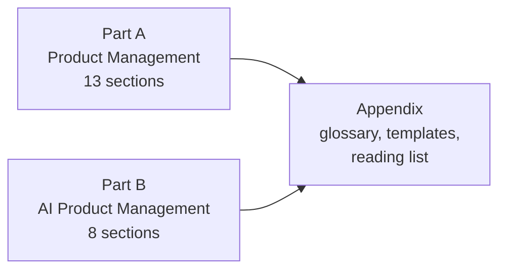

---
hide:
  - navigation
---

# PM & AI PM Coursebook

A free, plain-language course book on **Product Management** and **AI Product Management**. It is written to be read on your phone, between meetings, by anyone who wants to get better at building products people love.

<!-- progress:start -->
**Progress: 10 of 73 chapters ready** · new chapters added daily

<!-- progress:end -->

## How this book is organised

Two parts that can be read in any order. Part B assumes you know the basics from Part A.

| Part | What you'll learn |
|---|---|
| **[Part A: Product Management](part-a/08-product-metrics/01-metric-basics-leading-lagging-input-output-vanit.md)** | The PM role, understanding users, problem discovery, market research, strategy, roadmaps, design, execution, metrics, experiments, growth, stakeholders, and interviews. |
| **[Part B: AI Product Management](part-b/00-foundations/01-what-makes-ai-products-different.md)** | How AI products differ, how LLMs work, prompting, RAG, agents, AI UX, evals, AI metrics, safety and law, AI pricing and strategy, and the AI PM role. |

**Start here:** [A8 Product Metrics](part-a/08-product-metrics/01-metric-basics-leading-lagging-input-output-vanit.md) is complete and is the best place to see how every chapter works.

## How every chapter works

Each chapter follows the same pattern, so you always know where to look:

1. **In one line**: the whole idea in a sentence
2. **The idea, simply**: explained with an everyday analogy
3. **Frameworks**: step-by-step tools, with links to where they came from
4. **Diagrams and wireframes**: to see the idea, not just read it
5. **Worked example**: the framework applied to a realistic case
6. **Real-world examples**: from 2023 onwards, Indian and global, each with a source link
7. **Research happening now**: what's being studied or tested today
8. **Try it yourself**, **Go deeper**, and **Key takeaways**

## How this book stays current

- While the book is being built, **2 new chapters arrive every day**, alternating between Part A and Part B.
- Once it's complete, it's **updated every Saturday** with new examples, research and fixes.
- Every change is listed in **[What's New](whats-new.md)**.

!!! info "A note on sources"
    Every example, number and research item links to its source. The ideas from books are explained in our own words, so please buy or borrow the books for the full picture. If you spot an error, [open an issue on GitHub](https://github.com/sgunisity/pm-coursebook/issues).
