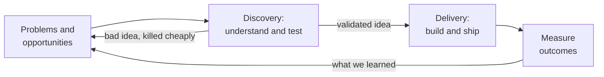
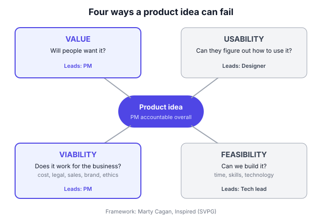

# A0.1 What a PM actually does

## In one line

A product manager makes sure the team builds the **right thing**: something customers want, can use, the team can build and the business can sustain, and then makes sure it actually reaches customers and works.

## Why this matters

"Product manager" is one of the most popular and least understood jobs in tech. Ask five people what a PM does and you'll hear five answers: "mini-CEO", "writes specs", "runs meetings", "the person who talks to customers", "the one who decides what gets built".

Each is partly true, and each misleads. If you don't have a clear picture of the job:

- You may spend your days on status updates and tickets, and never on the decisions that matter.
- You'll find it hard to explain your value in interviews or performance reviews.
- You may try to "boss" engineers and designers, which backfires, or simply take orders from leadership, which is just as bad.

This chapter gives you a simple, honest picture of the job: what it's for, what you spend time on, what you don't do, and how it changes with the company. Every other chapter in this book is one part of this job in detail.

## Key terms

| Term | Plain-English meaning |
|---|---|
| **Product** | Anything customers use to get a job done: an app, a website, an API, an internal tool, even a service with software behind it. |
| **Product manager (PM)** | The person responsible for deciding what the team builds and why, and for whether it creates value. |
| **Outcome** | A change in customer behaviour or business results (more repeat orders, fewer support calls). |
| **Output** | Something the team produced (a feature, a screen, a release). Outputs are only useful if they lead to outcomes. |
| **Discovery** | Work to figure out *what* to build: understanding problems and testing ideas before full building. |
| **Delivery** | Work to *build and ship* it well: planning, building, testing, launching. |
| **Stakeholder** | Anyone who cares about or affects the product: leaders, sales, support, legal, finance, partners. |
| **Product trio** | The PM, the designer and the tech lead working together as one decision-making team ([A0.2](02-product-teams-the-trio-empowered-vs-feature-team.md)). |
| **The four risks** | Value, usability, feasibility and viability: the four ways a product idea can fail (explained below). |

## The idea, simply

!!! tip "Analogy: the film director"
    A film director doesn't act, doesn't operate the camera, doesn't write the music and doesn't edit every frame. Yet everyone knows the director is responsible for whether the film *works*.

    The director's job is to hold the whole picture: what story are we telling, for which audience, and does every scene serve it? They make hundreds of choices, explain the vision so the actors and crew can do their best work, and say "no" to good ideas that don't fit the film. They also have a budget and a release date.

    A PM is similar, with one big difference: **most PMs have no formal authority**. The engineers and designers don't report to you. You lead through clarity, evidence and trust, not orders. That's why the job is hard, and why it's interesting.

Let's build the picture step by step.

### 1. The core job: own the problem and the outcome

A PM's job isn't to ship features. It's to make sure the features that get shipped **change something that matters** for customers and the business.

| Output (what you shipped) | Outcome (what changed) |
|---|---|
| Launched a new checkout page | Payment success rate rose from 82% to 88% |
| Added a "reorder" button | Repeat orders within 30 days rose by 6% |
| Built a help-centre chatbot | Support tickets per 1,000 orders fell by 15% |
| Released dark mode | (Probably no measurable business outcome, and that may be fine if it's cheap and users asked for it) |

Two things follow:

- **You start with the problem, not the solution.** "Users want a reorder button" is a solution. "Users who buy the same groceries every week spend 4 minutes rebuilding their cart" is a problem. Owning the problem gives the team room to find the best fix ([A2.2](../02-problem-discovery/02-framing-the-problem-problem-statements.md)).
- **You're not done at launch.** You're done when you know whether it worked. If it didn't, you learn why and try again.

Melissa Perri calls the failure mode here the **build trap**: a team so busy shipping features that it never checks whether they created value ([A2.4](../02-problem-discovery/04-outcomes-over-outputs-escaping-the-build-trap.md)).

### 2. The four ways a product fails

Marty Cagan of the Silicon Valley Product Group (SVPG), in his book *Inspired*, describes four big risks every product idea faces ([SVPG on product risks](https://svpg.com/product-risk-taxonomies)):

| Risk | The question | Who usually leads on it |
|---|---|---|
| **Value** | Will customers buy it or choose to use it? | PM |
| **Usability** | Can users figure out how to use it? | Designer |
| **Feasibility** | Can we build it, with our time, skills and technology? | Tech lead / engineers |
| **Viability** | Does it work for the business: cost, legal, sales, brand, ethics? | PM |

The PM is accountable for the product succeeding overall, so you care about all four. But you **personally lead on value and viability**, and you rely on your designer and engineers to lead on usability and feasibility. This is a big reason the PM, designer and tech lead work as a trio rather than in a hand-off chain.

Most failed products didn't fail because engineering couldn't build them. They failed on **value** (nobody wanted it) or **viability** (it cost too much, broke a rule, or the sales team couldn't sell it). That's why so much PM time goes into understanding customers and the business.

### 3. Where the PM sits: business, user and technology

In 2011, Martin Eriksson, co-founder of Mind the Product, drew the PM role as the overlap of three circles: **business**, **user experience (UX)** and **technology** ([his original article](https://www.mindtheproduct.com/what-exactly-is-a-product-manager/)). The picture stuck because it captures the job well:

- **Business:** you understand how the company makes money, what the strategy is and what leadership cares about.
- **User experience:** you understand users deeply and care how the product feels to use.
- **Technology:** you understand enough about how things are built to have good conversations with engineers and make sensible trade-offs.

You don't need to be an expert in all three. You need to be **conversant** in all three and **strong** in the overlap: turning a business goal and a user problem into something the team can build.

PMs from different backgrounds lean towards different circles. An ex-engineer may start strong on technology; an ex-consultant on business; an ex-designer on UX. Good PMs know their weak circle and work on it.

### 4. Two kinds of work: discovery and delivery

A PM's work splits into two streams that run at the same time.

- **Discovery** answers *"what should we build?"* You talk to users, study data, frame problems, and test ideas cheaply with prototypes before committing engineers ([A2.1](../02-problem-discovery/01-continuous-discovery-and-opportunity-solution-tr.md)).
- **Delivery** answers *"how do we build and ship it well?"* You clarify requirements, make trade-offs during building, handle surprises, plan the launch and measure results ([A7.1](../07-execution-and-delivery/01-prds-and-specs.md)).

Discovery's job is to kill bad ideas cheaply and send good ones to delivery. Measurement after launch feeds the next round of discovery.

Weak PMs spend almost all their time in delivery, managing tickets. Strong PMs make sure discovery never stops, so the team keeps working on the most valuable problems.

### 5. What the work looks like in a typical week

The job is a mix of a few repeating activities. The exact mix depends on the company and the phase of a project, but a typical week for a PM on a product team might look like this (illustrative, not a survey result):

| Activity | Rough share of time | Examples |
|---|---|---|
| **Understanding users and data** | 15–25% | Customer calls, reading support tickets, checking dashboards, reviewing research |
| **Deciding what to do** | 15–20% | Framing problems, prioritising, writing a one-page strategy or PRD |
| **Working with the team** | 25–35% | Design reviews, answering engineers' questions, stand-ups, unblocking work |
| **Aligning stakeholders** | 15–25% | Updates to leaders, syncing with sales, support, marketing, legal |
| **Launching and measuring** | 10–15% | Launch plans, release checks, results reviews |

Some things you might actually do on a Tuesday:

- 09:30 Check yesterday's numbers; notice Android sign-ups dipped.
- 10:00 Stand-up with the team; help an engineer choose between two approaches.
- 11:00 Call two customers who cancelled last week.
- 12:30 Design review: the new onboarding flow.
- 14:00 Write the problem section of next quarter's plan.
- 15:30 Sync with the sales lead about a big client's request.
- 16:30 Ask the data analyst to dig into the Android dip.
- 17:30 Send a short written update to your manager.

Notice how much of this is **communication**. The PM's main tools are conversations and writing ([A11.3](../11-stakeholder-management-and-com/03-writing-and-presenting-for-leaders.md)).

### 6. Leading without authority

Engineers report to engineering managers. Designers report to design managers. Sales reports to the sales head. As a PM, you usually manage none of them, yet you're expected to get them aligned and moving.

You lead through:

- **Clarity:** a crisp problem, a clear goal and a clear "why" make it easy for people to help.
- **Evidence:** user quotes, data and test results win arguments that opinions can't.
- **Trust:** keeping promises, giving credit, admitting mistakes, and protecting the team's time.
- **Shared goals:** connecting your work to what each stakeholder already cares about.

Ben Horowitz's classic essay [*Good Product Manager/Bad Product Manager*](https://a16z.com/good-product-manager-bad-product-manager/) is still a sharp list of the habits that earn this kind of influence: knowing the market, defining the "what", taking responsibility, and communicating clearly in writing. Influence is covered in depth in [A11.2](../11-stakeholder-management-and-com/02-influence-without-authority.md).

### 7. What a PM is not

Many misunderstandings come from treating the PM as something they're not.

| Common belief | Reality |
|---|---|
| "The PM is the CEO of the product." | You're accountable like a CEO but have no authority like one. Acting like a boss backfires. |
| "The PM decides everything." | You make the final call on *what* and *why*. Engineers decide *how*; designers lead on the experience. |
| "The PM writes the requirements, then engineers build them." | Requirements are worked out *with* the team. Hand-offs produce worse products. |
| "The PM is a project manager." | Project managers ensure work is delivered on time and budget. PMs decide which work is worth doing. See [A0.3](03-product-vs-project-vs-program-management-types-o.md). |
| "The PM takes requests from sales and leadership." | You listen to requests as signals, then decide based on evidence and strategy. Sometimes the answer is no ([A5.3](../05-roadmaps-and-prioritisation/03-managing-the-backlog-and-saying-no.md)). |
| "The PM must be technical." | You need to understand technology well enough to make good trade-offs. Most PMs don't write production code. |

### 8. How you know you're doing the job well

Because PMs don't produce the code or the designs, it can feel hard to see your own contribution. A practical way to judge it:

- **Outcomes:** did the things your team shipped move the metrics they were meant to move? ([A8.1](../08-product-metrics/01-metric-basics-leading-lagging-input-output-vanit.md))
- **Decision quality:** were your bets well reasoned, with evidence, even the ones that didn't work?
- **Team health:** does your team understand why it's building what it's building? Do engineers and designers want to work with you?
- **Stakeholder trust:** do leaders and partner teams come to you early, and believe your updates?
- **Learning speed:** how quickly does your team find out an idea is bad?

## Framework: Cagan's four risks

**Who created it.** Marty Cagan, founder of the Silicon Valley Product Group, set out the four risks (value, usability, feasibility, viability) in *Inspired* (2nd edition, 2017) and many [SVPG articles](https://svpg.com/product-risk-taxonomies). It has become the most common way to describe what a product team must get right before building.

**The steps.** Use it whenever a new idea arrives, from your own team, a leader or a customer.

1. **Write the idea as a problem and a bet.** "We believe [users] have [problem]; if we build [solution], [metric] will improve."
2. **List the riskiest assumption for each risk.**
    - *Value:* "Users will want this enough to change their habit."
    - *Usability:* "Users will understand the new flow without help."
    - *Feasibility:* "We can get delivery times from our partners in real time."
    - *Viability:* "The discount won't wipe out our margin, and legal is fine with it."
3. **Rank them.** Which assumption, if wrong, kills the idea? Which do you know least about?
4. **Test the biggest risks cheaply first.** Customer interviews or a fake-door test for value; a clickable prototype for usability; a short technical spike (a quick experiment by engineers) for feasibility; a conversation with finance or legal for viability ([A2.3](../02-problem-discovery/03-assumption-testing-prototypes-and-mvps.md)).
5. **Decide:** build, change the idea, or drop it. Write down what you learned.

**When to use:** new features, new products, big changes to existing flows, and any request from a stakeholder you're unsure about.

**When not to:** small, low-risk, easily reversible changes (fixing a typo, a minor UI tweak). Just ship them and measure. Running a four-risk analysis on everything slows the team down.

## Diagram

The PM leads on value and viability and is accountable for the whole; the designer and tech lead lead on usability and feasibility. Ideas die cheaply when risks are tested early.

## Worked example

You've just joined "QuickBasket", a fictional grocery delivery app in Bengaluru, as the PM for the checkout experience. Here's what your first few weeks look like, using the ideas in this chapter. Numbers are illustrative.

**Step 1: Find the problem (discovery, data).** Your funnel dashboard shows where users drop off in checkout:

| Checkout step | Users reaching it per day | Drop-off at this step |
|---|---|---|
| Cart | 60,000 | |
| Choose delivery slot | 50,000 | 18% leave here |
| Payment | 41,000 | 6% leave here |
| Order placed | 38,500 | |

The delivery-slot step loses **9,000 users a day**, far more than any other step.

**Step 2: Understand why (discovery, users).** You call 8 users who abandoned at that step and read 100 support tickets. A pattern appears: in the evening, the earliest available slot is often 3+ hours away, and users wanted their groceries for dinner.

**Problem statement:** *"Evening shoppers who need groceries within the hour abandon checkout when the earliest slot is hours away, because they need the items for tonight's meal."*

**Step 3: Size the opportunity.** If a solution recovered **one third** of the 9,000 daily drop-offs:

| Item | Value |
|---|---|
| Extra orders per day | 3,000 |
| Average order value | ₹600 |
| Extra order value per day | ₹18 lakh |
| Contribution margin (after delivery and costs) at 8% | ₹1.44 lakh a day |
| **Per year** | **about ₹5.3 crore** |

That's a big enough prize to put real effort into.

**Step 4: Generate options with the trio.** You, the designer and the tech lead list ideas:

1. Add more evening delivery slots (needs more riders).
2. Show slot availability on the home screen, before users build a cart.
3. Offer a smaller "express" basket of up to 10 items, delivered from the nearest store within 45 minutes.

**Step 5: Check the four risks for option 3.**

| Risk | Riskiest assumption | Cheapest test | Result |
|---|---|---|---|
| Value | Evening users will accept a 10-item limit | Fake-door test: show "Express (up to 10 items)" to 5% of users and measure taps | 22% of exposed evening users tapped it |
| Usability | Users understand which items are eligible | Clickable prototype with 6 users | 5 of 6 understood; label needed rewording |
| Feasibility | Stores can pick 10 items in under 10 minutes | Engineering and ops spike in 2 stores | Yes, for 80% of items |
| Viability | Small baskets aren't loss-making | Finance model | Only with a ₹29 express fee below ₹300 order value |

**Step 6: Decide and define success.** You build option 3 for two pilot areas.

- **Steering metric:** checkout completion rate for evening sessions (target: from 64% to 70%).
- **Guardrails:** express orders delivered late, contribution margin per order, rider safety incidents.
- **Learning goal:** what share of express orders are new orders vs. orders moved from the normal flow?

**Step 7: Deliver, launch, measure.** You write a short PRD, work with the team through build questions, plan the launch with support and marketing, and review results after 4 weeks. Then you decide: scale, change or stop.

**What the PM did, and didn't do:** you didn't design the screens, write the code or run the stores. You found the problem, sized it, kept the team focused on it, made sure all four risks were tested before big investment, set the success measures, and kept everyone aligned.

## Going deeper: nuances and trade-offs

### 1. The job changes with company stage

| Stage | What PM work looks like |
|---|---|
| **Early startup (under ~30 people)** | Often the founder is the PM. When a PM is hired, they do everything: research, design help, testing, support, analytics. Speed matters more than process. |
| **Growth stage** | Several PMs, each owning an area (onboarding, payments). More focus on metrics, experiments and coordination between teams. |
| **Large company** | Many layers (PM, senior PM, group PM, director). More time on alignment, planning cycles and dependencies. Changes affect millions of users, so risk management grows. |

The same title can mean very different days. Ask about this when you interview.

### 2. The job changes with product type

- **Consumer (B2C):** huge user bases, lots of data and A/B tests, strong focus on growth, engagement and design polish.
- **Business (B2B / SaaS):** fewer, larger customers; the buyer is often not the user; strong ties with sales and customer success; more qualitative evidence because there's less data.
- **Platform and API PMs:** your users are other developers or internal teams. Reliability and documentation matter as much as features.
- **Internal tools PMs:** your users are colleagues (support agents, warehouse staff, sellers). Productivity gains are your outcomes.
- **AI PMs:** add quality, cost-per-use and trust questions to all of the above ([B0.1](../../part-b/00-foundations/01-what-makes-ai-products-different.md)).

### 3. Titles vary, especially in India

In many IT services companies and large enterprises, the title **Product Owner** is common, often meaning someone who manages a backlog for a Scrum team and works from requirements set elsewhere. In product startups and tech companies, **Product Manager** usually means owning the problem and outcome. Some companies use "PM" for what is really project or program management. Don't judge a role by its title. Read the job description and ask: *"Who decides what gets built, and how is success measured?"* See [A0.3](03-product-vs-project-vs-program-management-types-o.md).

### 4. Empowered teams vs feature teams

Cagan distinguishes **empowered product teams**, which are given problems to solve and judged on outcomes, from **feature teams**, which are given a list of features to build and judged on shipping them. In a feature team, the PM's role shrinks towards project management. In an empowered team, the PM does the full job in this chapter. Many PMs work somewhere in between. This is the subject of [A0.2](02-product-teams-the-trio-empowered-vs-feature-team.md).

### 5. Does every company need PMs?

In mid-2023, Airbnb CEO Brian Chesky said on stage at Figma's conference that Airbnb had gotten rid of the classic product management function. He later clarified that it had been merged with product marketing into a smaller, Apple-style team, with design given a bigger role ([Mind the Product](https://www.mindtheproduct.com/airbnbs-product-management-shift-the-viewpoint-of-product-leaders)). Product leaders responding in that piece mostly concluded that the *work* of product management didn't disappear; it was redistributed and reshaped to fit Airbnb's founder-led context.

The lesson: the PM **role** is a way of organising work, and companies organise differently. The PM **work** (deciding what to build, for whom, and why) always has to be done by someone.

### 6. How AI is changing the job

AI tools now let PMs do things that used to need other people: build working prototypes, analyse data, summarise research and draft documents. Some companies are redesigning roles around this. In December 2025, LinkedIn's chief product officer Tomer Cohen said on [Lenny's Podcast](https://www.lennysnewsletter.com/p/why-linkedin-is-replacing-pms) that LinkedIn had replaced its Associate Product Manager programme with an "Associate Product Builder" programme that teaches coding, design and product management together.

It's still early, and it's unclear how widely this will spread. The safe conclusion: the PM skills least likely to be automated are **judgement** (which problem matters, which trade-off to make), **understanding people**, and **leading without authority**. Being able to build quick prototypes yourself is becoming a strong advantage. See [B6.1](../../part-b/06-the-ai-pm-role/01-ai-pm-careers-teams-and-using-ai-in-your-own-pm.md).

### 7. The PM as the "glue": useful and dangerous

PMs often fill gaps: running a meeting nobody owns, writing release notes, answering a support escalation. Some of this is valuable. But if you become the team's permanent glue, you'll have no time for discovery and decisions, which only you can do. Strong PMs fill gaps temporarily, then fix the underlying problem (get an owner, create a process, automate it).

### 8. Accountability without credit

When a product succeeds, the credit should go to the team. When it fails, the PM should stand up and own it. This asymmetry is part of the job, and it's how you earn trust. It also means PMs must be comfortable with ambiguity and with being wrong in public. Good PMs separate **decision quality** from **outcome**: a good, evidence-based bet can still fail, and that's learning, not incompetence.

## Real-world examples (2023 onwards)

!!! example "Swiggy Bolt, October 2024: a problem reframed under constraints"
    In October 2024, Swiggy launched **Bolt**, promising food in 10 minutes, starting in six cities. Rather than making all deliveries faster, Bolt was limited to restaurants within **2 km** of the customer and to dishes needing little or no preparation, such as burgers, beverages, breakfast items and desserts. Swiggy also said delivery partners would not be told which orders were Bolt orders, so they would not be rewarded or penalised on delivery time ([Swiggy press release](https://www.swiggy.com/corporate/press-release/swiggy-launches-bolt-delivering-your-favorite-food-in-just-10-minutes/)). By May 2025, Swiggy said Bolt was live in 500+ cities and powered more than 1 in 10 of its food delivery orders ([Swiggy press release](https://www.swiggy.com/corporate/press-release/swiggy-bets-big-on-bolt-now-live-in-500-cities-across-india/)).

    **PM lesson:** this is the four risks in action. *Value:* some customers want certain foods very fast. *Feasibility:* only possible with short distances and quick-to-prepare dishes, so scope was cut to fit. *Viability* (including ethics and brand): not telling riders which orders are Bolt orders is a design response to the safety worries that ultra-fast delivery promises tend to raise. Narrowing the problem made the solution possible. Figures are company-reported.

!!! example "Airbnb, 2023: the PM role is redesigned, the PM work remains"
    As described above, Airbnb merged product management with product marketing and raised the role of design ([Mind the Product](https://www.mindtheproduct.com/airbnbs-product-management-shift-the-viewpoint-of-product-leaders)). The announcement sparked a debate about whether PMs are needed at all.

    **PM lesson:** companies are free to divide the work differently, especially when a strong founder is deeply involved in product. What doesn't change is the work itself: deciding what to build and why, aligning people, and checking whether it worked. If you understand the work, you can thrive under any title.

## Common mistakes

!!! warning "Watch out for"
    - **Being a "ticket manager".** Spending all your time writing tickets and running stand-ups, and none understanding users or deciding what matters.
    - **Jumping to solutions.** Starting from "let's build X" instead of "what problem are we solving, for whom?"
    - **Acting like the boss.** Telling engineers and designers *how* to do their work. You own the *what* and *why*.
    - **Saying yes to everything.** A roadmap shaped by whoever shouted loudest has no strategy.
    - **Measuring outputs.** Celebrating features shipped instead of outcomes moved.
    - **Hiding in documents.** A long spec doesn't replace talking to your team and users.
    - **Ignoring viability.** Forgetting to check with finance, legal, sales or support until it's too late.
    - **Skipping the follow-up.** Never checking whether a launch actually worked.

## Common questions

**Is a PM the "CEO of the product"?**
Only in the sense of feeling responsible for the whole. A CEO has authority; a PM usually doesn't. Thinking of yourself as a CEO tends to make you bossy. Think "accountable leader without authority" instead.

**Do I need an engineering degree or an MBA to become a PM?**
No. Many good PMs come from engineering, design, analytics, consulting, sales, support or operations. You do need to learn enough about business, users and technology to make good trade-offs. Your background shapes which of the three you'll need to work on most.

**Who decides what gets built: the PM or leadership?**
Leadership sets strategy and big goals. In a healthy team, the PM (with the trio) decides which problems to tackle and which solutions to pursue within that strategy. In practice, how much freedom you have depends on the company ([A0.2](02-product-teams-the-trio-empowered-vs-feature-team.md)).

**How technical does a PM need to be?**
Enough to understand how your product works at a high level, ask good questions, follow engineers' trade-offs and spot when something is much harder or easier than it looks. You don't need to write production code, though being able to build quick prototypes is increasingly useful.

**What's the difference between a PM and a product owner?**
In Scrum, "product owner" is a role responsible for the team's backlog. Some companies use it as a synonym for PM; others use it for a narrower, more delivery-focused job. Look at what the role actually decides ([A0.3](03-product-vs-project-vs-program-management-types-o.md)).

## In the interview

!!! question "In the interview"
    **How it's tested:** "What does a product manager do?", "Why do you want to be a PM?" and "Tell me about a product you shipped" all test whether you understand the job. Interviewers listen for outcomes over outputs, customer focus, and leading through influence.

    **Sample question:** *"In your own words, what does a PM do, and how would you know if you were doing it well?"*

    **Outline of a strong answer:**

    1. **One-line definition:** "A PM makes sure the team builds the right thing, something customers value that works for the business, and that it actually ships and works."
    2. **The four risks:** value and viability are the PM's to lead; usability and feasibility are shared with design and engineering.
    3. **Discovery and delivery:** both, continuously.
    4. **How you lead:** influence through clarity, evidence and trust, not authority.
    5. **How you'd know you're doing well:** outcomes moved, good decisions even when bets failed, a team that understands the "why", stakeholders who trust you.
    6. **A short example** from your own experience, even a non-PM one, showing you found a problem, aligned people and measured the result.

    **A second common form:** *"Tell me about a time you influenced a team without authority."* Use a short story: the situation, what each person cared about, the evidence you brought, and the outcome. See [A12.4](../12-career-and-interviews/04-behavioural-interviews-and-building-a-pm-portfol.md).

## Research happening now

!!! info "Research happening now"
    - **AI use by PMs is high; AI strategy lags (Productside, June 2026).** Productside's [State of AI for Product Management 2026](https://productside.com/the-state-of-ai-for-pm-report-2026/), a survey of 250+ product professionals, reports that about four in five PMs use AI regularly, but only about a quarter say their organisation has a clear AI strategy with defined ownership; most measure AI's impact only through time saved. *Status: vendor survey, not peer-reviewed; methodology details are limited.*
    - **Redesigning the entry-level PM role (LinkedIn, December 2025).** LinkedIn [replaced its APM programme](https://www.lennysnewsletter.com/p/why-linkedin-is-replacing-pms) with an "Associate Product Builder" track combining coding, design and product, and created a "Full Stack Builder" career path. *Status: one company's experiment; too early to know results or how widely it will spread.*

## Try it yourself (25 minutes)

Pick a feature launched recently in an app you use (for example, a new payment option, a "reorder" button or a 10-minute delivery promise).

1. Write the **problem** it probably solves, as a one-sentence problem statement.
2. Write one **outcome** metric the PM was probably trying to move, and one guardrail.
3. List the **riskiest assumption** for each of the four risks.
4. Suggest the **cheapest test** for the biggest risk.

??? success "Check your answer"
    For a **"reorder your last basket" button** in a grocery app, a good answer might be:

    1. **Problem:** "Weekly shoppers spend several minutes rebuilding the same cart, which makes ordering feel like a chore."
    2. **Outcome metric:** time from app open to order placed for repeat buyers, or repeat orders per user per month. **Guardrail:** average order value (are people buying fewer new items?).
    3. **Riskiest assumptions:**
        - *Value:* most repeat orders really are similar to the last one.
        - *Usability:* users can quickly remove items they don't need this week.
        - *Feasibility:* we can handle out-of-stock items in the old basket gracefully.
        - *Viability:* it doesn't reduce discovery of new products that suppliers pay to promote.
    4. **Cheapest test:** look at order history data. What share of repeat orders overlap more than 70% with the previous order? That answers the value question without building anything.

    Check that your problem statement describes a **user's pain**, not a feature, and that your metric is an **outcome**, not "button clicks".

## How this connects

- [A0.2 Product teams: the trio, empowered vs feature teams](02-product-teams-the-trio-empowered-vs-feature-team.md): the team you do this job with, and how much freedom you have.
- [A0.3 Product vs project vs program management](03-product-vs-project-vs-program-management-types-o.md): how the PM role differs from similar-sounding jobs.
- [A2.4 Outcomes over outputs: escaping the build trap](../02-problem-discovery/04-outcomes-over-outputs-escaping-the-build-trap.md): the core idea of section 1, in depth.
- [A11.2 Influence without authority](../11-stakeholder-management-and-com/02-influence-without-authority.md): how to lead people who don't report to you.
- [A8.1 Metric basics](../08-product-metrics/01-metric-basics-leading-lagging-input-output-vanit.md): how to measure the outcomes you're accountable for.
- [A12.1 The PM career ladder and skills](../12-career-and-interviews/01-the-pm-career-ladder-and-skills.md): how the job grows from APM to product leader.

## Go deeper

- **Book:** [*Inspired*](https://svpg.com/books) by Marty Cagan (2nd edition, 2017). The best-known description of the PM role, the four risks and discovery.
- **Article:** [Martin Eriksson, "What, exactly, is a Product Manager?"](https://www.mindtheproduct.com/what-exactly-is-a-product-manager/) (2011). The short post behind the business–UX–technology picture of the role.
- **Essay:** [Ben Horowitz, *Good Product Manager/Bad Product Manager*](https://a16z.com/good-product-manager-bad-product-manager/). A short, punchy list of the habits that separate strong PMs from weak ones.
- **Article:** [SVPG: Product risk taxonomies](https://svpg.com/product-risk-taxonomies). Cagan on the four risks and how they apply in different contexts.
- **Book:** [*Cracking the PM Career*](https://www.crackingthepmcareer.com/authors) by Jackie Bavaro and Gayle Laakmann McDowell. A practical guide to PM skills at every level.
- **Podcast:** [Lenny's Podcast: Tomer Cohen on LinkedIn's "full stack builders"](https://www.lennysnewsletter.com/p/why-linkedin-is-replacing-pms) (December 2025). How one large company is reshaping PM roles with AI.

## Key takeaways

- A PM makes sure the team builds the **right thing** and that it **works**: customer value plus business results.
- Own the **problem and the outcome**, not a list of features. You're not done at launch.
- Every idea faces **four risks**: value, usability, feasibility and viability. The PM leads on value and viability.
- The work runs on two tracks: **discovery** (what to build) and **delivery** (building it well).
- You lead **without authority**, through clarity, evidence and trust.
- The role varies a lot by **company stage, product type and title**, but the core work always has to be done by someone.
- Judge yourself on **outcomes, decision quality, team understanding and stakeholder trust**.

## Updates

*No updates yet.*
