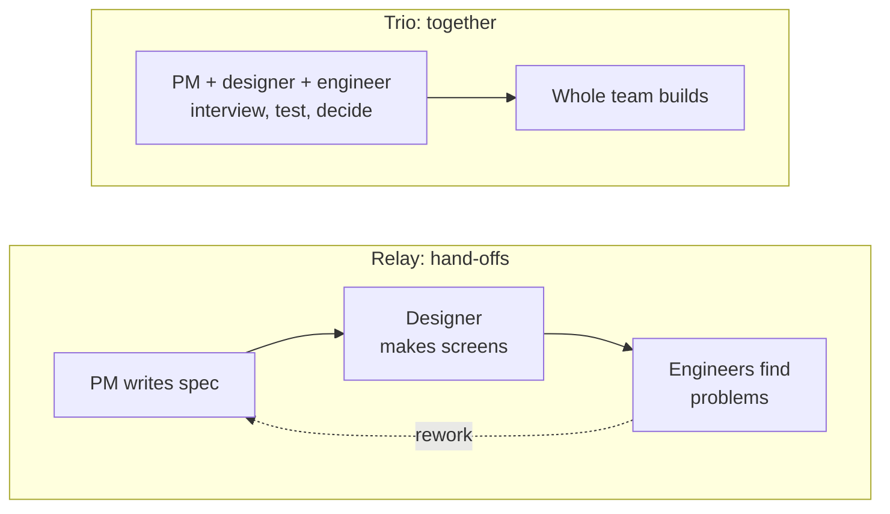
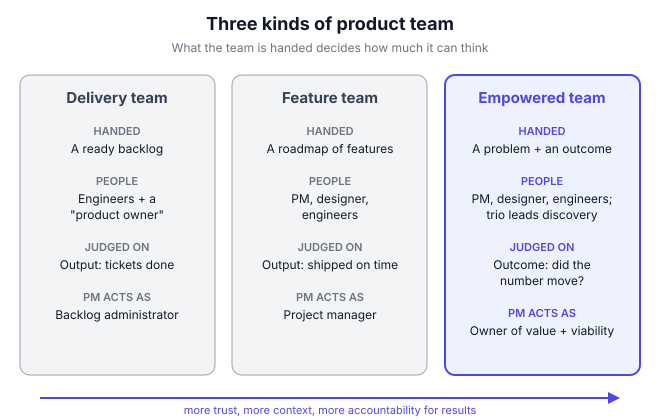

# A0.2 Product teams: the trio, empowered vs feature teams

## In one line

The best product teams are handed a problem to solve and a result to reach, not a list of features to build, and a small trio of PM, designer and engineer leads the work of figuring out the answer.

## Why this matters

You will never build a product alone. Everything you do as a PM happens through a team, so the *kind* of team you're on decides what your job really is:

- **On a feature team**, you mostly chase deadlines for features someone else chose. Your job slides into project management.
- **On an empowered team**, you own a problem and a result. Your job is to find a solution that works, with your designer and engineers.

Knowing the difference helps you in three ways. You can spot which kind of team a company really runs (before you join it). You can work well inside whichever kind you're on. And you can slowly move your team towards more ownership, which is where most PM growth happens. This chapter builds on [A0.1](01-what-a-pm-actually-does.md), which explained what a PM owns; here we look at the team around you.

## Key terms

| Term | Plain-English meaning |
|---|---|
| **Cross-functional team** | A team that mixes skills (product, design, engineering, sometimes data) so it can build things end to end without waiting on others. |
| **Feature team** | A team handed a roadmap of features to build. It's judged on shipping them (output). |
| **Delivery team** | An even narrower team that just works through a ready-made backlog of tasks. |
| **Empowered product team** | A team handed a problem and a target result. It's trusted to find the best solution and judged on the result (outcome). |
| **Output** | What a team ships: features, screens, releases. |
| **Outcome** | The change in user behaviour or business results that the output causes (e.g. more repeat orders). |
| **Product trio** | The PM, the product designer and a lead engineer who make discovery decisions together. |
| **Discovery** | Working out *what* to build: talking to users, testing ideas cheaply, before committing engineering time. |
| **Stakeholder** | Anyone outside the team who cares about or is affected by its work: sales, legal, leadership, ops. |

## The idea, simply

!!! tip "Analogy: two kinds of cricket coaching"
    Picture two coaches on the morning of a T20 match.

    The first coach hands the batters a sheet: "Over 1–6, play these exact shots. Over 7–15, rotate strike. Over 16–20, hit sixes." The batters follow the plan, whatever the bowling, the pitch or the score. If they lose, they say, "We did what we were told."

    The second coach says: "We need 170 to win on this pitch. You know the bowlers and the conditions better than I do once you're out there. Here's what we know about their attack. Figure out how to get there, and tell me what you need."

    The first is a **feature team**: it executes someone else's plan. The second is an **empowered team**: it's given the goal and the context, and trusted to find the way. Almost every good batting side works like the second, because the people at the crease see things the coach in the dugout can't.

Product teams work the same way. Let's build up the idea.

### 1. What a product team actually is

A product team is a small group of people with different skills who together own a part of the product. A typical team looks like this:

| Role | What they bring | Typical count |
|---|---|---|
| **Product manager** | Customer, data and business knowledge; owns *value* (will people want it?) and *viability* (does it work for the business?) | 1 |
| **Product designer** | Owns *usability*: can people figure out how to use it? Shapes the whole experience, not just the visuals | 1 (sometimes shared) |
| **Engineers** | Build it; the tech lead owns *feasibility* (can we build it, with the time, skills and tech we have?) | 3–10 |
| **Sometimes:** data analyst, researcher, QA, data scientist | Specialist depth, often shared between teams | 0–2 |

Those four "owns" come from Marty Cagan's four risks, which [A0.1](01-what-a-pm-actually-does.md) explains in detail. The point here is simple: no single person can cover all four risks well. That's why products are built by teams, not by heroic individuals.

**Why small?** Every extra person adds more conversations to keep in sync. Amazon's well-known "two-pizza team" rule says a team should be small enough that two pizzas could feed it, ideally under ten people. As demand grows, Amazon splits teams rather than making them bigger, and each team owns its product or service end to end ([AWS Executive Insights](https://aws.amazon.com/executive-insights/content/amazon-two-pizza-team/)).

### 2. Three kinds of team: delivery, feature, empowered

Marty Cagan of the Silicon Valley Product Group (SVPG) gave the clearest description of the difference in his 2019 essay [*Product vs. Feature Teams*](https://svpg.com/product-vs-feature-teams). He describes three kinds of team, and the difference is mostly about **what the team is handed** and **what it's judged on**:

| | Delivery team | Feature team | Empowered product team |
|---|---|---|---|
| **What it's handed** | A ready backlog of tasks | A roadmap of features and projects | A problem to solve and an outcome to reach |
| **Who's on it** | Engineers and a "product owner" | PM, designer, engineers | PM, designer, engineers |
| **What it's judged on** | Output (tasks done) | Output (features shipped on time) | Outcome (did the result move?) |
| **Who owns whether it works** | Someone else | The stakeholder who asked for the feature | The team |
| **What the PM really does** | Manages the backlog | Project management, chasing dates | Owns value and viability |

Here's the trap that catches many new PMs: **a feature team looks exactly like an empowered team on an org chart.** Same people, same titles, same stand-ups. The difference only shows up when you ask: "Who decided we're building this? And what happens if it ships on time but nobody uses it?"

### 3. Output vs outcome: the heart of the difference

An **output** is what you ship. An **outcome** is the change it causes.

| Output (what a feature team is asked for) | Outcome (what an empowered team is asked for) |
|---|---|
| "Build a referral programme by March" | "Raise the share of new users who come from referrals from 8% to 15%" |
| "Add UPI Autopay to bill payments" | "Cut the % of users who miss a bill due date from 18% to 10%" |
| "Redesign the search page" | "Raise search-to-order conversion from 22% to 26%" |
| "Launch a chatbot for support" | "Resolve 40% of 'where is my order' queries without an agent, with CSAT held above 4.2" |

Why does this matter so much? Because **most ideas don't work the way we hope**, and you rarely know which ones will fail in advance. A feature team that ships a failed idea on time has "succeeded". An empowered team that ships the same idea and sees no result has failed, so it keeps going: tries another approach, tests more cheaply, learns more about users. Accountability for the outcome is what forces real learning. (You'll go much deeper on this in [A2.4 Outcomes over outputs](../02-problem-discovery/04-outcomes-over-outputs-escaping-the-build-trap.md).)

**How to recognise which you're on.** Listen to how your team's goals are written:

- "Ship X by date Y" → feature team.
- "Move metric M from A to B by date Y, with guardrail G" → empowered team.
- Both → a hybrid, which is very common (see Going deeper).

### 4. Empowerment is not the same as "do whatever you want"

People often misread "empowered" as "no one can tell the team what to do". That's wrong. In Cagan's model, leaders still do a lot:

- **They set the product vision and strategy** (where we're going and why). See [A4.1](../04-strategy-and-vision/01-vision-and-mission.md) and [A4.2](../04-strategy-and-vision/02-good-strategy-vs-bad-strategy-the-kernel.md).
- **They decide which problems each team works on**, based on that strategy.
- **They give the team context**: customer insights, business constraints, data.
- **They coach**, and they hold the team accountable for results.

What changes is the **how**. Leaders decide *which* problem matters; the team decides *how* to solve it. Think of it as "what and why from above; how from the team".

| Leaders decide | The team decides |
|---|---|
| Which customer problem matters most this quarter | Which solution to try first |
| The target outcome and the guardrails | How to test ideas cheaply |
| Constraints (budget, legal, brand, deadlines that truly exist) | The design, the build approach, the release plan |
| How teams fit together | When to stop an idea that isn't working |

This only works if the team is trusted **and** competent. Empowerment without skill, context or coaching is just abandonment. That's why Cagan's book [*Empowered*](https://www.wiley-vch.de/en/areas-interest/finance-economics-law/empowered-978-1-119-69129-7) (2020, with Chris Jones) is mostly about leaders: hiring, coaching, and giving teams the strategic context they need.

### 5. The product trio: who leads discovery

Inside an empowered team, someone has to work out *what* to build. Teresa Torres, author of *Continuous Discovery Habits*, calls the small group that does this the **product trio**: usually the PM, the designer and an engineer ([Product Talk, 2024](https://www.producttalk.org/product-trios/)).

The idea is that these three do discovery **together**, not in a relay. In the old relay model:

1. The PM writes a spec alone.
2. The designer gets the spec and makes screens.
3. Engineers get the screens and discover it can't be built that way.
4. Back to step 1.

Each handoff loses context and adds delay. In a trio, all three interview users together, look at data together and decide together. Torres points to her own 2022 and 2024 benchmark surveys, which found people working in trios were more satisfied with their team and company ([Product Talk](https://www.producttalk.org/product-trios/)). *Note: these are surveys of her own audience, not controlled studies.*

In a relay, every hand-off loses context and creates rework. In a trio, the three perspectives meet at the start, when changing your mind is cheap.

**Why an engineer in discovery?** Engineers know what's newly possible. They often have the best solution idea in the room, because they know what the technology can do cheaply. They also spot feasibility problems before anyone has fallen in love with a design. And engineers who heard customers' pain directly build with more care.

**Is it always exactly three?** No. Torres describes the trio as flexible: a team building a machine-learning API might add a data scientist (a "quad"); a team with an embedded researcher might include them. But keep it as small as possible, because bigger groups decide more slowly ([Product Talk](https://www.producttalk.org/product-trios/)). The engineer also doesn't have to be the tech lead; any engineer with interest and context can play the role ([Product Talk](https://www.producttalk.org/engineer-lead-product-trio/)).

### 6. How the trio shares decisions

A trio doesn't mean "decide everything by vote". Each person brings a lens, and each risk has a natural lead:

| Risk | Natural lead | What the others add |
|---|---|---|
| **Value** (will they want it?) | PM | Designer: what users actually do; engineer: what's possible |
| **Viability** (works for the business?) | PM | Engineer: cost to run; designer: brand and trust |
| **Usability** (can they use it?) | Designer | PM: who the user is; engineer: performance, edge cases |
| **Feasibility** (can we build it?) | Engineer | PM: what can be cut; designer: simpler alternatives |

Torres puts it well: the trio is jointly responsible for a desirable, viable, feasible, usable and ethical product. When they disagree, she suggests first exploring *why* (different people often see different evidence). If the disagreement persists, either defer to the person with the relevant expertise, or run a quick test if the stakes are high ([Product Talk](https://www.producttalk.org/product-trios/)).

Practical habits that make trios work:

- **Interview customers together** at least every week or two (even one 30-minute call).
- **Each person forms their own view first**, then share. This avoids everyone simply agreeing with the PM.
- **Keep one shared artefact**, such as an opportunity solution tree ([A2.1](../02-problem-discovery/01-continuous-discovery-and-opportunity-solution-tr.md)), so everyone sees the same map.
- **Protect engineering time:** the engineer in the trio might spend a few hours a week on discovery, not half their week.

### 7. Teams are shaped around something: choosing a team's "mission"

Every team needs a clear area it owns, so it can act without asking permission every day. Common ways to slice teams:

| Team owns… | Example | Good when | Watch out for |
|---|---|---|---|
| **A customer journey or step** | "Checkout team", "Onboarding team" | One step is a clear bottleneck | Steps that need other teams to change |
| **A customer segment** | "Restaurant partners team", "SMB merchants team" | Segments have very different needs | Duplicate work across segments |
| **A product area** | "Search", "Payments", "Notifications" | Clear technical boundaries | Teams optimising their area, not the whole |
| **A business outcome** | "Repeat purchase team" | A metric tree is clear ([A8.2](../08-product-metrics/02-north-star-metric-and-metric-trees.md)) | Teams fighting over who moved the number |
| **A platform** | "Design system", "Identity and login" | Many teams depend on shared tech | Platform teams losing sight of end users |

A well-known example is the "Spotify model", described by Henrik Kniberg and Anders Ivarsson in 2012–13 ([slides](https://www.jfokus.se/jfokus13/preso/jf13_ScalingAgile.pdf)). Small cross-functional **squads** each own a mission; squads group into **tribes**; people with the same skill across squads form **chapters**; and interest groups across the company form **guilds**. It inspired many Indian startups. But treat it as a snapshot of one company at one moment, not a recipe. Copying the names without the trust and clear missions behind them changes nothing.

### 8. Where feature teams come from (and why they persist)

Feature teams aren't created by bad people. They usually grow out of reasonable instincts:

- **Leaders want predictability.** A list of features with dates feels safer than "we'll move this number somehow".
- **Sales wants commitments** to promise customers ([A11.4](../11-stakeholder-management-and-com/04-handling-conflict-and-saying-no.md) covers how to handle this).
- **Teams lack trust or skills.** If leaders don't trust a team's judgement, they hand it answers.
- **Companies grew from an IT or services background**, where software was built to a client's spec. This is common in India's tech history, and it shapes habits even in product companies.
- **Budgets are set per project**, so work has to be described as projects with outputs.

Knowing these roots matters, because you won't change a feature-team culture by arguing that "Cagan says so". You change it by solving the underlying worry: giving leaders visibility, showing results, building trust step by step (see Going deeper).

## Framework: Cagan's empowered product team + Torres's product trio

**Who created it.** Marty Cagan (SVPG) set out the difference between delivery, feature and empowered product teams in [*Product vs. Feature Teams*](https://svpg.com/product-vs-feature-teams) (August 2019), and expanded it in the book [*Empowered*](https://www.wiley-vch.de/en/areas-interest/finance-economics-law/empowered-978-1-119-69129-7) (2020, with Chris Jones). His later book *Transformed* (2024) describes how whole companies move to this "product operating model" ([O'Reilly](https://oreilly.com/library/view/transformed/9781119697336); [SVPG FAQ](https://svpg.com/transformed-faq)). Teresa Torres popularised the **product trio** as the group that leads discovery inside such a team ([Product Talk](https://www.producttalk.org/product-trios/)).

Use this as a six-step **team charter** process, whether you're forming a new team or improving an existing one.

**Step 1: Write the team's mission as a problem, not a feature list.** One or two sentences: who the team serves and which problem it owns. *"Help first-time bill payers build a habit of paying all their bills with us."* Not *"Own the bills tab."*

**Step 2: Agree one outcome and one or two guardrails with leadership.** Use the metric habits from [A8.1](../08-product-metrics/01-metric-basics-leading-lagging-input-output-vanit.md): a leading input the team can move this quarter, plus counter metrics that catch shortcuts.

**Step 3: Name the trio and set its rhythm.** PM, designer, one engineer. Fix a weekly slot for customer contact and a weekly slot to review what was learned.

**Step 4: Make the decision rights explicit.** Write down what leaders decide (problem, target, real constraints) and what the team decides (solution, tests, release plan). Share it with stakeholders so nobody is surprised.

**Step 5: Run discovery, then delivery.** The trio tests ideas cheaply ([A2.3](../02-problem-discovery/03-assumption-testing-prototypes-and-mvps.md)); the whole team builds what survives.

**Step 6: Report outcomes, not just outputs.** In every update, show what shipped *and* what moved. Over time, this is what earns the team more trust.

**When to use it:** for teams building products that customers use directly, where there's real uncertainty about what will work, and where the company can give teams real context (data, strategy, customer access).

**When not to, or with care:**

- **Truly fixed requirements**, such as a regulatory change with a legal deadline (a new RBI rule, say). The *what* is decided; the team mainly decides *how*. That's fine.
- **Very early startups** where the founders are effectively the trio. Formal team structures add little until there are several teams.
- **When the team lacks key skills** (no designer, inexperienced engineers). Give the team coaching and context first; empowering a team that can't yet succeed sets it up to fail.
- **Crisis mode** (a cash crunch, a major outage), when leaders may need to centralise decisions for a while. See the Airbnb case below.

## Diagram

Read the "Handed" row first: a backlog, a feature list, or a problem plus an outcome. Everything else, including what the PM's job becomes, follows from it.

## Worked example

*A realistic, made-up scenario to show the maths.*

You're the new PM of the **Bills team** at a UPI payments app. The team is you, one designer, five engineers, and an analyst shared with another team. Last quarter, it was run as a feature team.

**Step 1: Look at last quarter honestly.** Leadership had handed the team five features. Here's what happened:

| Feature (output) | Shipped on time? | Effect on repeat bill payments |
|---|---|---|
| New bill categories (water, gas) | Yes | Tiny: few users paid these |
| Redesigned bills home screen | Yes | None measurable |
| Bill-splitting with friends | Late | None; low use |
| Dark mode for the bills tab | Yes | None |
| Due-date reminder (basic, email only) | Yes | Small lift, but emails were rarely opened |

Four of five shipped on time. By feature-team rules, a good quarter. But the number leadership actually cares about barely moved.

**Step 2: Reframe as an outcome.** With your manager, you agree:

- **Outcome:** raise the **repeat bill-payer rate** (new bill payers who pay a second bill within 45 days) from **22% to 28%** this quarter.
- **Guardrails:** cashback cost per repeat payer, and the notification opt-out rate.
- **Context from leadership:** "Bill payers are our stickiest users. We think habit is the issue, but we're not sure."

**Step 3: The trio does discovery.** You, the designer and one engineer interview 12 users who paid one bill and never returned, and look at the data together:

| What you learned | Source |
|---|---|
| 7 of 12 said they "forgot" or paid at the biller's own site out of habit | Interviews |
| Users who connected 2+ billers in week 1 had a 41% repeat rate vs 15% for those with one | Data |
| Push reminders were never built; the old reminder was email only | Engineer, from the code |

The engineer adds an idea no one else had: the app can already fetch due dates for many billers automatically, so reminders could show the *exact* amount and date.

**Step 4: Test three ideas cheaply.** Each runs for two weeks on 10% of new bill payers:

| Idea | Repeat rate in test | Extra cost |
|---|---|---|
| A. Push reminder with exact amount and due date | 27% (vs 22% control) | Almost none |
| B. ₹25 cashback on the second bill | 29% | ₹25 per second payment |
| C. "Add another biller" prompt after first payment | 24.5% | None |

**Step 5: Estimate what each is worth.** The app gets about **1,00,000 new bill payers a month**. Assume (from finance) each repeat payer brings about **₹150 of contribution** (revenue minus direct costs) over their lifetime.

- **A + C together** (tested together, they reached 28%): 6 extra points × 1,00,000 = **6,000 extra repeat payers a month** × ₹150 = **₹9 lakh a month**, or about **₹1.08 crore a year**, at almost no running cost.
- **B (cashback)**: 7 extra points = 7,000 extra repeat payers × ₹150 = ₹10.5 lakh a month. But cashback goes to *every* second payment: 29,000 × ₹25 = ₹7.25 lakh a month. Net gain is only about **₹3.25 lakh a month**, and the habit might stop when the cashback stops.

**Step 6: Decide and ship.** The team ships A and C, and keeps cashback for a later test aimed only at users who ignore reminders.

**Step 7: Compare the two ways of working.**

| | Last quarter (feature team) | This quarter (empowered team) |
|---|---|---|
| What the team was handed | 5 features | 1 outcome + context |
| Things shipped | 5 | 2 (plus 3 cheap tests) |
| Repeat bill-payer rate | 22% → 22.5% | 22% → 28% |
| Value created (estimate) | Hard to see | About ₹1 crore a year |

Notice what changed. The team shipped *less* and achieved *more*. The engineer's idea (fetching exact due dates) only surfaced because an engineer was in discovery. And the cashback test stopped the team from choosing the option that looked best on the headline number but was worst for the business.

## Going deeper: nuances and trade-offs

### 1. Most real teams are hybrids

Pure empowered teams are rarer than conference talks suggest. Most teams have a mix: some committed features (a contract promised to a big client, a compliance change) and some outcome work. A practical way to handle this is to say it openly, for example: "About 60% of our capacity goes to our outcome; 40% to committed items." That way, committed work doesn't silently eat all the time meant for real problem-solving.

Cagan's answer for dates that truly matter is what he calls **high-integrity commitments**, described in *Empowered*: the team does enough discovery first to understand the solution and its cost, and *then* commits to a date. Committing before you know what you're building is where missed deadlines come from.

### 2. It changes with company stage

| Stage | What team structure usually looks like |
|---|---|
| **Pre-product-market fit** (under ~20 people) | Founders act as the trio. One team, frequent pivots. Formal structure adds little. |
| **Scaling** (several teams) | First real teams with missions. The biggest risk is dependencies between teams and unclear ownership. |
| **Large company** (dozens of teams) | Needs clear missions, platform teams and strong product leadership to give each team context. Drift into feature teams is common as planning becomes more formal. |

### 3. B2B, sales-led and services businesses

In B2B, a big customer often asks for a specific feature, and sales may promise it. That pulls teams towards feature-team behaviour. Good B2B PMs handle this by asking *why* the customer wants it (the underlying problem), checking whether several customers share it, and only then committing ([A11.4](../11-stakeholder-management-and-com/04-handling-conflict-and-saying-no.md)). Teams in companies or centres that grew out of IT services or client delivery can carry spec-driven habits; if you work in one, expect to build trust gradually rather than changing the model overnight.

### 4. The counter-trend: centralisation and "founder mode"

Not every successful company pushes decisions down. From 2020 onwards, Airbnb did the opposite: it moved to a more centralised, functional structure with one roadmap reviewed by the CEO (see the case below). Some founders argue that strong central product judgement beats many semi-independent teams, especially when the company has too many directions at once.

There's a real trade-off here. Centralisation gives focus and a coherent product, but it depends heavily on the judgement and bandwidth of a few leaders, and it can slow teams down. Empowerment gives speed and local learning, but risks fragmented products if strategy is weak. Strong companies often swing between the two over time. As a PM, notice which way your company leans, and work with it.

### 5. Conway's law: your teams shape your product

In 1968, Melvin Conway observed that organisations tend to design systems that mirror their own communication structure ([ACM Queue summary of the original paper](https://queue.acm.org/detail.cfm?id=3395214)). In product terms: if you have separate "web", "Android" and "iOS" teams, you'll get three slightly different products. If "search" and "recommendations" are separate teams that rarely talk, the experience will feel stitched together.

The practical lesson: **design teams around the experience you want customers to have.** When you see a seam in the product, look for the seam in the org chart.

### 6. Dependencies: the silent killer of empowerment

A team can be "empowered" on paper but unable to ship anything without three other teams. Signs: most of your roadmap says "blocked on…", and your stand-ups are about other teams. Ways to reduce this:

- Give teams ownership of a whole slice (front end to back end) where possible.
- Create platform teams for truly shared pieces, and treat other teams as their customers.
- When you must depend on another team, agree the dependency early and write it down with dates.

### 7. AI is changing team shapes

AI coding and design tools are letting smaller teams do more, and some companies are blurring the lines between roles. LinkedIn replaced its Associate Product Manager programme with an Associate Product *Builder* programme that trains people in coding, design and product skills together ([Lenny's Podcast, Dec 2025](https://www.lennysnewsletter.com/p/why-linkedin-is-replacing-pms)). At Zerodha, small "micro teams" of developers own products end to end without dedicated PMs (case below).

What doesn't change: someone still has to own value and viability, and someone still has to talk to customers. The *title* may change; the *responsibilities* don't disappear. Part B covers AI-era team structures in depth ([B6.1](../../part-b/06-the-ai-pm-role/01-ai-pm-careers-teams-and-using-ai-in-your-own-pm.md)).

### 8. How to work well inside a feature team

Most PMs, especially early in their careers, will work on feature teams for a while. You can still do good product work:

- **Ask "what problem does this solve, and how will we know?"** for every feature you're handed. Write the answer in the PRD ([A7.1](../07-execution-and-delivery/01-prds-and-specs.md)).
- **Attach a success metric to every feature** and report it 4–6 weeks after launch, not just "shipped".
- **Bring your designer and an engineer to a few customer calls.** You can run a trio informally.
- **Propose one small outcome-based experiment** per quarter. Success there is how you earn more room.

Changing a team's model is a trust-building exercise, not an argument you win.

## Real-world examples (2023 onwards)

!!! example "Airbnb, 2023: pulling decisions back to the centre"
    In a September 2023 interview reported by [Fortune](https://fortune.com/2023/09/15/airbnb-ceo-brian-chesky-leadership-strategy-success/), CEO Brian Chesky described how Airbnb had "shuttered most of the divisions" and moved from a divisional to a functional structure, with one company roadmap. Nothing ships unless it's on that roadmap, and he reviews work before it ships. He said the company had previously had too many projects and directions. Airbnb also made its Fortune 500 debut in 2023 after its first profitable year. Chesky discussed how Airbnb had shifted its thinking on product management in a [Lenny's Podcast episode in November 2023](https://www.lennysnewsletter.com/p/brian-cheskys-contrarian-approach).

    **PM lesson:** empowered teams aren't the only model that works. When a company has too many scattered bets, centralising can bring focus. But notice the cost: it depends on a few leaders reviewing everything. If you join a company like this, your job leans more towards excellent execution and influencing a central roadmap than towards owning a problem end to end.

!!! example "Zerodha, 2025: product ownership without PM titles"
    In November 2025, a widely shared post about the Indian stockbroker Zerodha sparked debate about building a large business without full-time PMs ([Business Today](https://www.businesstoday.in/markets/story/zerodha-made-1b-with-no-full-time-product-managers-engineering-efficiency-is-a-moat-not-a-feature-503437-2025-11-24)). The article cites CTO Kailash Nadh's own 2020 description of a roughly 30-person tech team with "no dedicated project or product managers", where small micro teams of two to four developers owned products end to end, and natural leaders took on product roles. *The revenue figures in the post that started the debate weren't verified by the article, so they're left out here.*

    **PM lesson:** as one engineering leader quoted in the article pointed out, no PM *title* doesn't mean no product *work*. Someone at Zerodha still decides what to build by listening to customers. Small, stable, highly trusted teams can absorb the trio's responsibilities. This is empowerment taken to its extreme, and it works best with very senior people and a focused product.

## Common mistakes

!!! warning "Watch out for"
    - **Thinking your team is empowered because it has a PM, a designer and engineers.** Check what it's *handed* and what it's *judged on*.
    - **Treating empowerment as "no one can tell us what to do".** Leaders still set strategy, choose problems and set targets.
    - **Running a trio as the PM plus two spectators.** If the designer and engineer never speak to users, it's a relay with extra meetings.
    - **Pulling every engineer into discovery.** One engineer for a few hours a week is usually enough; the rest need focus time to build.
    - **Accepting an outcome you can't influence**, such as "company revenue". Push for a leading input your team can move ([A8.1](../08-product-metrics/01-metric-basics-leading-lagging-input-output-vanit.md)).
    - **Copying another company's model by name** ("we're doing squads now") without the trust, context and clear missions behind it.
    - **Celebrating "shipped" as success.** Report what moved, not just what launched.
    - **Fighting your company's model head-on.** Build trust with small outcome-based wins instead.

## Common questions

**Is it bad to be a PM on a feature team?**
No. You'll learn execution, stakeholder management and delivery, which every PM needs. Just keep asking "why" and measuring results, so you're ready to own outcomes.

**Who is the boss in a product trio?**
Nobody, in day-to-day decisions. Each person usually reports to their own function (product, design, engineering). The PM is accountable for the overall outcome, so they often facilitate, but decisions are shared and each person leads on their own risk area.

**How big should a product team be?**
Usually one PM, one designer and 4–8 engineers. If the team grows past about ten, it's often time to split it, as Amazon's two-pizza idea suggests.

**What if there's no designer on my team?**
Common in Indian startups and B2B tools. The PM and a front-end engineer usually cover design, ideally with occasional help from a shared designer. Be honest that usability risk is then higher, and test with users more often.

**Is a "product owner" the same as a product manager?**
"Product owner" is a role in Scrum ([A7.3](../07-execution-and-delivery/03-agile-scrum-and-kanban.md)), focused on managing the backlog. Some companies use it as another name for PM; others mean a narrower, delivery-focused role. Ask what the job actually involves.

**Can a team be empowered if leadership sets deadlines?**
Yes, if the deadline is real (a festival sale, a regulatory date) and the team gets to decide how to meet it. What breaks empowerment is fixing both the solution *and* the date before anyone has learned whether it will work.

## In the interview

!!! question "In the interview"
    **How it's tested:** behavioural questions about working with engineers and designers, handling disagreement, and owning outcomes. Interviewers listen for whether you treat your team as partners or as "resources".

    **Sample question:** *"Tell me about a time you disagreed with your designer or engineering lead. What happened?"*

    **Outline of a strong answer (use STAR: situation, task, action, result):**

    1. **Situation:** a specific project and the disagreement (e.g. the designer wanted a full redesign; you wanted a smaller change before a festival sale).
    2. **Task:** what was at stake: the outcome metric and the deadline.
    3. **Action:** how you explored *why* you disagreed (different evidence?), what data or user input you gathered together, and how you decided. Mention deferring to their expertise where it applied.
    4. **Result:** what shipped, what the metric did, and what you'd do differently.
    5. **Reflection:** what you learned about working as a trio.

    Avoid stories where you "won" by escalating. Strong answers show shared ownership.

    **A second common form:** *"Leadership hands your team a list of features for the quarter. What do you do?"*

    A strong answer doesn't refuse. It: (1) asks what outcome each feature is meant to drive; (2) proposes measuring that outcome; (3) suggests testing the riskiest feature cheaply first; (4) reports results, building trust to get outcome-based goals next time.

## Research happening now

!!! info "Research happening now"
    - **State of Product 2026 (Atlassian).** Atlassian's first annual [State of Product report](https://www.atlassian.com/software/jira/product-discovery/resources/state-of-product-2026) surveyed more than 1,000 product professionals in the US and Europe. Its headline finding: 84% of PMs fear their products will fail. The report covers team structures, collaboration and AI's effect on product work. *Status: vendor survey, not peer-reviewed.*
    - **The "full stack builder" experiment (LinkedIn).** Since late 2025, LinkedIn has been rebuilding its product development around a Full Stack Builder title and career ladder, replacing its APM programme with an Associate Product Builder programme ([Lenny's Podcast, Dec 2025](https://www.lennysnewsletter.com/p/why-linkedin-is-replacing-pms)). *Status: an ongoing company experiment; results not yet publicly measured.*

## Try it yourself (20 minutes)

Think of a team you've worked on, or pick a product you know well (a food delivery app's search, say). Write:

1. The team's **mission**, written as a problem, not a feature list.
2. One **outcome** metric and one **guardrail**.
3. Which kind of team it is today (delivery, feature or empowered), and one piece of evidence.
4. Two decisions leaders should make, and two the team should make.
5. One small change that would move the team one step towards empowerment.

??? success "Check your answer"
    For a food delivery app's search team, a good answer might be:

    1. **Mission:** "Help hungry users find something they want to order in under a minute."
    2. **Outcome:** search-to-order conversion (from, say, 22% to 26%). **Guardrail:** order cancellation rate, or restaurant complaints about ranking fairness.
    3. **Today:** a feature team, if its roadmap says "add filters, add voice search, redesign results" with dates but no metric targets.
    4. **Leaders decide:** that search is a priority this quarter; the target and guardrails. **Team decides:** whether to fix ranking, filters or spelling tolerance first; how to test.
    5. **One change:** add a success metric to the next feature and report it six weeks after launch.

    Check: is your outcome something the team can move within a quarter? Does your mission describe a user problem rather than a part of the app?

## How this connects

- [A0.1 What a PM actually does](01-what-a-pm-actually-does.md): the four risks that the trio splits between PM, designer and engineer.
- [A0.3 Product vs project vs program management](03-product-vs-project-vs-program-management-types-o.md): why feature-team PMs often end up doing project management.
- [A2.4 Outcomes over outputs](../02-problem-discovery/04-outcomes-over-outputs-escaping-the-build-trap.md): the "build trap" that feature teams fall into.
- [A2.1 Continuous discovery and opportunity solution trees](../02-problem-discovery/01-continuous-discovery-and-opportunity-solution-tr.md): the trio's main discovery habits and shared map.
- [A8.2 North Star metric and metric trees](../08-product-metrics/02-north-star-metric-and-metric-trees.md): how to give each team an outcome it can own.

## Go deeper

- **Article:** [*Product vs. Feature Teams*](https://svpg.com/product-vs-feature-teams) by Marty Cagan (SVPG, 2019). The short, original statement of the three kinds of team. Free.
- **Book:** [*Empowered*](https://www.wiley-vch.de/en/areas-interest/finance-economics-law/empowered-978-1-119-69129-7) by Marty Cagan and Chris Jones (Wiley, 2020). How leaders create and coach empowered teams: strategy, context, hiring.
- **Book:** [*Transformed*](https://oreilly.com/library/view/transformed/9781119697336) by Marty Cagan (Wiley, 2024). How a company moves to the product operating model; see also the [SVPG FAQ](https://svpg.com/transformed-faq).
- **Article:** [*Product Trios: What They Are, Why They Matter*](https://www.producttalk.org/product-trios/) by Teresa Torres. The practical guide to forming and running a trio.
- **Article:** [*In defense of feature team product*](https://www.lennysnewsletter.com/p/in-defense-of-feature-team-product) (Lenny's Newsletter). A counterpoint worth reading so you see both sides.
- **Listen:** [Brian Chesky's contrarian approach to product, growth and leadership](https://www.lennysnewsletter.com/p/brian-cheskys-contrarian-approach) (Lenny's Podcast, Nov 2023). Includes a chapter on how product management is structured at Airbnb.
- **Read:** [Amazon's two-pizza teams](https://aws.amazon.com/executive-insights/content/amazon-two-pizza-team/) (AWS Executive Insights). Small teams, single-threaded ownership, and splitting rather than growing teams.

## Key takeaways

- A team's real type depends on **what it's handed** (a backlog, a feature list, or a problem plus an outcome) and **what it's judged on** (output or outcome).
- **Empowered** doesn't mean "no direction": leaders choose the problem, set the target and give context; the team chooses the solution.
- The **product trio** (PM, designer, engineer) does discovery *together*, which cuts rework and surfaces better ideas, often from the engineer.
- Each trio member leads one risk: **PM on value and viability, designer on usability, engineer on feasibility**.
- **Ship less, learn more:** an outcome-focused team often ships fewer features and creates more value.
- Real companies sit on a spectrum, and some (like Airbnb) deliberately centralise. **Know your company's model and work with it.**
- On a feature team, you can still **ask why, measure results and build trust** step by step.

## Updates

*No updates yet.*
