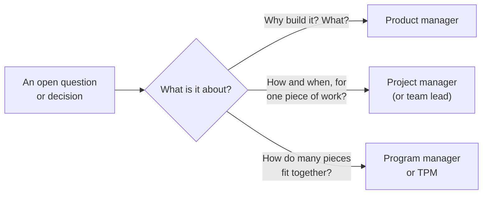
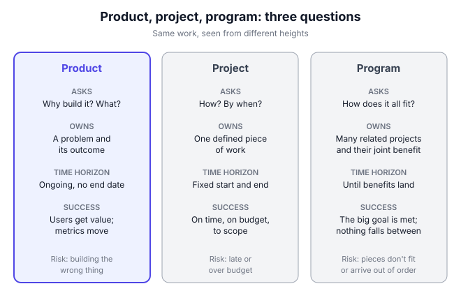

# A0.3 Product vs project vs program management; types of PM

## In one line

A product manager decides *what* to build and *why*; a project manager gets a fixed piece of work done on time; a program manager makes many related projects add up to one bigger result. And "product manager" itself comes in many flavours.

## Why this matters

These three titles all shorten to "PM", and people mix them up all the time:

- **Job hunting:** two jobs called "PM" can be completely different. One is about deciding what to build. The other is about Gantt charts and status reports.
- **Working well:** if you don't know who owns *what*, *when* and *how it fits together*, decisions fall through the gaps or get made twice.
- **Switching careers:** many people in India move into product from IT services, consulting or project roles. Knowing exactly what changes helps you prepare and pitch yourself.
- **Choosing a path:** growth, platform, B2B and AI PM jobs need different skills. Picking one that fits your strengths makes you better and happier at work.

This chapter draws the lines clearly, shows where they blur, and maps the main types of product manager.

## Key terms

| Term | Plain-English meaning |
|---|---|
| **Product** | Something that keeps delivering value to users over time, like an app, a feature area or an API. It has no planned end date. |
| **Project** | A temporary piece of work with a start, an end and a defined result, like "launch the app in Hindi by March". |
| **Program** | A group of related projects managed together, because together they achieve something none could alone. |
| **Portfolio** | All of a company's programs and projects, chosen and balanced against its strategy. |
| **Product owner** | A role in the Scrum way of working: the one person accountable for getting the most value from the team's work. Often a PM wears this hat. |
| **TPM (technical program manager)** | A program manager with deep technical knowledge who coordinates complex engineering work across many teams. |
| **Product operations (product ops)** | A team that supports PMs with shared tools, data, processes and rhythms, so PMs spend more time on customers. |
| **Scope** | What's included in a piece of work, and what isn't. |

## The idea, simply

!!! tip "Analogy: a big Indian wedding"
    Think of a big Indian wedding with five events: haldi, mehendi, sangeet, the wedding and the reception.

    - **The couple and their families** decide what kind of wedding they want and *why*. Intimate or grand? Traditional or modern? What should guests feel? That's **product management**: deciding what experience to create and what "success" means.
    - **The sangeet organiser** has a fixed date, a budget and a list: stage, DJ, choreographer, food. Their job is to deliver *that event*, on time and on budget. That's **project management**.
    - **The overall wedding coordinator** juggles all five events together. The same caterer serves three of them. Guests fly in once and must reach every venue. If the mehendi runs late, the sangeet starts late. That's **program management**: making many projects add up to one great wedding.

    All three are needed for a big wedding. They just answer different questions.

### 1. Product management: the "why" and the "what"

A product manager owns a **problem and its outcome**, for as long as the product lives ([A0.1](01-what-a-pm-actually-does.md)). Their core questions are:

- Who are our users, and what problem are we solving for them?
- Which problems matter most right now?
- What should we build, and what should we *not* build?
- Did it work? Did users get value, and did the business benefit?

The work never "finishes". When a feature ships, the PM watches whether it changed behaviour, learns, and decides what's next. Success is measured in **outcomes**: retention, conversion, revenue, customer satisfaction ([A8.1](../08-product-metrics/01-metric-basics-leading-lagging-input-output-vanit.md)).

### 2. Project management: the "how" and the "when"

The Project Management Institute (PMI) describes a project in its *PMBOK Guide* as a temporary endeavour to create a unique product, service or result. Project management is the use of knowledge, skills, tools and techniques to meet the project's requirements ([summary of the PMI definitions](https://projectengineer.net/what-is-project-management)).

The key word is **temporary**. A project has:

- **A clear goal:** "migrate all payments to the new gateway".
- **A start and an end date.**
- **A budget and a set of people.**
- **A defined scope:** what's in, what's out.

A project manager plans the tasks, tracks progress, manages risks, removes blockers and reports status. Success means **on time, on budget and to scope**. Once delivered, the project closes.

| Project question | Example |
|---|---|
| What exactly is in scope? | 3 payment methods, not 5 |
| What's the plan and the critical path? | Gateway contract → integration → testing → switch-over |
| What could go wrong? | Bank certification takes longer than expected |
| Are we on track? | 2 days behind on testing; here's the recovery plan |

### 3. Program management: making many projects add up

PMI's *Standard for Program Management* defines a program as related projects and activities "managed in a coordinated way" to get benefits you couldn't get by managing them separately ([PMI paper by B. Firat Dengiz, 2013](https://www.pmi.org/learning/library/program-project-management-relations-commonalities-differences-10591)).

A program manager doesn't run each project's details. Project managers and team leads do that. The program manager looks across them:

- **Dependencies:** team B can't start until team A's API is ready.
- **Shared resources:** two projects need the same security reviewer in the same week.
- **Sequencing:** what must launch first?
- **Benefits:** is the whole program delivering what the company wanted?
- **Stakeholders:** keeping leaders, legal, operations and partners aligned as the projects change.

Example: launching a food-delivery app in a new country is a program. It includes projects for payments, local tax, restaurant onboarding, delivery-partner apps, translation and marketing. Each could be "on time" while the launch still fails, if they don't fit together.

### 4. Side by side

| | **Product manager** | **Project manager** | **Program manager** |
|---|---|---|---|
| **Core question** | *Why* and *what*? | *How* and *when*? | *How does it all fit together?* |
| **Owns** | A problem and its outcome | One defined piece of work | Several related projects and their combined benefit |
| **Time horizon** | Ongoing, no end date | Fixed start and end | Months to years, ends when benefits land |
| **Success looks like** | Users get value; business metrics move | On time, on budget, to scope | The combined goal is achieved; dependencies don't break |
| **Typical artefacts** | Problem statements, roadmaps, PRDs, experiment results | Project plans, timelines, risk logs, status reports | Program roadmaps, dependency maps, steering updates |
| **Biggest risk they manage** | Building the wrong thing | Building it late or over budget | Pieces that don't fit, or arrive in the wrong order |
| **Main skill** | Judgement about users, value and trade-offs | Planning and execution discipline | Coordination and influence across many teams |

A useful one-liner: **the product manager decides where the train should go; the project manager gets one train there on schedule; the program manager runs the timetable for the whole railway.**

### 5. Where the lines blur

Real companies rarely match the textbook. Four overlaps come up all the time.

**Product owner.** The 2020 [Scrum Guide](https://www.scrumguides.org/scrum-guide.html) says the Product Owner is accountable for maximising the value of the team's work, and is one person, not a committee. In Scrum, "Product Owner" is an *accountability*, not a job title. In many companies the PM simply wears this hat. In others, especially large enterprises and IT services firms, a "product owner" is a separate person who manages the backlog while a PM or business head sets direction. If a job ad says "product owner", read the details to see which one it is ([A0.2](02-product-teams-the-trio-empowered-vs-feature-team.md)).

**Technical program manager (TPM).** In big tech companies, TPMs coordinate complex engineering work: a data-centre migration, a new security standard rolled out across 40 services, or an AI platform used by many teams. They need enough technical depth to judge risks and trade-offs with senior engineers.

**PMs doing project work.** In small companies there's often no project or program manager, so the PM runs timelines too. That's normal. The danger is when *all* of a PM's time goes on coordination and none on users and outcomes. Marty Cagan argued back in 2007 that combining the roles hurts as release cycles speed up, and that strong product companies separate them ([SVPG](https://svpg.com/product-management-vs-project-management)).

**Titles that mean something else.** For years Microsoft used the title "Program Manager" for a role that mixed product and project work, as Cagan's article notes. In Indian IT services, "project manager" is usually a large delivery role managing client contracts and big teams. Always read what a job *actually does*, not just its title.

### 6. Types of product manager

Once you're on the product side, the job still varies a lot. Product managers are often grouped in three ways: by **what** they build, by **which goal** they own, and by **company stage**. Mind the Product's community has described [several of these types](https://www.mindtheproduct.com/why-you-need-to-know-about-different-product-manager-types), and the point stands: there is no one ideal PM, so pick the type that matches your strengths.

**By what you build:**

| Type | Users | What the job feels like | Typical metric | Kind of product |
|---|---|---|---|---|
| **Consumer (B2C)** | Millions of individuals | High volume, fast experiments, design-heavy | Retention, conversion, engagement | Food delivery, UPI apps, social apps |
| **B2B / SaaS** | Businesses, often a few large customers | Deep customer conversations, sales input, admin features | Revenue retention, seats used, deals won | Payroll, CRM or invoicing software |
| **Platform / API** | Other developers or internal teams | Designing building blocks, reliability, documentation | Adoption by teams, uptime, time to integrate | Payment gateways, internal identity or maps services |
| **Technical** | Often engineers | Deep technical trade-offs, close to architecture | Performance, cost, developer productivity | Search ranking, data infrastructure |
| **Data / ML** | Internal teams or end users | Data quality, models, experiments | Model accuracy, business lift | Recommendations, fraud scoring |
| **AI** | End users of AI features | Probabilistic quality, evals, cost per use | Task success, cost per task | Chat assistants, AI copilots (see [Part B](../../part-b/00-foundations/01-what-makes-ai-products-different.md)) |
| **Hardware / devices** | Buyers of physical products | Long cycles, supply chain, firmware | Returns, defects, sales | Wearables, payment devices |
| **Internal tools** | Employees | Close users, operational efficiency | Time saved, error rates | Support-agent consoles, warehouse apps |

**By the goal you own:**

- **Core (or feature) PM:** makes the main product better for existing users.
- **Growth PM:** works on getting more people to sign up, activate, return and refer, usually through rapid experiments ([A10.2](../10-growth-and-go-to-market/02-product-led-growth-and-growth-loops.md)).
- **Monetisation PM:** owns pricing, plans, ads or payments ([A10.3](../10-growth-and-go-to-market/03-pricing-and-monetisation.md)).

**By company stage:**

- **0→1 PM:** finds product-market fit with very little data. Lots of ambiguity, lots of talking to users.
- **Scale PM:** improves a working product used by millions. More data, more stakeholders, more process.
- **Enterprise PM:** works in a large, often regulated company. More governance, longer cycles, bigger blast radius.

### 7. How to work out which type fits you

Each type rewards different strengths. Ask yourself what gives you energy:

| If you love… | You'll probably enjoy… |
|---|---|
| Talking to customers, design and fast feedback | Consumer or growth PM |
| Deep relationships with a few customers and solving complex workflows | B2B / SaaS PM |
| Elegant systems and making other engineers productive | Platform, API or technical PM |
| Numbers, experiments and statistics | Growth, data or monetisation PM |
| Ambiguity and building from nothing | 0→1 PM at a startup or a new bet inside a big company |
| Organising complex efforts and making many teams succeed together | Program or technical program management |

Your background matters too. Engineers often start in technical or platform roles. Designers and researchers often start in consumer roles. Sales, consulting and operations people often do well in B2B. None of this is fixed. Many PMs move between types every few years.

## Framework: The three questions, and the role-fit check

There's no single author of this split. The definitions of project and program come from PMI's standards (*PMBOK Guide* and *The Standard for Program Management*). The case for keeping product and project management separate was made early by Marty Cagan in his [2007 SVPG article](https://svpg.com/product-management-vs-project-management) and in his book [*Inspired*](https://svpg.com/books/product-is-hard-svpg-box-set). The product owner accountability comes from the [Scrum Guide](https://www.scrumguides.org/scrum-guide.html) (latest version 2020).

Use it as a quick tool whenever work feels messy.

**Step 1: List the decisions in play.** Write down every open question: "Should we build X?", "When can we launch?", "Who's blocking whom?"

**Step 2: Sort each into one of three questions.**

- **Why / what?** → product
- **How / when, for this one piece of work?** → project
- **How do these pieces fit together?** → program

**Step 3: Name one owner per question.** In a small team, one person may own two or all three. That's fine, as long as everyone knows who decides.

**Step 4: Check the balance.** If the PM spends most of the week on "how / when" and "fit together", the "why / what" work is starving. That's the signal to bring in project or program help, or product ops.

**Step 5: Re-check at each new phase.** Discovery is mostly product questions. A launch across many teams is mostly program questions.

Every decision should land on exactly one owner. In a small startup the same person may hold all three boxes, but it should still be clear which hat they're wearing.

**When to use it:** at the start of any initiative that involves more than two teams; when a launch keeps slipping; when the same decision keeps getting re-opened; when you're deciding whether to hire a PM or a program manager.

**When not to:** in a tiny team of three to five people working on one product, formal role-splitting adds overhead. Everyone does a bit of everything. Just keep the three questions in mind.

## Diagram

Read across each row: the three roles look at the same work from different heights. Product asks why, project asks when, program asks how it all fits.

## Worked example

You're the senior PM at a mid-size Pune fintech. The company wants to launch a **"pay later" option inside its payments app** in 16 weeks. Five teams are involved: the app team, payments, risk (credit decisions), collections and compliance. Each team has its own PM or lead.

All numbers below are **illustrative**, to show the method.

**Step 1: Sort the open decisions.**

| Open question | Type | Owner |
|---|---|---|
| Which users should be offered pay later first? | Why / what | Product (you) |
| What credit limit and repayment period are we testing? | Why / what | Product, with risk |
| When will the risk API be ready for the app team? | Fits together | Program |
| Who signs off the final user agreement, and when? | Fits together | Program, with compliance |
| What's the plan for the collections dashboard build? | How / when | Project (collections lead) |
| What does success look like 90 days after launch? | Why / what | Product |

**Step 2: Measure the coordination load.** Today, with no program manager, each of the five PMs and leads spends about **10 hours a week** in cross-team syncs, chasing dependencies and writing status updates.

| | Without program manager | With program manager |
|---|---|---|
| Coordination hours per PM/lead per week | 10 | 3 |
| Total coordination hours (× 5) | 50 | 15 |
| **PM hours freed per week** | | **35** |
| Over the 16-week launch | | **560 hours**, about 14 PM-weeks |

Those 560 hours can go back into talking to users, testing the credit offer and planning the 90-day follow-up.

**Step 3: Estimate the launch-delay risk.** The last two cross-team launches at this company slipped by an average of **4 weeks**, mostly from late dependencies. The finance plan expects pay later to bring in about **₹9 lakh a week** once live. You estimate, cautiously, that a dedicated program manager could cut the slip to **1.5 weeks**.

| | Value |
|---|---|
| Weeks of slip avoided | 4 − 1.5 = 2.5 |
| Revenue brought forward | 2.5 × ₹9 lakh = **₹22.5 lakh** |
| Cost of a contract program manager for 16 weeks (assumed) | about **₹11 lakh** |

**Step 4: What is it worth?** On delay alone, the program manager roughly pays for themselves twice over (₹22.5 lakh brought forward against ₹11 lakh cost). On top of that, you get about 14 PM-weeks of product time back. The risk is that the 1.5-week estimate is optimistic. Even if the slip only falls to 3 weeks, ₹9 lakh is brought forward, and the freed PM time is still worth having.

**Step 5: Decide and set boundaries.** You recommend hiring a program manager for the launch, and you write down the split:

- **You (product):** who the offer is for, what it looks like, the success metrics and the go/no-go call on product readiness.
- **Program manager:** the integrated plan, dependency map, weekly risk review and launch checklist across all five teams.
- **Team leads (project):** their own team's plan and delivery.

Because the boundaries are written down, nobody has to argue later about who decides what.

## Going deeper: nuances and trade-offs

### 1. Titles mean different things in different companies

The same title can describe very different jobs. A "product manager" at an IT services company may manage a client's requirements and deadlines, which is closer to project work. A "program manager" at one company may run what another calls product. A "product owner" may be a strategic leader or a backlog administrator. Before applying for or accepting a role, ask three questions:

- Who decides what gets built?
- What are you measured on: outcomes, or delivery dates?
- How much time do you spend with users?

The answers tell you the real job.

### 2. Product owner vs product manager

This is one of the most argued-about topics in product circles. The short version: in Scrum, the Product Owner is an *accountability* for maximising value, and the guide doesn't say how much strategy that includes. Problems start when companies split the work so that a "product owner" only manages the backlog while someone far away decides strategy. Then the person closest to the team has the least power to decide. Where possible, keep the "why / what" and the backlog with the same person ([A0.2](02-product-teams-the-trio-empowered-vs-feature-team.md)).

### 3. When a startup needs project or program help

Startups usually begin with no project or program managers, and that's right. Signs it's time to add one:

- Launches regularly slip because of cross-team dependencies.
- PMs spend more time in status meetings than with users.
- The same dependency surprises keep repeating.
- There are external parties with hard deadlines: banks, regulators, partners, hardware suppliers.

A common first step is **product operations**: shared templates, a launch checklist and one place to see status. A full program manager often comes later, for the biggest cross-team efforts.

### 4. Program management is about benefits, not just schedules

A weak program manager tracks dates. A strong one asks whether the program is still worth doing. If the market shifts halfway through, they raise it, even if every project is green. In regulated sectors common in India, such as fintech, insurance and health, program managers are also the people who keep compliance, legal and partner deadlines from silently derailing launches.

### 5. Moving from project or program work into product

Many Indian PMs started in IT services, consulting or delivery roles. What carries over well:

- Stakeholder management and clear communication.
- Execution discipline and managing risk.
- Comfort with complex systems and many dependencies.

What you'll need to build:

- **User sense:** talking to customers and spotting real problems ([A1.1](../01-understanding-users-user-sense/01-building-user-sense-and-empathy.md)).
- **Saying no:** a project manager delivers agreed scope; a product manager often has to *cut* scope ([A5.3](../05-roadmaps-and-prioritisation/03-managing-the-backlog-and-saying-no.md)).
- **Outcome thinking:** being judged on whether it worked, not whether it shipped ([A2.4](../02-problem-discovery/04-outcomes-over-outputs-escaping-the-build-trap.md)).

In interviews, frame past project work around the *decisions* you made and the *outcomes* they led to, not just the delivery dates you hit.

### 6. Types of PM change with the company

The same company may need different types of PM at different times. A young startup needs 0→1 generalists. As it grows, it adds growth and platform PMs. Later it adds monetisation, enterprise and AI PMs. Your type can change while you stay in one company, and moving between types is one of the best ways to grow.

### 7. Generalist vs specialist careers

Specialists (for example, a payments platform PM) can become very valuable in their niche, but have fewer jobs to choose from. Generalists can move across products and companies more easily, but may compete with more people. A common pattern is "T-shaped": broad PM basics across the board, plus real depth in one area. For career ladders and what's expected at each level, see [A12.1](../12-career-and-interviews/01-the-pm-career-ladder-and-skills.md).

### 8. AI is redrawing the lines

AI tools now help draft specs, analyse data and build working prototypes. That's changing who does what. Some companies are training PMs to code and design with AI, and some startups are hiring fewer junior PMs (see the examples below). The three questions in this chapter don't go away: someone still has to decide *why* and *what*, someone still has to deliver *on time*, and someone still has to make many pieces *fit together*. What changes is how many people it takes, and how much each person can build alone.

## Real-world examples (2023 onwards)

!!! example "LinkedIn, December 2025: from Associate Product Manager to Associate Product Builder"
    In a [December 2025 episode of Lenny's Podcast](https://www.lennysnewsletter.com/p/why-linkedin-is-replacing-pms), LinkedIn's long-time Chief Product Officer Tomer Cohen described two big changes. First, LinkedIn replaced its traditional Associate Product Manager (APM) programme with an **Associate Product Builder** programme that teaches coding, design and product skills together. Second, it introduced a formal **"Full Stack Builder"** title and career ladder, so people from any function can take a product from idea to launch. Cohen linked the change to organisational bloat slowing delivery, and to AI tools and agents that let one person do more.

    **PM lesson:** the boundaries between roles are being redrawn, at least at some large companies. But look at what stays: someone still has to decide what's worth building and judge whether it worked. The "why / what" question is still the core of the job; the builder model just expects the same person to also do more of the "how". It's one company's experiment, and it's too early to know how widely it will spread.

!!! example "India's PM job market, 2025: fewer generalists, more specialists"
    An [August 2025 Outlook Business report](https://www.outlookbusiness.com/start-up/how-product-managers-in-indias-tech-ecosystem-are-grappling-with-ai) talked to PMs, recruiters and founders across Indian start-ups. A talent head at a mid-sized fintech said her company had gone from hiring about 15 PMs a quarter to maybe three, in highly specialised roles. The report found some start-ups letting tech leads run product planning instead of hiring junior PMs, a change from the pre-2023 habit of hiring a PM soon after a seed round. Indian hiring cycles had stretched from 2–3 weeks to 2–3 months. Some PMs were moving sideways into data analytics, UX design or starting companies.

    **PM lesson:** the generalist "PM who coordinates everything" is the role most exposed when budgets tighten or AI takes over routine work. Specialist depth (payments, B2B, AI, growth) and real ownership of outcomes are what employers are paying for. This is a reported story based on interviews, not a survey, so treat it as a signal rather than a measurement. The data in "Research happening now" below adds more.

## Common mistakes

!!! warning "Watch out for"
    - **Treating "PM" as one job.** Product, project and program managers do different work and are judged differently.
    - **A product manager acting only as a project manager.** If all your time goes on timelines and status, nobody is asking whether you're building the right thing.
    - **No clear owner for "how it fits together".** In multi-team launches, dependencies fall through the gaps and dates slip.
    - **Reading titles instead of job descriptions.** "Product owner", "program manager" and even "product manager" mean different things at different companies.
    - **Splitting product owner and product manager across two people who rarely talk.** Decisions slow down, and the team loses the "why".
    - **Hiring a program manager too early** in a tiny startup, adding process before there's anything complex to coordinate.
    - **Choosing a PM type for the title or pay alone,** without checking it fits your strengths and interests.
    - **Switchers describing past work only as delivery.** Interviewers want to hear decisions and outcomes.

## Common questions

**Is a product manager senior to a project manager?**
No. They're different jobs, not levels of the same job. Both have their own career ladders, from junior roles up to directors and VPs.

**Do small startups need project or program managers?**
Usually not at first. The founders and PMs share that work. Add help when cross-team launches keep slipping or PMs are drowning in coordination.

**What's the difference between a TPM and a technical PM?**
A **technical program manager (TPM)** coordinates complex engineering work across many teams; they own *how it fits together*. A **technical product manager** owns *what* a technical product (like an API or platform) should do and *why*. Same letters, different questions.

**Can I move from project management into product management?**
Yes, and many people in India do. Your planning and stakeholder skills carry over. Build user research, prioritisation and outcome thinking, and show them through a side project or a product-like problem you solved at work.

**Which type of PM is easiest to start as?**
There's no easiest type. Engineers often find technical or platform roles a natural start; people from design, research or marketing often start in consumer or growth roles. Start where your background gives you an edge, then broaden.

**Will AI replace project and program managers?**
AI is already taking over parts of status-tracking, note-taking and drafting. The judgement parts — spotting risks, negotiating trade-offs between teams, and keeping leaders aligned — are much harder to automate. Expect fewer people doing pure coordination, and more value placed on judgement.

## In the interview

!!! question "In the interview"
    **How it's tested:** "What's the difference between a product manager and a project manager?" comes up often in entry-level and career-switcher interviews. More senior interviews test it indirectly: "Tell me about a launch you led across many teams. What did *you* own?" Interviewers are checking whether you think in outcomes or only in delivery dates.

    **Sample question:** *"You've spent four years as a project manager at an IT services company. Why do you want to be a product manager, and what will be different?"*

    **Outline of a strong answer:**

    1. **Show you know the difference:** a project manager delivers agreed scope on time; a product manager decides what scope is worth delivering, and is judged on outcomes.
    2. **Give a moment you already acted like a PM:** for example, you noticed users weren't adopting a feature, talked to them, and proposed a change that improved adoption. Give the numbers.
    3. **Name what transfers:** stakeholder management, risk management, delivering in complex environments.
    4. **Name what you're building, honestly:** user research, prioritisation and saying no. Show evidence, such as a side project, a course with real user interviews, or a product teardown.
    5. **Close with why this company:** the users and problems you want to own.

    **A second common form:** *"On this launch, who owns the launch date: you or the program manager?"* A strong answer splits the decision. The program manager owns the integrated plan and flags risks to the date. The PM owns whether the product is ready to launch, and the trade-off between cutting scope and moving the date. Big go/no-go calls are made together with leadership.

## Research happening now

!!! info "Research happening now"
    - **PM job openings are rising again (Lenny's Newsletter, March 2026).** Lenny Rachitsky's [state of the product job market in early 2026](https://lennysnewsletter.com/p/state-of-the-product-job-market-in-ee9), using TrueUp data on over 9,000 tech companies, counted more than 7,300 open PM roles globally. That's about 75% above the early-2023 low and the highest in over three years. Design openings, by contrast, have been roughly flat since early 2023. *Status: analysis of job-listing data from tech companies only; doesn't cover non-tech employers or IT services.*
    - **Fewer PM managers, more senior individual contributors (Mind the Product, June 2026).** A [Mind the Product round-up of layoff and hiring data](https://www.mindtheproduct.com/what-the-data-tells-us-about-tech-and-pm-lay-offs-in-2026/) reports US tech PM headcount down about 28% from its 2022 peak, with VP, director and manager levels cut hardest and senior individual contributors the most resilient. It also cites senior PM openings in India up 87% compared with 16% for junior roles. *Status: a secondary compilation of several data sources; check the original sources before relying on specific figures.*
    - **The "builder" experiment (LinkedIn, ongoing).** LinkedIn's Associate Product Builder programme and Full Stack Builder ladder ([Lenny's Podcast, December 2025](https://www.lennysnewsletter.com/p/why-linkedin-is-replacing-pms)) are a live test of whether one person can own product, design and code with AI help. *Status: early; no public results yet.*

## Try it yourself (20 minutes)

**Part 1.** Sort each task into **product (why / what)**, **project (how / when)** or **program (fits together)**:

1. Deciding whether to build a "split the bill" feature
2. Making sure the payments, app and legal teams all finish before Diwali
3. Writing the test plan and timeline for migrating to a new SMS vendor
4. Choosing which user segment to target first for a new subscription
5. Tracking the dependency between the risk API and the checkout screen
6. Setting the success metric for a new onboarding flow
7. Running the weekly status report for the SMS vendor migration
8. Deciding to delay the launch of one country because tax rules aren't ready, so the other three can go ahead

**Part 2.** Read three real PM job ads from a job site. For each, note: the type of PM (consumer, B2B, platform, growth…), whether it's mostly product or mostly project work, and one sentence on whether it fits you.

??? success "Check your answer"
    **Part 1:**

    1. Product: it's a *whether and why* decision.
    2. Program: several teams' work must fit together by one date.
    3. Project: one defined piece of work with a plan and timeline.
    4. Product: choosing who to serve.
    5. Program: a cross-team dependency.
    6. Product: defining what success means.
    7. Project: tracking one piece of work.
    8. Program, with product input: it's about sequencing many launches for the overall benefit. The PM should weigh in on what the delay means for users and the business.

    **Part 2 self-check:**

    - Did you look past the title to what the role is *measured on*?
    - Did you spot words like "own outcomes", "discovery" and "customer research" (product) versus "timelines", "status reporting" and "delivery" (project)?
    - Did your fit sentence connect to a specific strength or interest of yours?

## How this connects

- [A0.1 What a PM actually does](01-what-a-pm-actually-does.md): the full picture of the product manager's job that this chapter contrasts with project and program roles.
- [A0.2 Product teams: the trio, empowered vs feature teams](02-product-teams-the-trio-empowered-vs-feature-team.md): how the team around a PM is shaped, and why feature teams push PMs into project work.
- [A7.3 Agile, Scrum and Kanban](../07-execution-and-delivery/03-agile-scrum-and-kanban.md): where the product owner role comes from and how delivery is organised.
- [A7.5 Launches and release management](../07-execution-and-delivery/05-launches-and-release-management.md): the multi-team launches where program management matters most.
- [A12.1 The PM career ladder and skills](../12-career-and-interviews/01-the-pm-career-ladder-and-skills.md): how product careers grow, and how specialisms fit in.

## Go deeper

- **Article:** [Marty Cagan, "Product Management vs. Project Management" (SVPG, 2007)](https://svpg.com/product-management-vs-project-management). The classic short argument for separating the two roles.
- **Book:** [*Inspired*](https://svpg.com/books/product-is-hard-svpg-box-set) by Marty Cagan. Explains the product manager's job, and how it differs from project and delivery roles, in depth.
- **Guide:** [The Scrum Guide (2020)](https://www.scrumguides.org/scrum-guide.html). The official, short definition of the Product Owner accountability.
- **Paper:** [PMI: Program and project management: relations, commonalities, differences](https://www.pmi.org/learning/library/program-project-management-relations-commonalities-differences-10591). A clear explanation of programs vs projects using PMI's standards.
- **Article:** [Mind the Product: Why you need to know about different product manager types](https://www.mindtheproduct.com/why-you-need-to-know-about-different-product-manager-types). A practitioner's tour of PM types by product focus and company stage.
- **Podcast:** [Lenny's Podcast with Tomer Cohen: why LinkedIn is replacing PMs](https://www.lennysnewsletter.com/p/why-linkedin-is-replacing-pms). How one large company is redesigning product roles around AI.
- **Book:** [*Cracking the PM Career*](https://www.crackingthepmcareer.com/authors) by Jackie Bavaro and Gayle Laakmann McDowell. Practical guidance on PM skills, specialisms and growing your career.

## Key takeaways

- **Product management asks why and what; project management asks how and when; program management asks how it all fits together.**
- A **project** is temporary with a fixed goal; a **product** lives on; a **program** is related projects managed together for a bigger benefit.
- Titles vary wildly. **Read what a role is measured on**, not what it's called.
- **Product owner** is a Scrum accountability, not automatically a separate job. Keep the "why" and the backlog close together.
- PMs come in many **types**: by what you build (consumer, B2B, platform, AI…), by goal (core, growth, monetisation) and by stage (0→1, scale, enterprise). Pick one that fits your strengths, and expect to move.
- If a PM spends most of the week on coordination, the "why / what" work is starving. That's when **project, program or product ops help** pays for itself.
- AI is redrawing the boundaries, but someone still has to decide what's worth building. **Outcome ownership is the core of the job.**

## Updates

*No updates yet.*
