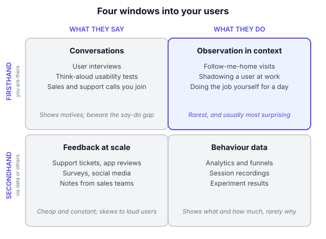
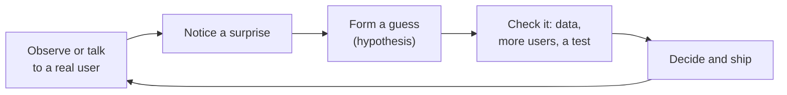
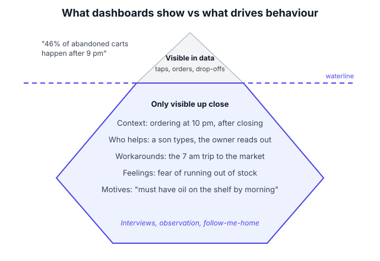

# A1.1 Building user sense and empathy

## In one line

User sense is the trained ability to predict what your users will do, feel and need, and you build it by watching real people regularly, not by guessing from your desk.

## Why this matters

Almost every PM decision is a bet on users:

- **Choosing problems:** "this pain is real and common enough to fix"
- **Shaping solutions:** "users will understand this screen without help"
- **Prioritising:** "this matters more to them than that"
- **Reading data:** "conversion fell because people didn't trust the new price display"
- **Arguing with stakeholders:** "here's what customers actually do, and here's the video"

If your picture of the user is wrong, every one of these bets goes wrong, even when the team executes perfectly. Strong PMs are not born with better instincts. They have simply spent more hours close to real users, so their guesses are better informed. This chapter shows you how to build that habit on purpose. The rest of section A1 then gives you the tools: interviews, personas, Jobs-to-be-Done and journey maps.

## Key terms

| Term | Plain-English meaning |
|---|---|
| **User sense** | Your ability to predict how real users will behave and feel in a situation. Sometimes called "customer intuition". |
| **Empathy** | Understanding a user's situation, feelings and goals from *their* point of view, not yours. |
| **Sympathy** | Feeling sorry for someone's problem while keeping your distance. It's kind, but it doesn't help you design. |
| **Say–do gap** | The difference between what people *say* they do and what they *actually* do. |
| **Curse of knowledge** | Once you know something, it's hard to imagine not knowing it. It makes experts bad at seeing beginners' confusion. |
| **Follow-me-home** | Watching a user do a real task in their own setting (home, shop, office), instead of asking them about it. |
| **Context** | Where, when, with whom and under what pressure someone uses your product. |
| **Insight** | A non-obvious truth about users that changes a decision. "Users hate waiting" is not an insight. "Shop owners order at 11 pm, after closing, when the app's support line is shut" is. |
| **Customer touchpoint** | Any small activity that puts you in contact with real users: an interview, a support call, a usability test. |

## The idea, simply

!!! tip "Analogy: the chaiwala who knows your order"
    Think of the chai stall outside your office. After a few weeks, the owner knows that you take less sugar, that the accounts team comes at 4:15 sharp, and that on rainy days everyone wants something fried with their chai. He has never run a survey. He simply watches the same people every day, notices small patterns, tests a guess ("aaj pakode?"), and remembers what worked.

    That's user sense. It isn't magic or talent. It's thousands of small observations of real people, in their real context, plus the habit of checking your guesses. A PM who never meets users is like a chaiwala who runs the stall by phone from another city. He can read the sales numbers, but he'll never know *why* Tuesday was slow.

Let's build the idea up step by step.

### 1. What user sense actually is

User sense is a **mental model of your users**: a picture in your head that lets you run quick simulations. "If we move the 'Pay later' button below the fold, what will a first-time user in Indore do?" A PM with good user sense can answer that in seconds, and is right more often than not.

It has three layers:

| Layer | What you know | Example (a bill-payments app) |
|---|---|---|
| **Facts** | Who the users are and what they do | Most users pay electricity bills in the first week of the month |
| **Context** | The situation around the action | Many pay on a shared family phone, often while standing in a queue |
| **Motives and feelings** | Why they do it and how it feels | The fear is not "will this be slow?" but "will the money go and the bill still show unpaid?" |

Analytics gives you the first layer. Only contact with real people gives you the second and third. And the third layer is usually where the best product ideas come from. In the example above, a big "Payment received by your electricity board" confirmation matters more than shaving one second off the payment flow.

### 2. Empathy is a skill, not a feeling

People often treat empathy as being "nice" or "caring". In product work it means something more practical: **seeing the situation from the user's side so clearly that you can predict their next move.**

Sarah Gibbons of the Nielsen Norman Group describes a spectrum, from **pity** (feeling sorry from a distance) through **sympathy** (acknowledging a problem you don't share) to **empathy** (understanding and sharing the user's needs and motives) and finally **compassion** (empathy that leads to action) ([NN/g, 2019](https://www.nngroup.com/articles/sympathy-vs-empathy-ux/)). The further right you go, the more effort it takes, and the more useful it is.

| Stage | Sounds like | Useful for product work? |
|---|---|---|
| Pity | "Poor users, the app is so confusing for them." | No. You stay outside their world. |
| Sympathy | "Yes, I see that onboarding is a pain point." | A little. You know *that* there's a problem, not *why*. |
| Empathy | "She's filling this in at the counter, with customers waiting, so any extra field feels like a cost." | Yes. Now you can design. |
| Compassion | "Let's cut the form to two fields and save the rest for later." | Yes. Understanding turns into action. |

Because empathy is a skill, it can be practised and it gets better with repetition. That's the good news of this chapter.

### 3. You are not your user

The most common trap for PMs is assuming users think like you. They usually don't, for three reasons:

1. **You know too much.** You know where every setting lives, what each icon means and why the flow is built that way. This is the **curse of knowledge**. A famous 1990 Stanford study by Elizabeth Newton shows it. "Tappers" tapped out well-known songs on a table and predicted listeners would name 50% of them. Listeners named just 2.5% ([The Decision Lab](https://www.thedecisionlab.com/reference-guide/management/curse-of-knowledge)). The tapper hears the tune in their head. The listener hears only knocking.
2. **You live differently.** Many PMs in India work in metros, use the latest iPhone or flagship Android, have fast Wi-Fi and pay with cards. Many of their users are on a ₹10,000 phone with 32 GB of storage, patchy 4G, an app in a second language and a family that shares the device.
3. **You care more.** You think about your product all day. Users think about it for 40 seconds, while doing something else.

| What the PM assumes | What the user's reality often is |
|---|---|
| "Users read the screen." | They scan for the one button they expect. |
| "Users remember last week's tutorial." | They don't remember installing the app. |
| "A 30 MB update is nothing." | Their storage is full; they'll delete your app first. |
| "Everyone understands 'KYC pending'." | Many don't know what KYC means or what to do next. |

The fix isn't to try harder to imagine. It's to go and look.

### 4. The say–do gap: watch behaviour, not only opinions

What people **say** and what they **do** are often different. This isn't lying. People are bad at predicting their own future behaviour and bad at remembering their past behaviour accurately.

- Ask "Would you use a feature that tracks your spending?" and most people say yes. Few will open it after week one.
- Ask "How often do you order groceries online?" and people give you the answer they wish were true.
- Ask "Is this price fair?" and people say it's too high, then buy anyway.

Rob Fitzpatrick's book [*The Mom Test*](https://momtestbook.com/) turns this into simple interview rules, all in plain language:

1. Talk about **their life**, not your idea. (Opinions about your idea are cheap.)
2. Ask about **specific things that already happened**, not general habits or future promises. "Tell me about the last time you…" beats "Would you ever…?"
3. **Listen more than you talk.**

| Weak question (invites opinion) | Strong question (invites evidence) |
|---|---|
| "Would you use an app to split bills?" | "Tell me about the last time you split a bill with friends. How did you settle it?" |
| "Do you like our new design?" | "Show me how you'd find last month's invoice." |
| "How much would you pay for this?" | "What do you use today for this? What does it cost you?" |
| "Is ordering medicines online hard?" | "Walk me through your last medicine order, from when you noticed you were running out." |

The deepest form of watching behaviour is **observation in context**. Intuit calls its version **Follow-Me-Home**: go to where the customer faces the problem, watch them for 30 to 90 minutes, ask them to show you rather than tell you, and debrief with your team soon after. Intuit is explicit that this is not an interview: the aim is to see real behaviour ([Intuit, Design for Delight](https://www.intuit.com/blog/life-at-intuit/design-for-delight-building-deep-customer-empathy-to-solve-any-problem/)).

### 5. Where user sense comes from: four windows

You can learn about users through four "windows". They differ on two questions: *am I hearing it firsthand or secondhand?* and *am I learning what they say or what they do?*

Each window shows something the others miss. The top-right box (watching behaviour firsthand) is the rarest and usually the most surprising.

| Window | Examples | Strength | Blind spot |
|---|---|---|---|
| **Firsthand, what they do** | Follow-me-home, shadowing a support agent, doing a delivery shift yourself | Shows real context and workarounds | Small numbers; takes time |
| **Firsthand, what they say** | Interviews, usability-test think-alouds, sales calls you join | Reveals motives and feelings | Say–do gap |
| **Secondhand, what they do** | Analytics, funnels, session recordings, heatmaps | Large numbers; shows *what* and *how much* | Rarely shows *why* |
| **Secondhand, what they say** | Support tickets, app-store reviews, surveys, social media, sales notes | Cheap, constant, shows pain in users' own words | Skews to angry or very happy users |

Strong PMs use all four, and they notice when they've been living in only one. A PM who only reads dashboards knows *what* happened. A PM who only does interviews knows *stories*, but not how common they are. User sense comes from moving between them, as covered in [A8.1](../08-product-metrics/01-metric-basics-leading-lagging-input-output-vanit.md): numbers tell you *what*; people tell you *why*.

### 6. Empathy needs a rhythm, not a project

Most teams do research in bursts: a big study before a big launch, then months of silence. User sense fades in those gaps. The product changes, the users change, and the PM's mental model slowly drifts out of date.

Teresa Torres, author of *Continuous Discovery Habits*, defines continuous discovery as **at a minimum, weekly touchpoints with customers, by the team building the product**, in small research activities tied to the outcome they're working on ([Product Talk](https://www.producttalk.org/glossary-discovery-continuous-discovery/)). The point is frequency. One conversation a week, every week, beats a 20-interview study once a year.

The user-sense loop. Each turn sharpens your mental model. Skipping the "check it" step is how confident PMs end up confidently wrong.

What a light weekly rhythm can look like for a busy PM:

| Activity | Time per week | What it builds |
|---|---|---|
| One 30-minute user conversation | 30 min | Motives, feelings, language |
| Read 20 random support tickets or reviews | 20 min | Pain in users' own words |
| Watch 5 session recordings of a key flow | 15 min | Where people hesitate or give up |
| Use your own product as a new user would (fresh account, low-end phone) | 15 min | Notice friction you've stopped seeing |
| Share one insight with the team | 5 min | Spreads user sense beyond you |

That's under 90 minutes a week. Over a year it adds up to about 50 conversations, 1,000 tickets and 250 recordings: a far richer mental model than any single study.

### 7. Insights: turning observations into decisions

An observation is what you saw. An **insight** is a non-obvious truth that explains it and changes what you'd do. Most research notes are full of observations and short of insights.

| Observation | Weak "insight" | Real insight |
|---|---|---|
| Three shop owners asked their sons to place the order | "Users find the app hard." | "The decision-maker isn't the app user. Owners decide what to buy; family members operate the phone. Our flow assumes one person does both." |
| Users screenshot the payment confirmation | "Users like confirmations." | "People don't trust that the payment reached the biller. They keep evidence in case of a dispute." |
| Many users abandon KYC at the PAN step | "KYC is a pain point." | "Users don't have their PAN card with them when they sign up on the go, and we give them no way to come back later." |

A simple test for an insight: **does it suggest a specific thing to build, change or stop?** If not, keep digging. Ask "why?" a few more times, or go back and watch more.

### 8. Product sense vs user sense

You'll hear the term **product sense** in interviews and job descriptions. It's the broader skill of designing a good product: picking the right problem, shaping a sensible solution and judging trade-offs. User sense is its foundation. You can't judge whether a solution is good without a solid model of who it's for. Interviewers test product sense in design questions (see [A12.2](../12-career-and-interviews/02-product-sense-and-design-interviews-circles.md)), and the strongest answers always start from a vivid, specific user rather than "users in general".

## Framework: The weekly user-sense habit

There's no single inventor of "user sense". This framework combines four well-known sources into one routine you can run every week:

- **Teresa Torres' continuous discovery:** weekly touchpoints with customers by the team building the product ([Product Talk](https://www.producttalk.org/glossary-discovery-continuous-discovery/)). Her book *Continuous Discovery Habits* came out in 2021.
- **Intuit's Follow-Me-Home:** watch people in their real setting, part of Intuit's Design for Delight principles ([Intuit](https://www.intuit.com/blog/life-at-intuit/design-for-delight-building-deep-customer-empathy-to-solve-any-problem/)).
- **The Stanford d.school's "Empathize" mode:** observe, engage and immerse, from its free [Design Thinking Bootleg](https://dschool.stanford.edu/resources/design-thinking-bootleg) guide.
- **Rob Fitzpatrick's *The Mom Test* (2013):** ask about past specifics, not opinions about your idea ([book site](https://momtestbook.com/)).

**Step 1: Anchor on a question.** Write down the outcome you're working on and the one thing you most need to understand. For example: "Why do new shop owners stop ordering after their second week?" Research without a question turns into pleasant chats that change nothing.

**Step 2: Make recruiting automatic.** The hardest part of weekly contact is finding people. Set up a standing pipeline: an in-app "Can we call you?" prompt, a list from customer support, a field sales team who introduces you, or a small paid panel. Aim for a mix of new, loyal, struggling and churned users.

**Step 3: Pick your windows for the week.** Use at least two of the four windows from the 2×2 above. A good default is one conversation or observation (firsthand) plus one secondhand source (tickets, reviews or recordings).

**Step 4: Run the session the right way.**

- Observe before you ask. "Can you show me how you did your last order?"
- Ask about specific past events, not opinions or future promises.
- Talk for less than a third of the time.
- Never pitch your idea. The moment you do, you'll hear politeness instead of truth.

**Step 5: Debrief within 24 hours.** Write a one-page note: who, context, what they did, quotes in their own words, surprises, and open questions. Do it with your designer and engineer if they joined. Memory fades fast and gets tidier than reality.

**Step 6: Turn observations into insights, then check them.** Look across notes for patterns. Phrase each candidate insight so it suggests a decision. Then check it with data: how many users does this affect? A surprise from one user is a lead, not a fact.

**Step 7: Share and decide.** Post one insight, one quote or one 60-second clip to the team each week. Link insights to decisions in your roadmap or PRD. User sense that stays in your head doesn't help the team.

**When to use:** always, as a background habit. Turn it up before a big bet, when entering a new market or segment, when a metric moves and nobody knows why ([A8.6](../08-product-metrics/06-diagnosing-a-metric-drop.md)), and in your first 90 days in a new PM job.

**When not to rely on it alone:** a handful of conversations can't tell you *how many* users share a problem or whether a change *caused* an improvement. For "how many", use data and surveys. For "did it work", use experiments ([A9.1](../09-experimentation/01-a-b-testing-basics.md)). And don't let "we need more research" become a reason to avoid a small, cheap, reversible decision. Sometimes shipping and watching is the fastest research.

## Diagram

Dashboards show the tip of the iceberg. Most of what drives behaviour (who's helping, what they fear, the workaround they use) sits below the waterline, and you only see it by getting close.

## Worked example

You're the PM for the ordering app of a B2B wholesale company. Kirana (neighbourhood grocery) owners in Lucknow and Kanpur use it to restock. Your goal this quarter: raise weekly orders.

**Step 1: Start from the numbers (secondhand, what they do).**

| Weekly funnel | Value now |
|---|---|
| Stores that start a cart | 11,000 |
| Stores that place an order | 7,000 |
| **Cart-to-order conversion** | **64%** |
| Abandoned carts | 4,000 |
| Share of abandonments between 9 pm and midnight | 46% (about 1,840 carts) |

The analytics team suggests a 5% discount, because "price is the usual reason people abandon carts".

**Step 2: Anchor a question.** "Why do so many owners abandon carts late at night?"

**Step 3: Run a one-week empathy sprint.** You, your designer and one engineer split the work:

| Activity | Count | Team hours |
|---|---|---|
| Follow-me-home visits to shops (incl. one after closing time) | 6 | 18 |
| Phone calls with owners who abandoned a cart last week | 8 | 6 |
| Support tickets read and tagged | 200 | 6 |
| Session recordings of late-night abandoned carts | 40 | 5 |
| Debriefs and synthesis | 4 | 8 |
| **Total** | | **43 hours** |

**Step 4: What you saw.**

- Owners plan the order after closing, around 10 pm, from a handwritten notebook. In four of six shops a son or daughter types it in while the owner reads out items.
- When they reach checkout after 9 pm, tomorrow's delivery slot often shows "Sold out", and the app quietly moves delivery to the day after.
- Owners can't wait two days for fast-moving items like oil and biscuits. So they close the app and visit the wholesale market at 7 am.
- Not one of the 14 owners mentioned price as the reason. Several said your prices were *better* than the market's.

**Step 5: Check it with data.** You go back to the analytics. Among late-night abandoned carts, 71% had seen a "next slot: day after tomorrow" message. Among late-night carts that converted, only 9% had. Your observation is not a one-off; it's the main pattern.

**Step 6: The insight.** "Owners order after closing, as a two-person task, and need delivery by the next morning. When we can't promise that, we lose the order to the wholesale market, not to a competitor app."

**Step 7: Decide.** Instead of a discount, the team ships:

1. **Show tomorrow's slot availability on the home screen** from 6 pm, before owners build a cart.
2. **"Hold my slot"**: reserve a next-day slot for 2 hours while the cart is built.
3. **Photo-of-list ordering** as a follow-up experiment, since the notebook is the real starting point.

**Step 8: What is it worth?**

| | Discount idea | Slot fix |
|---|---|---|
| What it changes | Price (not the real problem) | Delivery promise (the real problem) |
| Cost per week | 5% × 7,000 orders × ₹6,000 average order = **₹21 lakh** in discounts on orders you'd have got anyway | One-time build of about 3 sprints |
| Likely recovered orders per week | Few; price wasn't the blocker | If one-third of the 1,840 late-night abandoned carts convert: **about 610 orders** |
| Extra value | Negative margin | 610 × ₹6,000 = ₹36.6 lakh extra order value a week; at a 3% contribution margin, about **₹1.1 lakh a week, or ₹57 lakh a year** |

The 43 hours of empathy work didn't just find a better idea. It stopped a costly wrong one. Notice the counter metric you'll now watch: **on-time delivery rate for held slots**. A promise you can't keep would destroy the trust you just built.

## Going deeper: nuances and trade-offs

### 1. Empathy has limits, so stay humble

Spending a day in a user's shoes is powerful, but it can also mislead. A PM who rides one delivery shift has seen one shift, in one city, with the safety net of knowing they'll go home to their real job. Treat what you experience as a set of strong hypotheses, not as "now I know what it's like". Always pair immersion with conversations with people who live it every day, and with data on how common each problem is.

### 2. The user, the buyer and the decision-maker may be different people

In consumer products, one person often uses, chooses and pays. In many other cases these split:

| Product | Who uses it | Who decides or pays |
|---|---|---|
| School learning app | Child | Parent |
| Office expense tool (B2B) | Employees | Finance head |
| Kirana ordering app | Son or daughter typing | Shop owner |
| Hospital software | Nurses | Hospital administrator |

User sense means understanding all of them, and the tension between them. A B2B tool that delights the buyer's spreadsheet but frustrates daily users will get low adoption and will eventually be cancelled. In B2B, also remember there are fewer customers, so each conversation carries more weight and you can often meet a big share of your users personally.

### 3. India-specific realities that change what you see

- **Shared and assisted use.** One phone may serve a family. Older users often get help from a younger relative or a shopkeeper, so the "user" in your data may be two people.
- **Language and literacy.** Many users prefer Hindi, Tamil, Bengali or another language, and many prefer voice or pictures to text. An English-only interview with an English-comfortable user tells you little about the rest.
- **Low-end devices and patchy networks.** Test on a budget Android phone with full storage and a weak signal, not your own phone on office Wi-Fi.
- **Trust and cash.** Fear of losing money, distrust of auto-debits, and comfort with cash on delivery shape behaviour in ways metro PMs often underestimate.
- **Go in person.** Video calls exclude many of the users you most need to understand. Field visits, often with a local colleague, are worth the travel.

### 4. Bias: whose voice are you hearing?

Every window has a skew. Watch for:

- **Loud users.** Support tickets and reviews over-represent angry users and power users.
- **Convenient users.** Friends, colleagues and the people easiest to recruit (urban, English-speaking, tech-savvy) are rarely representative.
- **Survivors.** Talking only to current users misses the people who tried you and left, and people who never tried at all. Churned users and non-users often teach you the most.
- **Confirmation bias.** You'll notice what supports your favourite idea. Write down your hypothesis *before* the sessions and look hard for evidence against it.

A simple guard: for each batch of sessions, note who you talked to by segment, and ask, "Who's missing?"

### 5. When your gut and the data disagree

Sometimes your user sense says one thing and the dashboard says another. Neither wins automatically.

- If data contradicts your instinct, your mental model may be outdated, or the data may be wrong (tracking bugs are common; see [A8.1](../08-product-metrics/01-metric-basics-leading-lagging-input-output-vanit.md)). Check both.
- If your instinct sees something the data doesn't, it may be a real but small problem, or an early signal of something bigger. Size it before acting.
- The best move is usually a small, cheap test that could prove either side wrong.

Experienced PMs say "I have a strong hunch, and here's how we'll check it" far more often than "trust me".

### 6. Making user sense a team sport

If only the PM talks to users, the team depends on the PM's retelling, and nuance gets lost. Better practices:

- Bring a designer and an engineer to sessions. Teresa Torres encourages the **product trio** (PM, designer, tech lead) to do discovery together ([A0.2](../00-the-pm-role/02-product-teams-the-trio-empowered-vs-feature-team.md)).
- Share raw material (short clips, real quotes), not just your conclusions.
- Rotate who does the weekly session so everyone builds their own user sense.

Research is increasingly done by non-researchers. In Maze's 2026 survey of about 500 research, design and product professionals, 39% said product managers conduct user research at their organisation ([Maze, March 2026](https://maze.co/blog/future-user-research-2026/)). If you have a user researcher on the team, use them as a coach and partner. They can help you avoid leading questions and biased samples.

### 7. AI tools: faster synthesis, not a replacement for users

AI tools can now transcribe interviews, tag hundreds of tickets and draft summaries in minutes. That's genuinely useful for the secondhand windows. Be more careful with **synthetic users**, where an AI pretends to be a type of customer and answers your questions.

In an October 2026 study, Nielsen Norman Group compared 120 synthetic respondents with real survey answers on the same question. The synthetic answers reached the same broad conclusion, but collapsed onto about a dozen labels where humans used more than 50. They also badly misjudged one group: 93% of synthetic product managers used "UX" terms, against 44% of real ones ([NN/g, 2026](https://www.nngroup.com/articles/synthetic-users-vs-human-respondents/)). NN/g's advice: treat synthetic findings as hypotheses, not evidence, and check them against real people. Remember that the surprises, the unusual answers, are exactly what user sense is for.

### 8. Ethics, consent and safety

User contact comes with responsibilities:

- **Get consent** before recording, and explain how you'll use the recording.
- **Pay or thank people fairly** for their time, especially small-business owners whose time is money.
- **Protect personal data.** Keep notes and recordings in approved tools, share them only inside the team and strip out phone numbers and account details. India's Digital Personal Data Protection Act applies to personal data you collect (see [B4.3](../../part-b/04-data-safety-and-law/03-ai-regulation-eu-ai-act-india-s-dpdp-act-and-ai.md)).
- **Don't create false expectations.** Don't promise features during a session.
- **Stay safe in the field.** Go in pairs for home visits, and tell someone where you'll be.

## Real-world examples (2023 onwards)

!!! example "Zomato, October 2024: the CEO on a delivery shift"
    In early October 2024, Zomato CEO Deepinder Goyal and his wife Gia worked a day as delivery partners and shared a video of it. Picking up an order at a Gurugram mall, Goyal was stopped at the main entrance, sent to another entrance, directed to the stairs instead of the lift, and then made to wait on the stairs on the third floor. While waiting, he sat with other delivery partners and asked for their feedback. Afterwards he said Zomato needed to work more closely with malls to improve working conditions for delivery partners ([YourStory, 8 Oct 2024](https://yourstory.com/2024/10/zomato-ceo-deepinder-goyal-realities-delivery-life)).

    **PM lesson:** Zomato's dashboards could show pickup wait times at that mall. Only being there showed *why*: rules set by a third party (the mall) that made a delivery partner's job harder. That's a context-layer insight you can't get from data. Notice the user here isn't the customer. It's the delivery partner, one side of a three-sided marketplace (customers, restaurants, delivery partners). User sense has to cover every side.

!!! example "Xbox Adaptive Joystick, August 2024: building with the users"
    In August 2024, Microsoft announced the Xbox Adaptive Joystick, a single wired joystick for players with limited mobility, priced at $29.99 and due in early 2025. Xbox said it came from years of research, testing and collaboration with players with disabilities and accessibility experts. It said players had told it they needed an affordable, single joystick, and that the packaging design was shaped by feedback from the gaming and disability community ([Xbox Wire, 21 Aug 2024](https://news.xbox.com/en-us/2024/08/21/xbox-accessibility-adaptive-joystick-thumbstick-toppers/)).

    **PM lesson:** When your users' lives are very different from your team's, imagination isn't enough. Xbox didn't guess what players with limited mobility needed; it worked with them over years, down to how the box opens. It also learned that *price* and *simplicity* mattered to these users, not just features. That's the kind of motive you only hear by listening.

## Common mistakes

!!! warning "Watch out for"
    - **Treating yourself as the user.** "I'd never use that" is one data point, and usually an unrepresentative one.
    - **Asking for opinions about your idea.** "Would you use this?" gets polite yeses, not evidence.
    - **Research in bursts.** One big study a year, then silence. User sense goes stale between them.
    - **Only reading dashboards.** You'll know *what* happened, never *why*.
    - **Only doing interviews.** You'll have vivid stories with no sense of how common they are.
    - **Talking only to easy-to-reach users.** Metro, English-speaking, loyal users are rarely the whole picture. Seek out churned users and non-users.
    - **Keeping insights in your head.** If the team doesn't see the quotes and clips, they can't build user sense of their own.
    - **Confusing observations with insights.** "Users find it confusing" isn't an insight until it explains *why* and points to a decision.

## Common questions

**Is user sense something you're born with?**
No. Some people are naturally curious, which helps. But user sense comes mainly from exposure: many hours watching and listening to real users, and checking your guesses. Anyone can build it with a weekly habit.

**How many users do I need to talk to?**
For understanding motives and spotting problems, a handful of well-chosen people per segment often reveals the main patterns. For knowing how many users share a problem, you need data or a survey. Use conversations to find problems, and numbers to size them.

**I'm a PM in a B2B company with few customers. How do I build user sense?**
Join sales and support calls, sit with customer success teams, and visit customer sites. With fewer customers, you can often know many of them personally. Remember to talk to daily users, not only the buyer who signed the contract.

**My company has a research team. Do I still need to talk to users?**
Yes. Researchers bring rigour and scale, but you make the daily calls on what to build. Reading a report is not the same as hearing a frustrated user in their own words. Join their sessions and ask them to coach your interviewing.

**What if I don't have time?**
Start with 30 minutes a week: one call or 20 support tickets. It's the highest-return half hour in your week, because it improves every other decision you make.

**Can I use ChatGPT or Claude to "be my user"?**
Use AI to brainstorm questions, summarise transcripts and tag tickets. Don't treat an AI persona's answers as evidence about real users. Studies so far show synthetic answers are less varied than real ones and can miss how particular groups differ.

## In the interview

!!! question "In the interview"
    **How it's tested:** Rarely by name. Instead it shows up inside product sense and design questions ("Design a product for…", "Improve…"), and in behavioural questions such as "Tell me about a time you learned something surprising about your users." Interviewers look for whether you start from a specific user and their context, or jump straight to features.

    **Sample question:** *"How would you improve Google Maps for auto-rickshaw drivers in India?"*

    **Outline of a strong answer:**

    1. **Clarify the goal:** more drivers using Maps for navigation, or better trips for their passengers? Agree on one.
    2. **Paint the user's context:** drivers on budget phones, often mounted or held, in heavy traffic, frequently navigating to landmarks rather than addresses, sometimes more comfortable in a local language and with voice than text.
    3. **List their key needs and pains:** routes that suit autos (lanes, no highways), landmark-based directions, low data use, hands-free voice in their language.
    4. **Prioritise one pain** and explain why (frequency × severity).
    5. **Propose 2–3 solutions** and pick one, with trade-offs.
    6. **Say how you'd validate:** ride along with a few drivers (a follow-me-home), then measure, for example, the share of trips where drivers keep navigation running to the end.

    Interviewers listen for a vivid, specific user, real context, and a plan to check your assumptions with actual users.

    **A behavioural version:** *"Tell me about a time your assumption about users was wrong."* A strong answer names the assumption, how you found out (a specific session or data point), what changed in the product, and what you now do differently.

## Research happening now

!!! info "Research happening now"
    - **Synthetic users vs real respondents (NN/g, October 2026).** Nielsen Norman Group compared 120 AI-generated respondents with 604 real professionals on the same open-ended question. The broad conclusion matched, but synthetic answers were far less varied and understated differences between job roles ([NN/g](https://www.nngroup.com/articles/synthetic-users-vs-human-respondents/)). *Status: a single small study on one question; the authors say platform quirks may have influenced results.*
    - **Who does user research now (Maze, March 2026).** Maze's *Future of User Research Report 2026*, a survey of about 500 professionals, found 66% say demand for research has grown, 69% use AI in at least some research projects, and 39% report product managers conducting research ([Maze](https://maze.co/blog/future-user-research-2026/)). Respondents saw interpreting nuance and emotion as the part humans matter most for. *Status: industry survey, not peer-reviewed; respondents are Maze's audience.*

## Try it yourself (30 minutes)

Pick an app you use often (UPI, food delivery, a ride-hailing app). Find one person who uses it differently from you: a parent, a shopkeeper, a cousin in a smaller town.

1. Ask them to **show you** the last time they used it for a real task. Don't help. Just watch and take notes for 10 minutes.
2. Then ask 3 questions about **specific past events**, such as "Tell me about the last time this went wrong."
3. Write down: 3 observations, 1 quote in their own words, and 1 candidate insight that would change a product decision.

??? success "Check your answer"
    - **Did you watch before you asked?** If you started with questions, you mostly heard opinions.
    - **Are your questions about the past, not the future?** "Would you…?" questions don't count.
    - **Did you talk less than a third of the time?**
    - **Is your quote in their words, not yours?**
    - **Does your insight point to a decision?** Example: "My mother never uses UPI's QR scanner because she can't tell if she's paying or receiving. She asks the shopkeeper to type her number instead." That suggests a clear change: label the direction of money in large, plain words.
    - **Did anything surprise you?** If not, you may have been seeing what you expected. Try again with someone even less like you.

## How this connects

- [A1.2 User research methods and interviews](02-user-research-methods-and-interviews.md): the detailed toolkit for the "firsthand" windows.
- [A1.3 Personas and Jobs-to-be-Done](03-personas-and-jobs-to-be-done.md): how to capture user sense so the whole team can use it.
- [A1.4 Journey maps and empathy maps](04-journey-maps-and-empathy-maps.md): turning observations into a shared picture of the user's experience.
- [A2.1 Continuous discovery and opportunity solution trees](../02-problem-discovery/01-continuous-discovery-and-opportunity-solution-tr.md): how weekly user contact feeds decisions about what to build.
- [A8.1 Metric basics](../08-product-metrics/01-metric-basics-leading-lagging-input-output-vanit.md): pairing numbers (what) with people (why).

## Go deeper

- **Book:** [*The Mom Test*](https://momtestbook.com/) by Rob Fitzpatrick. A short, practical guide to asking questions that get honest answers instead of polite ones.
- **Book:** *Continuous Discovery Habits* by Teresa Torres. Start with her free [continuous discovery glossary entry on Product Talk](https://www.producttalk.org/glossary-discovery-continuous-discovery/), which explains weekly customer touchpoints.
- **Article:** [Intuit: Design for Delight, building deep customer empathy](https://www.intuit.com/blog/life-at-intuit/design-for-delight-building-deep-customer-empathy-to-solve-any-problem/). How Intuit runs Follow-Me-Home sessions.
- **Article:** [NN/g: Sympathy vs. empathy in UX](https://www.nngroup.com/articles/sympathy-vs-empathy-ux/). The empathy spectrum, with a clear diagram.
- **Guide:** [Stanford d.school: Design Thinking Bootleg](https://dschool.stanford.edu/resources/design-thinking-bootleg). Free method cards, including observe, engage and immerse.
- **Article:** [NN/g: Synthetic users vs. human respondents](https://www.nngroup.com/articles/synthetic-users-vs-human-respondents/). Why AI "users" can't replace real ones yet.

## Key takeaways

- User sense is a **mental model of your users** built from many small observations. It's a skill, not a gift.
- **You are not your user.** The curse of knowledge and a different life make your instincts unreliable until you check them.
- **Watch behaviour, not just opinions.** Ask about specific past events and observe people in their real context.
- Use **all four windows**: firsthand and secondhand, what people say and what they do.
- Build a **weekly rhythm**. Ninety minutes a week beats one big study a year.
- Turn observations into **insights that point to decisions**, then **size them with data**.
- Make it a **team sport**, and treat AI "synthetic users" as hypotheses, never as evidence.

## Updates

*No updates yet.*
