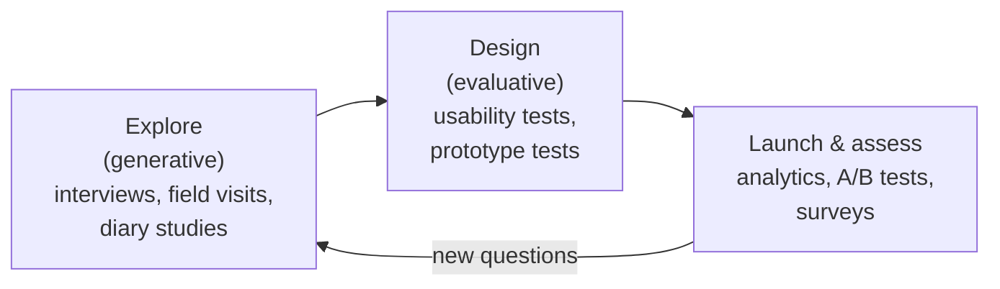
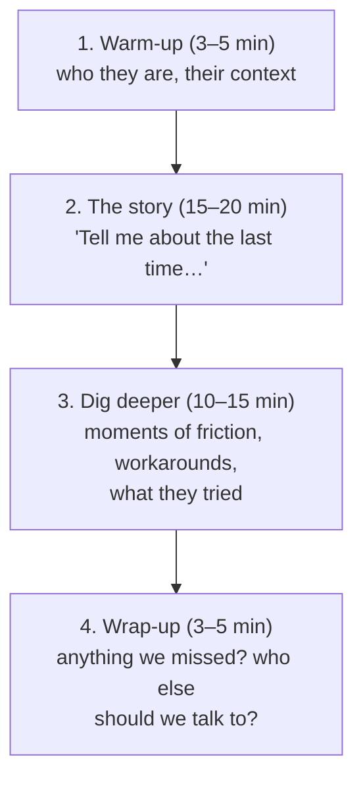
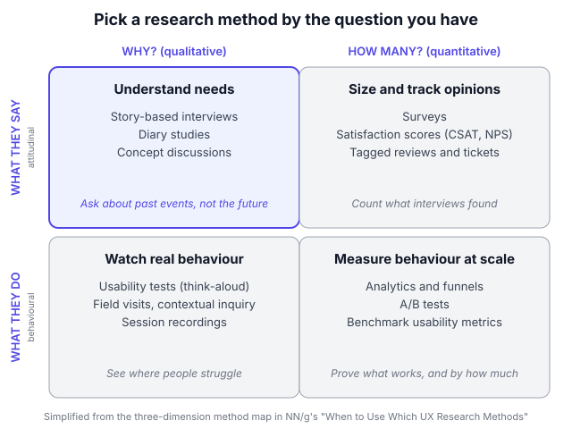

# A1.2 User research methods and interviews

## In one line

Good user research starts with the decision you need to make, picks the method that can actually answer it, and, when that method is an interview, collects true stories about what people did, not opinions about what they might do.

## Why this matters

Every product decision rests on a belief about users: "they want faster delivery", "they'll pay for this", "they don't understand the auto-debit step". Research is how you check those beliefs before you spend months building on them. As a PM you'll often run research yourself, especially interviews, and you'll constantly judge research others bring you. Knowing which method answers which question, and how to run an interview that doesn't just tell you what you want to hear, is one of the highest-leverage skills you can build.

## Key terms

| Term | Plain-English meaning |
|---|---|
| **Generative research** | Research to discover problems and opportunities you didn't know about ("what's hard about managing money for a family?"). |
| **Evaluative research** | Research to check whether a specific design or product works ("can people set up a SIP with this screen?"). |
| **Attitudinal vs behavioural** | What people *say* (beliefs, opinions) vs what people *do* (actions you can observe or log). |
| **Qualitative vs quantitative** | Rich detail from a few people that explains *why*, vs numbers from many people that show *how many* or *how much*. |
| **Usability test** | Watching someone try to complete real tasks with your product or prototype, usually while they think aloud. |
| **Contextual inquiry (field study)** | Interviewing and observing people where they actually do the task: their shop, office or home. |
| **Discussion guide** | The plan for an interview: goals, main questions and follow-up prompts. |
| **Leading question** | A question that hints at the "right" answer ("Wouldn't it be easier if…?"). |
| **Screener** | A short questionnaire used to recruit the right participants and filter out the wrong ones. |
| **Saturation** | The point where new interviews stop teaching you anything new. |
| **Synthesis** | Turning raw notes into patterns and insights, for example by grouping notes on a wall (affinity mapping). |

## The idea, simply

!!! tip "Analogy: the good family doctor"
    You visit a doctor with a stomach ache. A good doctor doesn't start by ordering every test in the lab. First she asks you to *tell her what happened*: when it started, what you ate, what you were doing. She listens more than she talks. She doesn't ask "It's probably acidity, right?" because you might just agree.

    Then she *examines* you, because what you say and what's actually happening can differ. Only then does she order a *specific* test to confirm or rule out what she suspects. And if fifty patients from the same area come in with the same symptoms, she starts counting, because now the question is "how many, and how widespread?"

    History, examination, tests, counting. User research works the same way: ask for the story, observe the behaviour, test the specific idea, and count when you need scale.

Let's build the idea up.

### 1. Start with the decision, not the method

The most common research mistake is starting with a method ("let's do a survey!") instead of a question. Work backwards:

1. **Decision:** what will we decide differently depending on what we learn? (Build the feature or not? Which of two flows?)
2. **Question:** what do we need to know to make that decision?
3. **Method:** which method can answer *that* question, fastest and most honestly?

| Decision | Research question | Good method | Poor method |
|---|---|---|---|
| Should we build a family-account feature? | How do families manage shared spending today, and where does it hurt? | Interviews and home visits | A survey asking "Would you use a family account?" |
| Which of two checkout designs do we ship? | Can users complete checkout without errors? | Usability test, then an A/B test | Asking users which design they prefer |
| How common is the problem we found in interviews? | What share of users face it? | Survey or product analytics | More interviews |
| Why did repeat orders drop in Pune last month? | What changed for those users? | Analytics first, then a few calls | A brainstorm in the office |

### 2. The map of methods: three questions

Christian Rohrer of Nielsen Norman Group maps 20 common research methods along three dimensions in his article ["When to Use Which User-Experience Research Methods"](https://www.nngroup.com/articles/which-ux-research-methods/):

- **Say or do?** *Attitudinal* methods capture what people say; *behavioural* methods capture what they do.
- **Why or how many?** *Qualitative* methods are better at "why"; *quantitative* methods at "how many" and "how much".
- **How is the product used during the study?** Naturally (in real life), in a scripted task, or not at all.

Here are the methods a PM meets most often:

| Method | Say or do | Why or how many | Best for | Typical size |
|---|---|---|---|---|
| **User interview** | Say | Why | Understanding needs, context, past behaviour | 5–15 people |
| **Contextual inquiry / field visit** | Do + say | Why | Seeing the real environment and workarounds | 4–10 visits |
| **Usability test** | Do | Why (and some how many) | Finding where a design confuses people | ~5 per round |
| **Diary study** | Say + do, over time | Why | Behaviour that unfolds over days or weeks | 10–20 people |
| **Survey** | Say | How many | Sizing a problem; measuring satisfaction | Hundreds or more |
| **Analytics / funnels** | Do | How many | What people do in the product, at scale | All users |
| **A/B test** | Do | How many | Proving which version performs better | Thousands |
| **Support tickets and reviews** | Say | Both | Spotting recurring pain cheaply | Ongoing |

A simple rule: **use "say" methods to understand, "do" methods to confirm.** People are good at telling you about their lives and frustrations. They are poor at predicting their own future behaviour.

### 3. Generative vs evaluative: where you are in the journey

Rohrer's article also maps methods to product stages. Early on (strategise) you're *generating* ideas: field studies, interviews and diary studies. While designing, you're *forming* the design: usability tests and card sorting. After launch, you're *assessing*: analytics, A/B tests and benchmark surveys.

Research isn't one phase. Each stage asks a different question, and what you learn after launch feeds the next round of exploration.

A common trap is using evaluative methods for generative questions: showing users a prototype and asking "would you use this?" before you know whether the problem matters to them.

### 4. Interviews: what they're good at, and what they're not

The interview is the PM's most-used research tool, because it's cheap, fast and flexible.

**Interviews are good at:**

- Learning how people do something today, step by step
- Uncovering motives, fears and context you'd never see in a dashboard
- Finding the words users use (gold for copy and search)
- Learning about workarounds: a WhatsApp group, a notebook, an Excel sheet. Workarounds are signs of unmet needs.

**Interviews are bad at:**

- Predicting future behaviour ("Would you pay ₹99 a month?")
- Measuring how common something is
- Judging usability. People will say a screen is "easy" right after struggling with it.

### 5. Ask for stories, not opinions

The single most useful interview habit is to ask about **specific past events**. Teresa Torres calls this [story-based interviewing](https://www.producttalk.org/glossary-discovery-story-based-interviewing/): instead of asking what people *usually* do or *would* do, ask them to tell you about *the last time* they did something, and walk through it.

Why it works: general questions ("How do you usually pay bills?") invite people to describe their ideal self. A specific story ("Tell me about the last bill you paid") pulls up real memories, with real details, including the messy parts. Rob Fitzpatrick's [*The Mom Test*](https://momtestbook.com/) makes the same point: talk about their life, not your idea, and ask about specifics in the past rather than opinions about the future.

| Weak question | Why it's weak | Stronger version |
|---|---|---|
| "Would you use a feature that splits bills with flatmates?" | Asks for a prediction; people say yes to be nice | "Tell me about the last time you split a bill with flatmates. What happened?" |
| "Do you find our app easy to use?" | Yes/no; invites politeness | "Walk me through the last time you used the app. Where did you pause?" |
| "Wouldn't it be better if delivery was faster?" | Leading; everyone wants faster | "Tell me about a recent order that arrived later than you wanted. What did you do?" |
| "How often do you order groceries online?" | People guess, and guess wrong | "When did you last order groceries online? And the time before that?" |
| "What features do you want?" | Users aren't designers | "What did you try that didn't work? What did you do instead?" |
| "Why don't you invest in mutual funds?" | "Why" questions can feel like judgement | "Tell me about the last time you thought about investing. What happened next?" |

### 6. Structure of a good interview

A 30–45 minute interview usually has four parts.

Spend most of the time in the story. Your idea, if it appears at all, comes last, after you've learned what you came to learn.

During the interview:

- **Talk less.** Aim for the participant to speak most of the time.
- **Use silence.** After an answer, wait three seconds. People often add the most honest part after a pause.
- **Follow the energy.** When someone sighs, laughs or says "ugh, that part", ask "Tell me more about that."
- **Ask for evidence.** "Can you show me?" (the app, the message, the notebook) beats a description.
- **Don't pitch or defend.** If they criticise your product, thank them and ask for an example.
- **Have a note-taker.** One person asks, one person writes. Record only with clear permission.

### 7. How many people is enough?

There's no magic number, but there are useful guides.

- **Usability tests:** Jakob Nielsen's well-known 2000 analysis estimated that 5 similar users uncover roughly 85% of the usability problems in a design. His advice: with budget for 15 people, run 3 rounds of 5, fixing problems between rounds ([NN/g](https://www.nngroup.com/articles/why-you-only-need-to-test-with-5-users/)). This applies to qualitative testing of comparable users; very different user groups each need their own small set.
- **Interviews:** NN/g's Maria Rosala explains that there "isn't a golden number" for interviews ([NN/g](https://www.nngroup.com/articles/interview-sample-size/)). Start with 5–6 people from one segment, analyse as you go, and stop when you stop learning (saturation). She cites a 2006 study by Guest, Bunce and Johnson in which most themes appeared within 6 interviews and themes were stable by 12.
- **Surveys:** you need many more, often hundreds, because you're counting, not understanding.

What raises the number: very different user groups (5 per segment, not 5 total), a broad question, or a less experienced interviewer.

### 8. Recruiting the right people

Your research is only as good as the people you talk to. Three rules:

1. **Recruit on behaviour, not demographics.** "Ordered groceries online at least twice in the last month" is better than "25–35, urban".
2. **Include the people you're losing.** Users who dropped off, churned or chose a competitor teach you the most, and are the hardest to reach.
3. **Avoid "professional participants" and friends.** People who join many studies, or who know you, give polished, polite answers.

A **screener** of 5–8 questions filters participants. Hide the real topic so people can't guess the "right" answers to qualify.

### 9. From notes to insights

Within 24 hours of each session, write a short debrief (see the [session debrief template](../../appendix/templates.md)). After 5–8 sessions:

1. Put each observation on a separate sticky note (paper or digital).
2. Group notes that point to the same underlying need or problem (affinity mapping).
3. Name each group as a *finding* ("Users don't trust auto-debit until they've seen one debit happen").
4. Count how many participants support each finding. Don't over-claim from one person.
5. Turn findings into *decisions* or *questions to test next*.

An observation is "3 of 8 people screenshot the payment confirmation". An insight is "People don't trust the app's record of a payment, so they keep their own proof", which suggests a decision, such as a shareable receipt.

## Framework: the research plan on a page + the story-based interview

No single person invented user research. The method map comes from Christian Rohrer's NN/g article ([2022 version](https://www.nngroup.com/articles/which-ux-research-methods/)). The interview practices below draw on Steve Portigal's [*Interviewing Users*](https://rosenfeldmedia.com/books/interviewing-users-second-edition/) (2nd edition, 2023), Erika Hall's [*Just Enough Research*](https://abookapart.com/products/just-enough-research), Rob Fitzpatrick's [*The Mom Test*](https://momtestbook.com/) (2013) and Teresa Torres's [story-based interviewing](https://www.producttalk.org/glossary-discovery-story-based-interviewing/).

**Step 1: Write the decision and the research question.** One sentence each. "We'll decide whether to redesign SIP setup or fix bank-mandate messaging. We need to know why people abandon SIP setup."

**Step 2: List what you already know.** Check analytics, past research, support tickets and app reviews first. Research should fill gaps, not repeat what's already known.

**Step 3: Choose methods using the map.** Usually a mix: data to find *where*, interviews or field visits to learn *why*, a survey or analytics to check *how many*, and usability tests to check a fix.

**Step 4: Decide who and how many.** Define segments by behaviour. Plan 5–8 interviews per segment, with a stopping rule ("stop when two interviews in a row add nothing new").

**Step 5: Write the screener and recruit.** Offer a fair incentive and make the topic vague in the screener.

**Step 6: Write the discussion guide.** Warm-up, story ("Tell me about the last time…"), dig deeper, wrap-up. 5–8 main questions plus follow-up prompts. Use the [discussion guide template](../../appendix/templates.md).

**Step 7: Run sessions in pairs.** One interviewer, one note-taker. Ask for consent to record. Debrief for 15 minutes right after each session.

**Step 8: Synthesise.** Affinity-map observations into findings, count support for each, and separate observations from interpretations.

**Step 9: Share as decisions.** Lead with "what this means for what we build", supported by quotes and short clips. Keep a simple research log so future teams can find it.

**When to use:** before committing to a roadmap item, when a metric moves and you don't know why, when entering a new user segment or market, and before and after design changes.

**When not to:** when the answer is already in your data; when the decision is cheap to reverse, so it's faster to ship a small test (an A/B test or fake-door test, see [A2.3](../02-problem-discovery/03-assumption-testing-prototypes-and-mvps.md)); or when you'd ignore the results anyway because the decision is already made. Research to justify a decision wastes users' time and your credibility.

## Diagram

Start in the top-left box to understand, move to the bottom-left to watch real behaviour, and use the right-hand boxes to count what you found.

## Worked example

You're the PM for a mutual-fund investing app. The funnel for starting a monthly SIP (systematic investment plan, an automatic monthly investment) looks like this. *All numbers are illustrative.*

**Step 1: The data shows where.**

| Funnel step (monthly) | Users | Step conversion |
|---|---|---|
| Started SIP setup | 100,000 | |
| Chose a fund and amount | 82,000 | 82% |
| Started bank auto-debit (mandate) setup | 74,000 | 90% |
| **Completed mandate approval** | **60,000** | **81%** |
| First SIP instalment successful | 56,000 | 93% |

The biggest drop is at mandate approval: 14,000 people a month. The team has two competing theories. Design says "the bank pages are confusing". Business says "people are waiting for salary day". Each theory points to a different fix.

**Step 2: Decision and question.** Decision: redesign the mandate flow, or add a "start next month" option? Question: why do people who start mandate setup not finish it?

**Step 3: Plan the mix.**

| Method | Who | How many | Time | Cost |
|---|---|---|---|---|
| Story-based phone or video interviews | Users who abandoned at mandate in the last 14 days | 8 | 8 × 40 min | ₹500 voucher each = ₹4,000 |
| Usability test of current flow | New users who've never set up a mandate | 5 | 5 × 30 min | ₹500 each = ₹2,500 |
| In-app survey (2 questions) | All mandate abandoners for 2 weeks | ~1,200 responses | Setup 2 hours | ₹0 |

Total direct cost: about ₹6,500 and roughly 3 days of PM and designer time.

**Step 4: Interview findings (8 people).**

| Finding | Participants |
|---|---|
| Unsure whether money would be taken immediately or on the SIP date | 6 of 8 |
| Bank page asked for a debit card or net-banking login they didn't have handy | 4 of 8 |
| Worried about "giving the app permission to take money anytime" | 4 of 8 |
| Waiting for salary to arrive first | 2 of 8 |

The salary theory is real, but small. The bigger story is uncertainty and trust. One participant said, "I thought it would cut ₹5,000 right now, and rent was due." That's an observation from one person; the count of 6 of 8 makes it a finding worth checking at scale.

**Step 5: Usability test (5 people).** 3 of 5 couldn't say, after setup, *when* the first debit would happen. 2 of 5 left the app to find their debit card.

**Step 6: Survey sizes it.** Of 1,200 abandoners who answered "What stopped you?":

| Reason | Share |
|---|---|
| Not sure when or how much would be debited | 38% |
| Didn't have bank login or card details at hand | 24% |
| Didn't want to give auto-debit permission | 17% |
| Waiting for salary or funds | 12% |
| Other | 9% |

**Step 7: Decisions.**

1. Before the bank step, show a plain-language summary: "₹5,000 will be debited on the 5th of every month, starting 5 December. Nothing is debited today. You can pause or cancel anytime."
2. Tell people what they'll need (debit card or net-banking) *before* they start, with a "remind me later" option.
3. Keep the salary-day idea as a smaller follow-up test.

**Step 8: What is it worth?** If the clearer flow lifts mandate completion from 81% to 86%, that's 74,000 × 5% = **3,700 extra completed SIPs a month**. At an average SIP of ₹2,000, that's about **₹74 lakh in new monthly SIP flows from each month's cohort**, which compounds as cohorts stack up. You'd confirm the lift with an A/B test ([A9.1](../09-experimentation/01-a-b-testing-basics.md)), using failed first instalments and cancellations in the first 30 days as guardrails.

Notice what research did here: ₹6,500 and three days stopped the team from building the "salary-day" feature first, which addressed only about 12% of the problem.

## Going deeper: nuances and trade-offs

### 1. The say–do gap, and when "say" is still useful

People's descriptions of their behaviour are often inaccurate, and their predictions about their future behaviour are worse (see [A1.1](01-building-user-sense-and-empathy.md)). That doesn't make attitudinal research useless. "Say" methods are excellent for understanding *motives, fears, language and context*. They are poor for *predicting adoption or willingness to pay*. Pair them: learn the why in interviews, check the what in behaviour data.

### 2. Bias: yours and theirs

Every interview is shaped by both people in it.

| Bias | What it looks like | Defence |
|---|---|---|
| **Confirmation bias** | You hear what supports your idea and forget the rest | Write predictions *before* research; have a note-taker record verbatim |
| **Leading questions** | "Don't you think…?" | Ask open, story-based questions |
| **Politeness (social desirability)** | "Accha hai, it's nice" | Ask about specific past actions; don't reveal it's your product |
| **Interviewer status** | Participant defers to the "company person" | Dress and speak casually; say "there are no wrong answers, you're the expert" |
| **Recency and memory** | People reconstruct the past to make sense | Ask about recent events; ask them to show screenshots or messages |

In India, politeness and hierarchy can be strong. Older participants may not want to criticise, and family members may answer on someone's behalf during home visits. Interviewing in the participant's own language, and not being the app's designer, both help.

### 3. In-person, remote or phone?

| Format | Strength | Weakness |
|---|---|---|
| **In person, in context** | See the environment, devices and workarounds | Slower and costlier; fewer sessions |
| **Video call** | Fast, cheap, can screen-share | Misses context; harder for less tech-confident users |
| **Phone call** | Reaches people with low bandwidth or less familiarity with video tools | No visual cues; can't see them use the product |
| **Unmoderated (recorded tasks)** | Scales quickly | No follow-up questions |

For users in smaller towns or with older phones, a phone call in their language often gets better participation than a scheduled video call.

### 4. B2B research is different

In B2B products, the person who **buys**, the person who **uses** and the person who **administers** are often different people with different problems. Interview all three. Recruiting is harder (fewer customers, busy people), so coordinate with sales and customer success, but don't let them sit in the session and "help" the customer answer. Each B2B interview also carries more weight because there are fewer customers, so take care not to over-generalise from one big account.

### 5. Ethics, consent and personal data

Participants are giving you their time and often private details. Basic good practice:

- Explain the purpose, how long it will take and how the recording will be used, and get clear consent.
- Pay fairly and promptly. Don't make payment depend on giving "useful" answers.
- Store recordings and notes securely, share only what's needed, and delete them when no longer needed.
- Anonymise quotes in reports ("SIP abandoner, Indore"), not "Ramesh from Indore".

Research data is personal data. In India, the Digital Personal Data Protection Act sets rules on consent and handling ([B4.3](../../part-b/04-data-safety-and-law/03-ai-regulation-eu-ai-act-india-s-dpdp-act-and-ai.md)); check your company's policy with legal before recording or storing sessions.

### 6. AI in research: helpful assistant, poor substitute

AI tools now transcribe interviews, draft discussion guides and cluster notes. Maze's [Future of User Research 2026](https://maze.co/resources/user-research-report/) survey found 69% of nearly 500 respondents use AI in at least some research projects. The same respondents said human judgement remains essential for interpreting nuance and emotion (82%) and for framing the right questions (76%).

Two cautions:

- **AI summaries flatten surprises.** The odd, unexpected comment is often the most valuable, and a summary may drop it. Read the transcripts of your most important sessions.
- **"Synthetic users" are not users.** AI-generated personas can help you prepare questions, but they can't tell you what real people did last Tuesday (see [A1.1](01-building-user-sense-and-empathy.md)).

### 7. Research by PMs, and when to call a researcher

PMs increasingly run research themselves. In the Maze survey, product managers were the most common non-researcher group conducting research (39%). That's good: teams that talk to users often decide better. But some research needs a professional: large or sensitive studies, vulnerable users (health, money troubles, children), studies that will drive big investments, or anything requiring careful survey design and statistics. A good rule: PMs run regular, lightweight interviews and usability tests; researchers lead big, risky or methodologically tricky studies and coach the team.

### 8. Making research stick

Research that isn't used is wasted. Habits that help:

- **Invite the team to sessions.** Engineers and designers who hear a user struggle become advocates.
- **Share short.** One-page findings with 3–5 decisions, 2–3 quotes and a 60-second clip beat a 40-slide deck.
- **Keep a research log or repository.** Date, question, method, participants, findings, link. It stops teams re-asking the same questions.
- **Make it continuous.** A few conversations every week beat a big study once a year ([A2.1](../02-problem-discovery/01-continuous-discovery-and-opportunity-solution-tr.md)).

## Real-world examples (2023 onwards)

!!! example "Zomato, March 2024: a launch reversed within a day"
    On 19 March 2024, Zomato CEO Deepinder Goyal announced a "Pure Veg Mode" for vegetarian customers, served by a separate "Pure Veg Fleet" of riders in green uniforms instead of the usual red. Within a day, critics raised concerns: housing societies might block red-uniformed riders, customers could face trouble with landlords, and riders' physical safety could be at risk. On 20 March, Zomato [rolled back the green uniform](https://www.deccanherald.com/business/companies/zomato-rolls-back-green-uniform-for-pure-veg-fleet-2944252). All riders would wear red, and the veg fleet would be identified only inside the app. Goyal said riders' physical safety was "of paramount importance". The veg mode and veg fleet themselves continued.

    **PM lesson:** we don't know what research Zomato did before launch. But the case shows why research must include *everyone a change affects*, not just the target users. Here that meant riders, non-vegetarian customers and residents' associations. A few interviews with those groups about the uniform could have surfaced the risk before launch. Notice too what survived: the core need (vegetarian customers wanting assurance) was real; the *design of the solution* was what failed.

!!! example "Figma, 2024: research at real-usage scale changed a redesign"
    In 2024 Figma introduced UI3, which it called its most substantial interface redesign since 2019, and released it through a beta. One signature change was floating side panels. [Figma's own review of the year](https://www.figma.com/blog/figma-2024-we-shipped-it-you-shaped-it/) says beta feedback showed floating panels were affecting people's daily workflows, so the team made the panels docked but resizable. In a [separate post on the UI3 design process](https://www.figma.com/blog/our-approach-to-designing-ui3/), Figma describes users saying floating panels cramped the canvas on smaller screens, and notes the team's challenge of separating lasting signal from natural resistance to change.

    **PM lesson:** early evaluative research (prototypes, internal testing) can't show everything. Some problems only appear when real users do real work over days. A beta is a research method: plan what you'll measure, how you'll collect feedback, and how you'll tell "I don't like change" from "this slows down my work".

## Common mistakes

!!! warning "Watch out for"
    - **Asking users to predict the future** ("Would you use…? Would you pay…?"). Ask about past behaviour instead.
    - **Pitching your idea in the first five minutes.** Once they've seen it, everything they say is about your solution, not their problem.
    - **Recruiting whoever is easy:** friends, colleagues, your most loyal power users. You'll hear a flattering, unrepresentative story.
    - **Using a survey to discover *why*.** Surveys count; they don't explain. Interview first, then survey to size.
    - **Treating one vivid quote as a finding.** Count how many participants support each pattern.
    - **No note-taker, no debrief.** Memory fades and bends towards what you hoped to hear within hours.
    - **Researching after the decision is made.** It wastes everyone's time and teaches the team to ignore research.
    - **Never talking to people who left.** Churned users and non-adopters are the hardest to recruit and the most informative.

## Common questions

**I'm a PM with no researcher on my team. Can I still do research?**
Yes. Start with 5 story-based interviews and 5 usability tests a month. Use a discussion guide, bring a note-taker, and debrief straight after. Ask a researcher (even from another team) to review your first guide.

**Interviews or surveys?**
Interviews to learn *why* and discover what you don't know; surveys to measure *how many* once you know what to ask. A survey written before any interviews usually asks the wrong questions.

**Should I tell participants which company I'm from?**
Usually you must disclose who's running the research for consent. But you don't need to say you designed the screen they're testing, and you can describe the topic broadly ("how you manage household payments") so answers aren't shaped by loyalty.

**How much should I pay participants?**
Enough to fairly value their time and expertise, more for busy professionals or hard-to-reach groups. Follow your company's policy and pay promptly. The right amount varies by market and audience, so check what's normal locally.

**What if users ask for a specific feature?**
Thank them, then dig into the problem behind it: "What would that let you do? When did you last need it?" The underlying need is the insight; their suggested solution is just one option.

**How do I know if an interview went well?**
You heard specific stories, the participant talked much more than you, you learned something that surprised you, and you can name at least one assumption that's now stronger or weaker.

## In the interview

!!! question "In the interview"
    **How it's tested:** Interviewers ask how you'd understand users before designing ("How would you figure out what to build?"), how you'd investigate a problem ("Retention dropped among older users. What would you do?"), or about your own experience ("Tell me about a time user research changed your mind"). They're checking that you start from a decision, pick fitting methods, avoid leading questions and turn findings into action.

    **Sample question:** *"Our grocery app's ratings from users over 55 have dropped. How would you find out why?"*

    **Outline of a strong answer:**

    1. **Clarify:** what changed and when? Which rating comments? Is it all users over 55 or a segment (new users, one city, one platform)?
    2. **Check existing data first:** review comments, support tickets, funnel and error data for that group, and recent releases.
    3. **Form hypotheses:** for example, a new layout with smaller text, a changed payment step, or delivery slot changes.
    4. **Pick methods:** 6–8 story-based phone interviews with recent low-raters ("Tell me about your last order"), plus 5 usability tests of the main flow with older users. Phone, in their language, because some may be less comfortable with video calls.
    5. **Size it:** a short in-app survey or tagging of reviews to see how common each finding is.
    6. **Turn it into action:** a prioritised list of fixes, an A/B test for the biggest one, and accessibility checks (text size, contrast) added to future releases.

    Strong candidates mention avoiding leading questions, including people who stopped using the app, and how they'd know the fix worked.

## Research happening now

!!! info "Research happening now"
    - **Can AI conduct interviews? (October 2026).** In a [randomised experiment](https://arxiv.org/abs/2610.23149), researchers compared AI-led and human-led text-chat interviews with 41 university students. The AI asked more than twice as many questions and participants wrote about 65% more text, with no detected difference in how specific the answers were; only AI-condition participants skipped questions. The authors conclude AI interviewing is viable for collecting qualitative data at scale. *Status: preprint, small student sample, chat format only; not evidence that AI can replace skilled in-person interviewing.*
    - **AI becomes standard in research teams (Maze, early 2026).** Maze's [Future of User Research 2026](https://maze.co/resources/user-research-report/) surveyed nearly 500 people between December 2025 and January 2026. 69% use AI in at least some research projects, and 66% saw demand for research rise, while fewer organisations offered training (46%) for non-researchers doing research. *Status: industry survey by a research-tool vendor; not peer-reviewed.*

## Try it yourself (30 minutes)

Pick a product you use often, such as a food delivery, UPI or travel app.

1. Write one decision a PM on that product might face, and the research question behind it.
2. Write a discussion guide: one warm-up question, one "tell me about the last time…" story question, three follow-up probes, and one wrap-up question.
3. Rewrite these three questions so they're not leading or predictive:
    - "Would you use a feature that reminds you to reorder?"
    - "Don't you find the checkout a bit long?"
    - "How often do you usually order?"
4. Run your guide with one friend or family member for 15 minutes. Afterwards, note: what did you learn that surprised you? How much of the time were you talking?

??? success "Check your answer"
    - Your **decision** names a real choice ("add a reorder button on the home screen or not"). Your **question** is something users can actually tell you ("How do people decide to reorder the same items today?").
    - Your **story question** asks about a specific past event: "Tell me about the last time you ordered the same thing you'd ordered before."
    - Possible rewrites:
        - "Would you use a reorder reminder?" → "Tell me about the last time you ordered something you'd ordered before. How did you remember to do it?"
        - "Don't you find checkout long?" → "Walk me through your last checkout. Was there any point where you paused or hesitated?"
        - "How often do you usually order?" → "When did you last order? And the time before that?"
    - Your **probes** are neutral: "Tell me more about that", "What happened next?", "Can you show me?"
    - In your practice session, you spoke **less than a third** of the time, and you didn't explain or defend the product.
    - You can name **one surprise**. If you learned nothing new, your questions were probably too general or too leading.

## How this connects

- [A1.1 Building user sense and empathy](01-building-user-sense-and-empathy.md): why talking to users matters, the say–do gap and the four windows into users.
- [A1.3 Personas and Jobs-to-be-Done](03-personas-and-jobs-to-be-done.md): turning interview findings into personas and jobs.
- [A1.4 Journey maps and empathy maps](04-journey-maps-and-empathy-maps.md): mapping what you learned across a user's whole journey.
- [A2.1 Continuous discovery and opportunity solution trees](../02-problem-discovery/01-continuous-discovery-and-opportunity-solution-tr.md): making interviews a weekly habit and linking them to opportunities.
- [A9.1 A/B testing basics](../09-experimentation/01-a-b-testing-basics.md): confirming at scale what research suggested.
- [A6.4 Usability heuristics and accessibility](../06-product-design-and-ux/04-usability-heuristics-and-accessibility.md): what to look for when you run usability tests.

## Go deeper

- **Book:** [*Interviewing Users* (2nd edition, 2023)](https://rosenfeldmedia.com/books/interviewing-users-second-edition/) by Steve Portigal. The most practical guide to running interviews well, from planning to synthesis.
- **Book:** [*Just Enough Research*](https://abookapart.com/products/just-enough-research) by Erika Hall. Short and opinionated: how to do useful research without a big budget.
- **Book:** [*The Mom Test*](https://momtestbook.com/) by Rob Fitzpatrick. How to ask questions that get honest answers, even from people who want to be nice to you.
- **Article:** [NN/g: When to Use Which User-Experience Research Methods](https://www.nngroup.com/articles/which-ux-research-methods/) by Christian Rohrer. The method map, with 20 methods explained.
- **Article:** [NN/g: Why You Only Need to Test with 5 Users](https://www.nngroup.com/articles/why-you-only-need-to-test-with-5-users/) and [How Many Participants for a UX Interview?](https://www.nngroup.com/articles/interview-sample-size/). How to size usability tests and interviews.
- **Article:** [Product Talk: Story-based interviewing](https://www.producttalk.org/glossary-discovery-story-based-interviewing/) by Teresa Torres. Why "tell me about the last time" works.
- **Podcast:** [UX Research Geeks: Steve Portigal on the second edition of *Interviewing Users*](https://uxtweak.com/podcast/steve-portigal-the-second-edition-of-interviewing-users). The author discusses what changed in his approach for the new edition.

## Key takeaways

- **Start with the decision**, then the question, then the method. Never start with "let's do a survey".
- Use the map: **say vs do**, **why vs how many**. Interviews explain; analytics and surveys count; usability tests and A/B tests show what people actually do.
- **Ask for stories about specific past events**, not opinions or predictions. "Tell me about the last time…" is the most useful sentence in research.
- **Talk less, use silence, ask to be shown**, and never pitch during an interview.
- **5 users per round** finds most usability problems; for interviews, start with 5–8 per segment and stop at saturation.
- **Recruit on behaviour**, include people who left, and include everyone a change affects, not just target users.
- Research only matters if it **changes a decision**: synthesise quickly, count support for findings, and share short.

## Updates

*No updates yet.*
