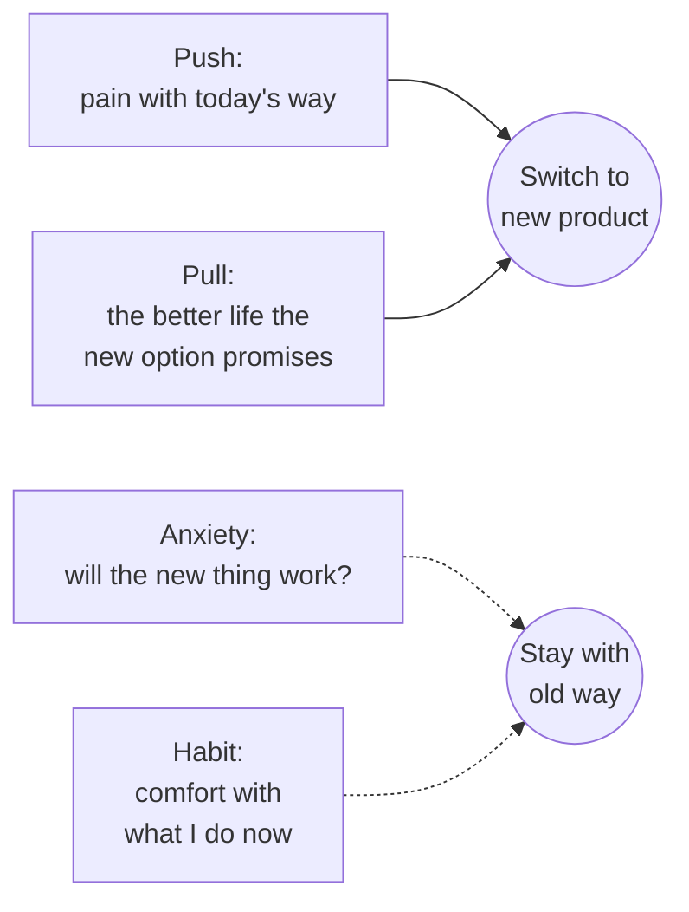
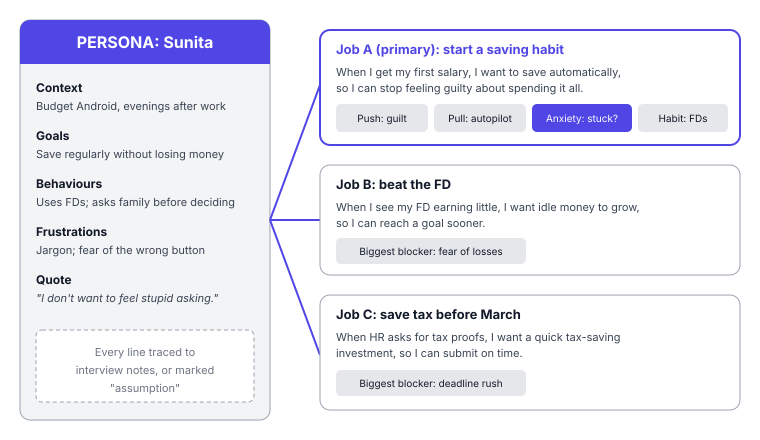

# A1.3 Personas and Jobs-to-be-Done

## In one line

A persona tells your team *who* you are building for; a job-to-be-done tells you *what progress that person is trying to make*; you need both, and both must come from real research.

## Why this matters

Every product decision quietly assumes a user. "Make the checkout faster." Faster for whom? Doing what? When those assumptions stay in people's heads, each person on the team designs for a different imaginary user, and the arguments never end.

Personas and jobs-to-be-done (JTBD) are two tools for writing those assumptions down. They turn the research from [A1.2](02-user-research-methods-and-interviews.md) into something the whole team can design, prioritise and argue against. Used well, they settle debates in minutes. Used badly, they become pretty posters that nobody reads.

## Key terms

| Term | Plain-English meaning |
|---|---|
| **Persona** | A short, research-based description of one type of user: their goals, behaviours, context and frustrations. |
| **Proto-persona** | A persona drafted from the team's assumptions, before research. A starting hypothesis, not a finding. |
| **Job-to-be-done (JTBD)** | The progress a person is trying to make in a particular situation. They "hire" a product to get that progress. |
| **Functional, emotional and social job** | What the person wants done; how they want to feel; how they want to be seen by others. |
| **Job story** | A way to write a need: "When [situation], I want to [motivation], so I can [outcome]." |
| **Switch interview** | A JTBD interview about the moment someone recently switched to (or from) a product. |
| **Four forces of progress** | Push and pull that drive a switch; anxiety and habit that block it. |
| **Desired outcome** | A measurable way a person judges whether a job is done well, e.g. "minimise the time to find a free slot". |

## The idea, simply

!!! tip "Analogy: the chai stall at the railway station"
    Picture a chai stall on platform 4. If the owner thinks in **demographics**, they'd say: "My customers are men, 25–50, middle income." That tells them almost nothing about what to sell.

    Now picture the owner watching for a week. They notice three different reasons people stop. Some are **killing 10 minutes before a delayed train**: they want a seat and something to sip slowly. Some are **rushing to catch a train**: they want chai in a cup they can carry, ready in 30 seconds. Some are **a group of colleagues on a break**: they want to stand together, chat, and share biscuits.

    Same chai, same customers on paper, three different **jobs**. And if the owner sketched one typical person for each (the **personas**: "the waiting commuter", "the sprinter", "the office group"), the whole staff would know who to serve how. That's the whole chapter in one stall.

### 1. What a persona actually is

A **persona** is a short profile of a *type* of user, built from research. It usually gives that type a name and a face-free description so the team can talk about them like a real person: "Would Priya understand this screen?"

The idea comes from software designer **Alan Cooper**. He started using imagined users in his own design work in the 1980s and popularised personas in his 1999 book *The Inmates Are Running the Asylum* ([background on Wikipedia](https://en.wikipedia.org/wiki/Persona_(user_experience))). His point was simple: if you design for "everyone", you design for no one. Designing for one sharply described person makes better choices for many.

A useful persona contains:

| Part | What goes in it | Example: "Sunita, the first-time investor" |
|---|---|---|
| **Context** | Where and when they use the product | Uses a budget Android phone, mostly on evenings after work |
| **Goals** | What they're trying to achieve | Start a small monthly SIP without losing money |
| **Behaviours** | What they actually do today | Keeps savings in a fixed deposit; asks her brother before any money decision |
| **Frustrations** | What gets in their way | Jargon; fear of clicking the wrong button; long KYC forms |
| **Quote** | One real line from research | "I don't want to feel stupid asking." |

Notice what's *missing*: age, star sign, favourite colour. Details that don't change a design decision are noise. As Nielsen Norman Group (NN/g) puts it, good personas are about goals, behaviours and attitudes, not demographics ([NN/g, 2017](https://nngroup.com/articles/personas-jobs-be-done)).

### 2. Three kinds of persona, and how much to trust each

NN/g describes personas by how much research sits behind them ([NN/g personas study guide](https://www.nngroup.com/articles/personas-study-guide/)):

| Kind | Built from | Effort | Trust it for |
|---|---|---|---|
| **Proto-persona** | The team's existing knowledge and assumptions | Hours | Aligning the team on what you *think*, and deciding what to research |
| **Qualitative persona** | Interviews and field visits (often 5–30 people) | Weeks | Most product decisions |
| **Statistical persona** | Qualitative work, then a survey or usage data to size each group | Months | Big bets where you need to know how many people each persona represents |

A proto-persona is fine as a *starting point*. Label it clearly ("assumption — not yet researched"). The danger is when an assumed persona quietly hardens into "truth" and starts driving roadmaps.

### 3. What a job-to-be-done is

Jobs-to-be-done flips the question. Instead of "who is the customer?", it asks **"what is the customer trying to get done, in this situation?"**

The idea is linked most with Harvard professor **Clayton Christensen**. His most famous story is the milkshake ([Harvard Business School Working Knowledge](https://hbswk.hbs.edu/item/6496.html)). A fast-food chain asked typical milkshake buyers how to improve the shake. They made the changes. Sales didn't move.

Then a researcher watched one restaurant for a whole day. About 40% of milkshakes were bought early in the morning, by commuters, to go. Why? They had a long, boring drive, one free hand, and would be hungry by mid-morning. The milkshake did that job better than a banana (gone in a minute) or a doughnut (crumbs on work clothes). Its real competitors weren't other milkshakes. They were bananas, bagels and boredom.

The chain also found a *different* job in the afternoon: parents buying a treat for kids. That job needed a *thinner* shake the kids could finish quickly. Same product, two jobs, two opposite design answers.

Christensen's key claim: **demographics correlate with buying, but they don't cause it.** The situation and the progress the person wants are what cause it.

### 4. Jobs have three layers

Most jobs have more than one side:

| Layer | Question | Milkshake commuter | UPI app user paying rent |
|---|---|---|---|
| **Functional** | What do I need done? | Stay full till lunch; something to do while driving | Pay the landlord on time, with proof |
| **Emotional** | How do I want to feel? | Less bored | Calm, not worried the money "got stuck" |
| **Social** | How do I want to be seen? | Not messy at the office | A reliable tenant |

Teams usually design only for the functional layer. But products often win on the emotional or social layer. A payment app that shows a big green tick and a shareable receipt is serving "feel calm" and "look reliable", not just "move money".

### 5. Job stories: writing a need without inventing a person

The usual agile **user story** is written as: "As a [type of user], I want [feature], so that [benefit]." The weak spot is the first part. "As a user…" adds little, and it jumps straight to a feature.

The product team at Intercom proposed an alternative: the **job story** ([Intercom, "How we accidentally invented Job Stories"](https://www.intercom.com/blog/accidentally-invented-job-stories/)). It starts from the situation instead of the person:

> **When** [situation], **I want to** [motivation], **so I can** [expected outcome].

| User story (persona-first) | Job story (situation-first) |
|---|---|
| As a shopper, I want a reorder button, so that I can buy again. | When I'm running out of a staple at 10 pm, I want to restock in under a minute, so I can sleep knowing breakfast is sorted. |
| As a driver, I want to see my earnings. | When I finish a long shift, I want to see exactly what I earned today, so I can decide whether to do one more trip. |
| As a student, I want flashcards. | When I have 5 minutes on the bus, I want to practise something useful, so I can feel I didn't waste the day. |

The situation does the heavy lifting. "At 10 pm" tells the designer the user is tired and wants speed, not browsing. You'll use job stories alongside user stories when we get to [A7.2](../07-execution-and-delivery/02-user-stories-and-acceptance-criteria.md).

### 6. The four forces: why people switch, or don't

Knowing the job isn't enough. You also need to know why someone would *leave* what they do today. **Bob Moesta** and **Chris Spiek** describe this with the **four forces of progress** ([jobstobedone.org](https://jobstobedone.org/the-four-forces/)):

People switch only when push + pull outweigh anxiety + habit. Most teams pour effort into pull (features) and ignore the two forces holding people back.

| Force | Sunita and SIP investing |
|---|---|
| **Push** | FD interest feels low; a colleague's SIP grew |
| **Pull** | "My money working for me, without daily watching" |
| **Anxiety** | "What if I lose money? What if I can't withdraw?" |
| **Habit** | "FDs have always been fine; my father uses them" |

The practical lesson: **reducing anxiety is often cheaper than adding pull.** A ₹100 starter SIP, a clear "withdraw any time" note, or a video of the withdrawal flow may convert more users than a new feature.

### 7. Personas and JTBD together

Some people argue JTBD makes personas obsolete. NN/g disagrees ([NN/g, 2017](https://nngroup.com/articles/personas-jobs-be-done)). Their view: the critique only lands on *bad*, demographic personas. Good personas already contain goals and behaviours. And jobs on their own can lose the human detail that builds empathy.

A practical way to combine them:

| Use… | When you need to… |
|---|---|
| **Jobs** | Decide *what* to build; spot your real competitors; write requirements |
| **Personas** | Decide *for whom first*; settle trade-offs when two user groups want opposite things |
| **Both** | Each persona lists its top 2–3 jobs, and the situations in which each job shows up |

One persona can have several jobs (Sunita saves for her child's education *and* keeps an emergency fund). One job can be shared by several personas (both a student and a retiree want to "send money home safely"). Mapping the two against each other shows you where to focus.

### 8. Where personas and jobs come from

Neither tool is a brainstorm. Both are summaries of research.

| Input | Gives you |
|---|---|
| **Interviews about real past events** ([A1.2](02-user-research-methods-and-interviews.md)) | Situations, motivations, the words users use |
| **Switch interviews** (what happened the week someone changed products) | Push, pull, anxiety and habit; the real competitors |
| **Field visits and observation** | Context: device, place, interruptions |
| **Usage data and surveys** | How many people each persona or job covers |
| **Support tickets and reviews** | Frustrations, in users' own words |

A rule of thumb: if you can't point to the interview notes behind a line on your persona, mark that line as an assumption.

## Framework: the Persona–Job Map

No single person invented this combined method. It joins four well-known ideas: **personas** (Alan Cooper, 1999; see [NN/g's guide](https://www.nngroup.com/articles/personas-study-guide/)), **jobs-to-be-done** (Clayton Christensen, popularised in his 2016 book *Competing Against Luck* and the HBR article ["Know Your Customers' Jobs to Be Done"](https://www.innosight.com/?p=19201)), **the four forces** (Bob Moesta and Chris Spiek, [jobstobedone.org](https://jobstobedone.org/the-four-forces/)) and **desired outcomes** (Tony Ulwick's Outcome-Driven Innovation at [Strategyn](https://strategyn.com/what-your-customer-really-needs-outcomes)).

**Step 1: Start with the decision.** What will these personas and jobs help you decide? "Which onboarding to build first" needs different detail from "which new market to enter".

**Step 2: Draft proto-personas and job guesses.** Spend one hour with the team. Write down who you *think* the users are and what you *think* they hire you for. Label everything "assumption".

**Step 3: Run research on real past events.** Interview 8–15 people, including some who recently **switched to** you and some who **dropped off**. Ask about the timeline: "Take me back to the day you first thought about this…" Note push, pull, anxiety and habit.

**Step 4: Write the jobs.** Cluster your notes by *situation and motivation*, not by age or city. Write each job as a job story, and add its functional, emotional and social layers. Add 2–4 desired outcomes per job ("minimise the fear that money is stuck").

**Step 5: Build personas around behaviour.** Group people who share goals, behaviours and context. Give each persona its top jobs, a real quote and the forces that block them. Two to four personas is usually enough. Choose one **primary persona** to design for first.

**Step 6: Size and validate.** Run a short survey or check usage data to estimate what share of users each job and persona covers. Drop or merge anything that's tiny.

**Step 7: Put them to work.** Reference them in PRDs, design reviews and prioritisation ("this solves Job 2 for Sunita"). Review them every 6–12 months, or after a big market change.

**When to use:** starting a new product or market; when the team keeps arguing about "the user"; before redesigning onboarding or pricing; when growth stalls and you don't know why people aren't switching.

**When not to:** for a small, well-understood fix, a proto-persona and one job story are enough. Don't build a statistical persona programme for a product with 200 users; just talk to all of them. And don't make personas a deliverable that ends in a slide deck. If no decision changes, skip it.

## Diagram

The persona says who; each job says what progress they want and in which situation. The forces under each job tell you what to fix first: often anxiety, not features.

## Worked example

You're the PM for onboarding at a mutual-fund investing app. Leadership's worry: lots of people sign up, few start a SIP (systematic investment plan, a fixed amount invested every month). *All numbers below are illustrative.*

**Step 1: The decision.** "What should onboarding focus on next quarter?"

**Step 2: Baseline.**

| Metric | Value |
|---|---|
| New sign-ups per month | 1,00,000 |
| % who start a first SIP within 30 days | 22% |
| New SIP starters per month | 22,000 |

**Step 3: Research.** You interview 12 people who started a SIP in the last 60 days, and 10 who signed up but didn't. You hear three clearly different situations:

| Job | Job story |
|---|---|
| **A. Start a saving habit** | When I get my first proper salary, I want to put some away automatically, so I can stop feeling guilty about spending it all. |
| **B. Beat the FD** | When I see my FD earning little, I want my idle money to grow faster, so I can reach a goal (a car, a wedding) sooner. |
| **C. Save tax before March** | When my HR reminds me about tax proofs, I want a quick tax-saving investment, so I can submit my declaration on time. |

**Step 4: Forces.** The drop-off interviews show that for Job A, **anxiety** dominates. Seven of the ten non-starters said some version of "what if I need the money and can't get it out?" Several also thought the minimum was ₹500 or more.

**Step 5: Size the jobs.** A two-question in-app survey of 2,000 new sign-ups asks what brought them here. You match answers to 30-day behaviour:

| Job | Share of sign-ups | Start a SIP in 30 days |
|---|---|---|
| A. Saving habit | 45% | 18% |
| B. Beat the FD | 35% | 28% |
| C. Tax before March | 20% | 22% (much higher Jan–Mar) |
| **Blended** | | **≈22%** (0.45×18 + 0.35×28 + 0.20×22 = 22.3) |

Job A is the biggest group *and* the weakest converter. That's your focus.

**Step 6: Persona.** You write "Sunita, first-salary saver" as the primary persona: 23–28, first job, decides with family, worried about locking money away. Her top job is A; her main blocker is anxiety.

**Step 7: Ideas aimed at the forces, not at features.**

| Force | Idea |
|---|---|
| Anxiety ("money stuck") | A 20-second explainer of withdrawal, shown before the payment step |
| Anxiety ("minimum too high") | Lead with a ₹100 starter SIP |
| Habit ("I'll do it later") | Suggest a date just after salary day |

**Step 8: What is it worth?** Say an A/B test shows Job A conversion rising from 18% to 24% (+6 points).

| Calculation | Value |
|---|---|
| Job A sign-ups per month | 1,00,000 × 45% = 45,000 |
| Extra SIP starters per month | 45,000 × 6% = 2,700 |
| Still investing after 12 months (assume 60%) | 1,620 per monthly cohort |
| Assumed annual revenue per active SIP investor | ₹300 |
| Value of one month's extra cohort, per year | 1,620 × ₹300 ≈ ₹4.9 lakh |
| After 12 monthly cohorts (annual run-rate) | ≈ ₹58 lakh per year |

The overall SIP start rate moves from about 22% to about 25%, without a single new investment product. That's the payoff of knowing *which* job is stuck and *why*.

**Step 9: Guardrails.** Watch SIP cancellations in the first 3 months (did the ₹100 option attract people who quit?), and support tickets about withdrawals.

## Going deeper: nuances and trade-offs

### 1. Two schools of JTBD, and they don't fully agree

"Jobs-to-be-done" is not one method. There are two main camps:

| | "Jobs as progress" | "Jobs as process" |
|---|---|---|
| **Key people** | Christensen, Bob Moesta, Alan Klement | Tony Ulwick (Strategyn) |
| **A job is…** | The progress a person wants in a situation, including emotions | A stable, functional task (e.g. "cook a meal") broken into steps |
| **Main method** | Switch interviews and stories | Large surveys rating desired outcomes by importance and satisfaction |
| **Good for** | Understanding why people switch; messaging; early products | Finding unmet needs in a mature, well-defined market |

[Ulwick's Outcome-Driven Innovation](https://strategyn.com/what-your-customer-really-needs-outcomes) writes needs as precise outcome statements (e.g. "minimise the time it takes to…") and surveys many customers to find the most under-served ones. The progress school argues that this misses emotion and context. Practitioners disagree on which is "right". In practice, many PMs use switch interviews to discover jobs and an outcome-style survey to size them.

### 2. Getting the level of the job right

Jobs can be written at many heights:

| Too high | Useful | Too low |
|---|---|---|
| "Be healthy" | "When I get home late, I want a quick dinner that isn't junk, so I can feel I'm eating right." | "Tap the 'healthy' filter" |
| "Be financially secure" | "When my salary arrives, I want some of it saved automatically…" | "Set up an auto-debit" |

Too high, and every product in the world competes with you. Too low, and you've written a feature, not a need. A good test: the job should suggest **several** possible solutions, and you should be able to name real alternatives people use today.

### 3. Your real competitors are often not in your category

Jobs show you competition that a category view hides. The milkshake competed with bananas. A food app's lunch job competes with tiffin services and office canteens. A meditation app's "fall asleep" job competes with YouTube, podcasts and simply scrolling Instagram. A useful exercise: for each job, list what people "fire" when they hire you. You'll study this more in [A3.2](../03-market-research/02-competitive-analysis.md).

### 4. B2B: one account, many personas

In business software, the person who **uses** a product is often not the person who **buys** it, and a third person may **approve** it.

| Role | Example (expense-management software) | Their job |
|---|---|---|
| **User** | Sales executive filing claims | "Get reimbursed without chasing finance" |
| **Buyer** | Finance controller | "Close the books on time with fewer errors" |
| **Approver / blocker** | IT security | "Make sure no data leaks" |

A product that delights users but ignores the buyer's job doesn't get bought. One that pleases the buyer but annoys users gets bought and then abandoned. B2B PMs usually keep a small persona set for each role.

### 5. Personas in India: shared phones, family decisions, many languages

Persona templates written in the US often assume one person, one device, one decision-maker. Many Indian products break those assumptions:

- **Shared devices.** A family may share one smartphone. The "user" of a learning app may be a child; the payer a parent.
- **Assisted use.** Many first-time digital users are helped by a family member, a shopkeeper or an agent. Your persona may need a "helper" too.
- **Family decisions.** Money, health and education choices often involve parents or spouses, which adds both anxiety and habit.
- **Language and literacy.** Context should note language preference and comfort with text vs voice and video.

These aren't stereotypes to assume; they're questions to ask in research. Add them to your persona's context only when your interviews show them.

### 6. The traps that make personas useless

| Trap | What it looks like | Fix |
|---|---|---|
| **Demographic fluff** | Age, hobbies, pet's name, nothing about behaviour | Keep only details that change a design decision |
| **Elastic persona** | The persona stretches to justify any feature | Write down which jobs the persona does *not* have |
| **Stereotyping** | Personas built on clichés about gender, age or region | Base every line on research notes; review for bias |
| **Poster-ware** | Made once, framed on a wall, never used | Reference personas and jobs in PRDs and design reviews |
| **Too many** | Ten personas, so no priorities | Two to four personas; one primary |
| **Stale** | Built three years ago, before a new market or pricing change | Review every 6–12 months |

### 7. Anti-personas and edge personas

An **anti-persona** describes someone you are deliberately *not* building for, for example "the bargain-hunter who signs up only for the cashback and leaves". Naming them stops the team from optimising for the wrong behaviour.

An **edge persona** describes a user at the margins: someone with low vision, a slow network, or a very old phone. Designing for them often improves the product for everyone. Accessibility gets its own treatment in [A6.4](../06-product-design-and-ux/04-usability-heuristics-and-accessibility.md).

### 8. AI-generated and "synthetic" personas

It's now easy to ask a chatbot to "write five personas for a fintech app", or to "interview" an AI pretending to be a customer. This is tempting and fast. It's also risky.

AI personas tend to sound plausible but average. They reflect patterns in the model's training data, not *your* users' situations. Research by a Columbia University team found that the more of a persona's detail an AI model writes, the further simulated opinions drift from real-world data (details in *Research happening now* below).

A sensible way to use AI here:

| Good use | Risky use |
|---|---|
| Summarising your own interview notes into draft clusters | Replacing interviews with "synthetic users" |
| Brainstorming proto-personas to decide what to research | Presenting AI-written personas as research findings |
| Checking a persona for missing fields or biased wording | Sizing a market from AI-simulated survey answers |

Treat AI output as a **proto-persona**: a hypothesis to test with real people.

## Real-world examples (2023 onwards)

!!! example "Zomato, February 2023: from a speed promise to a clear job"
    Zomato had been running **Zomato Instant**, a 10-minute food delivery service. According to [Inc42](https://inc42.com/buzz/zomato-launches-rebranded-meal-service-zomato-everyday), it struggled with low daily order volumes, scaling and covering fixed costs. On 22 February 2023 Zomato relaunched the idea as **Zomato Everyday**: home-style meals from ₹89, starting in parts of Gurugram, aimed mainly at working professionals living away from home.

    **PM lesson:** "10-minute delivery" is a feature. "Eat affordable, home-style food every day when I live away from my family" is a job, with a clear situation, a functional need (cheap, filling) and an emotional one (*ghar ka khaana*, food like home). Naming the job also names the real competitors: tiffin services, PG mess food and cooking yourself. Note that this case shows how Zomato reframed the offer; it doesn't by itself prove the new framing succeeded.

!!! example "Airbnb, May 2023: Airbnb Rooms and the affordability job"
    On 3 May 2023, Airbnb announced **Airbnb Rooms**, a renewed push into private rooms in a host's home ([AP, via News4Jax](https://www.news4jax.com/business/2023/05/03/airbnb-will-push-rooms-as-low-cost-option-to-house-rentals/)). Whole-home prices had risen; room prices were expected to average about $67 a night. CEO Brian Chesky said travellers cared more about affordability than a year earlier, and that the average Gen Z traveller wanted to pay under $100 a night. Listings added more host information and filters such as whether the bedroom door locks and whether the bathroom is private.

    **PM lesson:** the functional job ("a place to sleep that fits my budget") was clear. But the new filters target **anxiety**, the force that stops people from staying in a stranger's home: Is it safe? Will I have privacy? Good JTBD work designs for the blockers, not just the pull.

## Common mistakes

!!! warning "Watch out for"
    - **Personas built from imagination, presented as research.** Label proto-personas as assumptions until you've tested them.
    - **Demographics instead of behaviour.** "Male, 28, Bengaluru" predicts little; "pays rent on the 1st and panics if UPI is slow" predicts a lot.
    - **Writing features as jobs.** "I want a dark mode" is a request. Ask *why* until you reach the situation and progress.
    - **Only the functional job.** Ignoring emotional and social jobs leaves the strongest motivators off the table.
    - **Only adding pull.** Teams ship features while anxiety and habit stop people from switching.
    - **Too many personas, no primary one.** If you design for five people equally, you design for none.
    - **Never using them again.** If personas and jobs don't show up in PRDs, prioritisation and reviews, they were wasted effort.
    - **Treating AI-generated personas as real users.** They are hypotheses at best.

## Common questions

**Personas or JTBD: which should I use?**
Both, for different questions. Jobs tell you *what* to build and who you really compete with. Personas tell you *for whom first* and help settle trade-offs between user groups. Most mature teams link each persona to its top jobs.

**How many personas should a product have?**
Usually two to four, with one primary persona. If you have more, check whether some are really the same people in different situations (which makes them different *jobs*, not different personas).

**How many interviews do I need for a persona?**
For qualitative personas, often 8–15 interviews per broad user group, stopping when you stop hearing new things. To know how *many* users fit each persona, you need a survey or usage data on top.

**Isn't a job story just a user story with different words?**
Not quite. A user story starts from a role and often jumps to a feature. A job story starts from the situation and motivation, which keeps solution options open. Many teams use job stories in discovery and user stories in delivery.

**Should personas have names and photos?**
Names help people talk about them. Stock photos often do more harm than good, because they nudge the team toward stereotypes about age, gender or appearance. A simple illustration or no image is safer.

**Can one person have several jobs?**
Yes, and often at different times of day or year. The same investor might have a "save tax before March" job and a "build a habit" job. That's why jobs are tied to situations.

## In the interview

!!! question "In the interview"
    **How it's tested:** almost every product sense or design question ("Design a product for…", "Improve…") expects you to pick a user segment and their needs early. Interviewers check whether you segment by **needs and situations**, not just demographics, and whether you choose one segment to focus on. Some interviewers ask about JTBD directly.

    **Sample question:** *"Improve Google Maps for people in Indian Tier-2 cities."*

    **Outline of a strong answer:**

    1. **Clarify the goal:** more usage, better trust in directions, or more local business discovery?
    2. **Segment by job, not by age:** e.g. (a) first-time visitors finding an unfamiliar address, (b) two-wheeler riders navigating narrow lanes, (c) small shop owners wanting to be found.
    3. **Pick one, with a reason:** e.g. two-wheeler riders, because they are a large group and the pain is frequent.
    4. **Describe a quick persona and job story:** "When I'm riding to a new customer's home, I want directions I can follow without stopping, so I arrive on time."
    5. **Name the forces:** anxiety ("it sends me down lanes that are closed"), habit ("I just call and ask").
    6. **Propose solutions** aimed at the job and forces (landmark-based directions, voice in local language), and pick one.
    7. **Define success:** e.g. navigation sessions completed without a phone call to the destination; guardrail: route complaints.

    **Follow-up you may get:** *"What's the difference between a persona and a segment?"* A segment is a group you can count and target (often in data). A persona is a vivid summary of one segment, made so the team can design for it.

## Research happening now

!!! info "Research happening now"
    - **Can AI personas stand in for real people? (Columbia University, 2025).** Ang Li, Haozhe Chen, Hongseok Namkoong and Tianyi Peng's paper ["LLM Generated Persona is a Promise with a Catch"](https://arxiv.org/html/2503.16527v1) tested whether AI-generated personas can simulate population opinions. The more persona detail the model wrote, the further results drifted from real data; in a simulated 2024 US election, the most AI-heavy personas produced a Democratic sweep of every state. *Status: preprint from March 2025, later presented as a [NeurIPS 2025 poster](https://neurips.cc/virtual/2025/poster/121924).*
    - **Bias inside generated personas (2026).** A February 2026 arXiv preprint, ["The Personality Trap: How LLMs Embed Bias When Generating Human-Like Personas"](https://arxiv.org/html/2602.03334v1), continues this line of work on bias in AI-written personas. *Status: preprint, not peer-reviewed.*

## Try it yourself (25 minutes)

Pick an app you've **switched to** in the last year (a new UPI app, a quick-commerce app, a note-taking tool).

1. Write a short timeline: when did you first think about switching, what did you try, when did you decide?
2. Write the **job story** ("When…, I want to…, so I can…").
3. Fill in the **four forces** for your own switch.
4. List two things the app "replaced" (your real alternatives).
5. Draft a **persona** with context, goals, behaviours, frustrations and one quote — using yourself as the research participant.

??? success "Check your answer"
    Check your work against these points:

    - Your job story names a **situation** (time, place or trigger), not just "as a user".
    - The "so I can" part is **progress in your life**, not a feature.
    - You have at least one **anxiety** and one **habit**. If you can't think of any, ask yourself what almost stopped you.
    - At least one alternative is **outside the app's category** (e.g. "asking a friend", "a notebook", "doing nothing").
    - Your persona has **no detail** that wouldn't change a design decision.
    - Finally: you interviewed one person (you). What would you need to hear from 8–10 others before trusting it?

## How this connects

- [A1.2 User research methods and interviews](02-user-research-methods-and-interviews.md): the interviews personas and jobs are built from.
- [A1.4 Journey maps and empathy maps](04-journey-maps-and-empathy-maps.md): turn a persona and job into a step-by-step journey.
- [A2.1 Continuous discovery and opportunity solution trees](../02-problem-discovery/01-continuous-discovery-and-opportunity-solution-tr.md): jobs and pains become the "opportunities" on the tree.
- [A3.3 Positioning](../03-market-research/03-positioning.md): jobs reveal your real competitors and what makes you different.
- [A7.2 User stories and acceptance criteria](../07-execution-and-delivery/02-user-stories-and-acceptance-criteria.md): job stories in discovery turn into user stories in delivery.

## Go deeper

- **Book:** *Competing Against Luck* (2016) by Clayton Christensen, Taddy Hall, Karen Dillon and David Duncan ([catalogue record](https://search.worldcat.org/oclc/957652628)). The main book on jobs-to-be-done as "progress".
- **Article:** ["Know Your Customers' Jobs to Be Done"](https://www.innosight.com/?p=19201) (Harvard Business Review, 2016, via Innosight). The short version of the theory, including the milkshake story.
- **Article:** [NN/g: Personas vs. Jobs-to-Be-Done](https://nngroup.com/articles/personas-jobs-be-done). A balanced take on using both together.
- **Guide:** [NN/g Personas study guide](https://www.nngroup.com/articles/personas-study-guide/). A curated set of articles and videos on making and using personas.
- **Article:** [Intercom: How we accidentally invented Job Stories](https://www.intercom.com/blog/accidentally-invented-job-stories/). Where the "When… I want to… so I can…" format came from.
- **Site:** [jobstobedone.org: The Four Forces](https://jobstobedone.org/the-four-forces/). Bob Moesta and Chris Spiek's explanation of push, pull, anxiety and habit.
- **Article:** [Strategyn: Define customer needs as desired outcomes](https://strategyn.com/what-your-customer-really-needs-outcomes). Tony Ulwick's "jobs as process" view, for contrast.
- **Listen:** [Intercom podcast: Tony Ulwick on Jobs-to-be-Done](https://www.intercom.com/blog/podcasts/podcast-tony-ulwick-on-jobs-to-be-done). An episode on the outcome-driven approach.

## Key takeaways

- A **persona** says *who*; a **job** says *what progress they want, in which situation*. Use both, linked together.
- Both are **summaries of research**. Anything not backed by research is a proto-persona: label it as an assumption.
- Write needs as **job stories**: "When…, I want to…, so I can…". The situation does the heavy lifting.
- Jobs have **functional, emotional and social** layers; products often win on the last two.
- People switch only when **push + pull beat anxiety + habit**. Reducing anxiety is often cheaper than adding features.
- Keep **two to four personas** with one primary, built on behaviour, not demographics, and use them in real decisions.
- Treat **AI-generated personas** as hypotheses to test, not as users.

## Updates

*No updates yet.*
