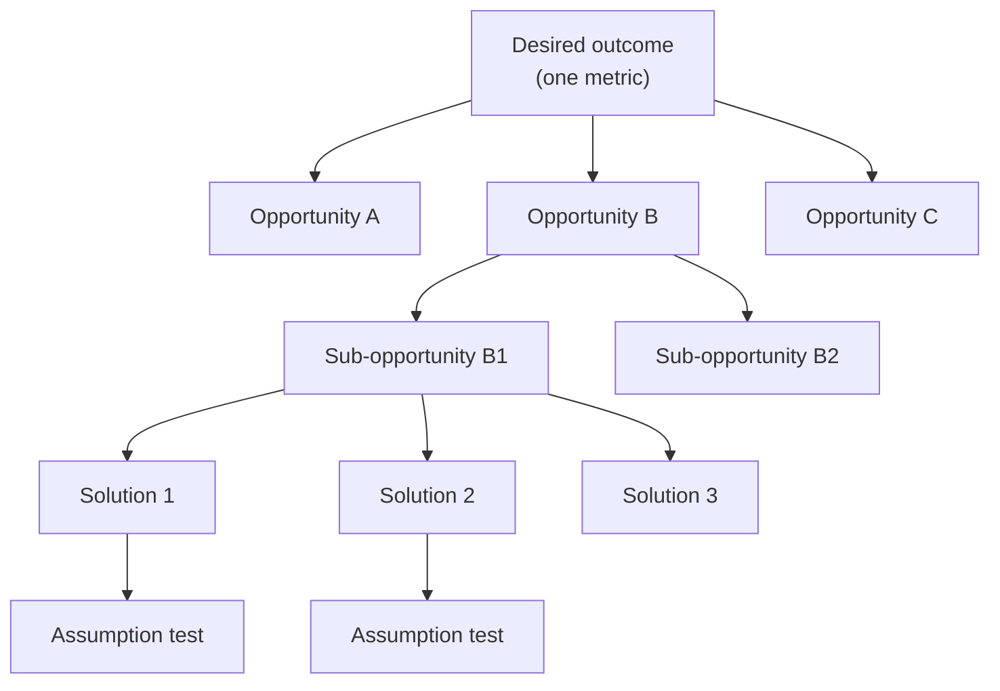
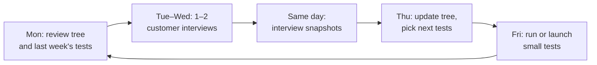
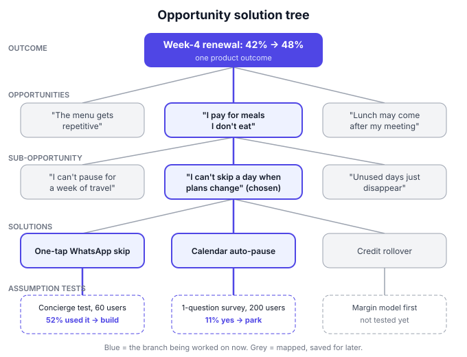

# A2.1 Continuous discovery and opportunity solution trees

## In one line

Continuous discovery means the team building the product learns from customers every week, and an opportunity solution tree is the one-page map that links what you learn to the outcome you're chasing and the ideas you'll test.

## Why this matters

Most product teams don't fail because they build badly. They fail because they build the wrong thing well. A PM's job is to cut that risk before engineers spend months writing code ([A0.1](../00-the-pm-role/01-what-a-pm-actually-does.md)).

Continuous discovery is the habit that cuts it. The opportunity solution tree is the tool that keeps the habit honest. Together they help you answer the question every stakeholder asks: *"Why are we building this, and not that?"*

## Key terms

| Term | Plain-English meaning |
|---|---|
| **Product discovery** | The work of deciding *what* to build: is it valuable, usable, feasible and viable? (Delivery is the work of building it well.) |
| **Continuous discovery** | Small, weekly customer touchpoints by the team building the product, aimed at a clear outcome. |
| **Product trio** | The PM, a designer and an engineer who do discovery together and share decisions. |
| **Desired outcome** | The one measurable change the team is trying to cause, such as "raise week-4 renewal from 42% to 48%". |
| **Opportunity** | An unmet customer need, pain point or desire, phrased in the customer's words. Not a feature. |
| **Solution** | An idea that might address an opportunity. |
| **Assumption test** | A small, fast check of one belief a solution depends on, done before building the whole solution. |
| **Opportunity solution tree (OST)** | A visual map: outcome at the top, opportunities below it, solutions under each opportunity, and tests under each solution. |
| **Interview snapshot** | A one-page summary of a single customer interview, made right after it. |

## The idea, simply

!!! tip "Analogy: the family doctor vs the yearly health camp"
    Picture two ways to look after your health. In the first, you attend a big health camp once a year. You get a thick report, feel guilty for a week, then forget it. In the second, you have a family doctor you see in short visits whenever something changes. She knows your history. Small problems get caught early.

    Old-style product research is the health camp: a big study once a quarter, a long deck, and then silence. Continuous discovery is the family doctor: short, regular contact, so the team always has fresh knowledge when a decision comes up. The opportunity solution tree is the doctor's case file. It shows what you're treating, what you've learned, and what you're trying next.

Let's build the idea up step by step.

### 1. What continuous discovery actually is

Teresa Torres, a product discovery coach, defines continuous discovery as weekly touchpoints with customers, by the team building the product, in pursuit of a desired outcome ([Product Talk glossary](https://www.producttalk.org/glossary-discovery-continuous-discovery/)). She set it out in her 2021 book [*Continuous Discovery Habits*](https://www.producttalk.org/continuous-discovery-habits/).

Each part of that definition does a job:

| Part of the definition | What it rules out | Why it matters |
|---|---|---|
| **Weekly** | A big research project once a quarter | Decisions happen every week, so knowledge must be fresh every week |
| **Touchpoints** | Only reading dashboards | You need *why*, not just *what* (see [A8.1](../08-product-metrics/01-metric-basics-leading-lagging-input-output-vanit.md)) |
| **With customers** | Asking sales or leadership what customers want | Second-hand stories lose detail and add bias |
| **By the team building the product** | A research team that hands over a report | The people making the decisions hear the customer directly |
| **In pursuit of an outcome** | "Let's chat to users and see" | Research stays focused on a goal, so it leads to decisions |

A touchpoint can be an interview, a prototype test, a quick survey, or a small experiment. The key is rhythm, not size. One 30-minute conversation every week beats twelve interviews crammed into one month and then nothing.

### 2. Why it works

Continuous discovery works for three simple reasons.

1. **Most ideas fail.** Even good teams find that many of their ideas don't move the numbers. If you test small and early, a failed idea costs a week, not a quarter.
2. **Knowledge goes stale.** Customers, competitors and markets change. A study from last year can quietly mislead you.
3. **Decisions are made by the people who were in the room.** When the engineer heard the customer struggle, the engineer suggests better solutions. Insight that travels through a slide deck loses most of its power.

Marty Cagan of SVPG makes a related point. He separates *discovery* (deciding what to build) from *delivery* (building it to production quality). Strong teams run both at the same time, all the time ([SVPG: Discovery vs. Delivery](https://www.svpg.com/discovery-vs-delivery/); [SVPG: Continuous Discovery](https://www.svpg.com/continuous-discovery/)).

### 3. Start with a clear outcome

Discovery without a goal turns into a list of interesting facts. So the tree starts at the top with one **desired outcome**.

Torres separates two kinds:

- **Business outcome:** a result the business cares about, like revenue or retention. It's usually lagging and shared by many teams.
- **Product outcome:** a change in customer behaviour that the team can move directly and that drives the business outcome.

This is the same idea as input and output metrics in [A8.1](../08-product-metrics/01-metric-basics-leading-lagging-input-output-vanit.md).

| Too vague | Too narrow (a solution in disguise) | Good product outcome |
|---|---|---|
| "Make users happy" | "Launch a referral programme" | "Raise the share of new users who invite one friend in 14 days from 8% to 12%" |
| "Grow revenue" | "Add a ₹99 plan" | "Raise free-to-paid conversion in month 1 from 3% to 4.5%" |
| "Improve onboarding" | "Add a tutorial video" | "Raise the share of sign-ups who complete a first order in 7 days from 35% to 42%" |

A good outcome is measurable, owned by the team, and leaves room for many possible solutions.

### 4. Opportunities: needs, not features

Below the outcome sit **opportunities**. These are customer needs, pain points or desires. Write them as the customer would say them.

The most common mistake is writing a solution and calling it an opportunity.

| Solution in disguise | Real opportunity |
|---|---|
| "Add a dark mode" | "My eyes hurt when I read late at night" |
| "Add WhatsApp login" | "I don't want to remember another password" |
| "Show delivery ETA" | "I don't know if the food will come before my meeting" |
| "Build a loyalty programme" | "I feel I'm paying more than my friends for the same thing" |

A quick test: *can you imagine three or more different solutions for it?* If not, it's probably a solution, not an opportunity.

Opportunities come mostly from **story-based interviews**. You ask about a specific past moment ("Tell me about the last time you ordered lunch at work"), not about opinions ("Would you use a lunch subscription?"). That method is covered in [A1.2](../01-understanding-users-user-sense/02-user-research-methods-and-interviews.md). Support tickets, reviews, sales calls and analytics add more.

### 5. The opportunity solution tree

Torres first published the opportunity solution tree on her blog in August 2016 ([origin story](https://www.producttalk.org/opportunity-solution-tree-origin.md)). It has four layers:

Read it top to bottom: one outcome, many needs, several ideas for the chosen need, and small tests for each idea. Only one branch is being worked on at a time.

The tree does several jobs at once:

- **It keeps you honest.** Every solution must hang under an opportunity, and every opportunity under the outcome. Pet ideas with no customer need above them have nowhere to go.
- **It shows choices.** You can see the paths you *didn't* take, not just the one you did.
- **It breaks big problems into small ones.** "Users churn" is too big to solve. "I can't skip a day when my plans change" is small enough to solve this month.
- **It's a communication tool.** Stakeholders can see why you chose a path, not just what you shipped.

Torres says she drew on several sources, including Bernie Roth's reframing questions at the Stanford d.school and the idea of "multitracking" (comparing several options instead of yes/no decisions) from Chip and Dan Heath's book *Decisive* ([origin story](https://www.producttalk.org/opportunity-solution-tree-origin.md)).

### 6. Building the tree well

A few structural rules make the tree useful rather than messy:

| Rule | Why | Example |
|---|---|---|
| **Children are smaller parts of their parent** | Lets you solve a big need one slice at a time | "Delivery feels unreliable" → "I don't know when it'll arrive" and "It arrives cold" |
| **Siblings shouldn't overlap** | Overlaps mean you'll count the same need twice | Don't put "Price is high" and "I feel I overpay" side by side; merge them |
| **Group by moments in the journey** | Mirrors how customers live it (see [A1.4](../01-understanding-users-user-sense/04-journey-maps-and-empathy-maps.md)) | Before ordering · while waiting · after delivery |
| **Keep at least 3 solutions per target opportunity** | One idea means you're deciding "whether", not "which" | Skip button, auto-pause, credit rollover |
| **Tests sit under solutions, not opportunities** | You test ideas, not needs | "Will users find the skip button?" |

The tree is a living document. You update it after interviews and tests. A tree that hasn't changed in a month usually means discovery has stopped.

### 7. Choosing which opportunity to work on

You can't work on every branch. Torres suggests you compare the opportunities at the top level and pick one, then go down that branch and compare its children ([Product Talk on prioritising opportunities](https://www.producttalk.org/prioritize-opportunities.md)). She weighs four factors:

- **Size:** how many customers it affects, and how often.
- **Market factors:** does solving it help you keep up with, or get ahead of, competitors?
- **Company factors:** does it fit the company's vision and strategy?
- **Customer factors:** how much does it matter to the people who have it?

She warns against turning this into a precise formula, because the numbers can make a judgement call look like a fact. She also calls these **two-way door decisions**: easy to reverse. If tests show you picked the wrong opportunity, you go back up the tree and choose another. So decide quickly.

### 8. Testing assumptions, not whole ideas

Once you pick an opportunity, you brainstorm several solutions. Then, instead of building one, you list the **assumptions** each solution depends on. Torres groups them into five types ([Product Talk: 5 types of assumptions](https://www.producttalk.org/five-types-of-assumptions/)):

| Assumption type | The question | Example for a "skip a day" button |
|---|---|---|
| **Desirability** | Do customers want it? | Users with changing plans will actually skip instead of cancelling |
| **Viability** | Does it work for the business? | Skips won't push the cost per meal above budget |
| **Feasibility** | Can we build and run it? | Kitchens can adjust quantities if skips arrive before 9 a.m. |
| **Usability** | Can customers use it? | Users can find and use skip in under 10 seconds |
| **Ethical** | Could it cause harm? | We won't make cancelling harder to push people towards skipping |

Then you test the riskiest few, using the cheapest test that gives an answer: a one-question survey, a fake button, a prototype, a manual "concierge" version. Each test sets its success criteria *before* it runs. Assumption tests and MVPs are covered fully in [A2.3](03-assumption-testing-prototypes-and-mvps.md).

### 9. The weekly rhythm

Continuous discovery is a set of small habits. A typical week for a product trio:

The cycle is short on purpose. What you learn on Tuesday can change what you test on Friday.

Two habits make this sustainable:

- **Automate recruiting.** The hardest part of weekly interviews is finding people. Teams add an in-app prompt ("Got 20 minutes to chat? We'll send a ₹300 voucher"), a sign-up link in support replies, or a standing panel. Then interviews arrive without a PM chasing them each week.
- **Make an interview snapshot** right after each interview: who it was, a memorable quote, the key moments of their story, and the opportunities you heard. A pile of snapshots is much easier to turn into a tree than a pile of recordings.

## Framework: Opportunity solution tree + weekly discovery cadence

**Created by:** Teresa Torres. The tree was first published in August 2016 ([origin story](https://www.producttalk.org/opportunity-solution-tree-origin.md)). The full method is in [*Continuous Discovery Habits*](https://www.producttalk.org/continuous-discovery-habits/) (2021).

**Step 1: Agree one outcome.** Work with your leader to pick one product outcome the trio can move. Write down today's baseline and the target.

**Step 2: Map the current experience.** Sketch the steps a customer goes through today (an experience map). This gives the tree its first-level branches.

**Step 3: Interview every week.** Run story-based interviews ([A1.2](../01-understanding-users-user-sense/02-user-research-methods-and-interviews.md)). Make a snapshot after each one.

**Step 4: Map opportunities.** Pull needs out of snapshots, support data and analytics. Place each one under the right parent. Merge duplicates.

**Step 5: Choose a target opportunity.** Compare siblings on size, market, company and customer factors. Pick one. Move fast; it's reversible.

**Step 6: Generate at least three solutions.** Brainstorm alone first, then together, so the loudest voice doesn't win.

**Step 7: List and rank assumptions.** For each promising solution, list desirability, viability, feasibility, usability and ethical assumptions. Rank by how risky they are and how little evidence you have.

**Step 8: Test the riskiest assumptions.** Small, fast tests with success criteria written in advance. Compare solutions side by side ("compare and contrast"), not one at a time.

**Step 9: Update the tree and repeat.** Build the solution that survives. Keep interviewing while it's being built.

**When to use:**

- A team with a clear outcome and freedom to choose how to reach it (an empowered team, see [A0.2](../00-the-pm-role/02-product-teams-the-trio-empowered-vs-feature-team.md)).
- Any time there's more than one way to solve a problem, and the cost of getting it wrong is weeks of engineering.

**When not to (or when to lighten it):**

- **Pure compliance or contract work.** If a regulator says "add this consent screen by March", the *what* is fixed. Do usability testing, but you don't need a full tree.
- **Clear bugs and small fixes.** Just fix them.
- **When the team is only handed features.** A tree can still help you ask better questions, but you'll need to win the right to choose solutions first ([A2.4](04-outcomes-over-outputs-escaping-the-build-trap.md)).
- **When you can't reach customers at all.** Fix that first; without fresh input the tree is just guesses drawn neatly.

## Diagram

Notice the highlighted path: one opportunity chosen, three solutions compared, and tests only on the riskiest assumptions. Everything else stays on the map for later.

## Worked example

You're the PM at a home-style tiffin subscription app in Bengaluru. Office workers pay about ₹2,400 a month for a weekday lunch delivered to their office. Your trio (you, a designer and an engineer) has been given an outcome:

> Raise the **week-4 renewal rate** (the share of new subscribers who renew after their first month) from **42% to 48%** this quarter.

**Step 1: Baseline.** About 2,000 people start a subscription each month. 42% renew, so 840 stay on and 1,160 leave.

**Step 2: Experience map.** You sketch the first month in five moments: sign up → choose plan → first week of meals → plans change (travel, WFH, leave) → renewal reminder. These become your first-level branches.

**Step 3: Interviews and data.** Over three weeks, the trio runs 9 interviews with people who cancelled and 6 with people who renewed. You also read 400 exit-survey answers from the last two months.

| Main reason in exit survey | Share of 400 answers |
|---|---|
| "My plans changed and I couldn't skip easily" | 31% |
| "The menu got repetitive" | 24% |
| "Delivery was late on some days" | 18% |
| "Too expensive" | 15% |
| Other | 12% |

The interviews add colour. One cancelled user says: *"I was in Chennai for three days. I messaged support, but the food still came to an empty office. I felt I was wasting money."*

**Step 4: Map opportunities.** You place what you heard on the tree:

- "I'm paying for meals I don't eat" (parent)
    - "I can't skip a day when plans change at short notice"
    - "I can't pause for a week of travel"
    - "Unused days just disappear"
- "I get bored of the menu"
- "I don't know if lunch will come before my 1 p.m. meeting"

**Step 5: Choose the target opportunity.** You compare the top three:

| Opportunity | Size (exit survey) | Customer factor (from interviews) | Company fit |
|---|---|---|---|
| Paying for meals I don't eat | 31% | Strong emotion ("wasting money") | High: cheap to fix, no new kitchens |
| Menu boredom | 24% | Mild; many said "it's fine for a while" | Medium: needs new recipes and suppliers |
| Late delivery | 18% | Strong, but only on some routes | Medium: depends on the logistics team |

You choose **"Paying for meals I don't eat"**, then the child **"I can't skip a day when plans change at short notice."** It came up in 7 of 9 cancellation interviews.

**Step 6: Three solutions.**

1. **One-tap skip on WhatsApp:** a 7 a.m. message with "Skip today" and "Skip tomorrow" buttons.
2. **Calendar auto-pause:** link your work calendar and lunches pause on leave days.
3. **Credit rollover:** unused days become credit for next month.

**Step 7: Riskiest assumptions.**

| Solution | Riskiest assumption | Type |
|---|---|---|
| WhatsApp skip | Kitchens can cut quantities if skips arrive by 9 a.m., without much food waste | Feasibility / viability |
| WhatsApp skip | Users will act on a morning message rather than ignore it | Desirability |
| Calendar auto-pause | Office workers will link a work calendar to a food app | Desirability (and privacy, an ethical concern) |
| Credit rollover | Rollover won't cut revenue more than it saves in churn | Viability |

**Step 8: Tests.**

- **Concierge test for WhatsApp skip (2 weeks, 60 new subscribers).** A team member sends the 7 a.m. message by hand and updates the kitchen sheet manually. Success criteria, written in advance: at least 40% of users who had a plan change use skip, and kitchen waste stays under 3%.
- **One-question survey for calendar link (200 subscribers).** "Would you connect your work calendar so lunches pause on leave days?" Success: at least 30% say yes.

Results:

| Test | Result | Decision |
|---|---|---|
| WhatsApp skip concierge | 52% of users with a plan change used it; waste 2.1% | Build it |
| Calendar link survey | 11% said yes; many worried about company data | Park it |
| Credit rollover | Not tested yet; finance asked for a margin model first | Keep on tree |

**Step 9: What is it worth?** In the concierge group, renewal was 49% against 42% for similar subscribers. That's a small sample, so you plan an A/B test before claiming victory ([A9.1](../09-experimentation/01-a-b-testing-basics.md)). Suppose the real lift is a more cautious **+5 points** (42% → 47%):

| Item | Value |
|---|---|
| New subscribers per month | 2,000 |
| Extra renewals per month (5% of 2,000) | 100 |
| Average extra months a renewer stays | 4 |
| Revenue per extra renewer (4 × ₹2,400) | ₹9,600 |
| Extra revenue per monthly cohort (100 × ₹9,600) | ₹9.6 lakh |
| **Extra revenue per year (12 cohorts)** | **about ₹1.15 crore** |
| Contribution margin at 20% | about ₹23 lakh a year |
| Build cost (WhatsApp buttons + kitchen sheet automation) | about 3 engineer-weeks |

That's a strong case for a small build. Notice what discovery saved you: the calendar idea looked clever in a brainstorm, but would have taken longer to build and few people wanted it.

**Step 10: Keep going.** You keep one or two interviews a week running while the skip feature is built. The next branch to explore is "I can't pause for a week of travel", which sits right next to the one you just solved.

## Going deeper: nuances and trade-offs

### 1. Continuous discovery vs research projects

Continuous discovery doesn't replace all research. Big, one-off studies still have a place:

| Use continuous touchpoints for… | Use a dedicated research project for… |
|---|---|
| Choosing between solutions for a known outcome | Entering a new market or segment |
| Spotting new pain points early | Large surveys that need statistical confidence |
| Testing prototypes weekly | Deep ethnography (spending days with users) |
| Keeping the whole trio close to customers | Regulated or sensitive topics needing trained researchers |

If your company has user researchers, they're your best partners. They can coach the trio, run the bigger studies and keep research quality high. Torres stresses that discovery isn't only "user research": it includes the trio's decisions about which ideas to test and build.

### 2. Picking the right outcome is harder than it looks

Many teams struggle at the very top of the tree. Common traps:

- **Outcome too far away.** "Increase annual revenue" is shared by every team, so no one can see their effect.
- **Outcome is really an output.** "Ship the new search" is a project, not an outcome.
- **Too many outcomes.** Three outcomes means three trees and shallow work on each.
- **Outcome set top-down with no say.** Torres recommends that leaders and teams *negotiate* the outcome. The leader says what matters to the business; the team says what it can move.

A good habit: agree the outcome for one quarter, then review whether it was the right one before setting the next. OKRs ([A4.3](../04-strategy-and-vision/03-okrs-and-goal-setting.md)) are a common home for this.

### 3. How it changes by company type and stage

| Context | What changes |
|---|---|
| **Early startup** | Founders often *are* the trio. The tree can be a whiteboard photo. Weekly interviews are easier because every customer matters. |
| **Scale-up** | Several trios, each with its own outcome. Trees help leaders see that teams aren't chasing the same opportunity. |
| **Large company** | Recruiting gets harder (legal, sales owning accounts). Build a standing research panel early. |
| **B2B / SaaS** | Fewer customers, so each conversation matters more. Talk to users *and* buyers; their needs differ. Ask account managers to help with recruiting, but interview customers yourself. |
| **Marketplace** | Two (or more) sides. You may need separate branches for buyers and sellers, or even separate trees. |

### 4. Discovery in India: reaching the right people

Some practical points for Indian teams:

- **Recruit on WhatsApp.** A short message with a calendar link usually works better than email for consumer apps.
- **Interview in the user's language.** If your users speak Kannada, Tamil or Hindi, bring a team member or interpreter who does. You'll hear stories, not polite yes/no answers.
- **Go beyond metros.** Users in Tier 2 and 3 cities may use your product very differently (shared phones, patchy data, help from family). Video calls may fail; a phone call works.
- **Watch for assisted users.** Many users rely on a child, shopkeeper or agent to complete tasks. Interview the helper too.
- **Pay people fairly and quickly.** A UPI transfer or voucher sent the same day builds trust and keeps your recruiting pipeline healthy.

### 5. When you don't have a full trio

Many teams share designers across products, or have engineers who are fully booked. The Texthelp case below shows PMs carrying discovery mostly alone for a while. Ways to cope:

- Invite the engineer to just one interview a fortnight. Even occasional exposure changes how they think about problems.
- Share snapshots in the team channel so everyone sees the same stories.
- Ask the designer to join the tree review, even if they can't attend interviews.

Doing a smaller version consistently beats waiting for the perfect setup. Torres titled a 2024 talk on this theme ["When it comes to discovery, something is better than nothing"](https://www.producttalk.org/y-oslo-2024/).

### 6. Common ways trees go wrong

- **Solutions at the opportunity level.** "Add filters" is a solution. Ask "why would a customer want that?" until you reach the need.
- **A tree built in one workshop and never updated.** It becomes a decorative poster.
- **Only one solution per opportunity.** You're asking "should we build X?" instead of "which of these is best?" With three options, you compare and learn faster.
- **Working several branches at once.** Spreading the team thin means no branch gets solved.
- **Testing the whole solution instead of its assumptions.** Building a full feature to "test" it is just delivery with extra hope.
- **Showing the whole tree to every stakeholder.** For leaders, a short summary often works better: outcome, chosen opportunity, why, and what you're testing.

### 7. AI in discovery: helpful, with limits

AI tools now help with many discovery chores: transcribing and summarising interviews, clustering feedback, drafting interview guides. Some tools even run interviews with an AI moderator.

Use them carefully:

- **Summaries can flatten nuance.** Always read or listen to a sample of the original.
- **AI interviewers stick to the script.** A January 2026 Nielsen Norman Group study found AI interviewers work better for post-launch feedback and screening than for open-ended discovery (see Research below).
- **Synthetic users are not users.** AI-generated "personas" that answer questions can help you prepare, but they can't tell you what real customers actually did last Tuesday ([NN/g on synthetic users](https://www.nngroup.com/articles/synthetic-users/); see also [A1.3](../01-understanding-users-user-sense/03-personas-and-jobs-to-be-done.md)).

The rule of thumb: let AI do the admin so the trio has *more* time with real customers, not less.

### 8. How much discovery is enough?

Discovery has a cost: time, and the risk of "analysis paralysis". Experienced PMs size it to the risk:

| Situation | Discovery depth |
|---|---|
| Easy to reverse, cheap to build (copy change, small UI tweak) | Ship it behind a flag and measure |
| Medium cost, reversible (new onboarding step) | A few interviews plus a prototype test |
| Expensive or hard to reverse (new pricing, new market, data migration) | Several rounds of tests, maybe a pilot |

Amazon calls these one-way and two-way doors: decisions you can easily undo deserve speed; ones you can't deserve care. Most opportunity choices on a tree are two-way doors. Many build decisions are not.

## Real-world examples (2023 onwards)

!!! example "Texthelp (now Everway), 2023–2024: introducing trees to a product team"
    Tali Melchior joined Texthelp, which makes reading and writing support tools for education and work, in January 2023 as a Director of Product Management. She bought *Continuous Discovery Habits* for her Nordic team, started continuous interviewing and interview snapshots, and built an opportunity solution tree for each product; the team ended up keeping five trees in one shared whiteboard file. When stakeholders in three regions each asked for their own improvements, the team mapped the requests against two outcomes (retention and new-customer adoption). Stakeholders agreed to build one set first, then switch to the other. Challenges included shared designers, few engineering leads, and the time needed to keep interviewing ([Product Talk case, February 2024](https://www.producttalk.org/2024/02/introducing-opportunity-solution-trees/)).

    **PM lesson:** the tree's biggest early win was in stakeholder alignment, not ideas. Linking each request to an outcome turned an argument into a sequencing decision. Note this is a self-reported case on Torres's own blog, with no hard metrics.

!!! example "Swiggy, reported January 2025: discovery-led onboarding changes"
    In an interview with Plotline's newsletter, a former Principal PM at Swiggy described how user insights showed people dropping off during onboarding when the app asked for location permission early without explaining why. Interviews also suggested most users were comfortable signing up early with a mobile number. The team ran more than 10 small experiments, including explaining why location was needed, moving sign-up earlier with a "Skip" option, single-step vs multi-step flows, and WhatsApp OTPs. Only ideas that tested well were rolled out to all users ([Plotline, January 2025](https://newsletter.plotline.so/p/how-swiggy-redefined-its-onboarding)).

    **PM lesson:** this is the tree in action, even if it wasn't drawn as one. One outcome (onboarding completion), specific opportunities ("Why do you need my location already?"), several solutions, and small tests before full rollout. The article reports the improvements as "significant" but gives no figures, so treat the size of the gains as unverified.

## Common mistakes

!!! warning "Watch out for"
    - **Talking only to customers who love you.** Interview people who left, too; they hold the clearest opportunities.
    - **Asking "Would you use…?"** People are poor at predicting their own behaviour. Ask about the last time it happened ([A1.2](../01-understanding-users-user-sense/02-user-research-methods-and-interviews.md)).
    - **Leaving engineers out of discovery.** They hear constraints and possibilities others miss.
    - **Batching interviews.** Ten interviews in one week, then none for two months, isn't continuous.
    - **Writing features as opportunities.** If only one solution fits, it isn't an opportunity.
    - **Falling in love with the first idea.** Always generate at least three.
    - **No success criteria before a test.** You'll find a way to call any result a success.
    - **Treating the tree as a roadmap commitment.** It's a map of options, not a promise to stakeholders.

## Common questions

**How many interviews a week is enough?**
Torres's benchmark is at least one touchpoint a week. One good interview a week adds up to about 50 a year, far more than most teams manage. Two is better if recruiting is automated.

**Who should attend the interview?**
Ideally the full trio. One person leads, one takes notes. Too many people on the call can make the customer nervous.

**Do I need special software for the tree?**
No. A whiteboard, Miro, FigJam or even a slide works. Some tools are built for trees, but the thinking matters more than the tool.

**What if my company gives us features, not outcomes?**
Start small. Pick the feature you were given, ask "what outcome is this meant to drive?", and build a mini-tree under it. Show leaders the evidence. Over time this earns the team more freedom ([A2.4](04-outcomes-over-outputs-escaping-the-build-trap.md)).

**Isn't discovery slow?**
Discovery is slower than writing a ticket. It's much faster than building the wrong feature for a quarter. The weekly rhythm also means you don't stop delivery to do it.

**How is an OST different from a backlog?**
A backlog is a list of things to build. A tree shows *why* each idea exists, which need it serves, and what you've learned. Ideas that can't attach to the tree probably don't belong in the backlog ([A5.3](../05-roadmaps-and-prioritisation/03-managing-the-backlog-and-saying-no.md)).

## In the interview

!!! question "In the interview"
    **How it's tested:** discovery shows up in product sense and execution rounds as "How would you decide what to build?" or "Your goal is X; what would you do?" Interviewers want a structured path from goal to evidence to decision, not a list of feature ideas.

    **Sample question:** *"You're the PM for a food delivery app's subscription plan. Renewal has been flat for two quarters. How would you figure out what to build next?"*

    **Outline of a strong answer:**

    1. **Pin down the outcome.** "I'd confirm we're targeting renewal rate after the first billing cycle, its baseline, and a target for the quarter."
    2. **Segment first.** New vs older subscribers, cities, plan types. Where is renewal weakest?
    3. **Gather evidence fast.** Exit-survey data, support tickets, and 5–8 story-based interviews with people who didn't renew, plus a few who did.
    4. **Map opportunities, not features.** "I'm paying for benefits I don't use", "I forget I'm subscribed until I'm charged", "The savings don't feel real."
    5. **Pick one, and say why.** Size, strength of pain, fit with strategy.
    6. **Generate three solutions** for that opportunity.
    7. **Test the riskiest assumption** of each cheaply, with success criteria set in advance.
    8. **Name a guardrail.** For example, don't make cancelling harder to push renewal up.

    Strong candidates mention talking to churned users, show more than one solution, and test before building.

## Research happening now

!!! info "Research happening now"
    - **AI-moderated interviews: good for feedback, weak for discovery (Nielsen Norman Group, January 2026).** Maria Rosala had 10 research leaders and ResearchOps staff try two AI interviewer tools on the same guide. AI interviewers handled structured feedback, screening and other-language interviews reasonably well. But they stuck to the script, missed unexpected insights, and only 3 of 10 participants said the conversation felt natural. The recommendation: use them to complement human interviews, not replace them, and avoid them for exploring unfamiliar problems ([NN/g](https://www.nngroup.com/articles/ai-interviewers/)). *Status: small qualitative study; useful early evidence, not a large benchmark.*
    - **Engineers still left out of early product work (Atlassian State of Product 2026, published September 2025).** A survey of 1,000+ product professionals in the US and Europe found 80% of teams don't involve engineers in ideation, problem definition or roadmap creation, and 49% say they lack time for strategic work. Only 31% say their organisation prioritises rapid experimentation ([Mind the Product summary](https://www.mindtheproduct.com/inside-atlassians-state-of-product-2026-key-takeaways/); [Atlassian report page](https://www.atlassian.com/software/jira/product-discovery/resources/state-of-product-2026)). *Status: vendor survey, not peer-reviewed; a little over a year old.*

## Try it yourself (25 minutes)

Pick an app you use at least weekly. Imagine you're its PM with this outcome: *"Increase the share of new users still active in week 4."*

1. Write the outcome with a made-up baseline and target.
2. Draw a tree with **three opportunities** in a customer's words (use your own experience and one friend's).
3. Under the most promising one, write **three solutions**.
4. For one solution, list **one assumption of each type**: desirability, viability, feasibility, usability, ethical.
5. Pick the riskiest assumption and design a test that takes under a week, with a success criterion.

??? success "Check your answer"
    Check your tree against this list:

    - [ ] The outcome is a number the team could move this quarter, with a baseline and target.
    - [ ] Each opportunity is a need or pain, not a feature. Could you imagine three solutions for each?
    - [ ] Opportunities don't overlap (you're not saying the same thing twice).
    - [ ] You have three genuinely different solutions, not three versions of one idea.
    - [ ] Assumptions are specific ("users will notice the banner on the home screen"), not vague ("users will like it").
    - [ ] Your test is smaller than building the feature, and the success criterion is written before the result.

    Example for a language-learning app: outcome "week-4 active from 30% to 36%"; opportunities "I forget to practise when my routine changes", "Lessons feel too easy so I get bored", "I don't see my progress"; solutions for the first: a smart reminder at the user's usual time, a 2-minute "streak saver" lesson, a weekly study-buddy nudge; riskiest assumption for the reminder: "users will keep notifications on" (desirability), tested by checking how many week-2 users currently allow notifications.

## How this connects

- [A1.2 User research methods and interviews](../01-understanding-users-user-sense/02-user-research-methods-and-interviews.md): how to run the story-based interviews that feed the tree.
- [A1.4 Journey maps and empathy maps](../01-understanding-users-user-sense/04-journey-maps-and-empathy-maps.md): the experience map that gives the tree its first branches.
- [A2.2 Framing the problem: problem statements](02-framing-the-problem-problem-statements.md): turning a chosen opportunity into a sharp problem statement.
- [A2.3 Assumption testing, prototypes and MVPs](03-assumption-testing-prototypes-and-mvps.md): the bottom layer of the tree, in depth.
- [A8.2 North Star metric and metric trees](../08-product-metrics/02-north-star-metric-and-metric-trees.md): where good product outcomes for the top of the tree come from.

## Go deeper

- **Book:** [*Continuous Discovery Habits*](https://www.producttalk.org/continuous-discovery-habits/) by Teresa Torres (2021). The full method: outcomes, interviewing, opportunity mapping and assumption testing.
- **Article:** [Product Talk: Opportunity solution trees](https://www.producttalk.org/opportunity-solution-trees.md). Torres's own guide to building and using the tree.
- **Article:** [Product Talk: The 5 types of assumptions](https://www.producttalk.org/five-types-of-assumptions/). How to break a solution into testable beliefs.
- **Article:** [Product Talk: Prioritising opportunities](https://www.producttalk.org/prioritize-opportunities.md). Why to compare siblings and decide fast.
- **Article:** [SVPG: Continuous Discovery](https://www.svpg.com/continuous-discovery/). Marty Cagan on running discovery alongside delivery.
- **Book:** [*Inspired*](https://svpg.com/books) by Marty Cagan. The broader case for product discovery and its techniques.
- **Podcast:** [Lenny's Podcast: Teresa Torres on how to interview customers](https://www.lennysnewsletter.com/p/teresa-torres-on-how-to-interview). An episode on interviewing, automating recruiting and the opportunity solution tree.

## Key takeaways

- **Continuous discovery** = weekly customer touchpoints, by the team that builds the product, aimed at one outcome.
- Start the tree with **one measurable product outcome** the team can move.
- **Opportunities are needs, not features.** If only one solution fits, rewrite it.
- **Compare at least three solutions** for the chosen opportunity, so you decide "which", not "whether".
- **Test assumptions, not whole ideas**: desirability, viability, feasibility, usability and ethics.
- Choosing an opportunity is a **two-way door**. Decide quickly, test, and go back up the tree if you're wrong.
- Keep the rhythm small and steady: **automate recruiting**, make snapshots, update the tree weekly.

## Updates

*No updates yet.*
