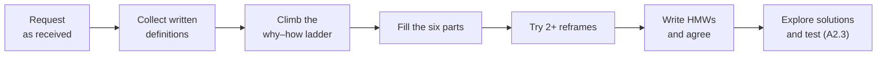

# A2.2 Framing the problem: problem statements

## In one line

A problem statement says who is struggling, in what situation, why, and how you'll know it's fixed, without naming the solution, so the team solves the right problem before it solves the problem right.

## Why this matters

Most of the requests a PM receives arrive as solutions: "add a leaderboard", "build a chatbot", "make the app faster". If you build them as asked, you may ship the wrong thing on time. A clear problem statement is how you turn a request into something the team can explore, debate and measure. It's also how you get engineers, designers and leaders to agree on *what* you're solving before they argue about *how*.

## Key terms

| Term | Plain-English meaning |
|---|---|
| **Problem statement** | A short, shared description of a user's struggle, its cause, its size and what success looks like. It doesn't name a solution. |
| **Solution in disguise** | A request that names a feature ("add a filter") instead of the problem behind it. |
| **Reframing** | Looking at a problem from a different angle so that new, often better solutions appear. |
| **Root cause** | The underlying reason a problem happens, not just its visible symptom. |
| **Five Whys** | Asking "why?" repeatedly to dig from a symptom towards a root cause. |
| **Why–how ladder** | Moving up ("why does this matter?") to broaden a problem, or down ("how might we?") to make it concrete. |
| **How Might We (HMW)** | A question that turns a problem statement into an invitation for ideas, e.g. "How might we help first-time buyers trust the seller?" |
| **Point-of-view (POV) statement** | A design-thinking format: user + need + insight. |

## The idea, simply

!!! tip "Analogy: the patient who asks for antibiotics"
    A patient walks into a clinic and says, "Doctor, give me antibiotics." A poor doctor writes the prescription. A good doctor asks: "What's bothering you? Since when? What makes it worse?"

    It turns out the patient has a viral cold. Antibiotics won't help, and may harm. What they really need is rest, fluids and a note for their office.

    The patient arrived with a **solution**. The doctor's job was to find the **problem**. That's a PM's job too. Stakeholders, users and even you will often arrive with a cure in mind. A problem statement is your diagnosis, written down before you prescribe.

Let's build the idea up step by step.

### 1. A problem statement is a shared diagnosis, not a feature request

A problem statement answers four questions in a few sentences:

1. **Who** is struggling? (A specific group, not "users".)
2. **What** are they struggling with, and **in what situation**?
3. **Why** does it happen? (Your best current understanding of the cause.)
4. **Why does it matter**, and how will we know it's better? (Size, impact and a measure.)

It deliberately **leaves out the solution**. That's the point. Once a solution is named, the team stops thinking about other options.

The examples below are illustrative:

| Request as received | Problem statement |
|---|---|
| "Add a dark mode." | "Night-shift delivery partners say the bright map strains their eyes during 10 pm–6 am shifts, and they keep their phones dimmed, which makes the map hard to read." |
| "We need a chatbot on the website." | "Prospective customers on the pricing page can't tell which plan fits a 10-person team; 40% of sales calls start with this question." |
| "Make checkout faster." | "On low-end Android phones, 1 in 5 UPI payments times out at the bank-app handoff, and users don't know whether they've been charged." |

Notice how each problem statement opens *several* possible solutions. Dark mode is one fix for night-shift drivers; a high-contrast map or larger text might work better.

### 2. Spotting solutions in disguise

Requests come shaped like solutions because that's how people naturally talk. Your first move is to translate them, politely.

**Signs a "problem" is really a solution:**

- It contains a feature noun: button, filter, dashboard, chatbot, leaderboard, notification.
- It contains "we need to add" or "build".
- You can't say which user is struggling, or why.
- Only one fix could possibly satisfy it.

**How to translate:** ask "What would that help with?" and "What happens today without it?" Keep asking until you reach the user's struggle.

| Solution in disguise | Questions to ask | Problem behind it (example) |
|---|---|---|
| "Add a leaderboard." | "What should it help with? Who isn't doing what we hoped?" | Learners stop practising after a bad first test. |
| "Send more push notifications." | "What do we want users to do that they aren't doing?" | Users forget to reorder monthly essentials. |
| "Build a dashboard for sales." | "What decision is sales struggling to make?" | Sales can't tell which leads are worth calling today. |
| "Add a Hindi version." | "Who is stuck today, and where?" | First-time users in Tier-3 towns abandon KYC at the document step. |

The request might still be right. But you won't know until you've seen the problem.

### 3. The parts of a strong problem statement

A strong problem statement has six parts. Short is better: three to five sentences.

| Part | Question | Weak | Strong |
|---|---|---|---|
| **Who** | Which users, specifically? | "Users" | "First-time sellers in their first 30 days" |
| **Situation** | When and where does it happen? | "On the app" | "When listing their first product from a phone" |
| **Struggle** | What goes wrong for them? | "Bad experience" | "They abandon the listing at the photo step" |
| **Cause** | Why, as far as we know? | (missing) | "Photos fail our quality check and the error doesn't say why" |
| **Evidence and size** | How do we know, and how big? | "Lots of complaints" | "38% drop at this step; 9 of 12 interviewees mentioned it" |
| **Impact and measure** | Why it matters; what "fixed" means | "Improve listings" | "Raise first-listing completion from 41% to 55% this quarter" |

Two of these parts deserve extra care.

- **Cause** should be written as a belief, not a certainty: "we believe" or "our evidence suggests". You'll test it in [A2.3](03-assumption-testing-prototypes-and-mvps.md).
- **Impact and measure** connects the problem to an outcome ([A8.1](../08-product-metrics/01-metric-basics-leading-lagging-input-output-vanit.md)). Without it, you can't tell later whether you solved anything.

### 4. Pick the right altitude with the why–how ladder

Problems can be framed too broad ("help people eat better") or too narrow ("add a calorie counter"). Neither helps a team.

The **why–how ladder** is a simple way to find the right level:

- Ask **"Why?"** to move **up**: broader, closer to the user's real goal.
- Ask **"How?"** to move **down**: narrower, closer to a specific solution.

| Rung | Example (exam-prep app) |
|---|---|
| Top (too broad) | Help aspirants clear their exam |
| Higher | Keep aspirants practising consistently after week 1 |
| **Sweet spot** | **Help low scorers on their first mock test know what to fix first** |
| Lower | Show a personalised 7-day fix plan after the first mock |
| Bottom (a solution) | Add a leaderboard |

**How to choose the rung.** Pick the highest rung your team can actually move in a quarter or two. Too high, and no team owns it. Too low, and you've already chosen the solution. A startup's founding team might work a rung higher than a feature team inside a big company.

### 5. Find the cause: Five Whys and reframing

A symptom isn't a cause. "Ratings dropped" is a symptom. Two tools help you dig.

**Five Whys.** Ask "why?" about five times, each answer feeding the next question. The method is credited to Taiichi Ohno and the Toyota Production System ([background](https://en.wikipedia.org/wiki/Five_whys)).

1. Why did app ratings drop? *Many 1-star reviews mention "late delivery".*
2. Why were deliveries late? *Orders in two suburbs took 50+ minutes.*
3. Why there? *Riders had to cross a flyover under repair.*
4. Why didn't the estimate warn users? *The ETA model didn't know about the diversion.*
5. Why not? *Road closures aren't an input to the ETA model.*

The fix moved from "respond to bad reviews" to "feed road-closure data into ETAs", which is a very different project.

**Limits of Five Whys:** real problems often have *several* causes, not one chain. Stop when you reach something you can act on, and check each "because" against data, not opinion. Never let it become "who's to blame?"

**Reframing.** Sometimes the best move isn't digging deeper but looking sideways. In a 2017 *Harvard Business Review* article, Thomas Wedell-Wedellsborg tells the story of tenants complaining about a slow elevator ([HBR](https://hbr.org/2017/01/are-you-solving-the-right-problems)). The obvious frame is "the elevator is too slow" (so: a faster lift, a new motor). The reframe is "the wait is annoying". Putting up mirrors made the wait feel shorter, at a tiny cost.

The same article reports a survey of 106 senior executives from 91 companies: 85% agreed their organisations were bad at diagnosing problems. Wedell-Wedellsborg suggests practices such as:

- **write problem definitions down** and compare them across the group
- **ask what the description leaves out**
- **look at positive exceptions:** when *doesn't* the problem happen?
- **question the objective:** is the goal itself right?

His fuller method is in the book [*What's Your Problem?*](https://store.hbr.org/product/what-s-your-problem-to-solve-your-toughest-problems-change-the-problems-you-solve/10257) (2020).

### 6. Turn the problem into "How might we…?"

Once the problem is written, turn it into an open question the team can brainstorm on. The phrase "How might we" was coined by Min Basadur at Procter & Gamble, building on creative problem-solving methods he learnt in 1971 ([Basadur](https://www.basadur.com/?p=7453)). It later spread through design firms and design-thinking courses. Each word does work:

- **How** assumes a solution exists.
- **Might** allows ideas that may not work.
- **We** makes it shared.

| Too narrow (already a solution) | Too broad | Good HMW |
|---|---|---|
| HMW add a leaderboard? | HMW improve learning? | HMW help low scorers know what to fix first after a mock test? |
| HMW add a "notify me" button? | HMW increase retention? | HMW make reordering monthly essentials effortless for busy households? |
| HMW put a chatbot on pricing? | HMW sell more? | HMW help a 10-person team pick the right plan without a sales call? |

Write three to five HMWs from one problem statement, each from a slightly different angle. Pick one or two to explore.

### 7. Evidence: how big, how often, how painful

A good problem statement is backed by evidence from both numbers and people ([A1.2](../01-understanding-users-user-sense/02-user-research-methods-and-interviews.md)):

- **Numbers** tell you *how many* and *how much*: funnel drop-offs, support tickets, cohort data ([A8.5](../08-product-metrics/05-funnels-cohorts-and-retention-curves.md)).
- **People** tell you *why*: interviews, session recordings, support transcripts.

A simple way to size a problem is **reach × frequency × severity** (illustrative numbers):

| Problem | Reach (users/month) | Frequency | Severity | Verdict |
|---|---|---|---|---|
| UPI timeout at bank handoff | 60,000 | Every failed payment | High (money uncertainty) | Big |
| Confusing filter labels | 200,000 | Occasionally | Low (users recover) | Medium |
| Can't export invoices to Tally | 3,000 (all B2B admins) | Monthly | High (blocks accounting) | Big for a key segment |

Small reach can still matter a lot if those users are your most valuable customers.

## Framework: The Problem Framing Canvas

This canvas is this book's synthesis of three well-known formats:

- **The point-of-view (POV) statement** from Stanford's d.school: *user + need + insight* ([d.school Design Thinking Bootleg](https://dschool.stanford.edu/resources/design-thinking-bootleg)).
- **The business problem statement** from Jeff Gothelf and Josh Seiden (*Lean UX*, *Sense & Respond*). It states the product's original goal, the gap between that goal and what's happening now, the harm that gap causes, and a "how might we" question tied to a measurable outcome ([Gothelf & Seiden, 2017](https://medium.com/@leanstartup/framing-the-work-to-encourage-experimentation-2b9c38cf23ec)).
- **Reframing** practices from Thomas Wedell-Wedellsborg ([HBR, 2017](https://hbr.org/2017/01/are-you-solving-the-right-problems)).

**Step 1: Write down the request as you received it.** Don't argue with it yet. "Build a leaderboard."

**Step 2: Collect everyone's problem definitions, in writing.** Ask each stakeholder (and your trio) to write one or two sentences: "The problem we're solving is…". Different answers are normal. They show you where alignment is missing.

**Step 3: Climb the why–how ladder.** Ask "why?" until you reach a user struggle the team can move in a quarter or two.

**Step 4: Fill in the six parts.** Who, situation, struggle, cause (as a belief), evidence and size, impact and measure. Use the [template in the appendix](../../appendix/templates.md).

**Step 5: Try at least two reframes.** Ask:

- *What does this description leave out?*
- *When does the problem not happen?* (positive exceptions)
- *Is the objective itself right?*
- *Is this a different kind of problem?* For example, a motivation problem rather than a knowledge problem, or a trust problem rather than a speed problem.

**Step 6: Write three to five HMW questions,** pick one or two, and get the trio and key stakeholders to agree on the statement. Then move to solutions and assumption tests ([A2.1](01-continuous-discovery-and-opportunity-solution-tr.md), [A2.3](03-assumption-testing-prototypes-and-mvps.md)).

**When to use:** before any significant piece of work. Use it when a stakeholder brings a solution, when a metric drops ([A8.6](../08-product-metrics/06-diagnosing-a-metric-drop.md)), when the team disagrees about what to build, and at the top of every PRD ([A7.1](../07-execution-and-delivery/01-prds-and-specs.md)).

**When not to:** for small, cheap, reversible fixes (a typo, an obvious bug), just fix it. And don't let framing become a reason never to act. Spend hours or days on it, not months, then test.

The canvas runs left to right in hours or days. Notice that solutions appear only at the very end.

## Diagram

Ask "why?" to climb towards the user's real goal and "how?" to climb down towards solutions. Frame your problem at the highest rung your team can move.

## Worked example

You're the PM for an online exam-prep app for government job aspirants. Learners buy a 3-month plan for **₹1,499**. The head of growth says: "Engagement is weak. Let's build a leaderboard."

**Step 1: The request, as received.** "Build a leaderboard to boost engagement."

**Step 2: Written definitions.** You ask four people to complete "The problem we're solving is…":

| Person | Their definition |
|---|---|
| Head of growth | "Learners aren't competitive enough." |
| Content lead | "Learners don't do enough practice questions." |
| Support lead | "Learners say the mock tests are too hard." |
| Data analyst | "Day-14 activity is falling." |

Four different problems. That's your first finding.

**Step 3: Look at the data.** The analyst pulls one month of new paid learners (figures illustrative):

| Fact | Value |
|---|---|
| New paid learners per month | 40,000 |
| Took the first mock test in week 1 | 70% (28,000) |
| Scored below 40% on that mock ("low scorers") | 45% of mock-takers (12,600) |
| Inactive by day 14: low scorers | 62% |
| Inactive by day 14: everyone else who took the mock | 28% |
| Renew the plan: learners active at day 14 | 35% |
| Renew the plan: learners inactive at day 14 | 8% |

The big gap isn't between competitive and uncompetitive learners. It's between low and high scorers on the *first* mock.

**Step 4: Talk to people.** You interview 12 low scorers who went quiet. Nine say something like: "I saw my score and the list of 60 weak topics, and I didn't know where to start." Two mention a leaderboard at a rival app that made them feel worse.

**Step 5: Climb the ladder.** "Leaderboard" → *why?* → "to keep learners practising" → *why do they stop?* → "low scorers feel overwhelmed and don't know what to fix first". That's the sweet spot: specific, ownable, and still open to many solutions.

**Step 6: Write the problem statement.**

> Aspirants who score below 40% on their first mock test (about 12,600 a month) stop practising within two weeks: 62% are inactive by day 14, against 28% of higher scorers. We believe it's because the score report shows them how far behind they are but not what to fix first. Nine of the 12 we interviewed said exactly this. Because learners inactive at day 14 renew at 8% (vs 35% for active learners), this gap costs us renewals. We'll know we've improved it when low scorers' day-14 inactivity falls from 62% to 50% or lower.

**Step 7: Reframe and write HMWs.**

- *Positive exception:* low scorers who *stayed* active mostly had a friend or coach telling them what to do next. That suggests a guidance problem, not a motivation problem.
- *Question the objective:* is "engagement" the goal? No. The real goal is learners improving their scores, which drives renewals.

HMWs:

1. HMW help low scorers know the one thing to fix first after a mock?
2. HMW make the first week after a bad score feel like progress, not punishment?
3. HMW give low scorers the kind of "next step" a good coach would?

**Step 8: What is it worth?** If low scorers' day-14 inactivity drops from 62% to 50%:

| Calculation | Value |
|---|---|
| Extra low scorers still active at day 14 | 12% × 12,600 ≈ 1,512 per month |
| Renewal gap between active and inactive learners | 35% − 8% = 27 points |
| Extra renewals | 1,512 × 27% ≈ 408 per month |
| Extra revenue | 408 × ₹1,499 ≈ ₹6.1 lakh per month (≈ ₹73 lakh a year) |

**Step 9: Compare with the original request.** A leaderboard would mostly engage high scorers, who are already active. For low scorers, it might make things *worse*: two interviewees said so. It isn't banned, but it now has to compete with ideas like a "fix these 3 topics first" plan, short confidence-building quizzes, or a mentor message after the first mock. You'll test the riskiest assumptions behind each before building ([A2.3](03-assumption-testing-prototypes-and-mvps.md)).

**Step 10: Metrics.** Steering: day-14 activity among low scorers. Outcome: renewals. Guardrails: average mock scores (are we keeping people busy without helping them learn?) and uninstalls or opt-outs from any new nudges.

## Going deeper: nuances and trade-offs

### 1. Problems, opportunities and goals aren't the same thing

People use these words loosely. It helps to separate them:

- A **goal** or **outcome** is what the business wants to move ("more renewals").
- An **opportunity** is a customer need, pain or desire that, if addressed, would move the outcome ([A2.1](01-continuous-discovery-and-opportunity-solution-tr.md)).
- A **problem statement** is a carefully written, evidence-backed description of one opportunity, ready for a team to work on.

A problem statement sits between the opportunity tree and the solution ideas. It's the brief you hand the trio.

### 2. The cause is a hypothesis, so hold it lightly

The "cause" part of your statement is your best current guess. Write it as "we believe…" and list what would prove it wrong. In the worked example, if a "fix these 3 topics first" plan doesn't change day-14 activity, maybe the cause is something else (exam dates, pricing, time pressure). Good PMs update the problem statement as they learn, and note the change, rather than defending the first version.

### 3. Multiple causes, multiple segments

Real problems rarely have one cause. Payment failures might come from bank downtime, slow phones and a confusing app switch, each affecting different users. Two practical habits:

- **Split by segment** before writing one big statement. "UPI failures on low-end Android in Tier-2 cities" is more workable than "payments fail".
- **Pick one cause to work on,** and say so. Mention the others as known, out-of-scope causes.

### 4. B2B: whose problem is it?

In B2B products, the **buyer** (who signs the contract), the **user** (who uses the product daily) and the **admin** (who sets it up) often have different problems. A finance head wants "fewer payment delays"; the accounts clerk wants "less copying between Tally and email". Write statements per role, and be clear whose problem you're solving. A solution that helps the user but adds work for the admin can block adoption.

### 5. Problem statements are alignment tools, and politics is real

Asking stakeholders to write their problem definitions isn't just research. It surfaces disagreements early, when they're cheap to resolve. Some tips:

- **Disagree on the problem, not on the person's solution.** "Let's check we agree on the problem first" lands better than "your idea is wrong".
- **Bring evidence.** Numbers and user quotes move conversations more than opinions.
- **Leave room for the original idea.** If the stakeholder's solution survives testing, great. They'll back it more because it was tested fairly.

Atlassian's *State of Product 2026* survey found that 80% of teams still don't involve engineers in ideation, problem definition or roadmap creation ([Mind the Product summary](https://www.mindtheproduct.com/inside-atlassians-state-of-product-2026-key-takeaways/)). Bringing engineers in at the framing stage often surfaces cheaper causes and fixes.

### 6. Framing in India: don't import someone else's problem

Problem statements written in a head office in Bengaluru, Mumbai or abroad often miss what users elsewhere face. Common blind spots:

- **Language:** the struggle may be reading English, not the feature itself.
- **Connectivity and devices:** low-end phones, patchy data, shared phones.
- **Trust:** fear of fraud, or of being charged twice, can matter more than speed.
- **Assisted use:** a family member or shopkeeper may operate the app for the user.
- **Cash and credit habits:** "pay later" at the local store is a strong competitor.

If your evidence comes only from metro users, say so in the statement. Then go and meet the others ([A1.1](../01-understanding-users-user-sense/01-building-user-sense-and-empathy.md)).

### 7. Can AI help you frame problems?

AI tools can summarise interviews, cluster support tickets and draft problem statements quickly. That's useful for gathering evidence. But the judgment of *which* frame is right still sits with people.

A study presented at ACM CHI 2025 tested this directly. Researchers at Aalto University asked 280 people to reframe design problems either by hand or with GPT-4o in different ways. Using the LLM did **not** make the frames more novel or useful, as rated by expert designers. It also widened the gap between experts and novices ([Shin et al., arXiv](https://arxiv.org/html/2503.01631v1)). So: use AI to gather and summarise, then do the framing yourself, and check AI-drafted statements against real evidence.

### 8. How framing changes by company stage

- **Early startup:** the problem *is* the company. Framing is broad ("small shops can't track credit customers") and changes fast as you learn.
- **Growth stage:** problems are framed around a metric and a segment ("new sellers in Tier-2 cities don't complete their first listing").
- **Large company:** problems are narrower and owned by a team, but connecting them to the company's strategy matters more ([A4.2](../04-strategy-and-vision/02-good-strategy-vs-bad-strategy-the-kernel.md)). A good statement says which company goal it serves.

## Real-world examples (2023 onwards)

!!! example "SEBI and F&O trading, 2024–2025: a sized problem, a targeted fix, and a surprise"
    In September 2024, India's market regulator SEBI published an updated study of individual traders in equity futures and options (F&O). It found that **93% of individual traders lost money** between FY22 and FY24, with aggregate losses of **over ₹1.8 lakh crore** across the three years ([SEBI press release](https://www.sebi.gov.in/media-and-notifications/press-releases/sep-2024/updated-sebi-study-reveals-93-of-individual-traders-incurred-losses-in-equity-fando-between-fy22-and-fy24-aggregate-losses-exceed-1-8-lakh-crores-over-three-years_86906.html)).

    That evidence shaped a specific set of measures announced on 1 October 2024 and phased in from 20 November 2024. They included larger contract sizes, only one weekly expiry per exchange, extra margin on expiry day and upfront collection of option premiums ([Zerodha's summary](https://zerodha.com/z-connect/business-updates/sebis-new-rules-for-index-derivatives-heres-whats-changing)).

    SEBI's follow-up study in July 2025 showed a mixed picture. Unique individual F&O traders fell 20% (December 2024–May 2025 vs a year earlier). But the average net loss per individual trader widened about 41% to roughly ₹1.1 lakh in FY25, and about 91% still lost money ([Business Standard](https://www.business-standard.com/amp/markets/news/individual-investors-shrink-20-percent-fo-segment-125070800801_1.html)).

    **PM lesson:** a sized, evidence-backed problem statement leads to focused action. But the measure of success must match the problem. "Fewer people trading" and "fewer people losing money" are different outcomes. If your statement doesn't name the measure that matters, a fix can look like success on one number while the core problem continues.

!!! example "Netflix, 2022–2023: from 'stop password sharing' to 'convert the borrowers'"
    In April 2022, Netflix reported its first subscriber loss in about a decade. It estimated that around 100 million households were watching on someone else's account, alongside about 222 million paying ones ([OPB / NPR](https://www.opb.org/article/2022/04/20/netflix-lost-viewers-for-the-1st-time-in-10-years-says-password-sharing-is-to-blame/)). Netflix framed these households as a chance to convert viewers into paying customers, not just as rule-breakers.

    That framing shaped the solution. Instead of simply blocking shared accounts, Netflix launched **paid sharing** in May 2023: members could add an extra member outside their household for a fee ($7.99 a month in the US). By Q2 2023, paid sharing covered more than 100 countries and over 80% of Netflix's revenue base, and Netflix added 5.9 million subscribers in the quarter against analysts' forecasts of about 1.7 million ([TechCrunch](https://techcrunch.com/2023/07/19/netflix-gains-nearly-6m-subscribers-as-paid-sharing-soars)).

    **PM lesson:** "how do we stop sharing?" and "how might we turn borrowers into paying members, with an easy path?" lead to very different products. The second frame kept the borrower as a customer to win, not an enemy to block.

## Common mistakes

!!! warning "Watch out for"
    - **Naming the solution in the problem.** "Users need a leaderboard" closes every other door.
    - **"Users" as the who.** Name a specific segment and situation, or the team will picture different people.
    - **Writing the cause as fact.** It's a belief until tested; say what would prove it wrong.
    - **No measure of success.** Without one, you can't tell later whether you solved anything, and every result can be spun as a win.
    - **Framing too broad or too narrow.** "Improve engagement" has no owner; "add a button" has no room for ideas.
    - **Skipping the written definitions step.** Teams discover halfway through a sprint that they were solving different problems.
    - **Using Five Whys to find someone to blame.** It's for finding causes in the system, not culprits.
    - **Never revisiting the statement.** When the evidence changes, update the statement and say why.

## Common questions

**How long should a problem statement be?**
Three to five sentences, or one short paragraph. If it needs a page, you're probably describing several problems. Split them.

**Isn't it faster to just build what the stakeholder asked for?**
Sometimes, for cheap, reversible changes. For anything that takes weeks, an hour spent framing usually saves far more time than it costs. And stakeholders generally care more about the outcome than about their specific idea.

**What if I don't have data yet?**
Write the statement with what you have, mark the evidence as thin ("based on 5 interviews"), and make gathering evidence the first step. A rough, honest statement beats none.

**What's the difference between a problem statement and a user story?**
A problem statement describes a struggle and why it matters, before any solution. A user story ("As a…, I want…, so that…") describes a piece of a chosen solution for the team to build ([A7.2](../07-execution-and-delivery/02-user-stories-and-acceptance-criteria.md)).

**Who writes the problem statement?**
The PM usually drafts it, but the product trio (PM, designer, engineer) should shape and agree on it. Stakeholders should review it. The more people who agree with the problem, the less you'll argue about solutions later.

**Can a problem statement change during a project?**
Yes, and it often should. Learning that your cause was wrong is progress. Update the statement, note what changed and why, and check the team still agrees.

## In the interview

!!! question "In the interview"
    **How it's tested:** almost every product sense and execution question tests framing, even when it doesn't say so. Interviewers watch whether you jump to solutions or first clarify the user, the problem and the goal. Some questions test it directly: "Your CEO wants feature X. What do you do?"

    **Sample question:** *"Ride cancellations by drivers have gone up 15% in the last month on our ride-hailing app. How would you approach this?"*

    **Outline of a strong answer:**

    1. **Clarify and check it's real:** which cities, vehicle types and times? Is it a tracking or definition change ([A8.6](../08-product-metrics/06-diagnosing-a-metric-drop.md))?
    2. **Segment before solving:** is it new drivers or experienced ones? Short trips or long? Cash or UPI? Airport pickups?
    3. **Find causes with evidence:** for example, Five Whys on one segment, plus driver interviews or support tickets. Name two or three possible causes (low fares on short trips, long pickup distances, a new competitor's incentives).
    4. **Write a crisp problem statement:** "Experienced auto drivers in Pune are cancelling short (<3 km) cash trips after accepting, because the pickup distance often exceeds the trip distance…"
    5. **Turn it into HMWs and a measure:** "HMW make short trips worth accepting?" Success: driver cancellation rate on short trips back to baseline, with rider wait time and fare as guardrails.
    6. **Only then, solutions:** suggest two or three, and how you'd test the riskiest assumption.

    Interviewers listen for segmentation, evidence, a clear problem statement and a measure, before any feature appears.

    **A second common form:** *"The CEO asks you to build a chatbot. What do you do?"* A strong answer: thank them, ask what problem it should solve and for whom, look for evidence, write the problem statement with them, and then compare the chatbot with other options against it.

## Research happening now

!!! info "Research happening now"
    - **Do LLMs help people reframe problems? (ACM CHI 2025).** Joongi Shin and colleagues at Aalto University ran an online experiment with 280 participants reframing design problems, with or without GPT-4o. LLM use didn't improve the novelty or usefulness of the frames, as judged by expert designers, and widened the gap between experts and novices ([arXiv](https://arxiv.org/html/2503.01631v1)). *Status: peer-reviewed conference paper; one task setting, online participants.*
    - **Teams still frame problems without engineers (Atlassian, September 2025).** Atlassian's *State of Product 2026* survey of over 1,000 product professionals in the US and Europe found that 80% of teams don't involve engineers in ideation, problem definition or roadmap creation, and 49% say they lack time for strategic planning ([Mind the Product summary](https://www.mindtheproduct.com/inside-atlassians-state-of-product-2026-key-takeaways/)). *Status: vendor survey, not peer-reviewed.*

## Try it yourself (25 minutes)

Pick one feature request you've heard recently at work, or use this one: *"Our grocery app should add a 'Buy again' button on the home screen."*

1. Ask "why?" three times and write down each answer (make reasonable guesses if needed).
2. Write a problem statement with all six parts: who, situation, struggle, cause (as a belief), evidence and size, impact and measure.
3. Try one reframe: when does the problem *not* happen?
4. Write three HMW questions at slightly different angles.

??? success "Check your answer"
    A strong answer for the "Buy again" example might look like this:

    - **Why ladder:** "Buy again" → *why?* → so repeat buyers reorder faster → *why does that matter?* → households that shop weekly abandon the app when building a basket takes too long → *why?* → they reorder 15–20 of the same items each week and must search for each one.
    - **Problem statement:** "Households that order groceries weekly (about X a month) take 9 minutes on average to build a repeat basket of 15+ items, because each item has to be searched for separately. Y% abandon mid-basket. We believe slow basket-building is a major reason weekly users drift to the local kirana. We'll know it's better when median repeat-basket time falls below 3 minutes and weekly-user retention rises by Z points."
    - **Reframe:** the problem doesn't happen for users who order from a saved list. So it's a *memory and effort* problem, not a *discovery* problem.
    - **HMWs:** HMW let weekly households rebuild last week's basket in one step? HMW remind households of what they usually run out of? HMW make editing a repeat basket as fast as reading a list?

    Check: does your statement name a specific user group, avoid naming the button, state the cause as a belief, and include a number you'd measure?

## How this connects

- [A2.1 Continuous discovery and opportunity solution trees](01-continuous-discovery-and-opportunity-solution-tr.md): where opportunities come from; a problem statement describes one of them in detail.
- [A2.3 Assumption testing, prototypes and MVPs](03-assumption-testing-prototypes-and-mvps.md): how to test the "cause" and the solutions that follow.
- [A1.2 User research methods and interviews](../01-understanding-users-user-sense/02-user-research-methods-and-interviews.md): how to gather the evidence a statement needs.
- [A8.6 Diagnosing a metric drop](../08-product-metrics/06-diagnosing-a-metric-drop.md): segmenting and finding causes when a number moves.
- [A7.1 PRDs and specs](../07-execution-and-delivery/01-prds-and-specs.md): the problem statement is the first section of a good PRD.

## Go deeper

- **Article:** [Thomas Wedell-Wedellsborg, "Are You Solving the Right Problems?"](https://hbr.org/2017/01/are-you-solving-the-right-problems), *Harvard Business Review* (2017). The slow-elevator story and seven practical reframing habits.
- **Book:** [*What's Your Problem?*](https://store.hbr.org/product/what-s-your-problem-to-solve-your-toughest-problems-change-the-problems-you-solve/10257) by Thomas Wedell-Wedellsborg (2020). The full reframing method, with many examples.
- **Podcast:** [HBR IdeaCast: The secret to better problem solving](https://hbr.org/podcast/2016/12/the-secret-to-better-problem-solving) (2016). An interview with Wedell-Wedellsborg on the same ideas (described from its title and listing).
- **Guide:** [Stanford d.school Design Thinking Bootleg](https://dschool.stanford.edu/resources/design-thinking-bootleg). Free method cards, including point-of-view statements and "How might we" questions.
- **Article:** [Jeff Gothelf and Josh Seiden: Framing the work to encourage experimentation](https://medium.com/@leanstartup/framing-the-work-to-encourage-experimentation-2b9c38cf23ec) (2017). The business problem statement template from the authors of *Lean UX*.
- **Background:** [Min Basadur on the origin of "How might we"](https://www.basadur.com/?p=7453). The history of the phrase, from its inventor's firm.
- **Background:** [Five whys](https://en.wikipedia.org/wiki/Five_whys). Where the method came from, and its known criticisms.

## Key takeaways

- Most requests arrive as **solutions in disguise**. Your first job is to find the problem behind them.
- A strong problem statement has **six parts:** who, situation, struggle, cause (as a belief), evidence and size, impact and measure. It **doesn't name a solution**.
- Use the **why–how ladder** to frame at the highest rung your team can actually move.
- Find causes with **Five Whys** and **reframing**, and check each "because" against evidence.
- Turn the statement into **How Might We** questions to open up ideas.
- **Collect stakeholders' definitions in writing:** disagreements surface early, when they're cheap.
- Make sure the **measure of success matches the real problem**, or a "fix" can win one number and miss the point.

## Updates

*No updates yet.*
