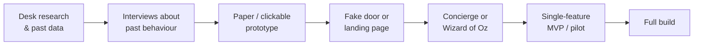
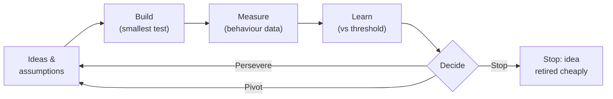
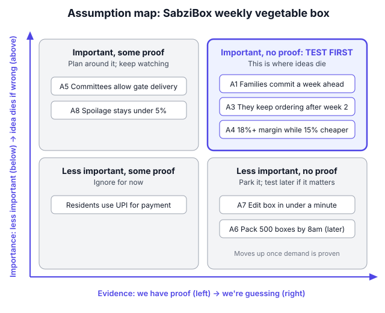

# A2.3 Assumption testing, prototypes and MVPs

## In one line

Before you spend months building an idea, list what must be true for it to work, then run the cheapest test that could prove the riskiest belief wrong.

## Why this matters

Most new ideas fail, even good-sounding ones built by capable teams. The expensive way to find out is to build the whole thing and launch it. The cheap way is to test the beliefs underneath the idea first, in days and with very little money.

This is a daily PM skill:

- **In discovery:** turning a promising solution into a set of testable beliefs ([A2.1](01-continuous-discovery-and-opportunity-solution-tr.md))
- **In planning:** deciding what *not* to build yet
- **With leaders:** replacing "I think users will love it" with "here's what 108 real people did"
- **In launches:** knowing which risks you've already retired and which you're still carrying

## Key terms

| Term | Plain-English meaning |
|---|---|
| **Assumption** | Something that must be true for your idea to work, but that you haven't proven yet. |
| **Riskiest assumption** | The belief that is both very important and has the least evidence behind it. Test it first. |
| **Hypothesis** | An assumption rewritten so a test can prove it right or wrong, with a number attached. |
| **Prototype** | A model of a product, from paper sketch to clickable screens, built to learn, not to sell. |
| **Fidelity** | How close a prototype looks and behaves to the real thing (low = sketch, high = looks real). |
| **MVP (minimum viable product)** | The smallest thing you can put in front of real users to learn whether they'll actually use or pay for it. |
| **Fake door test** | Showing a button or offer for something that doesn't exist yet, to measure how many people try it. |
| **Concierge test** | Delivering the service by hand to a few customers, openly, before building software. |
| **Wizard of Oz test** | A real-looking front end with humans secretly doing the work behind it. |
| **Success threshold** | The number, agreed *before* the test, that decides whether the belief passed. |

## The idea, simply

!!! tip "Analogy: the new dish at a dhaba"
    A dhaba owner wants to add paneer tikka pizza to the menu. One option: buy a pizza oven for ₹1.5 lakh, train the cook and print new menus. Then find out.

    A smarter owner asks: "What must be true for this to work?" Customers must want it. They must pay ₹250. The tandoor must cook it well enough. So for one weekend, he writes it on the blackboard as a "special", bakes it in the existing tandoor and counts orders. If 40 people order it and half come back for it, *then* he buys the oven. If 3 people order it, he's lost one weekend, not ₹1.5 lakh.

    That's assumption testing. The blackboard special is his MVP.

### 1. Every idea is a stack of beliefs

An idea like "a weekly vegetable box for apartment societies" sounds like one thing. It's actually a stack of beliefs, any one of which can sink it:

- Residents want to plan vegetables a week ahead.
- They'll accept Saturday delivery instead of 10-minute delivery.
- They'll pay in advance.
- You can buy produce cheaply enough to make money.
- Society committees will let you deliver at the gate.

Most product failures aren't caused by bad engineering. They're caused by one of these beliefs being false, and nobody checking. Alberto Savoia, a former Google engineering director, calls this the "law of market failure": most new products fail in the market, *even when competently executed* ([interview on The Product Compass](https://www.productcompass.pm/p/how-to-build-the-right-product-with)). Good execution of a wrong idea is still a failure.

**Why listing beliefs works:** it turns one big, vague risk ("will this work?") into small, specific risks you can test one at a time. And it lets the team argue about evidence instead of opinions.

### 2. The four (or five) kinds of risk

It helps to sort assumptions by *type*, because each type is tested differently.

| Type | The question | Example | Typical test |
|---|---|---|---|
| **Desirability** | Do people want this? | "Busy parents want vegetables planned for the week" | Interviews about past behaviour, fake door, pre-orders |
| **Viability** | Does it work for the business? | "We can earn 18% gross margin" | Cost model, concierge test with real costs |
| **Feasibility** | Can we build and deliver it? | "We can source and pack 500 boxes by Saturday 8am" | Spike (a short technical trial), manual pilot |
| **Usability** | Can people figure it out? | "Users can change their box in under a minute" | Prototype usability test |
| **Ethical** | Should we do it? Could it harm someone? | "Pre-payment won't trap people who forget to cancel" | Team review, legal check, edge-case walk-through |

David Bland and Strategyzer sort assumptions into desirability, feasibility and viability, and also mention a fourth, adaptability (will the idea survive changes in the market?) ([assumptions mapping article](https://strategyzer.com/library/how-assumptions-mapping-can-focus-your-teams-on-running-experiments-that-matter)). Teresa Torres adds usability and ethical risk in her version, which you met in [A2.1](01-continuous-discovery-and-opportunity-solution-tr.md). Marty Cagan's four product risks (value, usability, feasibility, business viability) are the same idea in different words ([A0.1](../00-the-pm-role/01-what-a-pm-actually-does.md)).

**How to recognise you've missed a type:** if all your assumptions are about users, you've probably skipped viability and feasibility. Teams of designers tend to over-list desirability; teams of engineers over-list feasibility.

### 3. Find the riskiest assumption first

You can't test everything, and you shouldn't. Plot each assumption on two questions:

1. **How important is it?** If this belief is wrong, does the whole idea die?
2. **How much evidence do we have?** Have we *seen* it in data or behaviour, or are we guessing?

The beliefs that are **important and have little evidence** are your riskiest assumptions. Test those first. This 2×2 is David Bland's **assumptions mapping**, described in *Testing Business Ideas*, which he co-wrote with Alexander Osterwalder ([Strategyzer](https://strategyzer.com/library/how-assumptions-mapping-can-focus-your-teams-on-running-experiments-that-matter)).

| Quadrant | What to do |
|---|---|
| Important + little evidence | **Test now.** This is where ideas die. |
| Important + strong evidence | Keep an eye on it; plan around it. |
| Unimportant + little evidence | Park it. Don't waste tests here. |
| Unimportant + strong evidence | Ignore. |

A common trap is testing what's *easy* instead of what's *risky*. Teams love building a pretty prototype of the checkout flow (usability) when the real question is whether anyone wants the product at all (desirability).

### 4. Turn the assumption into a hypothesis with a number

"People will like it" can't fail. A good test needs a belief that *can* be proven wrong. Write it like this:

> **We believe** [specific people] **will** [do a specific, observable thing] **at least** [X%/number] **within** [time], **if** [condition].

Savoia's version is the **XYZ hypothesis**: "at least X% of Y will do Z". An example often used to explain it: at least 20% of packaged-sushi buyers will choose day-old sushi if it's half the price ([EWOR guide](https://www.ewor.com/blog/mastering-pretotyping-a-guide-to-getting-it-right)). He then narrows it to something testable *this week*: one café, one lunchtime.

| Vague belief | Testable hypothesis |
|---|---|
| "Parents want a weekly vegetable box" | "At least 8% of flats in 3 societies will pay a ₹49 refundable deposit within 5 days of a WhatsApp offer" |
| "Users want dark mode" | "At least 15% of weekly users tap the 'Try dark mode' banner in 14 days" |
| "Shopkeepers will use voice to add stock" | "7 of 10 kirana owners complete 5 stock entries by voice without help in a 20-minute session" |

**Set the success threshold before you run the test.** If you decide afterwards, you'll always find a reason to call the result a win. The threshold should come from what the business needs: "below 8%, the unit maths doesn't work."

### 5. Prefer what people *do* over what they *say*

People are kind and optimistic in interviews. "Yes, I'd definitely use that" costs them nothing. Savoia puts it neatly: it's much easier for people to open their mouths than their wallets. He suggests weighting evidence by how much **skin in the game** it shows ([The Product Compass](https://www.productcompass.pm/p/how-to-build-the-right-product-with)).

| Weak evidence (says) | Stronger evidence (does) | Strongest evidence (commits) |
|---|---|---|
| "I'd buy that" in an interview | Clicked "Join waitlist" | Paid a deposit or pre-ordered |
| Liked a social post | Gave a phone number | Gave time: 30-minute onboarding call |
| Survey: "very interested" | Used a prototype twice unprompted | Switched away from their current option |

This links back to *The Mom Test* and the say–do gap in [A1.1](../01-understanding-users-user-sense/01-building-user-sense-and-empathy.md). Interviews are great for finding problems and *why*. Commitment tests are better for proving demand.

### 6. The test menu: from cheapest to most real

There's a ladder of tests. Start low; climb only when you've earned it.

Each step costs more and gives stronger evidence. Most ideas should die or change shape before the last two boxes.

| Test | What it is | Best for | Typical cost and time |
|---|---|---|---|
| **Data mining** | Look at existing data, search trends, support tickets | Is the problem real and big? | Hours |
| **Problem interviews** | Ask about the last time it happened ([A1.2](../01-understanding-users-user-sense/02-user-research-methods-and-interviews.md)) | Desirability (problem side) | 1–2 weeks |
| **Paper / clickable prototype** | Screens with no real back end | Usability, value proposition | Days |
| **Fake door** | A real button or ad for a thing that isn't built; after the tap, explain and apologise | Demand | Days |
| **Landing page / pre-order** | A page describing the offer with a sign-up or deposit | Demand and willingness to pay | Days to 2 weeks |
| **Concierge** | You deliver the service by hand to a few customers who know it's manual | Desirability and viability | 2–6 weeks |
| **Wizard of Oz** | A real-looking product where humans secretly do the work | Desirability, usability of the real flow | 2–6 weeks |
| **Single-feature MVP / pilot** | A narrow, real version in one city or segment | Retention, operations, economics | 1–3 months |

### 7. Prototypes: match the fidelity to the question

A prototype is a question in physical form. Its fidelity should match what you're asking.

| Question | Right fidelity | Why |
|---|---|---|
| "Do people get the concept?" | Paper sketch, storyboard | People comment freely on rough things; polish invites nitpicks on colour |
| "Can people complete the flow?" | Clickable mid-fidelity (Figma) | Tests navigation and wording |
| "Does this feel fast and trustworthy?" | High fidelity, real-ish data | Look and feel *are* the question |
| "Does the AI answer help?" | A working prototype on real inputs | AI quality can't be faked with static screens ([B2.2](../../part-b/02-discovery-and-design/02-ai-ux-patterns-chat-copilot-agent-ambient.md)) |

**AI changes the cost.** Tools like v0, Bolt, Lovable and Replit let a PM turn a description into a working prototype in hours. Colin Matthews' [guide on Lenny's Newsletter](https://www.lennysnewsletter.com/p/a-guide-to-ai-prototyping-for-product) compares them and suggests, for example, v0 for polished designs and Replit for tools that store data. This is powerful, but it has a catch. A slick working prototype can make a team *feel* more certain without adding evidence. A prototype nobody outside the team has used is still an opinion. (Prototyping as a design craft is covered in [A6.3](../06-product-design-and-ux/03-wireframes-and-prototypes.md).)

### 8. What an MVP really is (and isn't)

Eric Ries popularised the MVP in *The Lean Startup* (2011). He defines it as the version of a new product that lets a team collect the maximum validated learning about customers with the least effort. He also stresses that an MVP is not about creating minimal products ([Lean Startup Co.](https://leanstartup.co/what-is-an-mvp/)).

That definition has three words that matter:

- **Learning:** the goal is an answer, not revenue or a launch.
- **Validated:** proven by what real users did, not what the team believes.
- **Least effort:** if a cheaper test would answer the question, the MVP is too big.

| What people call an MVP | Is it really one? |
|---|---|
| Version 1.0 with fewer features, built for 6 months | Usually not. It's a small product, and it skipped the learning. |
| A clickable prototype tested with 8 users | It's a prototype test. Useful, but users didn't commit anything. |
| A concierge service for 20 paying families | Yes. Real users, real commitment, little building. |
| A pilot with 5 ambulances in one city | Yes, if it's set up to answer specific questions. |

**The build-measure-learn loop.** Ries describes the work as a loop: build the smallest thing, measure what users do, learn, then decide. The loop is easier to run in reverse. First decide what you need to *learn*, then what you'd need to *measure*, and only then what to *build*.

Plan the loop backwards (learn → measure → build), then run it forwards. "Stop" is a successful outcome when it saves months.

### 9. Wizard of Oz vs concierge: know which one you're running

These two get mixed up, and the difference decides what you learn. Amanda White's [Mind the Product article (March 2026)](https://mindtheproduct.com/wizard-of-oz-vs-concierge-testing-behind-the-curtain-or-behind-the-desk/) puts it simply:

- **Wizard of Oz:** the *front end* is real and the back end is a human. You're testing the screen and the experience. Users think it's automated.
- **Concierge:** the human *is* the front end. Users know a person is helping them. You're testing whether the service itself is valuable, before building any screens.

| | Wizard of Oz | Concierge |
|---|---|---|
| User sees | A product | A person |
| User knows it's manual? | No (usually) | Yes |
| Tests | The interface and the value | The value and the operations |
| Example | An "AI" meal planner where a dietitian writes plans behind the screen | A founder who WhatsApps each customer a meal plan personally |
| Watch out for | Ethics: don't deceive people where it matters (money, health); disclose afterwards | It doesn't scale; that's fine, it's not meant to |

**Ethical line:** if a Wizard of Oz test involves sensitive data, money or health, tell users a person may review their request. Hiding humans in a "fully automated" medical or financial product crosses from testing into deception.

## Framework: Assumptions mapping + the test card

**Who created it:** assumptions mapping was developed by David J. Bland. He describes it in *Testing Business Ideas*, co-written with Alexander Osterwalder, and in a [Strategyzer article (August 2020)](https://strategyzer.com/library/how-assumptions-mapping-can-focus-your-teams-on-running-experiments-that-matter). Bland credits Jeff Gothelf and Josh Seiden (authors of *Lean UX*) for introducing him to mapping risk this way. The MVP and build-measure-learn come from Eric Ries ([Lean Startup Co.](https://leanstartup.co/what-is-an-mvp/)). Pretotyping and the XYZ hypothesis come from Alberto Savoia's book *The Right It* (see his [Stanford talk page](https://stvp.stanford.edu/av/build-right-it-entire-talk)).

The steps below combine them into one routine you can run in a week.

**Step 1: Write the idea in one sentence.** Who it's for, what it does, why they'd pick it. If the team can't agree on this, stop and go back to the problem statement ([A2.2](02-framing-the-problem-problem-statements.md)).

**Step 2: List assumptions as a team (30 minutes).** Use "We believe that…" sentences. Push for 15–25. Cover every type: desirability, viability, feasibility, usability, ethical. A useful prompt: *"Imagine it's a year from now and this failed. Why?"* (This is a pre-mortem.)

**Step 3: Map them.** Put each on the importance × evidence 2×2. Be honest about evidence: "our CEO is sure" is not evidence.

**Step 4: Pick the 1–3 riskiest.** Top-right quadrant only: important, little evidence.

**Step 5: Write a test card for each.**

| Part | Example |
|---|---|
| **We believe that…** | Residents of large societies will commit to a weekly vegetable box |
| **To verify, we will…** | Send a WhatsApp offer with a ₹49 refundable deposit to 1,500 flats |
| **And measure…** | % of flats that pay the deposit within 5 days |
| **We are right if…** | At least 8% pay (120 flats) |
| **Cost and time** | ₹3,000 and 1 week |

**Step 6: Run the cheapest test that could prove you wrong.** Ask: "Is there a cheaper way to get evidence this strong?" If yes, use it.

**Step 7: Decide, and record what you learned.** Compare to the threshold. Then **persevere** (move to the next riskiest assumption), **pivot** (change the idea) or **stop**. Write a one-line learning card: "We observed… so we learned… so we will…". Update the map: the tested assumption moves left (more evidence).

**When to use:** any new product, new feature with real uncertainty, new market, new pricing, or a big bet that would take more than a few weeks to build.

**When not to:**

- **Small, reversible changes** (a copy tweak, a colour) — just ship and measure with an A/B test ([A9.1](../09-experimentation/01-a-b-testing-basics.md)).
- **Known must-haves** like legal compliance or a security fix — you're building it regardless.
- **When the test costs more than building.** For a two-day feature, a two-week test is waste.
- **When a fake test would harm trust,** for example fake doors in a payments or health flow where users urgently need the thing.

## Diagram

Only the highlighted top-right box earns a test this week. Everything else waits, even if it would be fun to test.

## Worked example

You're a PM at a small Bengaluru startup. The founders want to build **SabziBox**: a weekly fruit-and-vegetable box for apartment societies. Customers order by Thursday and get delivery on Saturday morning. Because orders are planned, the box is about 15% cheaper than quick-commerce prices. The founders want to build an app and lease a cold room. Estimated cost: **₹30 lakh and 4 months**.

You ask for two weeks to test first.

**Step 1: List the assumptions.** The team writes 14. Here are the 8 that matter most:

| # | We believe that… | Type |
|---|---|---|
| A1 | Families in large societies will commit to a weekly box in advance | Desirability |
| A2 | They'll accept Saturday delivery instead of 10-minute delivery | Desirability |
| A3 | They'll keep ordering after the first 2 weeks | Desirability |
| A4 | We can buy at prices that give an 18%+ gross margin while being 15% cheaper | Viability |
| A5 | Society committees will allow gate delivery | Feasibility |
| A6 | We can pack 500 boxes between 4am and 8am on Saturday | Feasibility |
| A7 | Users can edit their box on a phone in under a minute | Usability |
| A8 | Spoilage will stay under 5% | Viability |

**Step 2: Map them.** A1, A3 and A4 land in the top-right: important, no evidence. A5 is important but the founders have a letter from two committees already, so it has some evidence. A7 (usability) is unimportant *for now*: if nobody wants the box, the edit screen doesn't matter.

**Step 3: Test 1 — a smoke test for A1 (1 week, about ₹3,000).**

The team sends a WhatsApp message to three society groups (1,500 flats). It describes the box, shows a sample list with prices and asks for a ₹49 refundable deposit to "reserve a spot for the first delivery".

| | Number | Rate |
|---|---|---|
| Flats reached | 1,500 | — |
| Opened the form | 315 | 21% |
| Paid ₹49 deposit | 108 | 7.2% |
| **Threshold set beforehand** | **120** | **8%** |

The result is just below the threshold. The team doesn't fudge it. They read the 207 form-openers who didn't pay: many said "Saturday is too late; we cook from Thursday". That's a new insight about A2. Decision: **pivot slightly** to a Wednesday delivery for one society, and run the next test with those who did pay.

**Step 4: Test 2 — a concierge MVP for A3 and A4 (4 weeks, about ₹42,000).**

The founders buy at a wholesale market at dawn, pack boxes by hand and deliver themselves. Customers know it's a small, manual trial.

| Week | Boxes ordered | Retention vs week 1 | Avg order value | Cost of goods per box |
|---|---|---|---|---|
| 1 | 96 | 100% | ₹520 | ₹410 |
| 2 | 78 | 81% | ₹510 | ₹400 |
| 3 | 70 | 73% | ₹530 | ₹415 |
| 4 | 62 | 65% | ₹525 | ₹412 |

Thresholds set beforehand: **week-4 retention ≥ 50%** and **gross margin ≥ 18%**.

- Retention: 62 ÷ 96 = **65%** → passes.
- Gross margin in week 4: (₹525 − ₹412) ÷ ₹525 = **21.5%** → passes.
- Spoilage: 7% in week 1, falling to 4% by week 4 as they learned how much to buy → a new risk to keep watching.
- Packing time: 6 minutes per box by hand → 500 boxes would need 50 person-hours every Saturday. That's a feasibility risk (A6) for the *next* test.

**Step 5: What is it worth?**

| | Build first | Test first |
|---|---|---|
| Money spent before real evidence | ₹30 lakh | ₹45,000 |
| Time to first real evidence | 4–5 months | 5 weeks |
| If the idea fails | Lose about ₹30 lakh | Lose about ₹45,000 |
| If the idea works | Product may be built around the wrong delivery day | Build with the Wednesday insight, a real retention baseline and a cost model |

Say, honestly, the team gave the idea a 30% chance of working at the start. Building first means a 70% chance of losing ₹30 lakh: an expected loss of about **₹21 lakh**. Testing first caps the loss at ₹45,000 and *raised* the chance of success, because the team found the delivery-day problem before building.

**Step 6: Next.** The map is redrawn. A1, A3 and A4 now have evidence. The new riskiest assumption is A6: can packing scale? The next test is a one-Saturday packing trial for 250 boxes in a rented hall, before signing a cold-room lease.

## Going deeper: nuances and trade-offs

### 1. False negatives: a failed test doesn't always mean a bad idea

A test can fail because the *test* was bad. The message was confusing, the price was shown wrong, or it reached the wrong people. In the worked example, the smoke test nearly "failed" because of delivery day, not demand. Before you kill an idea, ask: "Did we test the idea, or did we test our copywriting?" A good habit is to look at *why* people didn't convert, not just how many didn't.

The opposite also happens. A fake door with a catchy headline can over-measure interest. Curiosity clicks aren't commitment. That's why later tests should ask for more skin in the game.

### 2. Thresholds come from the business, not from hope

Where does "8%" come from? Work backwards from the business model. If you need 400 paying flats per society cluster to cover a van and a packer, and a cluster has 5,000 flats, you need 8%. A threshold pulled from the air ("let's say 10%") gives a result you can't act on. A threshold derived from unit economics tells you whether the idea *can* work.

Also define a **grey zone**. For example: above 8% → go; 5–8% → iterate and retest; below 5% → stop. This prevents endless debate over 7.2%.

### 3. Sample size: small tests are for big signals

You won't get statistical certainty from 100 people, and you don't need it. Early tests are for finding **big** effects: "nobody wants this" vs "lots of people want this". If the answer is borderline, don't run 10 tiny tests hoping one passes. That's how you fool yourself. Either redesign the test to get a clearer signal or accept that the effect is small. Proper A/B testing with statistical power comes later, when you're optimising a live product ([A9.2](../09-experimentation/02-statistics-in-plain-english.md)).

### 4. Fake doors and trust

Fake door tests show something that doesn't exist. Done carelessly, they annoy users. Done well, they're honest and brief:

- Show the fake door to a small slice of users (1–5%), not everyone.
- After the tap, say plainly: "We're thinking about building this. Want to hear when it's ready?"
- Never take payment for something that won't be delivered. Refundable deposits must be refunded quickly.
- Avoid fake doors on urgent, high-stakes needs (a "cancel order" button that doesn't work, a health feature).

In India, the Consumer Protection Act and the Central Consumer Protection Authority's dark-patterns guidelines apply to misleading interfaces (see the dark-patterns discussion in [A1.4](../01-understanding-users-user-sense/04-journey-maps-and-empathy-maps.md)). If a test would look like a bait-and-switch to a customer, redesign it.

### 5. B2B vs B2C testing

- **B2C:** you can reach hundreds of people cheaply. Fake doors, landing pages and in-app tests work well.
- **B2B:** you may have 20 potential customers in total. Each test is a relationship. Strong evidence looks like a **letter of intent**, a paid pilot, a customer giving you their real data, or a buyer introducing you to their finance team. "They said it looks great in the demo" is weak evidence. A paid pilot with a named champion is strong.
- **Marketplaces** have two sides, so you have two sets of assumptions. Test the harder side first (often supply). A food platform with hungry users and no restaurants has learned nothing.

### 6. Testing in India: channels and quirks

- **WhatsApp groups** (society, school, community) are fast, cheap test channels. But they're trust-based; a test that feels spammy can get you removed from the group.
- **Cash on delivery and UPI** change what "commitment" means. A ₹1 UPI "reservation" is a real action; an online form fill isn't. Many users won't pre-pay large amounts to a new brand, so a small refundable deposit is a fairer test than full pre-payment.
- **Tier-2 and Tier-3 cities** may need assisted tests: a field agent or a shopkeeper explaining the offer. That changes what you're testing (the agent's persuasion is part of the product).
- **Language:** a test in English only tests English speakers. If your target users read Hindi or Tamil, test in those languages.

### 7. MVPs at bigger companies

At a startup, a failed MVP costs a few weeks. At a large company, a public MVP carries **brand risk**: users expect polish from a known name. Experienced PMs handle this by:

- Testing under a separate label or a "beta" or "lab" tag.
- Starting with internal users or a small city.
- Being explicit about what the pilot is meant to learn, so leaders don't judge it like a full launch.

The flip side: big companies have more data and distribution, so they can often answer desirability questions from existing behaviour without building anything.

### 8. AI-generated prototypes and "synthetic users"

AI tools make it cheap to build prototypes, and some vendors now offer "synthetic users": AI personas that answer interview or survey questions. Treat these carefully. A July 2026 preprint from Stevens Institute of Technology and UMass Boston found that LLM-simulated survey respondents did no better than a simple demographic lookup at predicting individual answers, exaggerated differences between segments, and would have led a team to pick the wrong target segment in many cases ([arXiv](https://arxiv.org/abs/2607.26348); *preprint, under peer review*). Use AI to generate *hypotheses* and draft test materials. Use real people to *test* them.

## Real-world examples (2023 onwards)

!!! example "Blinkit, January 2025: a five-ambulance pilot before a national service"
    On 2 January 2025, Blinkit launched a 10-minute ambulance service in Gurugram. It started with **five** Basic Life Support ambulances, booked through the Blinkit app. Each carried oxygen, an AED (a defibrillator), a stretcher, a monitor, a suction machine and emergency medicines, with a paramedic, an assistant and a trained driver on board ([Business Today](https://www.businesstoday.in/india/story/profit-is-not-a-goal-here-blinkit-rolls-out-10-minute-ambulance-service-starting-in-gurugram-459361-2025-01-02)). CEO Albinder Dhindsa said, "Profit is not a goal here," and that the aim was to "carefully scale" the service to all major cities over two years. YourStory described it as being in a testing phase in selected areas of Gurugram ([YourStory](https://yourstory.com/2025/01/blinkit-launches-ten-minute-ambulance-service-gurugram)).

    **PM lesson:** this is a pilot shaped like an MVP. One city, selected areas, a handful of vehicles. A national rollout would carry huge feasibility risks: can ambulances really reach people in 10 minutes in traffic, how many calls come in, what does each trip cost? A small pilot answers those with real calls before committing capital and reputation at scale. Note also that in health, the "minimum" can't mean cutting safety. The pilot was small in *scope* (place and fleet), not in *quality* (equipment and crew).

!!! example "Humane AI Pin, 2024–2025: a big launch before the core beliefs were proven"
    Humane's AI Pin, a wearable AI assistant with no screen, launched in April 2024 at **$699**. The company had reportedly sought a valuation of $750 million to $1 billion in May 2024. On 18 February 2025, Humane told customers that the Pins would stop working on 28 February 2025, and HP bought its technology, patents and most of its staff for **$116 million** ([The Decoder](https://the-decoder.com/humane-ends-its-ai-pin-in-ten-days-sells-technology-to-hp-for-116-million/)). Customers outside the return window lost the use of the device.

    **PM lesson:** public reports don't show what Humane tested internally, so don't over-read it. But the outcome shows the cost of carrying untested beliefs into a full launch. A product like this rests on several risky assumptions at once: people want to leave their phone for some tasks (desirability), voice and a projector are good enough to use daily (usability), and the AI is fast and accurate enough (feasibility). When all of them are tested only *after* manufacturing hardware, every failure is expensive. A cheaper path tests each belief with prototypes, a small paid pilot or a Wizard of Oz trial before scaling up.

## Common mistakes

!!! warning "Watch out for"
    - **Testing the easy assumption, not the risky one.** A polished usability test of a product nobody wants.
    - **No threshold set in advance.** Every result then gets called "promising".
    - **Counting compliments as evidence.** "Everyone loved the demo" isn't demand. Ask for a commitment.
    - **Calling a small v1 an MVP.** If it took 6 months to build, it wasn't the least effort.
    - **Testing only on friends, colleagues or power users.** They're kinder and more expert than real customers.
    - **Killing the idea after one weak test.** Check whether the test, not the idea, failed.
    - **Never stopping.** Endless tests without a decision is procrastination. Each test ends with persevere, pivot or stop.
    - **Deceptive tests.** Fake doors that take money, or hidden humans in sensitive products, burn trust you'll need later.

## Common questions

**What's the difference between a prototype and an MVP?**
A prototype is mainly for *your* learning about design and usability; users don't commit anything. An MVP puts something in front of real users in a real setting so you can see whether they use it, return or pay. Some things are both: a Wizard of Oz test is a prototype that real customers actually use.

**How many assumptions should we test before building?**
There's no fixed number. Test until the riskiest *remaining* assumption is one you're comfortable carrying, given what building would cost. For a 2-week feature, maybe one quick test. For a ₹30 lakh bet, several.

**Isn't a fake door test dishonest?**
It can be. Keep it small, explain immediately after the tap, never take money for something you won't deliver, and avoid it for urgent or sensitive needs. Done that way, most users don't mind; many like being asked.

**Can AI prototypes replace designers and engineers in discovery?**
They make early prototypes much faster and let PMs test more ideas. They don't replace design judgement or the work of building something reliable. Treat an AI prototype as a fast sketch, not a product.

**What if leadership has already decided to build?**
Then test the assumptions that affect *how* you build: which segment to launch with, which features matter, what price. Even a committed bet benefits from a small pilot before a full rollout.

**How long should a test run?**
Long enough to see the behaviour you care about. Sign-up interest shows in days. Retention needs weeks (at least 3–4 cycles of the natural usage frequency; see [A8.5](../08-product-metrics/05-funnels-cohorts-and-retention-curves.md)).

## In the interview

!!! question "In the interview"
    **How it's tested:** product sense and "how would you launch X?" questions often reward candidates who say *how they'd de-risk* before building. Interviewers also ask directly: "How would you validate this idea?" or "What would your MVP be?"

    **Sample question:** *"Swiggy wants to launch a monthly meal-plan subscription for office workers. How would you validate it before building?"*

    **Outline of a strong answer:**

    1. **Clarify the goal and user:** which offices and cities, and the business goal (order frequency? retention?).
    2. **List the key assumptions** across desirability (office workers want to plan a month ahead), viability (discount plus delivery still earns margin), feasibility (restaurants can commit to a fixed menu and slots) and usability (skipping a day is easy).
    3. **Pick the riskiest:** probably that people will commit a month ahead, and that restaurants will commit capacity.
    4. **Design cheap tests with thresholds:** a fake-door banner shown to 2% of weekday lunch users in one city ("Pre-book a month of lunches, save 20%"), success at, say, 3% tapping and 1% paying a refundable deposit; then a concierge pilot in 5 office parks with 3 partner restaurants for 4 weeks, tracking week-4 retention and skip rate.
    5. **State decision rules:** go, iterate or stop at defined numbers.
    6. **Name the guardrails:** effect on regular lunch orders (cannibalisation), restaurant cancellations and complaints.

    Interviewers listen for: assumptions before features, the riskiest one first, behaviour over opinions, numbers decided in advance, and a clear decision at the end.

## Research happening now

!!! info "Research happening now"
    - **Can AI "synthetic users" replace real ones in testing? (July 2026).** Researchers at Stevens Institute of Technology and UMass Boston benchmarked LLM-simulated survey respondents (using Claude and Llama models) against real data from the US General Social Survey and the World Values Survey. No model beat a simple demographic baseline at predicting individual answers. The models also exaggerated differences between groups, which could lead a team to target the wrong segment. Larger models didn't fix this. ([arXiv 2607.26348](https://arxiv.org/abs/2607.26348)) *Status: preprint, under peer review.*
    - **AI prototyping as a core PM habit.** Practitioner guides now treat AI prototyping tools (v0, Bolt, Lovable, Replit) as standard PM kit, e.g. [Lenny's Newsletter guide](https://www.lennysnewsletter.com/p/a-guide-to-ai-prototyping-for-product). *Status: fast-moving practice; little rigorous evidence yet on whether it improves decisions rather than just speed.*

## Try it yourself (25 minutes)

Pick an idea you or your team are excited about (or use: "a ₹99/month app that reminds families when medicines are running low and reorders them").

1. Write the idea in one sentence.
2. List 10 assumptions using "We believe that…". Include at least one of each type: desirability, viability, feasibility, usability, ethical.
3. Place them on an importance × evidence 2×2 (a sheet of paper is fine).
4. Choose the riskiest one and write a full test card: belief, test, metric, threshold, cost and time.

??? success "Check your answer"
    For the medicine-reorder app, a strong answer might include:

    - **Riskiest assumptions:** families will trust an app to reorder medicines (desirability); pharmacies will fulfil reorders reliably and legally (feasibility; prescription rules matter); people will pay ₹99/month rather than set a free phone reminder (viability); reminders won't cause harm if a dose or prescription changes (ethical).
    - **A good test card:** "We believe that families caring for an elderly parent will hand over reordering. To verify, we'll run a concierge test: a pharmacist WhatsApps 30 families when stock runs low and arranges the reorder, for 4 weeks. We'll measure the % who say yes to at least 3 reorders. We're right if at least 50% do. Cost: ₹15,000; time: 5 weeks."

    Self-check:

    - Is your riskiest assumption *important and unproven*, not just easy to test?
    - Does your test measure behaviour or commitment, not opinions?
    - Did you write the threshold *before* imagining the results?
    - Would the test be fair and honest from the user's side?

## How this connects

- [A2.1 Continuous discovery and opportunity solution trees](01-continuous-discovery-and-opportunity-solution-tr.md): where assumptions sit in the tree, under each solution.
- [A2.2 Framing the problem](02-framing-the-problem-problem-statements.md): test solutions only after the problem is clear.
- [A1.2 User research methods and interviews](../01-understanding-users-user-sense/02-user-research-methods-and-interviews.md): interviews find problems; tests here check demand.
- [A6.3 Wireframes and prototypes](../06-product-design-and-ux/03-wireframes-and-prototypes.md): the craft of building prototypes at the right fidelity.
- [A9.1 A/B testing basics](../09-experimentation/01-a-b-testing-basics.md): once a product is live, experiments take over from MVP-style tests.

## Go deeper

- **Book:** *Testing Business Ideas* by David J. Bland and Alexander Osterwalder. A catalogue of experiment types and the assumptions-mapping method. Start with Bland's [free Strategyzer article](https://strategyzer.com/library/how-assumptions-mapping-can-focus-your-teams-on-running-experiments-that-matter).
- **Book:** *The Lean Startup* by Eric Ries. The origin of MVP and build-measure-learn. Ries's own [MVP definition](https://leanstartup.co/what-is-an-mvp/) is a two-minute read.
- **Book:** *The Right It* by Alberto Savoia. Pretotyping, the XYZ hypothesis and skin in the game. See his [Stanford talk](https://stvp.stanford.edu/av/build-right-it-entire-talk) and an [interview on The Product Compass](https://www.productcompass.pm/p/how-to-build-the-right-product-with).
- **Article:** [Wizard of Oz vs concierge testing](https://mindtheproduct.com/wizard-of-oz-vs-concierge-testing-behind-the-curtain-or-behind-the-desk/), Mind the Product (2026). Clear on which one tests what.
- **Article:** [A guide to AI prototyping for product managers](https://www.lennysnewsletter.com/p/a-guide-to-ai-prototyping-for-product), Lenny's Newsletter. Which tool to use for which kind of prototype (partly paywalled).
- **Book:** [*Continuous Discovery Habits*](https://www.producttalk.org/continuous-discovery-habits/) by Teresa Torres. Assumption testing as a weekly habit, with five risk types.

## Key takeaways

- An idea is a **stack of beliefs**. List them before you build.
- Sort them by **type** (desirability, viability, feasibility, usability, ethical) and map them by **importance × evidence**.
- Test the **riskiest** assumption first, not the easiest.
- Write a hypothesis with a **number**, and set the **threshold before** the test.
- Trust **behaviour and commitment** over compliments.
- An **MVP** is the least effort that produces validated learning, not a small version 1.
- Every test ends in a decision: **persevere, pivot or stop**. Stopping early is a win.

## Updates

*No updates yet.*
