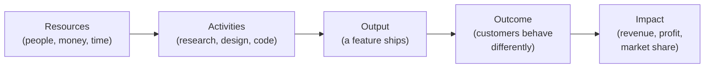
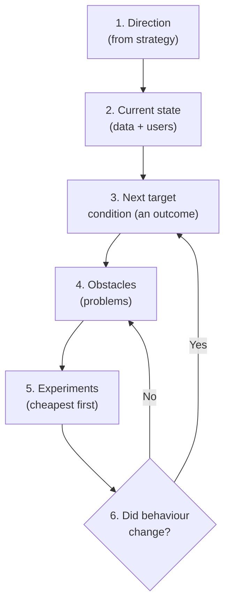
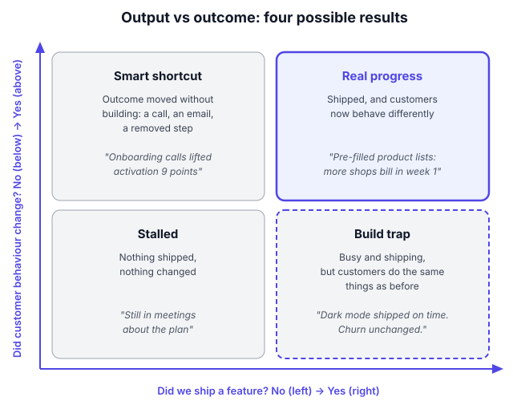

# A2.4 Outcomes over outputs: escaping the build trap

## In one line

Shipping features is not the goal. The goal is a change in what customers do that creates value for them and for the business, and features are only one way to get it.

## Why this matters

Almost every product team is measured on something. If it's measured on **what it ships** (features, releases, story points), it will ship a lot. Whether any of it helps anyone becomes an afterthought. Melissa Perri calls this the **build trap**. It is one of the most common reasons good teams build products nobody uses.

As a PM, this choice shapes your whole job:

- **Your roadmap:** a list of features, or a list of problems to solve? ([A5.1](../05-roadmaps-and-prioritisation/01-outcome-based-roadmaps-now-next-later.md))
- **Your goals:** "launch X by March", or "raise Y from 30% to 40%"? ([A4.3](../04-strategy-and-vision/03-okrs-and-goal-setting.md))
- **Your launches:** a celebration on release day, or a check six weeks later on whether behaviour changed?
- **Your conversations with leaders:** "we shipped 14 things", or "here's what changed for customers"?

## Key terms

| Term | Plain-English meaning |
|---|---|
| **Output** | Something the team produces: a feature, a release, a redesign, a report. |
| **Outcome** | A change in what people (customers or users) do, which creates value. Example: more shops record every sale in the app. |
| **Impact** | The big business result that outcomes add up to: revenue, profit, market share. |
| **Build trap** | When a company measures success by how much it ships rather than by the value it creates (Melissa Perri). |
| **Feature factory** | A team that turns out features on demand without checking whether they work. |
| **Product kata** | Perri's repeatable routine for working towards an outcome: set direction, understand where you are, set the next target, experiment. |
| **Keep-the-lights-on (KTLO) work** | Necessary work that keeps the product running (fixes, upgrades, compliance) but isn't aimed at a new outcome. |
| **Leading indicator** | An early behaviour that predicts a later result ([A8.1](../08-product-metrics/01-metric-basics-leading-lagging-input-output-vanit.md)). |

## The idea, simply

!!! tip "Analogy: the tuition teacher who counts chapters"
    Two tuition teachers prepare students for a Class 10 maths exam.

    The first proudly says: "I finished all 15 chapters by December." That's an **output**. It's easy to count, and it feels like progress.

    The second says: "In October, only 4 of my 20 students could solve a quadratic word problem on their own. Now 16 can. So I'm spending January on geometry proofs, where they're weakest." That's an **outcome**: a change in what the students can *do*.

    Parents don't actually care how many chapters were covered. They care whether their child can solve the paper. The first teacher is in the build trap. She's busy, she's finished, and she has no idea whether it worked.

Product teams face exactly the same choice. Let's build the idea up.

### 1. Output, outcome, impact: the chain

The clearest way to see the difference is as a chain, where each link depends on the one before:

Teams control the left side. Value appears only on the right. The jump from output to outcome is where most features fail.

Josh Seiden, author of *Outcomes Over Output* (2019), defines an outcome as a change in human behaviour that drives business results ([Seiden on the Intercom podcast](https://www.intercom.com/blog/podcasts/josh-seiden-on-why-product-teams-should-focus-on-outcome-vs-output)). Two parts of that matter:

- **"Human behaviour"** means something people *do* that you can observe: buy again, invite a colleague, finish onboarding, stop calling support.
- **"Drives business results"** means the behaviour links to impact. People "liking" a feature isn't enough; the behaviour has to matter to the business too.

| Output (what we ship) | Outcome (what changes) | Impact (what it adds up to) |
|---|---|---|
| New onboarding flow | More new users complete their first order within 3 days | Higher retention and revenue |
| Hindi language support | More users in Hindi-speaking states finish checkout | New market growth |
| Bulk-upload tool for sellers | Sellers list 50+ products in their first week | More selection, more orders |
| Self-serve refund page | Fewer customers call support about refunds | Lower support cost |

Notice the outcome column always names **who** does **what**, and could be counted.

### 2. Why outputs feel safer, and why that's the trap

Outputs are seductive for good reasons:

- **They're under your control.** You can promise a feature by March. You can't promise customers will change.
- **They're visible.** A release note is easy to show. A 3-point rise in repeat orders is less exciting in a slide.
- **They're easy to plan.** A roadmap of features looks like a clear plan. A list of problems looks vague.
- **They match how many companies fund work.** Budgets are often approved for projects, so people report on projects.

The trouble is that most features don't move outcomes. Pendo, a product analytics company, reported in its 2024 benchmarks that the average product's **feature adoption rate was 6.4%**. Roughly 6 in every 100 features produce 80% of all clicks ([Mind the Product, October 2024](https://www.mindtheproduct.com/users-engage-with-6-of-product-features-product-benchmark-findings/)). Even top-performing products only reached 15.6%. If you measure only outputs, you can't tell the 6 useful features from the 94 that weren't.

### 3. What the build trap is

Melissa Perri named the **build trap** in her 2018 book *Escaping the Build Trap* ([O'Reilly](https://www.oreilly.com/library/view/escaping-the-build/9781491973783/)). In her description, a company is stuck in the build trap when it measures success by outputs rather than outcomes. It focuses on shipping and building features instead of on the value those features create.

The trap is a **company** problem, not just a team problem. It's usually caused by how leaders set goals, fund work and reward people. One PM can't fix it alone, but one PM can start changing how their own team talks and works.

### 4. How to recognise the build trap

You're probably in it if several of these are true:

| Sign | What it sounds like |
|---|---|
| Success is celebrated at launch, never checked later | "We shipped it! On to the next one." |
| The roadmap is a list of features with dates | "Q2: dark mode, referral v2, new dashboard" |
| Goals are about delivery | "Launch the loyalty programme by June" |
| Nobody knows if last quarter's features worked | "I think people use it?" |
| Requests come in as solutions | "Sales needs a PDF export" (but why?) |
| Velocity or story points are the main measure | "We delivered 40 points this sprint" |
| Features are never removed | The product keeps getting more crowded |
| PMs act as project managers | Most of the PM's week is chasing tickets |

The last sign links to [A0.1](../00-the-pm-role/01-what-a-pm-actually-does.md) and [A0.2](../00-the-pm-role/02-product-teams-the-trio-empowered-vs-feature-team.md): Marty Cagan's "feature teams" are teams handed features to build, while "empowered product teams" are handed problems to solve and judged on results.

### 5. Writing a good outcome

A good outcome statement has four parts. Think of it as a mini version of the metric definition card from [A8.1](../08-product-metrics/01-metric-basics-leading-lagging-input-output-vanit.md).

| Part | Question | Example |
|---|---|---|
| **Who** | Which customers or users? | New sellers in their first 30 days |
| **Does what** | Which observable behaviour? | List at least 50 products |
| **Measured how** | Which number, from what to what? | From 22% to 35% of new sellers |
| **By when** | Over what time frame? | By the end of Q3 |

Put together: "Raise the share of new sellers who list 50+ products in their first 30 days from 22% to 35% by the end of Q3."

Common ways outcome statements go wrong:

| Weak version | Problem | Stronger version |
|---|---|---|
| "Launch the seller bulk-upload tool" | It's an output | "Raise new sellers listing 50+ products from 22% to 35%" |
| "Improve seller experience" | Not measurable | "Cut median time to first listing from 3 days to 1" |
| "Increase revenue" | An impact, not something one team controls | Pick the behaviour that drives revenue for your area |
| "Users love the new feature" | Feelings, not behaviour | "40% of weekly users use it at least twice a week" |
| "Get 10,000 sign-ups" | Can be gamed with ads; says nothing about value | "10,000 sign-ups who complete a first key action" |

### 6. Outcomes come from problems, not features

When you're handed an outcome instead of a feature, the work changes. You now have to find out *which problems* stop customers from behaving the way you want. That's discovery ([A2.1](01-continuous-discovery-and-opportunity-solution-tr.md)).

- Outcome: "more new sellers list 50+ products."
- Discovery reveals problems: they don't have product photos; the category list is confusing; they don't trust that listings will sell.
- Now you compare solutions: bulk upload, photo help, better categories, or showing early sales to new sellers.

Some of the best solutions aren't features at all. A phone call from an onboarding team, a clearer email, or removing a step might move the outcome more than anything you'd build. A team focused on outputs never considers these, because they don't appear on a feature roadmap.

### 7. Where the idea comes from

"Outcomes over outputs" grew out of several traditions:

- **Lean and agile thinking** shifted focus from following a plan to learning what works. Martin Fowler's short essay [Outcome Over Output](https://martinfowler.com/bliki/OutcomeOverOutput.html) explains why measuring output is tempting but misleading in software.
- **Lean UX and [*Sense & Respond*](https://www.oreilly.com/library/view/sense-and-respond/9781633691896/)** (Jeff Gothelf and Josh Seiden, 2017) argued that teams should be managed by the outcomes they target, not the features they ship.
- **Melissa Perri** (2018) named the build trap and described how whole organisations fall into it.
- **Marty Cagan** at SVPG made empowered, outcome-driven product teams central to his "product operating model" ([SVPG: Outcomes Are Hard](https://www.svpg.com/outcomes-are-hard), with Felipe Castro, 2025).

## Framework: Melissa Perri's product kata

In *Escaping the Build Trap* ([O'Reilly, 2018](https://www.oreilly.com/library/view/escaping-the-build/9781491973783/)), Perri describes a routine she calls the **product kata**. A *kata* is a martial-arts term for a pattern you practise until it becomes habit. She adapted the idea from *Toyota Kata*, Mike Rother's book on how Toyota builds a habit of continuous improvement. The steps below are a plain-English version, with a few additions from Seiden and Cagan.

**Step 1: Understand the direction.** What is the company trying to achieve? This comes from strategy ([A4.2](../04-strategy-and-vision/02-good-strategy-vs-bad-strategy-the-kernel.md)). Example: "reduce churn of paying customers this year."

**Step 2: Analyse the current state.** Where are you now, in numbers? What do customers actually do today? Look at data and talk to users. Example: "monthly churn is 6.7%; shops that use the app heavily in week 1 churn much less."

**Step 3: Set the next target condition.** Pick one outcome, a customer behaviour, that you believe will move the direction. Make it specific and time-bound. Example: "55% of new shops create 20+ bills in their first week, up from 35%, within 3 months."

**Step 4: Find the obstacles.** What stops customers from reaching that behaviour today? This is problem discovery ([A2.1](01-continuous-discovery-and-opportunity-solution-tr.md), [A2.2](02-framing-the-problem-problem-statements.md)).

**Step 5: Experiment towards the target.** Try solutions, cheapest first, and check each against the outcome ([A2.3](03-assumption-testing-prototypes-and-mvps.md)). Some will be features; some won't.

**Step 6: Check, learn, repeat.** Did the behaviour change? If yes, set the next target condition. If no, go back to Step 4 with what you learned.

The kata loops. A feature that ships but doesn't move the target sends you back to obstacles, not on to the next feature.

**When to use:** whenever a team is given a goal it has room to solve in its own way. It works for growth, retention, cost reduction and internal tools.

**When not to (or not alone):**

- **Pure keep-the-lights-on work.** A security patch or a legal requirement doesn't need a kata. It needs to be done well and on time.
- **Committed deadlines with a real reason.** If a regulator requires something by a date, the output *is* the goal. You can still measure whether it works.
- **Very early startups before product-market fit.** The "current state" may be too thin to measure. Talk to users and test quickly; set behaviour targets as soon as you have a few hundred active users ([A8.4](../08-product-metrics/04-lean-analytics-one-metric-that-matters-and-stage.md)).

## Diagram

The build trap is the bottom-right box: lots shipped, nothing changed. Notice the top-left box: sometimes the best way to move an outcome is to build nothing.

## Worked example

You're the PM for the onboarding team at **DukaanBook**, a fictional billing and inventory app for small shops in India. Shops pay ₹299 a month. About **2,000 new shops** subscribe each month.

Your manager hands you this quarter's roadmap: 8 features, including a new dashboard, GST report export, WhatsApp invoice sharing, a dark mode, and festive invoice templates. "Please ship all eight by March."

You decide to try the product kata before committing.

**Step 1: Direction.** The company's strategy for the year is to reduce churn among paying shops. Churn (shops that cancel each month) is eating growth.

**Step 2: Current state.** You look at last year's data and find a clear split.

| Shops' first week | Share of new shops | Monthly churn afterwards |
|---|---|---|
| Created 20 or more bills | 35% | 2.5% |
| Created fewer than 20 bills | 65% | 9.0% |
| **Blended** | **100%** | **≈ 6.7%** |

(Blended churn = 0.35 × 2.5% + 0.65 × 9.0% = 6.7%.)

You also check last year's feature launches. Of 12 features shipped, 3 are used weekly by more than 20% of shops. 5 are used by fewer than 5%. Nobody had looked.

**Step 3: Target condition.** "Raise the share of new shops that create 20+ bills in their first week from 35% to 55% within one quarter."

**Step 4: Obstacles.** You and your designer call 15 shops that stopped early. The top problems:

- Entering the product list takes hours; many shopkeepers give up on day 1.
- They don't know how to print bills on their existing printer.
- Family members who run the counter don't have the login.

None of the 8 roadmap features addresses these.

**Step 5: Experiments, cheapest first.**

| Experiment | Type | Cost | Result after 3 weeks |
|---|---|---|---|
| Onboarding call on day 1 to help set up products | Not a feature | 2 support staff | 35% → 44% for shops that got the call |
| Pre-filled product lists for the 10 most common shop types (kirana, pharmacy, hardware…) | Small feature | 1 sprint | +6 points on top |
| Printer setup guide with a short video in Hindi and English | Content | 3 days | +3 points |
| Add a second user login for family members | Small feature | 1 sprint | +2 points |

The effects overlap, so they don't simply add up. Together they take the share from 35% to about **53%** in the test group. You're close to the target, and only two of the four changes were features.

**Step 6: What is it worth?**

On average, a shop stays about 1 ÷ monthly churn months. So the value of a shop is roughly ₹299 ÷ churn.

| | Before | After (target 55%) |
|---|---|---|
| Blended monthly churn | 0.35 × 2.5% + 0.65 × 9% = **6.7%** | 0.55 × 2.5% + 0.45 × 9% = **5.4%** |
| Average lifetime | ≈ 14.9 months | ≈ 18.4 months |
| Lifetime revenue per shop | ≈ ₹4,450 | ≈ ₹5,510 |
| Extra per new shop | | **≈ ₹1,060** |

With 2,000 new shops a month, that's about **₹21 lakh of extra lifetime revenue from each month's sign-ups**, or roughly **₹2.5 crore** across a year of sign-ups. The two staff on onboarding calls cost a small fraction of that.

**What happens to the roadmap?** You don't throw it away. You take it back to your manager with a proposal:

- **Keep:** GST report export, because large customers have asked for it and it's a compliance need (a legitimate output commitment).
- **Test first:** WhatsApp invoice sharing, with a fake-door test ([A2.3](03-assumption-testing-prototypes-and-mvps.md)), since it might also help activation.
- **Drop or delay:** dark mode and the new dashboard, because nothing links them to churn.
- **Add:** the four experiments above, with the activation target as the team's main goal.

**Your update to leadership now says:** "We raised first-week activation from 35% to 53% in a test group, which we estimate is worth about ₹21 lakh in lifetime revenue per monthly cohort. We'll roll it out to all new shops next month and confirm the churn effect over the following quarter."

That last line matters. Activation is a **leading indicator**. The real proof, lower churn, takes months to appear. You say so plainly instead of claiming victory early.

## Going deeper: nuances and trade-offs

### 1. Outcomes are slow, so steer with leading indicators

The outcomes that matter most (retention, revenue, churn) take months to show up. You can't run a team on a number you only see twice a year. The fix is to find an earlier behaviour that predicts the later one, as DukaanBook did with "20 bills in week 1".

- **Check the link:** look back at past customers to see whether the early behaviour really predicts the later one ([A8.1](../08-product-metrics/01-metric-basics-leading-lagging-input-output-vanit.md)).
- **Confirm it later:** once you've moved the leading indicator, check that the lagging result follows. If it doesn't, your leading indicator was wrong, and you need a new one.
- **Organise them:** a metric tree shows how team-level behaviours connect to the company's main number ([A8.2](../08-product-metrics/02-north-star-metric-and-metric-trees.md)).

### 2. Not all work is outcome work, and that's fine

Cagan and Castro warn that a common mistake is failing to separate **keep-the-lights-on work** from outcome work ([SVPG, 2025](https://www.svpg.com/outcomes-are-hard)). Security fixes, platform upgrades, bug fixes, compliance changes and contractual commitments are real and necessary. Forcing every one of them into an "outcome" makes the language meaningless.

A practical split many teams use:

| Type of work | How to manage it | How to judge it |
|---|---|---|
| Outcome work | Give the team a target behaviour and freedom on the solution | Did the behaviour change? |
| Keep-the-lights-on | A fixed share of capacity (for example 20–30%) | Done well, on time, nothing broken |
| Committed outputs (legal, big contracts) | Plan like a project, with a date | Delivered as promised, and still check usage |

The point isn't to stop doing outputs. It's to stop pretending outputs are the same as progress.

### 3. You can't do outcomes without some freedom

Giving a team an outcome only works if the team can choose how to reach it. If leaders still decide the features, adding an outcome on top is just decoration. Cagan and Castro describe the most common failure as companies layering goals such as OKRs onto output-based roadmaps without changing how teams work ([SVPG, 2025](https://www.svpg.com/outcomes-are-hard)). Their view is that moving to outcomes follows from moving to empowered product teams ([A0.2](../00-the-pm-role/02-product-teams-the-trio-empowered-vs-feature-team.md)).

**What you can do as one PM**, even in a feature-driven company:

- For every feature you're asked to build, ask "what should customers do differently once this ships?" and write the answer in the PRD ([A7.1](../07-execution-and-delivery/01-prds-and-specs.md)).
- Measure every launch 4–8 weeks later and share the result, good or bad.
- Bring one outcome proposal to your manager with numbers, as in the worked example. Small wins build trust for more freedom.

### 4. B2B, sales promises and the "but we promised it" problem

In B2B companies, sales teams often promise features to close deals. This pushes strongly towards outputs. Some of these promises are worth keeping: a large customer may be worth a lot. But you can still apply outcome thinking:

- **Ask what the customer is trying to achieve.** "PDF export" may really mean "my finance team needs a monthly report they can file". A scheduled email might solve it faster.
- **Track whether promised features get used** by the customers who asked for them. If they don't, that's evidence for the next negotiation.
- **Measure account-level outcomes:** seats used, workflows completed, renewals, rather than individual clicks.

### 5. How it differs by company stage

| Stage | What "outcome" usually means | Main risk |
|---|---|---|
| Pre-product-market fit | Do enough customers keep coming back and pay? | Building lots of features hoping one sticks |
| Early growth | Activation, retention and referral behaviours | Chasing sign-ups instead of active users |
| Scale-up | Team-level behaviours in a metric tree | Teams optimising their number while hurting others |
| Large enterprise | Outcomes per business line, plus lots of KTLO | Roadmaps driven by annual budgets and committees |

At the earliest stage, the biggest outcome question is whether the product should exist at all. Zomato's Legends shutdown, below, is a good example of a company answering that honestly.

### 6. Outcome theatre: when the words change but nothing else does

Many teams adopt the language without the practice. Watch for:

- **Renamed outputs.** "Outcome: launch the new dashboard" is still an output.
- **KPIs mistaken for outcomes.** Cagan and Castro point out that most standing KPIs (uptime, cost per ticket) are health measures, not the goals of a specific piece of work ([SVPG, 2025](https://www.svpg.com/outcomes-are-hard)).
- **No telemetry.** The team sets an outcome but can't actually measure the behaviour. Ask for tracking before you start ([A8.1](../08-product-metrics/01-metric-basics-leading-lagging-input-output-vanit.md)).
- **Targets set after the fact.** Choosing the goal once you see what moved isn't outcome management; it's storytelling.

### 7. AI makes outputs cheaper, which makes this more important

AI coding and design tools let teams build faster than ever. That sounds like good news, and it is, but faster output doesn't automatically mean more value. Atlassian's *State of Product 2027* survey found that 80% of product teams said they were shipping faster, yet customers weren't seeing the benefit any sooner ([SD Times, October 2026](https://sdtimes.com/product-development/product-teams-share-their-thoughts-on-ai-work-in-new-atlassian-state-of-product-2007-report/)). When building is cheap, the scarce skill is choosing what's worth building and checking that it worked. For AI features specifically, the same thinking applies to quality: see [B2.1](../../part-b/02-discovery-and-design/01-finding-ai-opportunities-and-when-not-to-use-ai.md) and [B3.1](../../part-b/03-quality/01-evals-the-ai-pm-s-most-important-skill.md).

### 8. Removing features is an outcome decision too

If most features are rarely used (remember Pendo's 6.4% average adoption), then every unused feature has a cost. It adds clutter, maintenance work, testing time and confusion for new users. Teams that measure outcomes can make the hard call to remove or simplify features that didn't work.

Good practice:

- Review feature usage every 6–12 months.
- For low-use features, ask: who uses it, how much would they miss it, and what does it cost us to keep?
- Remove with care: tell affected users, offer an alternative, and watch support tickets.

## Real-world examples (2023 onwards)

!!! example "Zomato Legends, August 2024: shutting down after two years of trying"
    Zomato's Intercity Legends service delivered famous dishes from one city to customers in another. In April 2024 it was paused, then relaunched in July 2024 with a new model that delivered pre-stocked items faster. On 22 August 2024, CEO Deepinder Goyal announced on X that the company was shutting it down with immediate effect, saying that after two years of trying it had not found product-market fit ([Business Today, 22 August 2024](https://www.businesstoday.in/tech-today/news/story/zomato-shuts-down-inter-city-delivery-service-legends-over-lack-of-product-market-fit-says-ceo-deepinder-goyal-442670-2024-08-22)).

    **PM lesson:** the team clearly produced plenty of output: two business models, logistics, packaging and app features. But the outcome that mattered (enough customers ordering repeatedly, at a viable cost) didn't appear. Saying "it didn't work" in public and stopping is what escaping the build trap looks like at the company level. Many companies keep a product like this running for years because so much has already been built.

!!! example "Amazon Fresh, April 2024: replacing impressive tech with what shoppers said they wanted"
    Amazon's Just Walk Out technology let shoppers pick up groceries and leave without a checkout. In April 2024, Amazon said it would remove it from its US Amazon Fresh supermarkets and rely more on Dash Carts, smart carts that track items as they're added ([CNBC, 3 April 2024](https://www.cnbc.com/2024/04/03/amazon-ditches-cashierless-checkout-system-at-its-grocery-stores.html)). A spokesperson said customers liked skipping the queue but also wanted to see their receipt as they shopped, find deals nearby and know how much they'd saved. Just Walk Out continued in Amazon Go stores, smaller UK Fresh stores and stores of third-party businesses that license it.

    **PM lesson:** an advanced, famous output wasn't the same as the outcome shoppers wanted in a big grocery store. The team looked at what customers were trying to do (stay on budget, find deals) and changed course, keeping the technology where it fits better. Outcome thinking isn't anti-technology; it asks where each solution actually creates value.

## Common mistakes

!!! warning "Watch out for"
    - **Celebrating launches, never results.** If nobody checks usage 6 weeks later, you don't know whether anything worked.
    - **Writing outputs and calling them outcomes.** "Launch X" is never an outcome.
    - **Choosing an outcome the team can't influence,** such as company revenue, for a single onboarding team.
    - **Setting outcomes but no time to discover.** If the solution is already decided, the outcome is decoration.
    - **Forgetting the leading indicator.** Waiting a year to see whether churn moved is too slow to steer by.
    - **Treating all work as outcome work.** Keep-the-lights-on and genuine commitments need their own space.
    - **Never removing features.** Every unused feature makes the product harder to use and maintain.
    - **Claiming victory on the leading indicator alone.** Say what you'll check next, and check it.

## Common questions

**Does this mean PMs shouldn't care about deadlines?**
No. Deadlines still matter, especially for commitments to customers or regulators. The point is that shipping on time is necessary, not sufficient. A feature delivered on time that nobody uses is still a miss.

**How do I convince my manager to give us outcomes instead of features?**
Start small. Measure one past feature's real usage and share it. Then propose one outcome with a clear number and a cheap experiment, as in the worked example. Results persuade better than arguments.

**What if the outcome takes a year to show?**
Find a leading behaviour that predicts it and set your target on that. Then check the lagging result later. Say openly that the leading indicator is a bet.

**Isn't velocity a useful metric?**
For engineering health and planning, yes. As a measure of product success, no. A team can double its velocity and create no value.

**How many outcomes should one team have?**
Usually one main outcome per quarter, plus a couple of guardrail metrics. More than that and the team spreads too thin ([A8.4](../08-product-metrics/04-lean-analytics-one-metric-that-matters-and-stage.md)).

**Is "outcomes over outputs" just OKRs?**
OKRs are one way to write outcomes down ([A4.3](../04-strategy-and-vision/03-okrs-and-goal-setting.md)). But you can write OKRs full of outputs ("KR: launch three features"), and you can manage by outcomes without OKRs. The thinking matters more than the format.

## In the interview

!!! question "In the interview"
    **How it's tested:** directly ("What's the difference between an output and an outcome?") and, more often, inside other questions. Interviewers notice whether your answers to design, prioritisation and behavioural questions end with "and then we shipped it" or "and this is what changed for users".

    **Sample question:** *"Tell me about a feature you shipped. How did you know it was successful?"*

    **Outline of a strong answer:**

    1. **The problem and the target behaviour:** "New sellers weren't listing enough products; only 22% listed 50+ in their first month."
    2. **Why it mattered:** the link to a business result, such as sellers with 50+ listings having higher sales and retention.
    3. **What you tried,** including anything that wasn't a feature, and what you chose not to build.
    4. **The result in numbers:** "rose to 31% within 8 weeks", with the time frame and how you measured it.
    5. **What you learned or would do differently,** including anything that didn't work.

    A weaker answer describes the feature, the launch and the deadline, and stops there. A strong one shows you care whether it worked.

    **A second common form:** *"Your CEO wants five features by next quarter. What do you do?"* A strong answer doesn't refuse. It asks what result the CEO wants, checks which features plausibly drive it, proposes a measurable target, and suggests testing the riskiest features cheaply first.

## Research happening now

!!! info "Research happening now"
    - **Shipping faster, but customers don't feel it (October 2026).** Atlassian's *State of Product 2027* report found 80% of product teams said they were shipping faster with AI, but customers weren't seeing the benefit sooner. Only 26% said their job still reflected what attracted them to the role ([SD Times coverage](https://sdtimes.com/product-development/product-teams-share-their-thoughts-on-ai-work-in-new-atlassian-state-of-product-2007-report/); [report page](https://www.atlassian.com/software/jira/product-discovery/resources/state-of-product-2027)). *Status: industry survey by a tool vendor; not peer-reviewed.*
    - **Confidence without measurable impact (September 2025).** Atlassian's previous report, *State of Product 2026*, surveyed over 1,000 product professionals in the US and Europe. 84% worried their products wouldn't succeed, 49% said they lacked time for strategic planning, and 80% said they didn't involve engineers in problem definition or roadmaps ([Mind the Product summary](https://www.mindtheproduct.com/inside-atlassians-state-of-product-2026-key-takeaways/)). *Status: industry survey by a tool vendor; not peer-reviewed.*

## Try it yourself (20 minutes)

Take the last three things your team shipped (or, if you're not working as a PM yet, three recent features in an app you use, such as a UPI app or a food delivery app).

For each one, write:

1. The **output:** what was shipped.
2. The **outcome** it was probably meant to create: who does what differently, measured how.
3. A **leading indicator** you could check within 4 weeks.
4. One **non-feature** way to move the same outcome.

??? success "Check your answer"
    For a UPI app's "split bill with friends" feature, a good answer might be:

    - **Output:** a split-bill button in group chats.
    - **Outcome:** more users settle shared expenses inside the app, measured as the share of monthly users who complete at least one split payment, from (say) 8% to 12% in a quarter.
    - **Leading indicator:** % of split requests that get paid within 48 hours.
    - **Non-feature option:** a short in-app message after a restaurant payment suggesting splitting it, or a referral reward when friends pay their share.

    Check your own answers:

    - Does every outcome name **who** and an observable **behaviour**, with a number?
    - Is the outcome something one team could influence, not just "revenue"?
    - Did at least one of your ideas involve building nothing new?

## How this connects

- [A0.2 Product teams: the trio, empowered vs feature teams](../00-the-pm-role/02-product-teams-the-trio-empowered-vs-feature-team.md): outcome work needs teams that are trusted to solve problems.
- [A2.1 Continuous discovery and opportunity solution trees](01-continuous-discovery-and-opportunity-solution-tr.md): starts from a desired outcome and finds the opportunities beneath it.
- [A4.3 OKRs and goal setting](../04-strategy-and-vision/03-okrs-and-goal-setting.md): one common format for writing outcomes as goals.
- [A5.1 Outcome-based roadmaps: Now/Next/Later](../05-roadmaps-and-prioritisation/01-outcome-based-roadmaps-now-next-later.md): how to show outcome work on a roadmap.
- [A8.2 North Star metric and metric trees](../08-product-metrics/02-north-star-metric-and-metric-trees.md): connects each team's outcome to the company's main number.

## Go deeper

- **Book:** [*Escaping the Build Trap*](https://www.oreilly.com/library/view/escaping-the-build/9781491973783/) by Melissa Perri (2018). The book that named the build trap, with the product kata and advice on changing a whole organisation.
- **Book and interview:** *Outcomes Over Output* by Josh Seiden (2019) is a short book on defining outcomes as behaviour changes. His [Intercom podcast interview](https://www.intercom.com/blog/podcasts/josh-seiden-on-why-product-teams-should-focus-on-outcome-vs-output) is a good introduction, and his article on [user outcomes vs business outcomes](https://medium.com/@jseiden/whats-the-difference-between-user-outcomes-and-business-outcomes-588952071552) clarifies a common confusion.
- **Article:** [SVPG: Outcomes Are Hard](https://www.svpg.com/outcomes-are-hard) by Marty Cagan with Felipe Castro (2025). The most common mistakes teams make when switching to outcomes.
- **Article:** [Martin Fowler: Outcome Over Output](https://martinfowler.com/bliki/OutcomeOverOutput.html). A short, clear explanation from a software engineering perspective.
- **Article:** [Teresa Torres: Outcomes vs outputs](https://www.producttalk.org/2021/05/outcomes-vs-outputs/) (Product Talk). How outcomes connect to continuous discovery.
- **Benchmark:** [Mind the Product on Pendo's feature adoption data](https://www.mindtheproduct.com/users-engage-with-6-of-product-features-product-benchmark-findings/) (2024). Why most features go unused.

## Key takeaways

- **Outputs** are what you ship; **outcomes** are changes in what customers do; **impact** is the business result they add up to.
- The **build trap** is measuring success by outputs. It's usually caused by how companies set goals and reward people.
- A good outcome names **who**, **does what**, **from what to what**, and **by when**.
- The **product kata** gives a routine: direction, current state, target condition, obstacles, experiments, repeat.
- Outcomes are slow, so steer with a **leading indicator**, then confirm the lagging result.
- Not all work is outcome work. Give **keep-the-lights-on** and genuine commitments their own capacity.
- Some of the best ways to move an outcome involve **building nothing**, and some features should be **removed**.

## Updates

*No updates yet.*
