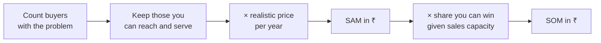
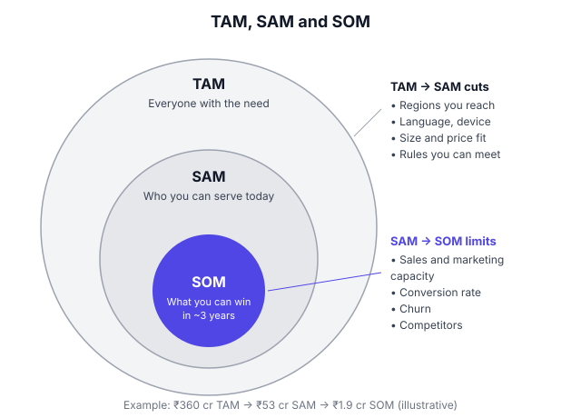

# A3.1 Market sizing: TAM, SAM, SOM

## In one line

Market sizing is a careful estimate of how much money (or how many customers) an idea could realistically earn, built from small, checkable assumptions rather than one big impressive number.

## Why this matters

Before a company spends a year building something, someone has to ask: "Is this worth it?" As a PM, you'll answer that question in business cases, strategy reviews, pitch decks and new-market proposals. You'll also meet it in interviews as the classic "estimate the market for X" question. A good sizing tells your team where to focus, how big a bet to make, and which assumption to test first.

## Key terms

| Term | Plain-English meaning |
|---|---|
| **TAM (total addressable market)** | Everyone who could ever pay for this kind of product, if you had no limits. |
| **SAM (serviceable available market)** | The part of the TAM your product, price, language and reach can actually serve today. |
| **SOM (serviceable obtainable market)** | The part of the SAM you can realistically win in the next few years. |
| **Top-down sizing** | Starting from a big published number and cutting it down with percentages. |
| **Bottom-up sizing** | Counting real buyers and multiplying by what each one would pay. |
| **Penetration** | The share of possible customers who actually use your kind of product. |
| **ARPU / ACV** | Average revenue per user per year (consumer); annual contract value per customer (business). |
| **Beachhead market** | The first small, specific group of customers you aim to win completely. |

## The idea, simply

!!! tip "Analogy: opening a chai stall at a railway station"
    Imagine you want to open a chai stall at Pune railway station. Your cousin says, "Indians drink crores of cups of chai every day. Huge market!" That's true, and useless. You can't sell to all of India.

    So you get specific. About how many people pass through *this* station each day? How many of them walk past *your* platform? How many stop for chai at all? And of those, how many will pick *your* stall over the three other stalls nearby?

    "All chai drinkers in India" is the **TAM**. "Chai buyers on your platform" is the **SAM**. "The cups you can actually sell each day, given your competitors and one kettle" is the **SOM**. The last number is the one that tells you whether to rent the stall.

Market sizing is that same narrowing, done with care. Let's build it up.

### 1. What TAM, SAM and SOM actually mean

The three numbers are nested, like circles inside circles. Each one answers a different question.

| Layer | Question it answers | Chai stall | Pharmacy billing app (B2B) |
|---|---|---|---|
| **TAM** | If everyone who has this need bought from us, how big is it? | All chai bought in India | All pharmacies in India × yearly software price |
| **SAM** | Which part can our product and reach serve today? | Chai buyers on platform 1 | Pharmacies in the states and languages we support, with a smartphone |
| **SOM** | How much can we realistically win in about 3 years? | 400 cups a day | The pharmacies our sales team can sign up and keep |

Some people define SAM a little differently (for example, as "the segment we target"). That's fine. What matters is that you **write down your definition** so everyone reads the numbers the same way. Stripe's guide uses the same three-layer split ([Stripe: TAM, SAM and SOM](https://stripe.com/resources/more/tam-sam-and-som)).

### 2. Why sizing works (and what it's really for)

A market size isn't a prediction you'll be graded on. It's a **thinking tool**. It works for three reasons:

1. **It forces you to name your customer.** You can't count "users" without saying who they are.
2. **It breaks one scary guess into small guesses.** "₹500 crore" is impossible to check. "80,000 shops × ₹6,000 a year" can be checked piece by piece.
3. **It shows which assumption matters most.** Change each input by 20% and see which one swings the answer. That input is what you research or test next.

Investors ask for market size because they want to know if a company *could* become big. Sequoia's classic guide to writing a business plan lists market size as a core slide and suggests sizing bottom-up where you can ([Sequoia: Writing a Business Plan](https://sequoiacap.com/article/writing-a-business-plan)). Inside a company, the question is the same in smaller form: "Is this feature, segment or new city worth a team's time?"

### 3. Top-down sizing: start big, cut down

**Top-down** starts from a published total and applies percentages.

> India's online retail is worth X → groceries are Y% of that → our cities are Z% → our share is W%.

| Strengths | Weaknesses |
|---|---|
| Fast. You can do it in 20 minutes. | Every percentage is a guess stacked on a guess. |
| Good for a first sense of scale. | The starting number comes from someone else's definition. |
| Easy for leaders to follow. | Tempts you to say "we only need 1%". |

The **"we only need 1% of a huge market"** line is the most common trap. It sounds modest, but it skips the hard question: *why* would that 1% choose you, and how will you reach them? Treat top-down as a sanity check, not as the answer.

### 4. Bottom-up sizing: count real buyers

**Bottom-up** starts from the unit you actually sell to and multiplies up.

> Number of buyers who have the problem × share who can buy now × price per year = market.

Bottom-up sizing starts from a countable unit (shops, households, clinics) and stays tied to how you'll actually sell.

Bottom-up is slower, but each number can be checked against something real:

| Input | Where to check it |
|---|---|
| Number of buyers | Government data (census, licence counts, GST registrations), industry bodies, company filings |
| Share who have the problem | Your own interviews and surveys ([A1.2](../01-understanding-users-user-sense/02-user-research-methods-and-interviews.md)) |
| Price | Competitors' public price pages; what customers pay for today's workaround |
| Share you can win | Your sales team's capacity, conversion from pilots, churn |

A good rule: **use bottom-up to decide, and top-down to check.** If the two answers are wildly different, one of your assumptions is wrong. Find it.

### 5. Value-based sizing: what is solving the problem worth?

A third way asks how much value you create, then assumes you can capture a slice of it.

- A billing app saves a shop owner 1 hour a day. If their time is worth ₹150 an hour, that's about ₹45,000 a year of value.
- People rarely pay more than a fraction of the value they get. If you capture 10–20%, a price of ₹4,500–9,000 a year is plausible.

This is useful when the product is new and there's no existing market to measure. It also links sizing to pricing ([A10.3](../10-growth-and-go-to-market/03-pricing-and-monetisation.md)). Its weakness: people's *stated* willingness to pay is often higher than what they really pay. Check it with a real offer, not just a survey ([A2.3](../02-problem-discovery/03-assumption-testing-prototypes-and-mvps.md)).

### 6. Count the right unit: users, households, accounts or transactions

The unit you count changes the answer, so pick the one that matches who pays and how often.

| Product | Wrong unit | Better unit |
|---|---|---|
| Family OTT subscription | People | Households with a smart TV or smartphone |
| B2B software | Employees | Companies (accounts), then seats per company |
| Payments app | Users | Transactions × value × fee per transaction |
| Food delivery | Population | Households that order out at least monthly × orders × order value |

For a marketplace (like a food app or Meesho), you also need to know **what you earn**. The money customers spend (gross order value) isn't your revenue. Your revenue is your commission and fees. Always say whether your number is **spend** or **revenue**, because they can differ by 5–10 times.

### 7. Where market sizes come from, and how to read them

You'll often start with numbers from consulting firms, research houses and investor reports. Read them like a careful journalist:

- **What exactly is counted?** "E-commerce" may or may not include travel, food delivery or quick commerce.
- **Spend or revenue?** Gross merchandise value (GMV) is not revenue.
- **Today or a forecast?** Forecasts for five years out are opinions, however precise they look.
- **Who paid for it?** A report sponsored by an industry player may lean optimistic.
- **What exchange rate?** Indian reports in dollars may use different rupee rates.

Two respected reports can disagree a lot about "the same" market because they define it differently. That's normal. Note both, state the definition you're using, and move on.

## Framework: TAM–SAM–SOM, built bottom-up

TAM, SAM and SOM aren't from a single inventor. The terms grew up in venture capital and startup practice, and became standard in pitch decks; investor guides such as [Sequoia's business-plan guide](https://sequoiacap.com/article/writing-a-business-plan) asked founders to show them. Bill Aulet of MIT made the bottom-up habit a formal step in *Disciplined Entrepreneurship* (2013; 2nd edition 2024): first choose a narrow **beachhead market**, then calculate its TAM by counting real end users ([Step 4 overview](https://www.d-eship.com/step4/); [book on O'Reilly](https://www.oreilly.com/library/view/disciplined-entrepreneurship-2nd/9781394222513/c04.xhtml)).

**Step 1: Write the question as a decision.** "Should we launch in Tier 2 cities next year?" is a better question than "How big is the market?" The decision tells you how precise you need to be.

**Step 2: Define the customer and the unit.** Who pays, for what, how often? Write one line: "Independent pharmacies that bill customers daily, paying a yearly subscription."

**Step 3: Size the TAM bottom-up.** Count the units × the realistic yearly price. Note the source for each number.

**Step 4: Cut to the SAM.** Remove those your product can't serve *today*: wrong language, platform, region, size, regulation or price point. List each cut and its reason.

**Step 5: Estimate the SOM from your ability to win.** Use your go-to-market capacity, not a hopeful percentage. How many customers can your sales team, channels or marketing reach and convert each month? How many will stay?

**Step 6: Cross-check top-down.** Compare with a published number or a competitor's revenue. If you're 10 times off, find out why.

**Step 7: Run a sensitivity check.** Change each key input by ±20–30% and see which one moves the answer most. That's your riskiest assumption. Test it next.

**Step 8: Present a range, not a point.** Show low, base and high cases, and say which assumptions drive the gap.

**When to use:** new products, new segments or cities, business cases, investor decks, and "is this feature worth building?" debates where the opportunity size is unclear.

**When not to:** for small, cheap experiments (just test it), or when the market doesn't exist yet and any number would be fiction. In that case, size the **problem** (how many people have it, how painful it is, what they spend on workarounds) and say so. Don't spend two weeks perfecting a number that won't change the decision.

## Diagram

Each step inward removes customers for a stated reason. The cuts between the circles are where your real thinking (and your riskiest assumptions) live.

## Worked example

You're the PM at a small Indian startup. Your team has built **DawaBook** (a made-up name), a simple billing and stock app for independent pharmacies. The founder asks: "Should we raise money to expand, and is this market big enough to bother?"

The numbers below are **illustrative assumptions** for practice. In real work, you'd find a source for each one (licence data, an industry body, your own surveys) and note it beside the number.

**Step 1: The decision.** Is the reachable market big enough to justify hiring a 15-person field sales team for three years?

**Step 2: The customer and unit.** Independent (non-chain) pharmacies that bill customers every day, paying ₹6,000 a year for the app.

**Step 3: TAM (bottom-up).** Suppose your research finds about 6,00,000 independent pharmacies in India.

| | Value |
|---|---|
| Independent pharmacies (assumed) | 6,00,000 |
| Price per year | ₹6,000 |
| **TAM** | **₹360 crore a year** |

**Step 4: Cut to the SAM.** Your app only works in Hindi, Marathi and English, and you only have sales staff in five states.

| Cut | Reason | Remaining |
|---|---|---|
| Start | All independent pharmacies | 6,00,000 |
| In your 5 launch states (35%) | Languages and sales reach | 2,10,000 |
| Use a smartphone and bill 40+ customers a day (60%) | Below that, a notebook is good enough | 1,26,000 |
| Not happily locked into another tool (70%) | Switching is hard for content users | 88,200 |
| **SAM** | 88,200 × ₹6,000 | **≈ ₹53 crore a year** |

**Step 5: SOM (from your ability to win).** Don't say "we'll get 10%". Work it out from your sales capacity.

| Input | Assumption |
|---|---|
| Field sales reps | 15 |
| Shop visits per rep per month | 60 |
| Visits that sign up | 10% → 90 new pharmacies a month |
| Extra sign-ups from referrals and distributors | 30 a month |
| **Total new pharmacies a month** | **120** |
| Monthly churn (pharmacies that cancel) | 2% |

With 120 joining and 2% leaving each month, you'd have about **3,100 paying pharmacies after 3 years**. (Each month: last month's customers × 0.98, plus 120.)

**SOM ≈ 3,100 × ₹6,000 ≈ ₹1.9 crore a year of revenue (ARR)**. That's about **3.5% of the SAM**.

**Step 6: Cross-check.** Value-based: if the app saves an owner about an hour a day, that's worth roughly ₹45,000 a year at ₹150 an hour. A ₹6,000 price captures about 13% of that value, which is plausible. If a competitor's public filings showed revenue far above your whole SAM, you'd re-check your cuts.

**Step 7: Sensitivity.** Which assumption matters most?

| Change one input | Pharmacies after 3 years | Change in SOM |
|---|---|---|
| Base case | ~3,100 | — |
| Total pharmacies in India −30% | ~3,100 | **No change** (you never reach the limit) |
| Sign-up rate 10% → 7% | ~2,400 | −22% |
| Monthly churn 2% → 4% | ~2,300 | −25% |
| Price ₹6,000 → ₹4,500 | ~3,100 (revenue ₹1.4 crore) | −25% |

The surprise: the **TAM barely matters** for this decision. Churn, sign-up rate and price drive the answer. So your next research isn't "count pharmacies more precisely". It's "run a 3-month pilot to measure real churn and sign-up rates."

**Step 8: What is it worth?** Assume each rep costs ₹4 lakh a year.

- **Sales cost:** 15 reps × ₹4 lakh = ₹60 lakh a year, or ₹5 lakh a month. That's about ₹5,600 per rep-signed pharmacy (₹5 lakh ÷ 90).
- **Customer lifetime:** at 2% monthly churn, the average pharmacy stays about 50 months.
- **Lifetime revenue:** 50 months × ₹500 = **₹25,000 per pharmacy**, before server and support costs.
- **Lifetime value to acquisition cost (LTV:CAC):** ₹25,000 ÷ ₹5,600 ≈ **4.5:1**. Higher is better; how high you need depends on your margins and how fast you earn the cost back.

**Recommendation:** the reachable market (₹53 crore) is far bigger than what you can win in three years, so market size isn't the constraint. Sales efficiency and churn are. Hire 5 reps first, confirm churn below 3% a month over a quarter, then scale to 15. Present SOM as a range: ₹1.4–2.3 crore ARR in year 3.

## Going deeper: nuances and trade-offs

### 1. Markets can grow because of you

Historical market size assumes the product stays the same. Great products can **expand** the market. In 2014, finance professor Aswath Damodaran valued Uber assuming its market was the global taxi and car-service market, about $100 billion, of which Uber might win 10% ([Bill Gurley's response, July 2014](https://abovethecrowd.com/2014/07/11/how-to-miss-by-a-mile-an-alternative-look-at-ubers-potential-market-size/)). Investor Bill Gurley replied that faster pick-ups, cashless payment and better safety would create **new use cases**, such as replacing a second car. He quoted Uber's founder saying the San Francisco taxi and limo market was about $120 million in 2009, and Uber's San Francisco business had already grown to a healthy multiple of that. Damodaran answered with a follow-up post, [Possible, Plausible and Probable](https://aswathdamodaran.substack.com/p/possible-plausible-and-probable-big-14-07-16), and the debate became a classic lesson in market sizing.

**The lesson isn't "always assume a bigger market."** Most products don't expand their market. It's this: when your product is 10 times cheaper or easier, size the market by the **job** people are doing (getting around the city), not the **current product** they use (taxis). See jobs-to-be-done in [A1.3](../01-understanding-users-user-sense/03-personas-and-jobs-to-be-done.md).

### 2. In India, "1.4 billion people" is almost never your TAM

India's population is huge, but spending power is concentrated. Consumer products need to size by **households who can and do pay** for this category, not by population. City tier, language, device, UPI use and income all cut the numbers sharply. A product that works for metros may have a much smaller SAM in smaller cities, even when interest is high. The first real-world example below shows how concentrated this is.

### 3. B2B vs B2C sizing

| | B2C (consumers) | B2B (businesses) |
|---|---|---|
| Unit | Users or households | Accounts (companies), then seats |
| Price | Small, often ₹0–1,000 a month | Larger, ₹ thousands to crores a year |
| Hardest assumption | Conversion to paying, and frequency | Sales cycle length and how many accounts the team can close |
| Typical SOM limit | Marketing cost and retention | Sales capacity and implementation effort |

In B2B, the SOM is often limited by **how many customers your team can sell to and set up**, not by how many exist. That's why the worked example built SOM from sales capacity.

### 4. Market size vs market quality

A big market can still be a bad one. Ask about quality, not just size:

- **Growth rate:** a small market growing 40% a year can beat a large flat one.
- **Willingness to pay:** some segments love a product but won't pay for it.
- **Cost to reach:** scattered buyers in small towns may cost much more to acquire and serve.
- **Competition and switching:** a large market with a happy incumbent is hard to enter. See [A3.2](02-competitive-analysis.md) and [A3.4](04-industry-analysis-porter-s-five-forces-and-swot.md).
- **Unit economics:** can you serve each customer profitably? The quick-commerce example below shows demand isn't enough.

### 5. Start with a beachhead, then expand

Aulet's *Disciplined Entrepreneurship* argues for winning one small, specific market first: customers who buy similar things, the same way, and talk to each other ([Step 4](https://www.d-eship.com/step4/)). Then you size **follow-on markets** separately. This keeps sizing honest. A startup that claims "all SMBs in India" as its first market usually has no clear first customer. A startup that says "independent pharmacies in Maharashtra and Gujarat" can be checked and can win.

### 6. Sizing a feature, not a company

Inside a company, you'll size opportunities more often than markets. Same logic, smaller units:

> Users who hit this problem each month × share who'd use the fix × value per use = opportunity size.

For example: 2 lakh users a month abandon checkout at the address step × 30% would be saved by auto-fill × ₹40 contribution per order = about ₹24 lakh a month. This feeds directly into prioritisation scores like RICE ([A5.2](../05-roadmaps-and-prioritisation/02-prioritisation-frameworks-rice-ice-moscow-kano.md)) and into problem statements ([A2.2](../02-problem-discovery/02-framing-the-problem-problem-statements.md)).

### 7. AI is changing what "the market" means

For AI products that do work rather than just help with it, some investors now size the market by **labour spend**, not software spend. Foundation Capital describes a "$4.6 trillion" opportunity: the money companies spend each year on salaries and outsourced services, compared with a much smaller software pool ([Foundation Capital, July 2025](https://foundationcapital.com/the-4-6t-service-as-software-opportunity-lessons-from-year-one/)). Treat this as an **investor thesis**, not a measured market. Even if you accept it, your SAM is the share of that work your AI can actually do to an acceptable standard, and that depends on evals ([B3.1](../../part-b/03-quality/01-evals-the-ai-pm-s-most-important-skill.md)). Pricing such products is covered in [B5.1](../../part-b/05-strategy-and-business/01-ai-pricing-and-unit-economics.md).

### 8. How experienced PMs present a sizing

- **Lead with the decision and the range,** not the TAM. "We can realistically reach ₹1.4–2.3 crore ARR in three years; the market isn't the constraint."
- **Show the assumptions table** with a source beside each number.
- **Name the riskiest assumption** and how you'll test it.
- **Keep the old versions.** Revisit the sizing after a pilot and show what changed. Sizing is a living estimate, not a one-time slide.

## Real-world examples (2023 onwards)

!!! example "Blume Ventures, February 2025: India's real consuming class is much smaller than its population"
    Blume Ventures' *Indus Valley Annual Report 2025* split India's consumers by spending power. As [reported by Business Standard](https://www.business-standard.com/india-news/india-wealth-gap-consumption-study-2025-blume-125022800468_1.html), it estimated that nearly 1 billion people, about 90% of the population, lack money for discretionary (non-essential) spending. The top 10% ("India1", roughly the size of Mexico's 130–140 million people) drive about two-thirds of discretionary spending. Another 30 million or so are "emerging" spenders.

    **PM lesson:** for a premium consumer app, the realistic TAM starts closer to 130–140 million people than 1.4 billion. That's still a large market, but it changes pricing, marketing and which cities you launch in. Always cut population down by ability to pay before calling it a market.

!!! example "Quick commerce beyond the metros, 2025: demand isn't the same as a serviceable market"
    Quick commerce (10–30 minute delivery from small warehouses called dark stores) grew about 150% year-on-year in the first five months of 2025, according to [Redseer data reported by YourStory](https://yourstory.com/2025/07/india-quick-commerce-booms-metros-slow-lane-non-metros). Yet cities outside the eight metros contributed just over 20% of the sector's GMV, even though they make up 60–70% of retail in India's top 100 cities. Beyond the top 10–15 cities, dark stores were handling fewer than 1,000 orders a day, and fewer than 700 in the next 20 cities, while the report said the throughput needed to break even was 1.5–2 times higher in smaller cities.

    **PM lesson:** a smaller city's retail spend looks like a big TAM. But the SAM (orders you can serve profitably) is limited by order density and unit economics. Size by "orders per store per day at a price that covers costs," not just by "people who'd like fast delivery."

## Common mistakes

!!! warning "Watch out for"
    - **Using population as the market.** Cut by ability to pay, device, language and need first.
    - **The "we only need 1%" pitch.** A percentage with no reason behind it isn't a plan.
    - **Confusing spend with revenue.** A marketplace's GMV isn't its income; your take rate is.
    - **Mixing up definitions.** Comparing your SAM with someone else's TAM, or two reports that count different things.
    - **False precision.** "₹3,847.2 crore" built from five guesses. Give a range.
    - **No sources beside the numbers.** Nobody can check or improve the estimate.
    - **Sizing once and never revisiting.** Update it after pilots and real sales data.
    - **Treating a big TAM as proof of demand.** It shows potential, not that anyone will pick *you* ([A4.4](../04-strategy-and-vision/04-product-market-fit.md)).

## Common questions

**Do I need all three numbers every time?**
No. For a feature or a small bet, an opportunity size (users affected × value) is enough. Use the full TAM–SAM–SOM for new products, segments, cities or investor decks.

**What's a "big enough" market?**
It depends on the ambition. For a venture-backed startup, investors usually want a path to a very large business, so the TAM must be large. For a feature inside a company, "worth a team's quarter" may mean a few crore rupees of impact. Ask what the decision needs.

**Which should I trust more, top-down or bottom-up?**
Bottom-up, because each piece can be checked. Use top-down to catch a wild error.

**Where do I find reliable numbers for India?**
Start with government sources (census, ministry data, GST and licence counts), regulators' statistics (for example RBI or NPCI for payments), company annual reports and shareholder letters, and reputable research firms. Always note the definition and date.

**Is SOM the same as a sales forecast?**
Close, but SOM is a capacity-based estimate of what's winnable; a forecast is a committed plan with targets, owners and timelines. A sizing often becomes the starting point for a forecast.

## In the interview

!!! question "In the interview"
    **How it's tested:** market sizing and estimation ("guesstimate") questions are common in PM interviews, especially for early-career roles and in consulting-style rounds. Interviewers care about your structure and assumptions far more than the final number. Lewis Lin's [*Decode and Conquer*](https://www.goodreads.com/work/editions/40168005-decode-and-conquer-answers-to-product-management-interviews) and [*Cracking the PM Interview*](https://www.crackingthepmcareer.com/authors) both cover estimation questions. Estimation is covered further in [A12.3](../12-career-and-interviews/03-metrics-estimation-and-execution-interviews.md).

    **Sample question:** *"Estimate the yearly market for home EV charger installations in Bengaluru."*

    **Outline of a strong answer:**

    1. **Clarify:** Revenue or units? Homes only, or apartments too? Hardware plus installation?
    2. **Choose bottom-up and say why:** "I'll start from households, because chargers are bought per home."
    3. **Build the chain aloud:** households in Bengaluru → share that own a car → share of new car buyers choosing an EV this year → share with home parking where a charger can be installed → price per installation.
    4. **State each assumption with a round number** and a reason. Keep the maths simple.
    5. **Sanity check:** compare the answer with something you know (for example, how many cars are sold in the city each year).
    6. **Name the riskiest assumption** (EV share of new cars, or apartment society approvals) and how you'd verify it.
    7. **Give a range,** and say what you'd do with it.

    Interviewers listen for: a clear unit, a logical chain, sensible round numbers, a sanity check, and a "so what".

## Research happening now

!!! info "Research happening now"
    - **Two 2026 reports, two sizes for India's online commerce.** In April 2026, [Deloitte India and Google](https://www.deloitte.com/in/en/about/press-room/indias-e-commerce-market-set-to-reach--250-billion-by-2030.html) said India's e-commerce market would grow from $90 billion "today" to $250 billion by 2030, with quick commerce projected at $50 billion and Tier 2+ cities driving 30% of it. In May 2026, [Redseer](https://redseer.com/articles/speed-in-metro-scale-in-bharat-indias-80-bn-online-retail-story/) put India's online retail at about $80 billion in FY26, growing 21% a year, with 320–340 million annual transacting users and new users shifting towards Tier 2+ India. The two use different definitions and bases, so don't treat them as directly comparable. *Status: industry reports; forecasts, not measurements.* They make a good exercise in reading definitions before using a number.

## Try it yourself (25 minutes)

Pick a product you know, for example a subscription app for home-cooked tiffin delivery in your city. Write:

1. The **decision** your sizing will inform.
2. The **unit** and price.
3. A **bottom-up TAM** with at least 3 steps.
4. Your **SAM cuts**, each with a reason.
5. A **SOM** built from how you'd acquire customers (not a percentage).
6. Your **riskiest assumption** and a cheap test for it.

??? success "Check your answer"
    A strong answer for the tiffin example might look like this:

    - **Decision:** "Should we launch in a second neighbourhood cluster?"
    - **Unit:** working professionals living away from family who eat a weekday lunch or dinner they didn't cook, paying about ₹3,000 a month.
    - **TAM chain:** working-age adults in the city → share living away from family → share who buy meals regularly → × ₹3,000 × 12.
    - **SAM cuts:** within your delivery radius; veg/non-veg menu fit; price range they already pay; not already loyal to a cook at home.
    - **SOM:** e.g. "Our kitchen can make 400 meals a day; we can win about 25 subscribers a week from society notice boards and referrals; about 10% cancel each month."
    - **Riskiest assumption:** monthly cancellation rate, tested with a 4-week pilot in one housing society.

    Check yourself: Did every number have a reason? Did your SOM come from capacity and conversion, not "1%"? Did you say spend vs revenue? Would the answer actually change your decision?

## How this connects

- [A3.2 Competitive analysis](02-competitive-analysis.md): who else is chasing the same SAM, and why customers would choose you.
- [A3.3 Positioning](03-positioning.md): picking the segment you'll win first, which defines your beachhead.
- [A4.4 Product-market fit](../04-strategy-and-vision/04-product-market-fit.md): a large market is potential; fit is proof that customers want your product.
- [A10.1 Go-to-market strategy](../10-growth-and-go-to-market/01-go-to-market-strategy.md): your channels and sales capacity set your SOM.
- [A12.3 Metrics, estimation and execution interviews](../12-career-and-interviews/03-metrics-estimation-and-execution-interviews.md): practising estimation questions.

## Go deeper

- **Article:** [Bill Gurley: How to Miss By a Mile](https://abovethecrowd.com/2014/07/11/how-to-miss-by-a-mile-an-alternative-look-at-ubers-potential-market-size/) (2014). The classic argument that a better product can expand its market.
- **Article:** [Aswath Damodaran: Possible, Plausible and Probable: Big markets and networking effects](https://aswathdamodaran.substack.com/p/possible-plausible-and-probable-big-14-07-16) (2014). The valuation expert's side of the Uber debate.
- **Book:** [*Disciplined Entrepreneurship*, 2nd ed.](https://www.oreilly.com/library/view/disciplined-entrepreneurship-2nd/9781394222513/c04.xhtml) by Bill Aulet. Beachhead markets and bottom-up TAM as steps in building a startup; the [Step 4 overview](https://www.d-eship.com/step4/) is a quick start.
- **Guide:** [Sequoia: Writing a Business Plan](https://sequoiacap.com/article/writing-a-business-plan). What investors expect on market size, in one page.
- **Guide:** [Stripe: TAM, SAM and SOM](https://stripe.com/resources/more/tam-sam-and-som). A clear walk-through of the three layers and both methods.
- **Report coverage:** [Blume's Indus Valley Annual Report 2025, via Business Standard](https://www.business-standard.com/india-news/india-wealth-gap-consumption-study-2025-blume-125022800468_1.html). Why India's consuming class is smaller than its population.

## Key takeaways

- **TAM** is everyone who could buy; **SAM** is who you can serve today; **SOM** is what you can realistically win in a few years.
- **Start from the decision.** The decision tells you how precise the sizing needs to be.
- **Use bottom-up to decide and top-down to check.** Every number gets a source or a stated assumption.
- **Count the right unit** (households, accounts, transactions) and say whether you mean **spend or revenue**.
- **Build SOM from your ability to win:** sales capacity, conversion and churn, never "we only need 1%".
- **Run a sensitivity check** to find the riskiest assumption, then test it.
- A big market is potential, not proof. **Quality** (growth, willingness to pay, cost to serve) matters as much as size.

## Updates

*No updates yet.*
