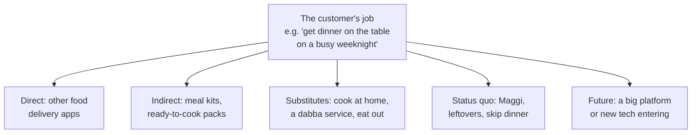
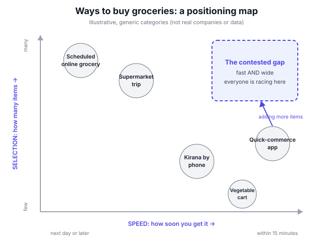

# A3.2 Competitive analysis

## In one line

Competitive analysis means understanding every way your customers could get their job done instead of using you, so you can decide where to compete, where to be different and what to ignore.

## Why this matters

Customers never judge your product alone. They compare it with what they use today, what their friend recommends, and the option of doing nothing at all. A PM who doesn't understand those alternatives builds features nobody switches for, prices badly, and gets surprised in every sales call.

Competitive analysis feeds many PM decisions: which segment to target ([A3.1](01-market-sizing-tam-sam-som.md)), how to position ([A3.3](03-positioning.md)), what to prioritise, how to price, and how to respond when a rival makes a move. Done well, it also stops teams from wasting months copying competitors their customers don't care about.

## Key terms

| Term | Plain-English meaning |
|---|---|
| **Direct competitor** | A product that solves the same problem, for the same customer, in a similar way. |
| **Indirect competitor** | A different kind of product that solves the same problem. |
| **Substitute** | Any other way of getting the job done, including a manual or offline method. |
| **Status quo ("do nothing")** | Carrying on with what the customer does today. Often your biggest competitor. |
| **Competitive alternatives** | Everything a customer would use if your product didn't exist (April Dunford's term). |
| **Table stakes** | Features every option must have just to be considered. They don't win deals, but missing them loses deals. |
| **Differentiator** | Something you do better or differently that customers value and rivals can't easily copy. |
| **Win-loss analysis** | Interviewing buyers after a deal to learn why they chose you or someone else. |
| **Battlecard** | A one-page guide for sales teams on how to compete against a specific rival. |
| **Perceptual (positioning) map** | A chart placing options on two dimensions customers care about, to show gaps. |

## The idea, simply

!!! tip "Analogy: the kirana store and the new dark store"
    A kirana store owner hears that a quick-commerce dark store (a warehouse that only does app deliveries) has opened two lanes away. His first thought: "My competitor is that app."

    But think about what his customers actually do. Some order from the app for 10-minute delivery. Some go to a supermarket once a month for bulk shopping. Some buy vegetables from the cart outside. And some simply phone him and ask his delivery boy to drop things off, which they've done for years.

    His real competition is *every other way his customers get their household items*, including their own habits. If he only watches the app, he might cut prices and lose money, when his regulars actually value his credit book (*udhaar*), his personal service and his willingness to stock their favourite brand.

That's the heart of competitive analysis: start from the customer's job, not the list of companies that look like you.

### 1. What competitive analysis is actually for

Competitive analysis isn't a document you write once for a strategy deck. It's an input to specific decisions. If it doesn't change a decision, it's research for its own sake.

| Decision | Question competitive analysis answers |
|---|---|
| **Where to play** | Which customers are badly served by every current option? |
| **What to build** | Which features are table stakes, and where can we be truly different? |
| **How to position** | Compared with what, and why are we better for a particular customer? ([A3.3](03-positioning.md)) |
| **How to price** | What do the alternatives cost, including the cost of switching? ([A10.3](../10-growth-and-go-to-market/03-pricing-and-monetisation.md)) |
| **How to sell** | What objections will we hear, and how do we answer them? |
| **How to respond** | A rival just launched something. Do we match it, leapfrog it, or ignore it? |

Start by writing down which of these decisions you're informing. It keeps the analysis focused and short.

### 2. Who counts as a competitor: five rings

Think of competitors as rings around the customer's job. The further out, the less they look like you, but the more often they win.

Most teams only watch the first box. Customers choose between all five.

| Ring | What it means | Example: a UPI payments app |
|---|---|---|
| **Direct** | Same job, same customer, similar product | Other UPI apps |
| **Indirect** | Same job, different kind of product | Debit cards, wallets, a bank's own app |
| **Substitutes** | Same job, done another way | Cash, cheques |
| **Status quo** | Keep doing what they do now | "I'll pay the electrician in cash like always" |
| **Future entrants** | Players that could enter | A large platform adding payments inside its app |

April Dunford, author of *Obviously Awesome*, puts the key question simply: what would a customer do if your product didn't exist? Often the honest answer is a spreadsheet, a manual process, or hiring someone. She notes that B2B software often loses a large share of deals to "no decision", where the buyer simply keeps the status quo ([Positioning and competition](https://aprildunford.substack.com/p/positioning-and-competition)).

### 3. Compete for the job, not the category

Clayton Christensen's **jobs-to-be-done** idea (see [A1.3](../01-understanding-users-user-sense/03-personas-and-jobs-to-be-done.md)) gives the classic example. A fast-food chain wanted to sell more milkshakes. Asking customers about flavours didn't help. Then researchers noticed that about 40% of milkshakes were bought early in the morning by commuters ([HBS Working Knowledge](https://www.library.hbs.edu/working-knowledge/clay-christensens-milkshake-marketing)). These customers were "hiring" the milkshake to make a long, boring drive more bearable and keep them full until mid-morning. Its real competitors were bagels and doughnuts, not other milkshakes.

Defining competition by the job changes what you see:

| Category view | Job view |
|---|---|
| "We compete with other fitness apps" | "We compete with anything that helps busy people feel healthier: a gym, a cricket group, a morning walk with friends, or just guilt" |
| "We compete with other edtech apps" | "We compete with tuition classes, YouTube, elder siblings and the school's own notes" |
| "We compete with other accounting software" | "We compete with the accountant who visits monthly, Excel, and a paper ledger" |

The job view usually reveals that your biggest threat isn't the startup everyone in your office talks about.

### 4. What to compare (much more than features)

A feature checklist is the most common and least useful form of competitive analysis. Features are easy to copy. What really decides who wins is usually elsewhere.

| Dimension | Question to ask | Why it matters |
|---|---|---|
| **Target customer** | Who is each option built for? | Rivals serving a different segment may not be rivals at all |
| **Job and value promise** | What do they promise, in one line? | Shows how they want to be seen |
| **Business model and pricing** | How do they make money? What does the customer pay in total? | A different model can beat a better product |
| **Distribution** | How do they reach customers: app stores, sales teams, partners, offline agents? | In India, distribution often decides the market |
| **Experience quality** | How fast, simple and reliable is it in real use? | Try it yourself; read app reviews |
| **Switching cost** | What would a customer lose or have to redo to move? | Explains "why don't they switch to us?" |
| **Strengths and weaknesses** | What do customers praise and complain about? | Weaknesses are your openings |
| **Direction** | What are they investing in? (Job posts, launches, earnings calls) | Tells you where they'll be next year |

**Business model** deserves special attention. A rival with a different way of charging can be very hard to fight with features alone, as the Indian ride-hailing story below shows.

### 5. Where to find competitive information (ethically)

You can learn most of what you need from public sources and from customers.

| Source | What you learn | Tip |
|---|---|---|
| **Use the product yourself** | Real experience, onboarding, pricing | Sign up as a normal customer; record the flow |
| **App store and review sites** | What users love and hate | Sort by "most recent" and "most critical" |
| **Pricing pages and changelogs** | Price moves, launch pace | Check monthly; note changes |
| **Job postings** | What they're about to build (e.g. hiring ML engineers for fraud) | A strong signal of direction |
| **Annual reports, shareholder letters, IPO filings** | Strategy, metrics, priorities | In India, listed companies and IPO documents (DRHPs) are rich sources |
| **Customer interviews** | Why people choose and switch | Ask about the last time they chose ([A1.2](../01-understanding-users-user-sense/02-user-research-methods-and-interviews.md)) |
| **Win-loss interviews** | Why you won or lost real deals | The most honest source in B2B |
| **Sales and support teams** | What prospects say about rivals | Ask for specific quotes, not opinions |

**The ethical line:** use the product as a genuine customer would and read what's public. Don't pretend to be someone you're not to get a demo, don't ask a rival's former employees for confidential information, and never discuss or agree prices with competitors (that can break competition law). If you wouldn't be comfortable seeing it in the newspaper, don't do it.

### 6. From facts to "so what"

Facts about competitors are only useful when you turn them into choices. For each important competitor or alternative, write three lines:

1. **Where they win:** which customers choose them, and why.
2. **Where they're weak:** which customers they serve badly.
3. **Our response:** compete head-on, differentiate, or deliberately ignore.

| Finding | Weak "so what" | Strong "so what" |
|---|---|---|
| Rival has 50 more features | "We need to catch up" | "Our segment uses 8 of those features. We match those 8 and stay simpler" |
| Rival is cheaper | "Cut our price" | "Their price excludes setup and training, which our customers need. Show total cost" |
| Rival launched AI chat | "Launch AI chat" | "Check win-loss: has anyone chosen them for it? If not, watch and wait" |
| Customers stay on Excel | "They're not ready" | "Excel is our real competitor. Make importing from Excel instant" |

### 7. Win-loss analysis: let buyers tell you

In B2B products, the most reliable competitive insight comes from **win-loss analysis**: short interviews with recent buyers, whether they chose you or not. Sales teams' notes are useful but biased. A salesperson who lost a deal tends to blame price or missing features. Buyers often give different reasons: trust, the demo, the onboarding promise, or simply "your rival's sales rep understood our problem better".

Good practice:

- Interview **within a few weeks** of the decision, while memory is fresh.
- Have someone **other than the salesperson** do the interview.
- Ask about the **whole decision**: what triggered it, who was involved, which options were considered, what tipped it.
- Look for **patterns across 15–30 interviews**, not single stories.
- Share findings with product, sales and marketing together.

Vendors' surveys suggest these programmes pay off. Clozd's [2025 State of Win-Loss report](https://www.clozd.com/guides/2025-state-of-win-loss-report) found that 63% of practitioners saw win rates rise, though as a win-loss vendor it has an interest in the result.

## Framework: The Competitive Landscape in five steps

There's no single "official" competitive analysis method. This book's five steps combine Christensen's [jobs-to-be-done](https://www.library.hbs.edu/working-knowledge/clay-christensens-milkshake-marketing) (2000s), April Dunford's **competitive alternatives** from *Obviously Awesome* ([publisher page](https://pagetwo.com/book/obviously-awesome/), 2019), and standard practice from product marketing (feature matrices, positioning maps, win-loss and battlecards). For whole-industry forces, use Porter's Five Forces in [A3.4](04-industry-analysis-porter-s-five-forces-and-swot.md).

**Steps:**

1. **Name the decision and the customer.** Which decision is this for, and which segment?
2. **List the alternatives in all five rings.** Ask customers: "Before us, how did you handle this? What else did you consider?"
3. **Compare on what customers value.** Build a matrix with 5–8 dimensions customers actually choose on (not 50 features). Rate each option honestly.
4. **Map the gaps.** Plot options on a positioning map using the two dimensions customers care about most. Look for underserved spaces.
5. **Decide and keep it fresh.** For each alternative, decide: compete, differentiate or ignore. Assign an owner to update the analysis each quarter, and refresh battlecards when something changes.

**When to use it:** entering a new market, planning a roadmap, before positioning or pricing work, and whenever win rates or retention change.

**When not to:** when you haven't yet talked to customers about their problem. Competitive analysis before customer discovery tends to produce copycat products. Also, don't redo the full analysis every time a rival tweets about a launch; check against your win-loss data first.

## Diagram

A positioning map turns a list of rivals into a picture of gaps. Pick the two axes customers actually choose on. Here, "fast and wide" is the space everyone is racing towards.

## Worked example

You're the PM for a billing and stock app for small pharmacies, priced at ₹499 a month. Growth has slowed. In the weekly meeting, everyone is talking about a well-funded startup that just launched "AI invoice scanning". The sales head says: "We need AI scanning too, fast."

**Step 1: Name the decision.** What should the team build next quarter to win more deals? The customer is an independent pharmacy with 1–3 staff.

**Step 2: Look at last quarter's deals.**

| | Count |
|---|---|
| Demos given | 200 |
| Won | 60 (30% win rate) |
| Lost | 140 |

**Step 3: Find out who you really lost to.** You run 30 win-loss interviews and combine them with CRM notes.

| Lost to | Share of losses | Deals lost |
|---|---|---|
| Staying on their old desktop billing software | 45% | 63 |
| A free app funded by a medicine distributor | 25% | 35 |
| No decision (kept paper register and Excel) | 20% | 28 |
| The new AI startup | 10% | 14 |

The startup everyone is worried about took only 14 deals. The biggest competitor is **the status quo**: the old desktop software the pharmacist already has.

**Step 4: Understand why.** In interviews, pharmacists who stayed on desktop software said things like: "Five years of my stock and customer data are in there. If I move, I'll lose it." Their real fear is **switching cost**, not missing features.

**Step 5: Compare on what customers value.**

| Dimension (what pharmacists choose on) | Us | Old desktop software | Free distributor app | AI startup |
|---|---|---|---|---|
| Easy to move existing data | Weak | (already there) | Weak | Weak |
| Stock expiry alerts | Strong | OK | OK | Strong |
| Works offline | OK | Strong | Weak | Weak |
| Price per year | ₹6,000 | ₹12,000 once + yearly maintenance | Free | ₹9,000 |
| Data privacy (who sees my sales?) | Strong | Strong | Weak (distributor sees data) | Strong |
| AI invoice scanning | None | None | None | Strong |
| Local-language support | Strong | Weak | OK | Weak |

**Step 6: Compare two options.**

| | Option A: build AI scanning | Option B: free one-click migration from desktop software |
|---|---|---|
| Effort | ~8 weeks, 2 engineers | ~6 weeks, 2 engineers, plus a ₹500 per-customer migration service |
| Losses it addresses | 14 (AI startup) | 63 (desktop) + some of the 28 "no decision" |
| Realistic deals won back per quarter | ~7 (half of 14) | ~21 (a third of 63) + ~5 from "no decision" = ~26 |

**Step 7: What is it worth?** Each customer pays about ₹6,000 a year and stays about 3 years, so is worth about ₹18,000 in lifetime value.

| | Option A | Option B |
|---|---|---|
| Extra customers per quarter | 7 | 26 |
| Extra customers per year | 28 | 104 |
| Lifetime value added per year | ₹5.0 lakh | ₹18.7 lakh |
| New win rate | (60 + 7) ÷ 200 = 33.5% | (60 + 26) ÷ 200 = 43% |
| Migration service cost per year | none | 104 × ₹500 = ₹52,000 |

Option B is worth nearly four times as much, because it attacks the alternative that actually wins most deals.

**Step 8: Decide on each competitor.**

- **Desktop software:** compete head-on, by removing switching cost.
- **Free distributor app:** differentiate on privacy ("your sales data stays yours").
- **AI startup:** watch. Add AI scanning to the "later" roadmap and re-check win-loss data each month. If AI scanning starts to show up in more lost deals, move it up.

**Step 9: Equip sales.** Write a one-page battlecard for each alternative: when you meet it, what the customer likely believes, the two questions to ask, and the proof to show.

## Going deeper: nuances and trade-offs

### 1. Don't let competitors write your roadmap

The biggest risk in competitive analysis is copying. If you build whatever rivals build, you end up with **feature parity**: you're just as good, so customers have no reason to switch. Dunford warns against positioning against "phantom competitors" that your customers never actually consider ([source](https://aprildunford.substack.com/p/positioning-and-competition)).

Sort competitor features into two groups:

- **Table stakes:** customers reject you without it (e.g. UPI payment in an Indian checkout). Match these, quickly and simply.
- **Differentiators:** where you choose to be clearly better for your segment. Invest here.

The Kano model in [A5.2](../05-roadmaps-and-prioritisation/02-prioritisation-frameworks-rice-ice-moscow-kano.md) helps separate the two.

### 2. Responding to a competitor's move

When a rival launches something, there are four sensible responses.

| Response | When it fits | Example |
|---|---|---|
| **Match** | It's becoming table stakes, and customers are leaving over it | Adding a payment method everyone now expects |
| **Leapfrog** | You can do it clearly better, and it matters to your segment | A much faster or cheaper version |
| **Differentiate** | Their move pulls them away from customers you serve well | Doubling down on privacy while a rival adds ads |
| **Ignore (and watch)** | It doesn't change your customers' choices yet | A flashy launch that doesn't show up in win-loss data |

Before choosing, ask: **is this changing what our customers choose?** Check churn reasons, win-loss notes and support tickets. Many competitor launches never show up in any of them.

### 3. Business models compete, not just products

Sometimes a rival wins not with a better product but with a different way of charging. Common patterns:

- **Free, paid by someone else** (ads, a distributor, a bank). Hard to beat on price; beat it on trust or quality.
- **Subscription instead of commission** (see the ride-hailing case below). Changes who the platform is really serving.
- **Bundling.** A big company includes a "good enough" version of your product in something customers already pay for.
- **Usage-based pricing**, which can make a rival look cheaper for small customers.

When you compare rivals, always ask: who pays, for what, and how does that shape their incentives?

### 4. When a giant enters your market

Large players can enter with deep pockets, existing customers and the ability to lose money for years. In India's quick commerce, for example, TechCrunch reported in April 2026 that [Flipkart and Amazon were squeezing the quick-commerce startups](https://techcrunch.com/2026/04/11/walmart-owned-flipkart-amazon-are-squeezing-indias-quick-commerce-startups/) as they expanded their own fast-delivery services.

Smaller players rarely win by fighting a giant on discounts. They usually win by:

- **Focusing on a segment** the giant serves as an afterthought.
- **Being better at the job** in ways that are hard for a big organisation to copy (speed of decisions, service, local knowledge).
- **Learning faster.** Shipping and testing weekly while the giant plans quarterly.
- **Partnering** where the giant is weak.

### 5. Switching costs and the power of "no decision"

The status quo wins because switching has costs: money, time, learning, risk and data. Map them for your customers:

| Switching cost | Example | How to reduce it |
|---|---|---|
| **Data** | Years of records in old software | Free import, done for them |
| **Learning** | Staff trained on the old tool | Familiar layout; local-language help |
| **Risk** | "What if it breaks during the festival rush?" | Trial period; run both side by side |
| **Contract** | Annual licence already paid | Start free until the licence ends |
| **Social** | "My CA uses this format" | Export in the formats others need |

Reducing switching cost is often the highest-value competitive move a PM can make, as the worked example shows. The flip side: once customers are with you, healthy switching costs (their data, their habits) help retention. Just don't trap them, which damages trust and can attract regulators.

### 6. Keeping it alive: cadence over documents

Competitive analysis decays fast. A deck from last year is already wrong about pricing and features. Practical habits:

- **Monthly:** check rivals' pricing pages, changelogs and recent app reviews (30 minutes).
- **Quarterly:** refresh the matrix and positioning map; review win-loss patterns.
- **On a real event:** a major launch, a price change or a funding round gets a short "what changes for us?" note.
- **Battlecards** for sales, updated whenever the facts change.

Vendor research points the same way. Crayon's [2026 State of Competitive Intelligence](https://www.crayon.co/blog/state-of-competitive-intelligence-2026) summary reports that a regular cadence predicted revenue impact more strongly than the tools teams used. (Crayon sells competitive intelligence software, so read it as an industry view.)

### 7. How it differs by business type and market

- **B2C apps:** watch app store reviews, social media, usage habits and downloads. Switching is easy, so experience quality and habit matter most.
- **B2B software:** win-loss interviews are the best source. Buyers compare carefully, and "no decision" is a major competitor.
- **Marketplaces:** you compete on **both sides** at once (riders and drivers, buyers and sellers). A rival can win by being better for just one side.
- **India-specific:** many competitors are **offline or informal**: the local agent, the neighbourhood shop, cash, a WhatsApp group, a family member who "handles it". They rarely appear in market reports, but they often hold most of the market. Field visits find them.

### 8. AI products: the ground moves monthly

In AI, competitive analysis needs a faster rhythm:

- **Capabilities shift with each model release.** A feature that was your differentiator can become table stakes within months, sometimes because the model providers themselves add it to their own apps.
- **Your supplier can be your competitor.** If you build on a model company's API, that company may launch a product for your users too. Ask what you offer beyond the model: workflow, data, distribution and trust ([B5.2](../../part-b/05-strategy-and-business/02-ai-native-strategy-and-moats.md)).
- **Benchmarks aren't the customer's view.** A rival topping a public benchmark may still be worse at your users' real tasks. Compare on your own evals ([B3.1](../../part-b/03-quality/01-evals-the-ai-pm-s-most-important-skill.md)).
- **Open models lower entry barriers.** New competitors can appear quickly, so speed of learning matters more than any one feature.

## Real-world examples (2023 onwards)

!!! example "Indian ride-hailing, 2023–2025: a business model that the giants copied"
    Namma Yatri, launched in Bengaluru in November 2022, let auto drivers keep the full fare. From mid-2023 it charged drivers a flat subscription (about ₹25 a day in most states) instead of a commission per ride ([Rest of World](https://restofworld.org/2025/uber-ola-copy-india-zero-commission-ride-hailing-app/)). Rapido moved autos to a similar subscription model in 2024. In February 2025, Uber [dropped commissions for auto-rickshaw drivers in India](https://techcrunch.com/2025/02/19/uber-ditches-commissions-in-favor-of-fees-for-auto-rickshaw-drivers-in-india), charging a daily fee of ₹20–40 instead, with riders paying drivers directly by cash or UPI. TechCrunch linked the change to competition from Rapido and Namma Yatri. In June 2025, Ola [rolled out zero-commission rides across India](https://yourstory.com/2025/06/ola-rolls-0-commission-rides-pan-india-rapido-uber), with drivers buying passes.

    **PM lesson:** the challengers didn't win drivers with a better app. They changed **who pays and how**. A feature matrix would have missed this completely. Notice too that the incumbents' response was to **match** the model once it became table stakes for drivers. Always include the business model, and both sides of a marketplace, in your analysis.

!!! example "OpenAI's 'code red', December 2025: a leader responds to a rival"
    In December 2025, after Google released Gemini 3, OpenAI chief executive Sam Altman sent an internal memo declaring a "code red" to focus on improving ChatGPT, delaying other projects including advertising plans ([Fortune](https://fortune.com/2025/12/02/sam-altman-declares-code-red-google-gemini-ceo-sundar-pichai/)). Fortune reported that Google's Gemini app had reached 650 million monthly users in October 2025, while OpenAI reported 800 million weekly ChatGPT users.

    **PM lesson:** even the market leader treated a rival's move as a reason to **narrow focus** on core quality rather than to chase every initiative. Also notice the numbers: one is *monthly* users and the other *weekly* users, so they can't be compared directly. When you put competitors side by side, check that the metrics share the same definition ([A8.1](../08-product-metrics/01-metric-basics-leading-lagging-input-output-vanit.md)).

## Common mistakes

!!! warning "Watch out for"
    - **Only listing direct competitors.** The status quo and substitutes often win more deals.
    - **Feature checklists with 50 rows.** Compare on the 5–8 things customers actually choose on.
    - **Copying a rival's launch by reflex.** Check whether it changes your customers' choices first.
    - **Trusting sales notes alone.** Lost deals get blamed on price; buyers often say otherwise.
    - **Ignoring the business model.** A different way of charging can beat a better product.
    - **Comparing metrics with different definitions** (monthly vs weekly users, gross vs net revenue).
    - **A one-time document.** It's out of date within a quarter.
    - **Crossing ethical lines** (fake identities, confidential documents, talking prices with rivals).

## Common questions

**How many competitors should I analyse in depth?**
Usually 3–5: the two or three you meet most in deals, plus the status quo. List the rest in a single line each.

**We're the first in our category. Do we have no competitors?**
You always have competitors: the old way of doing the job, or doing nothing. "No competitors" usually means you haven't found the real alternatives yet, or that there's no market.

**Should we mention competitors in our marketing?**
Sometimes, carefully. Comparing with the customer's current way of working ("stop wasting hours on Excel") is usually safer and more persuasive than naming a rival. Positioning is covered in [A3.3](03-positioning.md).

**Is it OK to sign up for a competitor's product?**
Yes, as a genuine user, following their terms. Don't misrepresent who you are to get private demos or sales material.

**How is this different from SWOT or Porter's Five Forces?**
Competitive analysis looks at specific rivals and alternatives for a customer's job. Five Forces looks at the whole industry's structure (suppliers, buyers, new entrants, substitutes and rivalry), and SWOT summarises your position. They work well together ([A3.4](04-industry-analysis-porter-s-five-forces-and-swot.md)).

**How do I do this as a junior PM with no budget?**
Use each product yourself, read 50 recent app reviews per rival, and ask five customers what they used before. That's often enough to find the real alternatives.

## In the interview

!!! question "In the interview"
    **How it's tested:** competitive analysis shows up inside strategy questions ("should we enter this market?"), product-sense questions ("design a product for X; who else serves them?") and response questions ("a competitor just did Y, what do you do?").

    **Sample question:** *"A rival food delivery app has just launched 10-minute delivery in your city. You're the PM at a competitor. What do you do?"*

    **Outline of a strong answer:**

    1. **Don't react yet; clarify.** Which areas, which items, at what price? Is it a pilot or a full launch?
    2. **Understand the job.** Who wants food in 10 minutes, and for which occasions (a snack, a late-night order)? What's their alternative today?
    3. **Measure the impact.** Watch order share, churn and app reviews in the affected areas over 2–4 weeks. Is it changing your customers' choices?
    4. **Think about the economics.** Can the rival sustain it? What does it cost per order (dark kitchens, riders on standby)?
    5. **Choose a response:** match (if it's becoming table stakes for a valuable segment), differentiate (selection, reliability, price) or ignore and watch.
    6. **Define success and guardrails:** e.g. protect retention in the affected areas without making each order unprofitable.

    Interviewers look for customer-first thinking, a structured view of alternatives, and a response chosen on evidence, not panic.

## Research happening now

!!! info "Research happening now"
    - **Cadence beats tools (Crayon, July 2026).** Crayon's [2026 State of Competitive Intelligence](https://www.crayon.co/blog/state-of-competitive-intelligence-2026) summary, based on hundreds of CI and revenue leaders, reports that most deals are now competitive and that a regular cadence predicts revenue impact more strongly than tooling. *Status: vendor survey; full report gated.*
    - **Win-loss programmes and win rates (Clozd, 2025 report, updated 2026).** Clozd's [State of Win-Loss Analysis](https://www.clozd.com/guides/2025-state-of-win-loss-report), surveying over 1,000 professionals, found that 63% of practitioners saw win rates rise, and that ongoing programmes showed positive returns far more often than one-off projects. *Status: vendor survey; not peer-reviewed.*

## Try it yourself (25 minutes)

Pick a product you know well (a learning app, a payments app, a food app). Then:

1. Write the customer's job in one sentence.
2. List at least one alternative in each of the five rings (direct, indirect, substitute, status quo, future).
3. Choose the 5 dimensions customers really choose on, and rate the product and two alternatives on each (Strong / OK / Weak).
4. Write the "so what": one place to compete head-on, one to differentiate, one to ignore.

??? success "Check your answer"
    For a language-learning app, a good answer might be:

    - **Job:** "Help me speak enough English to do well in job interviews within three months."
    - **Rings:** direct (other learning apps); indirect (online spoken-English classes); substitute (YouTube videos, practising with friends, an AI chatbot); status quo (keep postponing); future (an AI assistant built into the phone that tutors by voice).
    - **Dimensions:** speaking practice, feedback on mistakes, price, fit with a busy schedule, confidence-building.
    - **So what:** compete head-on on speaking practice with feedback; differentiate on interview-specific scenarios; ignore grammar-game features that rivals promote but your users don't value.

    Check that your status quo entry is realistic, that your dimensions come from what customers say (not your feature list), and that each "so what" is a clear choice.

## How this connects

- [A3.1 Market sizing](01-market-sizing-tam-sam-som.md): sizing tells you how big the prize is; competitive analysis tells you how much of it you can win.
- [A3.3 Positioning](03-positioning.md): competitive alternatives are the starting point for positioning.
- [A3.4 Porter's Five Forces and SWOT](04-industry-analysis-porter-s-five-forces-and-swot.md): the industry-level view that complements rival-by-rival analysis.
- [A1.3 Personas and Jobs-to-be-Done](../01-understanding-users-user-sense/03-personas-and-jobs-to-be-done.md): defining competition by the job.
- [A5.2 Prioritisation frameworks](../05-roadmaps-and-prioritisation/02-prioritisation-frameworks-rice-ice-moscow-kano.md): Kano helps separate table stakes from differentiators.

## Go deeper

- **Book:** [*Obviously Awesome*](https://pagetwo.com/book/obviously-awesome/) by April Dunford. The best practical guide to competitive alternatives and positioning.
- **Article:** [April Dunford: Positioning and competition](https://aprildunford.substack.com/p/positioning-and-competition). Short and clear on the status quo and "phantom competitors".
- **Article:** [HBS Working Knowledge: Clay Christensen's milkshake marketing](https://www.library.hbs.edu/working-knowledge/clay-christensens-milkshake-marketing). The classic story of competing for the job.
- **Guide:** [Clozd: State of Win-Loss Analysis](https://www.clozd.com/guides/2025-state-of-win-loss-report). Benchmarks and practice for win-loss programmes (vendor-produced).
- **Watch:** [April Dunford at MTPCon London 2026](https://mindtheproduct.com/everything-has-changed-except-for-the-fundamentals-of-positioning-april-dunford-at-mtpcon-london-2026). Talk titled "Everything has changed except for the fundamentals of positioning" (free account needed).
- **Article:** [Rest of World: how Uber and Ola copied India's zero-commission app](https://restofworld.org/2025/uber-ola-copy-india-zero-commission-ride-hailing-app/). A detailed story of business-model competition.

## Key takeaways

- Start from the **customer's job**, not the list of companies that look like you.
- Map **five rings** of competition: direct, indirect, substitutes, the status quo and future entrants. The status quo often wins most.
- Compare on the **5–8 things customers choose on**, including business model, distribution and switching cost, not just features.
- Turn facts into choices: **compete, differentiate or ignore** for each alternative.
- In B2B, **win-loss interviews** with buyers are the most honest source.
- Reducing **switching cost** is often the most valuable competitive move.
- Keep it alive with a **regular cadence**, and stay on the right side of ethics and the law.

## Updates

*No updates yet.*
