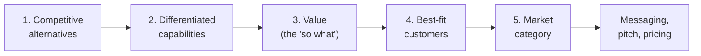
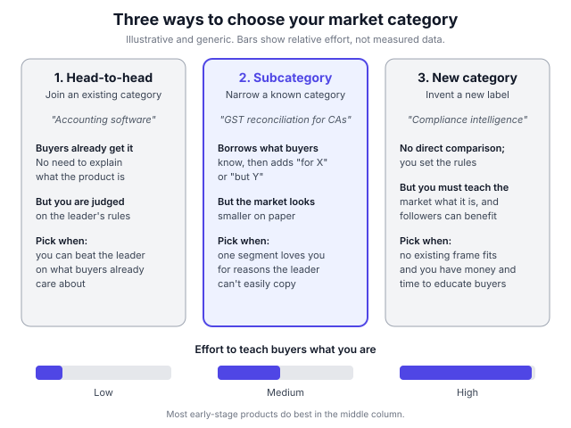

# A3.3 Positioning

## In one line

Positioning is the context you put your product in so the right customers instantly see why it is the best choice for them.

## Why this matters

The same product can look brilliant or pointless depending on what people compare it to. Positioning decides that comparison. It shapes who you build for, which features you prioritise, what you charge, how sales pitches go and what the home page says. A PM who leaves it to "marketing later" often ends up with a good product that nobody quite understands.

## Key terms

| Term | Plain-English meaning |
|---|---|
| **Positioning** | The frame you choose for your product: who it's for, what it's compared with, and why it wins that comparison. |
| **Competitive alternatives** | What customers would do if your product didn't exist, including "nothing" or "a spreadsheet". |
| **Differentiated capabilities** | What you have or do that those alternatives don't. |
| **Value** | What those differences let the customer achieve, in their words ("I save two days a month"). |
| **Best-fit customer** | The group that cares most about your value and buys fastest. |
| **Market category** | The label that tells buyers what kind of thing your product is, and so who to compare it with. |
| **Messaging** | The words you use to express the positioning on a page, in an ad or in a pitch. Positioning comes first. |
| **Repositioning** | Deliberately changing the frame, usually because the market, the alternatives or the product has changed. |

## The idea, simply

!!! tip "Analogy: the same cake, three counters"
    Picture one chocolate cake. Put it on the counter of a five-star hotel bakery and people expect ₹2,000 and judge it on finesse. Put it in a bakery near a college and it's a ₹400 birthday treat, judged on size and taste. Put it in a gym café as "protein cake" and it's judged on grams of protein per slice.

    The cake hasn't changed. The **counter** changed what people compare it with, what they expect and what they'll pay. Positioning is choosing the counter on purpose.

Let's build the idea up step by step.

### 1. What positioning is, and what it isn't

April Dunford, an author and positioning consultant, defines positioning as the context that makes your value obvious to the right customers. In her book [*Obviously Awesome*](https://pagetwo.com/book/obviously-awesome/) (2019), she argues that customers can't judge a product in a vacuum. They always ask "compared to what?" Your positioning answers that question for them before they guess wrong.

Positioning is often confused with three neighbours. They are related, but they are not the same.

| Thing | Question it answers | Example (a budgeting app) | Who usually leads it |
|---|---|---|---|
| **Positioning** | What are we, for whom, compared with what, and why are we better? | "The budgeting app for couples who share expenses, unlike spreadsheets or bank apps built for one person" | Product, marketing and founders together |
| **Messaging** | What exact words do we say? | "Stop fighting about money. Split, track and save together." | Marketing |
| **Branding** | How should we look and feel? | Warm colours, friendly tone, couple-friendly illustrations | Brand / design |
| **Marketing** | Where and how do we reach people? | Wedding-season Instagram ads, partnerships with wedding planners | Marketing / growth |

The order matters. If positioning is wrong, beautiful messaging and branding just say the wrong thing more loudly.

### 2. Where the idea came from

The word comes from advertising. Al Ries and Jack Trout first wrote about "positioning" in the June 1969 issue of *Industrial Marketing* and expanded it in an *Advertising Age* series in 1972 ([Ries](https://www.ries.com/positioning-pioneers/)). Their 1981 book, [*Positioning: The Battle for Your Mind*](https://www.mheducation.com/highered/mhp/product/positioning-battle-your-mind.html), made it famous.

Their core idea, captured in the book's title: buyers' minds are crowded with products and ads. So a product wins by claiming a clear, simple place in the buyer's mind, defined relative to what is already there.

Later, Geoffrey Moore's [*Crossing the Chasm*](https://bookshop.org/book/9780062292988) brought positioning to tech products, with a focus on selling new technology to mainstream customers. His short **positioning statement** (covered in the Framework section) is still in many PM toolkits.

Dunford's contribution, decades later, was to turn positioning from a creative exercise into a **repeatable process** a team can run in a few workshops.

### 3. The five components (Dunford)

Dunford breaks positioning into five parts ([quickstart guide on Lenny's Newsletter](https://www.lennysnewsletter.com/p/positioning)). Each part leads to the next, which is why the order matters.

| Component | Question | Example: a UPI-based expense app for small offices |
|---|---|---|
| **1. Competitive alternatives** | What would customers do if we didn't exist? | Petty-cash register, WhatsApp photos of bills, Excel |
| **2. Differentiated capabilities** | What do we have that those don't? | Auto-captures UPI payments; reads bill photos; one-tap approval |
| **3. Value** | So what? What does that enable? | Month-end close in 1 hour instead of 2 days; no missing bills |
| **4. Best-fit customers** | Who cares most about that value? | Offices of 10–50 people with an accountant but no finance team |
| **5. Market category** | What frame makes that value obvious? | "Expense management for small offices" |

A sixth, optional layer is **relevant trends**: a shift that makes your value feel timely, such as more payments moving to UPI ([summary by Heinz Marketing](https://www.heinzmarketing.com/blog/five-components-of-effective-positioning-an-obviously-awesome-book-summary-part-2/)). Use a trend only if it's real for your best-fit customers. Otherwise it reads as hype.

**Why start with alternatives?** Because "differentiated" only means something relative to something else. Dunford warns that teams who start with features write positioning that sounds good inside the company but doesn't stand out to buyers.


<p class="caption">Each step depends on the one before it. Messaging comes last, built on top of the positioning, never the other way round.</p>

### 4. Competitive alternatives: the real competition is often "do nothing"

Most teams list rival companies. Customers think differently. They compare you with whatever they do today. In [A3.2](02-competitive-analysis.md) you saw the five rings of competition, including the **status quo**. Positioning starts from that list.

| What the team thinks the competitor is | What the customer actually does today |
|---|---|
| Another meal-planning app | Asks mum, or orders the same three dishes on Swiggy |
| Another project management tool | A WhatsApp group plus a shared Google Sheet |
| Another AI writing tool | A general chatbot, or a junior writer |
| Another fitness app | A free YouTube workout, or nothing at all |

Dunford also warns against **phantom competitors**. These are rivals the team worries about but rarely meets in real sales or switching decisions. Ask your sales team or look at churn surveys: "When we lose, who do we lose to?"

### 5. Value and the "so what" test

Features are what the product *has*. Value is what the customer *gets*. Dunford's method is to take each differentiated feature and keep asking "so what?" until you reach something the customer would pay for.

| Feature | So what? | So what? (value) |
|---|---|---|
| Reads bill photos automatically | No typing of bill details | Accountant saves about 6 hours a month |
| UPI payments captured in real time | Every spend is recorded the same day | No "missing bill" arguments at month end |
| Works in Hindi and Tamil | Office staff can use it without training | Adoption across the whole office, not just the manager |

Good value statements are **specific** (hours, rupees, errors avoided) and **provable**. Customer quotes, before/after numbers and case studies turn value claims into something a sceptical buyer can believe. This links directly to the problem statement you wrote in [A2.2](../02-problem-discovery/02-framing-the-problem-problem-statements.md): value is the solved version of that problem.

### 6. Best-fit customers, not "everyone"

Your best-fit customers are the people who care most about your value. They buy faster, ask for fewer discounts and stay longer. They are usually a **subset** of your total market.

How to find them:

1. List your happiest current customers (or beta users).
2. Find what they have in common: size, role, situation, trigger moment.
3. Check that the common trait explains *why* they love your value, not just a coincidence.

This is closely related to the personas and jobs to be done from [A1.3](../01-understanding-users-user-sense/03-personas-and-jobs-to-be-done.md). The difference is focus. Personas describe users; best-fit customers are the slice you choose to win **first**. It is the positioning version of the beachhead market from [A3.1](01-market-sizing-tam-sam-som.md).

Narrowing feels risky: "won't we lose the others?" In practice, a clear position attracts the best-fit group strongly, and others still find you. A vague position attracts no one strongly.

### 7. The market category: the frame that does most of the work

The category is the shortcut buyers use to understand you. Say "CRM" and a buyer instantly assumes a list of features, a price range and a set of rivals. That assumption can help or hurt.

Dunford describes three broad choices:

| Choice | Example | Upside | Downside |
|---|---|---|---|
| **Head-to-head** in an existing category | "Accounting software" | Buyers already understand it | You're judged against the leader on the leader's terms |
| **Subcategory** (a niche of an existing category) | "CRM for investment banks" (Dunford's example) | Familiar frame, plus a clear reason you win for a segment | Market looks smaller |
| **New category** | A label nobody uses yet | No direct comparison; you set the rules | You pay to teach the market; later entrants often benefit |

Dunford notes that most start-ups begin in an existing category or a subcategory, and that category creators often lose to later entrants ([Lenny's Newsletter](https://www.lennysnewsletter.com/p/positioning)). Category creation is a real strategy, but an expensive one. It needs a product that truly doesn't fit any frame, plus the money and patience to educate buyers.

**A simple test:** say your category to a best-fit buyer. Do they immediately expect the right things? If they expect features you don't have, or compare you with the wrong rival, the category is wrong.

### 8. Positioning vs differentiation

People often use these words as if they mean the same thing. They don't.

- **Differentiation** is a *fact*: you have something others don't (a feature, a cost advantage, a network, data).
- **Positioning** is a *choice*: which of your differences to lead with, for whom, and in what frame.

A product can be highly differentiated and badly positioned. For example, an app with the best offline mode in the market might keep pitching itself to metro users with fast 4G, who don't care. Repositioned for field sales teams in low-network areas, the same difference becomes the main reason to buy.

## Framework: Dunford's process plus Moore's statement

Two tools work well together. Dunford's process helps you **find** the position. Moore's statement helps you **write it down** in a form everyone can check.

### Part 1: Dunford's positioning process

[*Obviously Awesome*](https://pagetwo.com/book/obviously-awesome/) (April Dunford, Page Two, 2019) lays out a step-by-step process. Her [quickstart guide](https://www.lennysnewsletter.com/p/positioning) condenses it into the five components above. A practical version for a PM-led team:

**Step 1: Pick your happiest customers.** Start from people who already love the product, not from the whole user base. If you have no customers yet, use your strongest beta users or interviewees.

**Step 2: Gather a small cross-functional team.** Include product, marketing, sales (or support) and a founder or leader. Positioning touches all of them, so all of them must agree.

**Step 3: List the real competitive alternatives.** Use win/loss notes, churn surveys and interviews: "What did you use before? What else did you consider?"

**Step 4: List differentiated capabilities.** Only what is true *today* and that alternatives truly lack.

**Step 5: Map capabilities to value.** Run the "so what" test. Group similar value points into 2–3 **value themes** (for example "speed", "fewer errors", "control").

**Step 6: Define the best-fit customers.** Who cares most about those value themes? Describe them by traits you can find and target.

**Step 7: Choose the market category.** Try the head-to-head, subcategory and new-category options. Pick the one that makes your value obvious to the best-fit customers.

**Step 8 (optional): Add a relevant trend.** Only if it's real for these buyers.

**Step 9: Write it down and share it.** Use a positioning canvas (see the [templates appendix](../../appendix/templates.md)) and a positioning statement.

**Step 10: Turn it into messaging, then test it.** Pitches, landing pages, onboarding copy. Watch how real buyers react, and revise.

**When to use:** at launch, when sales cycles are long or confusing, when prospects keep comparing you with the wrong rival, after a big product change, or when the market shifts under you.

**When not to:** don't run a full positioning exercise before you have any users who love the product. Early on, you don't yet know which value matters. Talk to users first ([A1.2](../01-understanding-users-user-sense/02-user-research-methods-and-interviews.md)). And don't re-run it every month: positioning that keeps changing confuses customers and your own team.

### Part 2: Moore's positioning statement

In [*Crossing the Chasm*](https://bookshop.org/book/9780062292988), Geoffrey Moore recommends compressing your positioning into a short statement that names the target customer, their need, the category, the key benefit, the main alternative and your key difference. A widely used fill-in version based on his approach looks like this:

```text
For [best-fit customer]
who [need or problem],
[product] is a [market category]
that [key value].
Unlike [main competitive alternative],
we [key differentiated capability].
```

Example for the expense app (LedgerKhata is a made-up name):

> For offices of 10–50 people that run on UPI and petty cash, LedgerKhata is an expense management app that cuts month-end closing from two days to one hour. Unlike WhatsApp photos and Excel sheets, it captures every UPI payment and bill automatically.

This statement is **internal**. Don't paste it on the website. It's a test: if your team can't fill in every blank crisply, the positioning isn't finished.

### Part 3: From positioning to the pitch

Dunford's later book, [*Sales Pitch: How to Craft a Story to Stand Out and Win*](https://pagetwo.com/book/sales-pitch/) (2023), applies positioning to the sales conversation. For a PM, the reminder is that positioning should shape demos, onboarding and release notes too, not only ads.

## Diagram


<p class="caption">The further right you go, the more you must teach buyers what you are. Subcategories borrow an existing frame and add a reason you win.</p>

## Worked example

You're the PM at a 12-person Bengaluru start-up. Your product reads purchase invoices and matches them against the GST data that suppliers file. It flags missing input tax credit (ITC: tax a business has already paid on purchases and can claim back). Early users love it. But sales are slow and every pitch feels different.

Two founders disagree on the position. You decide to run the process and then test the two strongest options.

**Step 1: Happiest customers.** Of 40 paying users, the 9 most active are all chartered accountant (CA) firms that handle GST for many small-business clients. The 31 small businesses that use it directly log in rarely.

**Step 2: Competitive alternatives.** Interviews show CA firms today use junior staff with Excel to match invoices line by line. Small businesses mostly use their accounting software or leave it to their CA.

**Step 3: Differentiated capabilities and value.**

| Capability | So what? | Value (in customer words) |
|---|---|---|
| Reads invoices in bulk, any format | No manual data entry | "Reconciliation for one client takes 10 minutes, not 2 days" |
| Flags mismatches by supplier | Staff know whom to chase | "We recover ITC we used to miss" |
| Multi-client dashboard | One view of all clients' status | "I can promise clients a filing date and keep it" |

Value themes: **speed**, **money recovered**, **control across many clients**. Notice the last theme only matters to someone with many clients.

**Step 4: Two candidate positions.**

| | Position A | Position B |
|---|---|---|
| Best-fit customer | Small businesses | CA firms with 40+ GST clients |
| Category | "AI-powered accounting assistant" (head-to-head with accounting software) | "GST reconciliation software for CA firms" (subcategory) |
| Main alternative named | Accounting software | Junior staff plus Excel |
| Price that fits the frame | ₹9,000 per year per business | ₹60,000 per year per firm (up to 50 clients) |

**Step 5: Landing-page test.** You build two landing pages, one per position. You split a ₹60,000 search-ad budget evenly. At about ₹12 per click, each page gets about 2,500 visitors. Every demo request then gets a short qualifying call (is this a real buyer who can pay?).

| Funnel step | Position A | Position B |
|---|---|---|
| Ad spend | ₹30,000 | ₹30,000 |
| Visitors | 2,500 | 2,500 |
| Demo requests | 30 (1.2%) | 70 (2.8%) |
| Qualified demos | 12 (40%) | 49 (70%) |
| Closed after 6 weeks | 1 (about 10%) | 10 (about 20%) |
| New annual revenue | about ₹9,000 | about ₹6,00,000 |
| Ad spend per customer | about ₹30,000 | about ₹3,000 |

Is the demo-request gap real or luck? 30 out of 2,500 vs 70 out of 2,500 is a large gap. A standard two-proportion check gives a z-score of about 4, well beyond the usual cut-off of 2 (see [A9.1](../09-experimentation/01-a-b-testing-basics.md)). The close rates, though, rest on only 11 customers in total. Treat them as rough.

**Step 6: Sales-call test.** You also run 10 discovery calls per framing. You count how often the prospect repeats the value back in their own words without being prompted ("so this saves my team the matching work"). Position A: 3 of 10. Position B: 8 of 10. In A calls, prospects kept asking "Does it replace Tally?", a sign the category pulled them into the wrong comparison.

**Step 7: What is it worth?** Your real constraint is sales time: two founders can run about 120 qualified demos a quarter.

| Next quarter (120 qualified demos) | Position A | Position B |
|---|---|---|
| Customers at the test close rate | 12 | 24 |
| Price per year | ₹9,000 | ₹60,000 |
| New annual revenue | about ₹1.1 lakh | about ₹14.4 lakh |
| Ad spend to generate 120 qualified demos | about ₹3,00,000 | about ₹73,500 |

Even if Position B's close rate halves at scale, it still adds about ₹7.2 lakh in annual revenue a quarter for a quarter of the ad spend. The positioning choice is worth more than any single feature on the roadmap.

**Step 8: Write it down.**

> For CA firms that file GST for 40 or more small-business clients, [product] is GST reconciliation software that cuts each client's monthly matching from two days to ten minutes and recovers missed ITC. Unlike junior staff working in Excel, it reads every invoice automatically and shows all clients' status in one dashboard.

**Step 9: What changes for the PM.** The roadmap shifts. Multi-client features (bulk filing status, staff assignment) move up. A "simple mode for small businesses" moves down. Pricing becomes per firm, not per business. You keep the small-business users, but stop designing for them.

## Going deeper: nuances and trade-offs

### 1. Who owns positioning: why PMs can't hand it off

Positioning sits where product, marketing and sales meet, so it often falls between them. In many companies, product marketing writes it down. But the PM holds much of the evidence that should shape it: user research, usage data, which features truly differ, and what's coming next.

The PM's role in practice:

- **Bring evidence:** who the happiest users are, what they use most, why they churn.
- **Keep it honest:** flag claims the product doesn't yet support. Present-tense positioning needs present-tense product.
- **Use it as a filter:** say no to features that drag you into a rival's category, and yes to features that deepen your value themes.
- **Push it through the product:** onboarding, empty states, pricing pages and release notes should all tell the same story.

When positioning lives only in a marketing deck, the product slowly drifts away from it, and the two start to contradict each other.

### 2. When to reposition, and the cost of doing it

Signals that your positioning has stopped working:

| Signal | What it often means |
|---|---|
| Prospects keep comparing you with the wrong rival | Your category frame is wrong |
| Long, confused sales cycles; lots of "interesting, but…" | Value isn't obvious to the people you're talking to |
| Many sign-ups who churn quickly | You're attracting poor-fit customers |
| A new kind of alternative appears (e.g. a free general tool) | Your competitive alternatives have changed |
| The product has grown well beyond its original promise | Positioning lags the product |

Repositioning has real costs. Existing customers may feel the product is "no longer for them". Sales materials, SEO and partnerships built on the old frame lose value. Investors and staff need re-explaining. Do it deliberately, explain it to existing customers, and keep it for at least a few quarters before judging it. The Jasper case below shows a repositioning triggered by a sudden change in alternatives.

### 3. B2B vs B2C, and two-sided products

- **B2B:** positioning is mostly about **the alternative and proof**. Buyers are a group (user, manager, finance) and compare carefully. Best-fit customers are defined by company traits (size, industry, tools used). Sales calls are your fastest test lab.
- **B2C:** buyers decide in seconds, often on mobile. The category and one value theme must land in a single line and a screenshot. Testing leans on ads, app-store pages and landing pages.
- **Marketplaces and platforms** need a position for **each side**. A delivery app positions itself one way to customers ("fast") and another to restaurants or riders ("more orders", "fair earnings"). The Rapido case below is a supply-side repositioning.

### 4. Positioning in India

Some patterns show up often in Indian markets:

- **Price is part of the frame.** Many Indian buyers compare against a cheaper "good enough" alternative (a local vendor, a free app, a family member's help). Your value has to beat that, not just a premium rival.
- **Different Indias, different positions.** The same product may need one position for metro professionals and another for smaller-town users. Language, trust signals and payment habits differ. Don't force a single position across both if the best-fit customers really differ.
- **Trust is a value theme.** For money, health and education products, "safe", "regulated" and "used by people like you" can matter as much as features.
- **Borrowed frames.** Indian start-ups often position as "the X of India" or "UPI for Y". This borrows understanding quickly, but it also imports the comparison. Use it only if you're happy to be judged against X.

### 5. Positioning AI products: "AI-powered" is not a position

Almost every new product now claims AI. That makes "AI-powered" useless as a differentiator, because every alternative says it too. It may even hurt. In a 2024 study by Washington State University researchers, people were less likely to buy products whose descriptions mentioned "artificial intelligence", and the effect was stronger for high-risk purchases ([WSU news release](https://news.wsu.edu/press-release/2024/07/30/using-the-term-artificial-intelligence-in-product-descriptions-reduces-purchase-intentions/)). The researchers advised leading with features and benefits instead.

How to position an AI product well:

- **Add general chatbots to your competitive alternatives.** Many customers will ask "why not just use ChatGPT?" Have a clear answer: your data, your workflow integration, your accuracy on a narrow task, or your accountability.
- **Lead with the outcome, not the model.** "Reconcile GST in ten minutes" beats "AI-powered reconciliation".
- **Claim only what you can prove.** Regulators are watching AI claims closely (see "Research happening now"). Overstated AI claims are a legal risk as well as a trust risk.
- **Expect the alternatives to move fast.** When general AI tools improve, your differentiation can shrink in months. Review AI positioning more often than you would for other products. [B5.2](../../part-b/05-strategy-and-business/02-ai-native-strategy-and-moats.md) covers how to build differences that last.

### 6. How to test positioning

Positioning is a hypothesis until real buyers react to it. Useful tests, from fastest to slowest:

| Test | How it works | Watch out for |
|---|---|---|
| **"So what" and repeat-back in sales calls** | Pitch one framing; note whether prospects restate the value unprompted | Small samples; the person pitching may be biased |
| **Five-second test** | Show the home page for five seconds; ask "what is this, and who is it for?" | Tests clarity, not desire to buy |
| **Landing-page or ad test** | Send similar traffic to two pages with different positions; compare qualified sign-ups | Measure *qualified* leads, not clicks; keep design the same |
| **Win/loss interviews** | Ask recent buyers and lost prospects why they chose | Slow, but the most honest signal |
| **Retention by segment** | Check whether best-fit customers really stay longer | Takes months |

Change one thing at a time. If page B has a new position *and* a better design, you won't know which one worked. And judge on **qualified** demand, not raw clicks: a vague, broad position often gets more clicks and fewer buyers.

### 7. Positioning shapes pricing and the roadmap

The category you choose sets a **price anchor**: buyers expect prices similar to others in that frame. Position as "a to-do app" and people expect ₹0–₹300 a month. Position as "compliance software for factories" and ₹50,000 a year can seem normal. (Pricing is covered in [A10.3](../10-growth-and-go-to-market/03-pricing-and-monetisation.md).)

Positioning also guides the roadmap:

- Features that deepen your value themes for best-fit customers → prioritise.
- Features that only matter for a head-to-head fight with the category leader → be wary. They pull you onto the leader's ground, where you're likely to lose.
- Requests from poor-fit customers → listen, but don't let them set the direction.

## Real-world examples (2023 onwards)

!!! example "Rapido, December 2023 – 2025: repositioning to drivers as a software subscription"
    Rapido is best known for bike taxis. When it launched cabs in December 2023, it pitched itself to drivers not as an aggregator taking a cut of each ride but as a **SaaS platform** (software drivers pay a flat fee to use) with **zero commission** ([YourStory](https://yourstory.com/2023/12/rapido-launches-cab-services-with-a-saas-platform)). In February 2024 it extended this to auto drivers, who pay a small daily access fee (₹9–₹29 depending on the city) instead of a per-ride commission ([YourStory](https://yourstory.com/2024/02/rapido-saas-model-auto-drivers-lifetime-zero-commission)).

    The competitive alternative for a driver was a platform that takes a commission on every ride. Rapido's frame made the comparison about keeping your full fare. By mid-2025, [Inc42 reported](https://inc42.com/features/ola-uber-the-zero-commission-u-turn) that Uber and Ola had both moved to subscription-style models for auto drivers. In August 2025, Uber's CEO said on a podcast that Rapido, not Ola, was now its tougher competitor in India ([Inc42](https://inc42.com/buzz/uber-ceo-says-rapido-has-overtaken-ola-as-its-top-rival-in-india)).

    **PM lesson:** in a marketplace, positioning to the supply side can matter as much as positioning to customers. A pricing model can itself be the position. Also notice the cost: once rivals copied the model, "zero commission" stopped being a difference on its own.

!!! example "Jasper, July 2023: repositioning when the alternatives changed"
    Jasper is an AI writing tool for marketing. In a [July 2023 note](https://www.jasper.ai/blog/july-11-important-update-from-ceo), its CEO announced layoffs and a sharper focus. He wrote that Jasper works best for marketing teams at "mid-size and enterprise companies", and that it aimed to become the best AI copilot for marketing teams. He pointed to "an explosion of consumer AI tools" as part of the change.

    **PM lesson:** when free general tools became the competitive alternative for individual writers, Jasper's value to that group shrank. It narrowed to best-fit customers (marketing teams in larger companies) for whom team workflows and brand control mattered more than raw text generation. Repositioning usually starts with "what would they use instead of us now?"

## Common mistakes

!!! warning "Watch out for"
    - **Starting with features instead of alternatives.** Your "unique" feature may be standard in what customers already use.
    - **Positioning for everyone.** If you can't name who it's *not* for, it isn't a position.
    - **Confusing positioning with a tagline.** A clever line on the home page isn't a strategy. Fix the frame first, then the words.
    - **Fighting phantom competitors.** Building against rivals you rarely meet in real deals.
    - **Creating a new category by default.** It's the most expensive option; most products do better as a subcategory.
    - **Leading with "AI-powered".** Everyone says it. Lead with the outcome, and claim only what you can prove.
    - **Testing on clicks, not qualified buyers.** Broad positions win clicks and lose sales.
    - **Changing positioning every quarter.** Customers and your own team stop knowing what you stand for.

## Common questions

**Isn't positioning a marketing job?**
Product marketing often writes it down and runs the messaging. But it depends on who the product serves and what it does differently, which is product's territory. The best results come when PM, marketing and sales build it together.

**Do we need positioning before product-market fit?**
You need a rough hypothesis to know whom to talk to. A full exercise works best once some users clearly love the product, because their reasons tell you what your real value is ([A4.4](../04-strategy-and-vision/04-product-market-fit.md)).

**Is positioning the same as a value proposition?**
They overlap. A value proposition describes the value you offer. Positioning adds who it's for, what it's compared with and which category frames it. Value is one of positioning's five parts.

**How often should we revisit it?**
Review it about once a year, and immediately if the signals in "Going deeper" §2 appear. For AI products, review more often, because alternatives change fast.

**Can a perceptual map replace this process?**
No. A 2x2 map ([A3.2](02-competitive-analysis.md)) is a good way to *see* where rivals sit. Positioning goes further: it chooses your best-fit customers, your category and the value you'll prove.

## In the interview

!!! question "In the interview"
    **How it's tested:** positioning comes up in product strategy and go-to-market questions ("How would you launch X?", "Why is Y losing to Z?") and in product-sense questions where you must pick a target user.

    **Sample question:** *"You're the PM for a new note-taking app. The market has Notion, Google Keep and Apple Notes. How would you position it?"*

    **Outline of a strong answer:**

    1. **Don't start with features.** Ask who the target user might be and what they do today (the alternatives include paper notebooks and WhatsApp-to-self).
    2. **Pick a best-fit segment** with a sharp need, for example students preparing for competitive exams who revise from handwritten notes.
    3. **Name the differentiated capability and the value:** photo-to-searchable-notes plus spaced revision, so "find any formula in seconds and revise before the exam".
    4. **Choose the category:** a subcategory such as "revision notes app for exam aspirants", not head-to-head with Notion.
    5. **Say how you'd test it:** two app-store listings or landing pages, measured on qualified installs and week-1 retention.
    6. **Name the risk:** the segment may be too seasonal, and a general app could copy the feature.

    Interviewers listen for alternatives before features, a narrow best-fit customer, a deliberate category choice and a way to test.

## Research happening now

!!! info "Research happening now"
    - **How AI assistants describe your brand (Seer Interactive, August 2026).** Seer tracked 1,562 prompts about its own brand across six AI platforms, including ChatGPT, Claude, Gemini and Perplexity. The assistants declined to answer about 31% of the time. When they did answer, they were accurate about 96% of the time. Comparative prompts were mostly left unanswered. Seer recommends stating clearly what you do and don't offer, because vague positioning can harden into a misconception in AI answers ([study](https://www.seerinteractive.com/insights/ai-brand-accuracy-study)). *Status: one company studying its own brand; not peer-reviewed.*
    - **Enforcement against "AI washing" (FTC and others, ongoing).** The US Federal Trade Commission's "Operation AI Comply", started in September 2024, targets misleading AI claims. A [Holland & Knight review (August 2026)](https://www.hklaw.com/en/insights/publications/2026/08/operation-ai-comply-2-years-later-continued-enforcement) says the FTC brought more than a dozen AI-washing cases in 2025, increasingly about business-to-business claims. *Status: ongoing enforcement, summarised by a law firm.* For positioning, the lesson is to back every AI claim with evidence.

## Try it yourself (25 minutes)

Pick a product you use or work on. Fill in:

1. Three **competitive alternatives** (include at least one non-product option, such as "do nothing" or "a spreadsheet").
2. Two **differentiated capabilities** the alternatives lack.
3. The **value** of each, after asking "so what?" twice.
4. A **best-fit customer** in one sentence, with traits you could target.
5. A **market category**, and say whether it's head-to-head, a subcategory or a new category.
6. A full Moore-style **positioning statement**.

??? success "Check your answer"
    For example, for a UPI-based savings app that rounds up spends and invests the spare change:

    - **Alternatives:** a recurring deposit at the bank; a mutual fund SIP; not saving at all.
    - **Differentiated capabilities:** automatic round-ups on every UPI payment; starts from ₹10.
    - **Value:** "I save without deciding to save" → "first-jobbers build a habit before they can afford a big SIP".
    - **Best-fit customer:** salaried 21–26-year-olds in their first job, paying for most things by UPI, with no investments yet.
    - **Category:** "automatic savings app for first-jobbers" (a subcategory of investment apps).
    - **Statement:** "For first-jobbers who pay by UPI but haven't started investing, [app] is an automatic savings app that builds a saving habit without effort. Unlike SIPs that need a fixed monthly amount, it saves a few rupees on every payment."

    Check yourself:

    - Did you start with alternatives, not features?
    - Is "do nothing" on your list?
    - Is your value in the customer's words, with a number or concrete outcome?
    - Could you name someone who is *not* your best-fit customer?
    - Does the category set the right expectations and the right price anchor?

## How this connects

- [A3.2 Competitive analysis](02-competitive-analysis.md): the rings of competition give you the competitive alternatives that positioning starts from.
- [A3.1 Market sizing](01-market-sizing-tam-sam-som.md): your best-fit customer is often your beachhead market.
- [A1.3 Personas and jobs to be done](../01-understanding-users-user-sense/03-personas-and-jobs-to-be-done.md): the job the customer hires you for is the raw material of your value.
- [A10.1 Go-to-market strategy](../10-growth-and-go-to-market/01-go-to-market-strategy.md): positioning is the foundation every launch plan builds on.
- [A4.1 Vision and mission](../04-strategy-and-vision/01-vision-and-mission.md): vision is where you're going; positioning is how you win buyers today.

## Go deeper

- **Book:** [*Obviously Awesome*](https://pagetwo.com/book/obviously-awesome/) by April Dunford (2019). The practical, step-by-step guide to the five components and the positioning process.
- **Book:** [*Sales Pitch*](https://pagetwo.com/book/sales-pitch/) by April Dunford (2023). How to turn positioning into a sales story.
- **Book:** [*Crossing the Chasm*](https://bookshop.org/book/9780062292988) by Geoffrey Moore (3rd edition). The classic on selling new technology to mainstream customers, and the source of the positioning statement.
- **Book:** [*Positioning: The Battle for Your Mind*](https://www.mheducation.com/highered/mhp/product/positioning-battle-your-mind.html) by Al Ries and Jack Trout (1981). The classic that started it; positioning as a battle for a place in the buyer's mind.
- **Article:** [A quickstart guide to positioning](https://www.lennysnewsletter.com/p/positioning) by April Dunford on Lenny's Newsletter (2021). The five components in one sitting.
- **Article:** [Using the term "artificial intelligence" in product descriptions reduces purchase intentions](https://news.wsu.edu/press-release/2024/07/30/using-the-term-artificial-intelligence-in-product-descriptions-reduces-purchase-intentions/) (WSU, 2024). Short read on why "AI-powered" isn't a position.

## Key takeaways

- Positioning is **the context that makes your value obvious** to the right customers. Messaging, branding and marketing come after it.
- Use Dunford's five parts in order: **alternatives → differentiated capabilities → value → best-fit customers → category.**
- Your real competition is often **what customers do today**, including doing nothing.
- The **market category** sets expectations, rivals and price. Most early products do best in a **subcategory**.
- **"AI-powered" is not a position.** Lead with a provable outcome.
- Test positions with **real buyers**: repeat-back in sales calls and qualified sign-ups, not clicks.
- PMs own the evidence and the follow-through: positioning should shape the **roadmap, pricing and onboarding**, not just the website.

## Updates

*No updates yet.*
