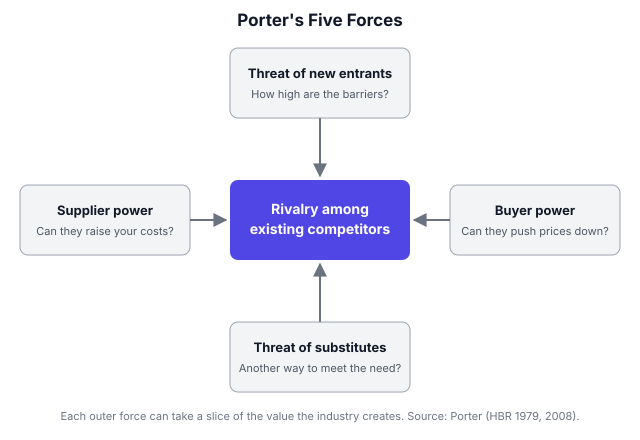
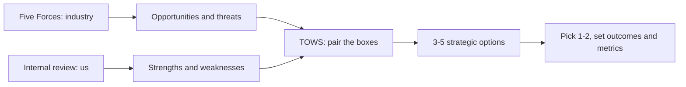
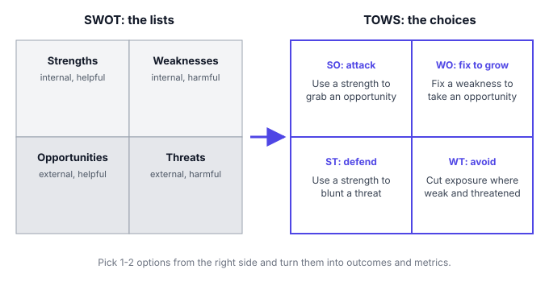

# A3.4 Industry analysis: Porter's Five Forces and SWOT

## In one line

Five Forces tells you how hard it is for *anyone* to make money in an industry; SWOT tells you where *your* company stands in it; used together, they turn market research into a few clear strategic choices.

## Why this matters

You've sized the market ([A3.1](01-market-sizing-tam-sam-som.md)), studied rivals ([A3.2](02-competitive-analysis.md)) and chosen a position ([A3.3](03-positioning.md)). One question is left: **is this a good game to play, and how should we play it?**

PMs face this question more often than they think. It comes up when you pitch a new product line, enter a new segment, set pricing, or explain to leadership why growth costs so much. Industry analysis gives you a structured way to answer. It also stops a common mistake: blaming your product for problems that are really caused by the industry's structure.

## Key terms

| Term | Plain-English meaning |
|---|---|
| **Industry structure** | The basic economics of a market: who has power, how easy it is to enter, what customers could use instead. |
| **Profitability (of an industry)** | How much money the typical company in an industry keeps after costs, over time. |
| **Bargaining power** | How much one side can push prices or terms in its favour. |
| **Barriers to entry** | Things that make it hard for new companies to start competing (scale, brand, licences, network effects). |
| **Substitute** | A different way of meeting the same need, from outside the industry (a paper ledger instead of billing software). |
| **Switching cost** | The money, time or hassle a customer faces when changing to another product. |
| **SWOT** | Strengths, Weaknesses, Opportunities, Threats: a snapshot of one company's position. |
| **TOWS matrix** | A follow-up to SWOT that pairs the four boxes to generate strategies (e.g. use a strength to grab an opportunity). |

## The idea, simply

!!! tip "Analogy: opening a chai stall at a railway station"
    Imagine you want to open a chai stall at Pune railway station. Before you think about your recipe, look around.

    - There are already **eight other stalls** on the platform, all selling at ₹15. (Rivalry)
    - The station gives out **new stall licences** every year. (New entrants)
    - There's **one milk supplier** allowed inside the station. (Supplier power)
    - Passengers can walk to **any stall in ten seconds** and compare. (Buyer power)
    - Many passengers **carry a flask from home**, or buy a cold drink instead. (Substitutes)

    Even the best chai in Pune will struggle to make good money here. That's not about your recipe. It's about the **structure** of this little market.

    Now look at yourself: you have a secret masala recipe (strength), but only one person to run the stall (weakness). A new Vande Bharat train will stop here soon (opportunity). The station may ban single-use cups (threat). That's a **SWOT**.

    Five Forces looks at the **platform**. SWOT looks at **your stall**. You need both.

### 1. Where Five Forces comes from and what it claims

Michael Porter, a Harvard Business School professor, introduced the Five Forces in a 1979 *Harvard Business Review* article, "How Competitive Forces Shape Strategy". He restated and extended it in 2008 in ["The Five Competitive Forces That Shape Strategy"](https://store.hbr.org/product/the-five-competitive-forces-that-shape-strategy/R0801E).

His central claim: **an industry's long-run profitability depends on five forces, not just on the rivals you can see.** Most people think competition means "other companies like us". Porter's point is that customers, suppliers, possible new entrants and substitutes all compete with you for the same money. Each of them can take a slice of the value you create.

Rivalry sits in the middle, but the four outer forces decide how much value even the winner gets to keep.

### 2. The five forces, one by one

| Force | The question | Strong (bad for profits) when… | Example |
|---|---|---|---|
| **Rivalry among existing competitors** | How fiercely do current players fight? | Many similar rivals, slow growth, high fixed costs, products look the same | Quick-commerce discount wars (see the case below) |
| **Threat of new entrants** | How easily can someone new start competing? | Low startup cost, no network effects, no licences, easy distribution | Basic SaaS tools that anyone can build in weeks |
| **Bargaining power of suppliers** | Can suppliers push up your costs? | Few suppliers, no alternatives, switching is costly | AI companies that depend on a small number of chip and cloud providers |
| **Bargaining power of buyers** | Can customers push down your prices? | Few large buyers, price-sensitive customers, easy switching | Large FMCG brands negotiating with packaging suppliers |
| **Threat of substitutes** | Can customers meet the same need another way? | Substitute is cheap and "good enough" | Video calls replacing some business travel; UPI replacing some card payments |

**Why it works:** each force is really about **who captures the value**. If buyers are powerful, they take it through lower prices. If suppliers are powerful, they take it through higher costs. If entry is easy, new rivals compete it away. What's left is the industry's profit.

### 3. Rivalry: not just "how many competitors"

Rivalry is the force most people already think about, but its *intensity* depends on more than the number of rivals.

| Signal | Rivalry gets fiercer when… | What you'd see |
|---|---|---|
| Growth | The market grows slowly | Companies can only grow by stealing share |
| Sameness | Products look alike to customers | Fights move to price and discounts |
| Fixed costs | Costs are mostly fixed (dark stores, data centres, networks) | Companies cut prices to fill capacity |
| Exit barriers | It's hard to leave (sunk assets, long contracts) | Weak players keep fighting instead of quitting |
| Funding | Rivals have deep funding and long time horizons | Losses tolerated for years |

**Price vs non-price rivalry.** Rivalry on price hurts everyone. Rivalry on features, service or speed can *grow* the market if each player serves a different customer well. Porter's advice is to compete on different dimensions, not on the same one.

### 4. New entrants: barriers to entry are the real question

The threat isn't "could someone enter?" Someone always could. The question is **how high the barriers are**.

| Barrier | How it protects | Example |
|---|---|---|
| **Economies of scale** | Big players have lower unit costs | Warehousing and logistics networks |
| **Network effects** | The product gets better as more people use it | Marketplaces, payment networks, social apps |
| **Switching costs** | Customers' data and habits are locked in | Accounting software with years of records |
| **Brand and trust** | Newcomers must earn trust slowly | Insurance, banking, healthcare |
| **Licences and regulation** | Legal permission is needed to operate | Banking licences, telecom spectrum, pharmacy rules |
| **Access to distribution** | Shelf space, app store ranking, reseller networks | FMCG distribution into kirana stores |

**For PMs:** many barriers are *product* choices. Building integrations, storing customer history and creating network effects all raise switching costs and barriers. When you prioritise features, ask: "Does this make us harder to copy or leave?"

### 5. Suppliers and buyers: who has the power to squeeze?

These two forces mirror each other. Your suppliers are trying to charge you more; your customers are trying to pay you less.

**Supplier power is high when:**

- There are few suppliers and many buyers like you.
- What they sell is critical and unique.
- Switching to another supplier is costly (re-engineering, retraining, re-certifying).
- They could enter your business themselves.

**Buyer power is high when:**

- Customers are few and large, or organised (a federation, a government buyer).
- What you sell is a big share of their costs, so they shop hard.
- Your product looks the same as others.
- Switching is easy, or they could build it themselves.

| If you see… | It means… | Product response |
|---|---|---|
| One cloud or model provider is most of your cost | High supplier power | Abstract the layer so you can switch; test alternatives ([B0.3](../../part-b/00-foundations/03-choosing-models-capability-cost-latency-open-vs.md)) |
| A few enterprise clients are 60% of revenue | High buyer power | Diversify customers; deepen integration with each |
| Customers compare you on price in every deal | High buyer power plus sameness | Differentiate on outcomes; reposition ([A3.3](03-positioning.md)) |
| A key partner is building your feature | Supplier may become rival | Own the customer relationship and data |

### 6. Substitutes: the competitor that isn't in your category

A substitute meets the same need in a different way. It's easy to miss because it doesn't look like you. In [A3.2](02-competitive-analysis.md) this showed up as the "status quo" and "substitutes" rings.

- Food delivery's substitute is cooking at home, a tiffin service or the office canteen.
- Ride-hailing's substitutes include the metro, a two-wheeler and working from home.
- Paid language apps compete with free YouTube lessons and, now, general AI chatbots.

**How to judge the threat:** compare the substitute's **price-performance** to yours, and the customer's **cost of switching** to it. When a substitute becomes "good enough" and much cheaper, it can cap your prices for years. Generative AI is currently a substitute for many single-purpose tools: writing aids, translation apps, basic tutoring.

### 7. SWOT: one company's position in that industry

SWOT looks inward and outward from **your** company:

| | Helpful | Harmful |
|---|---|---|
| **Internal** (you control it) | **Strengths** | **Weaknesses** |
| **External** (you don't) | **Opportunities** | **Threats** |

**Where it comes from.** SWOT is often credited to Albert Humphrey at Stanford Research Institute, or to Harvard Business School in the 1960s. A 2024 historical study by Puyt, Lie and Madsen in the [*Journal of Management History*](https://emerald.com/insight/content/doi/10.1108/JMH-05-2023-0047) traces it to the "SOFT approach" developed at Stanford Research Institute in the 1960s. The honest summary: it emerged between about 1960 and 1980, and who exactly invented it is disputed.

**How to do it well:**

- **Strengths and weaknesses must be relative.** "Good engineers" isn't a strength unless they're better than rivals' in a way customers notice.
- **Opportunities and threats come from outside.** Use your Five Forces findings, market trends and regulation (for example PESTLE: political, economic, social, technological, legal and environmental factors).
- **Be specific and evidenced.** "Strong brand" is weak. "NPS 62 vs category average 35, from our Q3 survey" is strong.
- **Keep each box to 3–5 items,** ranked by importance.

### 8. From SWOT to choices: the TOWS matrix

A SWOT on its own is a list. Lists don't make decisions. The **TOWS matrix** turns it into strategy by pairing the boxes:

| | **Opportunities** | **Threats** |
|---|---|---|
| **Strengths** | **SO: attack.** Use a strength to grab an opportunity. | **ST: defend.** Use a strength to blunt a threat. |
| **Weaknesses** | **WO: fix to grow.** Fix a weakness so you can take an opportunity. | **WT: avoid.** Reduce exposure where you're weak and threatened. |

Five Forces feeds the outside half of SWOT. TOWS turns the four lists into options you can actually choose between.

## Framework(s)

### Porter's Five Forces

- **Created by:** Michael E. Porter, Harvard Business School. First published in *Harvard Business Review* in 1979; restated and extended in ["The Five Competitive Forces That Shape Strategy"](https://store.hbr.org/product/the-five-competitive-forces-that-shape-strategy/R0801E) (HBR, January 2008).
- **Steps:**
    1. **Define the industry.** Name the product scope and the geography. "Billing software for independent pharmacies in India" is analysable. "Software" isn't.
    2. **List the players** in each force: rivals, possible entrants, suppliers, buyer groups, substitutes.
    3. **Rate each force** (low, medium, high, or 1–5) with evidence, not gut feel.
    4. **Find the drivers.** For each strong force, write *why* it's strong (e.g. "buyers switch easily because data export is one click").
    5. **Judge overall attractiveness** and how it's changing: which forces are getting stronger or weaker over the next 2–3 years?
    6. **Find your position.** Where can you be shielded from the strongest forces, or reshape them?
- **When to use:** entering a new market or segment, planning a new product line, explaining weak margins, annual strategy reviews, investor or leadership pitches.
- **When not to use:** to pick features for next sprint (too high-level); for a tiny niche where one or two relationships decide everything; or as a one-off box-ticking exercise. It's also weaker for brand-new categories, where industry boundaries aren't clear yet.

### SWOT and TOWS

- **Origin:** SWOT emerged in the US in the 1960s–70s; its exact author is disputed (see [Puyt, Lie and Madsen](https://emerald.com/insight/content/doi/10.1108/JMH-05-2023-0047)). TOWS is a later extension that pairs the boxes into strategies.
- **Steps:**
    1. Take Opportunities and Threats from your Five Forces and trend analysis.
    2. List Strengths and Weaknesses *relative to rivals*, each with evidence.
    3. Rank and trim to 3–5 per box.
    4. Pair them in a TOWS matrix to generate options (SO, ST, WO, WT).
    5. Choose 1–2 options and turn them into outcomes and metrics ([A2.4](../02-problem-discovery/04-outcomes-over-outputs-escaping-the-build-trap.md)).
- **When to use:** at the start of planning, when onboarding to a new product, or to align a leadership team on reality.
- **When not to use:** as a final output. A SWOT without choices is a decoration. Also avoid it when the team has no external evidence yet; do the research first.

## Diagram

SWOT is the left side: four honest lists. TOWS is the right side: each pair of boxes becomes a type of strategy. The value is in the right side.

## Worked example

You're the PM for the pharmacy billing app from [A3.1](01-market-sizing-tam-sam-som.md) and [A3.2](02-competitive-analysis.md). It's a cloud app that helps independent chemists bill, track stock and file GST. Leadership asks: "Should we raise prices, spend more on growth, or build something new?" You run an industry analysis. *All figures are illustrative.*

**Step 1: Define the industry.** Billing and inventory software for independent pharmacies in India.

**Step 2: Your current numbers.**

| Metric | Value |
|---|---|
| Paying pharmacies | 10,000 |
| Price | ₹6,000 a year |
| Gross margin | 80% → ₹4,800 contribution per pharmacy a year |
| Yearly churn | 25% |
| Customer acquisition cost (CAC), mostly reseller commissions | ₹4,500 |
| Lifetime value (LTV) = contribution ÷ churn | ₹4,800 ÷ 0.25 = **₹19,200** |

**Step 3: Rate the five forces, with evidence.**

| Force | Rating (1–5, 5 = bad for profits) | Evidence |
|---|---|---|
| Rivalry | 4 | Dozens of local vendors; most sell similar features; frequent "first year free" offers |
| New entrants | 4 | A basic billing app can be built in a few months; resellers will sell anything with a commission |
| Supplier power | 2 | Cloud, SMS and WhatsApp messaging are available from several vendors |
| Buyer power | 3 | Chemists are many and small, so individually weak, but very price-sensitive and compare offers |
| Substitutes | 4 | Paper ledgers, spreadsheets, and free software some distributors give to their retailers |

**Step 4: What the forces explain.** Three strong forces (rivalry, entry, substitutes) explain your problems better than your product does:

- **Price is stuck** at ₹6,000 because buyers can switch and substitutes are cheap.
- **Churn is high** because switching costs are low: chemists can export a CSV and move.
- **CAC stays high** because resellers have many products to push.

Raising the price alone would likely raise churn. Spending more on acquisition would buy customers who leave just as fast.

**Step 5: SWOT.**

| Strengths | Weaknesses |
|---|---|
| Fastest GST filing flow (median 6 minutes vs about 20 for paper) | 25% yearly churn |
| 10,000 pharmacies' anonymised stock and expiry data | Depend on resellers for 70% of sales |
| Works offline on low-end Android | No integrations with distributors |

| Opportunities | Threats |
|---|---|
| Distributors want digital orders from retailers | Distributors' free software bundles |
| Expiry losses are a big pain for chemists | A funded entrant offering free billing to sell other services |
| Rising GST and compliance burden | Price war in metro cities |

**Step 6: TOWS options.**

| Pair | Option |
|---|---|
| **SO** | Use stock data + distributors' demand for digital orders → build **one-tap reordering from distributors** inside the app |
| **ST** | Use offline speed and GST strength → focus on **Tier-2/3 towns**, where metro price wars matter less |
| **WO** | Fix low switching costs by adding **expiry alerts and returns tracking** that build up valuable history |
| **WT** | Reduce reseller dependence → **referral programme** among chemists, who know each other well |

**Step 7: Pick and size one option.** The SO option (distributor reordering) also does WO's job: once a chemist's orders, stock and distributor links live in your app, leaving costs much more. You estimate it cuts churn from 25% to 15%.

| | Today | With reordering |
|---|---|---|
| Contribution per pharmacy per year | ₹4,800 | ₹4,800 |
| Yearly churn | 25% | 15% |
| **LTV** | **₹19,200** | **₹32,000** |
| LTV ÷ CAC (₹4,500) | 4.3 | 7.1 |

**Step 8: What is it worth?** If you add about 4,000 new pharmacies a year, each new yearly cohort is worth about **₹5.1 crore more** in lifetime contribution (4,000 × ₹12,800). It also weakens three forces at once: higher switching costs (buyers), a barrier against new entrants (integrations take time to copy) and a better answer to distributors' free software (a substitute). And distributors become a channel, not just a threat.

**Step 9: Counter-checks.** Watch distributor concentration (if two distributors account for most orders, they gain power over you), order error rates and chemists' support tickets. Revisit the Five Forces rating in 12 months.

## Going deeper: nuances and trade-offs

### 1. Defining the industry is half the answer

Draw the boundary too wide ("Indian software") and nothing is specific. Draw it too narrow ("pharmacy billing in Pune") and you'll miss the entrant from Mumbai. A good test: **an industry is the set of companies a customer would compare when choosing.** Run the analysis at two levels if unsure, and check whether the answers differ. Geography matters too: a force can be weak nationally but strong in one city where a local player dominates.

### 2. Forces change, sometimes overnight

Five Forces is often taught as a static picture. In reality, a single event can shift a force:

- A new technology lowers entry barriers (cheap AI coding tools make simple SaaS easier to build).
- A regulation adds a barrier (licensing) or removes one.
- A big funding round changes rivalry for years.

So ask two questions for each force: **how strong is it today, and which way is it moving?** The direction often matters more than the level.

### 3. Complements, government and technology: factors, not forces

People sometimes propose a "sixth force" such as complements (products that make yours more valuable, like apps for a phone) or government. In his 2008 article, Porter treats these as **factors that act through the five forces** rather than as separate forces. Government can raise entry barriers through licences or shift buyer power through price caps. Complements can raise switching costs. Whatever label you use, don't ignore them. For platform products, complements (developers, sellers, creators) are often the most important factor of all.

### 4. Platforms and two-sided markets bend the model

In a marketplace like a food-delivery app, the restaurants are both **suppliers** and **customers**: they supply the food and pay the commission. Users are buyers, but they also create network effects that act as an entry barrier. Analyse each side separately and look at how they feed each other. Strong network effects can make an industry attractive even when buyers on each side look powerful.

### 5. Industry vs company: average profits hide the spread

Five Forces explains the *typical* profit in an industry. It doesn't say *your* company can't do well in a tough industry, or badly in an easy one. A company with a strong position (lowest cost, or real differentiation for a specific segment) can earn far more than the average. That's why you need SWOT and positioning as well as the industry view.

### 6. SWOT's common failure modes

SWOT is the most used and most abused strategy tool. The main failures:

| Failure | What it looks like | Fix |
|---|---|---|
| **Wish lists** | "Great culture", "innovative team" as strengths | Demand evidence relative to rivals |
| **Mixing internal and external** | "Strong competition" as a weakness | Weaknesses are yours; competition is a threat |
| **Too long** | 15 items per box | Rank; keep the top 3–5 |
| **No choices** | The SWOT is the final slide | Always follow with TOWS and a decision |
| **Groupthink** | Only the leadership team's view | Add customer interviews, win-loss data ([A3.2](02-competitive-analysis.md)), frontline sales |

### 7. Using these tools as a PM, not a consultant

Consultants run these analyses for a whole company. PMs use them at a smaller scale and more often:

- **Product line level:** "Should we build a lending product inside our payments app?" Five Forces of digital lending looks very different from payments.
- **Pricing:** strong buyer power and substitutes signal that price increases need new value attached ([A10.3](../10-growth-and-go-to-market/03-pricing-and-monetisation.md)).
- **Roadmap:** features that raise switching costs or barriers to entry deserve extra weight in prioritisation ([A5.2](../05-roadmaps-and-prioritisation/02-prioritisation-frameworks-rice-ice-moscow-kano.md)).
- **Strategy docs:** a one-slide Five Forces summary gives leadership the context for why a goal is hard ([A4.2](../04-strategy-and-vision/02-good-strategy-vs-bad-strategy-the-kernel.md)).

### 8. India-specific patterns

- **Fragmented buyers, powerful channels.** Millions of small retailers each have little power, but the distributors, resellers and associations that reach them often have a lot. The quick-commerce case below shows a channel organising to push back.
- **Funding-driven rivalry.** Deep venture funding can sustain price wars for years, making rivalry stronger than the market's growth alone would suggest.
- **Regulation as a force-shifter.** Rules in payments, lending, pharmacy and gaming can create or remove barriers quickly. Track regulators as part of your threat list.
- **"Free" substitutes.** UPI, government platforms and bundled free tools often act as substitutes that cap what users will pay.

## Real-world examples (2023 onwards)

!!! example "Quick commerce and FMCG distributors, October 2024 – April 2025: a channel pushes back"
    In October 2024, the All India Consumer Products Distributors Federation (AICPDF), which says it represents about 400,000 distributors, complained to the Competition Commission of India (CCI) about Blinkit, Swiggy Instamart and Zepto. [Business Standard reported](https://www.business-standard.com/industry/news/retail-distributors-allege-predatory-pricing-by-blinkit-swiggy-zepto-124102200522_1.html) that it alleged deep discounts and below-cost selling, and that the platforms were bypassing traditional distribution by buying directly from manufacturers. In April 2025, [Business Standard reported](https://business-standard.com/industry/news/cci-seeks-evidence-in-complaint-against-quick-commerce-companies-125040700975_1.html) that the CCI had asked the federation for more evidence, including market-share data and proof of exclusive agreements and below-cost pricing. The CCI can order an investigation if it is satisfied. *Status: the reports conflict on whether a formal investigation was opened; the complaint's claims are allegations, not findings.*

    **PM lesson:** this is Five Forces in motion. Quick commerce is a **substitute** for kirana stores and a **new entrant** in FMCG distribution. That threatens distributors, who then use another force (**regulation**, via the CCI) to push back. If you build in a market like this, list the regulators and organised groups who lose when you win. Their response is part of your industry's structure.

!!! example "DeepSeek and Nvidia, January 2025: when one entrant shakes several forces"
    On 27 January 2025, after the Chinese lab DeepSeek released its R1 reasoning model, Nvidia's share price fell 16.9% in one day, wiping out nearly $600 billion of market value ([TechCrunch](https://techcrunch.com/2025/01/27/nvidia-drops-600bn-off-its-market-cap-amid-the-rise-of-deepseek)). The model performed strongly despite using fewer resources and less computing power, which led to speculation that top AI models might not need as many expensive high-end chips.

    **PM lesson:** one credible **new entrant** made investors question the **supplier power** of chip makers and the **entry barriers** of frontier AI labs at the same time. For AI product teams, it was a reminder that model inputs keep getting cheaper and more varied. Design so you can switch models ([B0.3](../../part-b/00-foundations/03-choosing-models-capability-cost-latency-open-vs.md)), and don't build your strategy on any one supplier's advantage lasting.

## Common mistakes

!!! warning "Watch out for"
    - **Treating rivalry as the only force.** The biggest threat is often a substitute or a powerful channel, not a direct competitor.
    - **Defining the industry too broadly.** "E-commerce" or "fintech" can't be analysed usefully. Name the product, the customer and the geography.
    - **Rating forces without evidence.** "Buyer power: high" needs a reason: switching cost, concentration, price sensitivity.
    - **A static snapshot.** Forget the direction of change and you'll miss the force that matters next year.
    - **SWOT strengths that aren't relative.** If every rival has it, it isn't a strength; it's table stakes.
    - **Putting external factors in Strengths/Weaknesses.** Keep internal and external separate.
    - **Stopping at the analysis.** No TOWS, no options, no decision. The work was wasted.
    - **Blaming the product for structural problems.** Low prices in a commoditised market need a strategy change, not just a better UI.

## Common questions

**Is Five Forces still relevant in the age of digital platforms and AI?**
Yes, with adjustments. The core question (who captures the value?) is timeless. But you need to add network effects, multi-sided markets and fast-moving technology to the analysis, and update it more often.

**How is Five Forces different from competitive analysis?**
Competitive analysis ([A3.2](02-competitive-analysis.md)) studies specific rivals and how to beat them. Five Forces studies the whole industry's economics, including players who aren't rivals at all: suppliers, buyers and substitutes.

**Should a PM do a SWOT for a single feature?**
Usually not. SWOT works best at the product or business level. For a feature, use an opportunity solution tree ([A2.1](../02-problem-discovery/01-continuous-discovery-and-opportunity-solution-tr.md)) and assumption tests instead.

**How long should this take?**
A first pass of Five Forces plus SWOT takes a focused afternoon if you already have research. Spend most of the time on evidence for the strongest forces and on TOWS options, not on filling every box.

**What's the difference between SWOT and PESTLE?**
PESTLE scans the wider environment (political, economic, social, technological, legal, environmental). It feeds the Opportunities and Threats boxes of SWOT. SWOT then adds your internal strengths and weaknesses.

## In the interview

!!! question "In the interview"
    **How it shows up:** strategy questions such as "Should company X enter market Y?", "Why is industry Z so unprofitable?" or "Evaluate this acquisition". Five Forces and SWOT give you a quick structure, but interviewers penalise answers that just recite the framework.

    **Sample question:** *"Should a large food-delivery app in India launch its own cloud-kitchen brands?"*

    **Outline of a strong answer:**

    1. **Clarify the goal:** more margin? better quality control? filling gaps in cuisines or areas?
    2. **Five Forces of cloud kitchens, briefly:** low entry barriers and high rivalry (many brands); suppliers fragmented (weak); buyers price-sensitive with easy switching (strong); substitutes everywhere (restaurants, home cooking). Conclusion: a tough industry to make money in.
    3. **The platform-specific twist:** the app's partner restaurants are its suppliers *and* customers. Competing with them could weaken their trust and push them to rival apps.
    4. **SWOT for the app:** strengths: demand data, distribution; weaknesses: no kitchen operations experience; opportunity: gaps in certain cuisines and areas; threat: partner backlash and regulatory scrutiny of self-preferencing.
    5. **Recommendation with conditions:** a narrow pilot in a gap category where no strong partners exist, with clear rules on data use and ranking. Measure margin, order quality and partner sentiment.
    6. **Metrics and kill criteria:** contribution margin per order, repeat rate, partner churn.

    Interviewers listen for: a clear industry definition, evidence for the strongest forces, a company-specific twist, and a decision.

## Research happening now

!!! info "Research happening now"
    - **How competitive is consumer generative AI? (NBER, October 2026).** Egan, Russel, Shi and Yao studied card transactions from 174 million US consumers ([NBER working paper 35953](https://www.nber.org/papers/w35953)). They found about 2.9% of US consumers paid for at least one major generative AI service as of April 2026. Using several services at once was common but declining, and annual retention ranged from 20% to 45% across major providers. Consumers looked highly price-sensitive and more loyal to AI in general than to any one provider. That points to strong buyer power and low switching costs. *Status: working paper, not peer-reviewed.*
    - **OECD on AI market structure (July 2026).** The OECD's policy brief [Artificial Intelligence markets: recent developments and competition issues](https://www.oecd.org/en/publications/artificial-intelligence-markets_d531d73f-en/full-report.html) describes a "mixed picture". Frontier model leadership changes often, but upstream inputs (chips, cloud) are highly concentrated, and bundling and data feedback loops can raise switching costs. *Status: policy analysis; competition authorities are still debating remedies.*
    - **Rewriting SWOT's history (2024–2025).** [Puyt, Lie and Madsen](https://emerald.com/insight/content/doi/10.1108/JMH-05-2023-0047) reconstruct how SWOT emerged from the "SOFT approach" between 1960 and 1980, challenging common origin stories. *Status: peer-reviewed historical study.*

## Try it yourself (30 minutes)

Pick an industry you know as a customer: for example, **online test-prep for government exams in India**, **UPI payment apps** or **EV two-wheelers**.

1. Define the industry in one line (product, customer, geography).
2. Rate each of the five forces 1–5, with one piece of evidence each.
3. Say which force is getting stronger over the next two years, and why.
4. Pick one company in that industry and write a 3×4 SWOT (three items per box).
5. Write one SO and one WT option from a TOWS matrix.

??? success "Check your answer"
    Example: **online test-prep for government exams in India.**

    - **Industry:** paid online courses and test series for central and state government job exams, India.
    - **Forces:** rivalry 5 (many platforms, heavy discounting); new entrants 4 (teachers can launch on YouTube or their own app); supplier power 3 (popular teachers can leave and take students with them); buyer power 4 (price-sensitive students, easy to compare); substitutes 5 (free YouTube lessons, Telegram groups, AI chatbots for doubt-solving).
    - **Getting stronger:** substitutes, as free AI tutors get better at explaining and generating practice questions.
    - **SWOT (one company):** S: large question bank, strong results in one exam; W: depends on a few star teachers; O: regional-language demand; T: free AI tools and teacher exits.
    - **SO:** use the question bank to launch regional-language adaptive tests. **WT:** reduce star-teacher dependence by building a team-taught format and owning the student relationship.

    Self-check: Did every rating have evidence? Did you name at least one substitute *outside* the category? Do your options follow from specific SWOT items rather than generic ambitions?

## How this connects

- [A3.1 Market sizing](01-market-sizing-tam-sam-som.md): sizing tells you how big the market is; Five Forces tells you how much of it anyone can keep.
- [A3.2 Competitive analysis](02-competitive-analysis.md): rivals, substitutes and the status quo in detail; Five Forces adds suppliers, buyers and entry barriers.
- [A3.3 Positioning](03-positioning.md): where you stand against alternatives, which helps you escape the strongest forces.
- [A4.2 Good strategy vs bad strategy](../04-strategy-and-vision/02-good-strategy-vs-bad-strategy-the-kernel.md): industry analysis feeds the "diagnosis" part of a good strategy.
- [A10.3 Pricing and monetisation](../10-growth-and-go-to-market/03-pricing-and-monetisation.md): buyer power and substitutes set the ceiling on your price.

## Go deeper

- **Article:** [Michael E. Porter, "The Five Competitive Forces That Shape Strategy"](https://store.hbr.org/product/the-five-competitive-forces-that-shape-strategy/R0801E) (HBR, 2008). The original author's own restatement, with examples and common mistakes. The single best source on the framework.
- **Paper:** [Puyt, Lie and Madsen, "From SOFT approach to SWOT analysis, a historical reconstruction"](https://emerald.com/insight/content/doi/10.1108/JMH-05-2023-0047) (*Journal of Management History*). Where SWOT really came from, and why that matters for how it's used.
- **Report:** [OECD, Artificial Intelligence markets](https://www.oecd.org/en/publications/artificial-intelligence-markets_d531d73f-en/full-report.html) (2026). A short brief that is effectively a Five Forces view of the AI industry.
- **Paper:** [NBER, Competition in Generative AI: Evidence from Consumer Demand](https://www.nber.org/papers/w35953) (2026). Real data on switching and price sensitivity among AI users.
- **Book:** [*Good Strategy Bad Strategy*](https://penguinrandomhouse.com/books/208668/good-strategy-bad-strategy-by-richard-rumelt/) by Richard Rumelt. How to turn a diagnosis like this into a coherent strategy; covered in [A4.2](../04-strategy-and-vision/02-good-strategy-vs-bad-strategy-the-kernel.md).

## Key takeaways

- **Five Forces looks at the industry; SWOT looks at your company.** Use both.
- Profitability depends on **rivalry, new entrants, supplier power, buyer power and substitutes**: anyone who can take a slice of the value you create.
- **Rate each force with evidence**, and ask which way it's moving, not just how strong it is today.
- Many **barriers to entry and switching costs are product choices**: integrations, history, network effects.
- A SWOT is only useful when **TOWS turns it into options** and you pick one.
- Don't blame the product for **structural problems**; change the strategy instead.
- In India, watch **powerful channels, funding-driven rivalry, regulators and free substitutes**.

## Updates

*No updates yet.*
