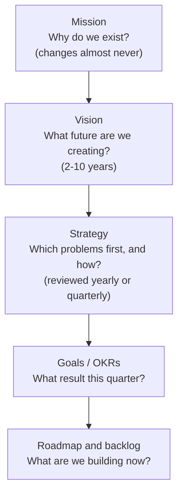
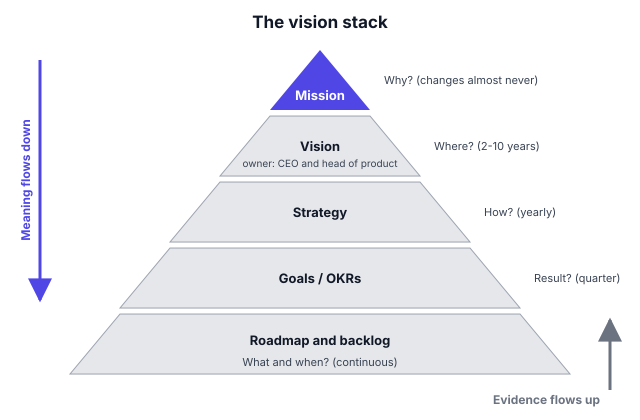

# A4.1 Vision and mission

## In one line

A mission says why you exist, a vision paints the future you are building toward, and a good one makes hundreds of everyday product decisions easier.

## Why this matters

Every week a PM says yes to a few ideas and no to many. Without a shared picture of where the product is going, each of those calls turns into a debate about opinions. A clear vision settles most of them before the meeting starts.

Vision also does jobs you might not expect:

- **Hiring:** strong people join teams that are going somewhere interesting.
- **Alignment:** ten teams can make independent choices that still add up.
- **Strategy:** you can't choose a route until you know the destination ([A4.2](02-good-strategy-vs-bad-strategy-the-kernel.md)).
- **Saying no:** "it doesn't move us toward the vision" is a kinder and clearer no than "I don't like it".

Most PMs won't write the company's mission. But almost every PM will write or use a product vision for their area, and interviewers often ask you to create one on the spot.

## Key terms

| Term | Plain-English meaning |
|---|---|
| **Mission** | Why the company exists: the lasting purpose it serves. It rarely changes. |
| **Vision (company)** | A picture of the future the company wants to create, usually years away. |
| **Product vision** | The future a specific product is trying to create for its customers, typically 2–5 years out for software. |
| **Strategy** | The plan for getting from today to the vision: which problems to tackle first and what to ignore. |
| **Values** | The behaviours a company holds itself to while pursuing its mission. |
| **Product principles** | Beliefs that guide trade-offs inside a product, e.g. "trust beats speed". |
| **BHAG** | "Big Hairy Audacious Goal": a bold, clear goal with a finish line, often 10–30 years away (Collins and Porras). |
| **Visiontype** | A prototype of the vision, often a short video or clickable mock-up, showing what the future could feel like. |
| **Vision narrative** | A written story of a customer's day once the vision is real. |

## The idea, simply

!!! tip "Analogy: the family trip to the new house"
    Your family is moving from Lucknow to a new house in Pune. **Why** you're moving is the mission: "so the family can live together again." **What life will look like** once you're there is the vision: grandparents downstairs, children walking to school, Sunday lunch on the terrace. **How** you'll get there is the strategy: sell the old flat first, move the children after exams, take the train because the car can't carry everything. The **ticket booking and packing list** are the roadmap and the tasks.

    If someone suggests buying a big sofa, the vision helps you decide. Will it fit the terrace lunches you imagined? If not, skip it. Without the picture, every purchase becomes an argument.

Products work the same way. Let's build the idea up step by step.

### 1. The stack: mission, vision, strategy, goals, roadmap

These words get mixed up all the time. The easiest way to keep them apart is to see them as a stack. Each layer answers a different question and changes at a different speed.

Read it top-down for meaning and bottom-up for proof. Every item on the roadmap should trace up to the vision; if it can't, ask why it's there.

| Layer | Question it answers | How often it changes | Who usually owns it |
|---|---|---|---|
| Mission | Why do we exist? | Almost never | Founders, CEO |
| Company vision | What future do we want for the world or our customers? | Rarely; years | CEO and leadership |
| Product vision | What will this product make possible for its users? | Rarely; reviewed yearly | Head of product, with design and engineering |
| Strategy | Which problems do we tackle first, and how will we win? | Yearly, often quarterly | Product leadership |
| Goals (OKRs) | What measurable result this quarter? | Quarterly | Teams ([A4.3](03-okrs-and-goal-setting.md)) |
| Roadmap | What are we working on now, next, later? | Continuously | PMs and teams ([A5.1](../05-roadmaps-and-prioritisation/01-outcome-based-roadmaps-now-next-later.md)) |

A simple memory trick: **mission is the why, vision is the where, strategy is the how, the roadmap is the what and when.**

### 2. Mission: the lasting why

A mission states the purpose a company serves. Good missions share three traits:

- **They outlast any product.** If your mission could be finished by shipping one feature, it's a goal, not a mission.
- **They name who benefits.** Customers, a community, a country.
- **They are short enough to remember.** One sentence, usually.

Here are made-up examples to show the difference between weak and strong:

| Weak mission | Why it's weak | Stronger version |
|---|---|---|
| "To be the No. 1 fintech app in India" | About the company winning, not anyone being helped | "Make saving and investing simple for every first-time earner" |
| "To leverage AI to deliver synergies" | Jargon; says nothing | "Help small clinics spend less time on paperwork and more on patients" |
| "To launch a food app in 10 cities" | A goal with a finish line, not a lasting purpose | "Make good food reachable for everyone, every day" |

Collins and Porras, in their research on long-lasting companies, call this the **core purpose**. They pair it with **core values** to form a company's **core ideology**: the part that should stay fixed while everything else changes ([HBR, "Building Your Company's Vision", 1996](https://www.oreilly.com/library/view/hbrs-10-must/9781422172056/Text/06_Building.html); [Collins's vision framework](https://www.jimcollins.com/pdf/Vision_Framework.pdf)).

### 3. Vision: a picture of the future

A vision describes a specific future state. It is concrete enough that you could tell whether you've arrived.

There are two levels you'll meet:

- **Company vision:** the future the whole company is building toward.
- **Product vision:** the future one product (or product area) will create for its users. Marty Cagan of SVPG describes it as usually **2–5 years out for software** and **5–10 years out for devices** ([SVPG, Product Vision FAQ](https://www.svpg.com/product-vision-faq/)).

Why that horizon? Shorter, and it's just a roadmap. Longer, and no one can picture it, so it stops guiding decisions.

Cagan stresses that a product vision is a **persuasion tool, not a specification**. Its job is to make people *want* to build that future. It does not say exactly how ([SVPG, Vision vs. Strategy](https://www.svpg.com/vision-vs-strategy/)).

Cagan also warns that many so-called product visions are really mission statements. They are slogans about purpose that don't show the customer's future life at all ([SVPG, Product Vision vs. Mission](https://www.svpg.com/product-vision-vs-mission/)). "Empower every farmer" is a mission. "A farmer in Vidarbha photographs a sick leaf, gets a diagnosis in Marathi in 30 seconds and books the right spray from the nearest dealer" is a vision.

### 4. What makes a product vision good

A useful test: a good vision changes what you build. If it fits every idea anyone has ever had, it's too vague to help.

| Trait | What it means | Weak | Strong |
|---|---|---|---|
| **Customer-centred** | Describes the user's life, not your company's size | "Be the leading HR platform" | "A 40-person firm runs payroll, leave and compliance in 10 minutes a month" |
| **Specific** | Concrete enough to rule ideas out | "Delight users with seamless experiences" | "A first-time investor understands every rupee of fees before tapping buy" |
| **Ambitious but credible** | Hard to reach, but the team believes it's possible | "Slightly faster checkout" | "Every order from a kirana arrives within 20 minutes, in any town over 1 lakh people" |
| **Stable** | Survives a bad quarter and a new competitor | Changes every planning cycle | Unchanged for years; strategy shifts beneath it |
| **Inspiring** | People want to work on it and can retell it | A 3-page bullet list | A one-line statement plus a short story or visiontype |

**The quick test:** show the vision to three team members separately and ask, "Who is our user, and what will be different in their life in three years?" If you get three different answers, the vision isn't doing its job yet.

### 5. Formats: from one line to a visiontype

Visions come in several forms, from cheap to expensive. Most teams combine two.

| Format | What it is | Best for |
|---|---|---|
| **Vision statement** | One or two sentences | Repeating in every review; putting on slides |
| **Vision narrative** | A one-page story of a customer's day in the future | Making it concrete; onboarding new hires |
| **Storyboard** | 6–12 sketched frames of a user journey | Workshops; showing emotion and context |
| **Visiontype** | A prototype or video of the future product | Persuading leaders and recruits; Cagan calls it "a prototype of a product vision" ([SVPG](https://www.svpg.com/the-power-of-visiontypes/)) |
| **Press release and FAQ (PR/FAQ)** | An imagined launch announcement written before you build | Testing whether the future is worth building; Amazon's "working backwards" habit ([Colin Bryar's guide](https://coda.io/@colin-bryar/working-backwards-how-write-an-amazon-pr-faq)) |

Today, AI prototyping tools make visiontypes much cheaper. A PM and a designer can mock up a clickable future in a day. That's useful, but be careful: a polished visiontype can look more certain than it is. Label it clearly as a picture of intent, not a promise.

### 6. Product principles: tie-breakers on the way

A vision says where you're going. **Product principles** say what you won't trade away on the journey. Cagan notes that a vision is usually created together with a set of principles ([SVPG](https://www.svpg.com/vision-vs-strategy/)).

Good principles are **choices between two good things**. "We value quality" is not a principle, because no one argues for poor quality. These are principles:

| Principle | What it rules out |
|---|---|
| "Trust beats conversion." | Dark patterns, hidden charges, pre-ticked boxes |
| "Works on a ₹8,000 phone on 3G." | Heavy animations and huge app downloads |
| "The merchant's time is more precious than ours." | Features that add steps for the merchant to save us work |
| "Explain every number we show." | Scores or prices without a "why?" |

When two teams disagree, a principle often settles the matter in minutes.

### 7. How a vision gets used day to day

A vision that lives only in a slide deck does nothing. Here is how strong teams actually use it:

- **Evaluating ideas.** Each new idea gets one question first: "Does this move a user closer to the future we described?"
- **Writing strategy.** Strategy picks which part of the vision to tackle first ([A4.2](02-good-strategy-vs-bad-strategy-the-kernel.md)).
- **Setting goals.** Quarterly OKRs should be steps toward the vision ([A4.3](03-okrs-and-goal-setting.md)).
- **Onboarding.** New joiners read the narrative in week one.
- **Recruiting.** Candidates join a story, not a backlog.
- **Saying no.** "Good idea, but it pulls us away from the vision" keeps relationships intact ([A5.3](../05-roadmaps-and-prioritisation/03-managing-the-backlog-and-saying-no.md)).

!!! example "A small illustration"
    Two ideas reach a payments app's PM in the same week: a cashback game, and a feature that shows a merchant's settlement time before the user pays. The vision says: "Every small merchant knows exactly when their money will arrive." The game might lift opens for a month. The settlement feature moves users toward the vision. The decision takes five minutes instead of five meetings.

## Frameworks

### Framework 1: Collins and Porras's vision framework (1996)

Jim Collins and Jerry Porras studied companies that stayed great for decades, first in *Built to Last* (1994) and then in the 1996 HBR article ["Building Your Company's Vision"](https://www.oreilly.com/library/view/hbrs-10-must/9781422172056/Text/06_Building.html). Their key idea is to **"preserve the core, stimulate progress."** A vision has two parts:

1. **Core ideology** (what never changes):
    - **Core values:** a few lasting beliefs about how you behave.
    - **Core purpose:** why you exist (the mission).
2. **Envisioned future** (what you're going for):
    - **A BHAG:** a big, clear goal with a finish line. Collins describes it as a "unifying focal point of effort" ([jimcollins.com](https://jimcollins.com/article_topics/articles/BHAG.html)). His classic example is the 1961 US goal to land a person on the moon before the decade was out.
    - **A vivid description:** a lively picture of what achieving the BHAG would look and feel like.

**When to use:** company-level or business-unit vision; founders writing their first vision; resetting after a big change.
**When not to:** a single feature team. BHAGs at that level turn into slogans no one owns.

### Framework 2: Cagan's product vision (SVPG)

Marty Cagan's approach, set out in *Inspired* and *Empowered* and on the [SVPG blog](https://www.svpg.com/product-vision-faq/), is built for product organisations.

1. **Owner:** the head of product writes it. It is an explicit part of that job, though the CEO and leaders must feel ownership too.
2. **Scope:** one vision per business unit or product, not one per team. Teams share it, like a North Star. For a marketplace, use one vision covering both sides rather than one for buyers and one for sellers.
3. **Horizon:** 2–5 years for software, 5–10 for devices.
4. **Process:** a 1–2 day offsite with about 5–15 people from product, design, engineering and leadership; then a designer turns the result into a visiontype.
5. **Pair it with principles:** the values that guide trade-offs.
6. **Keep it stable:** strategy changes at least yearly, often quarterly. The vision "doesn't usually change much at all."
7. **Evangelise it:** repeat it in every planning cycle, review and onboarding.

**When to use:** product organisations with several teams that need to pull in one direction.
**When not to:** a very early startup still searching for product-market fit ([A4.4](04-product-market-fit.md)). There, a lightweight hypothesis ("we believe X people need Y") beats a polished visiontype.

### Framework 3: Roman Pichler's Product Vision Board

Roman Pichler first described the [Product Vision Board](https://www.romanpichler.com/blog/the-product-vision-board/) on his blog in 2011 and has updated it since. It is a one-page canvas. It joins the vision to the first layer of strategy. Its five boxes are:

1. **Vision:** the ultimate reason for building the product.
2. **Target group:** who the users and customers are.
3. **Needs:** the main problem or benefit for them.
4. **Product:** the three to five features that make it stand out.
5. **Business goals:** what the company gets (revenue, cost saving, brand, learning).

**When to use:** a single product or feature area; workshops with stakeholders; checking that the vision, users and business goals actually line up.
**When not to:** as a replacement for real strategy. Pichler's board deliberately includes strategy elements, so it is a starting sketch, not a full plan. Use [A4.2](02-good-strategy-vs-bad-strategy-the-kernel.md) for that.

## Diagram

Meaning flows down the stack; evidence flows back up. When the evidence keeps contradicting a layer, that layer, not the roadmap, is what needs rethinking.

## Worked example

You've just joined as the first PM of **TutorKit**, a made-up app for neighbourhood tuition teachers in tier-2 and tier-3 towns. About 18,000 teachers use it each month. You have 8 engineers, so roughly **96 engineer-weeks** of capacity per quarter (8 × 12). The founder says: "We have too many ideas and everyone wants something different. Can you sort out our vision?"

**Step 1: Check the mission.** The founder's pitch deck says: "To be India's largest edtech platform." That's about the company, not the teacher. After two conversations, you agree on: **"Help every neighbourhood teacher run a thriving class."** It names who benefits and will outlast any feature.

**Step 2: Get clear on the user.** From 15 teacher interviews ([A1.2](../01-understanding-users-user-sense/02-user-research-methods-and-interviews.md)), the typical user teaches 20–80 school students from home. They track attendance in a notebook, chase fees on WhatsApp, and can't easily tell how much they earned this month.

**Step 3: Draft the vision statement (3-year horizon).**

> A tuition teacher in Nashik spends Sunday evening preparing lessons, not chasing fees. Parents pay on time after gentle reminders, every parent gets attendance and progress without asking, and the teacher knows exactly what they earned this month.

**Step 4: Add three product principles.**

1. **Works on a basic Android phone.** Most teachers use one.
2. **Parents never need to install anything.** They get updates by WhatsApp or SMS.
3. **The teacher never types the same thing twice.**

**Step 5: Score the backlog against the vision.** You list the ten biggest ideas and rate each for vision fit: 2 = clearly moves teachers toward the vision, 1 = partly, 0 = doesn't.

| Idea | Effort (engineer-weeks) | Vision fit | Was in last quarter's plan? |
|---|---|---|---|
| UPI fee reminders with automatic matching | 14 | 2 | Yes |
| Parent progress cards over WhatsApp | 10 | 2 | Yes |
| One-tap attendance | 8 | 2 | Yes |
| Monthly earnings summary | 6 | 2 | Yes |
| Hindi and Marathi interface | 8 | 2 | No |
| AI question-paper generator | 12 | 1 | No |
| Social feed for teachers | 16 | 0 | Yes |
| National course marketplace for students | 20 | 0 | Yes |
| Admin panel for big coaching chains | 14 | 0 | Yes |
| Badges and streaks for teachers | 6 | 0 | Yes |

**Step 6: See what the old plan was really doing.** Last quarter's plan used 94 of the 96 engineer-weeks. Of those, 56 weeks (16 + 20 + 14 + 6), about **60%**, went to ideas that don't move teachers toward the vision. The marketplace serves students nationally, and the admin panel serves a different customer (big coaching chains). Both may be fine businesses, but they belong to a different vision.

**Step 7: Rebuild the plan.**

| Bucket | Engineer-weeks |
|---|---|
| All five fit-2 ideas | 46 |
| Small discovery test of the AI question-paper idea (to learn if it saves teachers time) | 4 |
| Reliability and tech debt | 20 |
| Buffer for bugs and surprises | 16 |
| **Total** | **86 of 96** |

**Step 8: Estimate what it's worth.** Two numbers make the case to the founder.

- **Money redirected.** If an engineer-week costs about ₹50,000 fully loaded (salary, laptop, office), 56 off-vision weeks are about **₹28 lakh per quarter** now spent on the core job.
- **Value to teachers.** Suppose fee reminders lift on-time fee collection from 70% to 80% (a guess you'll test). A teacher with 40 students at ₹800 a month collects ₹32,000 if everyone pays. Ten points of on-time collection is **₹3,200 a month** reaching them without chasing. That is a strong reason to keep using TutorKit.

**Step 9: Check that it stuck.** Before the work, you asked 10 team members separately, "Who is our user, and what will be different for them in three years?" Only 3 gave a similar answer. Six weeks after sharing the vision, a one-page narrative and a clickable visiontype, 8 of 10 do. That's your evidence the vision is working as a shared picture.

**What could go wrong?** The founder may love the marketplace. Don't fight it as "off-vision, so bad". Say clearly: "That's a different product for a different user. If we want it, it needs its own vision, team and strategy, not a share of this one."

## Going deeper: nuances and trade-offs

### 1. The words matter less than the layers

Companies use "mission", "vision" and "purpose" in different, sometimes opposite, ways. Some call their purpose a vision; some put the future picture in the mission. Don't waste a meeting on vocabulary. Ask the three underlying questions instead:

- Why do we exist? (purpose)
- What future are we creating, and for whom? (vision)
- What are we doing first, and why? (strategy)

If your company has answers to all three, it doesn't matter what each is called. If one is missing, that's the gap to fill.

### 2. How stable should a vision be, and when should you change it?

Cagan's view is that the vision rarely changes, while strategy shifts at least yearly. Collins and Porras go further: keep the core purpose fixed and let everything else move.

But visions do sometimes need to change. Good reasons include:

- **A technology shift** that makes a better future possible (or makes yours obsolete).
- **Strong user evidence** that the future you pictured isn't one people want.
- **A change in what the company is,** for example after a big acquisition.

Bad reasons include a new leader wanting their own slogan, a single bad quarter, or a competitor's launch. When you do change a vision, say what changed and why. Otherwise people assume the new one will also be gone next year.

### 3. One vision, many teams

A product vision usually sits at the level of a business unit or product line. Individual teams don't need their own grand vision. They need a **team purpose** (sometimes called a charter, see [A0.2](../00-the-pm-role/02-product-teams-the-trio-empowered-vs-feature-team.md)) that explains which part of the shared vision they serve.

Two traps:

- **Vision sprawl.** Twelve teams each write a vision, and they quietly contradict each other.
- **Split marketplaces.** A delivery app writes one vision for customers and another for restaurants. Then the customer team pushes for cheaper delivery while the restaurant team pushes for higher payouts. Cagan recommends one vision for the whole marketplace that shows both sides winning ([SVPG FAQ](https://www.svpg.com/product-vision-faq/)).

### 4. How it changes by stage and business type

| Context | What the vision should look like |
|---|---|
| **Pre-product-market-fit startup** | A short, testable belief about a user and a future, revised as you learn. Don't spend weeks on a visiontype. |
| **Scale-up** | A written vision and principles become essential: new hires outnumber old ones and can't absorb the founder's thinking over lunch. |
| **Large company** | Several product visions under one company mission. The hard part is making them fit together, not writing them. |
| **B2B** | The vision must show both the **buyer** (who pays, e.g. a CFO) and the **user** (who works in the product daily). A vision that only delights users won't get renewed. |
| **Platforms and internal tools** | The "customer" is often other teams. The vision describes what they can build faster or more safely. |

**India-specific nuances.** Many Indian products serve first-time internet users, vernacular speakers, budget phones and patchy networks. A vision written by a team in Bengaluru for "users like us" quietly excludes most of the country. Put the real user, their language and their device in the vision itself.

### 5. Vision theatre: when the words and the work don't match

Many companies have beautiful vision statements that no one uses. Signs of vision theatre:

- Roadmap reviews never mention the vision.
- The "vision" is a list of features for next year.
- Every idea, however unrelated, gets described as "aligned with our vision".
- Values are posted on walls but ignored in hiring and promotion.

The fix is to make the vision **cost something.** At least once a quarter, the team should drop or delay a reasonable idea because it doesn't fit. If that never happens, the vision isn't really steering.

### 6. Visions in the AI era

AI changes product visions in two ways.

**First, technology is not a vision.** "Become an AI-first company" says what tool you'll use, not what future you'll create for users. Ask "AI-first *for whom*, to make *what* different in their lives?" The answer is the vision ([B2.1](../../part-b/02-discovery-and-design/01-finding-ai-opportunities-and-when-not-to-use-ai.md)).

**Second, capabilities move fast.** A vision that needs today's models to be perfect may be fragile. One that gets more achievable as models improve (cheaper, faster, more accurate) gets a tailwind every year. Write the vision around the user's outcome and leave the "how" flexible. AI strategy and moats are covered in [B5.2](../../part-b/05-strategy-and-business/02-ai-native-strategy-and-moats.md).

### 7. Bold visions need ethical guardrails

A big, audacious vision can justify cutting corners: "we're changing the world, so a bit of data collection is fine." This is one reason values and product principles matter. They set limits the vision can't override. When a vision and a principle conflict, the principle should usually win, and that conflict is worth raising with leadership openly.

### 8. Making a vision stick

People need to hear something many times before they remember and use it. Practical habits:

- **Open every planning cycle** with the vision and one customer story.
- **Ask "how does this move us toward the vision?"** in every PRD template ([A7.1](../07-execution-and-delivery/01-prds-and-specs.md)).
- **Show progress:** which parts of the future already exist, which are next.
- **Measure understanding:** repeat the "three people, same answer?" test twice a year.

## Real-world examples (2023 onwards)

!!! example "Zomato becomes Eternal, February 2025: a name to match a bigger vision"
    On 6 February 2025, founder Deepinder Goyal wrote to shareholders that the listed company, Zomato Ltd, would be renamed **Eternal Ltd** ([Eternal shareholder letter](https://eternal.com/letter)). The consumer app stayed "Zomato". He said the company now had four major businesses: **Zomato, Blinkit, District and Hyperpure**. He had wanted a name for the parent company that was bigger than food delivery, and wrote that after Blinkit "I feel we are there". He described the new name as a mission statement, and admitted that it scared him.

    **PM lesson:** when what a company *is* changes, the vision and its words need to change too, while customer-facing products can keep their own names and visions. Notice the split: one parent purpose, several product visions underneath. PMs at Blinkit or District each need a product vision that fits the parent's purpose, not a copy of Zomato's.

!!! example "Meta, July 2025 to January 2026: a new vision and a shift in resources"
    On 30 July 2025, Mark Zuckerberg published a letter setting out Meta's vision to bring **"personal superintelligence to everyone"**: AI that helps people pursue what they value in their own lives ([Meta newsroom](https://about.fb.com/news/2025/07/personal-superintelligence/)). In January 2026, reports said Meta was preparing to cut about **1,500 jobs, roughly 10%** of its Reality Labs division, which had been building toward the metaverse. Funding was to shift toward AI wearables such as smart glasses ([eWeek, 13 January 2026](https://www.eweek.com/news/meta-cuts-reality-labs-jobs/)). eWeek reported Reality Labs had lost over $70 billion since 2021.

    **PM lesson:** a vision is real only when it moves money and people. Meta's new vision was followed by visible choices about where *not* to invest. Also notice the cost of a vision that gets ahead of what users want: years of heavy spending before the change of course. Whether the new vision will work is still unknown, and reasonable people disagree.

## Common mistakes

!!! warning "Watch out for"
    - **Writing a vision about the company, not the customer** ("be No. 1 in X").
    - **A feature list dressed as a vision.** Features belong in the roadmap.
    - **So vague it fits everything.** If no idea is ever rejected because of it, it isn't working.
    - **Changing it every planning cycle.** People stop trusting it.
    - **One vision per team,** which then contradict each other.
    - **Never repeating it.** A vision said once at an offsite is forgotten in a month.
    - **Treating the vision as a strategy.** "Where" without "how" leaves teams guessing.
    - **Naming a technology as the vision** ("AI-first") instead of the future it creates.

## Common questions

**Is the vision the same as the North Star metric?**
No. The vision is a picture of the future in words; the North Star metric is one number that tracks whether users are getting value on the way there ([A8.2](../08-product-metrics/02-north-star-metric-and-metric-trees.md)). A good North Star should move when you get closer to the vision.

**I'm a PM on a small feature team. Do I need a vision?**
You need to know the product vision and be able to explain how your team's work serves it. A short team purpose is enough; you don't need a separate grand vision.

**Who should write the product vision?**
Usually the head of product, working closely with design and engineering leaders and agreed with the CEO. A vision written by one person alone rarely gets adopted.

**How long should a vision statement be?**
One or two sentences for the statement, plus a one-page narrative or a visiontype if you want people to really picture it.

**What if leadership's vision is unclear or missing?**
Write a draft for your area, label it a draft, and ask leaders to react. People find it much easier to edit a draft than to write from a blank page.

**Can a vision be too ambitious?**
Yes, if the team doesn't believe it's possible. Then it becomes a joke rather than a motivator. Ambitious but credible is the target.

## In the interview

!!! question "In the interview"
    **How it's tested:** vision shows up in product strategy questions ("Where should X be in five years?"), in "Tell me about a product you love" (interviewers like hearing what you think the vision is), and in leadership-level interviews ("How have you set a vision for your team?").

    **Sample question:** *"What would your vision be for Google Maps in India five years from now?"*

    **Outline of a strong answer:**

    1. **Clarify the mission** you'll assume: helping people get around and discover places.
    2. **Pick the users** you'll focus on and say why: for example, two-wheeler riders and first-time users in smaller towns.
    3. **Describe their life in five years** as a short story: a rider in Indore hears turn-by-turn directions in Hindi, routed around waterlogged roads during the monsoon, and finds a nearby open pharmacy at night.
    4. **Name 2–3 principles:** works offline, local language by default, trustworthy local information.
    5. **Bridge to strategy:** which part you'd tackle first and why (e.g. local-language voice navigation first, because it reaches the most new users).
    6. **Say how you'd know you're on track:** a North Star such as weekly navigated trips by users outside the top 10 cities, and a guardrail such as wrong-route reports.

    Interviewers listen for a customer-centred future (not a feature list), a clear user focus, ambition that's still credible, and a link to strategy and metrics.

## Research happening now

!!! info "Research happening now"
    - **Product teams want strategy time but don't get it (Atlassian, September 2025).** Atlassian's [State of Product 2026](https://www.atlassian.com/blog/company-news/state-of-product-2026) surveyed 1,000+ product professionals in the US and Europe. It reports that 84% worry their products won't succeed in the market, and that nearly half lack time for strategic planning. *Status: industry survey by a tool vendor, not peer-reviewed.*
    - **Deciding what to build matters more than ever (Atlassian, 2026).** The follow-up [State of Product 2027](https://www.atlassian.com/software/jira/product-discovery/resources/state-of-product-2027) surveyed 1,000 product professionals. Its headline finding: 86% agree that deciding what to build matters more than ever, and "shipping more isn't creating more value". *Status: vendor survey; full method behind a download.*
    - **What organisational purpose actually does (Review of Managerial Science, 2026).** Van Ingen, Peters and Robben interviewed 44 people and proposed that purpose serves five functions: a lens, a scale, a compass, a mirror and glue ([paper](https://link.springer.com/10.1007/s11846-026-00970-w)). *Status: peer-reviewed, qualitative theory-building study; it does not show cause and effect.*

## Try it yourself (25 minutes)

Pick a product you use every week (a UPI app, a grocery app, a learning app). Write:

1. A one-sentence **mission** you think it serves.
2. A **3-year product vision** in 2–3 sentences, describing a specific user's life.
3. Three **product principles**, each a real trade-off.
4. Two ideas the vision would make you **say no to**.

??? success "Check your answer"
    Use this checklist:

    - [ ] Your mission names who benefits and could last 10+ years.
    - [ ] Your vision describes a specific user (where they live, what they do) and what's different for them, not what the company achieves.
    - [ ] Someone could tell whether the vision has come true.
    - [ ] Each principle rules something out; nobody would argue for its opposite being "bad" (e.g. "trust beats conversion", not "we value quality").
    - [ ] Your two "no" ideas are reasonable ideas, not straw men. If you couldn't find any, your vision is probably too vague.
    - [ ] You didn't name a technology ("AI", "blockchain") as the vision itself.

## How this connects

- [A4.2 Good strategy vs bad strategy](02-good-strategy-vs-bad-strategy-the-kernel.md): strategy is the route from today to the vision.
- [A4.3 OKRs and goal setting](03-okrs-and-goal-setting.md): quarterly goals are measurable steps toward the vision.
- [A8.2 North Star metric and metric trees](../08-product-metrics/02-north-star-metric-and-metric-trees.md): one number that tracks progress toward the future the vision describes.
- [A5.1 Outcome-based roadmaps](../05-roadmaps-and-prioritisation/01-outcome-based-roadmaps-now-next-later.md): the roadmap shows the next steps toward the vision.
- [A0.2 Product teams](../00-the-pm-role/02-product-teams-the-trio-empowered-vs-feature-team.md): empowered teams need a shared vision to make good independent decisions.

## Go deeper

- **Book:** [*Inspired*](https://svpg.com/books/product-is-hard-svpg-box-set) and [*Empowered*](https://www.oreilly.com/library/view/empowered/9781119691297/) by Marty Cagan. The product vision, principles and how they connect to strategy and empowered teams.
- **Article:** [SVPG, Product Vision FAQ](https://www.svpg.com/product-vision-faq/). Cagan's short answers on horizon, ownership and how often to change a vision.
- **Article:** [SVPG, The Power of Visiontypes](https://www.svpg.com/the-power-of-visiontypes/) (2024). Why a prototype of the vision persuades better than a document.
- **Article:** ["Building Your Company's Vision"](https://www.oreilly.com/library/view/hbrs-10-must/9781422172056/Text/06_Building.html) by Jim Collins and Jerry Porras (HBR, 1996). The core ideology plus envisioned future model.
- **Article:** [Jim Collins on BHAGs](https://jimcollins.com/article_topics/articles/BHAG.html). What makes a big goal unifying, with examples.
- **Tool:** [Roman Pichler's Product Vision Board](https://www.romanpichler.com/blog/the-product-vision-board/). A free one-page canvas for vision, users, needs, product and business goals.
- **Guide:** [How to write an Amazon PR/FAQ](https://coda.io/@colin-bryar/working-backwards-how-write-an-amazon-pr-faq) by Colin Bryar, co-author of *Working Backwards*. Writing the future launch announcement before you build.
- **Podcast:** [Mind the Product: Marty Cagan on product vision and strategy](https://mindtheproduct.com/product-vision-and-strategy-marty-cagan-on-the-product-experience-part-1-of-2). An episode of *The Product Experience* on vision and strategy, part 1 of 2.

## Key takeaways

- **Mission is the why, vision is the where, strategy is the how,** and the roadmap is the what and when.
- A product vision describes **a specific user's future**, typically 2–5 years out for software, not the company's ambitions.
- A good vision is **specific enough to say no** to reasonable ideas. If it never rules anything out, it isn't working.
- Pair the vision with **product principles**: real trade-offs that settle arguments quickly.
- Keep the vision **stable**, change strategy beneath it, and explain clearly when the vision itself must change.
- Use formats people remember: **a one-line statement plus a narrative or visiontype**, repeated often.
- A vision is real only when it **moves people and money**, as both the Eternal and Meta cases show.

## Updates

*No updates yet.*
