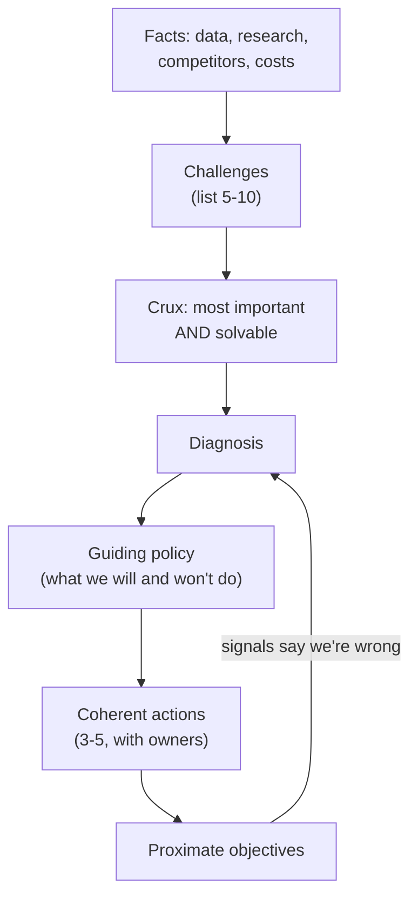
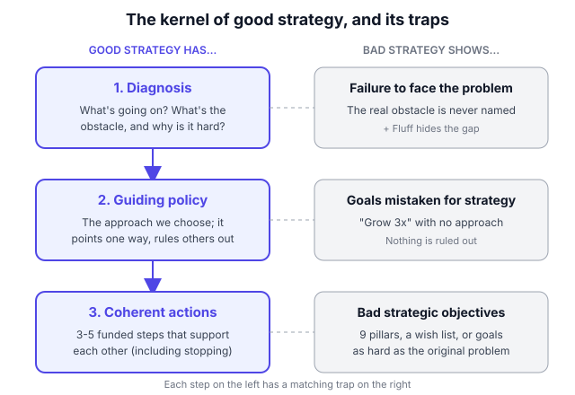

# A4.2 Good strategy vs bad strategy: the kernel

## In one line

A good strategy names the real problem, picks one way to beat it, and lines up a few actions that support each other; most "strategies" skip the first two and just list goals.

## Why this matters

PMs are asked for a "product strategy" all the time: in planning season, in a leadership review, when a competitor launches. Most strategy documents are lists of goals and initiatives that sound fine but don't help anyone decide anything. Richard Rumelt's kernel gives you a simple, testable shape for strategy, so your team knows what to do, and what to stop doing, when things get hard.

## Key terms

| Term | Plain-English meaning |
|---|---|
| **Strategy** | A coherent response to an important challenge: how you'll get past the obstacle in front of you. |
| **Kernel** | Rumelt's name for the three parts every good strategy has: diagnosis, guiding policy, coherent actions. |
| **Diagnosis** | A clear explanation of what's going on: the challenge and why it's hard. |
| **Guiding policy** | The overall approach you choose to deal with the challenge. It rules some options in and others out. |
| **Coherent actions** | Specific steps, money and people committed in ways that support each other and the guiding policy. |
| **Fluff** | Impressive-sounding words that say nothing ("synergistic customer-centric transformation"). |
| **Proximate objective** | A near-term target clear and close enough that the team can actually achieve it. |
| **Crux** | From Rumelt's later book: the part of the challenge that matters most *and* that you can actually solve. |

## The idea, simply

!!! tip "Analogy: chasing 180 on a slow pitch"
    You're captaining a T20 side chasing 180. A bad captain's "strategy" is: "Score 180. Play with intent. Give 100%." Those are goals and slogans. Nobody in the dressing room knows what to do differently.

    A good captain says: "The pitch is slow and their two spinners are the best in the league. Our openers struggle against spin (**diagnosis**). So we'll go hard against their fast bowlers in the powerplay and treat the spinners' eight overs as a time to rotate strike, not hit sixes (**guiding policy**). Our two left-handers bat at 3 and 4 because the spinners turn the ball into right-handers. Our target is 65 after six overs and fewer than 12 dot balls against spin (**coherent actions**)."

    Every player now knows what to do on every ball. That's the difference between a goal and a strategy.

### 1. What strategy is, and what it isn't

Rumelt's *Good Strategy Bad Strategy* ([publisher's page](https://penguinrandomhouse.com/books/208668/good-strategy-bad-strategy-by-richard-rumelt/), 2011) starts from a simple idea: **strategy is a response to a challenge.** If you can't say what obstacle you're trying to overcome, you don't have a strategy yet.

Things that are often called strategy but aren't:

| Often called strategy | What it really is | Why it isn't enough |
|---|---|---|
| "Grow revenue 3x by 2028" | A goal | It says where you want to be, not how you'll get past what's stopping you |
| "Be the most customer-centric platform" | A vision or slogan | It doesn't rule anything out |
| "Our 14 strategic initiatives" | A to-do list | Nothing explains why these 14, or how they fit |
| "Our values: speed, trust, ownership" | Culture | Useful, but not a plan |
| "Annual budget and headcount plan" | Resource plan | It allocates money without saying what problem the money solves |

A vision and mission ([A4.1](01-vision-and-mission.md)) tell you *where* you're heading and *why*. Strategy tells you *how you'll deal with what's in the way*.

### 2. The kernel, part 1: diagnosis

Rumelt describes the diagnosis as an explanation of the nature of the challenge ([McKinsey Quarterly, 2011](https://www.mckinsey.com/capabilities/strategy-and-corporate-finance/our-insights/the-perils-of-bad-strategy)). A good diagnosis does three jobs:

- **It simplifies.** Real situations are messy. The diagnosis picks the few facts that matter most.
- **It names the obstacle.** Not "the market is tough", but *what specifically* is hard.
- **It suggests where to act.** A good diagnosis already hints at the approach.

| Vague diagnosis | Sharp diagnosis |
|---|---|
| "Competition is intense." | "Two rivals now deliver in 10 minutes in our top 3 cities; our users there have started splitting orders between apps." |
| "Users aren't engaged." | "Users who don't connect their bank account in week 1 almost never return, and 70% skip that step because the screen asks for net-banking passwords." |
| "We need to grow faster." | "We win most trials we run, but only 1 in 20 small businesses ever hears of us, because we sell only through our website." |

A useful test: **would a smart outsider learn something new from your diagnosis?** If it says what everyone already says, keep digging.

### 3. The kernel, part 2: guiding policy

The guiding policy is the overall approach you choose to deal with the obstacles. It's not yet a list of actions. It is a direction that narrows choices.

Think of it as a **signpost plus a fence**: it points one way, and it rules out others.

| Diagnosis | Guiding policy | What it rules out |
|---|---|---|
| Rivals deliver in 10 minutes in metros; we can't match their dark-store density | Compete on planned monthly baskets, not speed | Building our own 10-minute network |
| Users who don't link a bank in week 1 rarely return | Make bank-linking the core of onboarding, and make it feel safe | Adding more features to the home screen first |
| Small businesses never hear of us | Sell through accountants who already advise them | Spending more on search ads |

A guiding policy works because it creates **advantage by focus**. You put your effort where it counts most, instead of spreading it thin across everything.

### 4. The kernel, part 3: coherent actions

Coherent actions are the steps, money and people that carry out the guiding policy. Rumelt stresses that they must be **coordinated with one another**. Two things matter:

- **Commitment:** real resources move. If nothing gets funded or stopped, there's no strategy.
- **Coherence:** actions support each other, so the whole is stronger than the parts.

| Incoherent actions | Coherent actions |
|---|---|
| Growth team pushes discounts for first orders; finance cuts delivery subsidy; ops expands to 4 new cities | All three teams focus on monthly-basket buyers in the 3 densest cities |
| Marketing promotes "AI features"; product spends the quarter on reliability; sales sells the old version | One quarter on reliability; marketing says "now 99.9% uptime"; sales targets customers who left over outages |
| Each squad picks its own top priority | Each squad's quarterly goal is a different input to the same diagnosed problem |

Notice that coherent actions often include **stopping things**. Ending a project frees people and money for the policy.

### 5. The four hallmarks of bad strategy

Rumelt names four signs of bad strategy. Bad strategy isn't just the absence of strategy. It's an active mistake that wastes effort.

| Hallmark | What it looks like | Product example |
|---|---|---|
| **Fluff** | Grand words that hide the absence of thought | "We will leverage AI-driven synergies to deliver omnichannel delight." |
| **Failure to face the problem** | The plan never names the real challenge | A strategy deck for a payments app that never mentions that 40% of payments fail on one bank |
| **Mistaking goals for strategy** | Targets with no plan for reaching them | "20% growth and 20% margin" as the whole strategy |
| **Bad strategic objectives** | A long list of "priorities", or goals that are as hard as the original problem | "Our 9 strategic pillars for FY27" |

In his McKinsey article, Rumelt describes a CEO's "20/20 plan" (20% growth, 20% profit margin) as an example of mistaking goals for strategy. He also warns against a "dog's dinner" of goals, citing a city plan with 47 "strategies" and 178 action items. If everything is a priority, nothing is.

**The quick test:** read your strategy and ask, *"What's the one big obstacle this is about, and what are we choosing not to do?"* If you can't answer both, it's probably bad strategy.

### 6. Why bad strategy is so common

If good strategy is this simple, why is bad strategy everywhere? Rumelt points to two big reasons in the McKinsey article:

1. **The inability to choose.** Strategy means saying no to people, projects and ideas. That is uncomfortable. Avoiding the choice and including everyone's priority feels kinder, but it produces a wish list.
2. **Template-style planning.** Companies fill in blanks: vision, mission, values, strategies. The template produces something that looks like strategy but skips the hard work of diagnosis. Rumelt describes the output of this as "pious statements of the obvious."

There's a third, quieter reason in product teams: **it's safer to promise outputs than to make a call.** A roadmap full of features feels concrete. A diagnosis can be wrong. But a strategy that can't be wrong also can't help you.

### 7. Proximate objectives: make the next step achievable

A **proximate objective** is a target close enough that the team can actually hit it. It turns a fuzzy, distant ambition into a concrete problem the team knows how to attack.

| Distant and fuzzy | Proximate objective |
|---|---|
| "Become the leading SME accounting platform" | "Get 200 CA firms to use us for GST filing by March" |
| "Win in Tier-2 cities" | "Reach break-even per order in Nagpur and Indore this quarter" |
| "Make our AI assistant trustworthy" | "Cut wrong answers on our top 50 questions from 8% to under 2%" |

A good proximate objective is hard but doable. Hitting it creates momentum and new options. It also connects naturally to good OKRs ([A4.3](03-okrs-and-goal-setting.md)).

### 8. The crux: focus on the problem you can solve

In *The Crux* ([publisher's page](https://www.hachettebookgroup.com/titles/richard-p-rumelt/the-crux/9781541701243/), 2022), Rumelt adds a sharper lens. Most situations contain many challenges. The **crux** is the one that is both **most important** and **actually solvable**.

- Pick the most important challenge but one you can't solve, and you burn resources.
- Pick an easy challenge that doesn't matter, and you feel busy but don't move forward.

A simple way to find it: list your challenges, then score each on *impact if solved* and *chance we can solve it in the next 6–12 months*. The crux sits high on both.

## Framework: Rumelt's kernel of good strategy

**Source:** Richard Rumelt, *[Good Strategy Bad Strategy: The Difference and Why It Matters](https://penguinrandomhouse.com/books/208668/good-strategy-bad-strategy-by-richard-rumelt/)* (2011); summarised by Rumelt in ["The perils of bad strategy"](https://www.mckinsey.com/capabilities/strategy-and-corporate-finance/our-insights/the-perils-of-bad-strategy) (McKinsey Quarterly, June 2011). Extended in *[The Crux](https://www.hachettebookgroup.com/titles/richard-p-rumelt/the-crux/9781541701243/)* (2022). Rumelt is a strategy scholar at UCLA Anderson School of Management.

**Step 1: Gather the facts.** Metrics, user research, competitor moves, costs. Look for what's surprising, not what confirms what you already think.

**Step 2: List the challenges.** Write down every serious obstacle. Usually 5–10.

**Step 3: Find the crux.** Score each challenge on impact and solvability. Pick the one that's high on both.

**Step 4: Write the diagnosis** in 2–4 sentences: what's going on, why it's hard, and the key fact behind it.

**Step 5: Choose a guiding policy.** One or two sentences. Check that it rules out at least two attractive options.

**Step 6: Commit to 3–5 coherent actions.** Each with an owner, resources and a proximate objective. Include at least one thing you'll stop.

**Step 7: Run the bad-strategy check.** Any fluff? Does it face the real problem? Is it more than goals? Fewer than 5 actions?

**Step 8: Decide how you'll know you were wrong.** Name the signal that would make you revisit the diagnosis, and when you'll check.

**When to use:** annual or half-yearly planning, a new PM role or product area, a big competitive or market shift, or whenever a team feels busy but isn't moving forward.

**When not to:** for small, reversible feature decisions (use prioritisation, [A5.2](../05-roadmaps-and-prioritisation/02-prioritisation-frameworks-rice-ice-moscow-kano.md)). And don't force a grand diagnosis before you understand the problem; if you don't know enough, your first coherent action may be focused discovery ([A2.1](../02-problem-discovery/01-continuous-discovery-and-opportunity-solution-tr.md)).

Strategy is a loop, not a document. When the signals show the diagnosis was wrong, go back and fix it.

## Diagram

Each part of the kernel has a matching trap. Fluff and goal lists usually appear when the diagnosis is missing.

## Worked example

You're the head of product at **a grocery delivery app in Tier-2 cities** (Nagpur, Indore, Nashik and six others). It's planning season. The draft strategy from last year reads:

> "Become India's most-loved grocery app. Grow orders 3x. Be customer-obsessed. Priorities: 10-minute delivery pilot, new cities, loyalty programme, AI recommendations, private label, B2B for restaurants, app redesign, referral push, vendor portal."

Run the bad-strategy check: fluff ("most-loved"), a goal mistaken for strategy ("3x"), nine priorities, and no named problem. Time to rebuild it with the kernel.

**Step 1: Gather the facts.**

| Fact | Value |
|---|---|
| Orders per month | 3,00,000 |
| Average order value (AOV) | ₹420 |
| Gross margin on goods | 18%, so about ₹76 per order |
| Delivery cost per order | ₹60 (₹45 in the 3 densest cities) |
| Discounts per order | ₹20 |
| Other costs per order (packing, payments) | ₹14 |
| **Contribution margin per order** (what's left after the costs of that order) | **₹76 − ₹60 − ₹20 − ₹14 ≈ −₹18** |
| Share of orders from the 3 densest cities | 62% |
| Users who also place a large monthly order elsewhere (survey) | 58% |

You lose about ₹18 on every order, or about **₹54 lakh a month**.

**Step 2: List the challenges.** Losses per order; low order density in 6 cities; a quick-commerce rival entering 2 of your 3 dense cities; low repeat rate among new users; an outdated app.

**Step 3: Find the crux.**

| Challenge | Impact if solved | Solvable in 12 months? |
|---|---|---|
| Negative contribution margin | Very high | Yes, through basket size and density |
| Rival's 10-minute delivery | High | No, matching it needs a dark-store network we can't fund |
| Outdated app | Medium | Yes |
| Low new-user repeat rate | Medium | Yes |

The crux: **small baskets spread thinly across too many cities.**

**Step 4: Diagnosis.** "We lose about ₹18 on every order because baskets are small and orders are spread too thin for delivery to pay for itself. A 10-minute rival is coming to our best cities, and we can't match its speed. But 58% of our users still buy a big monthly basket somewhere, and our edge is wide local-brand assortment and reliable scheduled delivery."

**Step 5: Guiding policy.** "Be the planned monthly-basket store for Tier-2 families, concentrated in cities where we have density. Don't compete on speed."

It rules out: the 10-minute pilot, new-city launches, and B2B for restaurants.

**Step 6: Coherent actions.**

1. **Launch a scheduled "monthly basket"** with a ₹1,500 minimum and a 2-hour delivery slot. *Proximate objective: 80,000 monthly baskets a month within two quarters.*
2. **Pause 4 low-density cities** and move their ops budget to the 3 densest. *Proximate objective: delivery cost of ₹45 per order across the remaining cities.*
3. **Partner with local brands** for basket-only bundles. *Proximate objective: 25 brand partners.*
4. **Redesign the app around the monthly list:** reorder last month's basket in two taps.
5. **Stop:** the 10-minute pilot, B2B for restaurants, and the AI recommendations project (revisit next year).

**Step 7: What is it worth?** Assume monthly baskets average ₹1,200, with ₹70 delivery, ₹30 discount and ₹20 other costs. Top-up orders stay at ₹420 but now cost ₹45 to deliver in denser cities.

| Order type | Orders per month | Contribution per order | Monthly contribution |
|---|---|---|---|
| **Before:** all orders | 3,00,000 | −₹18 | **−₹54 lakh** |
| **After:** monthly baskets | 80,000 | ₹216 − ₹70 − ₹30 − ₹20 = **₹96** | +₹76.8 lakh |
| **After:** top-up orders (dense cities only) | 1,50,000 | ₹76 − ₹45 − ₹20 − ₹14 = **−₹3** | −₹4.5 lakh |
| **After: total** | 2,30,000 | | **≈ +₹72 lakh** |

Orders *fall* by about 23%. But the business swings from losing ₹54 lakh a month to making about ₹72 lakh, a change of roughly **₹1.26 crore a month**. Gross order value even rises, from ₹12.6 crore to about ₹15.9 crore, because baskets are bigger. A goal of "3x orders" would have pushed you the wrong way.

**Step 8: How you'll know you're wrong.** If after one quarter fewer than 30,000 monthly baskets are being ordered, or basket buyers' repeat rate is under 50%, revisit the diagnosis. Maybe users don't want to plan ahead after all.

## Going deeper: nuances and trade-offs

### 1. Company, product and team strategy nest inside each other

Strategy exists at several levels. Each level's guiding policy becomes a constraint for the level below.

| Level | Typical challenge | Owner |
|---|---|---|
| Company | Where to compete and how to win money | CEO and leadership |
| Product line | How this product wins its users and market | Head of product, group PM |
| Team or area | How this team moves its part of the problem | PM with the trio ([A0.2](../00-the-pm-role/02-product-teams-the-trio-empowered-vs-feature-team.md)) |

A PM's product strategy should be traceable upward: "our team's guiding policy serves the company's guiding policy because…". If you can't draw that line, ask your leader for the diagnosis above you.

### 2. Strategy vs goals and OKRs

Goals and OKRs ([A4.3](03-okrs-and-goal-setting.md)) are useful, but they are not strategy. The order matters:

1. Diagnosis → guiding policy → coherent actions
2. *Then* set OKRs that measure whether the actions are working

Teams that start with OKRs often get goals without strategy, which is exactly Rumelt's third hallmark. A good key result is usually a proximate objective that comes out of a coherent action.

### 3. Saying no is the hard part

Every good strategy disappoints someone. The projects you stop have owners who believed in them. Practical habits that help:

- **Name the "won't do" list explicitly** in the strategy, so it can't quietly creep back.
- **Explain the diagnosis first,** so people see why their project lost, not just that it lost.
- **Offer a revisit date** ("we'll review the B2B idea in Q3 with new data").

Politics is a real barrier here. Atlassian's [State of Product 2026](https://www.mindtheproduct.com/inside-atlassians-state-of-product-2026-key-takeaways/) survey of over 1,000 product professionals (reported by Mind the Product, September 2025) found 49% citing internal politics as a barrier, and 49% saying they lacked time for strategic planning.

### 4. The diagnosis is a hypothesis

Your diagnosis is your best explanation today, not a fact. Markets change, competitors move, and you learn. Good strategists:

- **write down the key belief** the diagnosis depends on (e.g. "users will plan monthly baskets")
- **pick an early signal** that would show it's wrong
- **set a check date**

Changing strategy because the diagnosis was wrong is good. Changing it every month because a new idea sounds exciting is not. A rough rule: revisit the full kernel every 6–12 months, or when a signal you named turns red.

### 5. Strategy in startups vs large companies

| | Startup | Large company |
|---|---|---|
| Main challenge | Finding something people want, with little money | Coordinating many teams; inertia |
| Diagnosis comes from | Customer conversations, early data | Large datasets, market research, finance |
| Typical bad strategy | Chasing every customer request | Template planning, 9 "pillars" |
| Guiding policy often | Focus on one segment until it works | Concentrate resources; stop legacy bets |

In a startup, the crux is often product-market fit ([A4.4](04-product-market-fit.md)). In a large company, it's often focus: getting many teams to pull in one direction.

### 6. Strategy under high uncertainty

When the future is unclear (a new AI capability, a new regulation), people often give up on strategy and "stay agile". Rumelt's tools still work:

- **Use proximate objectives** to make progress on what you *can* see.
- **Make the diagnosis about the uncertainty itself:** "We don't know whether users will trust AI for X. The fastest way to learn is Y."
- **Choose actions that keep options open** and teach you something, such as small experiments ([A9.1](../09-experimentation/01-a-b-testing-basics.md)).

For AI products specifically, a good diagnosis often names what models can't yet do reliably, and where your workflow or data gives you an edge ([B5.2](../../part-b/05-strategy-and-business/02-ai-native-strategy-and-moats.md)).

### 7. Coherence makes strategy hard to copy

Rumelt stresses that actions should be coordinated. A competitor can copy one action, such as a feature or a price. It's much harder to copy a set of actions that support each other: the basket format, the brand partnerships, the delivery slots and the density, all reinforcing one another. This links to Porter's view that competitive advantage comes from how activities fit together ([A3.4](../03-market-research/04-industry-analysis-porter-s-five-forces-and-swot.md)).

### 8. How to write it down

A good strategy fits on **one or two pages**. A simple format:

1. **Diagnosis** (one paragraph, with the 2–3 key facts)
2. **Guiding policy** (one or two sentences)
3. **Coherent actions** (3–5 bullets, each with owner and proximate objective)
4. **We will not** (2–4 bullets)
5. **We'll revisit if** (the signals and the date)

The test of a strategy document: **can a team member use it to make a decision you didn't anticipate?** If an engineer can read it and decide, without asking you, whether to build a requested feature, the strategy is doing its job.

## Real-world examples (2023 onwards)

!!! example "Meta, March 2023: the 'Year of Efficiency' as a kernel"
    On 14 March 2023, Mark Zuckerberg published an [update on Meta's "Year of Efficiency"](https://about.fb.com/news/2023/03/mark-zuckerberg-meta-year-of-efficiency/). Read through Rumelt's lens:

    - **Diagnosis:** growth had slowed, and Zuckerberg wrote that he had "underestimated the indirect costs of lower priority projects", which compound across the company.
    - **Guiding policy:** "flatter is faster", "leaner is better", and keep technology at the centre, while making AI the company's single largest investment.
    - **Coherent actions:** reducing headcount by about 10,000 people, closing about 5,000 open roles, removing management layers, cancelling lower-priority projects, and investing in internal developer tools.

    **PM lesson:** the plan named a specific problem (the hidden cost of too many low-priority projects), picked an approach that ruled things out, and backed it with large, coordinated commitments. You can debate the human cost of layoffs, and the people involved certainly felt it. But structurally, this is the kernel: diagnosis, policy and actions that support each other, including a lot of stopping.

!!! example "Paytm, August 2024: selling a business to focus on the core"
    On 21 August 2024, Paytm agreed to sell its entertainment ticketing business (TicketNew and Insider) to Zomato for ₹2,048 crore, [YourStory reported](https://yourstory.com/2024/08/paytm-sells-event-ticketing-biz-to-zomato-for-rs-2048-crore). The business was growing: its gross order value was over ₹2,000 crore in FY24, with 7.8 crore tickets sold. Paytm said the sale was part of its strategy to focus on its "core payments and financial services". The deal came while the company was under RBI scrutiny of its payments bank.

    **PM lesson:** coherent action often means letting go of something that works. Ticketing was healthy, but it wasn't the crux. Selling it freed management attention and added cash at a moment when the core payments business faced its biggest challenge. A goals-only plan ("grow every business") would never have produced this choice.

## Common mistakes

!!! warning "Watch out for"
    - **Writing goals and calling them strategy.** "Grow 3x" is a target, not a plan to get past an obstacle.
    - **Skipping the diagnosis.** Without a named problem, the actions have nothing to be coherent around.
    - **Too many priorities.** Nine pillars means no focus. Aim for 3–5 coherent actions.
    - **Fluff.** If a sentence would fit any company's strategy, delete it.
    - **No "won't do" list.** If nothing is ruled out, the guiding policy isn't guiding.
    - **Picking an impossible crux.** Choosing a challenge you can't solve (matching a rival's huge network) burns resources.
    - **Never revisiting the diagnosis.** Markets move; set signals and a check date.
    - **Keeping the strategy secret or vague.** If teams can't use it to decide, it doesn't exist for them.

## Common questions

**Is "product strategy" the PM's job or leadership's?**
Both, at different levels. Leadership sets the company kernel. A PM writes the kernel for their product or area, inside that frame, and should push back if the company diagnosis above them is missing.

**How is this different from a SWOT?**
A SWOT ([A3.4](../03-market-research/04-industry-analysis-porter-s-five-forces-and-swot.md)) lists factors. It's useful input for the diagnosis. But a SWOT doesn't choose anything. The kernel forces a choice.

**Can a strategy be wrong and still be good?**
Yes. A good strategy is clear enough to be tested. If the diagnosis proves wrong, you learn fast and change course. A vague strategy can never be proven wrong, which also means it can never help.

**How long should a product strategy last?**
Usually 6–18 months for the kernel, with actions and objectives updated quarterly. Change it when your named signals say the diagnosis was wrong, not because a new idea arrives.

**What if my company only gives me goals, not a strategy?**
Write your own kernel for your area, starting from the goal. Make your diagnosis explicit and share it upward. It often prompts the missing conversation.

## In the interview

!!! question "In the interview"
    **How it's tested:** "What should X's strategy be?", "How would you compete with Y?", or "You've just joined as PM of Z; what's your plan for the first year?" Interviewers want structure, a clear choice, and trade-offs, not a feature list.

    **Sample question:** *"You're the PM for a UPI payments app with strong usage but little revenue. What should its strategy be for the next two years?"*

    **Outline of a strong answer:**

    1. **Clarify:** What does the company want: profit, growth, or defending share? Which users matter most?
    2. **Diagnosis (a hypothesis to check):** if payments themselves earn the app very little, the challenge is turning frequent use into a few high-value products without hurting trust. State the 2–3 facts you'd check.
    3. **Find the crux:** e.g. "we have the trust and daily habit, but no product that earns money from it". Explain why it's solvable.
    4. **Guiding policy:** e.g. "use payments as the daily habit, and earn from 1–2 adjacent products where we have a data or trust edge, such as merchant services or small loans through partners". Say what you'd rule out.
    5. **Coherent actions:** 3–4 actions that reinforce each other, each with a proximate objective.
    6. **Risks and signals:** regulation, trust, and the signal that would make you change course.

    Interviewers listen for a clear diagnosis, a choice that rules things out, and actions that fit together.

## Research happening now

!!! info "Research happening now"
    - **Too many priorities, too little bandwidth (Deloitte, February 2026).** Deloitte's [2026 Chief Strategy Officer Survey](https://www.deloitte.com/us/en/about/press-room/deloitte-2026-chief-strategy-officer-survey.html) found more than half of CSOs say they manage too many priorities with too little time. Only 35% say they co-lead or fully own strategic decision-making for top priorities, and 95% expect AI and competitive shifts to materially affect next year's priorities. *Status: industry survey, not peer-reviewed.*
    - **Ambition outpaces execution (Bain, June 2026).** Bain's [2026 CEO Agenda](https://www.bain.com/insights/the-2026-ceo-agenda-where-ambition-outpaces-execution/) reports that fewer than half of the CEOs it surveyed feel confident their organisations can execute their ambitions well. Its advice echoes Rumelt: CEOs need "not a longer list but a sharper one." *Status: consulting survey of about 100 CEOs, not peer-reviewed.*

## Try it yourself (25 minutes)

Find a real strategy statement: your company's planning doc, a team's quarterly plan, or a public annual-report "strategy" section from any company.

1. Highlight every sentence that is **fluff**, a **goal**, or a **list item** without a reason.
2. Write what you think the **diagnosis** should be, in 2–4 sentences.
3. Write a **guiding policy** in one sentence, and two things it rules out.
4. Write **3 coherent actions** with a proximate objective for each, including one thing to stop.

??? success "Check your answer"
    Check your rewrite against these:

    - **The diagnosis names a specific obstacle** and at least one fact that explains it (a number, a user behaviour, a competitor move).
    - **The guiding policy rules out at least two attractive options.** If it doesn't, it's too broad.
    - **The actions support each other.** Ask: does action 2 make action 1 more likely to work?
    - **At least one action is "stop doing X"**, freeing resources.
    - **Each proximate objective is hard but doable** in a quarter or two.
    - **No sentence could fit any company.** If one could, cut it.

    If your original document had no diagnosis at all, that's the most common finding, and the most useful thing you can bring back to your team.

## How this connects

- [A4.1 Vision and mission](01-vision-and-mission.md): vision says where you're going; strategy says how you'll get past what's in the way.
- [A4.3 OKRs and goal setting](03-okrs-and-goal-setting.md): set OKRs after the kernel, as measures of the coherent actions.
- [A3.4 Porter's Five Forces and SWOT](../03-market-research/04-industry-analysis-porter-s-five-forces-and-swot.md): industry analysis feeds the diagnosis.
- [A5.1 Outcome-based roadmaps](../05-roadmaps-and-prioritisation/01-outcome-based-roadmaps-now-next-later.md): the roadmap turns coherent actions into a sequence.
- [B5.2 AI-native strategy and moats](../../part-b/05-strategy-and-business/02-ai-native-strategy-and-moats.md): applying the same thinking to defensibility in AI products.

## Go deeper

- **Book:** [*Good Strategy Bad Strategy*](https://penguinrandomhouse.com/books/208668/good-strategy-bad-strategy-by-richard-rumelt/) by Richard Rumelt (2011). The source of the kernel and the four hallmarks; full of clear cases.
- **Book:** [*The Crux*](https://www.hachettebookgroup.com/titles/richard-p-rumelt/the-crux/9781541701243/) by Richard Rumelt (2022). How to find the challenge that matters most and can be solved.
- **Article:** ["The perils of bad strategy"](https://www.mckinsey.com/capabilities/strategy-and-corporate-finance/our-insights/the-perils-of-bad-strategy) (McKinsey Quarterly, 2011). Rumelt's own short summary; read this first if you're short of time.
- **Interview:** ["Strategy's strategist: An interview with Richard Rumelt"](https://www.mckinsey.com/capabilities/strategy-and-corporate-finance/our-insights/strategys-strategist-an-interview-with-richard-rumelt) (McKinsey). Rumelt in conversation about his ideas.
- **Article:** ["Why bad strategy is a 'social contagion'"](https://www.mckinsey.com/capabilities/strategy-and-corporate-finance/our-insights/why-bad-strategy-is-a-social-contagion) (McKinsey). A follow-up on why bad strategy spreads in organisations (described from its title).
- **Example:** [Meta's "Year of Efficiency" update](https://about.fb.com/news/2023/03/mark-zuckerberg-meta-year-of-efficiency/) (2023). A real strategy memo you can analyse with the kernel.

## Key takeaways

- **Strategy is a response to a challenge.** If you can't name the obstacle, you don't have one yet.
- The **kernel** has three parts: **diagnosis, guiding policy, coherent actions.**
- Bad strategy shows four hallmarks: **fluff, failing to face the problem, goals mistaken for strategy, and bad objectives** (often too many).
- A good guiding policy **rules things out.** Write a "won't do" list.
- Find the **crux:** the challenge that matters most *and* can be solved.
- Use **proximate objectives** to make the next step achievable.
- Treat the diagnosis as a **hypothesis**, with signals and a date to revisit it.

## Updates

*No updates yet.*
