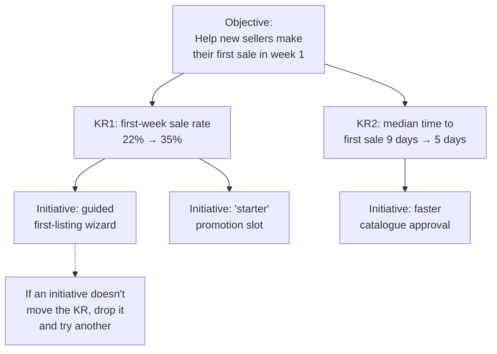
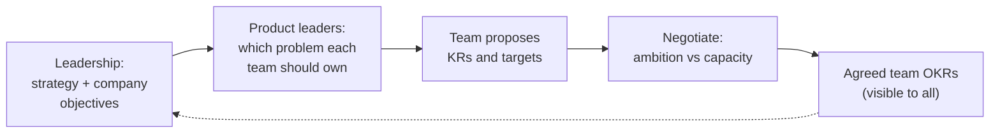
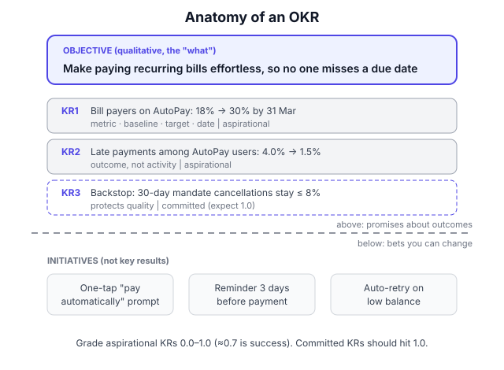

# A4.3 OKRs and goal setting

## In one line

An OKR is a short promise: one inspiring **objective** (where we want to go) plus 2–4 measurable **key results** (how we'll know we got there), set for a fixed period and checked every week.

## Why this matters

Strategy ([A4.2](02-good-strategy-vs-bad-strategy-the-kernel.md)) says *where* to focus. Goals turn that focus into something a team can work towards on Monday morning. As a PM you will write goals every quarter, defend them to leaders, and be judged on them. Good goals give your team freedom to find the best solution. Bad goals turn your team into a feature factory that ships a lot and changes little.

## Key terms

| Term | Plain-English meaning |
|---|---|
| **OKR** | Objectives and Key Results: a goal-setting method that pairs a qualitative aim with measurable results. |
| **Objective** | The "what": a short, memorable statement of the change you want, without numbers. |
| **Key result (KR)** | The "how we'll know": a measurable outcome with a starting value, a target and a date. |
| **Initiative** | A piece of work you *think* will move a key result (a feature, a campaign). Not a key result itself. |
| **Committed OKR** | A goal the team agrees *will* be achieved. Anything less than full delivery needs an explanation. |
| **Aspirational (stretch) OKR** | An ambitious goal where reaching about 70% counts as success. |
| **Health metric / guardrail** | A number that must not get worse while you chase your key results. |
| **Sandbagging** | Setting targets low on purpose so you're sure to hit them. |
| **Cadence** | The rhythm of setting, checking and grading goals (usually quarterly, with weekly check-ins). |

## The idea, simply

!!! tip "Analogy: planning a family road trip"
    Say your family decides: "This Diwali, let's have a relaxed trip to Goa that everyone enjoys." That's the **objective**. It's clear and motivating, but you can't measure "relaxed" directly.

    So you agree on some checks. "We reach in under 12 hours." "We spend less than ₹40,000." "Everyone rates the trip at least 4 out of 5." Those are **key results**. They tell you, honestly, whether the trip worked.

    Booking a train, packing snacks and choosing a homestay are **initiatives**. They're your best guesses at how to hit the key results. If the train gets cancelled, you switch to a bus. The objective and key results stay the same. The plan changes.

That's the whole idea of OKRs. Agree on where you're going and how you'll know you arrived. Then leave the team free to change the route.

### 1. Objectives: where you want to go

An objective is a short sentence describing a change worth making. It should make the team want to get up in the morning.

A good objective is:

- **Qualitative.** No numbers; those go in the key results.
- **About a change for someone,** usually a customer or the business. Not about the team's activity.
- **Memorable.** If people can't repeat it a week later, it won't guide their choices.
- **Time-bound.** It belongs to a period, usually a quarter.

| Weak objective | Why it's weak | Stronger version |
|---|---|---|
| "Launch the new onboarding flow" | It's a task, not a change | "Help new sellers make their first sale in their first week" |
| "Improve the app" | Too vague to guide choices | "Make checkout feel effortless on low-end Android phones" |
| "Increase revenue by 20%" | That's a key result dressed up as an objective | "Become the default way small cafés reorder supplies" |
| "Keep the platform running" | Business as usual; no change | Track it as a health metric instead (see sub-section 5) |

Google's internal OKR playbook, now published on [What Matters](https://www.whatmatters.com/resources/google-okr-playbook), puts it simply: objectives are the "whats".

### 2. Key results: how you'll know you got there

Key results are where the honesty lives. Each one is a number that moves only if the objective is really happening.

A good key result has four parts:

| Part | Example |
|---|---|
| **Metric** | % of new sellers who make a sale |
| **Starting value (baseline)** | 22% today |
| **Target** | 35% |
| **Date** | by 31 March |

So: "Raise the share of new sellers who make a sale within 7 days of sign-up from 22% to 35% by 31 March."

The single most important rule: **key results describe outcomes, not activities**. Google's playbook says the same thing: key results should describe outcomes, not activities, and should include evidence of completion.

| Activity disguised as a KR | Outcome KR |
|---|---|
| Ship seller onboarding v2 | First-week sale rate for new sellers rises from 22% to 35% |
| Run 12 user interviews | (This is an initiative. Keep it in the plan, not the KRs.) |
| Send 4 re-engagement campaigns | 30-day reactivation of lapsed buyers rises from 6% to 9% |
| Add Hindi and Tamil language support | Weekly active sellers outside the top 8 cities rise from 40,000 to 55,000 |

Why outcomes? Because a team can ship every feature on time and still not help a single customer. Marty Cagan's [SVPG article on team objectives](https://www.svpg.com/team-objectives-empowerment/) names activity-based key results as one of the most common ways teams go wrong with OKRs. This is the same "outputs vs outcomes" trap from [A2.4](../02-problem-discovery/04-outcomes-over-outputs-escaping-the-build-trap.md).

**How many?** Google's [re:Work guide](https://rework.withgoogle.com/intl/en/guides/set-goals-with-okrs) suggests three to five objectives, each with about three key results. Cagan suggests even fewer for a product team: often one or two objectives, with a main key result plus a "backstop" that protects quality. Fewer is almost always better.

### 3. Initiatives: your best bets, kept separate

Initiatives are the features, experiments and campaigns you plan in order to move the key results. Keeping them *separate* from key results is what makes OKRs powerful.

The objective and key results stay fixed for the quarter. Initiatives are swappable bets underneath them.

If an initiative ships and the key result doesn't move, the team learns something and tries a different bet. If the key result *was* the initiative ("ship the wizard"), the team would declare victory and move on, even if no seller sold anything.

### 4. Committed vs aspirational OKRs

Not every goal should be a moonshot. Google's playbook splits OKRs into two types, and mixing them up is listed as its first "trap".

| | Committed | Aspirational (stretch) |
|---|---|---|
| **What it means** | We agree this *will* happen | This is how we'd like the world to look |
| **Expected score** | 1.0 (full delivery) | About 0.7 on average, with lots of variation |
| **If you miss** | Explain why, and adjust plans | Normal; it was meant to be hard |
| **Typical examples** | Regulatory deadline, a launch a partner depends on, a reliability promise | Doubling a growth number, entering a new segment |

Why both? A team with only committed goals plays safe. A team with only stretch goals can't be relied on, and nobody knows which misses matter. Label each OKR clearly so leaders know which promises they can build plans on.

### 5. Health metrics: what must not break

Most of what keeps a product alive isn't "change". It's things like uptime, payment success rate and support response time. Putting these in OKRs fills the list with business-as-usual goals, which Google's playbook also calls a trap.

Instead, keep a short list of **health metrics** (also called guardrails or counter metrics, see [A8.1](../08-product-metrics/01-metric-basics-leading-lagging-input-output-vanit.md)). Each has a safe range. You only act when one leaves its range.

| If your KR pushes… | …watch this health metric |
|---|---|
| New seller sign-ups | Fraudulent seller rate |
| Checkout conversion | Refunds and order cancellations |
| Notification click-through | Opt-outs and uninstalls |
| Delivery speed | Rider safety incidents, order accuracy |
| AI answer adoption | Answer accuracy and complaint rate ([B3.2](../../part-b/03-quality/02-ai-product-metrics-and-production-monitoring.md)) |

Cagan's "backstop" key result is the same idea built right into the OKR: "raise X, *while ensuring* Y doesn't fall".

### 6. Where goals come from: top-down, bottom-up, or both

A common mistake is to "cascade" goals: the CEO sets OKRs, each VP copies a slice, each team copies a slice of that. The result is a team handed a number with no room to think.

A healthier pattern works in two directions:

Leaders give the problem and the context. Teams propose how to measure success and how far they can go. Then both sides agree.

Cagan argues the team, not leadership, should propose the target values. That way the team owns the number. Leaders still push back when a target is timid. A 2020 [Mind the Product survey with NEO Culture](https://www.mindtheproduct.com/how-real-product-teams-make-okrs-work-survey-results/) found that 69% of companies start the OKR cycle with top management, and that balancing top-down and bottom-up was one of the top three challenges people reported.

### 7. The OKR cycle: set, check, grade, learn

OKRs only work with a steady rhythm. Writing goals in January and reading them again in April doesn't count.

| When | What happens | Time it takes |
|---|---|---|
| **Before the quarter** | Draft, debate and agree OKRs; publish them where everyone can see | 1–2 weeks |
| **Every week** | Update KR progress and confidence; discuss what's blocking | 15–30 minutes in a team meeting |
| **Mid-quarter** | Check: is any OKR clearly wrong? Change it openly if so | 1 hour |
| **End of quarter** | Grade each KR, write what you learned, feed it into next quarter | 1–2 hours |

**Grading.** Google's [re:Work guide](https://rework.withgoogle.com/intl/en/guides/set-goals-with-okrs) uses a 0.0 to 1.0 scale. It says the sweet spot for stretch OKRs is around 0.6 to 0.7 on average. The grading guide on [What Matters](https://www.whatmatters.com/okrs-explained/grading-okrs) adds colour bands for aspirational OKRs:

| Score | Colour | Meaning |
|---|---|---|
| 0.7–1.0 | Green | Delivered, or very close |
| 0.4–0.6 | Yellow | Real progress, but short |
| 0.0–0.3 | Red | No significant progress |

It also notes that scoring 100% every quarter suggests sandbagging. Scoring below 30% every quarter suggests the goals are too ambitious. The re:Work guide adds an important line: OKRs are not the same as performance evaluation. Low grades are information, not punishment.

### 8. Where OKRs come from

OKRs grew out of Andy Grove's management practice at Intel, which he wrote about in [*High Output Management*](https://www.penguinrandomhouse.com/books/72467/high-output-management-by-andrew-s-grove-former-chairman-and-ceo-of-intel/9780679762881/) (first published 1983). John Doerr learned the method from Grove at Intel. According to [What Matters](https://www.whatmatters.com/stories/the-origin-story), Doerr introduced it to Google's founders in 1999. (Google's own re:Work guide says early 2000, so sources differ by a few months.) Doerr later wrote [*Measure What Matters*](https://www.penguinrandomhouse.com/books/546304/measure-what-matters-by-john-doerr/) (2018), which made OKRs popular well beyond Silicon Valley.

Goal setting itself is nothing new. What OKRs added were three habits that stuck: separating the "what" from the "how we'll know", making goals public across the company, and treating stretch goals as normal.

## Framework(s)

### OKRs (Grove, Doerr, Google)

**Who:** Andy Grove at Intel ([*High Output Management*](https://www.penguinrandomhouse.com/books/72467/high-output-management-by-andrew-s-grove-former-chairman-and-ceo-of-intel/9780679762881/), 1983), spread by John Doerr ([*Measure What Matters*](https://www.penguinrandomhouse.com/books/546304/measure-what-matters-by-john-doerr/), 2018). Google's practice is described in its [re:Work guide](https://rework.withgoogle.com/intl/en/guides/set-goals-with-okrs) (2016) and its internal [OKR playbook](https://www.whatmatters.com/resources/google-okr-playbook).

**Steps:**

1. **Start from strategy.** Re-read the company's strategy and the problem your team owns. An OKR that doesn't trace back to strategy is a wish.
2. **Write 1–3 objectives.** Each is a qualitative change for a customer or the business.
3. **Write 2–4 key results per objective.** Each has a metric, baseline, target and date. Check each one: *"If we hit this, will the objective really be true?"*
4. **Label each OKR committed or aspirational.**
5. **Add a backstop or health metric** for anything that could be gamed.
6. **List initiatives separately,** as bets you'll revisit.
7. **Publish** the OKRs where every team can see them, and check for clashes with other teams.
8. **Check in weekly** on progress and confidence (for example, "60% confident we'll hit KR2").
9. **Grade and reflect** at the end of the period. Carry learning, not just unfinished work, into the next cycle.

**When to use:** a team has enough autonomy to choose its own solutions; the company wants teams aligned on a few priorities; you can measure the outcomes within the period.

**When not to:** a tiny team doing one obvious thing (a simple to-do list may do); work where outcomes take far longer than a quarter to show (use leading indicators, or a longer cycle); a company where leaders will set every feature anyway. In that last case OKRs become a "feature list with numbers", and Cagan argues they do more harm than good.

### Team objectives (Cagan's variant for product teams)

Cagan's 2020 article [Team Objectives – Empowerment](https://www.svpg.com/team-objectives-empowerment/) adapts OKRs for empowered product teams ([A0.2](../00-the-pm-role/02-product-teams-the-trio-empowered-vs-feature-team.md)):

- Give each team **a problem to solve, not a feature to build**. His example: "reduce the frequency of parcels delivered to the wrong address".
- Use around **two key results**: the main measure, plus a "backstop" that protects quality ("while ensuring total deliveries continue to grow").
- Let **the team propose the target**, so it owns it.
- Share the **strategic context**, so the team understands why this problem matters.

Use this variant when you're a PM on a product team. The classic company-wide OKR system still works alongside it at the leadership level.

## Diagram

Notice the dashed line: everything above it is a promise about outcomes; everything below it is a bet you're allowed to change.

## Worked example

You're the PM for **AutoPay** in a bill-payments app in India. Users can set up a standing instruction (a mandate) so their electricity, mobile and broadband bills get paid automatically. Leadership's strategy for the year: *"Win by becoming the app people trust to never miss a bill."*

**Step 1: Understand the starting point.** Your analyst pulls the numbers:

| Metric | Today |
|---|---|
| Monthly bill payers | 2,000,000 |
| Share of them with at least one active AutoPay mandate | 18% (360,000) |
| Users who paid a bill after its due date last month (AutoPay users) | 4.0% |
| 90-day retention, AutoPay users | 82% |
| 90-day retention, manual payers | 61% |
| AutoPay mandates cancelled within 30 days of set-up | 7% |

**Step 2: Write the objective.** First draft: "Launch AutoPay 2.0." That's an output. Second draft: "Make paying recurring bills so effortless that customers never think about due dates." That's a change for the customer, and it ties directly to the strategy.

**Step 3: Write key results.** You test each candidate with the question "if we hit this, is the objective true?"

| Candidate | Keep? | Why |
|---|---|---|
| Ship AutoPay 2.0 by 15 Feb | No | Activity; it's an initiative |
| Mandates created: 100,000 new | No | Can be gamed with pop-ups; says nothing about bills paid on time |
| **KR1:** Share of monthly bill payers on AutoPay 18% → 30% | Yes | Measures adoption of the effortless path |
| **KR2:** Late payments among AutoPay users 4.0% → 1.5% | Yes | Measures whether "never miss a due date" is true |
| **KR3 (backstop):** 30-day mandate cancellations stay at or below 8% | Yes | Catches pushy set-up flows that annoy users |

**Step 4: Label it.** KR1 and KR2 are **aspirational**: nobody knows if 30% is reachable. KR3 is **committed**: you promise not to make the experience worse.

**Step 5: List initiatives (bets).**

- A one-tap "pay automatically next time" prompt after a manual payment
- Reminders 3 days before a mandate runs, so users top up their bank balance
- Automatic retry when a payment fails because of low balance
- Clear failure messages in Hindi and English

**Step 6: What is it worth?** You estimate the value so leaders see why this OKR deserves the team.

| Line | Calculation | Result |
|---|---|---|
| Extra AutoPay users if KR1 is hit | (30% − 18%) × 2,000,000 | 240,000 |
| Extra users retained at 90 days | 240,000 × (82% − 61%) | about 50,000 |
| Contribution per retained user per year (your finance team's estimate) | ₹150 | |
| **Value per year** | 50,000 × ₹150 | **about ₹75 lakh** |

Be honest about the big assumption. AutoPay users may retain better because loyal users choose AutoPay, not because AutoPay *makes* them loyal. You plan a holdout test on the one-tap prompt to check how much of the gap is cause rather than coincidence ([A9.1](../09-experimentation/01-a-b-testing-basics.md)). So the ₹75 lakh is an upper estimate.

**Step 7: Weekly check-ins.** Each Monday the team updates a simple table:

| Week | KR1 (target 30%) | KR2 (target 1.5%) | KR3 (≤ 8%) | Confidence | Note |
|---|---|---|---|---|---|
| 2 | 18.6% | 3.9% | 7.1% | 60% | One-tap prompt in A/B test |
| 6 | 23.4% | 2.8% | 9.2% | 50% | Cancellations above limit: prompt too aggressive; softened copy |
| 10 | 26.1% | 2.2% | 7.6% | 60% | Retry on low balance shipped |

Notice week 6. The backstop caught a problem the main KR hid: the prompt was getting sign-ups that people quickly cancelled.

**Step 8: Grade at the end of the quarter.** You finish at 27% on KR1, 2.0% on KR2, and 7.4% on KR3.

| KR | Formula | Score |
|---|---|---|
| KR1 | (27 − 18) ÷ (30 − 18) | 0.75 |
| KR2 | (4.0 − 2.0) ÷ (4.0 − 1.5) | 0.80 |
| KR3 (committed) | Stayed at or below 8%? Yes | 1.0 |

The aspirational KRs average about 0.78: green. The committed backstop was met. In the reflection you write down what you learned: low bank balance, not forgetfulness, caused most late payments. That changes next quarter's bets.

## Going deeper: nuances and trade-offs

### 1. OKRs are not performance reviews

If people's bonuses depend on hitting their OKRs, they'll set safe targets. That's sandbagging, and it kills ambition. Google's re:Work guide says plainly that OKRs are not the same as performance evaluation. The 2020 Mind the Product survey found 79% of companies didn't link OKRs to individual reviews.

This doesn't mean results don't matter. A strong reviewer still asks: *Did you pick the right goals? Did you learn fast? Did you change bets when the data said so?* Judge the quality of the work and the thinking, not just the score.

### 2. Output targets are sometimes fine

The "outcomes, not outputs" rule has exceptions:

- **Very early products,** where you can't measure outcomes yet. "Get 10 design partners using the beta weekly" is reasonable.
- **Committed delivery,** such as a compliance deadline or a launch that a partner depends on.
- **Capacity-building,** such as opening dark stores or hiring a team, where the output is itself the bottleneck to future outcomes.

When you do use an output, say why, and pair it with an outcome you'll measure later. Blinkit's public dark-store targets (see Real-world examples) are an output goal that makes sense for a business limited by how fast it can open stores.

### 3. Lagging results and long cycles (B2B and deep tech)

In B2B, a sales cycle can be six months. Your quarter's work may only show up in revenue next year. Don't make revenue your key result. Use **leading indicators** that predict it ([A8.1](../08-product-metrics/01-metric-basics-leading-lagging-input-output-vanit.md)):

| Lagging (too slow for a quarterly KR) | Leading (works as a KR) |
|---|---|
| Annual contract renewals | Weekly active seats in accounts up for renewal |
| New enterprise revenue | Pilots that reach the agreed success criteria |
| Market share | Win rate in head-to-head evaluations |

Some teams also use a six-month cycle for very long bets, with quarterly check-points.

### 4. How OKRs change by company stage

| Stage | What works |
|---|---|
| **Pre-product-market fit** (under ~30 people) | One company objective, maybe monthly. Everyone works on it. Heavy OKR process is a distraction ([A4.4](04-product-market-fit.md)). |
| **Scaling** (several product teams) | Company OKRs plus team OKRs; a shared page so everyone sees everyone's goals; quarterly cycle. |
| **Large company** | Fewer company-level OKRs; product areas own problems; strong habits around dependencies between teams; health metrics owned by platform teams. |

A 2023 study of OKRs inside a large software company by Microsoft researchers ([Butler, Zimmermann and Bird](https://arxiv.org/abs/2311.00236)) found that middle managers were critical to making OKRs work. Engineers' attitudes and beliefs mattered too. Their headline: setting and tracking goals is hard work "regardless of tools used". A shared doc with weekly updates beats an expensive OKR tool nobody opens.

### 5. OKRs, KPIs and the North Star metric

People confuse these, so here's the difference:

- **North Star metric** ([A8.2](../08-product-metrics/02-north-star-metric-and-metric-trees.md)): the one number that best captures customer value. It stays the same for years.
- **KPIs and health metrics:** the numbers you always watch to know the business is healthy. They change slowly.
- **OKRs:** the few things you're trying to *change* this quarter. They change every cycle.

A neat way to connect them: your metric tree shows the inputs that drive the North Star. Each quarter, pick the one or two inputs with the most room to improve and make them your key results.

### 6. Changing OKRs mid-quarter

Things change. A competitor launches, a regulator acts, a bet fails fast. Should you change your OKRs?

- **Change the initiatives freely.** That's the point of keeping them separate.
- **Change a KR only if it's clearly wrong** (you picked a metric that doesn't reflect the objective, or the world changed). Do it openly, say why, and tell dependent teams.
- **Don't change a KR because you're going to miss it.** Missing an aspirational KR is normal. Quietly lowering it destroys trust in every other OKR.

### 7. Gaming, sandbagging and Goodhart's law

Any number you reward will be gamed ([A8.1](../08-product-metrics/01-metric-basics-leading-lagging-input-output-vanit.md), Goodhart's law). Watch for these signs:

- **Every KR hits exactly 1.0, every quarter.** Targets are too safe.
- **A KR jumps in one week with no initiative to explain it.** Check the tracking or the definition.
- **Binary KRs everywhere** ("launch X: yes/no"). Google's re:Work guide accepts that some KRs are naturally 0 or 1, but a list full of them is a task list.
- **The backstop is always ignored.** Then it isn't a backstop.

The fix is usually the same as with metrics: pair every target with a guardrail, look at real user behaviour, and treat sudden easy wins as a question, not a party.

### 8. OKRs for AI features

AI features add a twist: quality is a percentage, not a yes/no ([B0.1](../../part-b/00-foundations/01-what-makes-ai-products-different.md)). Good AI key results usually pair adoption with quality:

| Adoption KR | Quality backstop |
|---|---|
| % of support chats resolved by the AI assistant: 20% → 35% | Customer satisfaction on AI-resolved chats stays ≥ 4.2/5; escalation-after-resolution ≤ 5% |
| % of sellers using AI-written listings: 10% → 25% | Listing rejection rate for AI listings ≤ that of manual listings |

Write the quality bar from your evals ([B3.1](../../part-b/03-quality/01-evals-the-ai-pm-s-most-important-skill.md)) into the OKR itself, so speed of adoption never quietly beats quality.

## Real-world examples (2023 onwards)

!!! example "Blinkit, 2025–2026: a public target, a near miss, and an honest explanation"
    Blinkit, the quick-commerce arm of Eternal (formerly Zomato), shares store targets with investors. In January 2025, with just over 1,000 dark stores, it [raised its aim to 2,000 stores](https://techcrunch.com/2025/01/20/blinkit-signals-costly-battle-ahead-in-indian-quick-commerce-market/), a year ahead of its earlier forecast. By September 2025 it had 1,816 stores, and management [guided for 2,100 by December 2025 and 3,000 by March 2027](https://www.ciol.com/news/blinkit-plans-3000-dark-stores-by-march-2027-keeps-focus-on-top-cities-10576163).

    In January 2026 it reported 2,027 stores, [about 70 short of the 2,100 guidance](https://www.businesstoday.in/latest/corporate/story/blinkits-dark-store-expansion-hit-by-high-aqi-in-delhi-ncr-512084-2026-01-21). It explained why: pollution-related construction restrictions in Delhi NCR had slowed store fit-outs. It called the miss a timing issue and kept the March 2027 target.

    **PM lesson:** this is a *committed*, output-style goal, and it makes sense because opening stores is Blinkit's bottleneck to growth. Notice what good practice looks like when you miss a committed goal: you say by how much, you explain the cause (here, an external one), and you say what happens next. Notice also that store count is never the only number. Investors watch losses alongside it, which acts as a backstop against growing at any cost.

!!! example "Microsoft Viva Goals, December 2024: the OKR tool that didn't last"
    In December 2024, Microsoft [announced it would retire Viva Goals](https://www.cxtoday.com/customer-analytics-intelligence/microsoft-scraps-viva-goals-gives-customers-a-year-to-move-off-the-app/), its OKR software built into Microsoft 365, on 31 December 2025. It gave customers about a year to export their goals. Microsoft didn't give a reason. One long-time Microsoft 365 commentator quoted in the article said the product simply hadn't won enough customers.

    **PM lesson:** two lessons. For goal setting, OKRs live in the habits (weekly check-ins, honest grading, clear trade-offs), not in the software; teams that had only the tool had to rebuild the practice anyway. For product managers generally, even a product from a giant with a huge distribution advantage can fail if users don't build it into their routine. Distribution got Viva Goals in front of people; it didn't make them use it.

## Common mistakes

!!! warning "Watch out for"
    - **Key results that are tasks.** "Launch X" or "run 10 interviews" are initiatives. Ask: what changes for users if we do this?
    - **Too many OKRs.** Seven objectives with five KRs each means no focus. One to three objectives is plenty for a team.
    - **No baseline.** "Raise retention to 40%" means little if you don't know whether it's 38% or 12% today.
    - **Mixing committed and aspirational** without labelling them, so nobody knows which misses matter.
    - **Business-as-usual OKRs.** "Keep uptime at 99.9%" belongs in health metrics.
    - **Set and forget.** Writing OKRs once and only looking again at the end of the quarter.
    - **Tying OKRs to bonuses,** which leads straight to sandbagging.
    - **Copying the company OKR word for word.** Your team's OKR should say what *your* team will change to help it.

## Common questions

**What's the difference between an OKR and a KPI?**
A KPI is a number you always track to know the business is healthy. A key result is a number you're trying to *change* this cycle. A KPI can become a key result for a quarter when you decide to push it.

**How ambitious should a target be?**
For aspirational KRs, aim so that reaching about 70% would feel like a real win. For committed ones, set what you're confident you'll deliver, and then deliver it.

**Should individuals have OKRs?**
Usually no, for product teams. Products are built by teams, so goals work best at team level. Personal growth goals are better handled in career conversations.

**What if our KR depends on another team?**
Say so when you set it. Agree the dependency up front, and ideally make it a shared KR, or a committed KR on the other team's list.

**We missed our OKR. Did we fail?**
Not if it was aspirational, and you learned something. Write down what you tried, what moved, and what you'd do differently. Missing a committed OKR is different: explain the cause and the recovery plan.

**Quarterly or monthly?**
Quarterly suits most teams. Very early start-ups often use monthly cycles because everything changes fast. Some B2B teams use half-year cycles with quarterly check-points.

## In the interview

!!! question "In the interview"
    **How it's tested:** goal setting comes up in execution and metrics interviews ("how would you set goals for this team?"), in behavioural questions ("tell me about a goal you missed"), and in product strategy questions as a follow-up ("what would your OKRs be for the first quarter?").

    **Sample question:** *"You've just joined as PM for Swiggy Instamart's fresh fruit and vegetables category. What would your OKRs be for next quarter?"*

    **Outline of a strong answer:**

    1. **Clarify the goal and context:** is the company focused on growth, profitability, or retention right now? What's the main customer complaint about fresh produce (quality, freshness, variety)?
    2. **One objective tied to a customer change:** "Make Instamart the place customers trust for fresh produce."
    3. **Two or three outcome KRs with baselines:** repeat purchase rate of fresh produce buyers within 14 days (e.g. 35% → 42%); share of produce orders with a quality complaint (e.g. 3% → 1.5%).
    4. **A backstop:** wastage as a % of produce stock must not rise, so you don't fix quality by over-stocking.
    5. **Label committed vs aspirational,** and name 2–3 initiatives as bets (better sourcing checks, freshness date on the product page, instant refunds for bad items).
    6. **Say how you'd run it:** weekly check-ins, a mid-quarter review, honest grading.

    Interviewers listen for outcomes (not features), baselines, a guardrail and a clear link to strategy.

    **Behavioural follow-up:** *"Tell me about a time you missed a goal."* Use a STAR-style answer (situation, task, action, result) and make the learning the hero: what you noticed, what you changed, and what the team does differently now.

## Research happening now

!!! info "Research happening now"
    - **Shipping faster isn't reaching customers faster (Atlassian, October 2026).** Atlassian's *State of Product 2027* report, [summarised by SD Times](https://sdtimes.com/product-development/product-teams-share-their-thoughts-on-ai-work-in-new-atlassian-state-of-product-2007-report/), found that 80% of product teams say AI helps them ship faster, but customers aren't seeing the benefit any sooner. It's a strong argument for outcome key results: shipping more is not the same as changing more. *Status: industry survey by a tool vendor, not peer-reviewed.*
    - **How OKRs work inside a big software company (Microsoft Research, 2023, still the main academic case study).** [Butler, Zimmermann and Bird](https://arxiv.org/abs/2311.00236) combined 47 interviews with a survey of 512 people. They found middle managers and engineers' beliefs were critical to OKR success, and that goal setting is hard work whatever the tool. *Status: a single company's experience; older than our usual 12-month window, included because newer peer-reviewed work on OKRs is scarce.*

## Try it yourself (25 minutes)

Pick a product you use every week (a UPI app, a food app, a learning app). Imagine you're the PM for one feature in it.

1. Write **one objective** for next quarter.
2. Write **three key results**, each with a baseline (guess one if you must), target and date.
3. Mark each KR **committed or aspirational**.
4. Add **one backstop or health metric**.
5. List **three initiatives** below a line.

??? success "Check your answer"
    Check your draft against this list:

    - [ ] The objective has no numbers and describes a change for a user or the business.
    - [ ] Every KR is an outcome. None of them starts with "launch", "ship", "build" or "run".
    - [ ] Every KR has a baseline, a target and a date.
    - [ ] If all KRs hit 1.0, the objective would truly be achieved.
    - [ ] At least one KR could be missed (otherwise, it's not ambitious).
    - [ ] The backstop would catch the laziest way to hit your main KR.
    - [ ] Initiatives are separate, and you could swap any of them without changing the KRs.

    **Example (a learning app's practice feature):** *Objective:* help beginner learners build a daily practice habit. *KR1 (aspirational):* learners practising on 4+ days a week, 21% → 30%. *KR2 (aspirational):* week-4 retention of new learners, 34% → 40%. *Backstop (committed):* average lesson rating stays at or above 4.4. *Initiatives:* streak reminders at the learner's chosen time, a 3-minute "quick practice" mode, weekly progress summaries.

## How this connects

- [A4.2 Good strategy vs bad strategy](02-good-strategy-vs-bad-strategy-the-kernel.md): OKRs translate the strategy's coherent actions into measurable goals; without strategy, OKRs are just a wish list.
- [A2.4 Outcomes over outputs](../02-problem-discovery/04-outcomes-over-outputs-escaping-the-build-trap.md): the reason key results describe outcomes, not features.
- [A8.1 Metric basics](../08-product-metrics/01-metric-basics-leading-lagging-input-output-vanit.md): good key results are usually leading, controllable input metrics with a counter metric.
- [A8.2 North Star metric and metric trees](../08-product-metrics/02-north-star-metric-and-metric-trees.md): the tree shows which inputs are worth turning into this quarter's KRs.
- [A5.1 Outcome-based roadmaps](../05-roadmaps-and-prioritisation/01-outcome-based-roadmaps-now-next-later.md): roadmaps organised by the problems your OKRs target.

## Go deeper

- **Book:** [*Measure What Matters*](https://www.penguinrandomhouse.com/books/546304/measure-what-matters-by-john-doerr/) by John Doerr (2018). The book that popularised OKRs, with stories from Intel, Google and others.
- **Book:** [*High Output Management*](https://www.penguinrandomhouse.com/books/72467/high-output-management-by-andrew-s-grove-former-chairman-and-ceo-of-intel/9780679762881/) by Andrew Grove (1983). Where the thinking behind OKRs began, plus a lot of practical management wisdom.
- **Book:** [*Radical Focus*](https://cwodtke.com/writing-2/) by Christina Wodtke (second edition). A short, story-based guide to running OKRs week to week in a small team.
- **Guide:** [Google re:Work: Set goals with OKRs](https://rework.withgoogle.com/intl/en/guides/set-goals-with-okrs). Free and short; covers grading, stretch goals and common mistakes.
- **Guide:** [Google's OKR playbook (What Matters)](https://www.whatmatters.com/resources/google-okr-playbook). The internal rules for committed vs aspirational OKRs and the classic traps.
- **Article:** [SVPG: Team Objectives – Empowerment](https://www.svpg.com/team-objectives-empowerment/) by Marty Cagan. How to adapt OKRs for empowered product teams: problems, not features.
- **Paper:** [Objectives and Key Results in Software Teams](https://arxiv.org/abs/2311.00236) (Microsoft Research). What actually helps OKRs work inside a large engineering organisation.

## Key takeaways

- An OKR is an **objective** (the change you want) plus 2–4 measurable **key results** (how you'll know).
- **Key results are outcomes, not tasks.** Keep initiatives separate so you can change your bets without changing your goals.
- Label each OKR **committed** (expect 1.0) or **aspirational** (about 0.7 is success).
- Protect what matters with **backstops and health metrics**, and keep business-as-usual out of OKRs.
- Leaders give the **problem and context**; teams propose **how to measure success and how far they can go**.
- OKRs need a **weekly rhythm** and honest grading. Low scores are information, not punishment.
- **Don't tie OKRs to bonuses,** and don't expect a tool to do the work.

## Updates

*No updates yet.*
