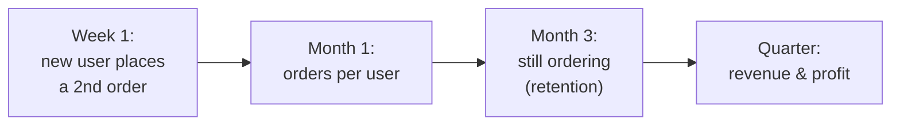
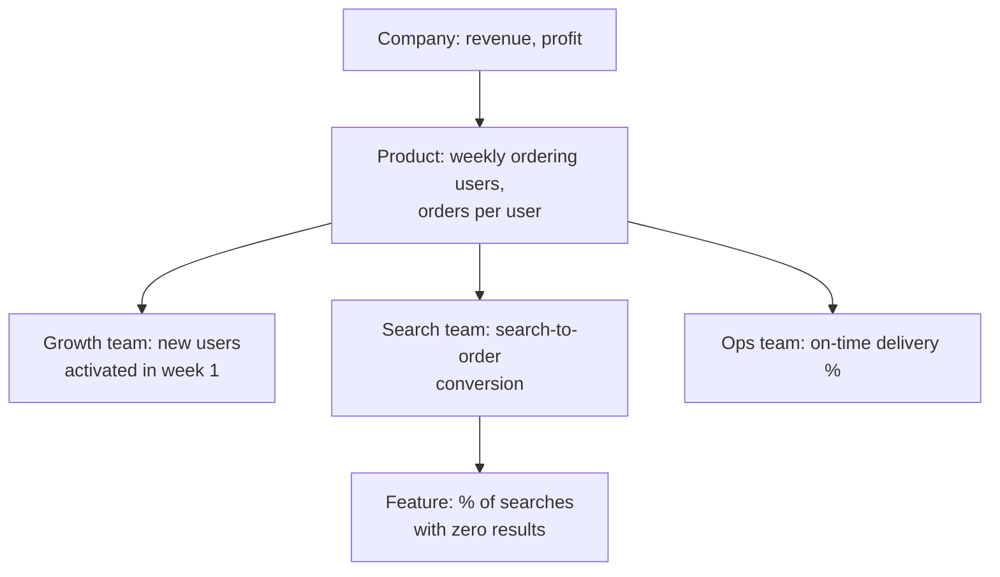
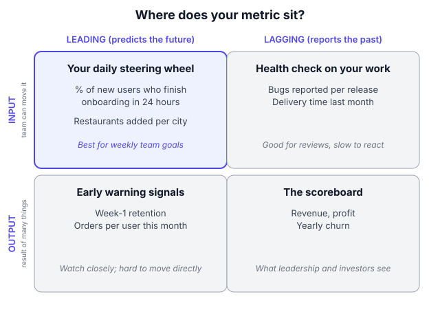

# A8.1 Metric basics: leading/lagging, input/output, vanity vs actionable

## In one line

A good metric is a number that helps you make a better decision. If it can't change what you do next, it's decoration.

## Why this matters

Numbers sit behind almost everything a PM does:

- **Setting goals:** "this quarter we will raise X from 30% to 36%"
- **Prioritising:** "this idea moves our most important number the most"
- **Judging launches:** "did the new checkout work?"
- **Explaining decisions to leaders:** "here's why we're stopping this feature"
- **Spotting trouble early:** "something broke on Android yesterday"

If the numbers are badly chosen, every one of these goes wrong, quietly. Teams work hard and celebrate rising charts while the product gets worse. This chapter gives you the basic vocabulary and habits to choose numbers that tell the truth early enough for you to act. Every other chapter in this section builds on it.

## Key terms

| Term | Plain-English meaning |
|---|---|
| **Metric** | Any number you track over time (orders per day, % of users who return). |
| **KPI** | Key performance indicator: a metric leadership has agreed matters most. |
| **Event** | A single recorded user action, like "order_placed" or "search_done". Metrics are built from events. |
| **Leading metric** | An early signal that predicts a later result. |
| **Lagging metric** | A result you only see after the fact (revenue, churn). |
| **Input metric** | Something a team can move directly, which drives a bigger result. |
| **Output metric** | A result of many things working together; no single team controls it. |
| **Vanity metric** | Looks impressive but doesn't change any decision. |
| **Actionable metric** | Tells you what to do next when it moves. |
| **Counter (guardrail) metric** | A number you watch to make sure you're not breaking something while pushing your main number. |
| **Proxy metric** | A number you track because the thing you really care about (like "happiness") is hard to measure directly. |
| **Time window** | The period a metric counts over (a day, 7 days, 28 days). |
| **Baseline** | The metric's normal, current value. You measure change against it. |

## The idea, simply

!!! tip "Analogy: the cricket scoreboard"
    Imagine you're captaining a T20 side. The final score at the end of 20 overs is the **result**. But you can't change it once the match is over. During the match you watch the **run rate**, **wickets in hand** and **dot balls**. Those numbers tell you, ball by ball, whether you're on track, and let you change your plan (promote a hitter, slow down, take fewer risks) *while it still matters*.

    Now imagine the scoreboard only showed "total runs scored by this team in all matches ever". It would always go up. It would look great. And it would tell you nothing about today's match. That's a **vanity metric**.

Product metrics work exactly the same way. Let's build the idea up step by step.

### 1. What a metric is actually made of

Every metric, however fancy its name, has five parts. If you can't fill in all five, the metric isn't defined yet.

| Part | Question it answers | Example: "Weekly repeat buyers" |
|---|---|---|
| **Action** | What did the user do? | Placed an order that was delivered |
| **Who** | Which users count? | Users whose first order was at least 7 days ago |
| **How it's counted** | Count, %, average…? | Count of unique users with 2+ orders |
| **Time window** | Over what period? | Monday–Sunday, IST |
| **Slices** | How can it be broken down? | By city, platform, acquisition channel |

This sounds basic, but most metric arguments in companies come from two people silently filling in these parts differently. One person's "active user" opened the app. Another's placed an order. Same name, different numbers.

### 2. The different shapes a metric can take

Metrics come in a few shapes, and each answers a different kind of question.

| Shape | Example | Good for | Watch out for |
|---|---|---|---|
| **Count** | 52,000 orders this week | Size and scale | Grows just because you spent more on ads |
| **Sum** | ₹2.3 crore order value | Business size | Dominated by a few big buyers |
| **Rate (%)** | 38% of new users order twice | Quality of the experience | Hides how many people that is; always show the base |
| **Ratio** | DAU ÷ MAU = 0.25 | How often people return | Can rise because the bottom number fell |
| **Average (mean)** | Average delivery time 31 min | Quick summary | A few extreme values distort it |
| **Median / percentile** | Median 26 min; 90th percentile (p90) 48 min | Experience of a typical user, and of the unluckiest | Harder to explain to leaders, but worth it |
| **Time-to-X** | Median 2 days from sign-up to first order | Speed of getting value | Users who never do X aren't counted, so state how many there are |

A simple rule: **counts tell you how big; rates tell you how good.** You usually need one of each.

### 3. Leading vs lagging metrics

- A **lagging metric** tells you what already happened. Revenue, profit and yearly churn (how many customers left) are lagging. They matter most to the business, but they arrive late. By the time revenue drops, the cause may be months old.
- A **leading metric** gives you an *early* signal of what's *likely* to happen. It shows up sooner and moves before the lagging metric does.

The most useful way to see this is as a **chain**, where each link predicts the next:

Each box is a leading indicator of the box to its right. The further left you can steer, the earlier you can fix problems.

**How do you find a good leading metric?** Look backwards.

1. Take users who signed up 6 months ago.
2. Split them into those who are still valuable today and those who left.
3. Look at what each group did in their first days and weeks.
4. Find the early behaviour that best separates the two groups. That behaviour is your candidate leading metric.
5. Test it: if you help more users do it, does long-term retention really go up? (See [A9.1](../09-experimentation/01-a-b-testing-basics.md).)

**How much "lead" is useful?** Enough time to act. A metric that warns you one day before revenue drops is too late. One that warns you 3–8 weeks ahead lets you ship a fix.

### 4. Input vs output metrics

- An **output metric** is a result of many things working together: total orders, revenue, monthly active users. No single team controls it.
- An **input metric** is something a team can push directly this week or month.

Think of it as a **controllability spectrum**:

| Very controllable (input) | Partly controllable | Not directly controllable (output) |
|---|---|---|
| Search results page load time | Search-to-order conversion | Total orders |
| Number of restaurants listed in a new city | Orders per user in that city | City revenue |
| % of users who finish sign-up | Week-1 retention | Monthly active users |

**Why this matters:** if you give a team a goal on an output they can't control, two bad things happen. Either they feel helpless, or they find a shortcut that moves the number without real value (more on that under Goodhart's law below). Give each team an input it truly owns, and choose those inputs so that, together, they move the output.

Amazon is famous for this discipline. *Working Backwards*, by former Amazon executives Colin Bryar and Bill Carr, describes how Amazon's weekly business reviews focus on **controllable input metrics**, such as selection, price and in-stock availability, rather than on revenue itself. Teams refine those inputs by trial and error until moving them reliably moves the outputs ([summary by Holistics](https://www.holistics.io/blog/how-amazon-measures); [book site](https://www.workingbackwards.com/)).

### 5. Vanity vs actionable metrics

A **vanity metric** usually has one or more of these three traits:

1. **It only goes up.** Cumulative totals like "1 crore downloads" can never fall, so they can never warn you.
2. **You can't connect it to anything you did.** It moves with ads, seasons or luck.
3. **It isn't tied to user value.** Page views, app opens or followers can rise while users get nothing.

An **actionable metric** is the opposite. It goes up *and* down, you can link changes to specific actions, and it reflects real value.

| Vanity version | Actionable alternative |
|---|---|
| Total downloads | % of new installs who complete a first key action in 7 days |
| Registered users | Weekly users who completed a value action |
| Page views | % of visitors who reach checkout |
| Followers on social media | Click-through rate and sign-ups from social posts |
| "Time in app" (for a utility app) | Time to complete the task (lower is better) |
| Number of features shipped | Adoption and retention impact of features shipped |

**The quick test:** *"If this number doubled tomorrow, would I know what caused it? Would I do anything differently?"* If both answers are no, it's vanity.

*Lean Analytics* (Croll & Yoskovitz) gives a similar checklist. A good metric is:

- **comparative:** you can compare it across time or groups
- **understandable:** people remember it and discuss it
- **a ratio or rate:** it shows quality, not just size
- **behaviour-changing:** it changes what you do

([book](https://www.oreilly.com/library/view/lean-analytics/9781098168179/))

### 6. Counter metrics (guardrails)

Whenever you push one number, something else can break. A counter metric is your alarm. Pick it by asking: *"What's the laziest or most harmful way someone could hit this target?"* Then measure that.

| If you push… | …also watch |
|---|---|
| Orders | Cancellations, refunds, contribution margin |
| Sign-ups | Activation rate of new sign-ups (quality) |
| Notifications clicked | Notification opt-outs, uninstalls |
| Delivery speed | Delivery partner safety incidents, order accuracy |
| Time spent (social/video) | Reports, blocks, "not interested" taps |
| Support tickets closed | Tickets reopened, satisfaction score |

### 7. Numbers tell you *what*; people tell you *why*

Metrics show you *what* happened and *how much*. They rarely tell you *why*. A drop in checkout conversion might be a bug, a confusing new button, a price change, or a competitor's sale. Strong PMs pair every important metric with a habit of talking to users: interviews, session recordings, support tickets ([A1.2](../01-understanding-users-user-sense/02-user-research-methods-and-interviews.md)). Data and conversations together beat either alone.

## Framework: The Metric Definition Card + the 2×2

There's no single inventor of leading/lagging or input/output. These ideas come from management accounting and operations. Product teams popularised them through approaches like Amazon's controllable input metrics and Amplitude's [North Star Playbook](https://amplitude.com/books/north-star), which separates a North Star from the "inputs" that drive it.

**Step 1: Start from the decision, not the data.** Ask: *"What decision will this number help us make?"* For example: keep or kill a feature, invest in a city, change the onboarding. If you can't name a decision, you probably don't need the metric.

**Step 2: Write a metric definition card.** Use the [template in the appendix](../../appendix/templates.md). Fill in all five parts: action, who, counting method, time window and slices. Add the owner and where the metric lives.

**Step 3: Place it on the 2×2** (leading or lagging × input or output, see the diagram). Team goals belong in the top-left box: leading and controllable.

**Step 4: Run the vanity test.** Does it go up and down? Can you link changes to actions? Is it tied to user value?

**Step 5: Add one counter metric** that would catch gaming or harm.

**Step 6: Set a baseline and a review rhythm.** Record today's value and its normal week-to-week range. Decide when you'll look at it (daily for operations metrics, weekly for most product metrics, monthly for strategic ones).

**When to use:** whenever you build a dashboard, set a quarterly goal, write the success section of a PRD, or plan a launch.

**When not to:** don't over-engineer metrics for a quick, low-risk experiment. There, one clear success metric and one guardrail are enough. And don't add a metric "just in case": every extra number on a dashboard competes for attention.

### Metrics at different levels of the company

Metrics stack in layers. Each layer's inputs are the next layer's outputs.

Leadership watches the top. Each team owns a box in the middle. Feature metrics at the bottom tell a team whether a specific change worked.

## Diagram

The top-left box (leading + input) is where team goals should live: numbers you can move this week that predict next month.

## Worked example

You're the PM for the "Groceries" tab of a food delivery app in Pune. Your manager says: "Our goal this quarter is more grocery orders."

**Step 1: The output.** Weekly grocery orders. It's currently around 40,000. It's good to report, but it's pushed around by ads, festivals and even rain, so it's a poor *team* goal.

**Step 2: Break it down.** Weekly grocery orders = weekly grocery buyers × orders per buyer per week.

| | Value now |
|---|---|
| Weekly grocery buyers | 25,000 |
| Orders per buyer per week | 1.6 |
| **Weekly grocery orders** | **40,000** |

Buyers split further into **first-time buyers this week** (5,000) and **returning buyers** (20,000).

**Step 3: Find the leading input.** You look back at buyers who started 3 months ago:

| First 14 days | Still buying in month 3 |
|---|---|
| Placed only 1 order | 12% |
| Placed 2 or more orders | 48% |

Users who order twice in their first 14 days are four times as likely to still be buyers in month 3. Your candidate leading input is the **second-order rate**: the share of first-time grocery buyers who place another grocery order within 14 days. Today it's **30%**.

**Step 4: Estimate what it's worth.** If you raise the second-order rate from 30% to 36%, an extra 300 of each week's 5,000 new buyers become repeat buyers (6% of 5,000). About half of those repeat buyers (48%) are still buying in month 3, so that's roughly 144 extra long-term buyers from each weekly cohort. Across the 13 weekly cohorts in a quarter, that's about 1,900 extra long-term buyers: roughly 7–8% more than today's 25,000 weekly buyers, from one input your team controls.

**Step 5: Vanity check.** "Grocery tab impressions" would rise if the tab were simply made bigger on the home screen. It doesn't tell you whether people got value. Drop it.

**Step 6: Counter metrics.**

- **Refund rate on grocery orders.** If you push second orders with over-promised delivery times, refunds will rise.
- **Discount cost per second order.** Don't buy the second order with a coupon that loses money on every order.

**Step 7: Definition card (short version).**

- **Second-order rate:** first-time grocery buyers in week W who place another delivered grocery order within 14 days ÷ all first-time grocery buyers in week W.
- **Sliced by:** city, platform, acquisition channel.
- **Owner:** Grocery growth pod.

**Step 8: Weekly review.** Your team dashboard shows:

1. second-order rate (steering)
2. refund rate and discount cost (guardrails)
3. weekly grocery orders (scoreboard)

That's one steering number, two guardrails and one scoreboard. It's clear, honest and actionable.

## Going deeper: nuances and trade-offs

### 1. Goodhart's law: every target gets gamed

Economist Charles Goodhart made the original point in 1975 about monetary policy. Anthropologist Marilyn Strathern later turned it into the popular saying "when a measure becomes a target, it ceases to be a good measure" ([background](https://en.wikipedia.org/wiki/Goodhart%27s_law)). In product terms: the moment you reward a team for a number, people find the easiest way to move *the number*, which isn't always the thing the number was meant to show.

- Reward support agents for "tickets closed per hour", and tickets get closed before problems are solved.
- Reward a growth team for "sign-ups", and sign-up forms get shorter while user quality drops.
- Reward a content team for "time spent", and you may get more clickbait.

Gaming isn't usually dishonest. People are simply doing what the system rewards.

**How experienced PMs defend against it:**

- Always pair the target with a counter metric.
- Choose metrics close to real customer value.
- Read a sample of real user sessions or tickets every week.
- Treat a sudden, too-easy win as a warning sign rather than a celebration.

### 2. Proxy metrics: check that the proxy actually tracks the real thing

Most product metrics are proxies. "Week-1 orders" stands in for "this customer will be valuable for years". A proxy is only useful while it really moves with the outcome you care about. Check it in two ways:

- **Historically:** do users with a high proxy value later show a high outcome? (That's the look-back in the worked example.)
- **Experimentally:** when an A/B test moves the proxy, does the outcome follow weeks later? (See [A9.1](../09-experimentation/01-a-b-testing-basics.md).)

Re-check proxies at least once a year. As the product and its users change, a proxy that once predicted well can drift.

### 3. Definitions and time windows change the answer

"Active user" sounds simple until you ask:

- Active doing *what*? Opening the app, or completing a value action?
- Over *what window*?
    - **DAU:** active on a given day
    - **WAU:** active in the last 7 days
    - **MAU:** active in the last 28 or 30 days

Pick the window that matches how often the product is *naturally* used:

| Product | Natural frequency | Sensible "active" window |
|---|---|---|
| Messaging, social | Many times a day | Daily (DAU) |
| Food delivery, ride-hailing | Weekly | Weekly (WAU) |
| Bill payments, insurance | Monthly or less | Monthly (MAU) or "per billing cycle" |
| Tax filing | Yearly | Seasonal, compared year on year |

A bill-payment app will look "dead" on a daily metric even if every customer is happy. When you change a definition, run the old and new versions side by side for a few weeks, and label the switch on every chart. Otherwise trend lines break silently and people draw wrong conclusions.

### 4. Ratios have two moving parts

**DAU/MAU** (often called *stickiness*) is popular because it shows how often monthly users come back. A value of 0.5 means the average monthly user is active about half the days of the month.

But any ratio can rise for the wrong reason. If a marketing campaign ends and casual users stop arriving, MAU falls faster than DAU, and stickiness "improves" while the business shrinks. Whenever you report a ratio, show its top number and bottom number next to it, so readers can see which one moved.

### 5. Signal vs noise

Daily numbers bounce around even when nothing has changed. Before reacting:

- **Compare like with like:** this Tuesday vs the last 4–6 Tuesdays, not vs yesterday (Monday behaves differently).
- **Know your normal range.** If orders usually swing ±4% week to week, a 3% dip is probably noise.
- **Remember that small numbers are jumpy.** 20 orders vs 25 is a 25% change, but tells you almost nothing.
- **Use the median (and p90) when outliers distort the average.** Delivery time is the classic case: a few 3-hour deliveries drag up the mean while most customers had a great experience. The p90 tells you about the unhappy tail.

### 6. Instrumentation: metrics are only as good as the events behind them

Every metric is calculated from **events** that the app or website records, such as "order_placed" or "search_done", each with **properties** like city, payment method or app version. If an event fires twice, fires late or is missing on one platform, every metric built on it is wrong.

What good teams do:

- **Keep a tracking plan:** a shared sheet listing every event, what triggers it, its properties and its owner.
- **Review tracking in every PRD:** "what events do we need to measure this feature's success?" ([A7.1](../07-execution-and-delivery/01-prds-and-specs.md)).
- **Test events before launch,** just as you test features.
- **Watch for silent breaks after releases:** a sudden drop to zero on one platform is usually tracking, not users.

You don't need to write tracking code as a PM, but you do need to know which events your key metrics depend on.

### 7. A rhythm for reviewing metrics

Metrics only help if someone looks at them regularly and acts. A simple rhythm:

- **Daily (2 minutes):** operational health. Are orders, payments and errors in their normal range?
- **Weekly (30–45 minutes, team):** steering metric, guardrails and scoreboard. What moved, why, and what we'll do this week.
- **Monthly or quarterly (leadership):** outputs, progress against goals, and whether the inputs are still the right ones.

Amazon's weekly business review, described in *Working Backwards*, is a well-known example of this habit at scale.

### 8. How metrics differ by business type

- **B2C transactional** (food, travel, payments): orders, frequency, order value, repeat rate.
- **B2C attention** (social, media, OTT): time spent, sessions, content consumed, creator activity.
- **Subscription / SaaS:** paid conversion, churn, revenue retention, seats used.
- **B2B:** measure **accounts and teams**, not just individual users. Signals arrive slowly because there are fewer customers, so lean more on qualitative feedback.
- **India-specific rhythms:** festival seasons (Diwali, Durga Puja), salary-day spikes at the start of the month, exam seasons, monsoon and IPL evenings all shift behaviour. Build them into your "normal range" so you don't panic every October.
- **AI products** add new kinds of metrics, such as answer quality, cost per task and how often users correct the AI. These are covered in Part B ([B3.2](../../part-b/03-quality/02-ai-product-metrics-and-production-monitoring.md)).

## Real-world examples (2023 onwards)

!!! example "Threads (Meta), July 2023: a record sign-up number vs. the real signal"
    Meta launched Threads on 6 July 2023, and it passed 100 million sign-ups within days. The sign-up count was a vanity metric. Within about a week, [Similarweb estimated](https://www.similarweb.com/blog/insights/social-media-news/threads-week/) that daily active users on Android had roughly halved, from about 49 million to 23.6 million. By the end of July, [Sensor Tower data reported by CNN](https://edition.cnn.com/2023/08/03/tech/threads-user-count-falls) put daily users down about 82% from the launch peak, with time spent per user also falling sharply.

    **PM lesson:** sign-ups told you about curiosity. Daily actives and time spent told you about value. Instagram's team kept improving the product after this. The early, honest reading of the *actionable* numbers is what made those fixes possible. Notice too that sign-ups was a count that could only go up, which is the first trait of a vanity metric.

!!! example "Swiggy, 2024–2026: reporting inputs, not just outputs"
    In its shareholder letters, Swiggy reports a small set of operating metrics every quarter. These include average **monthly transacting users (MTU)**, **platform frequency** (orders per user), **average order value** and **gross order value (GOV)**. In the [Q1 FY27 letter (July 2026)](https://nsearchives.nseindia.com/corporate/SWIGGY_30072026154100_Covering_Letter_Letter_to_Shareholders_-_signed.pdf), platform MTU rose to 27.5 million while platform frequency slipped to 3.87 from 4.13 a year earlier.

    **PM lesson:** GOV is the output. MTU and frequency are the inputs that multiply into it. Showing both lets you see *why* the output moved. Here, more users were joining, but the average user was ordering a little less often. That often happens when you grow fast, because new users order less at first (see [A8.5](05-funnels-cohorts-and-retention-curves.md)). Also note "transacting" users: Swiggy counts people who actually ordered, not people who merely opened the app. That's a value-based definition.

## Common mistakes

!!! warning "Watch out for"
    - **Celebrating cumulative totals** ("1 crore downloads!"). They can only go up, so they hide problems.
    - **Setting team goals on outputs the team can't control.** It leads to frustration or gaming.
    - **No written definition.** Two dashboards, two numbers, one wasted meeting.
    - **No counter metric.** You will eventually "win" the number and hurt the business.
    - **Too many metrics.** If everything is important, nothing is. Aim for 1 steering metric and 2–3 guardrails per team.
    - **Silently changing a definition.** The chart now compares apples with oranges.
    - **Reporting only averages.** Show medians or percentiles (p50, p90) when a few outliers distort the picture.
    - **Trusting a metric without checking its tracking.** A broken event looks exactly like a real drop.

## Common questions

**Is DAU a vanity metric?**
Not always. DAU *counting app opens* can be vanity, because notifications can inflate it. DAU *counting a value action* (a lesson completed, a message sent) is meaningful. The definition decides.

**How many metrics should one team watch?**
Usually one steering metric, 2–3 guardrails, and the company scoreboard for context. More than about 7 numbers on a weekly team dashboard and people stop reading it.

**What if we don't have much data yet (a new product)?**
Use simple counts and talk to every user you can. Early on, a few honest conversations are worth more than a dashboard. Move to rates and cohorts once you have a few hundred active users ([A8.4](04-lean-analytics-one-metric-that-matters-and-stage.md)).

**Who should own a metric's definition?**
One named person or team, usually with the data or analytics team keeping the official version. At Amazon, *Working Backwards* describes finance owning the accuracy of key business metrics. Whoever it is, everyone should know who to ask.

**Should a PM's goal be revenue?**
Most product teams should own a leading input that drives revenue, not revenue itself. Leadership owns revenue. Exceptions exist: a pricing or monetisation team may own revenue per user directly.

## In the interview

!!! question "In the interview"
    **How it's tested:** "How would you measure the success of *[feature/product]*?" is one of the most common PM interview questions, and it often comes up inside product design questions too.

    **Sample question:** *"How would you measure the success of WhatsApp's 'Status' feature?"*

    **Outline of a strong answer:**

    1. **Clarify the goal:** Is Status meant to raise daily engagement, help people share updates without group-chat noise, or drive ad revenue?
    2. **Name the users and their value:** posters (self-expression) and viewers (staying in touch).
    3. **Pick one primary metric that reflects value:** for example, the % of daily users who view or post at least one Status.
    4. **Add 2–3 input metrics:** posting rate among weekly users, views per Status, replies sent from Status.
    5. **Add guardrails:** the effect on chat messages sent (is Status cannibalising chats?), reported or blocked Statuses, and app performance.
    6. **Say how you'd know it's working:** an A/B test or a before/after comparison with a holdout, and the time frame you'd judge it over.

    Interviewers listen for a clear goal, one main metric, a short list of inputs, and at least one guardrail.

    **A second common form:** *"Which is the better metric for a food app: total orders or orders per active user?"*

    A strong answer explains that it depends on the decision:

    - **Total orders** shows scale, but can be bought with ads and discounts.
    - **Orders per active user** shows how valuable the product is to the people already using it, but can rise if casual users leave.

    Then recommend tracking both, with the per-user metric as the team's steering number and total orders as the scoreboard.

## Research happening now

!!! info "Research happening now"
    - **Acquisition and retention aren't linked (Amplitude, 2025).** Amplitude's [2025 Product Benchmark Report](https://amplitude.com/blog/leaky-bucket-problem) analysed over 2,600 companies. It found no meaningful correlation between how well a product *acquires* users and how well it *keeps* them. This is strong evidence that top-of-funnel counts are a poor proxy for product health. *Status: industry report based on Amplitude customers, not peer-reviewed.*
    - **Metric trees as a discipline.** Data leaders such as Abhi Sivasailam (Levers Labs) have been pushing "metric trees" as a standard way to connect inputs to outputs; see the [Levers Labs introduction](https://www.leverslabs.com/article/introducing-metric-trees). Analytics tools like [Mixpanel](https://mixpanel.com/blog/metric-tree/) now ship metric-tree features. *Status: fast-growing practice; standards still forming.* Covered in depth in [A8.2](02-north-star-metric-and-metric-trees.md).

## Try it yourself (20 minutes)

Open any app you use daily (UPI, food delivery, a news app). Write down:

1. One **vanity** metric the company might brag about
2. One **lagging output** metric
3. One **leading input** metric a single team could own
4. One **counter metric** for that input

Then write a full definition card for the input metric, covering all five parts: action, who, counting method, time window and slices.

??? success "Check your answer"
    For a UPI payments app, a good answer might look like this:

    - **Vanity:** total app downloads, or "10 crore registered users".
    - **Lagging output:** monthly transaction value, or revenue from merchant services.
    - **Leading input:** the % of new users who complete their *second* payment within 7 days, owned by the onboarding team.
    - **Counter metric:** failed-payment rate, or fraud complaints per 10,000 transactions.
    - **Definition card:**
        - **Action:** a successful payment
        - **Who:** users whose first payment was in week W
        - **Counting method:** % who made a 2nd successful payment within 7 days of the first
        - **Time window:** weekly cohorts
        - **Slices:** bank, platform, city tier

    Check that your input is something one team can move *this month*, and that your counter metric would warn you if the team cut corners.

## How this connects

- [A8.2 North Star metric and metric trees](02-north-star-metric-and-metric-trees.md): organises input and output metrics into one tree.
- [A8.5 Funnels, cohorts and retention](05-funnels-cohorts-and-retention-curves.md): the most important leading metric for most products.
- [A8.6 Diagnosing a metric drop](06-diagnosing-a-metric-drop.md): what to do when a metric moves unexpectedly.
- [A4.3 OKRs and goal setting](../04-strategy-and-vision/03-okrs-and-goal-setting.md): good key results are usually leading input metrics.
- [A9.1 A/B testing basics](../09-experimentation/01-a-b-testing-basics.md): how to prove an input actually moves an output.
- [A7.1 PRDs and specs](../07-execution-and-delivery/01-prds-and-specs.md): where success metrics and tracking plans get written down.

## Go deeper

- **Book:** [*Lean Analytics*](https://www.oreilly.com/library/view/lean-analytics/9781098168179/) by Alistair Croll and Benjamin Yoskovitz. The classic on vanity vs actionable metrics and what makes a good metric. (Teresa Torres has a short [review on Product Talk](https://www.producttalk.org/read-lean-analytics/).)
- **Book:** [*Working Backwards*](https://www.workingbackwards.com/) by Colin Bryar and Bill Carr. How Amazon uses controllable input metrics and weekly business reviews. A [chapter summary from Holistics](https://www.holistics.io/blog/how-amazon-measures) is a good preview.
- **Guide:** [Amplitude North Star Playbook](https://amplitude.com/books/north-star). Free; it explains how output and input metrics fit together.
- **Article:** [Amplitude: The leaky bucket problem](https://amplitude.com/blog/leaky-bucket-problem). Benchmark data on why more users doesn't mean more growth.
- **Background:** [Goodhart's law](https://en.wikipedia.org/wiki/Goodhart%27s_law). Origins of the idea and well-known examples of targets backfiring.
- **Watch:** [Lenny's Podcast on YouTube](https://www.youtube.com/@lennyspodcast). Search the channel for the Sean Ellis episode on North Star metrics.

## Key takeaways

- A metric is only useful if it can change your next decision. **Start from the decision.**
- Every metric has five parts: **action, who, counting method, time window and slices.** Write them down.
- **Leading** metrics warn early; **lagging** metrics confirm late. Find your leading metrics by looking back at what retained users did early.
- Set team goals on **inputs** they control; report **outputs** to leadership.
- **Counts show size; rates show quality.** Decide with rates, and show the base.
- **Goodhart's law:** any number you reward will be gamed. Pair targets with guardrails and read real user behaviour.
- Metrics are only as good as their **tracking** and as useful as the **review rhythm** around them.

## Updates

*No updates yet.*
