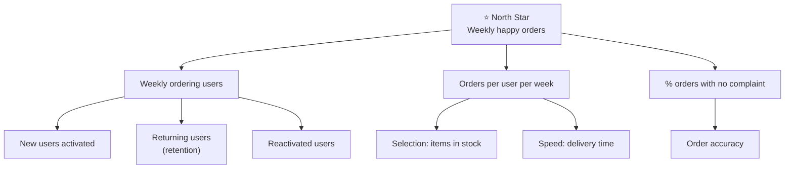

# A8.2 North Star metric and metric trees

## In one line

A North Star metric is the one number that best shows customers getting value from your product. A metric tree breaks it into smaller numbers that individual teams can move.

## Why this matters

Without a shared top number, every team optimises its own corner, and the product feels disjointed. With a North Star but no tree, teams know the destination but not which road is theirs. Together, they align a whole company on what "winning" means.

## The idea, simply

!!! tip "Analogy: the chai stall"
    Ravi runs a chai stall near a metro station. He could measure many things: cups made, sugar bought, hours open. But the number that best shows customers getting value is **cups sold to repeat customers each week**. If that grows, people like his chai and keep coming back. Everything else (opening earlier, faster service, a second kettle) feeds into it. That one number is his North Star. The things that feed it are his **metric tree**.

**What makes a good North Star metric?**

The term was popularised by growth expert Sean Ellis. Amplitude later turned it into a full method in its free [North Star Playbook](https://amplitude.com/books/north-star), co-written with John Cutler. A good North Star:

1. **Reflects customer value**, not just company revenue. Revenue is a result of value, so it usually comes later.
2. **Predicts long-term business success.** If it grows, revenue and retention should follow.
3. **Can be influenced** by product and other teams.
4. **Is easy to understand.** Anyone in the company can explain it in one sentence.
5. **Is a number that can grow**, usually a count over a time window. Ratios can look good while the business shrinks.

Classic examples you'll often hear: Airbnb's *nights booked*, Spotify's *time spent listening*, and a B2B SaaS tool's *weekly active teams*.

**What is a metric tree?**

A metric tree is a diagram that shows how a top metric is built from smaller ones. The parts either **multiply** (for example, users × frequency × order value) or **add up** (new users + returning users + reactivated users). [Levers Labs](https://www.leverslabs.com/article/introducing-metric-trees) defines a metric tree as a model of how inputs flow into a business and become outputs.

Trees help in three ways:

- **Ownership:** each branch gets an owning team.
- **Diagnosis:** when the top number moves, you walk down the branches to find which part moved (see [A8.6](06-diagnosing-a-metric-drop.md)).
- **Prioritisation:** you can estimate which branch has the biggest upside before you invest.

## Framework: Find your North Star in 5 steps

Adapted from the [Amplitude North Star Playbook](https://amplitude.com/books/north-star):

1. **Name the "game" your product plays.** Is it an *attention* game (time spent, e.g. YouTube), a *transaction* game (purchases, e.g. Swiggy), or a *productivity* game (tasks done, e.g. Notion)?
2. **Write the moment of value** in one sentence. Example: "A customer gets groceries delivered in under 15 minutes and is happy with them."
3. **Turn it into a count over time.** Example: "Weekly successful grocery orders with no complaints."
4. **Test it.** Would it fall if users were unhappy? Would it rise if you just spammed notifications? If spam would raise it, add a quality filter or choose a different metric.
5. **Break it into 3–5 inputs** and assign an owner to each. Pair each input with a counter metric.

**When to use:** company or product-line alignment, annual or quarterly planning, and building a growth team.
**When not to:** a very early product still searching for product-market fit. There you need learning metrics, not a fixed North Star (see [A8.4](04-lean-analytics-one-metric-that-matters-and-stage.md)).

## Diagram

The top number splits into parts that multiply or add up. Each box at the bottom can have one owning team.

## Worked example

You are PM at a quick-commerce startup in Bengaluru. The founder asks, "What should our North Star be?"

1. **Game:** a transaction game. Customers want everyday items delivered fast.
2. **Moment of value:** "Got what I needed, fast, and it was right."
3. **Candidate metrics:**
    - *Revenue*: comes too late, and can be inflated by price hikes.
    - *App opens*: vanity, because notifications can inflate it.
    - **Weekly orders delivered on time with no complaints**: captures speed, accuracy and frequency.
4. **Tree:**
    - Weekly happy orders = weekly ordering users × orders per user × share without complaint
    - Weekly ordering users = new activated + retained + reactivated
5. **Owners:**
    - Growth team: new activated users
    - Retention team: returning users
    - Catalogue team: in-stock rate
    - Ops team: on-time rate
6. **Guardrails:** contribution margin per order, so growth isn't bought at a loss, and delivery-partner safety incidents.

The founder now has one number for the board deck. Every team also knows which branch is theirs.

## Real-world examples (2023 onwards)

!!! example "Duolingo, 2023: the growth model that picked the right input"
    In a widely read [2023 essay on Lenny's Newsletter](https://www.lennysnewsletter.com/p/how-duolingo-reignited-user-growth), former Duolingo CPO Jorge Mazal explained how the team's growth had slowed to single digits by mid-2018. They built a model that splits all users into states, such as new, current, at-risk and reactivated. It also tracks the rates at which users move between those states, and the states add up to daily active users (DAU). [Duolingo's own engineering blog](https://blog.duolingo.com/growth-model-duolingo/) describes simulations showing that improving **Current User Retention Rate (CURR)** had the biggest impact on DAU. A retention team was set up around it. Duolingo has written that DAU grew from 4.9 million at the start of 2019 to [21.4 million by Q3 2023](https://blog.duolingo.com/growth-principles/).

    **PM lesson:** DAU was the North Star. The tree revealed that one input, keeping existing users, mattered far more than chasing new ones. The team also said "no" to work that seemed urgent before, like new-user retention projects. Duolingo's blog adds a twist: once most DAU became "current users", CURR itself grew harder to move. So they started exploring finer user segments. **A tree needs pruning as the business changes.**

!!! example "Swiggy, Q3 FY26 (January 2026): reading the branches"
    In its [Q3 FY26 shareholder letter](https://www.swiggy.com/corporate/wp-content/uploads/2026/01/Q3-FY2026-Shareholder-letter.pdf), Swiggy noted for one of its businesses that wallet share (GOV per user) rose about 6% quarter-on-quarter even though order frequency stayed flat.

    **PM lesson:** that is a metric tree in action. GOV = users × frequency × order value. When you report which branch moved, leaders can see *how* growth happened: bigger baskets, not more frequent orders. Then they can decide what to push next.

## Common mistakes

!!! warning "Watch out for"
    - **Choosing revenue as the North Star.** Revenue is important, but it's lagging and can grow while customers suffer (e.g. price hikes).
    - **Having "three North Stars".** Then you don't have one. Use one North Star plus a few inputs.
    - **A tree with no owners.** Boxes no team owns are just decoration.
    - **Never revisiting it.** As Duolingo found, the best lever changes as the business grows.
    - **Ignoring quality.** A pure count can be inflated with spam, discounts or dark patterns. Add a quality filter or a guardrail.

## Research happening now

!!! info "Research happening now"
    - **Standard metric trees (SOMA).** Abhi Sivasailam at Levers Labs is building a standard library of metric trees for common business types, and presenting this work at [Data Council](https://www.datacouncil.ai/talks25/designing-and-building-metric-trees). *Status: practitioner-led standard, still evolving.* For a beginner overview, see [Count.co's introduction to metric trees](https://count.co/blog/intro-to-metric-trees) (updated October 2025).
    - **Metric trees inside analytics tools.** Product analytics vendors such as [Mixpanel](https://mixpanel.com/blog/metric-tree/) now offer metric-tree features that link a top metric to the user behaviours below it. The open question is whether tools can *automatically* find which branch caused a change; see A8.6 for early AI work on root-cause analysis.

## Try it yourself (25 minutes)

Pick an Indian consumer app you know well (CRED, Zerodha, Meesho, Rapido, etc.).

1. Write its likely North Star in one sentence and test it against the 5 rules.
2. Draw a tree with 3 branches and 2 sub-branches each.
3. For each leaf, name which team would own it and one counter metric.

## Go deeper

- **Guide:** [Amplitude North Star Playbook](https://amplitude.com/books/north-star). Free workshop exercises for choosing a North Star.
- **Article:** [How Duolingo reignited user growth](https://www.lennysnewsletter.com/p/how-duolingo-reignited-user-growth) by Jorge Mazal on Lenny's Newsletter. The best real-world growth-model story. Free post.
- **Article:** [Duolingo blog: the Growth Model](https://blog.duolingo.com/growth-model-duolingo/). The data team's own explanation, including its limits.
- **Article:** [Levers Labs: Introducing Metric Trees](https://www.leverslabs.com/article/introducing-metric-trees).
- **Watch:** [Lenny's Podcast on YouTube](https://www.youtube.com/@lennyspodcast). Search the channel for the episode with Sean Ellis, who popularised the North Star metric.

## Key takeaways

- One **North Star** = the clearest number for customers getting value.
- A **metric tree** splits it into inputs that multiply or add up, each with an owner.
- Test your North Star: would spam or discounts fake it? If yes, fix it.
- Trees are for **ownership, diagnosis and prioritisation**.
- Revisit the tree as the business matures. Today's best lever may not be tomorrow's.

## Updates

*No updates yet.*
