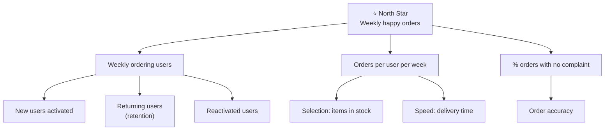

# A8.2 North Star metric and metric trees

## In one line

A North Star metric is the one number that best shows customers getting value from your product. A metric tree breaks it into smaller numbers that individual teams can move.

## Why this matters

Without a shared top number, every team optimises its own corner, and the product feels disjointed. With a North Star but no tree, teams know the destination but not which road is theirs. Together, they align a whole company on what "winning" means.

## Key terms

| Term | Plain-English meaning |
|---|---|
| **North Star metric (NSM)** | The one number that best shows customers getting value, and predicts long-term success. |
| **North Star Framework** | The NSM plus the 3–5 input metrics that drive it (popularised by Amplitude). |
| **Input metric** | A driver of the NSM that a team can move directly. |
| **Metric tree** | A diagram that breaks a top metric into parts that multiply or add up to it. |
| **Multiplicative split** | Top = A × B × C (e.g. users × frequency × order value). |
| **Additive split** | Top = A + B + C (e.g. new + retained + reactivated users). |
| **Guardrail** | A metric that stops you from "winning" the NSM in a harmful way. |
| **Owner** | The team accountable for moving one branch of the tree. |

## The idea, simply

!!! tip "Analogy: the chai stall"
    Ravi runs a chai stall near a metro station. He could measure many things: cups made, sugar bought, hours open. But the number that best shows customers getting value is **cups sold to repeat customers each week**. If that grows, people like his chai and keep coming back. Everything else (opening earlier, faster service, a second kettle) feeds into it. That one number is his North Star. The things that feed it are his **metric tree**.

**What makes a good North Star metric?**

The term was popularised by growth expert Sean Ellis. Amplitude later turned it into a full method in its free [North Star Playbook](https://amplitude.com/books/north-star), co-written with John Cutler. A good North Star:

1. **Reflects customer value**, not just company revenue. Revenue is a result of value, so it usually comes later.
2. **Predicts long-term business success.** If it grows, revenue and retention should follow.
3. **Can be influenced** by product and other teams.
4. **Is easy to understand.** Anyone in the company can explain it in one sentence.
5. **Is a number that can grow**, usually a count over a time window. Ratios can look good while the business shrinks.

Classic examples you'll often hear: Airbnb's *nights booked*, Spotify's *time spent listening*, and a B2B SaaS tool's *weekly active teams*.

**What is a metric tree?**

A metric tree is a diagram that shows how a top metric is built from smaller ones. The parts either **multiply** (for example, users × frequency × order value) or **add up** (new users + returning users + reactivated users). [Levers Labs](https://www.leverslabs.com/article/introducing-metric-trees) defines a metric tree as a model of how inputs flow into a business and become outputs.

Trees help in three ways:

- **Ownership:** each branch gets an owning team.
- **Diagnosis:** when the top number moves, you walk down the branches to find which part moved (see [A8.6](06-diagnosing-a-metric-drop.md)).
- **Prioritisation:** you can estimate which branch has the biggest upside before you invest.

### The three "games" a product can play

Amplitude's playbook groups products into three "games". Knowing yours narrows down your North Star quickly.

| Game | What users want | Typical North Star shape | Examples (illustrative) |
|---|---|---|---|
| **Attention** | To spend time they enjoy | Time spent on valuable content, by engaged users | OTT apps, short video, news, music |
| **Transaction** | To get something done or bought | Successful transactions (orders, rides, payments) | Food and grocery delivery, ride-hailing, UPI apps, e-commerce |
| **Productivity** | To finish work faster or better | Tasks or workflows completed, by active teams | Notion, Slack, Zoho, design tools |

Some products play two games, for example a social app with a marketplace inside. Pick the game that matches how the product makes money and keeps users, and treat the other as an input or a guardrail.

### Telling a good North Star from a bad one

Try your candidate against the five rules. Here's how a few common candidates score for a food delivery app:

| Candidate | Reflects value? | Predicts success? | Can teams move it? | Easy to explain? | Can grow? | Verdict |
|---|---|---|---|---|---|---|
| Revenue | Partly | Yes, but late | Weakly | Yes | Yes | ❌ An output, not a North Star |
| App opens | No | Weakly | Yes, too easily | Yes | Yes | ❌ Vanity; notifications inflate it |
| Order conversion rate | Partly | Partly | Yes | Yes | No (it's a ratio) | ❌ Better as an input |
| **Weekly orders delivered on time with no complaint** | Yes | Yes | Yes | Yes | Yes | ✅ |

### How to choose good input metrics under the North Star

A North Star needs 3–5 input metrics. Each one should pass three tests:

1. **Controllable:** one team can move it within a quarter.
2. **Leading:** it moves *before* the North Star does.
3. **Measurable weekly:** you can see it change fast enough to learn.

Inputs often fall into the same few families. Use them as a checklist so you don't miss a branch:

- **Breadth:** how many users get value (e.g. weekly ordering users).
- **Depth:** how much value each user gets (e.g. items per order).
- **Frequency:** how often they come back (e.g. orders per user per week).
- **Efficiency:** how quickly or easily they get value (e.g. time to checkout, on-time rate).

### North Star patterns by product type

These are **illustrative patterns** to help you think, not official metrics of any company:

| Product type | A North Star pattern | Why it fits |
|---|---|---|
| UPI / payments app | Monthly users making 2+ successful payments | Repeat use shows trust and habit, not just a one-off try |
| Quick commerce | Weekly orders delivered on time with no complaint | Captures speed, accuracy and frequency together |
| OTT / video streaming | Weekly hours watched by active viewers | Attention game; value is time spent on content people chose |
| Edtech (self-learning) | Weekly learners completing at least one lesson | Completion, not app opens, shows learning value |
| Marketplace (seller side) | Sellers with at least one order this week | Value for sellers is sales, not listings |
| B2B SaaS | Weekly active teams completing the core workflow | Value shows up at team level, repeatedly |
| Social / community app | Daily users who post, reply or react meaningfully | Separates participation from passive scrolling |

Notice the pattern: **a value action + who + how often.** Each one counts *real value* over a *time window* that matches the product's natural rhythm.

## Framework: Find your North Star in 5 steps

Adapted from the [Amplitude North Star Playbook](https://amplitude.com/books/north-star):

1. **Name the "game" your product plays.** Is it an *attention* game (time spent, e.g. YouTube), a *transaction* game (purchases, e.g. Swiggy), or a *productivity* game (tasks done, e.g. Notion)?
2. **Write the moment of value** in one sentence. Example: "A customer gets groceries delivered in under 15 minutes and is happy with them."
3. **Turn it into a count over time.** Example: "Weekly successful grocery orders with no complaints."
4. **Test it.** Would it fall if users were unhappy? Would it rise if you just spammed notifications? If spam would raise it, add a quality filter or choose a different metric.
5. **Break it into 3–5 inputs** and assign an owner to each. Pair each input with a counter metric.

**When to use:** company or product-line alignment, annual or quarterly planning, and building a growth team.
**When not to:** a very early product still searching for product-market fit. There you need learning metrics, not a fixed North Star (see [A8.4](04-lean-analytics-one-metric-that-matters-and-stage.md)).

## Diagram

The top number splits into parts that multiply or add up. Each box at the bottom can have one owning team.

## Worked example

You are PM at a quick-commerce startup in Bengaluru. The founder asks, "What should our North Star be?"

1. **Game:** a transaction game. Customers want everyday items delivered fast.
2. **Moment of value:** "Got what I needed, fast, and it was right."
3. **Candidate metrics:**
    - *Revenue*: comes too late, and can be inflated by price hikes.
    - *App opens*: vanity, because notifications can inflate it.
    - **Weekly orders delivered on time with no complaints**: captures speed, accuracy and frequency.
4. **Tree:**
    - Weekly happy orders = weekly ordering users × orders per user × share without complaint
    - Weekly ordering users = new activated + retained + reactivated
5. **Owners:**
    - Growth team: new activated users
    - Retention team: returning users
    - Catalogue team: in-stock rate
    - Ops team: on-time rate
6. **Guardrails:** contribution margin per order, so growth isn't bought at a loss, and delivery-partner safety incidents.

The founder now has one number for the board deck. Every team also knows which branch is theirs.

### The numbers: which branch is worth it?

Take the tree from the worked example, with today's values:

| Part | Today |
|---|---|
| Weekly ordering users | 200,000 |
| Orders per user per week | 1.5 |
| % of orders with no complaint | 92% |
| **Weekly happy orders (North Star)** | **200,000 × 1.5 × 0.92 = 276,000** |

Three teams propose projects. Each estimates a realistic lift for one quarter:

| Project | Branch | Realistic lift | New North Star | Gain |
|---|---|---|---|---|
| Better first-week onboarding (growth team) | Users +5% → 210,000 | +5% | 289,800 | **+13,800** |
| Smarter reorder reminders (retention team) | Frequency 1.5 → 1.6 | +6.7% | 294,400 | **+18,400** |
| Packing checklist for riders (ops team) | No-complaint 92% → 94% | +2.2% | 282,000 | **+6,000** |

On impact alone, reorder reminders win. But a PM also weighs:

- **Effort:** reminders may take 2 weeks; onboarding may take 8.
- **Confidence:** how sure are we of each lift? Has something similar worked before?
- **Guardrails:** reminders can annoy users. Watch notification opt-outs.
- **Long-term value:** the packing checklist improves quality, which supports retention later even though its immediate gain is smallest.

This is how a metric tree turns a debate ("my project matters more!") into a calculation. Prioritisation frameworks like RICE ([A5.2](../05-roadmaps-and-prioritisation/02-prioritisation-frameworks-rice-ice-moscow-kano.md)) formalise exactly this.

## Going deeper: nuances and trade-offs

### 1. North Star vs OKRs vs One Metric That Matters

These three are often confused:

| | North Star metric | OKRs | One Metric That Matters |
|---|---|---|---|
| **Time span** | Years | A quarter | Weeks to months |
| **Who** | Whole company or product line | Each team | A team or a young product |
| **Purpose** | Shared definition of "winning" | Goals for this period | The single biggest problem right now |

A healthy setup uses all three. The NSM stays fixed. Each team's OKRs target an input on the tree. A team may also have a temporary OMTM while it fixes a specific problem ([A8.4](04-lean-analytics-one-metric-that-matters-and-stage.md)).

### 2. Marketplaces need a North Star that serves both sides

Food delivery, ride-hailing and e-commerce marketplaces have buyers *and* sellers (and often delivery partners). A North Star like "weekly successful orders" works because each successful order means value for every side. Add **supply-side guardrails** such as partner earnings per hour, restaurant cancellation rates or seller retention. A North Star that only looks at buyers can quietly burn out the supply that makes the marketplace work.

### 3. B2B North Stars count accounts, not people

In B2B SaaS the customer is a company, and value usually shows up as a *team* doing the core job regularly. Good B2B North Stars look like "weekly active teams that completed the core workflow" or "accounts with 3+ active seats". Revenue expansion (more seats, higher plans) follows from that.

### 4. Doing the maths on a tree

Trees make prioritisation a calculation instead of an opinion.

- **Multiplicative parts:** a 10% lift in *any* factor lifts the top by about 10%. So pick the factor that's easiest to move.
- **Additive parts:** weight by size. A 10% lift in a bucket that is 80% of users matters far more than the same lift in a bucket that is 5%.
- **Compounding parts:** some branches feed themselves. Retained users stay retained, so small gains build up over time. This is exactly why Duolingo's simulations favoured CURR (see the example below).

A simple way to estimate the upside of a branch: **size of the branch × realistic lift × how directly it flows to the top**. Do this for each branch before roadmap planning. It's the logic behind Duolingo's sensitivity analysis.

### 5. When the North Star stops moving

Every metric saturates eventually. Signs of trouble:

- big projects stop moving the North Star
- one user segment now dominates the number
- the North Star rises while revenue or retention falls (you may be gaming it)

The fix is usually to **change the granularity** (split it into segments) rather than replace the North Star. Replacing a North Star is a big decision. It changes every team's goals, so communicate it as carefully as a strategy change.

### 6. Gaming risk is highest at the top

Because everyone is rewarded for it, the North Star is the metric most exposed to Goodhart's law ([A8.1](01-metric-basics-leading-lagging-input-output-vanit.md)). Notification spam inflates "daily active users". Discounts inflate "orders". Low-quality content inflates "time spent". Build a quality condition into the definition itself where you can ("orders *with no complaint*", "sessions *with at least one completed lesson*").

### 7. Communicating the North Star so it actually guides work

A North Star only works if people use it in daily decisions. Teams that do this well:

- **Put it everywhere:** at the top of every dashboard, in every quarterly plan, and in PRD success sections.
- **Tie roadmap items to a branch:** every project names which input it expects to move, and by roughly how much.
- **Review it in a weekly ritual:** North Star trend first, then each input with its owner.
- **Write a one-page explainer:** the definition, why it was chosen, the tree, the guardrails, and what it is *not*.

### 8. When you have more than one product

Companies with several products (Swiggy's food delivery and Instamart, Google's Search and YouTube) usually give **each product its own North Star**. A company-level output, such as total users or revenue, then sits above them. Forcing one North Star across very different products tends to favour whichever product is biggest. Make sure cross-product effects, like one app sending users to another, are visible as inputs.

## Real-world examples (2023 onwards)

!!! example "Duolingo, 2023: the growth model that picked the right input"
    In a widely read [2023 essay on Lenny's Newsletter](https://www.lennysnewsletter.com/p/how-duolingo-reignited-user-growth), former Duolingo CPO Jorge Mazal explained how the team's growth had slowed to single digits by mid-2018. They built a model that splits all users into states, such as new, current, at-risk and reactivated. It also tracks the rates at which users move between those states, and the states add up to daily active users (DAU). [Duolingo's own engineering blog](https://blog.duolingo.com/growth-model-duolingo/) describes simulations showing that improving **Current User Retention Rate (CURR)** had the biggest impact on DAU. A retention team was set up around it. Duolingo has written that DAU grew from 4.9 million at the start of 2019 to [21.4 million by Q3 2023](https://blog.duolingo.com/growth-principles/).

    **PM lesson:** DAU was the North Star. The tree revealed that one input, keeping existing users, mattered far more than chasing new ones. The team also said "no" to work that seemed urgent before, like new-user retention projects. Duolingo's blog adds a twist: once most DAU became "current users", CURR itself grew harder to move. So they started exploring finer user segments. **A tree needs pruning as the business changes.**

!!! example "Swiggy, Q3 FY26 (January 2026): reading the branches"
    In its [Q3 FY26 shareholder letter](https://www.swiggy.com/corporate/wp-content/uploads/2026/01/Q3-FY2026-Shareholder-letter.pdf), Swiggy noted for one of its businesses that wallet share (GOV per user) rose about 6% quarter-on-quarter even though order frequency stayed flat.

    **PM lesson:** that is a metric tree in action. GOV = users × frequency × order value. When you report which branch moved, leaders can see *how* growth happened: bigger baskets, not more frequent orders. Then they can decide what to push next.

## Common mistakes

!!! warning "Watch out for"
    - **Choosing revenue as the North Star.** Revenue is important, but it's lagging and can grow while customers suffer (e.g. price hikes).
    - **Having "three North Stars".** Then you don't have one. Use one North Star plus a few inputs.
    - **A tree with no owners.** Boxes no team owns are just decoration.
    - **Never revisiting it.** As Duolingo found, the best lever changes as the business grows.
    - **Ignoring quality.** A pure count can be inflated with spam, discounts or dark patterns. Add a quality filter or a guardrail.
    - **Copying another company's North Star.** "Airbnb uses nights booked" doesn't mean you should; the value moment is product-specific.
    - **Ignoring the supply side** in a marketplace North Star.

## Common questions

**Can the North Star be revenue?**
Usually not. Revenue is the result of value, so it lags, and it can be inflated by price increases or aggressive monetisation. Some B2B or monetisation-focused teams use a value-based revenue measure (like "revenue from retained customers") as an input, but the company North Star is normally a customer-value measure.

**How often should we change our North Star?**
Rarely: think in years, not quarters. Change it only when the strategy changes (new business model, new core customer) or the current one clearly stops predicting success. Announce a change like a strategy change.

**Who owns the North Star?**
Leadership owns it: typically the CPO or CEO, with the data team owning the definition. No single team "owns" moving it. Teams own the inputs.

**How many inputs should a North Star have?**
3–5. Fewer and you miss important drivers. More and focus disappears.

**What if our North Star goes up but revenue goes down?**
Treat it as a warning. Either the North Star is being gamed, or it no longer predicts business success. Check the quality filter and the guardrails, then revisit the definition if needed.

## In the interview

!!! question "In the interview"
    **How it's tested:** "What would be the North Star metric for *[product]*?" is asked on its own and inside metrics or strategy questions. Interviewers want reasoning, not one magic number.

    **Sample question:** *"What should Zepto's North Star metric be?"*

    **Outline of a strong answer:**

    1. **State the value:** the customer gets everyday items fast, and correctly.
    2. **Pick the game:** a transaction game.
    3. **Propose 2–3 candidates and reject the weak ones:** GMV (inflated by price and discounts), app opens (vanity), and **weekly orders delivered on time without complaint** (chosen).
    4. **Draw the tree:** ordering users × orders per user × share without complaint, with users split into new, retained and reactivated.
    5. **Add guardrails:** contribution margin per order, delivery-partner safety and earnings, and stock-out rate.
    6. **Explain how to validate it:** cities or cohorts with a higher North Star should show better long-term revenue and retention.

## Research happening now

!!! info "Research happening now"
    - **Standard metric trees (SOMA).** Abhi Sivasailam at Levers Labs is building a standard library of metric trees for common business types, and presenting this work at [Data Council](https://www.datacouncil.ai/talks25/designing-and-building-metric-trees). *Status: practitioner-led standard, still evolving.* For a beginner overview, see [Count.co's introduction to metric trees](https://count.co/blog/intro-to-metric-trees) (updated October 2025).
    - **Metric trees inside analytics tools.** Product analytics vendors such as [Mixpanel](https://mixpanel.com/blog/metric-tree/) now offer metric-tree features that link a top metric to the user behaviours below it. The open question is whether tools can *automatically* find which branch caused a change; see A8.6 for early AI work on root-cause analysis.

## Try it yourself (25 minutes)

Pick an Indian consumer app you know well (CRED, Zerodha, Meesho, Rapido, etc.).

1. Write its likely North Star in one sentence and test it against the 5 rules.
2. Draw a tree with 3 branches and 2 sub-branches each.
3. For each leaf, name which team would own it and one counter metric.

??? success "Check your answer"
    Take Zerodha (a stock-broking app) as an example.

    - **A possible North Star:** "monthly active investing accounts", meaning accounts that placed at least one trade or SIP in the month. It reflects real use, not just sign-ups.
    - **Tree:** active accounts = new funded accounts + retained active accounts + reactivated accounts; each can be split again by product (equity, mutual funds).
    - **Owners and counter metrics:**
        - onboarding team: funded-account rate (counter: KYC rejection rate)
        - retention team: monthly active rate (counter: complaint rate)
        - product team: SIP adoption (counter: SIP cancellations)
    - **Self-check:** would your North Star fall if users were unhappy? Could a notification blast fake it? If yes, add a quality condition.

## How this connects

- [A8.1 Metric basics](01-metric-basics-leading-lagging-input-output-vanit.md): the input/output split that metric trees are built on.
- [A8.4 Lean Analytics](04-lean-analytics-one-metric-that-matters-and-stage.md): when a young product should use an OMTM instead of a fixed North Star.
- [A8.6 Diagnosing a metric drop](06-diagnosing-a-metric-drop.md): walking down the tree to find what broke.
- [A4.1 Vision and mission](../04-strategy-and-vision/01-vision-and-mission.md): the North Star should be the measurable shadow of your vision.
- [A5.2 Prioritisation frameworks](../05-roadmaps-and-prioritisation/02-prioritisation-frameworks-rice-ice-moscow-kano.md): using tree maths to size the impact of roadmap ideas.

## Go deeper

- **Guide:** [Amplitude North Star Playbook](https://amplitude.com/books/north-star). Free workshop exercises for choosing a North Star.
- **Article:** [How Duolingo reignited user growth](https://www.lennysnewsletter.com/p/how-duolingo-reignited-user-growth) by Jorge Mazal on Lenny's Newsletter. The best real-world growth-model story. Free post.
- **Article:** [Duolingo blog: the Growth Model](https://blog.duolingo.com/growth-model-duolingo/). The data team's own explanation, including its limits.
- **Article:** [Levers Labs: Introducing Metric Trees](https://www.leverslabs.com/article/introducing-metric-trees).
- **Watch:** [Lenny's Podcast on YouTube](https://www.youtube.com/@lennyspodcast). Search the channel for the episode with Sean Ellis, who popularised the North Star metric.

## Key takeaways

- One **North Star** = the clearest number for customers getting value.
- A **metric tree** splits it into inputs that multiply or add up, each with an owner.
- Test your North Star: would spam or discounts fake it? If yes, fix it.
- Trees are for **ownership, diagnosis and prioritisation**.
- Revisit the tree as the business matures. Today's best lever may not be tomorrow's.
- North Star (years) → OKRs on its inputs (a quarter) → an OMTM for the current biggest problem (weeks).
- In marketplaces, guard the **supply side**; in B2B, count **teams and accounts**.

## Updates

*No updates yet.*
