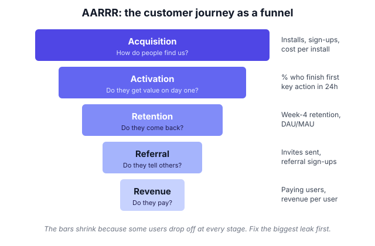

# A8.3 AARRR and Google's HEART framework

## In one line

**AARRR** measures the *business journey* of a customer, from finding you to paying you. **HEART** measures the *quality of the experience* along the way.

## Why this matters

When someone says "let's track metrics for this feature", the blank page is scary. These two frameworks are checklists that make sure you don't forget a whole stage of the customer's life. In PM interviews they're also the most common way to structure a "what metrics would you track?" answer (see [A12.3](../12-career-and-interviews/03-metrics-estimation-and-execution-interviews.md)).

## Key terms

| Term | Plain-English meaning |
|---|---|
| **Activation / "aha moment"** | The first time a new user gets the product's real value. |
| **Retention** | The share of users who come back over time. |
| **Viral coefficient (K)** | New users each existing user brings in = invites sent per user × % of invites that convert. |
| **ARPU** | Average revenue per user over a period. |
| **CAC** | Customer acquisition cost: what you spend to win one new customer. |
| **LTV** | Lifetime value: total profit you expect from one customer. |
| **NPS / CSAT / CES** | Survey scores for loyalty (NPS), satisfaction (CSAT) and effort (CES). |
| **GSM** | Goals → Signals → Metrics: HEART's method for turning a goal into a number. |

## The idea, simply

!!! tip "Analogy: a new restaurant on your street"
    - **Acquisition:** you notice the board outside.
    - **Activation:** you walk in, order, and the first bite is great.
    - **Retention:** you come back next week.
    - **Referral:** you tell your friends.
    - **Revenue:** you keep paying.

    AARRR is how the *owner* tracks the business. HEART is how the owner checks whether eating there *feels good*. Were you happy? Did you engage with the menu? Did you try the new dish? Did you come back? Did you manage to order without confusion?

### AARRR ("pirate metrics")

Investor Dave McClure introduced AARRR in a [2007 talk called "Startup Metrics for Pirates"](https://www.slideshare.net/slideshow/startup-metrics-for-pirates-presentation/629833). Say the acronym out loud and it sounds like a pirate. The five stages are:

| Stage | Question it answers | Example metrics |
|---|---|---|
| **Acquisition** | How do people find us? | Installs, sign-ups, cost per acquired user |
| **Activation** | Do they get value the first time? | % of new users who complete the key first action |
| **Retention** | Do they come back? | Week-1/week-4 retention, DAU/MAU |
| **Referral** | Do they bring others? | Invites sent, referral sign-ups |
| **Revenue** | Do they pay? | Conversion to paid, revenue per user |

Many teams now put **Retention before Acquisition** in priority. Pouring new users into a leaky product wastes money. Some modern versions also add **Awareness** at the start ("AAARRR").

### HEART (Google)

Google researchers Kerry Rodden, Hilary Hutchinson and Xin Fu published HEART at the ACM CHI conference in 2010, in a paper titled [*Measuring the User Experience on a Large Scale*](https://research.google/pubs/measuring-the-user-experience-on-a-large-scale-user-centered-metrics-for-web-applications/).

| Letter | Means | Example metric |
|---|---|---|
| **H**appiness | How users *feel* (asked via surveys) | Satisfaction score, NPS |
| **E**ngagement | How deeply they use it | Actions per user per week |
| **A**doption | New users of a product or feature | % of users who tried the feature this week |
| **R**etention | Do they keep using it? | % still using after 30 days |
| **T**ask success | Can they do what they came for? | Completion rate, time to complete, error rate |

HEART comes with a simple process called **Goals → Signals → Metrics (GSM)**:

1. **Goal:** what are we trying to achieve for the user?
2. **Signal:** what user behaviour or feeling would show we're succeeding?
3. **Metric:** how do we turn that signal into a number we can track?

The paper's advice: **don't fill all five boxes for every project.** Pick only the categories that match your goal.

## Framework: choosing between them

- **Use AARRR** for a whole product or business, a growth strategy, or to find the biggest leak in the funnel.
- **Use HEART** for a feature or redesign, when you care about experience quality, or when you're working with designers.
- **Use both** when launching a big feature. HEART judges the feature itself, and AARRR shows its effect on the business.

## Diagram

Every stage loses some users. Your job is to find the stage with the biggest drop and fix that first.

## Worked example

Your UPI payments app is launching **"Split the bill"** for groups of friends.

**HEART + GSM for the feature:**

| Category | Goal | Signal | Metric |
|---|---|---|---|
| Adoption | Users discover splitting | They open the split screen | % of weekly active users who start a split |
| Task success | Splitting is easy | They finish without abandoning | Split completion rate; median time to finish |
| Happiness | Users feel it's fair and simple | Positive feedback | Post-split 1-question rating |
| Retention | It becomes a habit | They split again | % of first-time splitters who split again within 30 days |

(Engagement is skipped on purpose. It doesn't match this feature's goal.)

**AARRR view for the business:**

- **Referral:** each split invites friends who may not use your app. Track new users who joined through a split request.
- **Retention:** do users who split have higher 90-day retention than similar users who don't?

## Going deeper: nuances and trade-offs

### 1. Finding your real activation moment

"Activation" isn't something you declare. You discover it from data.

1. **List candidate early actions:** for a food app, first order delivered, saving an address, ordering twice in a week.
2. **Compare users who did each action early** with users who didn't, and look at their retention 30–90 days later.
3. **Pick the action (and threshold) that best separates retained from churned users,** for example "2 orders in the first 14 days".
4. **Test it.** Run an experiment that pushes more users to that action, and check that retention really rises. Correlation alone isn't enough, because naturally engaged users do everything more.

Amplitude's 2025 benchmark analysis found a strong link between week-one activation and three-month retention ([source](https://amplitude.com/blog/7-percent-retention-rule)), which is why activation deserves so much attention.

### 2. The maths of referral

The **viral coefficient** is K = (invites sent per user) × (% of invites that become users).

- If each user sends 5 invites and 10% convert, K = 0.5. Every 100 users bring 50 more, who bring 25 more, and so on. That's helpful, but not self-sustaining.
- K above 1 means growth feeds itself, which is very rare and usually short-lived.
- **Cycle time** matters as much as K. A loop that completes in 1 day compounds far faster than one that takes a month.

Most products should treat referral as a *boost* to acquisition, not the engine.

### 3. Revenue: ARPU, LTV and CAC

At the Revenue stage, three numbers decide whether growth is healthy:

- **ARPU:** revenue per user per period.
- **LTV:** the profit a customer brings over their whole life. A rough version is monthly contribution per user ÷ monthly churn rate.
- **CAC:** marketing and sales cost ÷ new customers won.

The basic rule: **LTV must be comfortably higher than CAC, and the time to earn back CAC (the payback period) must be something your cash can survive.** Discount-heavy acquisition often makes CAC look low while quietly lowering LTV, because discount-hunters churn fast.

### 4. Measuring happiness well

- **NPS** ("How likely are you to recommend us?", 0–10) measures loyalty.
- **CSAT** ("How satisfied were you?") measures satisfaction with one interaction.
- **CES** ("How easy was it?") measures effort, and suits support and checkout flows.

All surveys have **response bias**: very happy and very angry users answer more. Ask at the right moment (right after the task, not days later), keep it to 1–2 questions, and always read the comments, since that's where the "why" lives. Never use survey scores alone. Pair them with behaviour.

### 5. Common variations of AARRR

- **AAARRR** adds *Awareness* before Acquisition, useful for brand-led products.
- Some growth teams reorder the stages to put **Retention first**: fix the leaky bucket before paying for more users.
- **B2B** teams often map AARRR onto the sales funnel: lead → trial → activated account → expansion → renewal.

The labels matter less than covering the whole customer life and finding the weakest stage.

### 6. HEART at feature level vs product level

At **product level**, HEART categories become company KPIs (overall retention, satisfaction). At **feature level**, they become short-term launch metrics (adoption of the feature, task success). A common trap is reading *feature adoption* as success. Lots of people may *try* a feature without it improving retention or task success for anyone. Always ask: adoption *and then what?*

## Real-world examples (2023 onwards)

!!! example "ChatGPT, January 2023: record acquisition, then the real test"
    An analyst note from UBS, [reported by Reuters on 1 February 2023](https://www.reuters.com/technology/chatgpt-sets-record-fastest-growing-user-base-analyst-note-2023-02-01/), estimated that ChatGPT reached 100 million monthly active users in January 2023, about two months after launch. That was faster than any consumer app the analysts had tracked. Months later, traffic dipped for the first time (see [A8.6](06-diagnosing-a-metric-drop.md)), and the question shifted from *acquisition* to *retention*. In 2025, [a16z showed](https://a16z.com/ai-retention-benchmarks/) that ChatGPT's monthly usage retention curve eventually rose again ("smiled") as users made it a habit.

    **PM lesson:** a record at the top of the funnel is a starting gun, not a finish line. The stages that decided ChatGPT's long-term success were activation and retention.

!!! example "JioCinema and IPL 2023: free acquisition, monetise later"
    JioCinema streamed IPL 2023 free for all viewers. Hotstar had kept the IPL behind a paywall since 2019. JioCinema set a world record of over 3.2 crore (32 million) concurrent viewers during the final, [according to Business Today](https://www.businesstoday.in/technology/news/story/ipl-2023-finals-jiocinema-breaks-world-record-with-over-32-crore-viewers-during-csk-vs-gt-final-383398-2023-05-30). Revenue came mainly from advertising around the matches, while the platform also launched a paid premium tier for other content.

    **PM lesson:** the AARRR order is a choice. JioCinema deliberately maximised **Acquisition** with a free hook, and moved **Revenue** to ads plus a separate premium product. Whether that works depends on retention *after* the IPL ends. That's exactly the stage to watch in a strategy like this.

## Common mistakes

!!! warning "Watch out for"
    - **Measuring all five AARRR stages with equal energy.** Focus on the leakiest stage.
    - **Treating HEART as five mandatory boxes.** Choose only what maps to your goal.
    - **Skipping Happiness because "surveys are soft".** Behaviour tells you *what* happened. Surveys tell you *why*.
    - **Defining Activation vaguely.** "Opened the app" isn't activation. Activation is the first moment of real value (first order delivered, first song saved, first payment done).
    - **Celebrating Revenue while Retention falls.** That's a business renting its customers.
    - **Declaring an activation moment without testing it.** Correlation isn't cause; prove it with an experiment.
    - **Buying cheap acquisition with discounts** and ignoring that those users have low LTV.

## In the interview

!!! question "In the interview"
    **How it's tested:** "What metrics would you track for *[feature]*?" and "How would you grow *[product]*?" are the classic hooks. AARRR helps structure growth answers. HEART + GSM helps structure feature-metrics answers.

    **Sample question:** *"Instagram just launched a 'Close Friends' feature for Reels. How would you measure success?"*

    **Outline of a strong answer:**

    1. **Goal:** help users share more personal content with a trusted circle, which should raise posting among less-confident users.
    2. **HEART categories that fit:** Adoption (% of posters who set up a Close Friends list), Engagement (Close Friends Reels posted per poster per week), Retention (repeat posting after 30 days), Happiness (a short survey on feeling comfortable sharing).
    3. **GSM for one category:** Goal "users feel safe sharing" → Signal "they post to Close Friends again" → Metric "% of first-time Close Friends posters who post again within 14 days".
    4. **Business view (AARRR):** does it lift overall posting and retention for users who adopt it, compared with a holdout group?
    5. **Guardrails:** public posting shouldn't fall (cannibalisation), and reports and blocks shouldn't rise.

## Research happening now

!!! info "Research happening now"
    - **AI apps monetise fast but retain worse (RevenueCat, March 2026).** RevenueCat's [2026 State of Subscription Apps report](https://www.revenuecat.com/state-of-subscription-apps/) covers over 115,000 apps. [TechCrunch reported](https://techcrunch.com/2026/03/10/ai-powered-apps-struggle-with-long-term-retention-new-report-shows/) that AI-powered apps convert trials to paid better than other apps but keep paying subscribers less well over a month and a year. In AARRR terms: strong *Revenue*, weak *Retention*. *Status: industry dataset from RevenueCat customers; not peer-reviewed.*
    - **Activation predicts retention (Amplitude, 2025).** Amplitude's [2025 benchmark analysis](https://amplitude.com/blog/7-percent-retention-rule) found that 69% of products that were top performers in week-one activation were also top performers in three-month retention. *Status: vendor report; correlation, not proof of cause.*

## Try it yourself (20 minutes)

Pick a feature you shipped or use often (e.g. "Reorder" on a food app).

1. Write a HEART table using only the 2–3 categories that fit.
2. For each, fill in Goal → Signal → Metric.
3. Then name the single AARRR stage this feature should move most.

??? success "Check your answer"
    For "Reorder" on a food app:

    - **HEART categories that fit:** Adoption (% of repeat customers who use Reorder), Task success (time from opening the app to placing the order; completion rate), Retention (orders per month among Reorder users vs similar non-users).
    - **GSM for Task success:** Goal "repeat orders take seconds" → Signal "users finish without searching" → Metric "median seconds from app open to order placed, for Reorder vs search".
    - **AARRR stage:** mainly **Retention** (it makes repeat ordering easier), with some lift to **Revenue** from higher frequency.
    - **Self-check:** did you skip categories that don't fit? Did you add a guardrail, such as "Reorder doesn't reduce discovery of new restaurants"?

## How this connects

- [A8.4 Lean Analytics](04-lean-analytics-one-metric-that-matters-and-stage.md): which AARRR stage to focus on depends on your stage.
- [A8.5 Funnels, cohorts and retention](05-funnels-cohorts-and-retention-curves.md): how to measure the Activation and Retention stages properly.
- [A10.2 Product-led growth and growth loops](../10-growth-and-go-to-market/02-product-led-growth-and-growth-loops.md): Referral and Acquisition as loops instead of a funnel.
- [A10.3 Pricing and monetisation](../10-growth-and-go-to-market/03-pricing-and-monetisation.md): the Revenue stage in depth.
- [A1.2 User research methods](../01-understanding-users-user-sense/02-user-research-methods-and-interviews.md): the qualitative side of HEART's Happiness.

## Go deeper

- **Paper:** [Measuring the User Experience on a Large Scale (Google, CHI 2010)](https://research.google/pubs/measuring-the-user-experience-on-a-large-scale-user-centered-metrics-for-web-applications/). Short, readable, the original HEART source.
- **Slides:** [Dave McClure: Startup Metrics for Pirates](https://www.slideshare.net/slideshow/startup-metrics-for-pirates-presentation/629833). The 2007 original.
- **Benchmarks:** [Amplitude: The 7% retention rule](https://amplitude.com/blog/7-percent-retention-rule). How activation links to retention.
- **Report:** [RevenueCat State of Subscription Apps 2026](https://www.revenuecat.com/state-of-subscription-apps/). Subscription and AI app benchmarks.

## Key takeaways

- **AARRR** = the business journey: Acquisition, Activation, Retention, Referral, Revenue.
- **HEART** = experience quality: Happiness, Engagement, Adoption, Retention, Task success.
- Use **Goals → Signals → Metrics** to turn a fuzzy goal into a number.
- Pick only the stages or categories that matter for your goal.
- A huge top of funnel means little without activation and retention.
- Find activation from data, then **prove it with an experiment**.
- Healthy growth needs **LTV well above CAC** and a payback period your cash can survive.

## Updates

*No updates yet.*
