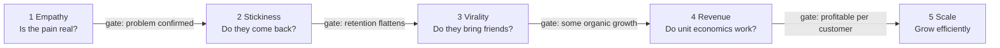

# A8.4 Lean Analytics: One Metric That Matters and stages

## In one line

The right metric depends on your **stage**. Early on you measure whether people care. Later you measure whether they stay, spread the word, pay, and whether the business can grow profitably.

## Why this matters

Teams often copy the metrics of big companies. A three-month-old product obsessing over revenue per user is like a nursery school tracking board-exam marks. *Lean Analytics* gives you a simple map: figure out which stage you're in, then focus on **One Metric That Matters (OMTM)** for that stage.

Young products die more often from **focusing on the wrong problem** than from building badly. A team obsessing over virality before people stick around, or over revenue before anyone loves the product, spends its time and money in the wrong place. Lean Analytics gives you a simple diagnosis: *what stage are we really in, and what single number tells us if we're getting past it?* As a PM, you'll use it to:

- **Say no to the wrong work at the wrong time.** "Referral programme? Not until retention flattens."
- **Set honest goals for new products and new markets.**
- **Explain to leadership why** a new initiative shouldn't be judged by the core business's metrics yet.

## Key terms

| Term | Plain-English meaning |
|---|---|
| **OMTM** | One Metric That Matters: the single number a team focuses on right now. |
| **Stage** | Where the product is in its life: Empathy, Stickiness, Virality, Revenue or Scale. |
| **Gate** | The test you must pass before moving to the next stage. |
| **Line in the sand** | The target value that counts as "good enough" for your OMTM. |
| **Unit economics** | Profit or loss on one unit (one order, one customer). |
| **Contribution margin** | Revenue from an order minus its direct variable costs (delivery, payment fees, discounts). |
| **Payback period** | How long it takes for a customer's profit to repay the cost of acquiring them. |
| **Premature scaling** | Spending heavily on growth before the product keeps users. |

## The idea, simply

!!! tip "Analogy: learning to drive"
    In week one, the only thing that matters is not stalling the car. Later it's smooth gear changes. Then it's highway driving. Only after all that do you think about fuel efficiency. Each stage has one thing to master, and focusing on the wrong one too early slows you down.

Alistair Croll and Benjamin Yoskovitz wrote [*Lean Analytics*](https://www.oreilly.com/library/view/lean-analytics/9781449335687/), published by O'Reilly in 2013. O'Reilly also [lists a March 2024 release](https://www.oreilly.com/library/view/lean-analytics/9781098168179/). Its two big ideas are below.

**Big idea 1: The One Metric That Matters (OMTM)**

At any moment, a team should pick *one* number to focus on above all others. You still watch other numbers, but one leads. Why?

- It forces a clear answer to "what's our biggest problem right now?"
- It makes experiments easier to judge.
- It stops teams from scattering effort.

The OMTM is **temporary**. It changes as you solve one problem and move to the next. That's different from a North Star ([A8.2](02-north-star-metric-and-metric-trees.md)), which stays stable for years.

**Big idea 2: Five stages, each with a "gate"**

| Stage | The question | Typical OMTM | Gate to move on |
|---|---|---|---|
| **1. Empathy** | Is this a real, painful problem? | Number of interviews confirming the pain | You've found a problem people will pay or change behaviour to solve |
| **2. Stickiness** | Does the product solve it well enough that people come back? | Week-4 retention, active days per week | Retention flattens instead of falling to zero |
| **3. Virality** | Do users bring other users? | Referrals per user ("viral coefficient") | Growth comes partly on its own |
| **4. Revenue** | Can we make more money per customer than it costs to get them? | Revenue per user vs cost to acquire; contribution margin | Unit economics work |
| **5. Scale** | Can we grow the whole business efficiently? | Profit, market share, growth in new markets | — |

The authors argue the stages are **gated**. Don't push hard on virality or revenue before people stick around. Otherwise you're pouring water into a leaky bucket.

### Each stage in more depth

**1. Empathy: "Is this a real, painful problem?"**

- **What you do:** customer interviews, observation, testing problem statements, sometimes a landing page or a "concierge" service done by hand.
- **Typical metrics:** number of interviews where people describe the pain unprompted; % of interviewees who already pay for or hack together a workaround; landing-page sign-up rate.
- **You've passed when:** you can describe the problem in the customer's own words, and a clear group is actively looking for a solution.
- **Classic mistake:** asking "would you use this?" (everyone says yes) instead of asking about past behaviour. See *The Mom Test* in [A1.2](../01-understanding-users-user-sense/02-user-research-methods-and-interviews.md).

**2. Stickiness: "Do they keep coming back?"**

- **What you do:** improve the core experience, onboarding and activation for a small group of users.
- **Typical metrics:** cohort retention, active days per week, repeat purchase rate, churn.
- **You've passed when:** retention curves flatten at a level that works for your business type, across several cohorts.
- **Classic mistake:** adding features for every request instead of making the core loop excellent.

**3. Virality: "Do they bring others?"**

- **What you do:** build sharing into the product, test referral incentives, make the product more valuable with more users.
- **Typical metrics:** invites per user, invite conversion, viral coefficient, share of new users from word of mouth.
- **You've passed when:** a meaningful share of growth comes without paid spend, and those users retain as well as others.
- **Classic mistake:** paying for referrals that bring low-quality users.

**4. Revenue: "Do the unit economics work?"**

- **What you do:** pricing tests, packaging, reducing discounts, lowering cost to serve.
- **Typical metrics:** contribution margin, ARPU, LTV, CAC, payback period.
- **You've passed when:** each customer or order is profitable after direct costs, and payback fits your cash.
- **Classic mistake:** raising prices or cutting discounts without watching retention.

**5. Scale: "Can we grow the whole business efficiently?"**

- **What you do:** new cities and segments, channel expansion, efficiency, building moats.
- **Typical metrics:** profit, market share, growth in new markets, efficiency ratios.
- **Classic mistake:** assuming what worked in one city or segment works everywhere. Each new market can restart at an earlier stage.

### Where Lean Analytics comes from

*Lean Analytics* belongs to the "Lean Startup" family of ideas, popularised by Eric Ries's 2011 book *The Lean Startup*. The core loop there is **build → measure → learn**: build something small, measure what users really do, learn, and repeat. Croll and Yoskovitz focused on the *measure* step. Their question was: which number should you measure, at which moment, to learn fastest? The stages and the OMTM are their answer.

### Why focusing on one metric works

It feels risky to focus on just one number. Here's why it works:

1. **It forces a decision about your biggest problem.** Picking one number means admitting what matters most right now. That conversation alone often clears up months of confusion.
2. **It makes experiments easy to judge.** Every idea is scored against the same number, so "did it work?" has a clear answer.
3. **It aligns a small team.** Everyone knows what to do on Monday morning.
4. **It's temporary, so it's safe.** You're not ignoring other metrics forever. You're deciding what comes *first*.

You still watch other numbers, especially guardrails. The OMTM simply decides what wins when priorities clash.

### Choosing a good OMTM: four questions

1. **Does it answer the biggest question of our current stage?** (Empathy: is the pain real? Stickiness: do they come back?)
2. **Can we move it within weeks** through things we control?
3. **Is it a rate or ratio** that shows quality, not just a growing count?
4. **Would hitting the target change what we do next?** If hitting it wouldn't unlock a decision (like "start spending on growth"), it's the wrong metric.

### OMTM, KPI, North Star and OKR: how they fit together

| Concept | Time span | Scope | Purpose |
|---|---|---|---|
| **KPI** | Ongoing | Any level | Standing numbers you always monitor |
| **North Star** | Years | Company or product | Shared definition of customer value |
| **OKR** | A quarter | Team or company | A goal and the results that show it's achieved |
| **OMTM** | Weeks to months | Team, or a young product | The one number that matters most *right now* |

In practice: a young product's OMTM is often its main key result for the quarter. Once the product matures, the OMTM usually becomes one of the inputs under the North Star.

### A quick stage diagnosis worksheet

Answer honestly. The first "No" usually marks your current stage.

| Question | Yes / No | If "No", you're in… |
|---|---|---|
| Can we describe a painful problem in customers' own words, backed by 15+ interviews? | | **Empathy** |
| Do our cohort retention curves flatten at a healthy level for our category? | | **Stickiness** |
| Do a meaningful share of new users arrive without paid spend, and stay as well as others? | | **Virality** |
| Is each order or customer profitable after direct costs, with an acceptable payback period? | | **Revenue** |
| Do the economics hold in new markets or segments, not just the first one? | | **Scale** |

### Example OMTMs by stage and business model

Illustrative choices, not rules:

| Stage | E-commerce / delivery | SaaS | Free mobile app | Two-sided marketplace |
|---|---|---|---|---|
| **Empathy** | % of interviewees who already order this category online | % of interviewees with a budget for the problem | % who describe the habit or need unprompted | Both sides confirm the pain |
| **Stickiness** | Repeat purchase rate in 30 days | Weekly active accounts using the core feature | Day-30 retention | Repeat buyers *and* repeat sellers |
| **Virality** | Orders from referrals | Invited teammates per account | Invites per new user | New sellers brought by buyers, and vice versa |
| **Revenue** | Contribution margin per order | Net revenue retention | Revenue per daily active user | Take rate × order value − cost to serve |
| **Scale** | Contribution margin in new cities | Customer acquisition payback by segment | Retention in new countries | Liquidity (% of searches that end in a transaction) in new markets |

## Framework: the OMTM check-in

Run this every quarter (or every month for young products):

1. **Name your stage** honestly, using the table above.
2. **Pick one OMTM** that answers that stage's question.
3. **Set a line in the sand:** the target that means "good enough to move on". Use benchmarks from [A8.5](05-funnels-cohorts-and-retention-curves.md) for retention.
4. **List 2–3 supporting metrics** and 1 guardrail.
5. **Review:** did you cross the line? If yes, move to the next stage and pick a new OMTM.

**When to use:** startups, new products inside big companies, and new markets (each new city or country can be at a different stage).
**When not to:** large mature products with many teams. There, use a North Star plus a metric tree, and let each team have its own OMTM.

## Diagram

Move right only after passing each gate. Different products and markets inside one company can sit at different stages.

## Worked example

You're launching a **pet-care subscription box** in Hyderabad. It's 3 months old with 400 customers.

1. **Stage?** You have customers, but you don't know if they'll renew. You're in **Stickiness**.
2. **OMTM:** % of month-1 subscribers who renew for month 3.
3. **Line in the sand:** 40% renewal at month 3 for six cohorts in a row.
4. **Supporting metrics:** box-rating score; % who customise their next box. **Guardrail:** cost per box (don't buy retention with free gifts).
5. **What you *don't* chase yet:** referral codes, ad spend and new cities. Those belong to later stages.

Two quarters later, renewal is stable at 45%. Now you move to Virality or Revenue and choose a new OMTM, such as contribution margin per box.

### The numbers: watching the pet-care box pass the Stickiness gate

| Cohort (month joined) | Subscribers | Renewed for month 2 | Renewed for month 3 |
|---|---|---|---|
| January | 60 | 63% | 35% |
| February | 75 | 68% | 38% |
| March | 90 | 71% | 42% |
| April | 110 | 74% | 46% |
| May | 120 | 75% | 45% |
| June | 140 | 76% | 47% |

The line in the sand was **40% month-3 renewal for six cohorts in a row.** January and February fell short, March through June cleared it, and the cohorts keep improving. That isn't six in a row yet. **The team doesn't pass the gate until two more cohorts clear 40%**, though the trend is encouraging.

Meanwhile the team works out early unit economics for the **Revenue** stage:

| Per box | ₹ |
|---|---|
| Price | 1,499 |
| Product cost | −780 |
| Packing and delivery | −180 |
| Payment fees (2%) | −30 |
| **Contribution per box** | **+509** |

With a customer acquisition cost of about ₹1,200 and an average subscriber staying about 4 months, a customer brings roughly ₹2,000 of contribution: about 1.7× their acquisition cost. That's positive but thin. So the first Revenue-stage OMTM might be **contribution per subscriber over their lifetime**, improved by lifting retention further or lowering packing cost, before scaling ad spend.

## Going deeper: nuances and trade-offs

### 1. How to tell your stage honestly

Teams almost always think they're one stage further along than they are. Use evidence:

- **Still in Empathy?** You can't yet describe a painful problem in customers' own words, or interviews give mixed signals.
- **Still in Stickiness?** Retention curves don't flatten, or keep sliding with each new cohort ([A8.5](05-funnels-cohorts-and-retention-curves.md)).
- **Ready for Virality?** Retention is stable, and some new users already arrive by word of mouth without paid spend.
- **In Revenue?** You know what a customer is worth and what they cost, and you're working to make that gap positive.
- **In Scale?** Unit economics work in your core market, and the questions are now about new cities, new segments and efficiency.

### 2. Your business model changes the OMTM

*Lean Analytics* also groups metrics by **business model**: e-commerce, SaaS, free mobile apps, media, user-generated content and two-sided marketplaces. The same stage needs different numbers in each:

- **E-commerce in Stickiness:** repeat purchase rate.
- **SaaS in Stickiness:** weekly active accounts using the core feature.
- **Marketplace in Stickiness:** repeat buyers *and* repeat sellers. A marketplace has two Stickiness problems.
- **Media in Revenue:** ad revenue per thousand visits, and content cost.

### 3. Setting a line in the sand

An OMTM without a target is just a number to stare at. Set the "line in the sand" from three sources:

1. **External benchmarks:** for retention, use the ranges in [A8.5](05-funnels-cohorts-and-retention-curves.md).
2. **Your own economics:** what retention or margin makes the business work on paper?
3. **Investor or leadership expectations.**

Then commit to it for a fixed period (for example, one quarter) before changing it. Moving the target every week defeats the purpose.

### 4. Unit economics with real numbers

Take a delivery app with these per-order numbers:

| Item | ₹ per order |
|---|---|
| Average order value | 450 |
| Commission earned (20%) | +90 |
| Delivery fee charged | +25 |
| Delivery partner cost | −60 |
| Payment gateway (2%) | −9 |
| Discount funded by the platform | −30 |
| **Contribution per order** | **+16** |

If acquiring a customer costs ₹400, and a retained customer places 4 orders a month, each customer contributes ₹64 a month. **Payback is roughly 6–7 months, if the customer stays.** Now you can see why retention and discounts dominate the Revenue stage. Cut the discount to ₹15 and contribution nearly doubles to ₹31, but will customers still order as often? That's the experiment to run.

### 5. OMTM in a big company

Large companies don't have *one* OMTM. They have a **portfolio of stages**. The core business may be at Scale (OMTM: margin), a new city at Stickiness (OMTM: repeat rate), and a new product line at Empathy (OMTM: problem interviews). Leaders who apply one stage's metric to everything usually kill new initiatives too early.

### 6. The cost of skipping stages

**Premature scaling** means spending on acquisition, new cities or big teams before retention is solid. It's one of the most common ways startups burn cash. In India, the 2022–23 funding slowdown pushed many startups to shift focus from growth to profitability. That's the same Revenue-stage move the Zomato example above shows. The lesson isn't "never grow fast". It's **grow fast only once the bucket holds water**.

### 7. Stages can go backwards

Passing a gate isn't permanent. A strong competitor, a regulation change, a pricing change or a shift in user behaviour can push a product back a stage. For example, retention that held at Stickiness can weaken when a cheaper rival appears. Keep watching the gate metric of every stage you've passed. It becomes a guardrail.

### 8. Leading indicators for each stage

Each stage's gate takes time to confirm, so watch earlier signals:

| Stage | Gate metric (slow) | Leading indicator (fast) |
|---|---|---|
| Empathy | Customers willing to pay | % of interviewees describing the pain unprompted |
| Stickiness | Month-3 retention | Week-1 activation rate |
| Virality | Share of organic new users | Invites sent per new user in week 1 |
| Revenue | Payback period | Contribution margin per order this week |
| Scale | Profit in new markets | Week-4 retention in a new city vs older cities |

## Real-world examples (2023 onwards)

!!! example "Zomato and Blinkit, mid-2023: moving into the Revenue stage"
    In August 2023, Zomato reported its first-ever quarterly profit (₹2 crore for April–June 2023). It also said its quick-commerce arm Blinkit had turned **contribution positive** for the first time in June 2023, [as reported by Inc42](https://inc42.com/buzz/zomato-turns-profitable-reports-inr-2-cr-pat-in-q1/). Contribution positive means each order covered its direct costs. The same coverage noted that a deferred tax credit helped produce the reported profit. That's a reminder to always read the definition behind a headline number.

    **PM lesson:** for a scaled business, the company's focus metrics had visibly shifted from pure growth to **unit economics**: contribution margin, adjusted EBITDA and break-even timelines. That's a textbook move from the Virality/Scale-for-growth mindset into the Revenue stage.

!!! example "Swiggy, January 2026: choosing the OMTM out loud"
    In its Q3 FY26 letter, Swiggy's CEO Sriharsha Majety wrote that the company had consciously chosen not to chase discount-driven, volume-only growth that hurts order values and margins, [as quoted by Business Today](https://www.businesstoday.in/amp/latest/corporate/story/swiggy-q3-loss-widens-to-rs1065-crore-despite-surge-in-food-quick-commerce-growth-513570-2026-01-29).

    **PM lesson:** in a competitive market, picking your focus metric is a strategic statement. "Order value and margin" over "order count" changes which features, discounts and experiments the whole team runs.

## Common mistakes

!!! warning "Watch out for"
    - **Skipping Stickiness.** Paid growth on a product people don't return to burns cash fast.
    - **Never changing the OMTM.** Once you've hit the line, a new problem is now the biggest one.
    - **Picking the OMTM by committee** and ending up with three. One means one.
    - **Applying one stage to the whole company.** A new city or a new feature may still be at Empathy while the core business is at Scale.
    - **Trusting headline profit without reading the definition** (adjusted, contribution, or net).
    - **Changing the line in the sand every week.** Commit for a fixed period.
    - **Using the wrong business-model metric.** A marketplace has two sides to keep sticky.

## Common questions

**What's the difference between an OMTM and a North Star?**
The North Star is long-term and company-wide, and changes rarely. The OMTM is the single number a team focuses on *now* to fix its biggest problem, and changes as problems get solved. An OMTM is often one of the North Star's inputs.

**Can a team have an OMTM and OKRs?**
Yes. The OMTM is usually the main key result of the team's main objective.

**Are the five stages strictly in order?**
Mostly, but not rigidly. Some products are viral from day one (social apps), and some must earn revenue early (B2B with paying pilots). The core advice holds: don't scale what doesn't retain.

**Is this only for startups?**
No. Every new product, city or segment inside a big company goes through the same stages. Big companies just run several stages at once.

**What if we're stuck in a stage for a long time?**
Check whether you're solving a real, painful problem (go back to Empathy), whether you're serving the right segment, and whether the core experience delivers value fast enough. Being stuck for months is a signal to rethink, not just to try more tactics.

## In the interview

!!! question "In the interview"
    **How it's tested:** stage questions show up as "You're the PM of a 6-month-old product. What would you focus on?" or inside strategy cases ("Should we expand to 10 new cities?").

    **Sample question:** *"You're the first PM at a 6-month-old fitness app with 50,000 users. The CEO wants to spend heavily on ads. What do you say?"*

    **Outline of a strong answer:**

    1. **Diagnose the stage with data:** ask for retention curves by cohort, how many users come from word of mouth, and current churn.
    2. **If curves don't flatten:** you're in Stickiness. Recommend fixing activation and retention first, because paid users will leak out.
    3. **Propose an OMTM and a line in the sand:** for example, week-4 retention of 25% held for 3 consecutive cohorts.
    4. **Offer a compromise:** a small, controlled ad budget to keep learning, with a cost-per-retained-user limit.
    5. **Explain the gate:** once retention holds, scale ad spend in steps and watch payback.

    **A second common form:** *"Your company just launched in a new city where the brand is unknown. Which metrics would you track in the first 3 months?"*

    A strong answer:

    1. **Treats the city as its own early-stage product,** even if the company overall is at Scale.
    2. **Starts with Stickiness metrics:** repeat order rate of first-time customers, and month-1 retention compared with older cities at the same age.
    3. **Watches supply readiness:** restaurant or seller coverage, delivery times, stock-outs. Poor supply causes poor retention.
    4. **Delays heavy spending** until the repeat rate approaches older cities' benchmarks, and uses contribution margin as a guardrail.

## Research happening now

!!! info "Research happening now"
    - **Growth is concentrating at the top (RevenueCat, 2026).** RevenueCat's [2026 State of Subscription Apps report](https://www.revenuecat.com/state-of-subscription-apps/) found that new subscription app launches grew roughly 7× since 2022. Yet [apps launched before 2020 still earn about 69% of subscription revenue](https://www.subscriptioninsider.com/article-type/news/revenuecat-data-shows-subscription-app-growth-concentrating-at-the-top). For new products, passing the Stickiness and Revenue gates is getting harder, not easier. *Status: vendor dataset; based on apps using RevenueCat.*
    - **Rethinking early-stage retention for AI products.** a16z [argues](https://a16z.com/ai-retention-benchmarks/) that AI products attract "AI tourists" who try and leave quickly. Their suggestion is to judge the Stickiness gate from month 3 onwards, not month 0. *Status: investor analysis (September 2025) from portfolio data.* More in [A8.5](05-funnels-cohorts-and-retention-curves.md).

## Try it yourself (15 minutes)

Think of a product you work on (or a side project).

1. Which of the five stages is it really in? Be honest.
2. Write one OMTM and one "line in the sand".
3. Write down one thing your team is doing that belongs to a *later* stage, and whether you should pause it.

??? success "Check your answer"
    For a 3-month-old B2B invoicing tool with 40 paying small businesses:

    - **Stage:** most likely **Stickiness**. There's revenue, but you don't yet know whether customers keep using it.
    - **OMTM:** % of accounts that send at least 5 invoices a month, 3 months after sign-up.
    - **Line in the sand:** 60% of accounts by month 3, held for two quarterly cohorts.
    - **Later-stage work to pause:** a referral programme and a second-city sales team.
    - **Self-check:** does your OMTM measure *repeated real use*, not sign-ups or logins?

## How this connects

- [A8.2 North Star metric](02-north-star-metric-and-metric-trees.md): the long-term metric that sits above your stage-specific OMTMs.
- [A8.5 Funnels, cohorts and retention](05-funnels-cohorts-and-retention-curves.md): how to prove you've passed the Stickiness gate.
- [A4.4 Product-market fit](../04-strategy-and-vision/04-product-market-fit.md): what passing Empathy and Stickiness really means.
- [A10.3 Pricing and monetisation](../10-growth-and-go-to-market/03-pricing-and-monetisation.md): the Revenue stage in depth.
- [A2.1 Continuous discovery](../02-problem-discovery/01-continuous-discovery-and-opportunity-solution-tr.md): the work of the Empathy stage.

## Go deeper

- **Book:** [*Lean Analytics*](https://www.oreilly.com/library/view/lean-analytics/9781098168179/) by Alistair Croll and Benjamin Yoskovitz. Also see the authors' site, [leananalyticsbook.com](https://leananalyticsbook.com/).
- **Review:** [Teresa Torres on Lean Analytics](https://www.producttalk.org/read-lean-analytics/). A short take on why the stages matter.
- **Article:** [a16z: Retention Is All You Need](https://a16z.com/ai-retention-benchmarks/). How the Stickiness stage looks for AI products.

## Key takeaways

- Your best metric depends on your **stage**: Empathy → Stickiness → Virality → Revenue → Scale.
- Pick **One Metric That Matters** for now, with a clear target that lets you move on.
- The OMTM is **temporary**; the North Star is **long-term**.
- Don't skip Stickiness. Retention is the foundation for everything after it.
- Different parts of the same company can be at different stages.
- Work out your **unit economics** per order or per customer; retention and discounts usually dominate.
- Big companies run a **portfolio of stages**; don't judge a new bet by the core business's metrics.

## Updates

*No updates yet.*
