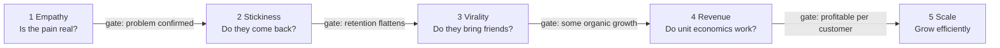

# A8.4 Lean Analytics: One Metric That Matters and stages

## In one line

The right metric depends on your **stage**. Early on you measure whether people care. Later you measure whether they stay, spread the word, pay, and whether the business can grow profitably.

## Why this matters

Teams often copy the metrics of big companies. A three-month-old product obsessing over revenue per user is like a nursery school tracking board-exam marks. *Lean Analytics* gives you a simple map: figure out which stage you're in, then focus on **One Metric That Matters (OMTM)** for that stage.

## The idea, simply

!!! tip "Analogy: learning to drive"
    In week one, the only thing that matters is not stalling the car. Later it's smooth gear changes. Then it's highway driving. Only after all that do you think about fuel efficiency. Each stage has one thing to master, and focusing on the wrong one too early slows you down.

Alistair Croll and Benjamin Yoskovitz wrote [*Lean Analytics*](https://www.oreilly.com/library/view/lean-analytics/9781449335687/), published by O'Reilly in 2013. O'Reilly also [lists a March 2024 release](https://www.oreilly.com/library/view/lean-analytics/9781098168179/). Its two big ideas are below.

**Big idea 1: The One Metric That Matters (OMTM)**

At any moment, a team should pick *one* number to focus on above all others. You still watch other numbers, but one leads. Why?

- It forces a clear answer to "what's our biggest problem right now?"
- It makes experiments easier to judge.
- It stops teams from scattering effort.

The OMTM is **temporary**. It changes as you solve one problem and move to the next. That's different from a North Star ([A8.2](02-north-star-metric-and-metric-trees.md)), which stays stable for years.

**Big idea 2: Five stages, each with a "gate"**

| Stage | The question | Typical OMTM | Gate to move on |
|---|---|---|---|
| **1. Empathy** | Is this a real, painful problem? | Number of interviews confirming the pain | You've found a problem people will pay or change behaviour to solve |
| **2. Stickiness** | Does the product solve it well enough that people come back? | Week-4 retention, active days per week | Retention flattens instead of falling to zero |
| **3. Virality** | Do users bring other users? | Referrals per user ("viral coefficient") | Growth comes partly on its own |
| **4. Revenue** | Can we make more money per customer than it costs to get them? | Revenue per user vs cost to acquire; contribution margin | Unit economics work |
| **5. Scale** | Can we grow the whole business efficiently? | Profit, market share, growth in new markets | — |

The authors argue the stages are **gated**. Don't push hard on virality or revenue before people stick around. Otherwise you're pouring water into a leaky bucket.

## Framework: the OMTM check-in

Run this every quarter (or every month for young products):

1. **Name your stage** honestly, using the table above.
2. **Pick one OMTM** that answers that stage's question.
3. **Set a line in the sand:** the target that means "good enough to move on". Use benchmarks from [A8.5](05-funnels-cohorts-and-retention-curves.md) for retention.
4. **List 2–3 supporting metrics** and 1 guardrail.
5. **Review:** did you cross the line? If yes, move to the next stage and pick a new OMTM.

**When to use:** startups, new products inside big companies, and new markets (each new city or country can be at a different stage).
**When not to:** large mature products with many teams. There, use a North Star plus a metric tree, and let each team have its own OMTM.

## Diagram

Move right only after passing each gate. Different products and markets inside one company can sit at different stages.

## Worked example

You're launching a **pet-care subscription box** in Hyderabad. It's 3 months old with 400 customers.

1. **Stage?** You have customers, but you don't know if they'll renew. You're in **Stickiness**.
2. **OMTM:** % of month-1 subscribers who renew for month 3.
3. **Line in the sand:** 40% renewal at month 3 for six cohorts in a row.
4. **Supporting metrics:** box-rating score; % who customise their next box. **Guardrail:** cost per box (don't buy retention with free gifts).
5. **What you *don't* chase yet:** referral codes, ad spend and new cities. Those belong to later stages.

Two quarters later, renewal is stable at 45%. Now you move to Virality or Revenue and choose a new OMTM, such as contribution margin per box.

## Real-world examples (2023 onwards)

!!! example "Zomato and Blinkit, mid-2023: moving into the Revenue stage"
    In August 2023, Zomato reported its first-ever quarterly profit (₹2 crore for April–June 2023). It also said its quick-commerce arm Blinkit had turned **contribution positive** for the first time in June 2023, [as reported by Inc42](https://inc42.com/buzz/zomato-turns-profitable-reports-inr-2-cr-pat-in-q1/). Contribution positive means each order covered its direct costs. The same coverage noted that a deferred tax credit helped produce the reported profit. That's a reminder to always read the definition behind a headline number.

    **PM lesson:** for a scaled business, the company's focus metrics had visibly shifted from pure growth to **unit economics**: contribution margin, adjusted EBITDA and break-even timelines. That's a textbook move from the Virality/Scale-for-growth mindset into the Revenue stage.

!!! example "Swiggy, January 2026: choosing the OMTM out loud"
    In its Q3 FY26 letter, Swiggy's CEO Sriharsha Majety wrote that the company had consciously chosen not to chase discount-driven, volume-only growth that hurts order values and margins, [as quoted by Business Today](https://www.businesstoday.in/amp/latest/corporate/story/swiggy-q3-loss-widens-to-rs1065-crore-despite-surge-in-food-quick-commerce-growth-513570-2026-01-29).

    **PM lesson:** in a competitive market, picking your focus metric is a strategic statement. "Order value and margin" over "order count" changes which features, discounts and experiments the whole team runs.

## Common mistakes

!!! warning "Watch out for"
    - **Skipping Stickiness.** Paid growth on a product people don't return to burns cash fast.
    - **Never changing the OMTM.** Once you've hit the line, a new problem is now the biggest one.
    - **Picking the OMTM by committee** and ending up with three. One means one.
    - **Applying one stage to the whole company.** A new city or a new feature may still be at Empathy while the core business is at Scale.
    - **Trusting headline profit without reading the definition** (adjusted, contribution, or net).

## Research happening now

!!! info "Research happening now"
    - **Growth is concentrating at the top (RevenueCat, 2026).** RevenueCat's [2026 State of Subscription Apps report](https://www.revenuecat.com/state-of-subscription-apps/) found that new subscription app launches grew roughly 7× since 2022. Yet [apps launched before 2020 still earn about 69% of subscription revenue](https://www.subscriptioninsider.com/article-type/news/revenuecat-data-shows-subscription-app-growth-concentrating-at-the-top). For new products, passing the Stickiness and Revenue gates is getting harder, not easier. *Status: vendor dataset; based on apps using RevenueCat.*
    - **Rethinking early-stage retention for AI products.** a16z [argues](https://a16z.com/ai-retention-benchmarks/) that AI products attract "AI tourists" who try and leave quickly. Their suggestion is to judge the Stickiness gate from month 3 onwards, not month 0. *Status: investor analysis (September 2025) from portfolio data.* More in [A8.5](05-funnels-cohorts-and-retention-curves.md).

## Try it yourself (15 minutes)

Think of a product you work on (or a side project).

1. Which of the five stages is it really in? Be honest.
2. Write one OMTM and one "line in the sand".
3. Write down one thing your team is doing that belongs to a *later* stage, and whether you should pause it.

## Go deeper

- **Book:** [*Lean Analytics*](https://www.oreilly.com/library/view/lean-analytics/9781098168179/) by Alistair Croll and Benjamin Yoskovitz. Also see the authors' site, [leananalyticsbook.com](https://leananalyticsbook.com/).
- **Review:** [Teresa Torres on Lean Analytics](https://www.producttalk.org/read-lean-analytics/). A short take on why the stages matter.
- **Article:** [a16z: Retention Is All You Need](https://a16z.com/ai-retention-benchmarks/). How the Stickiness stage looks for AI products.

## Key takeaways

- Your best metric depends on your **stage**: Empathy → Stickiness → Virality → Revenue → Scale.
- Pick **One Metric That Matters** for now, with a clear target that lets you move on.
- The OMTM is **temporary**; the North Star is **long-term**.
- Don't skip Stickiness. Retention is the foundation for everything after it.
- Different parts of the same company can be at different stages.

## Updates

*No updates yet.*
