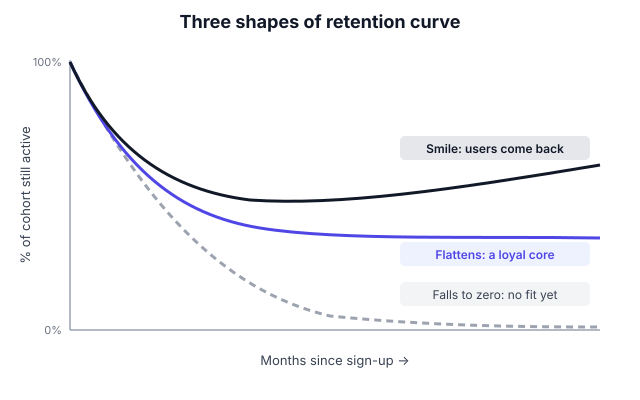

# A8.5 Funnels, cohorts and retention curves

## In one line

A **funnel** shows where users drop off on the way to a goal. A **cohort** groups users by when they started. A **retention curve** shows how many in each cohort keep coming back.

## Why this matters

Averages lie. "Monthly active users are up" can hide the fact that every new group of users leaves faster than the last. Funnels, cohorts and retention curves are the three tools that show you what's *really* happening. They're also the first thing an investor or senior PM will ask to see.

## The idea, simply

!!! tip "Analogy: a school's batches"
    A coaching centre wants to know if its teaching is getting better. Looking at "total students this year" doesn't help, because new admissions hide dropouts. Instead it tracks each **batch** (the 2024 batch, the 2025 batch) separately. How many from each batch were still attending after 1 month, 3 months, 6 months? If newer batches stay longer, teaching is improving. That batch-by-batch view is **cohort analysis**.

### Funnels

A funnel is a list of steps toward a goal, with the % who make it to each step.

*Example: ordering food*
Open app → search → open restaurant → add to cart → pay → order delivered

- Look at the **step-to-step conversion**, not just start-to-end. The step with the biggest drop is your first problem.
- **Segment** the funnel: new vs returning users, Android vs iOS, city by city. A problem in one segment is often hidden in the total.
- Set a **time window**, e.g. "within the same session" or "within 7 days".

### Cohorts

A cohort is a group of users who share a starting point, usually the week or month they signed up (or first ordered). You then follow each cohort over time.

*Example cohort table (% of users still ordering):*

| Sign-up month | Month 1 | Month 2 | Month 3 | Month 6 |
|---|---|---|---|---|
| Jan | 100% | 42% | 33% | 25% |
| Feb | 100% | 45% | 36% | 28% |
| Mar | 100% | 48% | 39% | — |
| Apr | 100% | 51% | — | — |

Read it **down the columns**. Month-2 retention has improved from 42% to 51% across four cohorts, so recent product changes are working. A single "overall retention" number would have hidden this.

### Retention curves

Plot one cohort's retention over time and you'll see one of three shapes (see diagram):

1. **Falls to zero.** Almost everyone leaves eventually, so the product hasn't found its fit yet.
2. **Flattens.** Retention drops at first, then levels off. You have a loyal core. This is the classic sign of product-market fit.
3. **Smiles.** It dips, then rises as some users come back and use the product more. That's rare and powerful.

**What is "good" retention?** It depends on the type of product. A widely used benchmark from Lenny Rachitsky and Casey Winters ([*What is good retention?*](https://www.lennysnewsletter.com/p/what-is-good-retention-issue-29), based on a survey of growth experts) suggests rough 6-month user retention:

| Product type | Good | Great |
|---|---|---|
| Consumer social | ~25% | ~45% |
| Consumer transactional (e.g. food, travel) | ~30% | ~50% |
| Consumer SaaS / subscription | ~40% | ~70% |
| SMB / mid-market SaaS | ~60% | ~80% |
| Enterprise SaaS | ~70% | ~90% |

Treat these as rough guides. Your own trend over time matters more.

## Framework: the weekly retention review

1. **Pick the action that means "retained".** This is a value action, not just "opened the app". Example: placed an order, or completed a lesson.
2. **Pick the right interval** for your product's natural frequency: daily for messaging, weekly for food delivery, monthly for bill payments.
3. **Build a cohort table** by sign-up week or month.
4. **Read down the columns** to see if newer cohorts do better.
5. **Look for the flattening point.** Where does the curve level off, and at what %?
6. **Find what retained users did early on** that churned users didn't. This is your activation clue. (It's a correlation; test it with an experiment, see [A9.1](../09-experimentation/01-a-b-testing-basics.md).)

## Diagram

You want your curve to flatten (blue) or smile (black). A curve that keeps sliding to zero means fix the product before spending on growth.

## Worked example

You're PM for a fitness app. Overall monthly active users are up 20% in 6 months, and leadership is happy. You build a cohort table:

- Cohorts from 6 months ago: month-3 retention 30%.
- Cohorts from 3 months ago (after a big ad campaign): month-3 retention 18%.

**Diagnosis:** the ad campaign brought in lots of users who don't stick. MAU is up only because acquisition is huge. That's the [leaky bucket](https://amplitude.com/blog/leaky-bucket-problem).

**Funnel check on the new cohorts:** 70% install → 40% finish the fitness quiz → only 15% complete their first workout. The big drop is between the quiz and the first workout.

**Action:** shorten the quiz, start a 5-minute "first workout" right after it, and measure month-1 retention of the next cohorts. Guardrail: workout injuries reported (don't push too hard too soon).

## Real-world examples (2023 onwards)

!!! example "AI products and the 'AI tourist' problem (a16z, September 2025)"
    In [*Retention Is All You Need*](https://a16z.com/ai-retention-benchmarks/), a16z partners Santiago Rodriguez and Alex Immerman argue that many AI products attract curious "tourists" who try once and leave. That makes early retention curves look worse and less predictive than usual. They suggest measuring from **month 3**, once tourists have left, and using **M12 ÷ M3** to judge how the committed users behave over a year. The same article shows ChatGPT's monthly usage retention curve forming a "smile".

    **PM lesson:** choose the starting point of your curve carefully. For products with a lot of casual trial, the month-0 baseline can mislead you.

!!! example "Swiggy, FY26: when more users means lower average frequency"
    By Q4 FY26, Swiggy's platform monthly transacting users had grown about 27% year-on-year to 25.2 million, [MediaNama reported](https://www.medianama.com/2026/05/223-q4fy26-swiggy-adds-users-faster-retains-food-delivery-hits-15-quarter-high/). Over the same period, platform frequency (orders per user) dipped to 4.01, according to the company's shareholder letters.

    **PM lesson:** this is a classic **mix effect**. When lots of new users join, they usually order less often than long-time users at first. So the *average* falls even if no one's behaviour got worse. Cohort analysis is how you tell the difference: compare each cohort's frequency with older cohorts at the same age.

## Common mistakes

!!! warning "Watch out for"
    - **"Retained" = "opened the app".** Use a value action instead.
    - **Wrong interval.** Measuring daily retention for a monthly-use product makes it look broken.
    - **Reading cohort tables across rows only.** The real insight is in comparing columns.
    - **Mixing new and old users in one average.** This hides both problems and wins.
    - **Treating correlation as cause.** "Users who add 3 friends retain better" might be because engaged people add friends, not the other way round. Test it.

## Research happening now

!!! info "Research happening now"
    - **The "7% rule" for week one (Amplitude, September 2025).** Amplitude's [2025 Product Benchmark analysis](https://amplitude.com/blog/7-percent-retention-rule) covers more than 2,600 companies. It proposes Day-7 retention of about 7% as a threshold that separates growing products from churning ones. It also found strong links between week-one activation and three-month retention. *Status: vendor benchmark; correlation-based.*
    - **AI subscription retention (RevenueCat, March 2026).** RevenueCat's [2026 report](https://www.revenuecat.com/state-of-subscription-apps/) found AI-powered apps keep fewer paying subscribers over monthly and annual periods than non-AI apps, despite stronger early conversion ([TechCrunch summary](https://techcrunch.com/2026/03/10/ai-powered-apps-struggle-with-long-term-retention-new-report-shows/)). *Status: industry dataset; researchers are still debating how much is "tourist" churn.*

## Try it yourself (30 minutes)

Use this toy data (users still active by month):

- Jan cohort: 1,000 → 400 → 300 → 280
- Feb cohort: 1,200 → 540 → 420 → —
- Mar cohort: 1,500 → 600 → — → —

1. Turn it into a % cohort table.
2. Is retention improving or getting worse?
3. Where is the curve flattening, and at roughly what %?
4. Write one sentence you'd say to your manager.

## Go deeper

- **Article:** [Lenny Rachitsky: What is good retention?](https://www.lennysnewsletter.com/p/what-is-good-retention-issue-29). The benchmark table above, with examples.
- **Article:** [a16z: Retention Is All You Need](https://a16z.com/ai-retention-benchmarks/). Retention curves for AI products.
- **Benchmarks:** [Amplitude: The 7% Retention Rule](https://amplitude.com/blog/7-percent-retention-rule).
- **Book:** [*Lean Analytics*](https://www.oreilly.com/library/view/lean-analytics/9781098168179/). The cohort analysis chapter is a great beginner's walkthrough.

## Key takeaways

- **Funnels** show where users drop; fix the biggest drop first.
- **Cohorts** group users by start date so averages can't hide the truth.
- A **flattening retention curve** is the clearest sign of product-market fit.
- Pick a **value action** and the **right interval** for your product.
- Fast growth lowers averages (the mix effect). Compare cohorts at the same age.

## Updates

*No updates yet.*
