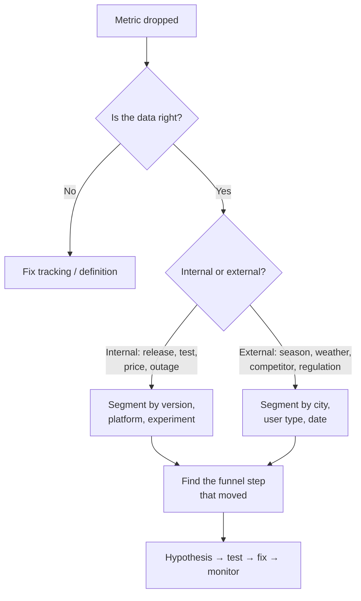
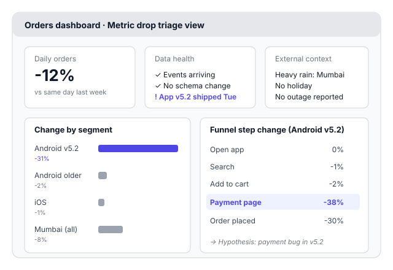

# A8.6 Diagnosing a metric drop

## In one line

When a key number suddenly falls, don't panic and don't guess. Check whether the drop is real, whether its cause is inside or outside the company, where it's concentrated, and which step broke.

## Why this matters

"Our daily orders dropped 12% yesterday. What happened?" is one of the most common messages a PM gets. It's also one of the most common PM interview questions. A calm, structured investigation builds trust fast. A panicked guess ("it must be the new competitor!") destroys it.

## Key terms

| Term | Plain-English meaning |
|---|---|
| **Anomaly** | A movement outside the metric's normal range. |
| **WoW / YoY** | Week-over-week / year-over-year comparison. |
| **Seasonality** | Regular, predictable ups and downs (weekends, festivals, school holidays). |
| **Segment** | A slice of users: by platform, city, version, channel, new vs returning. |
| **Mix shift** | The overall number changes because the *share* of each segment changed. |
| **Simpson's paradox** | Every segment moves one way while the total moves the other way. |
| **Root cause** | The underlying reason, not just the first symptom you see. |
| **Runbook** | A written checklist the team follows when an alert fires. |

## The idea, simply

!!! tip "Analogy: a doctor with a patient who has a fever"
    A good doctor doesn't jump to "it's dengue". First: is the thermometer working? (Is the data right?) Then: have you travelled, eaten something new, been around sick people? (What changed inside vs outside?) Then: where does it hurt? (Where is it concentrated?) Only then do they order a specific test. That's how you diagnose a metric drop too.

Most metric drops come from one of four buckets:

1. **It isn't real.** Tracking broke, a definition changed, a dashboard filter is wrong, data arrived late, or bot traffic was cleaned up.
2. **Something *we* did.** A new release, an experiment, a price change, a marketing campaign that ended, or an outage.
3. **Something *outside* happened.** Seasonality (festivals, exams, school holidays, month-end salary days), weather, a competitor's offer, a regulation, or news.
4. **A mix shift.** The user base changed. For example, lots of new users who behave differently pull the average down ([A8.5](05-funnels-cohorts-and-retention-curves.md)).

## Framework: the 6-step metric drop investigation

Use the [checklist template in the appendix](../../appendix/templates.md).

**Step 1. Clarify the drop**

- Which exact metric?
- By how much, compared with what? Use the same day last week, not yesterday, to remove weekday effects.
- Since when? Sudden (one day) or gradual (weeks)?

**Step 2. Check that it's real**

- Is data arriving normally?
- Did tracking, definitions or dashboards change?
- Do other related metrics agree? If orders fell 12%, did payments also fall?

**Step 3. Internal vs external**

- **Internal:** what did *we* change? Look at releases, experiments, pricing, marketing, outages and supply (stock-outs, fewer delivery partners).
- **External:** what changed in the world? Check holidays, weather, competitors, news and regulation.

**Step 4. Segment to find where it's concentrated.** Break the drop down by:

- platform and app version
- geography (city or region)
- new vs returning users
- acquisition channel
- user type

A drop that sits in one segment points to a specific cause. A drop spread evenly everywhere points to something broad.

**Step 5. Walk the funnel or metric tree.** Which step or branch moved? Use the tree from [A8.2](02-north-star-metric-and-metric-trees.md).

**Step 6. Form a hypothesis, test it, act.** Write down:

- the most likely cause
- the evidence for and against it
- the quickest way to confirm it
- the fix and who owns it
- when you'll check again

**When to use:** any sudden change, up *or* down. Unexplained good news deserves the same check, because it's often a tracking bug.
**When not to:** small day-to-day noise. Agree in advance what size of move triggers an investigation (e.g. more than 5% vs the same day last week for two days in a row).

## Diagram

Always check the data first. A surprising share of "drops" turn out to be tracking problems.

A good triage dashboard puts data health, external context, segments and funnel steps on one screen. Here, one app version's payment step stands out at once.

## Worked example

**Situation:** daily food orders are down 12% vs the same day last week. The CEO is asking.

1. **Clarify:** the drop started Wednesday and is sudden. Revenue also fell, so it isn't just an order-counting glitch.
2. **Real?** Event volumes look normal. No tracking changes. App v5.2 for Android went out on Tuesday.
3. **Internal vs external:** heavy rain in Mumbai (external), plus the new release (internal).
4. **Segment:**
    - Android v5.2: −31%
    - older Android versions: −2%
    - iOS: −1%
    - Mumbai overall: −8% (rain usually *raises* orders, so this fits the release story)
5. **Funnel:** on Android v5.2, the payment page step fell 38%. Earlier steps barely moved.
6. **Hypothesis:** a payment bug in v5.2. **Test:** the QA team reproduces it in 20 minutes; one payment method fails to load. **Act:** roll back or hotfix, and send an in-app message to affected users. **Check again:** tomorrow, same time.

**Your message to the CEO:** "Orders are down 12%. Nearly all of the drop is on the new Android release, at the payment step. We've reproduced a bug with one payment method. A hotfix goes out in 3 hours, and we'll confirm recovery tomorrow morning."

## Going deeper: nuances and trade-offs

### 1. Is the drop even unusual?

Before investigating, check whether this is just normal wobble:

- **Compare the same weekday** over the last 4–8 weeks to see the usual range.
- **For seasonal businesses, compare the same period last year** (Diwali week vs last Diwali week), adjusted for growth.
- **Use a simple control band.** Many teams flag a move only when it falls outside the usual range for 2 days in a row.

This saves hours of chasing noise, and saves your credibility.

### 2. Simpson's paradox: when every segment improves but the total falls

This surprising effect is well documented in statistics ([Stanford Encyclopedia of Philosophy](https://plato.stanford.edu/entries/paradox-simpson/)). Here's a product version:

| | Last week | This week |
|---|---|---|
| Returning users: conversion | 30% (9,000 users) | **32%** (9,000 users) |
| New users: conversion | 5% (1,000 users) | **6%** (6,000 users) |
| **Overall conversion** | **27.5%** | **≈ 21.6%** |

Both segments *improved*, yet overall conversion *fell*, because a big campaign brought in thousands of new users, who naturally convert less. If you only looked at the total, you'd hunt for a bug that doesn't exist. **Always split by segment before blaming the product.**

### 3. Rate effect vs mix effect

A change in any total can be split into two parts:

- **Rate effect:** did users in each segment *behave* differently?
- **Mix effect:** did the *share* of segments change?

In the table above, the rate effect is positive (both segments got better) and the mix effect is strongly negative. Saying this out loud ("the drop is almost all mix, from the campaign") is exactly the kind of clarity leaders value.

### 4. A culprit checklist by category

| Category | Usual suspects |
|---|---|
| **Data / tracking** | SDK or analytics update, event renamed, consent banner change, bot filtering, time-zone bug, late data |
| **Product** | New release, feature flag, experiment ramped up, bug in one OS version, performance slowdown |
| **Supply / operations** | Stock-outs, fewer delivery partners, payment gateway or UPI bank downtime, a partner outage |
| **Demand / calendar** | Festivals, exam season, school holidays, salary cycle, long weekends, IPL finals, monsoon |
| **Market** | A competitor's big sale, app-store ranking change, OS policy change, regulation, news event |

Go through it quickly but completely. The cause is usually in the category you assumed it *wasn't*.

### 5. Communicating while you investigate

The first update should go out within about an hour, even if you don't know the answer yet. A useful structure:

- **What we know:** "Orders −12% since Wednesday, concentrated on Android v5.2."
- **What we don't know yet:** "Whether all payment methods are affected."
- **Next steps and owner:** "QA is reproducing it; the engineering lead owns the hotfix."
- **Next update time:** "4 pm today."

Avoid blaming people or teams in early updates. You may be wrong, and blame slows everyone down.

### 6. Make the next investigation faster

After each incident, spend 30 minutes making the next one easier:

- **Annotate dashboards** with releases, experiments and campaigns.
- **Add alerts** on key metrics, broken down by platform and version.
- **Keep a metric tree** ([A8.2](02-north-star-metric-and-metric-trees.md)) next to the main dashboard.
- **Write a short runbook** that lists who to call and which checks to run.

Mature teams treat metric drops like engineering incidents, with a short blameless review afterwards.

## Real-world examples (2023 onwards)

!!! example "ChatGPT's first traffic dip, June–July 2023: external, and a measurement trap"
    Similarweb estimated that worldwide traffic to ChatGPT's website fell 9.7% in June 2023 and another 9.6% in July. It was the first decline since launch, [Similarweb reported](https://www.similarweb.com/blog/insights/ai-news/chatgpt-schools-out/). A leading hypothesis was **seasonality**: students on summer break needed less homework help. Coverage also noted that OpenAI had launched an **iOS app in May 2023**, which could move some usage from the website to the app ([Engadget](https://www.engadget.com/chatgpt-saw-its-first-ever-user-decline-in-june-163043304.html)).

    **PM lesson:** two of the four buckets in one story. One is external (school holidays). The other is a possible measurement shift: a website-only metric can't see users who moved to the app. Before declaring a decline, check whether you're measuring all the places users now are.

!!! example "Paytm's UPI share, 2024: an external, regulatory shock"
    On 31 January 2024, the RBI placed strict restrictions on Paytm Payments Bank. Paytm's share of UPI transactions fell from 13.09% in December 2023 to 6.88% in December 2024, [according to NPCI data reported by Business Standard](https://www.business-standard.com/amp/companies/news/navi-crosses-1-market-share-in-upi-transactions-in-december-2024-125010801052_1.html). Meanwhile, Paytm moved its UPI users to partner banks ([Business Today](https://www.businesstoday.in/industry/banks/story/after-paytm-payments-bank-operations-ban-paytms-upi-market-share-drops-to-9-report-424947-2024-04-09)).

    **PM lesson:** sometimes the cause is obvious and external. The PM's job then shifts from *diagnosis* to *recovery*: migrating users smoothly, communicating clearly, and tracking which segments churn and which stay.

## Common mistakes

!!! warning "Watch out for"
    - **Jumping to a story** before checking the data.
    - **Comparing with yesterday** instead of the same day last week, or the same festival last year.
    - **Only looking at the total.** The answer almost always hides in a segment.
    - **Ignoring good surprises.** A sudden jump is often a tracking bug too.
    - **Ending with "we're looking into it".** Always share the next step and when you'll update.
    - **Skipping the segment split** and falling for Simpson's paradox.
    - **No annotations on dashboards**, so every investigation starts from scratch.

## In the interview

!!! question "In the interview"
    **How it's tested:** "Metric X dropped by Y%. What do you do?" is a staple of PM interviews at most large tech companies. It's often called an "execution" or "root cause analysis" question.

    **Sample question:** *"Daily active users on Swiggy Instamart fell 10% yesterday. Walk me through how you'd investigate."*

    **Outline of a strong answer:**

    1. **Clarify:** how is DAU defined, compared with what (same day last week?), sudden or gradual, all cities or some?
    2. **Check the data:** tracking changes, pipeline delays, a new app version's analytics.
    3. **Internal vs external:**
        - internal: release, experiment, pricing, an outage, stock-outs, delivery-partner availability
        - external: a holiday, weather, a competitor's sale, payment or UPI downtime
    4. **Segment:** platform and app version, city, new vs returning users, acquisition channel.
    5. **Walk the funnel:** open → browse → add to cart → checkout → payment. Find the step that moved.
    6. **Hypothesis, test, act, communicate:** state the most likely cause, how you'd confirm it in under an hour, the fix, the owner, and when you'll update.

    **Bonus points:** mention Simpson's paradox or mix shift, and say what you'd add to prevent a repeat.

## Research happening now

!!! info "Research happening now"
    - **AI agents for root-cause analysis.** Researchers are testing whether LLM-based agents can investigate incidents by pulling logs, metrics and past cases themselves. Examples:
        - [*RCAgent*](https://arxiv.org/abs/2310.16340), first posted in 2023 and revised in 2024, tested on cloud jobs at Alibaba Cloud
        - [*Exploring LLM-based Agents for Root Cause Analysis*](https://arxiv.org/abs/2403.04123) (2024)

        These focus on engineering incidents, but the same idea is now appearing in product analytics tools, as "AI agents" that suggest why a metric moved. *Status: active research; results are promising but agents still make confident mistakes, so a human should verify.*
    - **Metric trees for faster diagnosis.** Practitioners argue that a well-built metric tree ([A8.2](02-north-star-metric-and-metric-trees.md)) saves teams from starting every investigation from scratch; see [Count.co's guide](https://count.co/blog/intro-to-metric-trees). *Status: practitioner consensus, little formal research yet.*

## Try it yourself (20 minutes)

Interview-style practice. **"Weekly active users on our ride-hailing app dropped 8% last week. What do you do?"**

Answer out loud in 5 minutes using the 6 steps. Then write down:

1. Three segments you'd check first, and why
2. Two external causes specific to India (e.g. exam season, monsoon, a fuel-price change)
3. The one-line update you'd send your manager after the first hour

??? success "Check your answer"
    For "ride-hailing weekly active users −8%":

    - **Three segments to check first:**
        - **city:** a local event or regulation hits specific cities
        - **platform and app version:** catches release bugs
        - **rider type:** new vs returning, to catch campaign or mix effects
    - **Two India-specific external causes:** the end of exam season or a school-holiday shift in commuting patterns; heavy monsoon flooding in a few metros; a fuel-price change affecting fares; a local auto or cab strike.
    - **First-hour update:** "Weekly active riders are down 8%. The data looks healthy. 70% of the drop is in Mumbai and Pune, which matches last week's heavy rain. We're checking whether supply (driver availability) or demand fell, and will update by 3 pm."
    - **Self-check:** did you check the data *first*, segment *before* hypothesising, and end with an owner and a time?

## How this connects

- [A8.2 North Star metric and metric trees](02-north-star-metric-and-metric-trees.md): the tree is your map for walking down to the cause.
- [A8.5 Funnels, cohorts and retention](05-funnels-cohorts-and-retention-curves.md): funnels and segments are the main investigation tools.
- [A9.3 Experiment pitfalls and culture](../09-experimentation/03-experiment-pitfalls-and-culture.md): experiments are a frequent hidden cause of metric moves.
- [A11.3 Writing and presenting for leaders](../11-stakeholder-management-and-com/03-writing-and-presenting-for-leaders.md): how to write the update.
- [A12.3 Metrics and execution interviews](../12-career-and-interviews/03-metrics-estimation-and-execution-interviews.md): practising this as an interview question.

## Go deeper

- **Template:** [Metric drop investigation checklist](../../appendix/templates.md) in this book's appendix.
- **Article:** [Similarweb on ChatGPT's 2023 traffic decline](https://www.similarweb.com/blog/insights/ai-news/chatgpt-schools-out/). A real, public seasonality case.
- **Paper:** [RCAgent (arXiv)](https://arxiv.org/abs/2310.16340). What AI-assisted root-cause analysis looks like today.
- **Book:** [*Decode and Conquer*](https://www.goodreads.com/work/editions/40168005-decode-and-conquer-answers-to-product-management-interviews) by Lewis C. Lin (5th edition, 2025). Its metrics-interview sections cover this question type. The full interview walkthrough is in [A12.3](../12-career-and-interviews/03-metrics-estimation-and-execution-interviews.md).

## Key takeaways

- First ask: **is the drop real?**
- Then: **internal or external?**
- Then: **segment** to find where it's concentrated, and **walk the funnel** to find which step broke.
- End with a **hypothesis, a test, a fix, an owner and a check-in time**.
- Treat sudden good news with the same suspicion as bad news.
- **Split by segment** before blaming anything; watch for **Simpson's paradox** and mix shifts.
- Send a **first update within an hour**: what we know, what we don't, next steps, next update time.

## Updates

*No updates yet.*
