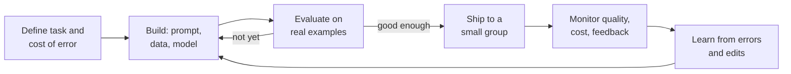
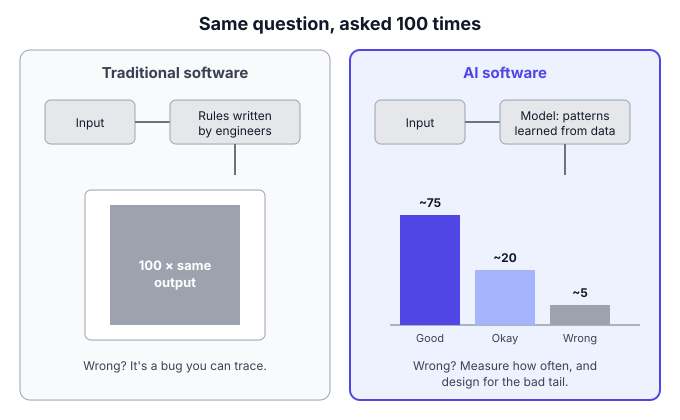
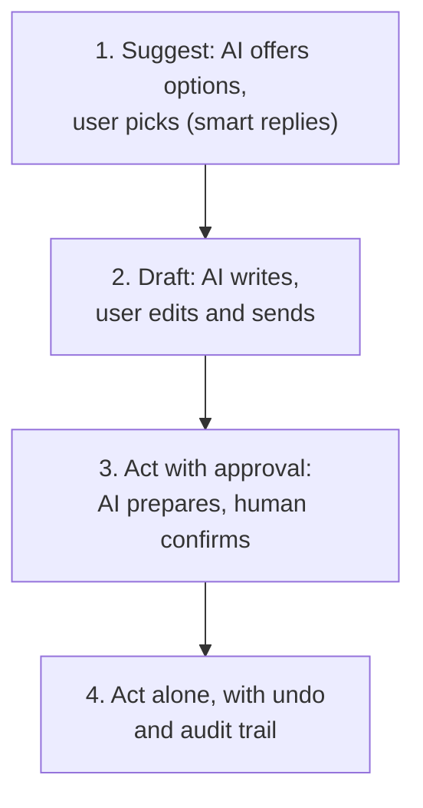

# B0.1 What makes AI products different

## In one line

Normal software does exactly what it was told; AI software makes a good guess. So an AI PM manages *how often* the product is right, *what it costs* each time it runs, and *how much people should trust it*, not just which features it has.

## Why this matters

Most PM habits were built for software that behaves the same way every time. Click "Pay" and the payment either goes through or shows an error. AI products break that habit. The same question can get two different answers. A wrong answer can look exactly like a right one. And every single use costs money.

If you carry old habits into AI work, you get predictable trouble:

- **Launch decisions** made on a few good demos instead of measured quality.
- **Pricing** that loses money on your most active users.
- **Support bots** that sound confident while giving wrong policy answers, which the company is then held to.
- **Teams** that celebrate "the bot handled 80% of chats" while customers quietly get worse service.

This chapter is the foundation for all of Part B. It names the differences so that the later chapters (models, prompting, RAG, evals, trust, pricing) have a place to hang.

## Key terms

| Term | Plain-English meaning |
|---|---|
| **Deterministic** | Same input, same output, every time. A calculator is deterministic. |
| **Probabilistic** | The output is a likely guess, so it can vary and can be wrong. Most AI is probabilistic. |
| **Model** | The trained AI "engine" that turns an input (a question, a photo) into an output (an answer, a label). |
| **LLM (large language model)** | A model trained on huge amounts of text that predicts and writes text, like the ones behind ChatGPT, Claude or Gemini. Explained in [B0.2](02-how-llms-work-for-pms.md). |
| **Inference** | One run of the model to produce an answer. Each inference costs computing power, and so money. |
| **Token** | A small chunk of text (roughly part of a word) that models read and write. AI providers usually charge per token. |
| **Hallucination** | When an AI states something false as if it were true. |
| **Eval (evaluation)** | A repeatable test that measures how good the AI's outputs are, across many examples. See [B3.1](../03-quality/01-evals-the-ai-pm-s-most-important-skill.md). |
| **Human-in-the-loop** | A design where a person checks, approves or corrects the AI's work before it matters. |
| **Jagged frontier** | The idea that AI is excellent at some tasks and surprisingly bad at others that look similar or easier. |

## The idea, simply

!!! tip "Analogy: the calculator and the bright new intern"
    A **calculator** is traditional software. Type 457 × 12 and you get 5,484. Every time. If it's ever wrong, that's a bug, and an engineer can find the exact line of code that caused it.

    An **AI product** is more like a bright new intern. Ask them to draft a reply to an angry customer and they'll usually do a good job, fast. But:

    - Ask twice and you'll get two slightly different drafts.
    - Once in a while they'll state a refund rule that doesn't exist, in a very confident tone.
    - They're brilliant at some tasks and oddly weak at others you'd expect to be easy.
    - You pay them for every hour they work, so the more you use them, the more they cost.
    - You don't fix them by editing one line. You fix them with better instructions, better reference material, examples and feedback.

    A good manager of an intern doesn't ask "is the intern right?" They ask "how often are they right on *this kind* of task, what happens when they're wrong, and what checks do I need?" That's the AI PM's mindset.

Let's build the idea up one difference at a time.

### 1. From rules to predictions

Traditional software runs on **rules** a person wrote: "if the order is older than 7 days, hide the cancel button." The behaviour is designed in advance, line by line.

AI software runs on **patterns learned from data**. Nobody writes the rule for "is this review angry?" Instead, a model has seen huge numbers of examples and has learned to predict what usually comes next or which label usually fits. Its output is a **prediction**, and a prediction can be wrong.

| | Traditional software | AI software |
|---|---|---|
| How behaviour is set | Rules written by engineers | Patterns learned from data, steered by prompts and examples |
| Same input twice | Same output | Often a different output |
| When it's wrong | A bug you can trace to code | A pattern of errors you measure and reduce |
| How you test it | Pass/fail test cases | Score quality across hundreds of examples (evals) |
| Cost of one more use | Close to zero | A real cost per use (inference) |
| What "done" means | Feature works as specified | Quality is good *enough* for the risk, and stays that way |

**Why this matters to a PM:** you can no longer write "the system will correctly answer refund questions" in a spec and assume engineering will make it true. You have to say *how correct*, on *which questions*, measured *how*.

### 2. Same input, different output

Ask a chatbot "Suggest a name for my chai brand" five times and you'll get five different lists. For creative tasks that variety is a feature. For a bank telling you your loan eligibility, it's a problem.

There are settings that reduce variation (engineers call one of them "temperature"), and lower settings make answers more repeatable. But in practice you should not assume an LLM product will give word-for-word identical answers every time. Small changes to the input, such as an extra space or a different order of facts, can also change the output.

**What this changes for you:**

- **Demos lie.** A demo shows one lucky run. Ask to see 50 runs of the same tricky input before you believe it.
- **Bug reports need context.** "The bot said something wrong" is only useful with the exact input, the time and the model version, because the same question may get a fine answer next time.
- **Consistency becomes a product decision.** Decide where variety is welcome (marketing copy ideas) and where it isn't (prices, policies, medical or financial facts). For the second kind, take the answer from a database or a fixed rule, and let the AI only phrase it.

| Task | Is variety good? | Design choice |
|---|---|---|
| Writing 10 Instagram captions | Yes | Let the model be creative |
| Summarising a customer's complaint for an agent | A little | Fixed format, flexible wording |
| Telling a user their refund amount | No | Look up the number; AI only explains it |
| Approving a loan | No | Use rules and a scoring model with human review; don't let free text decide |

### 3. Quality is a percentage, not a yes/no

A normal feature either works or it's broken. An AI feature is "right 92% of the time on delivery questions, 78% on refund questions and 60% on questions in Tamil." Quality is a **distribution**: a spread of good and bad results across many cases.

That means two new PM questions:

1. **How good is good enough?** It depends on the **cost of a wrong answer**, not on a universal number.
2. **Good enough on what?** Overall averages hide weak spots. Always slice quality by type of question, language, user group and risk level, just as you'd slice any metric ([A8.1](../../part-a/08-product-metrics/01-metric-basics-leading-lagging-input-output-vanit.md)).

| Cost of a wrong answer | Example | What "good enough" might look like |
|---|---|---|
| **Low**: easy to spot, easy to ignore | Suggested reply in a chat app | Useful most of the time; users simply skip bad ones |
| **Medium**: annoying, costs time or a little money | "Where is my order?" support bot | High accuracy, plus an easy way to reach a human |
| **High**: money, health, legal or safety harm | Insurance claim decision, medicine dosage | AI only drafts or flags; a qualified person decides |

The same accuracy, say 90%, can be excellent for the first row and unacceptable for the third.

### 4. Confidently wrong: failures that look like success

When normal software fails, it usually fails loudly: an error message, a crash, a spinner that never stops. When an LLM fails, it often fails **quietly and fluently**. A made-up refund rule reads just as smoothly as a real one. This is what people call a **hallucination**.

Hallucinations happen because the model is built to produce *likely-sounding* text, not to check facts against a database. Common triggers:

- The question needs information the model doesn't have (your company's latest policy, today's prices).
- The question is unusual, so the model fills gaps with plausible guesses.
- The user's question contains a false assumption, and the model plays along.

**What PMs do about it:**

- **Ground the model in real sources.** Give it your actual policy documents and ask it to answer only from them (this is called RAG; see [B1.2](../01-building-blocks/02-rag-giving-ai-your-knowledge.md)).
- **Let it say "I don't know."** Design a good path for low-confidence answers: a clarifying question, a link to the source, or a handover to a human.
- **Show sources.** Citations let users check, and let your team audit.
- **Measure it.** Track how often answers contain unsupported claims, using evals and sampled human review.

You can reduce hallucinations a lot. You should plan as if you can't remove them completely.

### 5. The jagged frontier: brilliant here, weak there

You might expect AI to be "generally smart", so that if it can do something hard it can surely do something easy. It doesn't work like that.

In a well-known 2023 field experiment, researchers from Harvard, Wharton, MIT and other schools worked with Boston Consulting Group. 758 consultants were given realistic tasks, with and without GPT-4. [Ethan Mollick's summary](https://www.oneusefulthing.org/p/centaurs-and-cyborgs-on-the-jagged) reports that, on tasks inside AI's abilities, consultants using AI finished 12.2% more tasks, worked 25.1% faster and produced work rated 40% higher in quality. But on a task designed to fall *outside* AI's abilities, consultants using AI got the right answer less often (60–70% of the time) than those working without it (84%). The researchers called this pattern the **jagged technological frontier**.

The pattern still holds with today's far stronger models. Stanford's [2026 AI Index](https://hai.stanford.edu/ai-index/2026-ai-index-report), as [summarised by The Decoder](https://the-decoder.com/stanfords-ai-index-2026-shows-rapid-progress-growing-safety-concerns-and-declining-public-trust/), notes that top models beat human baselines on PhD-level science questions, yet one leading model read analogue clocks correctly only about half the time.

**What this means for you:**

- **Never assume.** Test the AI on *your* tasks, with *your* users' real inputs.
- **Map the frontier for your product.** List the task types your feature covers and measure each one separately.
- **Design for the weak spots.** Where the AI is weak, keep a human in charge or don't offer the feature at all.
- **Re-check when models change.** The frontier moves with every new model, in both directions.

### 6. Every use costs money

In traditional software, serving one more user costs almost nothing. Once the code is written, the extra server cost per click is tiny. That's why software businesses have such high margins.

AI is different. Every answer means running a large model, which uses expensive chips. You pay per use, often per token, either to a provider (like OpenAI, Anthropic or Google) or for your own servers. Costs have fallen extremely fast: Stanford's 2025 AI Index found the price of GPT-3.5-level performance fell from $20 to $0.07 per million tokens between November 2022 and October 2024, a roughly 280-fold drop ([VentureBeat summary](https://venturebeat.com/ai/stanfords-ai-index-5-critical-insights-reshaping-enterprise-tech-strategy)). But products also keep using bigger models, longer inputs and multi-step "agents", so the bill per task doesn't automatically shrink.

| | Traditional app feature | AI feature |
|---|---|---|
| Cost to build | High (engineering time) | High (engineering time, data, evals) |
| Cost per extra use | Near zero | Real and visible on a bill |
| Who costs the most | Nobody in particular | Your heaviest, most engaged users |
| What drives the cost | Mostly fixed team costs | Model choice, length of inputs and outputs, number of steps |

**PM consequences:**

- **Unit economics matter from day one** (see [B5.1](../05-strategy-and-business/01-ai-pricing-and-unit-economics.md)). Know your cost per answer, per user and per successful task.
- **Your best users can be your least profitable**, especially on a flat monthly price.
- **Model choice is a business decision.** A cheaper, faster model may be good enough for 80% of requests (see [B0.3](03-choosing-models-capability-cost-latency-open-vs.md)).

### 7. Speed: waiting for a thinking machine

A normal page loads in well under a second. A large model writing a long answer, or an agent doing several steps, can take many seconds. Users notice.

Latency (the wait before a response) becomes a design and product trade-off:

- **Bigger, smarter model** → better answers, slower and costlier.
- **Smaller, faster model** → snappier, cheaper, sometimes worse.
- **Streaming** (showing words as they're generated) makes waits feel shorter.
- **Doing work in the background** (e.g. summarising a document before the user opens it) hides latency entirely.

Match the speed to the moment. A voice support bot must reply in about the gap of a normal conversation. A research report can take minutes, if you tell users what's happening.

### 8. The ground keeps moving

Traditional features stay the same until your team changes them. AI features can change **without your team touching anything**:

- **Model updates.** Your provider releases a new version or retires an old one. Answers shift in tone, length and accuracy.
- **User behaviour.** People learn what the AI can do and start asking harder or stranger things.
- **The world.** Prices, policies and facts change; anything the model "remembers" goes stale.

So an AI feature is never "done". You need ongoing monitoring (see [B3.2](../03-quality/02-ai-product-metrics-and-production-monitoring.md)), a fixed set of test cases to re-run whenever anything changes, and a habit of reading real conversations every week.

There's an upside too. AI products can **get better with use**. Every correction, thumbs-down, edit or escalation is data you can use to improve prompts, examples and evals. Teams that design this feedback loop on purpose improve fastest ([B4.1](../04-data-safety-and-law/01-data-strategy-and-feedback-loops.md)).

### 9. Trust has to be designed, not assumed

With a calculator, users trust the answer completely, and they're right to. With AI, the goal is **calibrated trust**: users rely on it when it's likely right and check it when it might be wrong.

Two failure modes:

- **Over-trust:** users copy the AI's answer without checking, even in risky cases. (The consultants in the jagged-frontier study who did worse on the "outside" task are an example.)
- **Under-trust:** users never rely on it, so you pay for a feature nobody uses.

Good AI products help users calibrate. They say clearly what the AI can and can't do. They show sources. They mark uncertain answers. They make it easy to edit, undo or reach a human. These ideas come from well-tested design guidelines, covered in the framework section below and in depth in [B2.3](../02-discovery-and-design/03-designing-for-trust-failure-and-human-in-the-loo.md).

An AI feature is a loop, not a line. Quality is measured before launch and keeps being measured after, because the model, users and world keep changing.

## Framework: Microsoft's Guidelines for Human-AI Interaction + the AI PM's six questions

**Where it comes from.** In 2019, researchers at Microsoft (led by Saleema Amershi) published 18 [Guidelines for Human-AI Interaction](https://www.microsoft.com/en-us/research/publication/guidelines-for-human-ai-interaction/) at CHI, the main academic conference on human-computer interaction. They tested the guidelines over several rounds, including a study in which 49 design practitioners checked them against 20 popular AI-powered products. Microsoft now publishes them with examples in its [HAX Toolkit](https://www.microsoft.com/en-us/haxtoolkit/ai-guidelines/). Google's [People + AI Guidebook](https://pair.withgoogle.com/guidebook-v2/chapters) (from its PAIR research team, first released in 2019 and since updated) covers similar ground: user needs, mental models, explainability, feedback and errors.

The 18 guidelines are grouped by **when** they apply:

| When | What the guidelines ask (paraphrased) |
|---|---|
| **At the start** | Make clear what the system can do, and how well it can do it. |
| **During use** | Show help at the right time and in context; match social norms; avoid reinforcing social biases. |
| **When it's wrong** | Make it easy to call up, dismiss and correct; narrow the scope when unsure; explain why it did what it did. |
| **Over time** | Remember recent interactions; learn from behaviour; update cautiously; ask for fine-grained feedback; explain consequences of user actions; offer global controls; tell users about changes. |

These guidelines were written before today's LLM boom, but they fit chatbots, copilots and agents surprisingly well.

**The AI PM's six questions.** To turn the differences in this chapter into a decision tool, use these six questions on any AI feature. (This checklist is this book's own synthesis of the ideas above, not an official framework.)

1. **Task and cost of error:** What exactly will the AI do, and what happens when it's wrong? Who is harmed, how badly, and can they notice?
2. **Quality bar and measurement:** What accuracy do we need on each type of request, and how will we measure it before and after launch?
3. **Cost per use:** What does one successful task cost us, and what does our heaviest user cost per month?
4. **Speed:** How long can the user wait at this moment?
5. **Failure path:** When the AI is unsure or wrong, what does the user see? Can they correct it, undo it or reach a human?
6. **Learning loop:** What signals (edits, ratings, escalations) will tell us where it's failing, and who reviews them weekly?

**Steps to apply it:**

1. Write the six answers in the first page of the PRD ([A7.1](../../part-a/07-execution-and-delivery/01-prds-and-specs.md)).
2. Place the feature on the **autonomy ladder** (below) based on question 1.
3. Collect 50–200 real example inputs and agree what a good output looks like for each. This is your first eval set.
4. Check the HAX guidelines against your design, especially the "when it's wrong" group.
5. Revisit the answers after the first two weeks in production.

**When to use:** any time you add AI to a product, and again whenever you change model, prompt or scope.

**When not to:** if a simple rule or database lookup solves the problem reliably, you don't need AI, and you don't need this framework. Use the boring solution. "When not to use AI" is covered in [B2.1](../02-discovery-and-design/01-finding-ai-opportunities-and-when-not-to-use-ai.md).

## Diagram

Notice the right-hand panel: the job shifts from "make it work" to "move the spread of results towards good, and catch the bad tail before users are hurt".

**The autonomy ladder.** The higher the cost of error, the lower down this ladder the feature should start.

Start low on the ladder and climb only when evals and real usage show the AI is reliable for that task.

## Worked example

You're the PM for customer support at a fictional Indian fashion e-commerce app, "StyleKart". It gets **1,00,000 support chats a day**. Leadership wants an AI assistant to handle them. All numbers below are illustrative, to show the method.

**Step 1: Today's baseline (all human).**

| Item | Value |
|---|---|
| Chats per day | 1,00,000 |
| Fully loaded cost per human-handled chat | ₹40 |
| **Daily support cost** | **₹40 lakh** |

**Step 2: Define the task and cost of error.** Most chats are "Where is my order?", "How do I return this?" and "When will my refund arrive?". A wrong answer (e.g. telling someone they can return a non-returnable item) leads to a repeat contact, a goodwill refund and sometimes a lost customer. Your finance team estimates the average cost of one wrong AI answer at **₹300**.

**Step 3: First version of the AI.** After an eval on 500 real past chats, the assistant can fully resolve **70%** of chats. Of the chats it resolves, **3%** contain a wrong answer. The rest are handed to humans. Each AI conversation costs about **₹1.50** in model and infrastructure costs.

| Cost line | Calculation | Daily cost |
|---|---|---|
| AI runs on every chat | 1,00,000 × ₹1.50 | ₹1.5 lakh |
| Human handles the 30% handed over | 30,000 × ₹40 | ₹12 lakh |
| Cost of wrong AI answers | 70,000 × 3% = 2,100 × ₹300 | ₹6.3 lakh |
| **Total** | | **₹19.8 lakh** |

That saves about ₹20 lakh a day compared with ₹40 lakh.

**Step 4: The tempting next move.** The team says: "Let's make the bot hand over less. We can push resolution to 85%." But to do it, the bot starts answering trickier chats it isn't good at. Its error rate on resolved chats rises to **8%**.

| Cost line | Calculation | Daily cost |
|---|---|---|
| AI runs on every chat | 1,00,000 × ₹1.50 | ₹1.5 lakh |
| Human handles the 15% handed over | 15,000 × ₹40 | ₹6 lakh |
| Cost of wrong AI answers | 85,000 × 8% = 6,800 × ₹300 | ₹20.4 lakh |
| **Total** | | **₹27.9 lakh** |

The "better" bot, with a higher resolution rate, costs **₹8.1 lakh more per day** than version 1. And that's before counting customers who quietly leave.

**Step 5: What a good AI PM does instead.**

- **Steering metric:** *correct* resolution rate (resolved *and* right, checked by sampling), not raw resolution rate.
- **Guardrails:** wrong-answer rate by question type, repeat contact within 7 days, customer satisfaction after AI chats.
- **Scope by risk:** high-value refunds (say above ₹5,000), fraud claims and legal complaints always go to a human, whatever the AI's confidence. This is the "narrow the scope when unsure" guideline in action.
- **Improve where it's weak:** read 50 failed chats a week, add the missing policy documents, and grow the eval set.

**Step 6: What is it worth?** Suppose these changes keep resolution at 72% while cutting the error rate to 2%:

- AI: ₹1.5 lakh
- Humans: 28,000 × ₹40 = ₹11.2 lakh
- Errors: 72,000 × 2% = 1,440 × ₹300 = ₹4.32 lakh

That's about **₹17 lakh a day**, or roughly ₹23 lakh a day saved versus all-human. Over a year that's around ₹84 crore. More importantly, it beats the "85% resolution" version by about ₹11 lakh a day, with happier customers.

**The lesson:** in AI products, the headline automation number is a vanity metric unless it's paired with quality. The cost of wrong answers can outweigh the savings.

## Going deeper: nuances and trade-offs

### 1. The cost of error decides the design, not the technology

Two products can use the same model and need completely different designs. A smart-reply feature can be wrong often because users simply ignore bad suggestions. A tax-filing assistant cannot. Before debating models or prompts, write down: *who is hurt by a mistake, how much, and will they notice in time?* That answer decides where you sit on the autonomy ladder, how much human review you need, and how high the quality bar is.

### 2. You're responsible for what your AI says

In February 2024, a Canadian tribunal ruled in *Moffatt v. Air Canada* that the airline was liable for wrong bereavement-fare advice its website chatbot gave a customer. The airline argued, among other things, that the chatbot was responsible for its own actions. The tribunal rejected this: the chatbot was part of Air Canada's website, and the company had to take reasonable care that it was accurate. It awarded the customer about CAD 650 plus interest and fees ([American Bar Association summary](https://www.americanbar.org/groups/business_law/resources/business-law-today/2024-february/bc-tribunal-confirms-companies-remain-liable-information-provided-ai-chatbot/)).

The amount was small; the principle wasn't. Users and courts will usually treat what your AI says as what your company says. Laws on this vary by country and are still developing, so involve your legal team early (see [B4.3](../04-data-safety-and-law/03-ai-regulation-eu-ai-act-india-s-dpdp-act-and-ai.md)).

### 3. Evals replace test cases, and most teams are still catching up

Because quality is a percentage, you need **evals**: a fixed set of real inputs with agreed "good" outputs, scored automatically or by people, and re-run whenever anything changes. Many teams are not there yet. LangChain's [State of Agent Engineering](https://langchain.com/state-of-agent-engineering) survey of about 1,300 practitioners (run in November–December 2025) found quality was the most-cited barrier to putting agents into production (about a third of respondents), while only about half ran offline evaluations. Evals are the AI PM's most important skill, which is why [B3.1](../03-quality/01-evals-the-ai-pm-s-most-important-skill.md) is devoted to them.

### 4. Margins behave differently, so pricing does too

Traditional software often has very high gross margins because extra use is nearly free. AI products carry a real cost for every use, so margins depend on how much people use them and which model handles each request. This shapes product decisions:

- **Flat pricing** is simple but risky if a few heavy users run up large bills.
- **Usage limits or credits** protect margins but add friction.
- **Routing** sends easy requests to a cheap model and hard ones to an expensive one.
- **Caching** reuses answers to common questions.

In India, where users are price-sensitive and revenue per user is often lower than in the US, cost per use matters even more. A feature that's affordable at US prices can be loss-making at Indian ones. See [B5.1](../05-strategy-and-business/01-ai-pricing-and-unit-economics.md).

### 5. You depend on someone else's model

Most AI products are built on models from a handful of providers, or on open models you host yourself. That brings new dependencies:

- **Version changes:** a new model may be better on average yet worse on *your* key task. Pin model versions where you can, and re-run your evals before switching.
- **Retirement:** providers retire old models, forcing upgrades on their timeline.
- **Pricing and limits:** prices and rate limits change.
- **Data handling:** you need to know where user data goes and whether it's stored or used for training.

Experienced teams design so they can switch models without rewriting the product, and keep their evals as the referee. Choosing models is covered in [B0.3](03-choosing-models-capability-cost-latency-open-vs.md).

### 6. Data is both fuel and risk

AI products get better with good examples, feedback and domain data. But the same data raises privacy and consent questions: what users typed into a chatbot can include phone numbers, addresses or health details. Decide early what you log, how long you keep it, who can read it and whether it's used for improvement. In India, the Digital Personal Data Protection Act shapes these choices; in Europe, the GDPR and the EU AI Act. These are covered in [B4.1](../04-data-safety-and-law/01-data-strategy-and-feedback-loops.md) and [B4.3](../04-data-safety-and-law/03-ai-regulation-eu-ai-act-india-s-dpdp-act-and-ai.md).

### 7. B2C vs B2B vs internal tools

- **Consumer (B2C):** huge variety of inputs, many languages, low patience, and errors seen in public (screenshots travel fast). Favour narrow, well-tested scopes and clear failure paths.
- **Business (B2B):** buyers ask about accuracy, audit trails, data security and admin controls before they sign. One big error can lose an account. Expect to show your evals in sales conversations.
- **Internal tools:** users are colleagues who can give feedback directly, and mistakes are cheaper to catch. A good place to learn before going customer-facing.

### 8. Sometimes the right answer is "no AI"

AI is the right tool when the task is fuzzy (language, images, judgement calls), when a good-enough answer is valuable, and when errors are catchable. It's the wrong tool when a rule, a search box or a form does the job reliably. "Show my last five orders" doesn't need an LLM. Experienced AI PMs are often the ones who say "let's not use AI for this part", and use it only where it earns its cost and risk. See [B2.1](../02-discovery-and-design/01-finding-ai-opportunities-and-when-not-to-use-ai.md).

## Real-world examples (2023 onwards)

!!! example "Klarna, February 2024 to May 2025: an AI assistant's big numbers, and a correction"
    In February 2024, the Swedish payments company Klarna announced that its OpenAI-powered assistant had handled 2.3 million conversations in its first month, about two-thirds of its customer service chats. Klarna said this was the work of about 700 full-time agents, cut average resolution time from 11 minutes to under 2, reduced repeat inquiries by 25%, and was expected to bring a $40 million profit improvement in 2024 ([Tech.eu](https://tech.eu/2024/02/28/power-of-ai-is-happening-right-now-says-klarna-boss-as/)).

    By May 2025, CEO Sebastian Siemiatkowski told Bloomberg that cost had been too dominant a factor and the result was "lower quality". Klarna began recruiting human agents again and said investing in the quality of human support was the way forward ([Mind the Product](https://www.mindtheproduct.com/klarna-goes-on-recruitment-drive-after-ditching-ai-first-policy/)).

    **PM lesson:** automation share and cost savings are easy to measure; quality and customer trust are harder. Without strong quality guardrails, the headline number can lead you the wrong way, exactly as in this chapter's worked example. Note that Klarna kept its AI assistant; the change was in the balance between AI and humans.

!!! example "Meesho, November 2024: a GenAI voice bot for Indian customers"
    In November 2024, Meesho launched a generative-AI voice bot for customer support. As [reported by YourStory](https://yourstory.com/2024/11/meesho-launches-gen-ai-powered-multilingual-voice-bot-customer-service), Meesho said it was handling about 60,000 calls a day, resolving 95% of queries without a human, with customer satisfaction scores 10% higher and support costs down 75%. It launched in Hindi and English, with Bengali, Gujarati, Kannada, Marathi, Tamil and Telugu planned. Meesho said it would move existing support staff to more complex queries.

    **PM lesson:** in India, voice and local languages are where many users are, and they raise the bar on speed (callers won't wait) and language quality. Starting with two languages and expanding is a sensible way to manage the jagged frontier. The figures are company-reported, so a careful PM would ask how "resolved" is defined and how it's checked.

## Common mistakes

!!! warning "Watch out for"
    - **Judging an AI feature from a demo.** One good run proves little. Look at quality across many real inputs.
    - **Writing specs as if AI were deterministic.** "The bot will answer refund questions correctly" isn't a spec. Say how correct, on what, measured how.
    - **Chasing automation rate alone.** "Handled by AI" without "handled correctly" is a vanity metric.
    - **Ignoring cost per use until the bill arrives.** Model costs scale with usage; heavy users can make a feature loss-making.
    - **Using AI where a rule would do.** You add cost, latency and risk for no gain.
    - **No path for "I'm not sure".** Users get confident nonsense instead of a handover or a clarifying question.
    - **Treating launch as the finish line.** Models, users and facts change; quality drifts without monitoring.
    - **Testing only in English.** Quality often differs by language, so test in every language your users use.

## Common questions

**Is an AI product just a normal product with an AI feature?**
Partly. All the usual PM work (users, problems, metrics) still applies. What changes is how you define "working", how you test, what each use costs and how you design for errors.

**Can't we just set the model to give the same answer every time?**
Settings like temperature can make answers more repeatable, but you shouldn't rely on word-for-word consistency. If an answer must always be the same (a price, a policy), fetch it from a database and let the AI only phrase it.

**What accuracy is good enough?**
There's no universal number. It depends on the cost of a wrong answer and on what users do today. A bot that's right 85% of the time can be great if errors are cheap and easy to catch, and unacceptable if they're costly.

**Do I need to know machine learning to be an AI PM?**
You don't need to train models. You do need to understand, in plain terms, how models work and fail ([B0.2](02-how-llms-work-for-pms.md)), how to read evals, and how cost and speed trade off. Part B is designed to give you exactly that.

**Will AI costs keep falling, so cost won't matter?**
Price for a given level of ability has fallen fast. But products tend to use the newest, largest models and multi-step agents, so the cost per task doesn't automatically shrink. Track it rather than assume.

## In the interview

!!! question "In the interview"
    **How it's tested:** AI PM interviews often start with "What's different about building AI products?" or hide it inside a design question: "Design an AI feature for X." Interviewers listen for whether you talk about quality, error handling, cost and trust, not just features.

    **Sample question:** *"You're a PM at a food delivery app. Leadership wants an AI chatbot to handle all customer complaints. How would you approach it?"*

    **Outline of a strong answer:**

    1. **Clarify the goal:** cut cost, speed up resolution, or improve satisfaction? Which complaints are most common?
    2. **Segment by cost of error:** "Where is my order?" is low risk. Refunds for missing items are medium. Food safety or harassment reports are high risk and go to humans.
    3. **Start narrow:** launch on the top two low-risk intents, in the top languages, with a clear "talk to a human" option.
    4. **Define quality:** build an eval set from past chats; set a bar for correct resolution per intent.
    5. **Metrics:** correct resolution rate as the steering metric; guardrails on repeat contacts, satisfaction and refund cost; cost per resolved chat.
    6. **Failure path and learning loop:** handover when confidence is low; weekly review of failed chats; expand scope only when evals pass.
    7. **Mention a real lesson:** Klarna's later shift back towards human support shows why quality guardrails matter.

    **A second common form:** *"How would you know whether to use AI for a feature at all?"* Strong answers compare the AI option with a simple rule-based option on accuracy, cost per use, speed and risk, and pick the simplest that meets the bar.

## Research happening now

!!! info "Research happening now"
    - **The jagged frontier persists (Stanford HAI, April 2026).** The [2026 AI Index](https://hai.stanford.edu/ai-index/2026-ai-index-report) reports rapid gains on hard benchmarks alongside surprising failures on simple tasks, plus productivity gains of roughly 14–26% in customer support and software development and weaker or negative results on judgement-heavy work ([summary by The Decoder](https://the-decoder.com/stanfords-ai-index-2026-shows-rapid-progress-growing-safety-concerns-and-declining-public-trust/)). *Status: annual report compiling many studies; individual findings vary in strength.*
    - **Quality is the main blocker for AI agents (LangChain, survey Nov–Dec 2025).** The [State of Agent Engineering](https://langchain.com/state-of-agent-engineering) report found about 57% of respondents had agents in production, quality was the top barrier, and latency the second. *Status: industry survey of a tool vendor's community, not peer-reviewed; respondents lean technical.*

## Try it yourself (20 minutes)

Pick one AI feature you use, such as an AI assistant in a shopping app, smart replies in email, a support chatbot or a photo-editing "magic" button. Answer the six questions for it:

1. What task does the AI do, and what happens when it's wrong?
2. What quality bar would you set, and how would you measure it?
3. Roughly what drives its cost per use?
4. How fast must it be?
5. What does the product do when the AI is unsure or wrong? Is it good enough?
6. What feedback does it collect to improve?

Then place it on the autonomy ladder (suggest, draft, act with approval, act alone) and say whether you'd move it up or down.

??? success "Check your answer"
    For **smart replies in an email app**, a good answer might be:

    1. **Task:** suggest three short replies. A wrong suggestion costs almost nothing; the user ignores it.
    2. **Quality bar:** a meaningful share of suggestions get used; near-zero offensive or embarrassing suggestions. Measure usage rate and sampled human review of tone.
    3. **Cost:** runs on a huge number of emails, so it must use a small, cheap, fast model.
    4. **Speed:** instant; suggestions must appear as the email opens.
    5. **Failure path:** the user simply doesn't tap them. Good enough, because nothing is sent automatically.
    6. **Feedback:** which suggestion is tapped, and whether the user edits it before sending.

    **Ladder:** step 1, *suggest*. Moving to "auto-send" would be a mistake: the cost of an error would jump from zero to embarrassing.

    Check that your answer ties the quality bar to the **cost of error**, and that you named a real **failure path**.

## How this connects

- [B0.2 How LLMs work, for PMs](02-how-llms-work-for-pms.md): why models behave probabilistically and hallucinate, in plain language.
- [B0.3 Choosing models](03-choosing-models-capability-cost-latency-open-vs.md): the capability, cost and speed trade-offs introduced here.
- [B2.3 Designing for trust, failure and human-in-the-loop](../02-discovery-and-design/03-designing-for-trust-failure-and-human-in-the-loo.md): the design side of calibrated trust and the autonomy ladder.
- [B3.1 Evals](../03-quality/01-evals-the-ai-pm-s-most-important-skill.md): how to measure quality when it's a percentage, not a yes/no.
- [B5.1 AI pricing and unit economics](../05-strategy-and-business/01-ai-pricing-and-unit-economics.md): the cost-per-use maths in depth.
- [A8.1 Metric basics](../../part-a/08-product-metrics/01-metric-basics-leading-lagging-input-output-vanit.md): vanity vs actionable metrics and guardrails, applied in this chapter's worked example.

## Go deeper

- **Guidelines:** [Microsoft Guidelines for Human-AI Interaction](https://www.microsoft.com/en-us/research/publication/guidelines-for-human-ai-interaction/) and the [HAX Toolkit](https://www.microsoft.com/en-us/haxtoolkit/ai-guidelines/). The 18 guidelines with examples; a practical checklist for any AI feature.
- **Guidebook:** [Google People + AI Guidebook](https://pair.withgoogle.com/guidebook-v2/chapters). Free chapters on user needs, mental models, trust, feedback and errors.
- **Article:** [Ethan Mollick, "Centaurs and Cyborgs on the Jagged Frontier"](https://www.oneusefulthing.org/p/centaurs-and-cyborgs-on-the-jagged). A readable summary of the BCG experiment by one of its authors.
- **Book:** [*Co-Intelligence*](https://www.penguinrandomhouse.com/books/741805/co-intelligence-by-ethan-mollick/9780593716717/) by Ethan Mollick (2024). A non-technical guide to working with AI, including the jagged frontier.
- **Book:** [*AI Engineering*](https://www.oreilly.com/library/view/ai-engineering/9781098166298/) by Chip Huyen (O'Reilly, 2025). The best single book on building products with foundation models; read the chapters on evaluation and cost.
- **Report:** [Stanford HAI AI Index](https://hai.stanford.edu/ai-index/2026-ai-index-report). The yearly reference on AI capabilities, costs and adoption.

## Key takeaways

- AI software makes **predictions**, not rule-based decisions, so it can vary and can be wrong.
- Quality is a **percentage across many cases**. Set the bar by the **cost of a wrong answer**, and slice it by task, language and user group.
- AI fails **quietly and confidently**. Ground it in real sources, let it say "I don't know", and design a good failure path.
- Abilities are **jagged**: test on your own tasks, and re-test when models change.
- **Every use costs money**. Track cost per successful task; heavy users can be your least profitable.
- An AI feature is **never done**: monitor, review real conversations and feed errors back into improvements.
- Your company is **responsible for what its AI says**. Pair automation metrics with quality guardrails.

## Updates

*No updates yet.*
