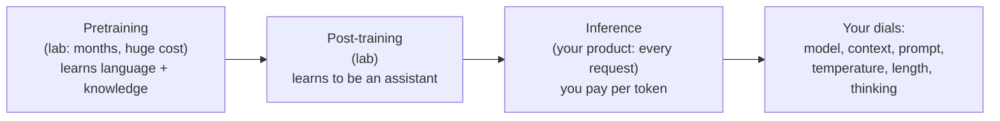
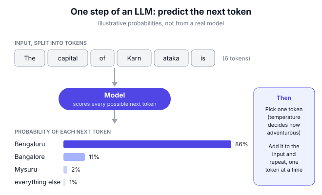

# B0.2 How LLMs work, for PMs

## In one line

A large language model (LLM) is a very large prediction machine that writes one small chunk of text (a "token") at a time, choosing what is most likely to come next based on patterns learned from huge amounts of text, and almost every quirk you'll manage as a PM follows from that.

## Why this matters

You don't need to build an LLM to be a great AI PM. But you do need a working mental model of how it behaves, because nearly every product decision depends on it:

- **Cost and speed:** you pay for, and wait for, every token. Hindi and Tamil text can cost several times more than English.
- **Quality:** the model predicts plausible text, not checked facts. That's why it can be confidently wrong.
- **Consistency:** the same question can get different answers. You need to decide when that's a feature and when it's a bug.
- **Memory:** the model only "knows" what was in its training data plus what you put in front of it right now.
- **Engineering conversations:** words like "context window", "temperature", "fine-tuning" and "reasoning model" will come up in every planning meeting.

[B0.1](01-what-makes-ai-products-different.md) explained *what* makes AI products different. This chapter explains *why*, from the inside, in plain words. Everything in Part B builds on it.

## Key terms

| Term | Plain-English meaning |
|---|---|
| **LLM (large language model)** | A program trained on huge amounts of text to predict the next piece of text. ChatGPT, Claude and Gemini are products built on LLMs. |
| **Token** | The small chunk of text a model reads and writes: a word, part of a word, or a symbol. Pricing and limits are counted in tokens. |
| **Parameters** | The internal numbers a model adjusts during training. A rough measure of model size ("a 2-billion-parameter model"). |
| **Pretraining** | The first, most expensive training stage: learning to predict the next token across a vast amount of text. |
| **Post-training** | Later stages that teach the model to follow instructions, be helpful and refuse harmful requests (e.g. RLHF). |
| **RLHF** | Reinforcement learning from human feedback: people rank the model's answers, and the model is trained towards the preferred ones. |
| **Context window** | The maximum amount of text (in tokens) the model can look at in one go: your instructions, the conversation and any documents. |
| **Inference** | Using a trained model to produce an answer. This is what you pay for per request. |
| **Temperature** | A setting that controls how adventurous the model is when picking the next token. Low means predictable; high means varied. |
| **Hallucination** | When the model states something false, fluently and confidently. |
| **Reasoning model** | A model trained to "think" step by step (producing extra hidden tokens) before answering. Better at hard problems; slower and costlier. |

## The idea, simply

!!! tip "Analogy: the antakshari champion who has read everything"
    Imagine a friend who has read nearly every book, website and forum in a giant library, and is brilliant at one game: **continue the sentence**. You say "The capital of Karnataka is…", and they instantly say "Bengaluru". You say "Dear Sir, I am writing to inform you that…", and they produce a perfect formal letter.

    They're not looking anything up. They've absorbed so many patterns that continuing text *sounds* right almost every time. Usually, sounding right and being right are the same thing. But ask about something rare (the birthday of a minor politician, a policy your company changed last week) and they'll still continue the sentence fluently. They'll just make it up.

    And here's a twist: your friend has no memory of yesterday's chat. Every time you talk, you have to hand them the notes.

That's an LLM. Let's build up each piece.

### 1. Tokens: the units of everything

LLMs don't read letters or whole words. They read **tokens**: chunks produced by a "tokenizer" that splits text into common pieces. A common word like "the" is one token. A rarer word like "Karnataka" might be split into two or three.

A rule of thumb from OpenAI: in English, one token is roughly **4 characters, or about ¾ of a word** ([OpenAI Help](https://help.openai.com/en/articles/4936856-what-are-tokens-and-how-to-count-them)). So 100 English words ≈ 130–135 tokens.

**Why PMs care:**

| Tokens decide… | What it means for your product |
|---|---|
| **Price** | API providers charge per million input tokens and per million output tokens. Output usually costs more. |
| **Speed** | The model writes one token at a time, so long answers take longer. |
| **Limits** | The context window is measured in tokens; very long documents may not fit. |
| **Fairness across languages** | Many tokenizers were built mostly on English text, so other languages split into more tokens. |

That last point matters a lot in India. Sarvam AI, a Bengaluru startup, reported in October 2024 that many multilingual models need **4–8 tokens per word** for Indic scripts, compared with about **1.4 for English**. Its own tokenizer brought Indic languages down to 1.4–2.1 tokens per word ([Sarvam AI](https://www.sarvam.ai/blogs/sarvam-1)). In plain terms: the same message in Hindi can cost several times more, and take several times longer, than in English, depending on the model.

**How to recognise token effects:** the model is oddly bad at counting letters in a word, or at simple character-level tasks. That's because it never "sees" individual letters, only token chunks.

### 2. Next-token prediction: the core loop

At its heart, an LLM does one thing repeatedly:

1. Read all the tokens so far.
2. Give a probability to every possible next token.
3. Pick one.
4. Add it to the text and go back to step 1.

The diagram below shows one step. A 300-word answer is this loop run about 400 times.

**Why it works:** to predict the next word well across billions of examples, the model has to pick up grammar, facts, styles, reasoning patterns and even some common sense. Prediction is a simple goal that forces a lot of learning.

**What it explains:**

- **Fluency.** Text always sounds natural, because natural-sounding text is what it learned to predict.
- **Streaming.** Answers appear word by word in chat apps because they're *generated* word by word.
- **Errors that compound.** Once the model writes a wrong token early ("The policy was introduced in 2019…"), the rest of the answer continues confidently from that mistake.

### 3. Pretraining: where the knowledge comes from

In **pretraining**, a model is shown an enormous amount of text (web pages, books, code, and more) and adjusts its **parameters** billions of times to get better at predicting the next token. This takes weeks or months on thousands of specialised chips and is by far the most expensive stage. For scale: Sarvam reported training its small 2-billion-parameter Sarvam-1 model on 1,024 GPUs over 5 days ([Sarvam AI](https://www.sarvam.ai/blogs/sarvam-1)); frontier models are far larger.

What pretraining gives you, and what it doesn't:

| Pretraining gives | Pretraining doesn't give |
|---|---|
| Broad general knowledge | Knowledge of events after the **training cutoff** date |
| Language skills in many languages (unevenly) | Your company's private data (policies, prices, customers) |
| Coding, summarising, translating patterns | A reliable sense of *which* facts it knows well |
| Common reasoning patterns | Guaranteed correct maths or logic |

**For PMs:** if your feature needs current or private information, the model must be *given* it at the time of the request, usually through retrieval (RAG, see [B1.2](../01-building-blocks/02-rag-giving-ai-your-knowledge.md)) or tools ([B1.3](../01-building-blocks/03-agents-tool-use-and-mcp.md)).

### 4. The transformer and "attention", in one paragraph

Almost every modern LLM uses the **transformer** design, introduced by Google researchers in the 2017 paper [*Attention Is All You Need*](https://arxiv.org/abs/1706.03762). Its key idea is **attention**: when predicting the next token, the model can weigh every earlier token by how relevant it is. In "Priya put the phone in her bag because *it* was ringing", attention helps the model link "it" to "phone", not "bag". Transformers also train efficiently on many chips at once, which is what made today's huge models practical.

You don't need the maths. Just remember: attention is why the model can use information from anywhere in its context, and also why longer inputs cost more to process.

### 5. Post-training: from text predictor to assistant

A pretrained model just continues text. Ask it "What is the capital of France?" and it might continue with another quiz question, because that's what often follows in its training data. **Post-training** turns it into a helpful assistant. The most influential recipe was described by OpenAI in its 2022 InstructGPT paper ([arXiv](https://huggingface.co/papers/2203.02155)):

1. **Supervised fine-tuning:** people write example answers to many requests, and the model is trained on them.
2. **Ranking:** people compare several model answers and rank them.
3. **Reinforcement learning from human feedback (RLHF):** the model is trained further to produce answers like the ones people preferred.

The striking finding: in human evaluations, people preferred answers from a **1.3-billion-parameter** InstructGPT model over the **175-billion-parameter** GPT-3, despite it being about 100 times smaller ([paper](https://huggingface.co/papers/2203.02155)). **Training matters as much as size.**

Post-training also shapes the model's "personality": its tone, how cautious it is, how it formats answers, what it refuses. When two models feel very different to use, much of that comes from post-training choices.

### 6. The context window: the model's desk, not its memory

The **context window** is everything the model can see when producing an answer: your system prompt (the instructions you write for it), the conversation so far, any documents you added, and its own answer as it writes. Think of it as a desk. Whatever is on the desk, the model can use. Whatever isn't, it can't.

Three things PMs often get wrong:

- **The model has no memory between requests.** Every API call starts fresh. Chat apps "remember" the conversation only because the app re-sends the whole history each time. "Memory" features in products are extra systems built on top, which store notes and put them back on the desk.
- **Bigger desks cost more.** Every token on the desk is paid for on every request. A 20-page document in a 50-turn chat is paid for 50 times unless you design around it.
- **A bigger desk isn't a tidier desk.** Chroma's July 2025 study of 18 models found performance dropped as inputs grew longer, even on simple tasks, and that related-but-irrelevant text ("distractors") made it worse ([Chroma research](https://www.trychroma.com/research/context-rot)). They called this "context rot". *Status: an industry technical report, not peer-reviewed.*

**Rule of thumb:** put only what the model needs on the desk, and put the most important instructions where they can't be missed.

### 7. Sampling and temperature: why answers vary

At each step, the model produces probabilities, not a single answer. The product then **samples** a token from those probabilities. The **temperature** setting controls how:

| Temperature | Behaviour | Good for |
|---|---|---|
| **Low (around 0–0.3)** | Almost always picks the most likely token; answers are similar each time | Extraction, classification, summaries, customer support |
| **Medium (around 0.5–0.8)** | Some variety, still sensible | General chat, drafting emails |
| **High (around 1 and above)** | More surprising choices; more errors | Brainstorming names, creative writing |

*Exact ranges and defaults vary by provider and model; some newer models don't let you change temperature at all. Check the docs for the model you use.*

**Why PMs care:** variation is why the same question can get different answers, which confuses users and makes testing harder. It's also why you must test AI features on *many* runs, not one ([B3.1](../03-quality/01-evals-the-ai-pm-s-most-important-skill.md)). Even at low temperature, don't assume identical outputs every time; check how your chosen model behaves.

### 8. Hallucination: confident and wrong

A **hallucination** is a fluent, confident statement that's false. In September 2025, OpenAI published an explanation of why this happens ([OpenAI](https://openai.com/index/why-language-models-hallucinate/)):

- **Pretraining has no "true/false" labels.** The model learns to produce plausible text. Patterns like grammar become reliable, but rare, arbitrary facts (a specific person's birthday) can't be predicted from patterns, so errors appear.
- **Tests reward guessing.** Most benchmarks score only accuracy. A model that guesses scores higher than one that says "I don't know", just as a student who guesses on a test with no negative marking does. So models learn to guess.

OpenAI's example from its own models makes the trade-off concrete:

| On a factual quiz (SimpleQA) | Newer model (gpt-5-thinking-mini) | Older model (o4-mini) |
|---|---|---|
| Said "I don't know" | 52% | 1% |
| Correct | 22% | 24% |
| **Wrong (hallucinated)** | **26%** | **75%** |

The older model was slightly more "accurate" but wrong three times as often, because it almost never abstained. **For PMs:** an accuracy score alone can hide a hallucination problem. When you evaluate models, measure how often they're wrong, not just how often they're right, and reward "I'm not sure" where that's the honest answer.

### 9. Reasoning models: thinking before answering

Since 2024, a new kind of model "thinks" before answering. In September 2024, OpenAI introduced **o1**, trained with reinforcement learning to work through a long internal chain of thought first. On a 2024 maths competition exam (AIME), it averaged about 74% on a single attempt per problem, versus about 12% for GPT-4o ([OpenAI](https://openai.com/index/learning-to-reason-with-llms/)). OpenAI also reported that performance kept improving with more time spent thinking. Most major labs now offer models or settings like this.

| | Standard model | Reasoning model (or "thinking" mode) |
|---|---|---|
| **Good at** | Quick, everyday tasks: drafting, summarising, simple Q&A | Multi-step maths, code, planning, tricky analysis |
| **Speed** | Fast | Slower: it writes many hidden "thinking" tokens first |
| **Cost** | Lower | Higher: you usually pay for the thinking tokens too |
| **PM question** | "Is quality good enough?" | "Is the extra quality worth the wait and cost *for this task*?" |

**Rule of thumb:** don't use a reasoning model to summarise a chat or classify a ticket. Do consider it where errors are expensive and users can wait a few seconds more.

## Framework: the LLM lifecycle and the PM's dials

**Where it comes from.** The three-stage view of how assistant LLMs are made, **pretraining → post-training → inference**, follows the recipe set out in OpenAI's InstructGPT paper (Ouyang et al., [2022](https://huggingface.co/papers/2203.02155)), built on the transformer ([Vaswani et al., 2017](https://arxiv.org/abs/1706.03762)). Andrej Karpathy's 2025 video [*Deep Dive into LLMs like ChatGPT*](https://www.youtube.com/watch?v=7xTGNNLPyMI) walks through the same stages for a general audience. The "dials" list below is this book's practical summary of the choices a PM controls at inference time.

Labs control the first two stages. Your product decisions mostly live in the last two boxes, which is where cost, speed and quality are set for each request.

**Step 1: Name the task type.** Is it extraction, classification, summarising, drafting, open-ended chat, or multi-step reasoning? The task decides most of the dials below.

**Step 2: Pick the model class.** Small and fast, large general, or reasoning model ([B0.3](03-choosing-models-capability-cost-latency-open-vs.md) goes deeper). Start with the smallest that meets your quality bar.

**Step 3: Design the context.** What must be on the desk: instructions, examples, retrieved documents, user data? What can be left off? Estimate tokens per request.

**Step 4: Set the generation dials.**

| Dial | Question to ask |
|---|---|
| **Temperature** | Do we want the same answer every time, or variety? |
| **Max output length** | How long should answers be? (Shorter is faster and cheaper.) |
| **Thinking / reasoning effort** | Does this task need it? |
| **Output format** | Free text, or structured (e.g. JSON) that code can check? |

**Step 5: Estimate cost and latency** from tokens in, tokens out, and the language mix (see the worked example).

**Step 6: Plan for the known failure modes:** hallucination (ground answers in sources, allow "I don't know"), variation (test many runs), stale knowledge (retrieval or tools), and long-context degradation (keep context lean).

**When to use:** at the start of any AI feature, in the PRD, and whenever cost or quality surprises you.

**When not to rely on it alone:** this mental model explains typical behaviour, not every behaviour. Models differ a lot, and they change with each release. Always confirm with evaluations on your own data ([B3.1](../03-quality/01-evals-the-ai-pm-s-most-important-skill.md)).

## Diagram

Notice that the model never "looks up" the answer. It scores possible next tokens, picks one, and repeats. A plausible-but-wrong token with even a small probability can sometimes be picked.

## Worked example

*A realistic scenario. The prices, speeds and exchange rate are **assumptions for illustration**; always check your provider's current price page.*

You're the PM at a private bank. Agents handle about **50,000 customer chats a day**. Before replying to a returning customer, an agent spends about a minute reading the old chat. You propose: **an LLM writes a 120-word summary of the previous chat** for the agent.

**Assumptions:**

| Item | Value |
|---|---|
| Model price (input) | $1 per million tokens |
| Model price (output) | $4 per million tokens |
| Exchange rate | ₹88 per $ |
| Generation speed | 80 output tokens per second |
| Average chat length | 600 words |
| System prompt (instructions + format) | 500 tokens |
| Summary length | 120 words |

**Step 1: Count tokens for an English chat.** Using about 1.33 tokens per word:

| | Tokens |
|---|---|
| Chat: 600 words × 1.33 | 800 |
| System prompt | 500 |
| **Input total** | **1,300** |
| **Output:** 120 words × 1.33 | **160** |

**Step 2: Cost per summary.**

- Input: 1,300 ÷ 10,00,000 × $1 = $0.0013
- Output: 160 ÷ 10,00,000 × $4 = $0.00064
- **Total ≈ $0.0019 ≈ ₹0.17 per summary**

At 50,000 a day: about **$97 (≈ ₹8,500) a day**, or **≈ ₹2.6 lakh a month**.

**Step 3: Now the same chat in Hindi.** Suppose your chosen model's tokenizer needs about **5 tokens per Hindi word** (within the 4–8 range Sarvam reported for many multilingual models):

| | English | Hindi (at 5 tokens/word) |
|---|---|---|
| Input tokens | 1,300 | 3,000 + 500 = 3,500 |
| Output tokens | 160 | 600 |
| Cost per summary | ≈ $0.0019 | ≈ $0.0059 (3× more) |
| Time to write the summary | 160 ÷ 80 ≈ **2 seconds** | 600 ÷ 80 ≈ **7.5 seconds** |

If 40% of your chats are in Hindi, your blended cost rises by about 80%, and agents wait noticeably longer for Hindi summaries.

**Step 4: Options the PM can take.**

| Option | Effect | Trade-off |
|---|---|---|
| Summarise Hindi chats **in English** (agents read English) | Output tokens drop from 600 to 160; ~2 s wait | Only if every agent is comfortable in English |
| Choose a model with an **Indic-efficient tokenizer** | Input and output tokens drop a lot | Must re-check quality on your data |
| Cut the system prompt from 500 to 250 tokens | Small saving on every call | Make sure quality holds |
| Use a **reasoning model** "for better summaries" | Might add ~2,000 thinking tokens: +$0.008 and ~25 s per summary | Almost never worth it for summarising |

**Step 5: Set the dials.** Temperature low (agents need consistent, factual summaries). Output as a fixed format: *issue*, *what was promised*, *open action*. Instruction: "If the chat doesn't say, write 'not mentioned'", so the model has an honest way out instead of guessing.

**Step 6: What is it worth?** If a summary saves an agent about 40 seconds per chat:

- 50,000 × 40 s ≈ **555 agent-hours a day**
- At an assumed fully loaded cost of ₹250 per agent-hour: ≈ **₹1.4 lakh a day** saved
- Versus model cost of ≈ ₹8,500 (all English) to ≈ ₹26,000 (all Hindi) a day

The feature is clearly worth building. But the *design choices* (output language, tokenizer, no reasoning model) change its running cost by about **3×**. Those are product decisions, not just engineering ones.

**Step 7: Guardrails.** Track the share of summaries agents mark as wrong, and sample 50 a week against the full chat. A summary that invents a promise ("refund approved") is worse than no summary.

## Going deeper: nuances and trade-offs

### 1. Bigger isn't automatically better

Model size (parameters) roughly tracks capability, but post-training, data quality and task fit matter just as much. InstructGPT's 1.3-billion-parameter model beat a model 100 times larger in human preference ([paper](https://huggingface.co/papers/2203.02155)). Sarvam claimed its 2-billion-parameter model ran 4–6 times faster than larger models while matching or beating them on Indic tasks ([Sarvam AI](https://www.sarvam.ai/blogs/sarvam-1)); *that's the company's own benchmark claim*. For PMs: test the smallest model that might work before assuming you need the biggest.

### 2. The model doesn't know what it knows

Anthropic's interpretability team studied how one of its models handles questions. They found that "I can't answer that" is the model's default, and recognising a familiar name switches that default off. Hallucinations can happen when a name *feels* familiar but the model knows little else about it ([Anthropic, March 2025](https://www.anthropic.com/research/tracing-thoughts-language-model)). That fits what PMs see in practice: errors cluster around half-familiar topics, such as small companies, niche policies and local names. Ground those answers in retrieved sources.

### 3. The model's explanation of itself may not be how it actually worked

The same Anthropic study found that when the model did mental addition, it used parallel internal paths, but when asked how, it described the school method of carrying the 1. On a harder problem, it sometimes worked backwards from a hinted answer while claiming to calculate ([Anthropic](https://www.anthropic.com/research/tracing-thoughts-language-model)). *Anthropic notes its methods capture only part of what happens inside the model.* **For PMs:** don't treat an AI's stated reasoning as an audit trail. In high-stakes products (lending, health), log the inputs and sources, and verify outputs independently.

### 4. Tokenization quirks beyond cost

- **Counting and spelling:** tasks like "how many r's in strawberry" are hard because the model sees chunks, not letters.
- **Numbers:** long numbers may be split into odd chunks, which is one reason arithmetic can go wrong. Use a calculator tool for anything financial.
- **Romanised Indian languages (Hinglish):** "kal milte hain" is written in Latin script, so it may tokenize more efficiently than Devanagari, but models may understand it less well. Test both on real user messages.
- **Names and addresses:** Indian names, localities and product SKUs often split into many tokens and are more error-prone. Check them in your evaluations.

### 5. Long context: capability vs reliability

Context windows have grown enormously, and it's tempting to "just put everything in". Resist it. Longer inputs cost more on every call, slow answers down, and can lower quality (the "context rot" effect, [Chroma](https://www.trychroma.com/research/context-rot)). Good teams retrieve only the relevant parts ([B1.2](../01-building-blocks/02-rag-giving-ai-your-knowledge.md)), summarise long histories, and place key instructions clearly. Ask your engineers: "How many tokens is a typical request, and what's in them?"

### 6. Same model, different behaviour over time

Providers update models, retire old versions and change defaults. A prompt that worked well in March may behave differently in July. Pin a specific model version where the provider allows it, re-run your evaluations before switching, and keep a small set of "golden" test cases that you check after every change ([B3.1](../03-quality/01-evals-the-ai-pm-s-most-important-skill.md)).

### 7. Where PMs make decisions vs where labs do

| Decided by the model lab | Decided by your product team |
|---|---|
| Pretraining data and size | Which model and version to use |
| Post-training style, safety behaviour | System prompt, examples, tone instructions |
| Tokenizer | Which language you generate output in |
| Training cutoff | Retrieval and tools for fresh or private data |
| Price per token | Context size, output length, caching, when to use reasoning |

Knowing this split stops two common mistakes: blaming the model for things your design controls, and promising stakeholders fixes that only the lab can make.

### 8. Questions to ask your engineers

- How many input and output tokens does a typical request use? What's the cost per 1,000 requests?
- What's the p50 and p90 latency (typical and slowest-10% wait)?
- What's in the context for each request, and what could we remove?
- What temperature are we using, and why?
- Which exact model version are we on, and how will we know if a provider update changes quality?
- How do we handle the model not knowing something: does it have a way to say so?

## Real-world examples (2023 onwards)

!!! example "Air Canada, February 2024: the chatbot's answer was the company's answer"
    A customer asked Air Canada's website chatbot about bereavement fares after a death in his family. The chatbot told him he could buy a ticket and apply for the reduced fare within 90 days. That was wrong: the airline's policy didn't allow claims after travel. On 14 February 2024, a Canadian tribunal (British Columbia's Civil Resolution Tribunal) held Air Canada liable for negligent misrepresentation. It rejected the airline's argument that the chatbot was responsible for its own actions, and awarded about CA$650 plus interest and fees ([American Bar Association summary](https://www.americanbar.org/groups/business_law/resources/business-law-today/2024-february/bc-tribunal-confirms-companies-remain-liable-information-provided-ai-chatbot/)). The tribunal also said the correct policy existing elsewhere on the website didn't excuse the error.

    **PM lesson:** this is next-token prediction meeting a niche company policy. The model produced a plausible, helpful-sounding policy. Your users and the law will treat AI answers as your company's answers. For policy, pricing and legal topics, ground the model in your actual documents, let it say "I'm not sure, here's the official page", and test those topics hardest.

!!! example "Sarvam AI, October 2024: fixing the token tax on Indian languages"
    Bengaluru-based Sarvam AI released **Sarvam-1**, a 2-billion-parameter model for ten Indian languages plus English. Its main design choice was a tokenizer built for Indic scripts. Sarvam reported 1.4–2.1 tokens per word across its supported Indic languages, versus 4–8 for many other multilingual models, and said this made both training and inference much more efficient ([Sarvam AI](https://www.sarvam.ai/blogs/sarvam-1); also covered by [IndiaAI](https://indiaai.gov.in/article/sarvam-ai-unveils-sarvam-1-optimized-language-model-for-indian-languages)).

    **PM lesson:** tokens are a product issue. If you serve users in Indian languages, measure tokens per message in each language before choosing a model. A tokenizer that's three times more efficient can mean roughly three times lower cost and faster answers, which can decide whether a vernacular feature is viable at all. *Performance figures are the company's own; verify on your data.*

## Common mistakes

!!! warning "Watch out for"
    - **Treating the LLM as a database.** It predicts plausible text; it doesn't look things up. Give it the facts you need it to use.
    - **Assuming it remembers users.** Each request starts fresh unless your product puts the history or memory back in.
    - **Estimating cost in English only.** Indic-language traffic can cost several times more per message.
    - **Stuffing the context "just in case".** More tokens mean more cost, more delay and sometimes worse answers.
    - **Judging a model on accuracy alone.** Also measure how often it's confidently wrong, and whether it can say "I don't know".
    - **Using a reasoning model for everything.** It's slower and costlier; save it for tasks that need multi-step thinking.
    - **Testing a prompt once and calling it done.** Outputs vary; test many runs and many inputs.
    - **Trusting the model's explanation of its own reasoning** as an audit trail.

## Common questions

**Does an LLM "understand" what it's saying?**
That's debated, and you don't need to settle it to build products. What matters is behaviour: it's very good at many language tasks, unreliable on rare facts, and doesn't reliably know when it's wrong. Design for that.

**Why does ChatGPT know about some recent events if it has a training cutoff?**
Many chat products add web search or other tools that fetch fresh information and put it into the context. The underlying model's own knowledge still stops at its cutoff.

**Is a bigger context window always better?**
No. It lets you include more, but you pay for every token on every request, and quality can drop with long, cluttered inputs. Use what you need.

**Why are output tokens more expensive than input tokens?**
Providers set the prices, and output is usually priced higher than input. Output is also what you wait for, since it is generated one token at a time. Check your provider's price page for current rates.

**Should I set temperature to zero for everything?**
For factual, repeatable tasks, low temperature is usually right. For creative tasks, some variety helps. And some models don't expose the setting at all.

**Do I need to understand the maths of transformers?**
No. You need to understand tokens, context, prediction, variation and hallucination well enough to make product decisions and ask good questions.

## In the interview

!!! question "In the interview"
    **How it's tested:** AI PM interviews often start with "Explain how an LLM works to a non-technical stakeholder" or "Why does our chatbot sometimes make things up?" Interviewers check whether you can be accurate *and* simple, and whether you connect the mechanics to product decisions.

    **Sample question:** *"Our support chatbot gave a customer the wrong refund policy. Explain to the CEO why this happened and what you'd do."*

    **Outline of a strong answer:**

    1. **Simple explanation:** the model writes the most likely next words based on patterns it learned. It doesn't look up our policy unless we give it the policy. A fluent answer isn't a checked answer.
    2. **Why here:** refund rules are specific to us and may have changed after the model's training, so the model "filled the gap" plausibly.
    3. **Fixes, in order:** ground answers in our actual policy documents (retrieval); instruct it to say "I'm not sure" and link the official page when the documents don't cover a question; add evaluations focused on policy questions; route money-related questions to human review or a fixed answer.
    4. **Measure:** the rate of wrong policy answers in weekly samples, escalation rate and customer satisfaction.
    5. **Accountability:** as the Air Canada case shows, the company is responsible for what its bot says.

    **A second common form:** *"How would you estimate the cost of adding an AI feature?"* Walk through requests per day × (input tokens × input price + output tokens × output price), mention language mix and reasoning tokens, then compare against the value created, as in the worked example above.

## Research happening now

!!! info "Research happening now"
    - **Looking inside models (mechanistic interpretability).** MIT Technology Review named mechanistic interpretability one of its [10 Breakthrough Technologies of 2026](https://www.technologyreview.com/2026/01/12/1130697/10-breakthrough-technologies-2026/) (January 2026), noting that nobody fully knows how LLMs work and that new techniques are giving the clearest view yet. *Status: fast-moving research field.*
    - **Can models notice their own internal states? (Anthropic, October 2025).** Anthropic [reported](https://anthropic.com/research/introspection) that its Claude Opus 4 and 4.1 models sometimes detected a concept artificially injected into their internal activations, about 20% of the time under the best conditions. The researchers stress this ability is highly unreliable and narrow, and say it is not evidence of human-like introspection. *Status: early research results.*
    - **Rethinking how hallucinations are scored (OpenAI, September 2025).** OpenAI [argued](https://openai.com/index/why-language-models-hallucinate/) that benchmarks should penalise confident errors more than "I don't know", much like negative marking. Whether major leaderboards adopt this is still open. *Status: published paper and proposal; adoption under way.*

## Try it yourself (25 minutes)

Pick any AI chat product you have access to.

1. Ask the same factual question 5 times in new chats (e.g. "Who founded [a small company in your city]?"). Note how answers vary and whether any are wrong.
2. Ask a question about something that happened last week. Does it know? Does it search?
3. Take a 100-word paragraph in English and the same paragraph in Hindi (or another Indian language). If you can, paste both into a free online token counter for a model you know (many providers offer one) and compare token counts.
4. Write down three product decisions you'd make differently because of what you saw.

??? success "Check your answer"
    What you'll typically see:

    - **Step 1:** answers about well-known facts are stable. Answers about obscure facts vary between runs and may include confident errors. This is sampling plus hallucination on rare facts.
    - **Step 2:** without a search tool, the model either doesn't know or guesses. With one, the product fetched fresh text into the context.
    - **Step 3:** the Indian-language version usually uses noticeably more tokens, often two to several times more, depending on the tokenizer.

    Good product decisions might include: ground factual answers in sources and show them; let the model say "I'm not sure"; estimate costs separately per language; choose a model with an efficient tokenizer for your main languages; test outputs across many runs before launch.

## How this connects

- [B0.1 What makes AI products different](01-what-makes-ai-products-different.md): the product consequences of the mechanics explained here.
- [B0.3 Choosing models](03-choosing-models-capability-cost-latency-open-vs.md): using these ideas to compare models on capability, cost and speed.
- [B1.1 Prompt engineering for PMs](../01-building-blocks/01-prompt-engineering-for-pms.md): how to fill the context window well.
- [B1.2 RAG: giving AI your knowledge](../01-building-blocks/02-rag-giving-ai-your-knowledge.md): the standard fix for stale or private knowledge and many hallucinations.
- [B5.1 AI pricing and unit economics](../05-strategy-and-business/01-ai-pricing-and-unit-economics.md): turning token costs into a business model.

## Go deeper

- **Watch:** [*Deep Dive into LLMs like ChatGPT*](https://www.youtube.com/watch?v=7xTGNNLPyMI) by Andrej Karpathy (2025). A long, general-audience walkthrough of how models like ChatGPT are built, from pretraining to post-training.
- **Paper:** [*Attention Is All You Need*](https://arxiv.org/abs/1706.03762) (Vaswani et al., 2017). The transformer paper. Skim the introduction and diagrams; skip the maths.
- **Paper:** [*Training language models to follow instructions with human feedback*](https://huggingface.co/papers/2203.02155) (Ouyang et al., 2022). The InstructGPT recipe behind modern assistants. The abstract alone is worth reading.
- **Article:** [*Why language models hallucinate*](https://openai.com/index/why-language-models-hallucinate/) (OpenAI, 2025). A clear explanation with a useful accuracy-vs-error table.
- **Article:** [*Tracing the thoughts of a large language model*](https://www.anthropic.com/research/tracing-thoughts-language-model) (Anthropic, 2025). Readable findings on what happens inside a model, with illustrations.
- **Report:** [*Context Rot*](https://www.trychroma.com/research/context-rot) (Chroma, 2025). Evidence that longer inputs can lower quality, across 18 models.
- **Article:** [*Sarvam 1: the first Indian language LLM*](https://www.sarvam.ai/blogs/sarvam-1) (Sarvam AI, 2024). A practical look at tokenizers and Indian languages.

## Key takeaways

- An LLM **predicts the next token**, one at a time. Fluency comes from that; so do confident errors.
- **Tokens drive cost, speed and limits.** Indian-language text can need several times more tokens than English, depending on the model.
- **Pretraining** gives broad knowledge up to a cutoff; **post-training** turns the model into an assistant. Training choices matter as much as size.
- The **context window is a desk, not a memory.** Give the model what it needs, keep it lean, and remember every request starts fresh.
- **Temperature** controls variation; test AI features on many runs, not one.
- **Hallucinations** come from predicting plausible text and from tests that reward guessing. Measure wrong answers, not just right ones, and give the model a way to say "I don't know".
- **Reasoning models** trade speed and cost for better multi-step thinking; use them where it pays.

## Updates

*No updates yet.*
