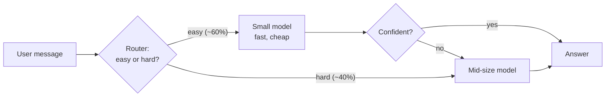
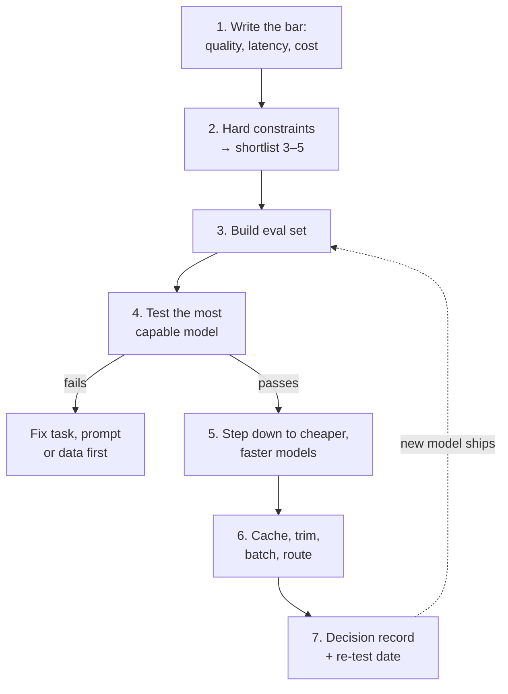
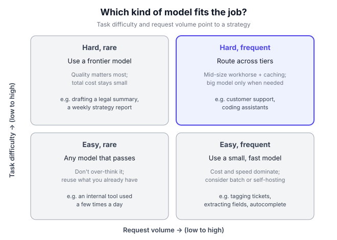

# B0.3 Choosing models: capability, cost, latency, open vs closed

## In one line

Pick the cheapest, fastest model that passes *your* quality bar on *your* real tasks, and keep the option to switch, because the best choice changes every few months.

## Why this matters

Model choice is one of the few AI decisions that touches everything at once:

- **Quality:** a weaker model makes more mistakes, and each mistake costs you a refund, a support ticket or a lost user.
- **Cost:** your API bill grows with every user and every word. The wrong model can make a feature lose money on every use.
- **Speed:** a model that takes eight seconds to start replying feels broken in a chat window.
- **Control:** where the model runs decides where your users' data goes, what the law allows, and whether a vendor can change your product overnight.

Engineers will run the tests. But the PM owns the trade-off: what "good enough" means, how much a correct answer is worth, and how much waiting users will accept. This chapter gives you the vocabulary and a repeatable way to make that call.

## Key terms

| Term | Plain-English meaning |
|---|---|
| **Model tier** | The size class of a model inside one family: a large "frontier" model, a mid-size workhorse, and a small fast one. |
| **Frontier model** | One of the most capable models available at a given time. |
| **Price per million tokens** | How API providers charge: a rate for text you send in (input) and a higher rate for text the model writes (output). |
| **Latency** | How long the user waits. Usually split into time to first token and total response time. |
| **Time to first token (TTFT)** | Seconds from sending a request until the first word of the reply arrives. |
| **Output speed** | How many tokens per second the model writes once it starts. |
| **Open-weight model** | A model whose trained "weights" (its learned numbers) you can download and run yourself. |
| **Closed model** | A model you can only use through the maker's API or app. |
| **Model routing** | Sending each request to a different model depending on how hard or important it is. |
| **Eval set** | A fixed collection of real example tasks, with what a good answer looks like, used to compare models fairly. |

## The idea, simply

!!! tip "Analogy: hiring for a kirana store"
    Imagine you run a busy kirana store. You could hire a chartered accountant to work the till. They would never make a mistake. But you'd pay a fortune, and they'd be wasted on "two Parle-G and a Maggi". You could hire a fast, cheap helper instead. They're perfect for the till, but you wouldn't let them file your GST return.

    Smart shop owners do both. The helper handles the counter, and the accountant handles the hard, high-stakes work. Choosing AI models is the same decision: **match the worker to the job**, and judge them on *your* work, not their CV.

Let's build this up.

### 1. There is no "best model", only a best model *for this job*

New models launch almost every month, and each claims to top some leaderboard. Leaderboards are useful for a shortlist. They are not your answer, for three reasons:

1. **Benchmarks test generic skills.** A model that aces maths olympiad questions may still write stiff Hinglish replies to your customers.
2. **Your task has its own shape.** Short replies or long reports? One-shot or a long conversation? English or Tamil?
3. **The gap at the top is small.** Stanford's [AI Index 2026](https://hai.stanford.edu/ai-index/2026-ai-index-report) shows the best US and best Chinese models only 39 points apart on the Arena leaderboard in 2026 (1,503 vs 1,464). Arena is a ranking built from people voting between two anonymous answers. When the top is that close, cost, speed and fit often decide.

So the question isn't "which model is best?" It's **"which is the cheapest, fastest model that clears our bar on our tasks?"**

| Wrong question | Better question |
|---|---|
| "Which model is number one on the leaderboard?" | "Which models pass 90% of *our* 200 test cases?" |
| "Should we use the newest model?" | "Does the newest model fix failures we actually see?" |
| "Which model is cheapest?" | "Which model gives the lowest *total* cost, including fixing its mistakes?" |

### 2. The four things you trade off

Every model choice balances four things. You can rarely max out all four at once.

| Dimension | What it means for the user | How you measure it |
|---|---|---|
| **Capability (quality)** | Does it get the job right? | Pass rate on your eval set ([B3.1](../03-quality/01-evals-the-ai-pm-s-most-important-skill.md)) |
| **Cost** | Can the feature make money at scale? | Cost per task or per user per month |
| **Latency** | Does it feel instant, or broken? | Time to first token, total response time |
| **Control** | Can we meet privacy, legal and reliability needs? | Where data goes, who can change the model, uptime |

Bigger models usually win on capability and lose on cost and latency. Small models are the reverse. Open-weight models trade convenience for control. Your job is to decide which dimension is the *constraint* for this feature, and which ones just need to be "good enough".

### 3. How API pricing works (and why output costs more)

Most companies use models through an API (a way for your software to call the model over the internet). You pay per token, the small chunk of text a model reads and writes ([B0.2](02-how-llms-work-for-pms.md)). Every provider publishes a price sheet with two main numbers:

- **Input price:** what you pay for every million tokens you *send*. This covers your instructions, the conversation so far and any documents.
- **Output price:** what you pay for every million tokens the model *writes*. This is usually 4–5 times the input price, because generating text takes more computing work than reading it.

Here's how one real price sheet looked in November 2026. On [Anthropic's pricing page](https://platform.claude.com/docs/en/about-claude/pricing), the largest tier cost 40 times the smallest per token:

| Tier on one provider's sheet (Nov 2026) | Input, $ per million tokens | Output, $ per million tokens |
|---|---|---|
| Large (Claude Opus 5.5) | 4 | 20 |
| Medium (Claude Sonnet 5.5) | 2 | 10 |
| Small (Claude Haiku 5.5, prompts up to 100K tokens) | 0.10 | 0.50 |

Treat these as an example of the *shape* of pricing, not numbers to memorise. Prices change often, and every provider is different. Always check the current page.

Two discounts matter a lot in practice. Both are on that same page:

- **Batch processing:** if the work can wait (overnight reports, tagging old tickets), sending it as a batch cuts the price by half.
- **Prompt caching:** if many requests start with the same long text (a big system prompt, a policy document), the provider can store it. Re-reading the stored text costs a small fraction of the normal input price.

**PM takeaway:** your bill = (input tokens × input price) + (output tokens × output price), minus discounts. Long prompts and chatty answers are both cost decisions.

### 4. Latency: what users actually feel

"The model is slow" can mean two different things. [Artificial Analysis](https://artificialanalysis.ai/methodology/performance-benchmarking), which benchmarks model APIs, separates them clearly:

- **Time to first token (TTFT):** how long before *anything* appears.
- **Output speed:** tokens per second once text starts flowing.
- **End-to-end time:** the whole wait, start to finish.

Which one matters depends on the product:

| Product | What users feel most | Target to aim for |
|---|---|---|
| Chat assistant (streaming text) | TTFT. A reply that starts fast feels fast. | First words within about a second |
| Voice bot | Total turn time. Silence on a call feels like a dropped line. | Very short turns; small, fast models |
| Autocomplete in a text box | End-to-end time. A late suggestion is useless. | A fraction of a second |
| Overnight report or batch tagging | Barely matters | Use batch pricing instead |

**Reasoning models** (models that "think" step by step before answering, see [B0.2](02-how-llms-work-for-pms.md)) add a twist. They may stream thinking quickly but take many seconds before the *answer* starts. Artificial Analysis tracks a separate "time to first answer token" for this reason. If you use a reasoning model in a chat product, design for the wait: show progress, or keep reasoning effort low for simple questions.

### 5. Capability: judge with your own eval set

Here's the single most important habit in this chapter. Before choosing, build a small **eval set**: 100–300 real examples of the task, each with a note on what a good answer looks like. Then run every candidate model on the same set and score the answers ([B3.1](../03-quality/01-evals-the-ai-pm-s-most-important-skill.md)).

OpenAI's [model selection guide](https://developers.openai.com/api/docs/guides/model-selection) puts it the same way: define acceptance criteria *before* comparing, test on representative tasks with the same inputs, then "keep the lightest setting that meets your quality bar".

What goes into a good eval set:

- **Common cases** (about 60%): the questions you get every day.
- **Hard cases** (about 25%): long, messy, multi-step or ambiguous inputs.
- **Risky cases** (about 15%): things that must never go wrong, such as medical, money or abuse topics.
- **Your languages and scripts:** Hindi in Devanagari, Hindi typed in English letters, Hinglish, Tamil, and so on.

| What a leaderboard tells you | What your eval set tells you |
|---|---|
| Rank on generic maths, code or chat | Pass rate on *your* refund questions |
| Average over thousands of strangers' votes | How it handles *your* users' Hinglish and typos |
| Nothing about your policies | Whether it follows *your* rules and tone |

### 6. Open-weight vs closed models

A **closed model** lives on its maker's servers. You send text through an API and get text back. An **open-weight model** can be downloaded and run on your own servers or cloud account. (People often say "open source", but many such models share only the weights, not the training data or code, so "open-weight" is more accurate.)

| | Closed (API) | Open-weight (self-hosted) |
|---|---|---|
| **Getting started** | Minutes: get an API key | Days to weeks: servers, GPUs, ops work |
| **Top-end quality** | Usually the frontier | Usually a little behind the very top |
| **Cost at low volume** | Cheap: pay per use | Expensive: GPUs cost money even when idle |
| **Cost at very high volume** | Can get large | Can be cheaper per token if you keep GPUs busy |
| **Data control** | Data goes to the vendor (check their terms) | Data can stay in your own cloud or country |
| **Customisation** | Limited to what the API allows | Full control, including fine-tuning |
| **Stability** | Vendor can update or retire a model | You decide when anything changes |

The gap at the top moves around. Stanford's AI Index 2026 tracked it on the Arena leaderboard. The best closed model led the best open-weight model by about 15% in May 2023, by only about 0.5% in August 2024, and by about 3.4% in March 2026 ([chapter 2, technical performance](https://hai.stanford.edu/assets/files/ai_index_report_2026_chapter_2_technical.pdf)). For many everyday tasks, open-weight models are already good enough.

**India angle:** open weights matter for language and sovereignty. In 2026 Bengaluru's Sarvam AI released Sarvam-30B and Sarvam-105B under the permissive Apache 2.0 licence, with a tokenizer built for 22 scheduled Indian languages ([Open Source For You](https://www.opensourceforu.com/2026/03/sarvam-releases-30b-and-105b-llms-under-apache-2-0/)). A team building for Indian languages can now test such models alongside global ones.

### 7. Small models, big models and routing between them

You don't have to pick one model for everything. Most mature AI products use **several**:

- A **small, fast model** for simple, high-volume work: classifying a message, extracting a phone number, short replies.
- A **mid-size model** as the everyday workhorse.
- A **frontier model** only for the hard, rare, high-value cases.

**Model routing** sends each request to the right one. A router can be simple rules ("refund disputes over ₹5,000 go to the big model") or a small model that rates how hard the question is.

Routing sends most traffic to the cheap model and saves the expensive one for questions that need it. The "not confident" path catches the small model's misses.

Does this work? Researchers at LMSYS tested it in their [RouteLLM study (July 2024)](https://lmsys.org/blog/2024-07-01-routellm/). Their routers kept about 95% of GPT-4's quality on a chat benchmark (MT Bench) while cutting cost by over 85%. On harder knowledge and maths benchmarks, the savings were smaller, about 35–45%. The lesson: routing saves the most when much of your traffic is easy.

### 8. Prices fall fast, so design to switch

The price of a given level of AI capability has been falling faster than almost any technology in history:

- [Epoch AI (March 2025)](https://epoch.ai/data-insights/ai-inference-price-trends) found that the price of reaching GPT-4's level on a hard science test fell about 40 times per year. Across tasks the yearly fall ranged from about 9 to 900 times.
- A [November 2025 preprint from MIT FutureTech](https://arxiv.org/html/2511.23455v1) estimated frontier prices for a fixed performance level falling roughly 5–10 times per year, with about 3 times per year coming from better algorithms alone. *(Preprint, not yet peer-reviewed.)*

The estimates differ, but they point the same way. A feature that's too expensive today may be cheap within a year. A model that's best today may be beaten next quarter. So:

- **Keep model calls behind one internal interface.** Then switching vendors is a config change, not a rewrite.
- **Keep your eval set alive.** Re-run it whenever a new model ships. It's how you switch with confidence.
- **Don't over-optimise for today's prices.** A clever workaround that saves 20% may be pointless after the next price cut.

## Framework: Quality first, then step down

There's no single inventor of this approach. It's the common advice from the AI labs themselves and from practitioners. OpenAI's [model selection guide](https://developers.openai.com/api/docs/guides/model-selection) sets out the core loop: set acceptance criteria first, test models on the same representative tasks, then use the lightest model and setting that still meets the bar. Chip Huyen's book [*AI Engineering*](https://www.oreilly.com/library/view/ai-engineering/9781098166298/) (O'Reilly, 2025) covers the same ground in more depth for engineers.

Here it is as a PM's checklist.

**Step 1: Write down the bar.** Before anyone opens a leaderboard, agree on three numbers:

- **Quality bar:** for example, "at least 90% of eval answers rated correct and on-policy, and zero failures on the risky cases".
- **Latency budget:** for example, "first words within 1.5 seconds at the 90th percentile".
- **Cost ceiling:** for example, "under ₹1 of model cost per conversation", worked out from what the feature earns or saves ([B5.1](../05-strategy-and-business/01-ai-pricing-and-unit-economics.md)).

**Step 2: Apply hard constraints to get a shortlist.** Cross out any model that fails a must-have. Must-haves include: the languages you need, data residency or privacy rules, licence terms, context length and the vendor's availability in your region. You should end up with 3–5 candidates.

**Step 3: Build the eval set.** Use 100–300 real, anonymised examples with notes on what good looks like (Section 5 above).

**Step 4: Find the ceiling.** Run the most capable candidate first. If even the best model can't pass, the problem is the task design, the prompt or missing data, not the model choice. Fix that before going further ([B1.4](../01-building-blocks/04-prompting-vs-rag-vs-fine-tuning-how-to-decide.md)).

**Step 5: Step down.** Try the cheaper and faster candidates on the same set. Keep the lightest one that clears all three bars.

**Step 6: Optimise around the model.** Before paying for a bigger model, try prompt caching, shorter prompts, batch processing and routing.

**Step 7: Record the decision and set a re-test date.** Write a one-page "model decision record": the candidates, their scores, the choice and why. Re-run the eval set when a major model launches, or at least once a quarter.

Prove the task is possible with the strongest model, then walk down until quality breaks. The dotted line is the habit most teams forget.

**When to use it:** for any AI feature going to real users, and whenever a new model makes you wonder whether to switch.

**When not to:** for a quick prototype or internal hack day, just use a strong default model and move on. A full evaluation is wasted effort until you know the feature is worth building. Also, don't re-run the whole process for every minor model update. Re-test when a launch plausibly changes your cost, speed or quality by a meaningful amount.

## Diagram

High volume pushes you towards small models; high difficulty pushes you towards large ones. The top-right box, hard and frequent, is where routing earns its keep.

## Worked example

You're the PM for the customer-support assistant at a mid-size Indian fintech app. It answers questions about UPI payments, refunds and KYC in English, Hindi and Hinglish. It handles **200,000 conversations a month**. When the bot fails, the chat goes to a human agent.

All prices and scores below are **illustrative**, set up to show the method. Your numbers will differ.

**Step 1: The bar.**

- Quality: at least 90% pass rate on the eval set, and zero failures on 30 risky cases (fraud, account blocks).
- Latency: first words within 1.5 seconds.
- Cost: as low as possible in **total**, counting human escalations.

**Step 2: Token maths per conversation.** An average conversation has 3 turns. Each turn sends about 2,500 input tokens: a 1,500-token system prompt (instructions and policies) plus about 1,000 tokens of conversation and help-centre snippets. Each reply is about 300 tokens.

| Per conversation | Tokens |
|---|---|
| Input (3 × 2,500) | 7,500 |
| Output (3 × 300) | 900 |
| **Per month (× 200,000)** | **1.5 billion input, 180 million output** |

**Step 3: Eval results.** Your team runs 300 real, anonymised conversations through three tiers. A human escalation costs about **$0.50** in agent time.

| Model tier | Price in / out ($ per million) | Pass rate | First-token time (p90) |
|---|---|---|---|
| Large | 4 / 20 | 94% | 2.1 s |
| Medium | 2 / 10 | 92% | 1.1 s |
| Small | 0.10 / 0.50 | 78% | 0.5 s |

The large model already misses the latency budget. Keep it in the table anyway, to see what it would cost.

**Step 4: Total monthly cost.**

| Option | Model cost | Failures (× $0.50) | **Total per month** |
|---|---|---|---|
| A. Large only | 1,500 × $4 + 180 × $20 = **$9,600** | 6% = 12,000 → $6,000 | **$15,600** |
| B. Medium only | $3,000 + $1,800 = **$4,800** | 8% = 16,000 → $8,000 | **$12,800** |
| C. Small only | $150 + $90 = **$240** | 22% = 44,000 → $22,000 | **$22,240** |

(Model cost = millions of input tokens × input price + millions of output tokens × output price.)

Notice two things. The cheapest model gives the **most expensive** product, because its failures cost far more than its tokens save. And the best model isn't worth it here: it costs $2,800 more a month than medium and is too slow.

**Step 5: Optimise around the model.** Two ideas:

- **D. Medium + prompt caching.** The 1,500-token system prompt is identical every turn, so 60% of input tokens can be cached. Assume cached reads cost 10% of the normal input price. Input cost falls from $3,000 to 900 × $0.20 + 600 × $2 = **$1,380**.
- **E. Routing + caching.** A small model sorts conversations. Easy ones (60%) go to the small model, which passes 95% of easy cases. Hard ones (40%) go to medium, which passes 84.5% of hard cases. Overall pass rate: 0.6 × 95% + 0.4 × 84.5% = **90.8%**.

| Option | Model cost | Pass rate | Failures cost | **Total per month** |
|---|---|---|---|---|
| D. Medium + caching | $1,380 + $1,800 = $3,180 | 92% | $8,000 | **$11,180** |
| E. Routing + caching | about $1,380 (small $95, medium $1,272, router $10) | 90.8% | $9,200 | **about $10,580** |

**Step 6: Decide.** Option E is about $600 a month cheaper. But it fails 2,400 more customers a month, and only just clears the 90% bar. Those customers may churn, and that cost isn't in the table. Option D clears every bar comfortably. **Choose D now.** Revisit E once the router is better at spotting hard questions, or once the "not confident → escalate to medium" path is built.

**What is it worth?** Compared with the "just use the best model" default (A), option D saves about **$4,420 a month, or roughly $53,000 a year**. It also replies about a second faster. The quality cost is 2 points of pass rate, already priced in as escalations. And all of this came from a two-day eval exercise.

**Step 7: Decision record.** "Medium tier + caching. Pass 92%, p90 first token 1.1 s, $11,180 a month all-in. Re-test when any provider ships a new medium or small model, or by end of next quarter."

## Going deeper: nuances and trade-offs

### 1. Self-hosting has hidden costs

An open-weight model is free to download, not free to run. You pay for GPUs (graphics chips) every hour they're switched on, whether or not users are sending requests. You also need engineers to deploy, scale, patch and monitor them. Self-hosting tends to pay off only when three things are true: your volume is high and steady, you have the skills in-house, and you have a reason beyond price (privacy, latency, customisation). A middle path is to use an open-weight model through a cloud provider's managed service. You get the model's control and licence benefits without running the servers yourself.

### 2. Data, privacy and the law

Ask engineering and legal three questions about any API model:

- **Where is the data processed and stored?** Some contracts and rules require data to stay in a particular country.
- **Is our data used to train the vendor's models?** Read the vendor's business terms; they often differ from the consumer app's.
- **How long is it kept, and can we ask for deletion?**

In India, the Digital Personal Data Protection Act shapes how personal data can be processed. Regulated sectors such as banking and insurance may have extra rules. These are covered in [B4.3](../04-data-safety-and-law/03-ai-regulation-eu-ai-act-india-s-dpdp-act-and-ai.md). For a PM, the practical point is that legal constraints belong in Step 2 of the framework. They can remove models from the shortlist before quality even comes up.

### 3. Models change under you

Closed models get updated and older versions get retired. An update can change tone, length or how strictly instructions are followed, even when the name stays similar. Protect yourself:

- **Pin a specific model version** in production, not a "latest" alias.
- **Watch the provider's deprecation notices** and plan migrations like any other dependency upgrade.
- **Re-run your eval set before switching**, and compare outputs side by side.

### 4. Indian languages change the maths

Many models split Indian-language text into more tokens than the same message in English ([B0.2](02-how-llms-work-for-pms.md)). More tokens mean higher cost and slower replies. Quality also varies more across languages than leaderboards suggest. Test each language and script your users actually type: Devanagari Hindi, romanised Hindi ("kal paise wapas aayenge?"), Hinglish, Tamil, Bengali and so on. Models built with Indic tokenizers, such as Sarvam's, are worth including in the shortlist for these products.

### 5. Context length is a cost dial, not just a feature

A huge context window (how much text the model can read at once) is tempting: "just send it the whole policy manual every time". But you pay for every input token on every call, and long inputs slow the first token down. Usually it's better to send only the relevant passages, using retrieval ([B1.2](../01-building-blocks/02-rag-giving-ai-your-knowledge.md)), and cache whatever stays the same.

### 6. "Reasoning effort" is a second dial

Many newer models let you choose how much they "think" before answering. More thinking usually means better answers on hard problems, but more output tokens (which you pay for) and a longer wait. OpenAI's guide suggests fixing the model and inputs, then varying reasoning effort to find the lightest setting that passes. For a PM, this means the choice isn't only "which model" but "which model at which effort level for which kind of request".

### 7. It depends on your stage

| Stage | Sensible default |
|---|---|
| **Prototype / early startup** | One strong API model. Speed of learning beats saving pennies. |
| **Product-market fit, growing volume** | Build the eval set; step down tiers; add caching. |
| **Scale** | Routing across tiers, batch for offline work, a second vendor as backup. |
| **Regulated enterprise (bank, hospital, government)** | Constraints first: private deployment, data residency, possibly open-weight models in your own cloud. |

### 8. Have a backup model

Every API has outages. If your product stops working whenever one vendor is down, that's a business risk. Mature teams keep a fallback: a second vendor's model, already tested on the eval set, that traffic can switch to automatically. It may be slightly worse, but a slightly worse answer usually beats an error message.

## Real-world examples (2023 onwards)

!!! example "DeepSeek-R1, January 2025: an open-weight model resets the price of reasoning"
    On 20 January 2025, Chinese lab DeepSeek released DeepSeek-R1, a reasoning model. Its [release note](https://api-docs.deepseek.com/news/news250120) claimed performance "on par with OpenAI-o1" on maths, code and reasoning. The weights came under the permissive MIT licence, and the API was priced at $0.55 per million input tokens and $2.19 per million output tokens. [VentureBeat](https://venturebeat.com/ai/open-source-deepseek-r1-uses-pure-reinforcement-learning-to-match-openai-o1-at-95-less-cost) described it as matching o1 at about 95% less cost. A week later, on 27 January, Nvidia's share price fell more than 17% in one day as investors questioned how much computing AI would really need ([Axios](https://www.axios.com/2025/01/27/nvidia-shares-deepseek-china-ai)).

    **PM lesson:** a model that is "best value" can appear overnight, from anywhere. Teams with an eval set and a switchable model layer could test R1 within days. Teams hard-wired to one vendor could not. It also shows why "open-weight" and "where the API runs" are separate questions. Some companies weren't comfortable sending data to DeepSeek's own API, but could run the open weights on infrastructure they controlled.

!!! example "Sarvam-30B and Sarvam-105B, February–March 2026: open models built for India"
    Bengaluru's Sarvam AI showed two new models at the India AI Impact Summit in New Delhi on 18 February 2026 ([Business Today](https://www.businesstoday.in/tech-today/story/sarvam-ai-launches-30b-and-105b-open-source-models-516729-2026-02-18)). The company said both were built from scratch. On 6 March it released them under the Apache 2.0 licence, downloadable from AIKosh (the government's AI platform) and Hugging Face ([Open Source For You](https://www.opensourceforu.com/2026/03/sarvam-releases-30b-and-105b-llms-under-apache-2-0/)). Both use a mixture-of-experts design, which switches on only part of the model for each token to save computing. The 30B model, with a 32,000-token context, targets conversations. The 105B model, with a 128,000-token context, targets complex reasoning and agent work. A custom tokenizer covers 22 scheduled Indian languages across 12 scripts. At the launch, Sarvam demoed its "Vikram" chatbot on a basic keypad phone.

    **PM lesson:** for Indian-language, government or data-sensitive products, the shortlist now includes credible home-grown open-weight options. But launch-day benchmark claims came without independent scores in the coverage. Treat any vendor's claims, Indian or global, as a reason to add a model to your eval run, not as the result of one.

## Common mistakes

!!! warning "Watch out for"
    - **Choosing from the leaderboard alone.** Generic rankings don't test your users, languages or policies.
    - **Defaulting to the biggest model for everything.** You pay frontier prices for "what's my order status?"
    - **Choosing the cheapest model without counting failure costs.** Escalations, refunds and churn can cost far more than the tokens saved.
    - **No eval set.** Without one, every switch is a guess, and "the new model feels better" wins arguments.
    - **Ignoring latency until launch.** A reply that takes 6 seconds to start can sink an otherwise good feature.
    - **Hard-wiring one vendor into the code.** Switching then takes months instead of a config change.
    - **Using a "latest" alias in production.** The model can change under you without warning.
    - **Forgetting the token tax on Indian languages.** Cost estimates done in English can be well off for Hindi or Tamil traffic.

## Common questions

**Should a startup self-host an open-weight model to save money?**
Usually not at first. At low volume, paying per use is cheaper than keeping GPUs running. Self-hosting starts to make sense with high, steady volume, in-house skills, or a privacy or control requirement that APIs can't meet.

**How big should my eval set be?**
Start with 100–300 real examples, including the hard and risky ones. That's enough to see big differences between models. Grow it every time you find a new kind of failure in production ([B3.1](../03-quality/01-evals-the-ai-pm-s-most-important-skill.md)).

**How often should we revisit the model choice?**
Re-run your evals whenever a major model launches in your price range, and at least once a quarter. Switch only when the gain is clear on your eval set, not on a press release.

**Isn't using two or three models more complicated?**
Yes, a little. Start with one. Add routing when your bill or latency becomes a real problem and your traffic has a clear "easy" segment. Keep a tested backup model from early on, though; it's cheap insurance.

**Does a bigger context window mean I don't need retrieval?**
Not usually. You pay for every token you send on every call, and long inputs are slower. Sending only the relevant passages is cheaper and often more accurate ([B1.2](../01-building-blocks/02-rag-giving-ai-your-knowledge.md)).

**Who should make the final call: PM or engineering?**
Together. Engineering owns the tests and the integration. The PM owns the bar: what quality is good enough, what latency users will accept, and what the feature can afford. Write the decision down so it can be revisited.

## In the interview

!!! question "In the interview"
    **How it's tested:** AI PM interviews often include a trade-off question: "Which model would you use, and why?" or "Our AI feature costs too much; what do you do?" Interviewers want structured thinking about quality, cost, latency and risk, not a favourite model name.

    **Sample question:** *"You're launching an AI assistant that helps sellers on an Indian e-commerce marketplace write product listings in 8 languages. How would you choose the model?"*

    **Outline of a strong answer:**

    1. **Clarify the job and users:** small sellers, often on phones, writing in several Indian languages. A good listing is accurate, follows marketplace rules and helps the product sell.
    2. **Set the bar:** for example, 90% of listings acceptable without edits; zero policy violations (banned claims, wrong categories); a draft within a few seconds; model cost per listing well below what a better listing earns.
    3. **Apply hard constraints:** strong quality in all 8 languages; data-handling terms the legal team accepts; reasonable token efficiency in Indic scripts.
    4. **Build an eval set:** a few hundred real listings across categories and languages, scored by category experts.
    5. **Test top-down:** prove the task works on the strongest model, then step down tiers, and include Indic-focused open-weight models.
    6. **Optimise:** cache the long rules prompt; use a small model for simple categories and a larger one for complex ones; batch any bulk catalogue clean-up overnight.
    7. **Plan for change:** a switchable model layer, a backup vendor, and a quarterly re-test.

    Strong candidates also mention the cost of failure (bad listings hurt sales and trust) and how they'd monitor quality after launch ([B3.2](../03-quality/02-ai-product-metrics-and-production-monitoring.md)).

## Research happening now

!!! info "Research happening now"
    - **The open vs closed gap has reopened a little (Stanford HAI, April 2026).** The [AI Index 2026](https://hai.stanford.edu/ai-index/2026-ai-index-report) tracks the gap between the best closed and best open-weight models on the Arena leaderboard. It fell from about 15% in May 2023 to 0.5% in August 2024, then widened again to about 3.3–3.4% by March 2026 as new closed frontier models launched. (The report gives 3.3% in its highlights and 3.4% in its [technical chapter](https://hai.stanford.edu/assets/files/ai_index_report_2026_chapter_2_technical.pdf).) *Status: annual report; based on crowd-voted Arena scores, which measure chat preference rather than every kind of task.*
    - **How fast is AI getting cheaper? (MIT FutureTech, November 2025).** The preprint [*The Price of Progress*](https://arxiv.org/html/2511.23455v1) estimates frontier prices for a fixed performance level falling about 5–10 times a year, with roughly 3 times a year from algorithm improvements. It also finds that the total cost of running hard benchmarks has stayed flat or risen, because newer models write longer reasoning. *Status: preprint, accepted at a NeurIPS 2025 workshop; not a full peer-reviewed paper.*
    - **Measuring latency for reasoning models (Artificial Analysis, ongoing).** Benchmarking firm Artificial Analysis now reports a [time to first *answer* token](https://artificialanalysis.ai/methodology/performance-benchmarking) alongside time to first token, so thinking time isn't hidden. *Status: evolving industry methodology.*

## Try it yourself (20 minutes)

A food-delivery app wants an AI summary for each restaurant's reviews ("Loved for biryani; some complaints about late delivery"). Summaries are refreshed **every night** for **100,000 restaurants**. Each summary reads about **4,000 input tokens** of reviews and writes about **200 output tokens**.

Two models pass your quality bar of 90%:

| Model | Price in / out ($ per million) | Pass rate |
|---|---|---|
| Medium | 2 / 10 | 93% |
| Small | 0.10 / 0.50 | 91% |

Batch processing gives 50% off.

1. Work out the nightly and monthly (30-day) cost for each model, with and without batch.
2. Which would you choose, and why?
3. What extra check would you run before deciding?

??? success "Check your answer"
    **Tokens per night:** 100,000 × 4,000 = 400 million input; 100,000 × 200 = 20 million output.

    | | Per night | With batch | Per month (batch) |
    |---|---|---|---|
    | Medium | 400 × $2 + 20 × $10 = **$1,000** | $500 | **$15,000** |
    | Small | 400 × $0.10 + 20 × $0.50 = **$50** | $25 | **$750** |

    **Choice:** the small model with batch processing. Both clear the bar, the job runs overnight so latency doesn't matter, and the small model saves about $14,250 a month. The 2-point quality gap is unlikely to be worth 20 times the cost for a summary users skim.

    **Extra checks:**

    - Score the **risky cases** separately, such as reviews mentioning food poisoning, hygiene or allergies. The small model must not drop these.
    - Test **Indian-language and Hinglish reviews**, which may need more tokens and may be harder.
    - Check how the summary handles **restaurants with very few reviews**.

    Give yourself full marks if you used batch pricing and looked beyond the headline pass rate.

## How this connects

- [B0.2 How LLMs work, for PMs](02-how-llms-work-for-pms.md): tokens, context windows and reasoning models, which drive every cost and latency number here.
- [B1.4 Prompting vs RAG vs fine-tuning](../01-building-blocks/04-prompting-vs-rag-vs-fine-tuning-how-to-decide.md): what to try when even the best model fails your eval set.
- [B3.1 Evals](../03-quality/01-evals-the-ai-pm-s-most-important-skill.md): how to build the eval set this whole chapter depends on.
- [B5.1 AI pricing and unit economics](../05-strategy-and-business/01-ai-pricing-and-unit-economics.md): turning cost per task into a pricing and margin decision.
- [B4.3 AI regulation](../04-data-safety-and-law/03-ai-regulation-eu-ai-act-india-s-dpdp-act-and-ai.md): the legal constraints that can rule a model out before quality is even tested.

## Go deeper

- **Guide:** [OpenAI: Model selection](https://developers.openai.com/api/docs/guides/model-selection). Short and practical: set acceptance criteria, test on real tasks, keep the lightest setting that passes.
- **Reference:** [Anthropic: Pricing](https://platform.claude.com/docs/en/about-claude/pricing). A clear example of a real price sheet, including batch and prompt-caching discounts.
- **Methodology:** [Artificial Analysis: performance benchmarking](https://artificialanalysis.ai/methodology/performance-benchmarking). Plain definitions of time to first token, output speed and end-to-end time.
- **Research:** [LMSYS: RouteLLM](https://lmsys.org/blog/2024-07-01-routellm/). The clearest public evidence on how much routing between strong and weak models can save.
- **Data:** [Epoch AI: LLM inference price trends](https://epoch.ai/data-insights/ai-inference-price-trends). Charts showing how fast the price of each capability level has fallen.
- **Report:** [Stanford HAI AI Index 2026](https://hai.stanford.edu/ai-index/2026-ai-index-report). The yearly big picture on model performance, open vs closed, and costs.
- **Book:** [*AI Engineering*](https://www.oreilly.com/library/view/ai-engineering/9781098166298/) by Chip Huyen (O'Reilly). A thorough engineer's guide to evaluating and choosing foundation models; skim the evaluation chapters as a PM.

## Key takeaways

- There's no best model, only the **cheapest, fastest model that clears your bar on your tasks**.
- Every choice trades **capability, cost, latency and control**. Decide which one is the real constraint.
- **Build an eval set first.** It turns model debates into measurements and makes switching safe.
- **Count total cost**, including the cost of failures. The cheapest model can produce the most expensive product.
- Start with the strongest model to prove the task works, then **step down**. Try **caching, batching and routing** before paying for a bigger model.
- **Open-weight models** buy control over data and change; closed APIs buy convenience and usually the top of the frontier.
- Prices fall and leaders change fast. **Design to switch**, pin versions, and re-test every quarter.

## Updates

*No updates yet.*
