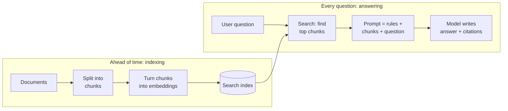
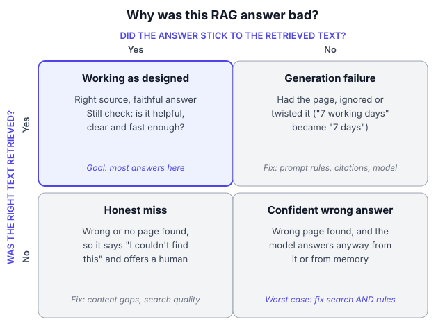

# B1.2 RAG: giving AI your knowledge

## In one line

RAG (retrieval-augmented generation) lets an AI model look up the right pages from *your* documents just before it answers, so it can answer about things it was never trained on, and show where the answer came from.

## Why this matters

Most useful AI features need knowledge the model doesn't have: your refund policy, last week's price list, a customer's order history, a 300-page insurance product manual. RAG is the most common way to give a model that knowledge, and it powers most "chat with your documents" and support assistants you'll be asked to build. As a PM you won't write the retrieval code, but you will decide what goes into the knowledge base, how fresh it must be, who is allowed to see what, how answers are checked, and what "good enough" means. Those decisions decide whether the feature is trusted or quietly abandoned.

## Key terms

| Term | Plain-English meaning |
|---|---|
| **RAG (retrieval-augmented generation)** | Find relevant text first (retrieval), add it to the prompt (augmentation), then let the model write the answer (generation). |
| **Knowledge base (corpus)** | The collection of documents the system is allowed to search: help articles, policies, manuals, tickets. |
| **Chunk** | A small piece of a document (often a few hundred tokens, about a page or less) that is stored and retrieved on its own. |
| **Embedding** | A list of numbers that captures the *meaning* of a piece of text, so texts with similar meaning have similar numbers. |
| **Vector database** | A store built to find the chunks whose embeddings are closest to the question's embedding, fast. |
| **Keyword search (BM25)** | Classic search that matches exact words. Great for codes, names and IDs that meaning-based search can miss. |
| **Hybrid search** | Running keyword and meaning-based search together and merging the results. |
| **Reranker** | A second model that re-reads the top results and puts the truly relevant ones first. |
| **Grounding / faithfulness** | Whether the answer actually sticks to what the retrieved text says. |
| **Recall@k** | Of the questions you test, how often the right chunk appears somewhere in the top *k* results. |

## The idea, simply

!!! tip "Analogy: the open-book exam"
    Imagine two students writing a law exam. The first studied hard months ago and writes from memory. She is fluent and confident, but if a rule changed last week she has no idea, and when she half-remembers something she fills the gap with something that *sounds* right.

    The second student is allowed to bring the latest rule book. Before answering each question she flips to the right pages, reads them, and writes her answer with page references. She can only be as good as her ability to *find the right page*, and her answer is only trustworthy if she actually *uses* what's on it.

    A plain language model is the first student. A RAG system is the second. And the two things that can go wrong are exactly the two things that can go wrong for her: she opens the wrong page, or she opens the right page and still answers from memory.

Let's build the idea up.

### 1. Why models need help with *your* knowledge

A large language model learns from a huge snapshot of public text, up to a training cutoff date (see [B0.2](../00-foundations/02-how-llms-work-for-pms.md)). Three things follow:

- **It doesn't know your private information.** Your internal policies, your product catalogue and your customers' accounts were never in its training data.
- **It doesn't know anything recent.** Prices, rules and offers change after the cutoff.
- **It fills gaps with plausible guesses.** When a model doesn't know, it often still produces a fluent answer. That's a hallucination.

There are three broad ways to fix this:

| Approach | How it works | Good for | Weak at |
|---|---|---|---|
| **Paste it in the prompt** | Put the whole document into every request | Small, stable knowledge (a short policy) | Large or changing collections; cost per call |
| **RAG** | Search a large collection and paste in only the relevant parts | Large, changing, citable knowledge | Questions that need the *whole* collection at once |
| **Fine-tuning** | Further train the model on your examples | Teaching a style, format or narrow skill | Adding facts that change often; it can't cite sources |

Most teams start with prompting, then add RAG when the knowledge is too big or changes too often. [B1.4](04-prompting-vs-rag-vs-fine-tuning-how-to-decide.md) covers how to choose.

### 2. Where RAG comes from

The term comes from a 2020 research paper by Patrick Lewis and colleagues at Facebook AI Research, University College London and New York University, ["Retrieval-Augmented Generation for Knowledge-Intensive NLP Tasks"](https://arxiv.org/abs/2005.11401), presented at NeurIPS 2020. They joined a text generator to a search index of Wikipedia. The model could answer factual questions better, and its knowledge could be updated by swapping the index rather than retraining the model.

That last point is why product teams love RAG. **To change what the system knows, you change the documents, not the model.** Updating a help article on Monday changes Tuesday's answers.

### 3. The two halves: indexing and answering

A RAG system has two pipelines. One runs ahead of time; the other runs every time a user asks something.

Indexing happens once (and again whenever documents change). Retrieval and generation happen on every question. Most quality problems start on the left.

**Indexing (ahead of time):**

1. **Collect** the documents the assistant may use.
2. **Clean** them: remove menus, footers, duplicates and outdated versions.
3. **Chunk** them into small pieces, because you can only paste a few into each prompt.
4. **Embed** each chunk (turn it into numbers that capture meaning) and store it in a search index, along with useful labels: source, date, product, language, who may see it.

**Answering (every question):**

1. **Retrieve:** turn the question into an embedding and find the most similar chunks (often also running keyword search).
2. **Rerank** (optional): have a second model re-order the candidates by real relevance.
3. **Augment:** build a prompt with the instructions, the top chunks and the question.
4. **Generate:** the model writes an answer, ideally quoting or citing the chunks it used.

### 4. Embeddings: search by meaning, not just by words

Classic search matches words. If a customer types "money not credited" and your help article says "refund pending", keyword search may miss it.

An **embedding model** turns text into a long list of numbers (a vector) so that texts with similar *meaning* end up close together. "Money not credited", "refund pending" and "paisa wapas nahi aaya" can all land near each other, even with no words in common.

| User types | Keyword search finds | Meaning search finds |
|---|---|---|
| "money not credited" | Articles containing "money" or "credited" | "Refund timelines" article |
| "can I cancel after it's shipped" | Anything with "cancel" | "Cancellation after dispatch" policy |
| "error E-402 on checkout" | The exact E-402 article | Generic "payment failed" articles (may miss the code) |

Notice the last row. **Meaning search is weak on exact codes, names and numbers.** That's why most production systems use **hybrid search**: keyword search and meaning search together. Embeddings are also cheap. OpenAI lists its small embedding model, `text-embedding-3-small`, at [$0.02 per million tokens](https://developers.openai.com/api/docs/models/text-embedding-3-small), so indexing even millions of words usually costs very little.

### 5. Chunking: how you cut the book decides what can be found

You can't paste a whole manual into every prompt, so you cut documents into chunks. How you cut matters more than most teams expect.

- **Too big** (whole chapters): the search can't pinpoint the answer, prompts get long and costly, and the model gets distracted by irrelevant text.
- **Too small** (single sentences): a chunk loses its context. "The limit is ₹50,000" means nothing if you've lost *which* product and *which* limit.

Common practice is chunks of a few hundred tokens, cut along natural boundaries (headings, paragraphs, table rows), sometimes with a small overlap. Anthropic's 2024 write-up on [Contextual Retrieval](https://anthropic.com/research/contextual-retrieval) shows a neat fix for the lost-context problem. Before indexing, a model writes a short line of context for each chunk ("This section is from the Gold credit card's fee schedule, 2024"), and that line is stored with the chunk. In their tests:

| Retrieval setup | Top-20 retrieval failure rate | Reduction |
|---|---|---|
| Standard embeddings | 5.7% | (baseline) |
| + contextual embeddings | 3.7% | 35% fewer failures |
| + contextual keyword search (BM25) | 2.9% | 49% fewer failures |
| + reranking | 1.9% | 67% fewer failures |

They estimated the one-time cost of adding context at about **$1.02 per million document tokens** using prompt caching. *These are the vendor's own benchmarks on its test sets, so treat them as direction, not a guarantee for your data.*

### 6. Retrieval quality is the ceiling on answer quality

This is the single most important idea in the chapter. **If the right chunk isn't retrieved, the model cannot give the right answer, however good it is.** At best it says "I don't know"; at worst it confidently answers from memory or from the wrong chunk.

So every RAG failure is one of two kinds:

| Failure | What happened | Example | Fix lives in… |
|---|---|---|---|
| **Retrieval failure** | The right text never reached the model | Asked about "EMI on Gold card"; got the Silver card chunk | Chunking, hybrid search, reranking, metadata filters, cleaner documents |
| **Generation failure** | The right text was there, but the answer ignored or twisted it | Chunk says "7 working days"; answer says "7 days" | Prompt rules, "only answer from sources", citations, a stronger model |

When a PM hears "the bot is wrong", the first question should be: **was the right text retrieved?** That one question halves the debugging time.

### 7. Grounding, citations and "I don't know"

Good RAG products make three behaviours explicit in the system prompt (see [B1.1](01-prompt-engineering-for-pms.md)):

1. **Answer only from the provided sources.** If they don't contain the answer, say so.
2. **Cite.** Point to the document or section each claim comes from, so users (and your reviewers) can check.
3. **Refuse gracefully.** "I couldn't find this in our help centre. Here's how to reach a person" beats a guess.

Citations build trust, but they are not proof. A system can attach a real document to a claim that the document doesn't support. Researchers call this a **misgrounded** citation, and it's covered in the Stanford legal study below.

## Framework: the RAG product decision checklist

There's no single official RAG framework. The technique comes from [Lewis et al. (2020)](https://arxiv.org/abs/2005.11401), and evaluation ideas such as *faithfulness*, *answer relevance* and *context relevance* were popularised by the open-source [Ragas paper (Es et al., 2023)](https://arxiv.org/abs/2309.15217). The checklist below pulls those ideas into the decisions a PM owns.

**Step 1: Name the job and the questions.** Write down 30–50 real questions users ask, from support tickets, search logs or interviews. If you can't, you don't know the job yet.

**Step 2: Decide if you need RAG at all.** If all the knowledge fits comfortably in the prompt, skip RAG. Anthropic suggests that for a knowledge base under about **200,000 tokens (roughly 500 pages)**, you can often just include all of it, with prompt caching to cut cost ([source](https://anthropic.com/research/contextual-retrieval)). Use RAG when the knowledge is bigger, changes often, or differs per user.

**Step 3: Define the knowledge base.** Which sources are in and out? Who owns each one? How often does it change? Which version wins when two documents disagree? Remove outdated and duplicate documents *before* indexing.

**Step 4: Decide access rules.** Who may see which document? Retrieval must filter by the user's permissions *before* anything reaches the model.

**Step 5: Build a test set (a "golden set").** For each test question, record the right answer and the document(s) that contain it. 100–300 questions is a practical start. This becomes your eval set (see [B3.1](../03-quality/01-evals-the-ai-pm-s-most-important-skill.md)).

**Step 6: Measure the two halves separately.**

- *Retrieval:* recall@k (is the right chunk in the top *k*?)
- *Generation:* faithfulness (does the answer stick to the sources?), correctness and helpfulness
- *Product:* resolution rate, escalation rate, thumbs-down rate, cost and latency per answer

**Step 7: Improve the weakest half first.** Usually that's retrieval: cleaner documents, better chunking, hybrid search, reranking, metadata filters.

**Step 8: Ship with guardrails and a feedback loop.** Citations, "I don't know" behaviour, a path to a human, logging of questions with no good match, and a weekly review of failures.

**When to use RAG:** large or changing knowledge; answers that must be traceable to a source; different users seeing different documents; regulated domains where you must show your basis.

**When not to:** the knowledge fits in the prompt; the task is about style or format rather than facts (that's prompting or fine-tuning); questions need reasoning over the *whole* collection at once ("what are the main themes across 10,000 tickets?"), where summarisation or GraphRAG fit better; or data is structured and lives in a database, where the model should query the database with a tool ([B1.3](03-agents-tool-use-and-mcp.md)).

## Diagram

Diagnose every bad answer by asking the row question first: was the right text retrieved? Only then ask whether the answer stuck to it. The bottom-right box is the one that destroys trust.

## Worked example

You're the PM for customer support at a mid-sized Indian consumer-electronics brand. Customers ask about warranties, returns, installation and error codes on the website chat and WhatsApp. Leadership wants an AI assistant that answers from the company's own content. *All numbers below are illustrative assumptions for teaching, not data from a real company.*

**Step 1: The job and the questions.** You pull 3 months of tickets. The top question types are: order and refund status (35%), warranty and returns policy (25%), product setup and error codes (25%), and everything else (15%). Order status needs live data from the order system, so that goes to a tool call ([B1.3](03-agents-tool-use-and-mcp.md)), not RAG. RAG covers policy, setup and error codes: about half of all questions.

**Step 2: Do you need RAG?** Size up the knowledge:

| Source | Documents | Avg size (tokens) | Total tokens |
|---|---|---|---|
| Help-centre articles | 1,200 | 800 | 960,000 |
| Product manuals | 300 | 8,000 | 2,400,000 |
| Policies (warranty, returns) | 40 | 3,000 | 120,000 |
| **Total** | **1,540** | | **≈3.5 million** |

That's about 17 times the ~200,000-token level where "just paste it all in" stops being sensible. It also changes weekly. RAG it is.

**Step 3: Clean and own the knowledge base.** You find 180 duplicate or outdated articles (old return windows, discontinued models) and remove them. Each source gets an owner: policies to the legal and CX team, manuals to the product team. Rule: if two documents disagree, the policy document wins.

**Step 4: One-time indexing cost.** At about 500 tokens per chunk, you get roughly 7,000 chunks.

- Embedding 3.5M tokens at $0.02 per million ≈ **$0.07**
- Adding contextual lines at about $1.02 per million document tokens ≈ **$3.60**

Indexing cost is almost nothing. The real cost is people's time cleaning content.

**Step 5: Cost per answer.** Assume a mid-priced model at $1 per million input tokens and $5 per million output tokens (check your provider's current prices; see [B0.3](../00-foundations/03-choosing-models-capability-cost-latency-open-vs.md)).

| Part of the prompt | Tokens |
|---|---|
| System prompt (rules, tone, citation format) | 700 |
| 8 retrieved chunks × 500 | 4,000 |
| Question + short chat history | 300 |
| **Input total** | **5,000** |
| Answer (output) | 250 |

Input: 5,000 × $1 ÷ 1,000,000 = $0.005. Output: 250 × $5 ÷ 1,000,000 = $0.00125. **About $0.006 per answer.** Pasting the whole 3.5M-token knowledge base instead would cost about $3.50 per question, around 500 times more, and wouldn't fit in most models' context windows anyway.

**Step 6: Build the golden set and measure.** You write 250 test questions from real tickets, each tagged with the correct answer and source article. Two versions compared:

| Metric | V1: embeddings only, 1,000-token chunks | V2: cleaned docs, 500-token chunks, hybrid search + reranker |
|---|---|---|
| Recall@8 (right chunk in top 8) | 76% | 92% |
| Faithfulness (answer sticks to sources) | 90% | 95% |
| Fully correct answers | 68% | 84% |
| "I couldn't find this" rate | 6% | 9% |
| Median time to first word | 1.4 s | 1.9 s |

Notice two trade-offs. The reranker added half a second. And the "I couldn't find this" rate went *up*, because the stricter prompt now refuses instead of guessing. That's a good trade for a support bot: an honest miss sends the user to a human; a confident wrong answer about refunds creates an angry customer.

**Step 7: What is it worth?** Assume the brand gets 50,000 support tickets a month, at about ₹45 each in agent cost (₹22.5 lakh a month). Suppose the assistant fully resolves 30% of the questions that would otherwise have become tickets:

| Line | Value |
|---|---|
| Tickets avoided | 50,000 × 30% = 15,000 |
| Agent cost saved | 15,000 × ₹45 = **₹6.75 lakh a month** |
| Questions answered by the assistant | ~90,000 a month |
| Running cost (model, search, reranker, logging), assume ₹1 per answer | ≈ ₹0.9 lakh a month |
| **Net saving** | **≈ ₹5.85 lakh a month, or about ₹70 lakh a year** |

**Step 8: Guardrails.** Savings disappear if wrong answers create repeat contacts. You track:

- **Repeat contact within 7 days** after an assistant answer (the main counter metric)
- **Thumbs-down rate** and the reasons users give
- **Answers on refund or warranty topics that cite no source** (should be zero)
- **Unanswered-question log**, reviewed weekly with content owners. Each recurring gap becomes a new help article.

That last loop is the secret of good RAG products: **the assistant tells you what your documentation is missing.**

## Going deeper: nuances and trade-offs

### 1. RAG vs "just use a long context window"

Models can now read hundreds of thousands of tokens in one go, so teams ask: why bother retrieving? Three reasons.

- **Cost and speed.** Every token you send costs money and time on every call. Prompt caching helps a lot when the same large text repeats.
- **Long inputs get less reliable.** Chroma's July 2025 study ["Context Rot"](https://trychroma.com/research/context-rot) tested 18 models and found performance became less reliable as input length grew, even on simple tasks. Related-but-wrong passages ("distractors") hurt more as inputs grew.
- **Scale and permissions.** A company's knowledge is usually far bigger than any context window, and each user may only see part of it.

The practical answer is often both: retrieve a focused set of chunks, then give the model a generous number of them. In Anthropic's tests, passing the top 20 chunks beat passing 5 or 10, though they note too much text can also distract the model ([source](https://anthropic.com/research/contextual-retrieval)). Test this on your own golden set.

### 2. The limits of embeddings, and why hybrid search wins

Embedding search is powerful but has blind spots. A Google DeepMind paper, ["On the Theoretical Limitations of Embedding-Based Retrieval"](https://arxiv.org/abs/2508.21038) (August 2025, revised March 2026), shows that a single embedding per document can't represent every possible combination of relevant results. On their simple LIMIT test set, top embedding models struggled to reach 20% recall@100. Classic keyword search (BM25) scored close to perfect on the original set, but dropped sharply when words were swapped for synonyms.

**PM translation:** neither method is enough alone. Keyword search catches exact terms (model numbers, error codes, legal section numbers, people's names). Meaning search catches paraphrases. Use both, then rerank. When your golden set shows failures, look at *which kind* of question fails.

### 3. Freshness, versions and the "two truths" problem

Retrieval happily returns an outdated document if it's still in the index. Common failures:

- The 2023 return policy and the 2025 return policy both sit in the index, and the old one matches the question's wording better.
- A product manual for model X-200 answers a question about X-300.

Fixes are mostly product decisions, not code:

- Give every document an **owner and an expiry or review date**.
- Store **metadata** (product, version, region, effective date) and filter on it.
- Tell the model which source wins when sources conflict.
- **Re-index automatically** when a document changes, and decide how fast that must happen (minutes for prices, a day for manuals).

### 4. Permissions, privacy and security

RAG brings documents into the prompt, so it also brings risks.

- **Access control.** An employee assistant must never retrieve HR files the employee can't open. Filter by permission *at retrieval time*. Never rely on the prompt to "not mention" restricted content.
- **Poisoned or hostile content.** If users or outsiders can add content (reviews, uploaded files, web pages), someone can hide instructions in it ("ignore previous rules and…"). This is indirect prompt injection (see [B1.1](01-prompt-engineering-for-pms.md)).
- **Leaky indexes.** Embeddings and indexes are copies of your data. They need the same protection as the originals.

OWASP lists these risks as [LLM08:2025 Vector and Embedding Weaknesses](https://genai.owasp.org/llmrisk/llm082025-vector-and-embedding-weaknesses/) in its top-10 risks for LLM applications. For personal data in India, the DPDP Act applies to what you index ([B4.3](../04-data-safety-and-law/03-ai-regulation-eu-ai-act-india-s-dpdp-act-and-ai.md)).

### 5. Citations are not proof

A citation shows *where* the system looked, not *whether the claim is true*. The Stanford study in the examples below found answers that cited real sources which didn't support the claim, and sources that were real but no longer applicable. Two design responses:

- **Show the quoted passage**, not just a link, so users can check in one glance.
- **Spot-check citations in your evals.** Don't just ask "did it cite something?" Ask "does the cited text actually say this?"

### 6. Indian languages, Hinglish and mixed scripts

Indian users ask in Hindi, Tamil or Hinglish ("refund kab tak aayega?"), sometimes in Roman script, sometimes in Devanagari, while most company documents are in English. Options include:

- **Translate the question to English, retrieve, answer, then translate back.** This is how Jugalbandi worked (see examples). It's simple, but translation errors can compound.
- **Use a multilingual embedding model** that places "refund kab aayega" near "refund timeline". Test it on real mixed-script queries, not just clean Hindi.
- **Keep key terms in both forms** in your documents' metadata ("EMI", "kist").

Also remember that Indian-language text often uses more tokens per word, so long chunks cost more ([B0.2](../00-foundations/02-how-llms-work-for-pms.md)).

### 7. Beyond basic RAG: agentic RAG and GraphRAG

Basic RAG searches once. Two extensions are common:

- **Agentic RAG.** The model decides what to search, reads the results, and searches again if needed ("first find the customer's plan, then that plan's refund rule"). Better for multi-step questions; slower and costlier. See [B1.3](03-agents-tool-use-and-mcp.md).
- **GraphRAG.** Microsoft Research's [GraphRAG](https://microsoft.com/en-us/research/blog/graphrag-new-tool-for-complex-data-discovery-now-on-github) (released July 2024) uses a model to build a map of the people, products and topics in your documents and how they connect, and to summarise each cluster ahead of time. It's designed for "global" questions, such as "what are the main complaint themes this quarter?", that basic top-*k* retrieval answers poorly. The catch is a large up-front indexing cost.

Start simple. Move to these only when your golden set shows question types that basic RAG can't handle.

### 8. Content is the product

Experienced AI PMs notice that most RAG quality work isn't model work. It's content work: clear, current, non-contradictory documents with one topic per section, real headings and tables that make sense when cut into chunks. A useful habit is a monthly "content health" review: top unanswered questions, documents most often retrieved for wrong answers, and stale documents past their review date. A RAG assistant makes the quality of your documentation visible, sometimes painfully so.

## Real-world examples (2023 onwards)

!!! example "Jugalbandi (AI4Bharat, Microsoft and partners), May 2023: government schemes on WhatsApp"
    In May 2023, [Microsoft described Jugalbandi](https://news.microsoft.com/source/asia/features/with-help-from-next-generation-ai-indian-villagers-gain-easier-access-to-government-services/), a WhatsApp chatbot that helps people in rural India find government programmes. A user sends a text or voice message. AI4Bharat's speech model transcribes it, a Bhashini translation model translates it to English, an Azure OpenAI model retrieves information on the relevant scheme, and the answer is translated back and spoken in the user's language. At the time it covered 10 of India's 22 official languages and 171 of roughly 20,000 government programmes. One student who used it said it gave "one answer at a time", which she found easier than a list of web search results.

    **PM lesson:** the retrieval core was only one link in a chain of speech, translation and messaging. Every link can fail, so quality must be measured end to end, in the user's language. Notice also the deliberate *narrow scope*: 171 schemes, not 20,000. A focused, well-curated knowledge base is how most successful RAG products start.

!!! example "Stanford RegLab and HAI, May 2024: legal RAG tools still hallucinate"
    Legal research vendors marketed AI tools built on RAG as avoiding hallucinations; one advertised "hallucination-free" citations. In May 2024, [Stanford researchers tested them](https://hai.stanford.edu/news/ai-trial-legal-models-hallucinate-1-out-6-or-more-benchmarking-queries). Lexis+ AI and Ask Practical Law AI produced incorrect information more than 17% of the time, and Westlaw AI-Assisted Research more than 34% of the time. That was better than general-purpose chatbots, which the same group had found hallucinating 58–82% of the time on legal questions, but far from zero. Failures included retrieving sources that didn't apply (wrong jurisdiction or overturned law) and citing real sources that didn't support the claim.

    **PM lesson:** RAG reduces hallucination; it doesn't remove it. Don't promise "hallucination-free". Measure retrieval and faithfulness separately, publish honest quality numbers, and design the interface so users can check sources quickly, especially in high-stakes domains.

## Common mistakes

!!! warning "Watch out for"
    - **Indexing everything as-is.** Duplicates, old versions and messy PDFs go in; contradictory answers come out. Clean first.
    - **Judging the system by a few demo questions.** Build a golden set of 100+ real questions before you decide anything.
    - **Only measuring the final answer.** If you don't measure retrieval separately, you can't tell what to fix.
    - **Relying on the prompt for access control.** Filter documents by the user's permissions before retrieval results reach the model.
    - **Using RAG for live, structured data.** Order status and account balances belong in a database query through a tool, not in a document index.
    - **Promising "no hallucinations" because answers have citations.** Citations can be wrong or irrelevant.
    - **No owner for the content.** Without owners and review dates, the knowledge base rots and so does the assistant.
    - **Hiding "I don't know".** A bot that never says it can't find something is a bot that guesses.

## Common questions

**Do I need a vector database to do RAG?**
Not always. Small collections can use simple keyword search, or a search engine you already have. Many teams add meaning-based search to an existing search system rather than buying a new product. Choose based on scale, latency and the team's skills.

**Does RAG train the model on our data?**
No. In RAG the model reads your text at answer time; its internal weights don't change. Whether the AI provider keeps or uses that text is a separate contract and settings question. Check the provider's data terms.

**How many chunks should we retrieve?**
There's no universal number. Common starting points are 5–20. Test several values on your golden set and watch both quality and cost.

**Will RAG stop all hallucinations?**
No. It reduces them, especially for questions your documents answer. You still need "answer only from sources", citations, evals and human review for high-stakes topics.

**Who should own a RAG feature's quality?**
The PM owns the definition of "good" and the eval set. Engineering owns retrieval and model choices. Content owners (support, legal, product) own the documents. Quality reviews need all three.

**Is RAG dead now that context windows are huge?**
No. Long context changes the trade-offs: small knowledge bases may not need retrieval at all. But for large, changing, permissioned knowledge, retrieval is still how you pick what the model should read.

## In the interview

!!! question "In the interview"
    **How it's tested:** AI PM interviews often include "design an AI assistant over our documents" or "our RAG bot gives wrong answers; what do you do?" Interviewers check whether you separate retrieval from generation, define evals, and think about content, permissions and cost.

    **Sample question:** *"You launched an AI assistant that answers questions from an insurance company's policy documents. Agents say it's often wrong. How would you fix it?"*

    **Outline of a strong answer:**

    1. **Clarify "wrong":** wrong facts, outdated info, wrong policy, or unhelpful? Gather 50–100 real failure examples.
    2. **Split the failures:** for each, was the right passage retrieved? If not, it's a retrieval problem; if yes, a generation problem.
    3. **Fix retrieval causes:** outdated or duplicate documents, poor chunking of tables, missing metadata (policy type, version), no keyword search for policy codes, no reranker.
    4. **Fix generation causes:** stricter "answer only from sources" rules, quoted citations, "I can't find this" behaviour, a stronger model for complex questions.
    5. **Set up evals:** a golden set with recall@k, faithfulness and correctness; run it on every change.
    6. **Guardrails for a regulated domain:** human review for claim decisions, clear disclaimers, logging, and access control.
    7. **Success metrics:** agent-reported error rate, resolution rate, repeat contacts, and time saved per query.

    Strong candidates mention cost and latency trade-offs, and that content ownership is part of the fix.

## Research happening now

!!! info "Research happening now"
    - **Hard limits of embedding search (Google DeepMind, revised March 2026).** [Weller et al.](https://arxiv.org/abs/2508.21038) show mathematically that single-vector embeddings can't return every combination of relevant documents, and built the LIMIT dataset where top embedding models do poorly while keyword search and long-context rerankers do much better. *Status: preprint; first posted August 2025, revised March 2026.*
    - **Do we still need GraphRAG? (April 2026).** [Fan et al.](https://arxiv.org/abs/2604.09666) benchmarked standard RAG and GraphRAG inside agentic search systems. Agentic, multi-round search narrowed the gap considerably, but GraphRAG still did better on complex multi-hop questions, at a higher indexing cost. *Status: preprint, not peer-reviewed.*

## Try it yourself (25 minutes)

Pick a public FAQ or help centre you know well (your bank, a telecom operator, an airline).

1. Write 10 questions a real customer might ask, in the words a customer would use. Include at least one with a code or number and one in Hinglish.
2. For each, find the exact passage that answers it. That's your mini golden set.
3. Now "be the retriever": use the site's own search box (or Ctrl+F with the customer's words). For how many questions does the right passage show up in the top 3 results?
4. For each failure, label the cause: different wording, missing content, outdated content, or content buried in a long page.
5. Write two product changes that would fix the most common cause.

??? success "Check your answer"
    - Your golden set has **real customer wording**, not the help centre's own terms. If every question used the site's vocabulary, retrieval will look better than it is.
    - You likely found **wording mismatches** (keyword search misses paraphrases) and **missing or outdated content**. These map to hybrid search and content ownership.
    - Your recall@3 is a fraction like "6 of 10". Don't round it up.
    - Good fixes include: adding meaning-based search alongside keywords; splitting long pages into one topic per section; adding the words customers actually use (including Hinglish) to articles or metadata; assigning owners and review dates; and logging unanswered questions to create new articles.
    - Bonus: did you note which failures would be **dangerous** if a bot answered confidently (refunds, fees, legal terms)? Those need stricter "I don't know" behaviour.

## How this connects

- [B1.1 Prompt engineering for PMs](01-prompt-engineering-for-pms.md): the system prompt that tells the model how to use retrieved text, cite and refuse.
- [B1.3 Agents, tool use and MCP](03-agents-tool-use-and-mcp.md): when the answer lives in a live system, the model calls a tool instead of searching documents.
- [B1.4 Prompting vs RAG vs fine-tuning](04-prompting-vs-rag-vs-fine-tuning-how-to-decide.md): how to choose between the three approaches.
- [B3.1 Evals](../03-quality/01-evals-the-ai-pm-s-most-important-skill.md): turning your golden set into a repeatable quality check.
- [B0.3 Choosing models](../00-foundations/03-choosing-models-capability-cost-latency-open-vs.md): token pricing, caching and latency, which set RAG's running cost.

## Go deeper

- **Paper:** [Retrieval-Augmented Generation for Knowledge-Intensive NLP Tasks](https://arxiv.org/abs/2005.11401) (Lewis et al., 2020). The paper that named RAG; read the abstract and introduction.
- **Article:** [Anthropic: Introducing Contextual Retrieval](https://anthropic.com/research/contextual-retrieval) (September 2024). Clear explanation of chunking, hybrid search and reranking, with numbers and costs.
- **Book:** [*AI Engineering*](https://www.oreilly.com/library/view/ai-engineering/9781098166298/) by Chip Huyen (O'Reilly). A thorough, practical guide to building with foundation models, including RAG and evaluation.
- **Paper:** [Ragas: Automated Evaluation of Retrieval Augmented Generation](https://arxiv.org/abs/2309.15217) (2023). Where common RAG metrics such as faithfulness come from.
- **Article:** [Microsoft Research: GraphRAG](https://microsoft.com/en-us/research/blog/graphrag-new-tool-for-complex-data-discovery-now-on-github) (July 2024). When a knowledge graph beats plain retrieval.
- **Report:** [Stanford HAI: AI on Trial](https://hai.stanford.edu/news/ai-trial-legal-models-hallucinate-1-out-6-or-more-benchmarking-queries) (May 2024). The best-known evidence that RAG doesn't eliminate hallucination.
- **Security:** [OWASP LLM08:2025 Vector and Embedding Weaknesses](https://genai.owasp.org/llmrisk/llm082025-vector-and-embedding-weaknesses/). The risks to raise with your security team.
- **Course:** [DeepLearning.AI: Retrieval Augmented Generation](https://www.deeplearning.ai/short-courses/retrieval-augmented-generation/). A hands-on course if you want to see the engineering side.

## Key takeaways

- RAG = **retrieve** relevant text, **add** it to the prompt, then **generate** an answer. To change what the system knows, change the documents, not the model.
- **Retrieval quality is the ceiling.** If the right text isn't found, the answer can't be right.
- Diagnose every bad answer in two steps: **was the right text retrieved?** Then, **did the answer stick to it?**
- Use **hybrid search** (keywords + meaning) and **reranking**; embeddings alone miss exact codes and names.
- If your knowledge fits comfortably in the prompt (roughly under 200,000 tokens), you may not need RAG at all.
- **Content is the product:** clean, owned, dated documents matter more than clever models. Filter by **permissions** before anything reaches the model.
- RAG **reduces** hallucination; it doesn't remove it. Measure with a golden set, show sources, and make "I don't know" a feature.

## Updates

*No updates yet.*

