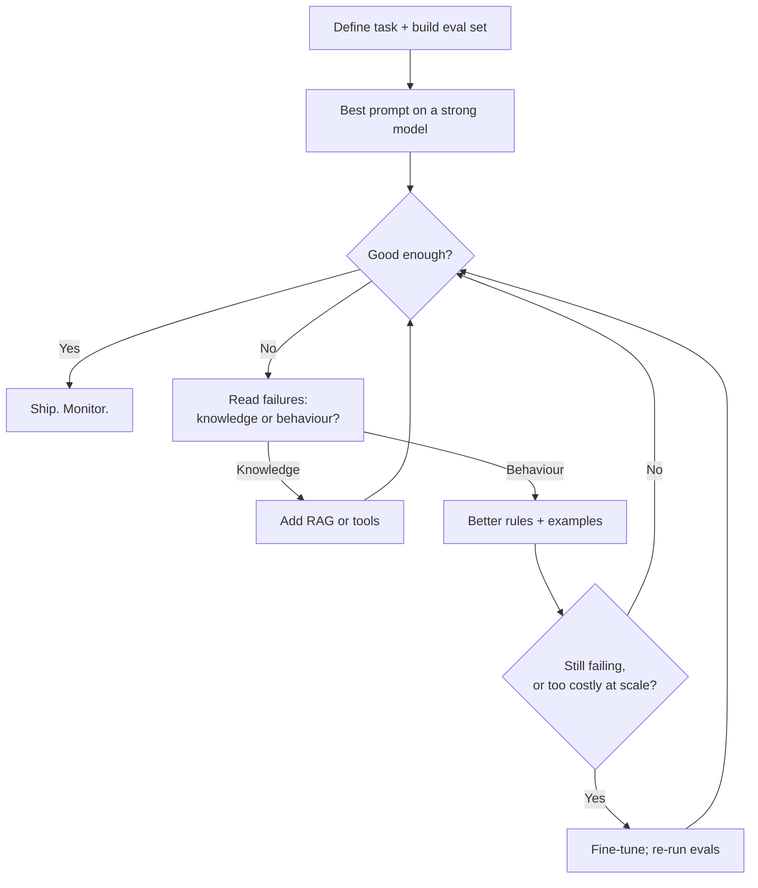
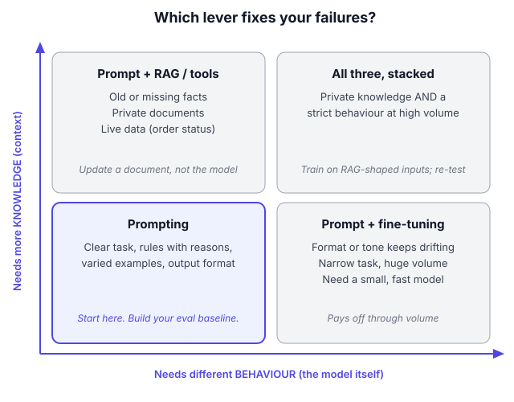

# B1.4 Prompting vs RAG vs fine-tuning: how to decide

## In one line

Start with a good prompt, add retrieval (RAG) when the model is missing knowledge, and fine-tune only when it must learn a behaviour that prompting can't make reliable or cheap enough. Let evals, not instinct, tell you which problem you have.

## Why this matters

"Should we fine-tune our own model?" is one of the first questions leaders ask when an AI feature disappoints. The honest answer is usually "not yet", but you need to know *why* and *when that changes*.

Pick the wrong lever and you lose months. Teams fine-tune to teach facts that change every week. Others pile 40 rules into a prompt to fix a problem that needs a document search. As the PM, you own this call because it decides cost, launch date, quality and how locked-in you are to one vendor.

## Key terms

| Term | Plain-English meaning |
|---|---|
| **Prompting** | Steering a model with instructions and examples you send on every call. Covered in [B1.1](01-prompt-engineering-for-pms.md). |
| **RAG (retrieval-augmented generation)** | Looking up relevant documents at question time and pasting them into the prompt. Covered in [B1.2](02-rag-giving-ai-your-knowledge.md). |
| **Fine-tuning** | Training an existing model further on your own examples, so the new behaviour lives inside the model's weights (its learned numbers). |
| **SFT (supervised fine-tuning)** | Fine-tuning with input → ideal-output pairs: "for this message, the right answer is this". |
| **Preference fine-tuning (e.g. DPO)** | Fine-tuning with pairs of a better and a worse answer, so the model learns which one you prefer. |
| **LoRA / PEFT** | Cheap fine-tuning methods that train a small add-on instead of the whole model. |
| **Distillation** | Using a big, expensive model's good answers to train a small, cheap model for one task. |
| **Eval set** | A fixed list of test cases with known good answers, used to score every version of your system. See [B3.1](../03-quality/01-evals-the-ai-pm-s-most-important-skill.md). |

## The idea, simply

!!! tip "Analogy: getting a new bank-branch employee ready"
    Imagine a bright new hire joins your bank branch on Monday. There are three ways to make them useful.

    **Brief them** at the start of each shift: "Today, greet customers in their language, never promise loan approval, and send gold-loan queries to Meena." That's **prompting**. It's instant, and you can change it tomorrow.

    **Hand them the rulebook and the customer's file** when a question comes in: today's FD rates, this customer's account history. That's **RAG**. They don't memorise rates that change every week; they look them up, and they can show the customer where the answer came from.

    **Send them on a three-month training course** until filling forms the bank's way becomes a habit. That's **fine-tuning**. It's slow and costly. It's worth it only for skills they'll use thousands of times, the same way, every day.

    You'd never send someone on a course to learn this week's FD rate. And you'd never hand them a rulebook to fix the fact that they keep filling forms in the wrong format. Matching the fix to the problem is the whole chapter.

### 1. Three levers, three different jobs

Each lever changes a different thing, at a different speed and cost.

| | Prompting | RAG | Fine-tuning |
|---|---|---|---|
| **What changes** | The instructions sent on each call | The facts sent on each call | The model itself |
| **Best at fixing** | Unclear task, wrong tone, missing rules | Missing, private or changing knowledge | Inconsistent behaviour at high volume; cost and speed |
| **Time to first version** | Hours | Days to weeks | Weeks to months |
| **Time to change** | Minutes (edit text) | Minutes (update a document) | Days (new data, retrain, re-test) |
| **Where the cost sits** | Every call (longer prompts cost more) | A pipeline to build and run, plus extra tokens per call | Data labelling, training, hosting, and retraining later |
| **Can it cite sources?** | No | Yes | No |
| **Survives a model upgrade?** | Mostly; re-test it | Yes; re-test it | No; you usually retrain |

The last row matters more every year. Model providers ship better models every few months. A prompt or a RAG pipeline moves to a new model with some re-testing. A fine-tuned model is tied to the base model it was trained on.

### 2. Is it a knowledge problem or a behaviour problem?

OpenAI's guide [*Optimizing LLM accuracy*](https://developers.openai.com/api/docs/guides/optimizing-llm-accuracy) gives the cleanest way to think about this. It splits problems along two directions:

- **Context optimisation** (what the model *knows* right now). The model lacks information, has old information, or needs your private information. The guide calls this an *in-context memory* problem. The fix is to give it the right context: RAG, search or tools.
- **LLM optimisation** (how the model *behaves*). The model knows enough but acts inconsistently: wrong format, wrong tone, shaky reasoning on your specific task. The guide calls this a *learned memory* problem. The fix is better instructions and examples, then fine-tuning if those aren't enough.

Here's how to sort real failures:

| What you see in the failures | Problem type | First fix to try |
|---|---|---|
| "Our return window is 30 days" (it's 10) | Knowledge | RAG over the policy docs |
| Doesn't know today's order status | Knowledge | A tool call to the order system ([B1.3](03-agents-tool-use-and-mcp.md)) |
| Answers correctly but in paragraphs when you need JSON | Behaviour | Clear format rules, an example, structured outputs |
| Replies in English to Hinglish messages half the time | Behaviour | Language rule with a reason, plus varied examples |
| Mixes up two similar ticket categories 1 time in 8 | Behaviour | Better category definitions and examples; fine-tune if it persists |
| Right answers, but the prompt is 6,000 tokens and too slow | Cost / speed | Prompt caching first; then a fine-tuned smaller model |

Most real products have both kinds of failure. That's fine. You fix each one with the matching lever.

### 3. Why RAG usually beats fine-tuning for facts

It feels natural to think "train the model on our documents and it will know them". Research says this works poorly.

- **Fine-tuning doesn't store new facts well.** A 2023–24 study by Ovadia and colleagues compared the two ways of adding knowledge. RAG did better than unsupervised fine-tuning, both for facts the model had seen before and for brand-new ones ([arXiv preprint](https://arxiv.org/abs/2312.05934)).
- **It can make hallucination worse.** Researchers led by Zorik Gekhman found that models learn new facts from fine-tuning slowly. Once they do learn them, their tendency to make things up rises roughly in step ([EMNLP 2024 paper](https://aclanthology.org/2024.emnlp-main.444)). Their conclusion: models get most of their knowledge in pre-training, and fine-tuning mostly teaches them to *use* it.

There are also product reasons to prefer RAG for knowledge:

| Need | RAG | Fine-tuning |
|---|---|---|
| Update a price or policy today | Edit the document | Retrain |
| Show the user where an answer came from | Cite the source | Not possible |
| Let each user see only their own documents | Filter by permission at search time | Not possible inside one model |
| Delete a customer's data on request | Remove it from the index | Very hard to "un-learn" |

### 4. What fine-tuning is really good at

Fine-tuning shines when you need the *same kind* of output, done *the same way*, many times. OpenAI's [model optimisation docs](https://developers.openai.com/api/docs/guides/model-optimization) list jobs like classification, generating content in a specific format, tone and style, and fixing instruction-following failures.

The docs also list four practical wins over prompting alone:

1. **More examples than fit in one prompt.** You can train on thousands of examples, not ten.
2. **Shorter prompts.** The rules move into the model, so each call sends fewer tokens. That cuts cost and waiting time at scale.
3. **Sensitive examples stay out of every request.** You don't resend them each call.
4. **A smaller model can do a narrow job.** A small fine-tuned model can sometimes match a large general one on a single task, faster and cheaper.

| Good fine-tuning jobs | Poor fine-tuning jobs |
|---|---|
| Tagging 3 lakh support tickets a month into 15 categories | Answering questions about policies that change monthly |
| Rewriting product titles into one strict house style | Teaching the model your product catalogue |
| Fast search-query understanding with a 100 ms budget | A feature you'll redesign next quarter |
| A brand voice that prompts keep drifting from | Anything with fewer than a few hundred real examples |

### 5. The ladder: what to try, in what order

The safest rule: **climb one step at a time, and measure at each step.**

Each step is cheaper and faster to undo than the next. Fine-tuning sits at the end of the ladder, not the start.

OpenAI's guide makes the same point. Prompting is "typically the best place to start", and teams should push simple methods as far as they go before reaching for complex ones. Many of its large customer deployments used only prompting and RAG.

### 6. The three levers have different cost shapes

Think of costs the way a finance team would: upfront, per use, and upkeep.

| Cost type | Prompting | RAG | Fine-tuning |
|---|---|---|---|
| **Upfront** | Low: writing and testing prompts | Medium: ingest, chunk and index documents | High: collect and label data, train, evaluate |
| **Per call** | Grows with prompt length (caching helps, see [B0.3](../00-foundations/03-choosing-models-capability-cost-latency-open-vs.md)) | Extra tokens for retrieved text, plus search | Often lowest, if it lets you use a smaller model or a shorter prompt |
| **Upkeep** | Re-test on each model change | Keep documents fresh; watch retrieval quality | Retrain on new data and on each base-model change; hosting fees on some platforms |

This gives you a useful rule: **fine-tuning pays off through volume.** The upfront cost is fixed. The per-call saving is small. You need many calls for the savings to add up. The worked example below shows the maths.

### 7. Fine-tuning comes in several flavours

You don't need to run these yourself, but you should know what your engineers mean.

| Method | What you give it | Good for |
|---|---|---|
| **SFT (supervised fine-tuning)** | Examples of input → ideal output | Format, classification, house style |
| **Preference tuning (DPO)** | A better and a worse answer for each input | Tone, focus, "this summary, not that one" |
| **Reinforcement fine-tuning** | Tasks plus a grader that scores answers | Tasks where an answer can be checked as right or wrong |
| **LoRA (a kind of PEFT)** | Same data as SFT; trains a small add-on | Making fine-tuning cheap enough to try often |
| **Distillation** | A big model's best outputs on your task | Shrinking cost and latency for a narrow job |
| **Continued pre-training** | Large amounts of raw domain text | Rarely right for product teams; costly, and weak at teaching facts |

**LoRA** deserves a note. The original 2021 paper from Microsoft researchers (Edward Hu and colleagues) showed you can freeze the big model and train only small extra pieces. Compared with fully fine-tuning GPT-3, it cut the number of trained parameters by about 10,000 times and GPU memory needs by about three times ([arXiv paper](https://arxiv.org/abs/2106.09685)). That's why fine-tuning open-weight models became affordable for ordinary teams.

## Framework: Diagnose, then climb

**Origin.** This framework adapts OpenAI's [*Optimizing LLM accuracy*](https://developers.openai.com/api/docs/guides/optimizing-llm-accuracy) guide, which introduced the context-versus-behaviour framing. The steps below add a PM's view of cost and risk.

**Step 1: Define "good" and build an eval set.** Write down the task and what a correct answer looks like. Collect real examples with known good answers. OpenAI's guide suggests starting with at least 20 questions and ground-truth answers. For a launch decision you'll want a few hundred, covering your hard cases and languages ([B3.1](../03-quality/01-evals-the-ai-pm-s-most-important-skill.md)).

**Step 2: Get a prompt baseline on a strong model.** Write the best prompt you can ([B1.1](01-prompt-engineering-for-pms.md)). Score it. This is your baseline; every later change must beat it.

**Step 3: Decide what "good enough" means in money.** Put a value on a right answer and a cost on a wrong one. OpenAI's guide works through a support example where success, human hand-off and customer churn each carry a price. In that example the break-even point was about 81.5% accuracy. Above your break-even, the AI earns its keep; below it, it doesn't.

**Step 4: Read the failures and label each one.** Take 50–100 failures. Label each as knowledge, behaviour, or cost/speed. Count them.

**Step 5: Fix the biggest group with the matching lever.**

- Knowledge → RAG over your documents, or a tool to look up live data.
- Behaviour → clearer rules, reasons and varied examples first.
- Cost/speed → prompt caching and a cheaper model first.

**Step 6: Consider fine-tuning only if all four are true.**

1. The remaining failures are behaviour, not knowledge.
2. Prompt fixes have stalled.
3. The task is narrow and stable (it won't change shape next quarter).
4. You have, or can label, several hundred good examples. OpenAI's docs suggest starting from 50+ and favouring quality over quantity.

**Step 7: Re-run the same evals after every change.** Keep the change only if it wins. Levers can be stacked, but stacking isn't automatically better (see Going deeper).

**When to use:** whenever an AI feature is below target and someone proposes "a custom model", or when a feature's cost or speed is blocking scale.

**When not to:** for very early prototypes, skip the formal steps: one good prompt and 20 test cases are enough to learn. And don't run this for problems that aren't model problems at all. If users don't want the feature, no lever will help ([B2.1](../02-discovery-and-design/01-finding-ai-opportunities-and-when-not-to-use-ai.md)).

## Diagram

Start in the bottom-left. Move up when failures are about missing knowledge; move right only when they are about behaviour that prompts can't fix.

## Worked example

You're the PM for AI support at a fictional Indian lending app, "PaisaPal". Customers write in English, Hindi and Hinglish. Your AI does two jobs:

- **Job A: answer policy questions** in chat ("What's the foreclosure charge?"). About 60,000 a month.
- **Job B: tag every incoming ticket** into one of 15 categories, as JSON, so it reaches the right team. About 3,00,000 a month.

Your CTO says: "Let's fine-tune our own model for both." Here's how you decide. All prices and accuracy numbers below are illustrative, to show the method.

**Step 1: Eval sets.** You build 400 real policy questions with checked answers, and 600 real tickets tagged by your best support leads.

**Step 2: Prompt baseline** on a strong general model:

| Job | Baseline accuracy |
|---|---|
| A: policy answers | 71% |
| B: ticket tagging | 86% |

**Step 3: What's good enough?** For Job A, a wrong answer about fees can mean a complaint or a regulator escalation, so you want at least 90% plus a clear "let me connect you" path. For Job B, every wrong tag costs about ₹12 of extra agent time (re-routing and delay).

**Step 4: Read the failures.**

| Job | Failures | What they were | Type |
|---|---|---|---|
| A | 116 of 400 | 92 used missing or outdated facts (old fee table, last year's rules) | Knowledge |
| B | 84 of 600 | 70 mixed up similar categories ("EMI bounce" vs "auto-debit failed"); 14 broke the JSON format or language rule | Behaviour |

**Step 5: Fix each with the matching lever.**

- **Job A → RAG.** Index the 140 current policy pages and fee tables. Accuracy rises to **90%**, with a source link on every answer. When fees change next month, the content team updates a page. No retraining.
- **Job B → better prompt first.** Sharper category definitions plus 25 varied examples lift accuracy to **91%**. But the prompt is now about 3,500 tokens, sent 3 lakh times a month.

**Step 6: Is fine-tuning worth it for Job B?** All four conditions hold: behaviour problem, prompt gains stalling, a stable task, and plenty of labelled tickets. Your team fine-tunes a small model on 4,000 checked tickets. On the same eval set it scores **93%**.

| | Big model + long prompt | Fine-tuned small model |
|---|---|---|
| Accuracy on eval set | 91% | 93% |
| Cost per tagging call | ₹0.20 | ₹0.02 |
| Monthly model cost (3 lakh calls) | ₹60,000 | ₹6,000 |
| Wrong tags per month | 27,000 | 21,000 |

**What is it worth?**

| Benefit per year | Calculation | Value |
|---|---|---|
| Lower model cost | (₹60,000 − ₹6,000) × 12 | ₹6.48 lakh |
| Fewer wrong tags | 6,000 fewer a month × ₹12 × 12 | ₹8.64 lakh |
| **Total benefit** | | **≈ ₹15.1 lakh** |

| Cost in year one | Assumption | Value |
|---|---|---|
| Labelling 4,000 tickets | Agents check model-drafted labels, ~100 hours × ₹400 | ₹0.4 lakh |
| Training and eval runs | | ₹0.25 lakh |
| Engineering | About 3 engineer-weeks | ₹3 lakh |
| Upkeep | Retrain twice a year for new categories or base-model changes | ₹3 lakh |
| **Total cost** | | **≈ ₹6.65 lakh** |

Net value in year one is about **₹8.5 lakh**, and the work pays for itself in roughly 5 months.

**Step 7: Check the sensitivity.** What if PaisaPal handled only 30,000 tickets a month? Both benefits shrink tenfold, to about ₹1.5 lakh a year, while the costs barely change. Then fine-tuning loses money; keep the prompt. **Volume is what makes fine-tuning pay.**

**Step 8: The decision you take to your CTO.**

1. **Job A:** RAG, not fine-tuning. Policies change; answers need sources.
2. **Job B:** fine-tune a small model, because volume makes it pay. Keep the prompt version as a fallback. Re-run the eval set every time the categories or base model change.
3. **Guardrails:** complaint rate on policy answers; share of tickets re-routed by agents after tagging.

## Going deeper: nuances and trade-offs

### 1. Stacking levers isn't automatically better

It's tempting to assume "prompt + RAG + fine-tune" beats any one of them. Not always. In an error-correction example in OpenAI's [accuracy guide](https://developers.openai.com/api/docs/guides/optimizing-llm-accuracy), a fine-tuned GPT-4 scored 87 on its quality measure. Adding RAG on top *dropped* it to 83, because the retrieved text added noise to a task the model had already learned.

Two lessons follow. First, measure every addition against the eval set. Second, if you fine-tune a model that will use RAG in production, train it on inputs that include retrieved text, so training looks like real use.

### 2. Your fine-tune is a fork you have to maintain

When you fine-tune, you freeze a copy of a model at one point in time. The general models keep improving. Your copy doesn't.

**BloombergGPT** is the classic warning. In March 2023 Bloomberg described a 50-billion-parameter model trained on a corpus of about 709 billion tokens, roughly half of it financial data. Training used about 1.3 million GPU hours ([paper](https://arxiv.org/abs/2303.17564)). Within months, researchers from Queen's University and J.P. Morgan AI Research tested the general-purpose GPT-4 on finance tasks. GPT-4 beat BloombergGPT on financial sentiment (88 vs 75 F1, a score that balances precision and recall) and on a financial question-answering test (76% vs 43%). BloombergGPT kept an edge on spotting named entities ([EMNLP 2023 industry paper](https://arxiv.org/abs/2305.05862)).

The PM lesson isn't "never train domain models". It's that you should price in how fast general models catch up. Before a big custom-model bet, ask: "What happens to our advantage when the next general model ships?"

### 3. Long context and caching changed the maths

Two of fine-tuning's classic selling points were "the prompt is too long" and "too many examples to fit". Both have weakened. Models now accept very long prompts, so you can include dozens or hundreds of examples (sometimes called *many-shot prompting*). Prompt caching makes a long, repeated prompt much cheaper after the first call ([B0.3](../00-foundations/03-choosing-models-capability-cost-latency-open-vs.md)).

So redo the cost comparison with caching switched on before you decide. Fine-tuning still wins on cost when volume is very high or when you need a small model for speed. But the gap is often smaller than people assume.

### 4. Data, privacy and who owns what

Fine-tuning data often comes from real customers: tickets, chats, documents. Three questions to settle before you start:

- **Consent and purpose.** Did customers agree to their data being used this way? Privacy laws, including India's DPDP Act, put limits on reusing personal data ([B4.3](../04-data-safety-and-law/03-ai-regulation-eu-ai-act-india-s-dpdp-act-and-ai.md)). Strip personal details from training examples where you can.
- **Deletion.** Removing a document from a RAG index takes seconds. Removing what a model learned from it usually means retraining.
- **Portability.** Can you download your fine-tuned weights, or do they live only on one vendor's platform? If the vendor retires the base model, what happens to yours? (See the OpenAI case below.)

### 5. Indian languages, small models and speed

Indian products face two extra pressures. Indic scripts often take more tokens per word, so long prompts cost more ([B0.2](../00-foundations/02-how-llms-work-for-pms.md)). And many Indian users are on budget phones and patchy networks, so speed matters.

Both push towards **small, fine-tuned models for narrow, high-volume jobs**: intent tagging, search-query understanding, transliteration, routing. Swiggy's search work (see the case below) is an example: a small model, tuned on its own order data, meeting a 100-millisecond budget on ordinary CPUs. Keep large general models for open-ended conversation, where their breadth matters more.

### 6. How the choice changes by stage and business type

| Situation | Usual choice | Why |
|---|---|---|
| Early startup, finding fit | Prompting + RAG | Speed of learning beats cost; the task will change |
| Scale-up with one very high-volume task | Distil or fine-tune a small model for that task | Volume makes per-call savings large |
| B2B SaaS serving many customers | Per-customer RAG, shared model | One fine-tune per customer is costly to maintain; RAG keeps each customer's data separate |
| Regulated (lending, insurance, health) | RAG with citations, strict evals, human review | You must show where answers came from |
| Strong brand voice at volume | Prompt first; preference tuning if drift persists | Tone is behaviour, not knowledge |

### 7. Fine-tuning can quietly break other skills

Training a model hard on one narrow task can make it worse at things you didn't test. Engineers sometimes call this *catastrophic forgetting*. A model tuned for ticket tagging may get worse at following other instructions.

Protect against it in two ways. Keep a small "general skills" slice in your eval set, and only use the fine-tuned model for the narrow job it was trained for. Then roll it out gradually behind an A/B test, not all at once ([A9.1](../../part-a/09-experimentation/01-a-b-testing-basics.md)).

### 8. Questions experienced PMs ask before approving a fine-tune

1. Which failures, exactly, will this fix? Show me the labelled failure counts.
2. Have we tried the best prompt *with caching* on a cheaper model?
3. Is any of this a knowledge problem in disguise?
4. How many good examples do we have, and who checked them?
5. What's the payback period, at our real volume?
6. What's the plan when the base model is retired or a better one ships?
7. Can we export the weights? Where does the training data live?
8. What's our fallback if the fine-tuned model misbehaves in production?

## Real-world examples (2023 onwards)

!!! example "Swiggy, early 2024: small fine-tuned models for food search"
    Swiggy's data science team wanted search to understand messy, multi-intent queries like "healthy snacks for office time". Real-time query understanding had to run within about **100 milliseconds on CPU** servers, which ruled out calling a large model on every search. The team fine-tuned small open language models in two stages. First they adapted them to Swiggy's world using about 996,000 texts built from successful orders. Then they trained on over 300,000 checked query–item pairs. The two-stage model did best overall on their 5,000-query test set. The work was presented at the CODS-COMAD 2024 conference and was being tested with a small group of users at the time ([Swiggy Bytes blog](https://bytes.swiggy.com/improving-search-relevance-in-hyperlocal-food-delivery-using-small-language-models-ecda2acc24e6); [summary in the ZenML LLMOps database](https://www.zenml.io/llmops-database/two-stage-fine-tuning-of-language-models-for-hyperlocal-food-search-ff103)).

    **PM lesson:** this is fine-tuning used for the right reasons. The job was narrow and stable. Volume was huge. The speed budget was strict. And Swiggy had abundant labelled data from real orders. Notice they still measured each stage separately rather than assuming more training was better.

!!! example "OpenAI, May 2026: winding down self-serve fine-tuning"
    On 7 May 2026, OpenAI told developers it was winding down its self-serve fine-tuning platform. Organisations that had never fine-tuned could no longer start. From 2 July 2026, organisations that hadn't used a fine-tuned model in the previous 60 days were also shut out. From 6 January 2027, even active customers can't create new fine-tuning jobs. Existing fine-tuned models keep working only until their base models are retired ([OpenAI deprecations page](https://developers.openai.com/api/docs/deprecations); [model optimisation docs](https://developers.openai.com/api/docs/guides/model-optimization)). Fine-tuning remains available elsewhere, for example on major cloud platforms and for open-weight models, though options and prices vary by provider and change often.

    **PM lesson:** a fine-tuned model is only as durable as the platform and base model under it. Teams that had put their key behaviour into prompts, RAG and eval sets could move to a new model by re-testing. Teams whose product depended on one vendor's fine-tune faced a forced migration. Keep your training data, your eval set and a working prompt-only fallback, whatever you build.

## Common mistakes

!!! warning "Watch out for"
    - **Fine-tuning to teach facts.** Prices, policies and catalogues belong in RAG or tools, where they can be updated and cited.
    - **Skipping the prompt baseline.** Without it, you can't tell whether fine-tuning helped or a better prompt would have done the same.
    - **No eval set.** "It feels better" isn't evidence. Every lever must be scored on the same fixed test cases.
    - **Fine-tuning a task that's still changing.** If the categories or flow will be redesigned next quarter, you'll retrain for nothing.
    - **Ignoring upkeep.** Retraining on new data and new base models is a recurring cost, not a one-off.
    - **Comparing against an uncached prompt.** Prompt caching often closes much of the cost gap.
    - **Training on messy labels.** A few hundred clean, checked examples beat thousands of inconsistent ones.
    - **No fallback.** Keep a prompt-only version ready in case the fine-tuned model or its platform goes away.

## Common questions

**Is fine-tuning dead?**
No. It's become a specialist tool rather than a default. Menlo Ventures' late-2025 enterprise survey found prompt design was the dominant way companies customise models, followed by RAG, with fine-tuning used mainly by advanced teams ([report](https://menlovc.com/perspective/2025-the-state-of-generative-AI-in-the-enterprise/)). It still earns its place for narrow, high-volume, speed-sensitive jobs.

**Can't we just put all our documents in a long prompt instead of RAG?**
Sometimes, for a small and stable set of documents. Once you have many documents, need per-user permissions, or care about cost per call, RAG is usually better. [B1.2](02-rag-giving-ai-your-knowledge.md) covers this trade-off.

**How many examples do we need to fine-tune?**
OpenAI's guidance is to start with at least 50 good examples and focus on quality. In practice, classification and format tasks often need a few hundred to a few thousand checked examples to beat a strong prompt. Your eval set will tell you.

**Does fine-tuning make the model safer or harder to trick?**
Not on its own. A fine-tuned model can still be manipulated by prompt injection and can still make things up. You still need guardrails ([B4.2](../04-data-safety-and-law/02-responsible-ai-safety-and-guardrails.md)).

**Should we train our own model from scratch?**
Almost never, for a product team. It costs vastly more than fine-tuning (see BloombergGPT above), and general models improve faster than most companies can keep up with.

## In the interview

!!! question "In the interview"
    **How it's tested:** AI PM interviews often include a scenario where an AI feature underperforms. The interviewer wants to see whether you diagnose before prescribing, and whether you think about cost and upkeep, not just accuracy.

    **Sample question:** *"Our AI support assistant gives wrong answers about refunds about 20% of the time. The VP of Engineering wants to fine-tune a model on our past tickets. What would you do?"*

    **Outline of a strong answer:**

    1. **Clarify the goal and the cost of errors.** What's the accuracy target? What does a wrong refund answer cost: a complaint, a wrong payout, a legal issue?
    2. **Ask for the eval set and the failures.** If there's no eval set, building one is step one.
    3. **Diagnose.** Refund rules change and differ by product, so most wrong answers are probably *knowledge* problems: old or missing policy. Check by labelling 50–100 failures.
    4. **Propose the matching fix.** RAG over current refund policies, or a tool that looks up the order's actual refund status, with source citations.
    5. **Explain why not fine-tuning first.** It's slow, doesn't store facts reliably, can raise hallucination, and must be redone when policies change.
    6. **Say when you *would* fine-tune.** If behaviour failures remain at high volume, such as wrong tone or format, and prompt fixes stall.
    7. **Close with metrics.** Accuracy on the eval set, complaint rate, escalation rate and cost per conversation.

    Interviewers listen for "diagnose first", the knowledge-versus-behaviour split, and awareness of upkeep and cost.

## Research happening now

!!! info "Research happening now"
    - **How enterprises actually customise models (Menlo Ventures, December 2025).** A survey of 495 US enterprise AI decision-makers found prompt design was the main customisation method, followed by RAG. Fine-tuning and reinforcement learning were described as niche, used mostly by frontier teams ([report](https://menlovc.com/perspective/2025-the-state-of-generative-AI-in-the-enterprise/)). *Status: industry survey of US firms, not peer-reviewed.*
    - **Fine-tuning vs RAG for multi-step questions on new facts (January 2026).** Researchers Zhuoyi Yang, Yurun Song, Iftekhar Ahmed and Ian Harris compared ways of adding knowledge for questions that need several reasoning steps. Plain continued training on raw text helped little. RAG gave large, consistent gains, especially for facts newer than the model's training. Supervised fine-tuning gave the highest overall accuracy in their tests ([arXiv preprint](https://arxiv.org/abs/2601.07054)). *Status: preprint, not peer-reviewed.* It's a reminder that the answer depends on the *type* of fine-tuning and the task.

## Try it yourself (20 minutes)

For each situation, choose the first lever you'd try: **prompting**, **RAG/tools**, or **fine-tuning**. Write one line on why.

1. A travel app's assistant quotes last month's cancellation fees.
2. A news app's summariser writes 300 words when you asked for 60.
3. A bank tags 50 lakh UPI dispute messages a month into 20 reasons; a strong prompt gets 89% and costs too much.
4. An HR bot must answer only from each company's own leave policy, and employees must never see another company's.
5. An edtech tutor answers in English when students write in Tamil.
6. A marketplace wants every product title rewritten into one strict format, for 2 crore listings.
7. A lawyer wants the assistant to quote the exact clause it relied on.
8. A startup with 40 users wants a "custom model" for its brand voice.

??? success "Check your answer"
    1. **RAG/tools.** Missing, changing knowledge. Look up the current fee table.
    2. **Prompting.** A behaviour rule: state the length and the reason; add an example.
    3. **Fine-tuning (or distillation).** A narrow, stable, very high-volume behaviour task where the prompt has stalled and cost bites.
    4. **RAG** with permission filters. Knowledge, plus per-customer access control. One shared fine-tune can't keep companies apart.
    5. **Prompting.** A language rule with a reason, plus varied examples. Fine-tune only if drift persists at scale.
    6. **Prompting first, then fine-tuning.** Huge volume and a fixed format make it a good fine-tuning candidate once a prompt baseline exists.
    7. **RAG.** Only retrieval can point to the exact source text.
    8. **Prompting.** Too little volume and data; the voice will change as the brand evolves.

    Self-check: did you ask "knowledge or behaviour?" first, and mention volume for every fine-tuning choice?

## How this connects

- [B1.1 Prompt engineering for PMs](01-prompt-engineering-for-pms.md): the first rung of the ladder and your baseline for every decision here.
- [B1.2 RAG: giving AI your knowledge](02-rag-giving-ai-your-knowledge.md): the fix for knowledge problems, including long context vs RAG.
- [B1.3 Agents, tool use and MCP](03-agents-tool-use-and-mcp.md): tools fetch live data that neither prompts nor fine-tuning can supply.
- [B0.3 Choosing models](../00-foundations/03-choosing-models-capability-cost-latency-open-vs.md): token pricing, caching and open-weight models, which shift the cost maths.
- [B3.1 Evals](../03-quality/01-evals-the-ai-pm-s-most-important-skill.md): how to build the eval set every step of this framework depends on.
- [B5.1 AI pricing and unit economics](../05-strategy-and-business/01-ai-pricing-and-unit-economics.md): where per-call cost savings turn into margin.

## Go deeper

- **Guide:** [OpenAI: Optimizing LLM accuracy](https://developers.openai.com/api/docs/guides/optimizing-llm-accuracy). The source of the context-versus-behaviour framing, with a worked break-even example. Free.
- **Docs:** [OpenAI: Model optimization](https://developers.openai.com/api/docs/guides/model-optimization). Plain descriptions of supervised and preference fine-tuning and when each fits, plus the wind-down notice.
- **Paper:** [Ovadia et al., *Fine-Tuning or Retrieval?*](https://arxiv.org/abs/2312.05934). The study showing RAG beats unsupervised fine-tuning for adding knowledge.
- **Paper:** [Gekhman et al., *Does Fine-Tuning LLMs on New Knowledge Encourage Hallucinations?*](https://aclanthology.org/2024.emnlp-main.444) (EMNLP 2024). Why fine-tuning on new facts can backfire.
- **Paper:** [Hu et al., *LoRA*](https://arxiv.org/abs/2106.09685) (2021). The method that made fine-tuning cheap; read the abstract and introduction.
- **Article:** [Hamel Husain: Is fine-tuning still valuable?](https://hamel.dev/blog/posts/fine_tuning_valuable.html) A practitioner's collection of views on when fine-tuning still pays off.
- **Podcast:** [TWIML AI Podcast #694: Building real-world LLM products with fine-tuning and more, with Hamel Husain](https://twimlai.com/go/694). A practitioner conversation on where fine-tuning fits in real products.
- **Report:** [Menlo Ventures: 2025 State of Generative AI in the Enterprise](https://menlovc.com/perspective/2025-the-state-of-generative-AI-in-the-enterprise/). How companies actually customise and buy models.

## Key takeaways

- Match the lever to the problem: **prompting for instructions, RAG for knowledge, fine-tuning for behaviour.**
- Ask **"knowledge or behaviour?"** about every failure before choosing a fix. Label and count failures.
- **Don't fine-tune to teach facts.** RAG is easier to update, can cite sources, respects permissions and supports deletion.
- **Climb the ladder one step at a time**, scoring every change on the same eval set.
- **Fine-tuning pays through volume.** Do the payback maths at your real volume, with prompt caching switched on.
- A fine-tune is **a fork you must maintain**: plan for retraining, base-model retirement and a prompt-only fallback.
- Keep your **data, eval set and prompts** portable. They outlast any single model or platform.

## Updates

*No updates yet.*
