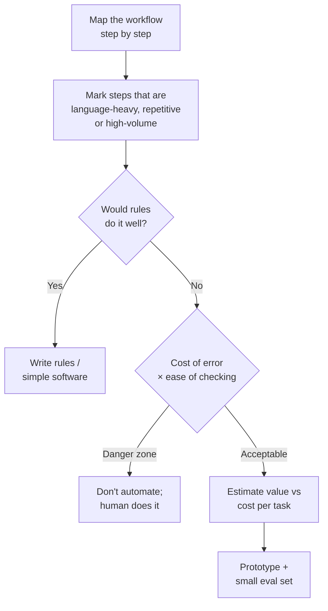
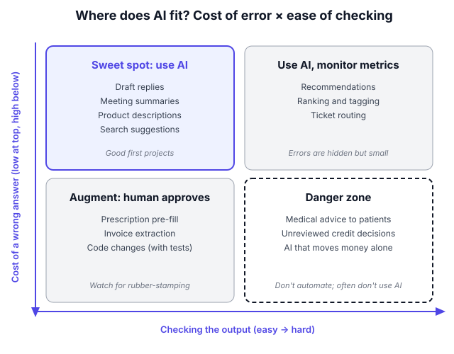

# B2.1 Finding AI opportunities, and when not to use AI

## In one line

Use AI where it does a real customer or business job better, cheaper or for the first time, and where its mistakes are cheap or easy to catch; everywhere else, simpler software, rules or people usually win.

## Why this matters

Almost every leadership team now asks, "Where's our AI strategy?" PMs get handed ideas like "add a chatbot" or "make it agentic" with no clear problem behind them. Many of these projects stall as pilots that never pay back.

Your job as an AI PM is to be the person in the room who can say, with evidence, *"Yes, AI fits here, and here's the value"* or *"No, a rule does this better and cheaper."* That judgement saves months of engineering and protects user trust.

## Key terms

| Term | Plain-English meaning |
|---|---|
| **AI opportunity** | A specific task where AI would beat the current way of doing it on value, cost or speed, at an acceptable level of risk. |
| **Deterministic (rule-based) software** | Software that gives the same output for the same input every time, because a person wrote the rules. |
| **Probabilistic output** | An answer that's usually right but sometimes wrong, and can vary between runs. AI outputs work this way (see [B0.1](../00-foundations/01-what-makes-ai-products-different.md)). |
| **Automation** | AI does the task for the user. |
| **Augmentation** | AI helps the user do the task better or faster; the user stays in control. |
| **Cost of error** | How much harm a wrong output causes: money, safety, trust, legal risk. |
| **Verification cost** | How much time and skill it takes a person to check whether the AI's output is right. |
| **Pilot purgatory** | When an AI project works in a demo or pilot but never reaches real use or real value. |

## The idea, simply

!!! tip "Analogy: the brilliant new intern and the calculator"
    Imagine you run a small CA firm. You have a calculator and you've just hired a brilliant intern.

    The calculator is perfect at arithmetic. It never gets tired and it's always right. But it can only do what it was built for.

    The intern can read messy client emails, summarise a 40-page notice and draft a reply in Hindi or English. But now and then the intern is confidently wrong, so a senior has to check the important work.

    You'd never ask the intern to add up a column of numbers when the calculator is sitting there. And you'd never ask the calculator to read a client's letter. The skill is knowing which job goes to which helper, and how much checking each job needs.

Rule-based software is the calculator. AI is the intern. Let's build up how to choose.

### 1. Start with the problem, not with AI

The most common failure is "solution-first" thinking: "We have AI, where can we put it?" It's the same trap as building any feature without a customer problem ([A2.1](../../part-a/02-problem-discovery/01-continuous-discovery-and-opportunity-solution-tr.md)).

The evidence that this goes wrong is growing:

- An MIT NANDA report in August 2025, based on 150 leader interviews, a 350-person survey and 300 public deployments, claimed that about 95% of enterprise generative AI pilots showed little or no measurable profit-and-loss impact. It blamed a "learning gap": tools that don't fit or adapt to real workflows, rather than weak models ([Fortune](https://fortune.com/2025/08/18/mit-report-95-percent-generative-ai-pilots-at-companies-failing-cfo/)). Treat the exact figure with caution: the report's definitions of "pilot" and "success" aren't spelled out in coverage.
- In June 2025, Gartner predicted that more than 40% of agentic AI projects will be cancelled by the end of 2027, because of rising costs, unclear business value or weak risk controls ([Gartner press release](https://www.gartner.com/en/newsroom/press-releases/2025-06-25-gartner-predicts-over-40-percent-of-agentic-ai-projects-will-be-canceled-by-end-of-2027)). That's a forecast, not a measurement.

The PM habit is simple: before you discuss models, write down the user, the task, today's way of doing it and what it costs. If you can't, you don't have an AI opportunity yet. You have an AI wish.

| Solution-first (weak) | Problem-first (strong) |
|---|---|
| "Let's add a GenAI chatbot to the app" | "40% of support tickets are 'where is my order?', and each costs ₹35 to handle" |
| "Let's use AI for personalisation" | "New users see the same home screen as everyone, and only 18% find a relevant product in their first session" |
| "We need an agent" | "Sellers spend 25 minutes listing each product, and half give up before listing 10" |

### 2. What AI is actually good at

Google's People + AI Research (PAIR) team published the *People + AI Guidebook* in 2019 and updated it in 2021 ([PAIR: User Needs + Defining Success](https://pair.withgoogle.com/chapter/user-needs/); [history](https://medium.com/people-ai-research/updating-the-people-ai-guidebook-in-the-age-of-generative-ai-cace6c846db4)). It lists situations where AI is *probably* better than rules. Here they are, with examples and how large language models (LLMs) have widened them:

| AI is probably better when you need to… | Example | What LLMs add |
|---|---|---|
| Recommend different things to different people | Personalised feeds, "people also bought" | Recommendations explained in plain words |
| Predict future events | Delivery time, demand, price | Mostly still classic machine learning (ML) |
| Personalise in a way that improves over time | Smart thermostats, playlists | Learns preferences stated in natural language |
| Understand natural language | Voice search, dictation | Understands messy, mixed-language text like Hinglish |
| Recognise a whole class of things | Tagging faces or objects in photos | Reading prescriptions, invoices, handwritten forms |
| Detect rare, changing events | Card fraud that keeps evolving | Spotting new scam message patterns |
| Act as a domain-specific agent | Booking a hotel | Multi-step tasks with tools ([B1.3](../01-building-blocks/03-agents-tool-use-and-mcp.md)) |
| Surface things users couldn't find themselves | Streaming suggestions | Answering questions over long documents ([B1.2](../01-building-blocks/02-rag-giving-ai-your-knowledge.md)) |

A simple way to remember it: **AI shines on messy inputs** (language, images, audio, varied user behaviour) **where there are too many cases to write rules for.**

LLMs added a big new family of jobs: **reading, writing, summarising, translating, classifying and extracting** from unstructured text. These used to need a human. Now a model can do a first draft in seconds.

### 3. When AI is probably *not* the answer

The same PAIR chapter lists when rules or simple software probably work as well or better ([PAIR](https://pair.withgoogle.com/chapter/user-needs/)):

| Probably *don't* use AI when… | Example | Better choice |
|---|---|---|
| Predictability is the most valuable part of the experience | A "Cancel" button that must always be in the same place | Fixed design |
| Information is static or limited | A standard address or card form | A normal form with validation |
| Errors are costly enough to outweigh small gains | Calculating a loan EMI or a tax amount | Deterministic code |
| Full transparency is required | Explaining exactly why a rule was applied | Rules users and auditors can read |
| Speed and low cost matter more than the extra value | A simple filter on a product list | A database query |
| Users don't want the task automated or augmented | Writing a personal wedding toast | Leave it to the user, or offer gentle help |

PAIR also notes that rule-based solutions are easier to build, explain, debug and maintain. That's a real cost difference, not a small one.

A quick test for any idea: **"Could a good engineer write this as rules in a week, with 95%+ accuracy?"** If yes, write the rules. Use AI for the part the rules can't cover.

### 4. The two questions that matter most: cost of error and cost of checking

AI will be wrong some of the time. So every AI opportunity depends on two questions:

1. **What happens when it's wrong?** (cost of error)
2. **How easily can someone tell it's wrong?** (cost of verification)

Put them together and you get four zones:

| | **Easy to check** | **Hard to check** |
|---|---|---|
| **Low cost of error** | **Sweet spot.** Draft replies, product descriptions, search suggestions, meeting summaries. Use AI freely. | **Okay with monitoring.** Recommendations, ranking, tags. Errors are hidden but small; watch metrics. |
| **High cost of error** | **Augment with a human check.** Prescription reading, invoice extraction, code changes. AI drafts; a person approves. | **Danger zone.** Medical or legal advice to the public, credit decisions with no review. Don't automate; often don't use AI at all. |

This is why AI coding tools spread fast: code is costly when wrong, but tests and reviews make it fairly easy to check. And it's why an AI that gives drug-dosage advice straight to patients is a poor first project, however impressive the demo.

**Watch out for one trap:** if checking the AI's output takes as long as doing the task yourself, the AI saves nothing. In the worked example below, this "break-even accuracy" decides whether the project is worth it.

### 5. Automate or augment?

Once AI fits, decide *how much* it should do. PAIR's guidance on what users want ([PAIR](https://pair.withgoogle.com/chapter/user-needs/)):

| Users tend to want **automation** when… | Users tend to want **augmentation** when… |
|---|---|
| They lack the skill, or a machine does it better | They enjoy the task |
| The task is boring, repetitive, awkward or dangerous | They feel personally responsible for the result |
| (Still give them a way to preview, edit or undo) | The stakes are high: money, health, legal, emotional |
| | Their preferences are hard to put into words |

Examples:

- **Automate:** tagging expense receipts, routing support tickets to the right team, translating product listings into Tamil.
- **Augment:** drafting a reply that the support agent edits, suggesting a loan decision that an underwriter approves, suggesting edits to a seller's listing photos.

Augmentation is often the better *first* version even where full automation is the long-term goal. It earns trust, produces labelled data (every human edit shows what "right" looks like), and limits damage while you learn. How to design these handoffs is covered in [B2.3](03-designing-for-trust-failure-and-human-in-the-loo.md).

### 6. Do you have the data and context?

An AI feature is only as good as what it can see. Ask:

- **Is the information the model needs available at the moment it's needed?** A support bot that can't see the order status will make things up.
- **Is your own knowledge written down?** Policies that live in one manager's head can't be fed to RAG ([B1.2](../01-building-blocks/02-rag-giving-ai-your-knowledge.md)).
- **Do you have examples of good output?** You need them to build evaluations (evals: test sets that score the AI), even if you never train a model ([B3.1](../03-quality/01-evals-the-ai-pm-s-most-important-skill.md)).
- **Are you allowed to use the data?** Consent, privacy and India's DPDP Act apply ([B4.3](../04-data-safety-and-law/03-ai-regulation-eu-ai-act-india-s-dpdp-act-and-ai.md)).

If the answer to the first two is "no", your first project may be a data or content project, not an AI one.

### 7. Does the maths work?

AI features cost money every time they run, unlike most software ([B0.3](../00-foundations/03-choosing-models-capability-cost-latency-open-vs.md)). A quick check:

> **Value per task × tasks per month** must comfortably beat **AI cost per task × tasks per month + human checking cost + build and upkeep**.

| Signal | Usually a good sign | Usually a warning sign |
|---|---|---|
| Volume | Thousands of similar tasks a day | A handful of one-off tasks |
| Value per task | Saves skilled minutes or wins a sale | Saves a few seconds of an easy click |
| Tolerance | A wrong answer is a mild annoyance | A wrong answer is a refund, fine or injury |
| Today's process | Slow, manual, expensive or impossible | Already fast and cheap |

### 8. Where to look for opportunities

Good AI opportunities usually hide inside existing work, not in new "AI features". Three places to look:

1. **Inside your users' workflows.** Map the steps a user goes through ([A1.4](../../part-a/01-understanding-users-user-sense/04-journey-maps-and-empathy-maps.md)). Circle steps that involve reading, writing, searching, sorting or filling in forms. Those are language-heavy, and LLMs are good at them.
2. **Inside your own company's operations.** Support, seller onboarding, catalogue clean-up, content moderation, collections calls. These are high-volume and measurable. The MIT NANDA report claimed the biggest returns were in back-office automation, even though most budgets went to sales and marketing ([Fortune](https://fortune.com/2025/08/18/mit-report-95-percent-generative-ai-pilots-at-companies-failing-cfo/)).
3. **Things that were impossible before.** Voice ordering in Indian languages for users who don't type, or instant answers over a 300-page policy document. These can create new products, not just cheaper ones.

Most ideas exit early. The ones that reach the bottom are worth a prototype and an eval set, not a big build.

## Framework: the AI Opportunity Fit Check

There's no single official framework for this. The check below combines two well-known sources:

- Google PAIR's *People + AI Guidebook* (2019, updated 2021), for when AI adds value and when to automate vs augment ([PAIR](https://pair.withgoogle.com/chapter/user-needs/)).
- Anthropic's engineering advice in [*Building effective agents*](https://www.anthropic.com/research/building-effective-agents) (December 2024): find the simplest solution that works, and add complexity only when it clearly improves results.

**Step 1: Name the job.** Who is the user, what task are they doing, how is it done today, and what does it cost (time, money, drop-off)? Use evidence from discovery ([A2.1](../../part-a/02-problem-discovery/01-continuous-discovery-and-opportunity-solution-tr.md)).

**Step 2: Try the simple answer first.** Could rules, a better form, a search filter, or a UX fix solve most of it? If yes, do that.

**Step 3: Check AI fit.** Is the input messy (language, images, voice, varied behaviour)? Are there too many cases for rules? If not, stop.

**Step 4: Place it on the risk grid.** Cost of error × ease of checking. Danger zone ideas get dropped or redesigned with a human decision-maker.

**Step 5: Choose automate or augment.** Use PAIR's signals: skill, boredom, enjoyment, responsibility, stakes.

**Step 6: Check data and context.** Can the model see what it needs at the moment it needs it? Do you have examples of good output, and permission to use them?

**Step 7: Do the maths.** Value per task vs AI cost, checking cost and upkeep. Work out the **break-even accuracy**: the accuracy below which checking and fixing cost more than doing the task by hand.

**Step 8: Prototype against a small eval set.** In a few days, build a rough prompt-based version and score it on 50–100 real examples ([B3.1](../03-quality/01-evals-the-ai-pm-s-most-important-skill.md)). Compare its accuracy to your break-even. That's your go/no-go evidence.

**When to use:** every time someone proposes an AI feature, when planning an AI roadmap, or when an AI pilot is stuck and you need to decide whether to kill it.

**When not to:** for small internal experiments that cost a few hours (just try them), or when the "AI" is a commodity feature you can switch on in a tool you already use (for example, built-in transcription). Don't run a heavy review for a cheap, reversible choice.

## Diagram

Start in the top-left. Most strong first AI projects are cheap to get wrong and easy to check; the bottom-right needs a human decision-maker, or no AI at all.

## Worked example

You're the AI PM at a mid-sized online pharmacy in India. It handles about **12,000 prescription orders a day**. Leadership has a list of six "AI ideas" and asks which to fund first.

**Step 1: Run each idea through the fit check.**

| Idea | Real problem? | Would rules do it? | Risk grid | Verdict |
|---|---|---|---|---|
| A. Chatbot for "where is my order?" | Yes: 35% of tickets | **Yes.** Order status is structured data; a tracking page and WhatsApp status message do it | Low risk | **Rules, not AI.** Fix the tracking page first |
| B. Read uploaded prescriptions and pre-fill the order for the pharmacist | Yes: pharmacists spend ~3 min per prescription typing | No. Handwriting and formats vary too much | High cost of error, but easy for a pharmacist to check | **Strong candidate (augment)** |
| C. AI chat that answers patients' drug-interaction questions | Some demand | No | High cost of error, hard for the patient to check | **Danger zone. Don't build** for patients; route to a pharmacist |
| D. Personalised refill reminders | Yes: refills are missed | Mostly. Dosage × pack size predicts the refill date | Low risk | **Rules first.** Maybe ML later for timing |
| E. Draft replies for support agents | Yes | Partly (templates) | Low risk, easy to check | **Good candidate (augment)**, smaller value |
| F. AI-written product descriptions | Weak: catalogue already has manufacturer text | — | Medium (medical claims) | **Skip for now** |

**Step 2: Size the strongest idea (B).** Today a pharmacist reads each prescription and types the medicines, strengths and quantities.

| Item | Value |
|---|---|
| Prescriptions per day | 12,000 |
| Manual time per prescription | 3 minutes |
| Pharmacist hours spent per day | 600 hours |
| Loaded cost per pharmacist hour (assumed) | ₹200 |

**Step 3: Work out break-even accuracy.** With AI pre-fill, the pharmacist still checks every prescription. Assume:

- If the AI got every field right, checking takes **1.5 minutes**.
- If any field is wrong, the pharmacist checks *and* retypes: **4.5 minutes**.

Expected time = 1.5 × *p* + 4.5 × (1 − *p*), where *p* is the share of prescriptions the AI gets fully right. That's 4.5 − 3*p*.

The AI saves time only if 4.5 − 3*p* is below 3 minutes. So *p* must be above **50%**. Below that, AI makes pharmacists *slower*.

**Step 4: Prototype and measure.** The team builds a rough version in a week using a vision-capable model and tests it on 300 past prescriptions with known correct answers. It gets **85%** fully right.

| | Manual | With AI pre-fill (85% right) |
|---|---|---|
| Minutes per prescription | 3.0 | 4.5 − 3 × 0.85 = **1.95** |
| Pharmacist hours per day | 600 | 390 |
| Hours saved per day | — | 210 |

**Step 5: What is it worth?**

| Item | Per year |
|---|---|
| Pharmacist time saved (210 h × ₹200 × 365) | about ₹1.53 crore |
| AI cost (assume ₹0.80 per prescription × 12,000 × 365) | about ₹35 lakh |
| Build and upkeep (team time, evals, monitoring; assumed) | about ₹40 lakh |
| **Net value, year one** | **about ₹78 lakh** |

There's also a customer benefit: faster checking means faster order confirmation, which may reduce drop-offs. You'd measure that separately rather than count it now.

**Step 6: Guardrails.** The biggest risk isn't the AI's 15% errors. It's pharmacists starting to trust the pre-fill and approving without really checking (automation bias). So:

- Highlight low-confidence fields in yellow.
- Never auto-approve; the pharmacist must confirm each line.
- Audit a random 2% of approved orders each week and track **errors caught vs errors missed**.
- Re-run the 300-prescription eval every time the model or prompt changes.

**Step 7: The recommendation.** Fund idea B as an augmentation tool. Fix order tracking (A) and refill reminders (D) with ordinary software. Say no to C. That "no" is as valuable as the "yes": it keeps the company out of the danger zone.

## Going deeper: nuances and trade-offs

### 1. Rules first, AI for the long tail

Many of the best AI products are **hybrids**. Rules handle the common, clear cases cheaply and predictably. AI handles the messy long tail. For example, a support system might answer "track my order" with a rule-based lookup, and send only the free-text complaints to an LLM. This cuts cost, makes behaviour easier to explain, and keeps the AI focused where it adds value. Anthropic's advice to start with the simplest solution makes the same point from the engineering side ([Building effective agents](https://www.anthropic.com/research/building-effective-agents)).

### 2. Test, don't guess: the jagged frontier

AI is surprisingly good at some tasks and surprisingly bad at similar-looking ones. Researchers call this the "jagged frontier" ([Ethan Mollick's summary](https://www.oneusefulthing.org/p/centaurs-and-cyborgs-on-the-jagged); see [B0.1](../00-foundations/01-what-makes-ai-products-different.md)). So you can't judge fit from a whiteboard. A cheap prototype scored on real examples beats a long debate. Many teams now set a rule: no AI project gets engineering time until a one-week prototype has been scored on at least 50 real cases.

### 3. Customer-facing vs internal first

Internal tools (for support agents, pharmacists, sales teams) are often safer first projects:

- Users are trained and can catch errors.
- You can measure time saved directly.
- Mistakes don't reach customers.
- Every correction becomes data for later improvement ([B4.1](../04-data-safety-and-law/01-data-strategy-and-feedback-loops.md)).

Customer-facing AI can create more value but needs more care with trust, failure design and safety ([B2.3](03-designing-for-trust-failure-and-human-in-the-loo.md), [B4.2](../04-data-safety-and-law/02-responsible-ai-safety-and-guardrails.md)). A common path is internal tool → customer-facing with human backup → more automation as evals prove it's safe.

### 4. High-stakes and regulated areas

Health, lending, insurance, hiring, legal advice and anything used by children all raise the cost of error and add legal duties. In these areas:

- Prefer augmentation, with a qualified human making the final decision.
- Expect regulators to ask how decisions were made. Rules or simple models are easier to explain.
- Check data rules early, including consent under India's DPDP Act and risk tiers under the EU AI Act ([B4.3](../04-data-safety-and-law/03-ai-regulation-eu-ai-act-india-s-dpdp-act-and-ai.md)).

This doesn't mean "never use AI here". It means the bar for evidence is higher, and the design must assume the AI will sometimes be wrong.

### 5. Build, buy or switch on?

Many AI opportunities don't need a custom build. Your CRM, help desk or design tool may already include the feature. The MIT NANDA report claimed that buying from specialised vendors and partnering succeeded about 67% of the time, while internal builds succeeded about a third as often ([Fortune](https://fortune.com/2025/08/18/mit-report-95-percent-generative-ai-pilots-at-companies-failing-cfo/)). Treat those numbers as rough, but the lesson holds: build where AI touches your core product or your unique data, and buy for generic jobs like meeting notes or ticket summaries. Strategy and moats are covered in [B5.2](../05-strategy-and-business/02-ai-native-strategy-and-moats.md).

### 6. "Will the model companies ship this next month?"

A thin AI feature built on top of a general model is easy to copy. If your idea is "a chat box that summarises PDFs", the big AI assistants may already do it free. Durable opportunities usually combine AI with something others don't have: your data, your workflow, your distribution, your customer trust, or your Indian-language coverage. Ask this question before you invest heavily.

### 7. Productivity gains are real, but smaller and messier than demos suggest

Demos show the best case. Real work includes checking, fixing and switching between tasks. The METR studies of experienced open-source developers show how hard this is to measure: a 2025 trial found AI tools made developers slower, and a February 2026 update suggested a speed-up but called its own estimate weak evidence (see Research below). Build in a measurement plan from day one: time per task, quality and rework, not just "people say it feels faster".

### 8. When users don't want AI

PAIR lists "users explicitly don't want it" as a reason not to use AI. Some tasks carry meaning (a personal message, a creative hobby). Some users distrust AI with money or health. Some just want the old, predictable button. Signs to watch: users skipping or turning off the AI feature, lower satisfaction among heavy users, and complaints that the product "keeps guessing". Offer AI as an option where possible, and keep a clear non-AI path for core tasks.

## Real-world examples (2023 onwards)

!!! example "McDonald's, June 2024: ending an AI drive-thru ordering test"
    McDonald's had been testing automated voice ordering with IBM at about 100 US drive-thrus since October 2021. In June 2024 it announced the test would end that year, saying only that it had made the decision "after thoughtful review". Industry reporting had pointed to accuracy concerns: a 2022 analyst report put voice-ordering accuracy in the low-80% range, against a reported goal of 95% or more. McDonald's said it still expected voice ordering to be part of its future and would keep evaluating options ([Nation's Restaurant News](https://www.nrn.com/quick-service/mcdonald-s-is-ending-its-ai-drive-thru-test-with-ibm)).

    **PM lesson:** the job was a good AI fit (messy spoken language, high volume). But the cost of error was high and *visible*: every wrong order meant a frustrated customer at the window and a staff member fixing it. When accuracy sits below the level where errors stay rare and cheap, even a promising AI use case stalls. Know your required accuracy before you scale.

!!! example "Zomato's Nugget, February 2025: AI support built where volume is high"
    In February 2025, Zomato launched **Nugget**, an AI-native, no-code customer support platform first built as an internal tool and the first product from its incubator, Zomato Labs. Founder Deepinder Goyal said it handled more than 15 million support interactions a month across Zomato, Blinkit and Hyperpure, and could resolve up to 80% of queries on its own ([YourStory](https://yourstory.com/2025/02/autonomous-customer-support-zomato-launches-ai-powered-nugget); [Business Standard](https://www.business-standard.com/companies/news/zomato-launches-ai-customer-support-platform-nugget-125021700734_1.html)).

    **PM lesson:** food and grocery support has exactly the profile of a strong AI opportunity: huge volume, repetitive language-heavy questions, measurable outcomes, and errors that are usually recoverable with a human fallback. Building it internally first meant the team learned on real tickets before selling it to others. The figures are company claims, not independently audited, and "up to 80%" is a ceiling, not an average.

## Common mistakes

!!! warning "Watch out for"
    - **Starting from "we need AI".** Start from a costly, frequent user or business problem.
    - **Using AI where a rule would do.** You add cost, delay and unpredictability for no gain.
    - **Ignoring checking time.** If checking takes as long as doing, the AI saves nothing.
    - **Automating high-stakes decisions on day one.** Begin with augmentation and earn the right to automate.
    - **Judging fit from a demo.** Test on 50–100 real, messy examples, including the ugly ones.
    - **Forgetting the running cost.** AI costs money on every call; model it at real volume.
    - **No baseline.** Without today's time, cost and quality, you can't prove the AI helped.
    - **Leaving pilots running forever.** Set a go/no-go date and criteria before the pilot starts.

## Common questions

**Is every chatbot a bad idea?**
No. Chat is great when users have varied, open-ended questions. It's a poor fit when most questions have one structured answer (like order status). Often a better screen beats a chatbot. Interface choices are covered in [B2.2](02-ai-ux-patterns-chat-copilot-agent-ambient.md).

**What accuracy is "good enough"?**
There's no universal number. Work it out from the cost of a wrong answer, the cost of checking, and how the task is done today. The break-even calculation in the worked example is a good starting point.

**Should classic machine learning still be used, or is it all LLMs now?**
Classic ML is often better, cheaper and faster for prediction from structured data: fraud scores, delivery times, demand forecasts. LLMs shine on language and unstructured inputs. Many products use both.

**How do I say no to a leader who wants an AI feature?**
Don't say no to AI; say yes to the problem. Show the fit check, offer the simpler solution, and propose where AI *would* create value. A one-week prototype with real numbers ends most debates.

**How small can a first AI project be?**
Very small. A single internal tool for one team, scored on a 50-example eval, is a fine first step. Small, measured wins build the skills and trust for bigger ones.

**What if competitors launch AI features and we don't?**
Check whether customers actually use and value them. A quick look at reviews, or a few customer interviews, often shows "AI features" that few people touch. Move fast where there's a real job; don't copy features for their own sake.

## In the interview

!!! question "In the interview"
    **How it's tested:** AI PM interviews often ask "Where would you use AI in product X?" or "Should we add AI to Y?" Interviewers want to see problem-first thinking, an honest view of risk, and the courage to say "not here".

    **Sample question:** *"You're a PM at a UPI payments app. Leadership wants an AI feature this year. What would you build, and what wouldn't you?"*

    **Outline of a strong answer:**

    1. **Start with users and problems.** Failed payments, fraud and scams, confusing transaction history, support queries, merchants' bookkeeping.
    2. **Filter out rule-shaped problems.** Payment status and limits are deterministic; don't put an LLM in the payment path.
    3. **Use the risk grid.** Sending money is high-stakes; any AI that *moves* money is in the danger zone. AI that *explains* or *flags* is safer.
    4. **Pick 1–2 opportunities.** For example: a scam-warning layer that flags suspicious requests (augments the user's decision), or a support assistant that explains failed payments in the user's language.
    5. **Automate or augment, and why.** Warn, don't block, at first; let the user decide.
    6. **Data and maths.** What signals exist, cost per check at UPI-scale volume, latency limits on the payment flow.
    7. **Success and guardrails.** Scam losses per lakh users, false-alarm rate, support resolution time; guardrail on payment completion rate.
    8. **What you'd not build.** An AI that auto-sends payments or gives investment advice.

    Strong answers name what *not* to build and explain why.

## Research happening now

!!! info "Research happening now"
    - **Measuring AI's real productivity effect is hard (METR, February 2026).** METR's July 2025 randomised trial found experienced open-source developers took about 19% longer on tasks when allowed AI tools. Its February 2026 update, covering 57 developers and 800+ tasks from August 2025 onwards, found raw estimates pointing to a speed-up (about 18% for returning developers, 4% for new ones). METR calls this "only very weak evidence" because of selection effects, and is redesigning its methods ([METR update](https://metr.org/blog/2026-02-24-uplift-update/); [original paper](https://arxiv.org/abs/2507.09089)). *Status: ongoing; results are preliminary and contested.*
    - **Adoption is wide, impact is narrow (McKinsey State of AI, November 2025).** 88% of respondents said their organisations use AI regularly in at least one function, but only about a third had begun scaling it, and 39% reported any EBIT (operating profit) impact, mostly under 5%. The small group of "high performers" were nearly three times as likely to have redesigned workflows ([McKinsey](https://www.mckinsey.com/capabilities/quantumblack/our-insights/the-state-of-ai-2025)). *Status: large industry survey, self-reported, not peer-reviewed.*

## Try it yourself (25 minutes)

Pick a product you know well (your company's, or an app like a food delivery, banking or edtech app). Write down **five tasks** its users or staff do every day. For each:

1. Would rules or a better UI solve most of it?
2. Where does it sit on the risk grid (cost of error × ease of checking)?
3. Automate or augment?
4. A rough value-per-task and volume estimate.

Then pick **one** to recommend and **one** to reject, with a one-line reason each.

??? success "Check your answer"
    - [ ] At least one of your five tasks ended up as "rules or UI, not AI". If none did, look again; most products have several.
    - [ ] Your recommended task involves messy input (language, images, voice) or too many cases for rules.
    - [ ] You named both the cost of error *and* how someone would check the output.
    - [ ] High-stakes tasks are marked "augment", with a human decision-maker.
    - [ ] You have a rough volume and value number, even if it's a guess.
    - [ ] Your rejection has a clear reason (rules work, danger zone, low volume, users don't want it).

    Example for an edtech app: recommend "draft feedback on student essays for teachers to edit" (augment; language-heavy; teachers check easily). Reject "AI chatbot to tell parents their child's exam timetable" (structured data; a simple schedule screen and SMS do it better).

## How this connects

- [B0.1 What makes AI products different](../00-foundations/01-what-makes-ai-products-different.md): probabilistic outputs, the jagged frontier and cost per use, which shape every fit decision.
- [B1.4 Prompting vs RAG vs fine-tuning](../01-building-blocks/04-prompting-vs-rag-vs-fine-tuning-how-to-decide.md): once AI fits, how to choose the technical lever.
- [B2.2 AI UX patterns](02-ai-ux-patterns-chat-copilot-agent-ambient.md): turning automate-or-augment into a concrete interface.
- [B3.1 Evals](../03-quality/01-evals-the-ai-pm-s-most-important-skill.md): how to build the small eval set that gives you go/no-go evidence.
- [A2.1 Continuous discovery and opportunity solution trees](../../part-a/02-problem-discovery/01-continuous-discovery-and-opportunity-solution-tr.md): finding the customer problems that AI might solve.

## Go deeper

- **Guide:** [Google PAIR: People + AI Guidebook, User Needs + Defining Success](https://pair.withgoogle.com/chapter/user-needs/). Free; the clearest checklist of when AI adds value and when to automate vs augment.
- **Article:** [Anthropic: Building effective agents](https://www.anthropic.com/research/building-effective-agents). Why to start simple and add AI complexity only when it pays.
- **Guidelines:** [Microsoft Guidelines for Human-AI Interaction](https://www.microsoft.com/en-us/research/publication/guidelines-for-human-ai-interaction/). 18 research-backed rules for designing AI features people can trust.
- **Book:** [*Co-Intelligence*](https://www.penguinrandomhouse.com/books/741805/co-intelligence-by-ethan-mollick/9780593716717/) by Ethan Mollick. A readable guide to where AI helps and where it fails at work.
- **Article:** [Ethan Mollick: Centaurs and cyborgs on the jagged frontier](https://www.oneusefulthing.org/p/centaurs-and-cyborgs-on-the-jagged). The study behind the "jagged frontier" idea.
- **Report:** [McKinsey: The state of AI in 2025](https://www.mckinsey.com/capabilities/quantumblack/our-insights/the-state-of-ai-2025). What separates the few companies getting real value.
- **Article:** [Fortune on the MIT NANDA "GenAI Divide" report](https://fortune.com/2025/08/18/mit-report-95-percent-generative-ai-pilots-at-companies-failing-cfo/). Why so many pilots stall, with the caveats in mind.

## Key takeaways

- **Problem first, AI second.** If you can't name the user, task and today's cost, you don't have an AI opportunity.
- **AI shines on messy inputs with too many cases for rules**: language, images, voice, varied behaviour.
- **Try the simple answer first.** Rules, a better form or a clearer screen often beat AI on cost and predictability.
- **Cost of error × ease of checking** decides how (and whether) to use AI. Avoid the danger zone.
- **Augment before you automate** in high-stakes work; it builds trust and data.
- Work out **break-even accuracy** and test a prototype on real examples before funding a build.
- A clear, evidence-backed **"no"** is one of the most valuable things an AI PM can give.

## Updates

*No updates yet.*
