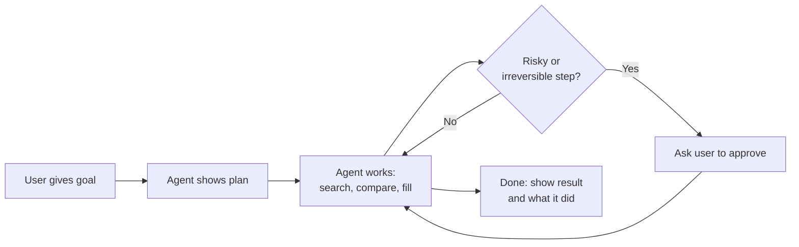
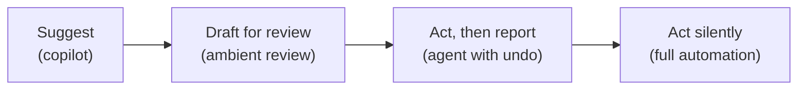

# B2.2 AI UX patterns: chat, copilot, agent, ambient

## In one line

The same AI model can feel useless or magical depending on its shape. Pick the pattern (chat, copilot, agent or ambient) by who starts the work, who checks it, and what a mistake costs.

## Why this matters

Once you've decided AI is worth using ([B2.1](01-finding-ai-opportunities-and-when-not-to-use-ai.md)), the next decision is *how users meet it*. That choice decides who uses the feature, how much value they get, and how badly things go when the model is wrong. Many teams default to "add a chat box". Often that's the weakest option. As the PM, you choose the pattern, set how much the AI may do alone, and design how people stay in control.

## Key terms

| Term | Plain-English meaning |
|---|---|
| **Interaction pattern** | A repeatable shape for how a user and an AI work together, like "chat" or "inline suggestion". |
| **Chat (assistant)** | The user types a request in a conversation window and the AI replies. |
| **Copilot** | AI that sits inside the user's own work and offers suggestions in context (next words, a draft, a fix). The user stays in charge. |
| **Agent** | AI that takes a goal and carries out many steps on its own, using tools, until the task is done or it needs help. |
| **Ambient AI** | AI that runs in the background, triggered by events (a new email, an overdue invoice), not by a user's request. |
| **Autonomy** | How much the AI may do without asking a person first. |
| **Human-in-the-loop** | A person reviews or approves the AI's work at a chosen point before it takes effect. |
| **Affordance** | A visible cue that tells users what they can do (a button, a slider, a suggested prompt). |
| **Articulation barrier** | The difficulty many people have in describing what they want in words, which makes typing prompts hard. |

## The idea, simply

!!! tip "Analogy: four ways to get help in a kitchen"
    Imagine you're cooking dinner for guests.

    - **Chat** is calling your mother: you ask, she answers, you go back to cooking. Helpful, but you have to know what to ask.
    - **Copilot** is a friend standing beside you at the stove: "add salt now", "that's burning". The advice appears *in the moment*, but your hands do the work.
    - **Agent** is hiring a cook: "make dal, rice and a sabzi for six". The cook shops, chops and cooks. You check at the end, or when they ask "no paneer in the fridge, okay to use potatoes?"
    - **Ambient** is a smart pantry that notices you're low on atta and puts it on tomorrow's order list, waiting for your nod.

    Same skill (cooking knowledge), four very different experiences. Who starts the work, who does it and who checks it changes everything.

AI products work the same way. Let's build the idea up.

### 1. The pattern is a product decision, not a design detail

The model is the engine. The pattern is the vehicle. You can put the same engine in a scooter or a truck, and you'll get very different results.

Jakob Nielsen argued in June 2023 that generative AI brings the first new user-interface paradigm in about 60 years ([UX Tigers / Jakob Nielsen](https://jakobnielsenphd.substack.com/p/ai-is-first-new-ui-paradigm-in-60?open=false)). He calls it **intent-based outcome specification**: you say *what* you want, and the computer works out *how*. Earlier interfaces were command-based: you told the computer each step, one click at a time.

That shift is powerful, but it also moves control away from the user. The four patterns in this chapter are four different answers to one question: *how much of the "how" do we hand to the AI, and where does the person stay in the loop?*

| Pattern | Who starts the work | Who does the work | Who checks it, and when |
|---|---|---|---|
| **Chat** | User asks | AI drafts or answers; user acts on it | User, right away, by reading the reply |
| **Copilot** | Product offers help inside the task | User, with AI suggestions | User, at each suggestion (accept, edit, ignore) |
| **Agent** | User gives a goal | AI, over many steps | User at checkpoints, and at the end |
| **Ambient** | An event in the background | AI prepares or acts | User reviews a queue, or is told afterwards |

### 2. Chat: flexible, but the blank box is hard

**What it is.** A conversation window. The user types; the AI replies. ChatGPT, Claude and Gemini made this the default shape of AI.

**Why it works.** Chat is open-ended. One box can handle thousands of different requests. It's cheap to build, and great for exploring, learning and one-off questions.

**Why it often fails inside products.** Two problems show up again and again:

- **The blank box gives no hints.** Amelia Wattenberger's widely shared 2023 essay [*Why Chatbots Are Not the Future*](https://wattenberger.com/thoughts/boo-chatbots) points out that a text box looks the same as a search bar or a login form. It tells users nothing about what the tool can do. Every user has to learn to prompt.
- **Not everyone can say what they want.** Nielsen calls this the **articulation barrier**. He estimates that about half the people in rich countries would struggle to write prompts good enough to get strong results ([source](https://jakobnielsenphd.substack.com/p/ai-is-first-new-ui-paradigm-in-60?open=false)). Treat that as one expert's estimate, not a measured fact, but the direction matches what product teams see.

For readers in India, add a third: many users are more comfortable speaking than typing, and in Hindi, Tamil or Hinglish rather than English. A typed English chat box filters them out.

**How to make chat work better:**

| Chat problem | Fix |
|---|---|
| Blank box, no idea what to ask | Suggested prompts based on the user's context, not generic ones ([NN/g on prompt suggestions](https://www.nngroup.com/articles/prompt-suggestions/)) |
| Users retype the same settings ("shorter", "formal") | Add buttons and sliders for common changes ([NN/g on adding UI controls to prompting](https://www.nngroup.com/articles/prompt-controls-genai/)) |
| Answers are walls of text | Structured replies: cards, tables, buttons to act on the answer |
| Typing is hard | Voice input and replies in the user's language |
| The answer is lost in scrollback | Let users pin, save or move outputs into their work |

**Good fits:** customer support, open questions over a knowledge base ([B1.2](../01-building-blocks/02-rag-giving-ai-your-knowledge.md)), research, learning, and power users who know what they want.

### 3. Copilot: AI inside the work

**What it is.** The AI sits *where the user already works* and offers help in context. Think of code editors that suggest the next lines, email apps that draft a reply, or a spreadsheet that suggests a formula. The user stays in the driver's seat; the AI is the co-pilot.

**Why it works.**

- **Context is free.** The product already knows what the user is looking at, so the user doesn't have to explain.
- **Checking is cheap.** Suggestions are small and appear right where the user can judge them. Accepting is one key press; ignoring costs nothing.
- **No new habit.** Users don't have to remember to open a separate tool.

The best-known evidence is from GitHub Copilot. In a 2023 controlled experiment, developers given Copilot finished a set coding task **55.8% faster** than a control group ([Peng et al., arXiv](https://arxiv.org/pdf/2302.06590); [Microsoft Research](https://microsoft.com/en-us/research/publication/the-impact-of-ai-on-developer-productivity-evidence-from-github-copilot)). Note that this was one well-defined task. Gains on messy, real-world work are usually smaller and vary a lot.

**How to recognise a good copilot:** it offers *small, frequent, easy-to-judge* suggestions, at the moment they're useful, and it's easy to dismiss.

| Bad copilot | Good copilot |
|---|---|
| Pops up a big panel on every screen | Appears only when there's something useful to suggest |
| Rewrites the whole document | Suggests one paragraph, with a visible "before and after" |
| Suggestions you can't undo | One-tap accept, edit or undo |
| Same suggestion for every user | Uses this user's data and past choices |

**Good fits:** writing, coding, form-filling, data entry, sales and support agents' screens, design tools. In short: skilled work where a person must stay accountable.

### 4. Agent: hand over a goal

**What it is.** The user states a goal ("book me the cheapest morning flight to Bengaluru next Friday"). The AI plans and takes many steps (search, compare, fill forms) using tools, until the task is done or it needs input. [B1.3](../01-building-blocks/03-agents-tool-use-and-mcp.md) explains how agents work under the hood. Here we focus on what the *user* experiences.

**Why it works.** Agents save the most effort when a task has many boring steps and a clear finish line. The user's time goes from "doing" to "checking".

**Why it's hard.** Every step can go wrong, and the user isn't watching each one. So agent UX is mostly about **control**:

Notice where the human sits: at the plan, at risky steps, and at the end. Everything in between runs on its own.

OpenAI's ChatGPT agent, launched on 17 July 2025, is a useful public example of these controls ([OpenAI](https://openai.com/index/introducing-chatgpt-agent/)). OpenAI says it:

- asks permission before actions with real-world consequences, such as making a purchase
- lets users interrupt, redirect, pause or stop a task at any point, and take over the browser (for example to log in)
- uses a "watch mode" for some critical tasks, such as sending emails, where the user must actively supervise
- refuses some high-risk tasks, such as bank transfers

**Good fits:** multi-step tasks with a checkable result: research reports, booking, data clean-up, filing routine forms, coding tasks with tests.

### 5. Ambient: AI that starts on its own

**What it is.** The AI watches a stream of events and acts when something happens, without the user asking. LangChain's Harrison Chase named this "ambient agents" in January 2025: agents that respond to events rather than chat messages, and may handle several at once ([LangChain blog](https://www.langchain.com/blog/introducing-ambient-agents)).

Examples: a support tool that drafts a reply the moment a ticket arrives; an accounting app that flags a suspicious invoice; a clinical "ambient scribe" that listens to a doctor–patient visit and drafts the notes.

**Why it works.** It removes the hardest step: remembering to ask. The user doesn't need to know a feature exists. Work is ready when they arrive.

**Why it's risky.** The AI acts on data the user may not realise it's watching. Privacy, surprise and noise become the main design problems.

LangChain describes three ways an ambient agent should involve a person ([source](https://www.langchain.com/blog/introducing-ambient-agents)):

| Mode | What the agent does | Example |
|---|---|---|
| **Notify** | Flags an event but takes no action | "This contract needs your signature." |
| **Question** | Asks for missing information instead of guessing | "Which address should this refund go to?" |
| **Review** | Prepares an action and waits for approval or edits | A drafted email the user can send, edit or discard |

They also built an **agent inbox**: one screen listing everything the agents need from you, modelled on an email inbox. Their reason: in a chat tool like Slack, such requests got lost.

**Good fits:** high-volume, repetitive events where the user always does roughly the same thing: triage, follow-ups, monitoring, note-taking.

### 6. The patterns blend, and good products move users along them

These four aren't boxes. Real products mix them:

- A support tool can be **ambient** (drafts a reply when a ticket lands), shown as a **copilot** (the draft sits in the agent's reply box), with a **chat** side panel for questions.
- A coding tool can offer **copilot** suggestions while you type and an **agent** mode for "fix this failing test".

The most useful idea is a **ladder of autonomy** that users climb as trust grows:

Each step right saves more effort but needs more trust. Let users choose their step, per task, and move back down easily.

### 7. Where the patterns come from, and what has held up

There's no single inventor of this four-way split. It's a working vocabulary from industry. Its roots:

- **Microsoft's Guidelines for Human-AI Interaction** (2019), 18 research-backed rules such as "make clear what the system can do", "support efficient correction" and "scope services when in doubt" ([Microsoft HAX Toolkit](https://www.microsoft.com/en-us/haxtoolkit/ai-guidelines/)). They predate generative AI and still apply to every pattern here.
- **Nielsen's intent-based paradigm** (2023), described above.
- **Critiques of chat** such as Wattenberger's (2023), which pushed teams towards in-context tools.
- **Ambient agents and the agent inbox** (LangChain, 2025).
- **Pattern libraries** such as Emily Campbell's [Shape of AI](https://shapeof.ai/about), which catalogue smaller building blocks (prompt suggestions, citations, regenerate, controls).

What has held up best: put AI *where the work is*, make its output *easy to check*, and match *autonomy* to the *cost of mistakes*.

## Framework: The Pattern Picker (five questions)

This book's synthesis of the sources above. It isn't one author's method. Use it after you've confirmed AI fits the problem ([B2.1](01-finding-ai-opportunities-and-when-not-to-use-ai.md)).

**Step 1: Who knows the work needs doing?**

- If only the user knows ("I want to compare these two plans"), they must start it: **chat** or **agent**.
- If the product can see it ("an invoice is 7 days overdue", "the user is writing an email"), the product can start it: **copilot** or **ambient**.

**Step 2: Is the task one step or many?**

- One step, judged immediately (a reply, a formula, a summary): **chat** or **copilot**.
- Many steps towards a goal (research, booking, clean-up): **agent**, or **ambient** if it repeats.

**Step 3: How costly is a mistake, and can it be undone?** Use the cost-of-error grid from [B2.1](01-finding-ai-opportunities-and-when-not-to-use-ai.md).

- Cheap and reversible: let the AI act.
- Costly or irreversible (money, messages to customers, deletions, health): the AI suggests or drafts; a person approves.

**Step 4: How easy is checking, and who checks?** A copilot works only if the user can judge a suggestion in seconds. If checking takes as long as doing, the pattern fails. Ask the AI to show its sources or steps, or pick a different task.

**Step 5: How often does it happen?** Rare tasks suit chat (users can't build a habit around a hidden feature). Frequent, repeating tasks suit copilot and ambient, because they meet the user where the work already is.

Then set the **autonomy level** per action, not per product. One product can auto-tag tickets (act silently) but only draft refunds (review).

**When to use:** any time you're adding AI to a product, and whenever a team proposes "let's add a chatbot".

**When not to:** for a quick internal prototype, chat is fine. Use it to learn what people ask, then design the real pattern. Also, don't force a pattern when the honest answer from [B2.1](01-finding-ai-opportunities-and-when-not-to-use-ai.md) was "don't use AI here".

| If your answers are… | Start with |
|---|---|
| User-started, one step, open-ended, rare | Chat |
| Product-started, one step, frequent, user accountable | Copilot |
| User-started, many steps, checkable result | Agent with checkpoints |
| Event-started, repeating, same response each time | Ambient, in review mode |
| Any, but a mistake is costly and hard to check | Copilot or review mode only, never silent action |

## Diagram

Moving right removes the need to remember to ask; moving up removes the need to do the work. Both save effort, and both need more trust and better controls.

## Worked example

You're the PM for an invoicing app used by **2,000 small businesses** in India (traders, agencies, small manufacturers). Their biggest pain is chasing unpaid invoices. Owners hate sending reminders: it's awkward and takes time.

Leadership says: "Let's add an AI assistant for payment reminders." Your job is to choose the pattern. (All numbers below are illustrative, of the kind you'd pull from your own data and a small pilot.)

**Step 1: The baseline.**

| Fact | Value |
|---|---|
| Overdue invoices per business per month | 60 |
| Overdue invoices in total per month | 120,000 |
| Share that get a reminder today | 40% (48,000) |
| Time to write a reminder by hand | 4 minutes |
| Average overdue invoice | ₹18,000 |

From past data, you estimate that a timely reminder gives an invoice a **12% higher chance** of being paid within 15 days rather than after 45. So each *extra* reminder pulls forward about ₹18,000 × 12% = **₹2,160** of cash.

**Step 2: Run the Pattern Picker.**

- *Who knows the work is needed?* The product does: it can see every overdue invoice. That points to copilot or ambient.
- *One step or many?* Mostly one (send a reminder), repeated, with a follow-up chain.
- *Cost of a mistake?* Medium. A reminder to a client who already paid, or a rude tone, can hurt a business relationship. It can't be unsent.
- *Ease of checking?* Easy: an owner can read a three-line message in seconds.
- *How often?* Daily.

**Step 3: Estimate each pattern.** You run a two-week pilot of mock-ups with 40 businesses, then estimate adoption (how many businesses would use it) and coverage (share of overdue invoices that get a reminder):

| Pattern | Businesses using it | Overdue invoices covered | Reminders sent (was) | Extra reminders | Owner time saved |
|---|---|---|---|---|---|
| **Chat** ("ask the assistant to write a reminder") | 10% (200) | 12,000 | 50% → 6,000 (4,800) | 1,200 | 300 hrs |
| **Copilot** ("Draft reminder" button on each overdue invoice) | 35% (700) | 42,000 | 60% → 25,200 (16,800) | 8,400 | 1,260 hrs |
| **Ambient review** (each morning: "12 reminders ready", approve in one tap) | 60% (1,200) | 72,000 | 85% → 61,200 (28,800) | 32,400 | 3,570 hrs |
| **Full agent** (sends and follows up on its own) | 25% (500) | 30,000 | 95% → 28,500 (12,000) | 16,500 | 1,900 hrs |

How the time column is worked out: chat and copilot save 3 of the 4 minutes per reminder; ambient saves 3.5 (one tap); the agent saves all 4.

Why does the full agent get *less* adoption than ambient review? In the pilot, most owners refused to let software message their customers unseen. Trust, not capability, limits it.

**Step 4: What is it worth?** Extra reminders × ₹2,160 of cash pulled forward each month:

| Pattern | Cash pulled forward per month |
|---|---|
| Chat | ≈ ₹26 lakh |
| Copilot | ≈ ₹1.8 crore |
| Ambient review | ≈ ₹7.0 crore |
| Full agent | ≈ ₹3.6 crore |

**Step 5: Count the cost of mistakes.** Suppose the model gets 2% of reminders wrong (wrong amount, client already paid, odd tone).

- **Full agent:** 2% × 28,500 = **570 wrong messages a month** reach customers.
- **Ambient review:** 2% × 61,200 = 1,224 wrong drafts. If owners catch 80% while approving, about **245** slip through.

The model cost is tiny by comparison. At, say, ₹0.40 per draft, drafting for all 72,000 covered invoices costs about ₹29,000 a month. The real constraints are trust and mistakes, not model bills.

**Step 6: Decide and design.** Ship **ambient review** first, presented as a morning queue (an "agent inbox"), with:

- a one-tap "send all", plus per-message edit and skip
- a check against the bank feed before drafting, so already-paid invoices are skipped
- a tone setting per client ("formal", "friendly")
- a **graduated autonomy** option: after an owner approves 20 reminders for a client without edits, offer "auto-send future reminders for this client". It stays off by default and can be undone.

Also keep the **copilot** button on each invoice for one-off reminders. Drop the chat assistant from the first release.

**Step 7: Metrics.** Steering metric: % of overdue invoices that get a timely reminder. Outcome: median days to payment. Guardrails: reminders sent to already-paid invoices, edit rate on drafts (a rising rate means quality is slipping), client complaints, and owners turning the feature off. See [B3.2](../03-quality/02-ai-product-metrics-and-production-monitoring.md) for AI-specific metrics.

## Going deeper: nuances and trade-offs

### 1. "Add a chatbot" is often a sign the team skipped design

Chat is the easiest pattern to build and the hardest for users to get value from. A chatbot bolted onto an app usually sees low usage. Users don't know it's there, don't know what to ask, and have to describe context the app already knows.

A quick test: list the five most common things users would ask. If they're the same five every time, they should be buttons, suggestions or ambient actions, not a blank box. Keep chat for the long tail of open questions.

### 2. Autonomy is set per action, not per product

The useful question isn't "is this an agent?" but "which actions may the AI take alone?" A shopping assistant might:

| Action | Autonomy |
|---|---|
| Search and compare products | Act silently |
| Add to cart | Act, then show |
| Apply a coupon | Act, then show, with undo |
| Pay | Ask every time |
| Change the delivery address | Ask every time |

Write this table into the PRD ([A7.1](../../part-a/07-execution-and-delivery/01-prds-and-specs.md)). It's also where safety reviews and legal sign-off will focus.

### 3. Approval fatigue: too many "Are you sure?" prompts

Human-in-the-loop only works if people actually look. If an agent asks for approval 30 times in a task, users start clicking "yes" without reading. This is automation bias in action ([B2.1](01-finding-ai-opportunities-and-when-not-to-use-ai.md)).

Ways to keep approvals meaningful:

- Ask only at **consequential or irreversible** steps.
- **Batch** small approvals ("approve these 12 reminders").
- **Show the difference**: what will change, for whom, at what cost.
- **Track rubber-stamping.** If approval takes under a second and is almost never "no", the check may have stopped working.

### 4. Ambient AI lives or dies on consent and noise

Ambient features see more of the user's world than any other pattern. That brings two risks:

- **Privacy and surprise.** Users should know what is watched, where it's stored, and how to turn it off. Default-on ambient features with broad access invite backlash (see the Microsoft Recall case below). In India, the Digital Personal Data Protection Act's consent and purpose rules also apply ([B4.3](../04-data-safety-and-law/03-ai-regulation-eu-ai-act-india-s-dpdp-act-and-ai.md)).
- **Noise.** An ambient feature that flags everything is ignored within a week. Measure how many notifications lead to an action. If it's low, raise the bar for what gets flagged.

### 5. Latency shapes the pattern

How long the AI takes changes which pattern works ([B0.3](../00-foundations/03-choosing-models-capability-cost-latency-open-vs.md)):

| Pattern | Latency users accept | Design implication |
|---|---|---|
| Copilot inline suggestion | Well under a second | Small, fast models; cancel if the user keeps typing |
| Chat reply | A few seconds, if text streams in | Stream the answer word by word |
| Agent task | Minutes, if progress is visible | Show the plan and live steps; let users leave and come back |
| Ambient | Hours are fine | Run in batches overnight at lower cost |

Ambient work can often use batch processing, which is cheaper. Copilots need speed, which often means smaller models.

### 6. Trust signals differ by pattern

Each pattern needs its own way of showing "you can rely on this":

- **Chat:** citations to sources ([B1.2](../01-building-blocks/02-rag-giving-ai-your-knowledge.md)), and honest "I don't know" answers.
- **Copilot:** clear before/after views and easy undo.
- **Agent:** a visible plan, a log of what it did, and partial results if it stops.
- **Ambient:** a reason for each action ("drafted because invoice #482 is 7 days overdue").

[B2.3](03-designing-for-trust-failure-and-human-in-the-loo.md) goes deeper into designing for trust and failure.

### 7. India: voice, language, assisted use and shared phones

Some pattern choices change for Indian users:

- **Voice first.** Many users prefer to speak. Chat that accepts voice notes, in their language, works better than a typed box.
- **Assisted use.** In many shops and homes, a family member or shop assistant operates the app for someone else. Ambient and agent actions should be clear to whoever is holding the phone.
- **Shared devices.** Ambient features that read messages or notifications can expose one person's data to another. Be careful with defaults.
- **UPI-style confirmations.** Indian users are used to a PIN step before money moves. Agent payments should keep that kind of explicit, familiar confirmation (see the Razorpay case).

### 8. B2B vs B2C

- **B2B** users are accountable for outcomes and work in the same tools daily. Copilots and ambient review fit well. Admins also want controls: which actions the AI can take for the whole team, and audit logs.
- **B2C** users visit less often and are less patient. Ambient features that do something useful without being asked can win, but only with clear consent. Agents for consumers need extra care around payments and personal data.

## Real-world examples (2023 onwards)

!!! example "Razorpay, NPCI and OpenAI, October 2025: an agent that can't pay without you"
    On 9 October 2025, Razorpay, NPCI and OpenAI announced a pilot of "agentic payments" in India ([Business Today](https://www.businesstoday.in/tech-today/news/story/razorpay-npci-openai-launch-pilot-for-agentic-payments-where-ai-powered-shopping-meets-upi-497545-2025-10-09)). Users could find, choose and pay for products inside ChatGPT. BigBasket was among the first merchants; Axis Bank and Airtel Payments Bank were the partner banks.

    The design is what matters for a PM. The AI searches the catalogue and shows options. But a payment goes through only **after the user confirms**. It's built on UPI Circle and UPI Reserve Pay, so the agent can act only after explicit user approval. Users also get real-time tracking and can revoke access instantly. The announcement gave no results or rollout timeline; it's a pilot.

    **PM lesson:** this is the autonomy table from Going deeper §2 in real life. Search and compare run on their own, but the money step always needs the human. Notice too that the control uses a payment habit Indian users already trust, rather than inventing a new one.

!!! example "Microsoft Recall, May–June 2024: ambient AI without enough consent"
    Microsoft unveiled Recall with its new Copilot+ PCs in May 2024. Recall took screenshots every few seconds so users could later search anything they'd seen. Security researchers and privacy advocates said the stored images and extracted text were poorly protected. One open-source tool showed how easily malicious software could pull sensitive data out of it ([Help Net Security](https://www.helpnetsecurity.com/2024/06/14/windows-recall-rollout-delay/)).

    By mid-June 2024, Microsoft had delayed the broad launch planned for 18 June. It limited Recall to Windows Insider testers first, made it **off by default (opt-in)**, encrypted its database, and required Windows Hello sign-in to turn it on ([Help Net Security](https://www.helpnetsecurity.com/2024/06/14/windows-recall-rollout-delay/); [Axios](https://www.axios.com/2024/06/14/microsoft-slows-recall-release-to-test-security-codebook)).

    **PM lesson:** ambient AI sees more than any other pattern, so consent, security and defaults are part of the core design, not a launch checklist item. The fixes Microsoft made (opt-in, encryption, authentication) are what a PM should have required before the first announcement.

## Common mistakes

!!! warning "Watch out for"
    - **Defaulting to a chat box** because it's easy to build, when the top requests are predictable and could be buttons or suggestions.
    - **One autonomy level for the whole product.** Set it per action, based on cost of error and reversibility.
    - **Approval prompts everywhere.** Users stop reading them, and the safety check quietly becomes a rubber stamp.
    - **Ambient features on by default with broad data access,** and no clear way to see or switch off what's watched.
    - **Agents with no visible plan or log.** When something goes wrong, neither the user nor your support team can tell what happened.
    - **Copilot suggestions that are too big to judge.** If checking a suggestion takes as long as doing the work, it's not a copilot, it's homework.
    - **Ignoring latency.** A slow inline suggestion arrives after the user has moved on.
    - **No path back down the autonomy ladder.** Users who got burnt once need an easy way to return to "suggest only".

## Common questions

**Is "copilot" just a brand name?**
Microsoft and GitHub use it as a product name, but the industry also uses it for the general pattern: AI that assists inside your work while you stay in charge. In this book, "copilot" means the pattern.

**Will agents replace chat and copilots?**
Unlikely to fully replace them. Different tasks need different shapes. Open questions suit chat; skilled, accountable work suits copilots; multi-step chores suit agents. Most products will mix all four.

**How do I know which autonomy level users want?**
Ask and test. Show mock-ups of "suggest", "draft for review" and "auto-do" for the same task, and watch what people pick. Then let them change it in settings. Track how many move up or down the ladder over time.

**What's the difference between an ambient agent and a notification?**
A notification only tells you something happened. An ambient agent also does work: it prepares a draft, a fix or a decision and asks you to review it. LangChain's "notify" mode is the simplest form; "review" is where the value is.

**Should every AI feature have a chat fallback?**
Often it helps, because users can ask about edge cases. But a fallback chat shouldn't be the main way to use the feature. If most usage goes through the fallback, the main pattern isn't working.

## In the interview

!!! question "In the interview"
    **How it's tested:** AI product design questions often hide this choice. "Design an AI feature for X" is really asking: what shape should it take, how much should it do alone, and how do users stay in control?

    **Sample question:** *"You're the PM for a food delivery app. Design an AI feature that helps families plan weekly dinners."*

    **Outline of a strong answer:**

    1. **Clarify the user and job:** a busy parent who orders 3–4 times a week and wants variety without spending time deciding.
    2. **Pick the pattern with reasons:** a blank chat box is weak because users don't know what to ask. An **ambient** weekly plan ("here's a suggested plan for the week, based on what your family liked") with **copilot**-style edits fits better. Add chat only for special requests ("Jain food on Tuesday").
    3. **Set autonomy per action:** suggesting meals happens on its own; adding to cart happens on one tap; **placing an order always needs confirmation**.
    4. **Design trust signals:** show why each dish was picked; one-tap swap; respect dietary rules strictly.
    5. **Metrics:** % of plans accepted (with edits), orders from plans, repeat use in week 4; guardrails on wrong-diet suggestions, opt-outs and cancellations.
    6. **Risks:** allergies and diet rules (hard constraints, not suggestions), notification fatigue, and privacy of family data.

    Interviewers listen for a reasoned pattern choice (not "add a chatbot"), autonomy set per action, and a plan for when the AI is wrong.

    **A second common form:** *"When would you not make this an agent?"* A strong answer: when mistakes are costly and hard to check, when the task is a single step, or when users need to stay accountable (so a copilot fits better).

## Research happening now

!!! info "Research happening now"
    - **Ambient scribes in a randomised trial (JAMIA, May 2026).** Researchers at a US academic medical centre ran a randomised crossover trial of two commercial ambient AI scribes with 160 outpatient clinicians. Both products reduced personal and work burnout scores. One cut daily time spent in notes by about 3 minutes more than the other. Neither made a meaningful difference to after-hours "pajama time" ([PubMed](https://pubmed.ncbi.nlm.nih.gov/41729180/)). *Status: peer-reviewed; one site, so results may not generalise.* The lesson for PMs: ambient tools can help even when the time saved is modest, and products in the same category can differ.
    - **Automation vs augmentation in real usage (Anthropic Economic Index, March 2026).** Anthropic's [March 2026 report](https://anthropic.com/research/economic-index-march-2026-report) on how people use Claude found that collaborative (augmentation) use on Claude.ai rose slightly, while automation in business API traffic fell sharply. Users with six or more months of experience had higher success rates and used Claude more for work. *Status: company report based on its own usage data; the authors note survivorship and cohort effects may explain part of the gap.*

## Try it yourself (25 minutes)

Pick an app you use weekly (a bank, a food app, an email client, a job portal). Choose one task its users repeat often.

1. Describe how that task would work as **chat**, **copilot**, **agent** and **ambient**, in one or two lines each.
2. Run the five Pattern Picker questions and choose one pattern.
3. Write an **autonomy table**: list 4–5 actions and mark each as "act silently", "act, then show", "draft for review" or "ask every time".
4. Name one steering metric and two guardrails.

??? success "Check your answer"
    For a job portal and the task "apply to relevant jobs", a strong answer might be:

    - **Chat:** "find me product jobs in Pune" in a chat window. **Copilot:** while filling an application, AI suggests answers from your CV. **Agent:** "apply to 10 matching jobs this week". **Ambient:** each morning, a queue of 5 new matching jobs with tailored cover notes ready to review.
    - **Choice:** ambient review plus copilot. The product knows when new jobs match (product-started). Applications are frequent. A bad application hurts the user's reputation and can't be undone, so a person should approve.
    - **Autonomy table:** find matching jobs (act silently); draft cover note (draft for review); fill standard fields like name and phone (act, then show); submit application (ask every time); message a recruiter (ask every time).
    - **Metrics:** steering metric: applications submitted from the queue per active user per week. Guardrails: % of drafts heavily edited, recruiter "not relevant" rejections, users switching the queue off.

    Check that your riskiest action needs a human, and that your pattern doesn't rely on users remembering to open a separate tool.

## How this connects

- [B2.1 Finding AI opportunities, and when not to use AI](01-finding-ai-opportunities-and-when-not-to-use-ai.md): decide *whether* to use AI before deciding its shape; the cost-of-error grid drives autonomy.
- [B1.3 Agents, tool use and MCP](../01-building-blocks/03-agents-tool-use-and-mcp.md): how agents and tools work under the hood.
- [B2.3 Designing for trust, failure and human-in-the-loop](03-designing-for-trust-failure-and-human-in-the-loo.md): the detailed design of approvals, errors and recovery.
- [B3.2 AI product metrics and production monitoring](../03-quality/02-ai-product-metrics-and-production-monitoring.md): measuring acceptance, edits and guardrails for each pattern.
- [B0.1 What makes AI products different](../00-foundations/01-what-makes-ai-products-different.md): why probabilistic outputs need these patterns at all.

## Go deeper

- **Guidelines:** [Microsoft Guidelines for Human-AI Interaction](https://www.microsoft.com/en-us/haxtoolkit/ai-guidelines/). 18 tested rules that apply to every pattern; a good checklist for design reviews.
- **Essay:** [Jakob Nielsen: AI is the first new UI paradigm in 60 years](https://jakobnielsenphd.substack.com/p/ai-is-first-new-ui-paradigm-in-60?open=false) (2023). The intent-based paradigm and the articulation barrier.
- **Essay:** [Amelia Wattenberger: Why Chatbots Are Not the Future](https://wattenberger.com/thoughts/boo-chatbots) (2023). A visual argument for AI tools built into the work, not a chat box.
- **Article:** [LangChain: Introducing ambient agents](https://www.langchain.com/blog/introducing-ambient-agents) (2025). Notify, question and review, and the agent inbox.
- **Podcast:** [Sequoia Training Data: Ambient agents and the new agent inbox, with Harrison Chase](https://sequoiacap.com/podcast/training-data-harrison-chase-2). A conversation on the same ideas (described from its title and listing).
- **Pattern library:** [The Shape of AI](https://shapeof.ai/about) by Emily Campbell. A catalogue of smaller AI UX building blocks to borrow from.
- **Articles:** [NN/g: Prompt suggestions](https://www.nngroup.com/articles/prompt-suggestions/) and [NN/g: Adding UI controls to prompting](https://www.nngroup.com/articles/prompt-controls-genai/). Practical fixes for chat interfaces.
- **Product example:** [OpenAI: Introducing ChatGPT agent](https://openai.com/index/introducing-chatgpt-agent/) (2025). A public description of agent controls: permission, interruption, takeover and watch mode.

## Key takeaways

- The **pattern** (chat, copilot, agent, ambient) often matters more to user value than the model behind it.
- Choose it by asking **who starts the work, how many steps it takes, what a mistake costs, how easy checking is, and how often it happens.**
- **Chat** is flexible but hard for users; **copilots** win for skilled, accountable work; **agents** suit multi-step tasks with checkable results; **ambient** removes the need to remember, but needs strong consent.
- Set **autonomy per action**, and make the riskiest steps (money, messages, deletions) need a human.
- Keep approvals **few and meaningful**, or they become rubber stamps.
- Let users **climb and descend the autonomy ladder** as trust grows or breaks.
- Trust and adoption, not model cost, are usually the real limits.

## Updates

*No updates yet.*
