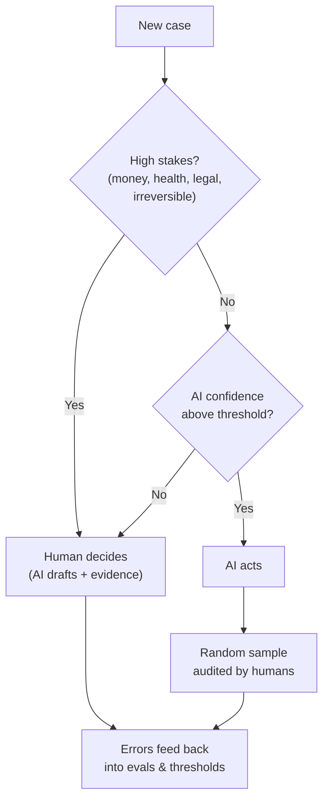
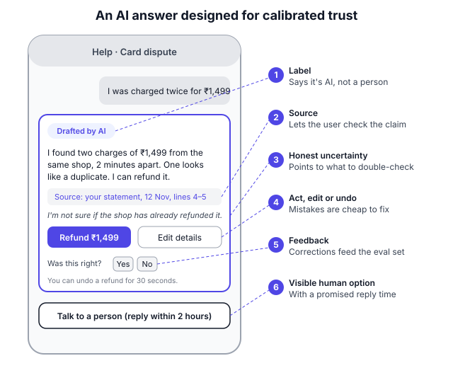

# B2.3 Designing for trust, failure and human-in-the-loop

## In one line

Your AI will be wrong some of the time, so design it so people trust it exactly as much as it deserves, can spot and undo its mistakes easily, and get a human where a mistake would really hurt.

## Why this matters

In normal software, a bug is an exception. In AI products, being wrong a few percent of the time is *normal behaviour* ([B0.1](../00-foundations/01-what-makes-ai-products-different.md)). So the PM's job isn't only "make the AI accurate". It's also "decide what happens when it isn't". Who notices? How do they fix it? Who's accountable? Those choices decide whether users keep coming back, whether the company gets sued, and whether regulators are comfortable. They're product decisions, and they belong in your spec, not left to whoever builds the screen.

## Key terms

| Term | Plain-English meaning |
|---|---|
| **Calibrated trust** | Users trust the AI as much as its real accuracy deserves: more where it's good, less where it's weak. |
| **Overreliance (automation bias)** | Accepting the AI's output without checking, even when it's wrong. |
| **Undertrust** | Ignoring or redoing the AI's work even when it's right, so the product adds no value. |
| **Human-in-the-loop (HITL)** | A person must approve the AI's output before it takes effect. |
| **Human-on-the-loop** | The AI acts on its own, but a person watches and can step in or stop it. |
| **Confidence threshold** | A cut-off score: above it the AI acts; below it, a human decides. |
| **Graceful failure** | When the AI can't help, it fails in a way that is safe, clear and gives the user a next step. |
| **Escalation (handoff)** | Passing a conversation or case from the AI to a human, with context. |
| **Approval fatigue** | Reviewers start clicking "approve" without really checking, because the AI is usually right. |

## The idea, simply

!!! tip "Analogy: the new trainee at a chartered accountant's office"
    A CA hires a bright trainee. In week one, the CA checks every return the trainee prepares. By month three, the CA has learned where the trainee is reliable (simple salary returns) and where they slip (capital gains). So the CA checks simple returns by sampling a few, but still checks every capital-gains return line by line. Anything going to the tax department with a big refund gets the CA's signature, always.

    The trainee also learns to say, "Sir, I'm not sure about this one," and the CA is glad they did.

    That's the whole chapter. The trainee is your AI. **Trust is earned task by task. Checking effort goes where mistakes are costly. And "I'm not sure" is a feature, not a weakness.**

### 1. Aim for calibrated trust, not maximum trust

It's tempting to make users trust the AI as much as possible. That's a mistake. If users trust a 90%-accurate assistant completely, they'll accept the 10% of wrong answers too. The goal is **calibrated trust**: trust that matches how good the AI really is, for this kind of task.

| | User trusts it a lot | User trusts it little |
|---|---|---|
| **AI is right here** | ✅ Good: value delivered | ❌ Undertrust: user redoes the work; product feels useless |
| **AI is wrong here** | ❌ Overtrust: errors slip through to customers, money, health | ✅ Good: user checks and catches the error |

Both failures are product failures. Undertrust kills adoption. Overtrust causes harm. Your design levers push users toward the green boxes: show *when* to trust and *when* to check.

**How to recognise a calibration problem:**

- Users accept almost every suggestion, including ones your evals say are often wrong → overtrust.
- Users edit almost every suggestion, including ones your evals say are reliable → undertrust.
- Trust collapses after one bad answer → you probably over-promised at the start ([B2.2](02-ai-ux-patterns-chat-copilot-agent-ambient.md)).

### 2. Know how your AI fails before users find out

You can't design for failure you haven't named. Google's People + AI Research (PAIR) team gives a useful way to sort AI errors in its [Errors + Graceful Failure chapter](https://pair.withgoogle.com/chapter/People%20+%20AI%20Guidebook%20-%20Errors%20+%20Graceful%20Failure.pdf):

| Error type | What it means | Example |
|---|---|---|
| **System limitation** | The AI simply can't do this | A travel bot asked to cancel a train ticket it has no access to |
| **Context error** | The system works "as intended", but the user sees it as wrong because it misread their situation | A music app plays party songs because "it's Friday night"; the user is at a funeral |
| **Background error** | The AI is wrong and *nobody notices* | A loan model quietly mis-scores self-employed applicants |
| **Failstate** | The AI correctly can't give an answer, and the user hits a dead end | "No results" with no next step |

PAIR also lists where errors come from: bad or missing training data, unexpected user input, low confidence or irrelevant results, and several systems clashing with each other.

**Background errors are the dangerous ones.** Users report the errors they see. The ones nobody notices only show up through evaluation, audits and sampling ([B3.1](../03-quality/01-evals-the-ai-pm-s-most-important-skill.md)). That's why "few complaints" doesn't mean "few errors".

A practical habit: before launch, write a **failure inventory** of the top 10 ways the AI could be wrong, how often (from evals), how bad each is, and whether the user would notice.

### 3. Help users judge each answer: sources, uncertainty and limits

Users can only calibrate their trust if the product gives them clues. The main levers:

| Lever | What it looks like | Why it helps |
|---|---|---|
| **Show sources** | "From your policy document, page 4" with a link | Users can check the claim in seconds ([B1.2](../01-building-blocks/02-rag-giving-ai-your-knowledge.md)) |
| **Express uncertainty in words** | "I'm not sure, but it looks like…" | Prompts users to double-check the shaky answers |
| **Say what it can't do** | "I can't see your bank statements, so I can't confirm this payment" | Sets an honest mental model |
| **Show what it used** | "Based on your last 3 orders" | Users can spot a wrong assumption |
| **Highlight what to check** | Flag the 2 numbers in a summary that came from a blurry scan | Directs limited attention to where errors hide |

There's evidence that *how* you phrase uncertainty matters. In a pre-registered experiment with 404 people answering medical questions, Microsoft researchers found that when an AI said "I'm not sure, but…", people agreed with it less and got more answers right, because they relied less on its wrong answers. A more impersonal phrase ("It's not clear, but…") had a weaker effect ([Kim et al., FAccT 2024](https://www.microsoft.com/en-us/research/?p=1030965)). The authors recommend testing such phrases with your own users before rolling them out at scale.

**Be careful with numbers.** Showing "87% confident" looks precise, but a model's stated confidence may not match how often it's actually right. Check confidence scores against your eval set before showing them. Often, simple bands ("high / check this / unsure") work better than raw percentages.

### 4. Make mistakes cheap to spot and cheap to undo

If a mistake is easy to notice and easy to reverse, you can let the AI do much more. If it's hard to notice or impossible to reverse, you need humans in front of it.

| Design pattern | Example |
|---|---|
| **Draft, don't send** | AI writes the email; the user clicks Send |
| **Preview before action** | "I'll move 12 meetings. Here's the list." → Confirm |
| **Undo window** | "Refund issued. Undo (30s)" |
| **Edit in place** | Suggested tags appear as chips the user can delete |
| **Diffs** | Show exactly what changed in a document or code |
| **Version history** | Restore yesterday's version of the AI-edited sheet |

This maps directly to the cost-of-error × ease-of-checking grid in [B2.1](01-finding-ai-opportunities-and-when-not-to-use-ai.md). Where errors are cheap and easy to check, automate. Where they're costly and hard to check, keep a human in front.

### 5. Fail gracefully: always leave a path forward

When the AI can't help, the worst outcome is a dead end or a confident wrong answer. PAIR uses a waiter analogy: a good waiter doesn't just say "We don't have Coke." They say, "We don't have Coke, but is Pepsi OK?" ([PAIR](https://pair.withgoogle.com/chapter/People%20+%20AI%20Guidebook%20-%20Errors%20+%20Graceful%20Failure.pdf)).

| Situation | Bad failure | Graceful failure |
|---|---|---|
| Low confidence | Answers anyway, confidently | "I'm not certain. Here's what I found; you may want to check with support." |
| Out of scope | "Error. Try again." | "I can't change bookings yet. Here's the link, or I can connect you to an agent." |
| Ambiguous input | Guesses the wrong meaning | "Did you mean your savings account or your credit card?" |
| System down | Spinner forever | "Our assistant is down. Here are the 3 most common answers, and the helpline." |
| Unsafe request | Long lecture | Short, calm refusal and a helpful alternative |

PAIR's guidance also includes returning control to the user and adding a safety check when the stakes are higher. Its closing advice is simple: be human, not machine.

### 6. Human-in-the-loop: choose the right level of oversight for each action

"Human-in-the-loop" isn't one thing. There's a spectrum, and you choose per action, not per product ([B1.3](../01-building-blocks/03-agents-tool-use-and-mcp.md) covers the autonomy ladder for agents).

| Level | How it works | Good for | Example |
|---|---|---|---|
| **Human does it; AI suggests** | AI offers, human decides every time | High stakes, low AI accuracy | A doctor reviewing AI-flagged scans |
| **Human-in-the-loop** | AI prepares, human approves each one | Medium-high stakes, decent accuracy | Loan officer approving AI-drafted decisions |
| **Human-on-the-loop** | AI acts; human monitors and can stop it | Medium stakes, high accuracy, high volume | Auto-replies to routine support tickets, with live monitoring |
| **Human audits** | AI acts; humans review a sample later | Low stakes, very high accuracy | Auto-tagging products in a catalogue |
| **Fully automated** | No routine human check | Trivial, reversible actions | Spell-check suggestions |

The most useful tool here is **routing by confidence and stakes**: the AI handles the easy, low-risk cases, and everything else goes to a person.

Stakes are checked before confidence: a confident AI still doesn't get the final say on high-stakes cases. Audits catch the background errors nobody reports.

### 7. Design the handoff to a human as a feature

When the AI passes a case to a person, two things matter: the user shouldn't have to start over, and the human should have what they need to act fast.

- **Easy to ask for:** a visible "Talk to a person" option, not hidden behind five failed attempts.
- **Carry context:** the agent sees the conversation, what the AI tried and why it escalated.
- **Set expectations:** "A person will reply within 2 hours" beats silence.
- **Escalate on emotion, not just failure:** frustration, repeated questions, words like "complaint" or "fraud".
- **Know who you're talking to:** label clearly whether a reply comes from AI or a person.

Klarna's experience is a good reminder. In February 2024 its AI assistant was reported to be handling most customer chats, about 2.3 million conversations in more than 35 languages. By May 2025 its CEO was saying there "will always be a human if you want", and Klarna began hiring human support staff again ([tech.co](https://tech.co/news/klarna-reverses-ai-overhaul)). The AI didn't go away; the human option became part of the product.

### 8. Close the loop: let users and reviewers teach the system

Every correction is data. Design ways to capture it:

- **Lightweight feedback:** thumbs up/down with an optional reason ("wrong", "outdated", "not what I asked").
- **Implicit signals:** edits to AI drafts, undo clicks, follow-up questions, escalations.
- **Reviewer decisions:** every human override in a HITL queue is a labelled example of where the AI was wrong.

Then use it: review the top error themes weekly, add failing cases to your eval set, and adjust thresholds. Feedback that goes into a database nobody reads is just a button.

## Framework: The Trust and Failure Plan

There's no single official framework for this. The plan below combines three well-known sources into one routine:

- Google PAIR's **People + AI Guidebook**, especially the [Errors + Graceful Failure](https://pair.withgoogle.com/chapter/People%20+%20AI%20Guidebook%20-%20Errors%20+%20Graceful%20Failure.pdf) and [Explainability + Trust](https://pair.withgoogle.com/chapter/People%20+%20AI%20Guidebook%20-%20Explainability%20+%20Trust.pdf) chapters. The PAIR team has since [updated the guidebook for generative AI](https://medium.com/people-ai-research/updating-the-people-ai-guidebook-in-the-age-of-generative-ai-cace6c846db4).
- Microsoft's **Guidelines for Human-AI Interaction** (HAX), covered in [B0.1](../00-foundations/01-what-makes-ai-products-different.md), such as "make clear how well the system can do what it can do" and "support efficient correction".
- The **human oversight** duties in Article 14 of the EU AI Act for high-risk systems: people must be able to understand the system's limits, interpret its output, override it and stop it, while staying aware of automation bias ([AI Act Service Desk](https://ai-act-service-desk.ec.europa.eu/en/ai-act/article-14)).

**Step 1: Build the failure inventory.** List the top 10 ways the AI can be wrong. For each, note how often it happens (from evals), how bad it is, and whether the user would notice. Mark background errors clearly.

**Step 2: Score each action on stakes and reversibility.**

| | Reversible | Irreversible |
|---|---|---|
| **Low stakes** | Automate | Automate with preview |
| **High stakes** | AI acts with undo + audit, or human-on-the-loop | Human approves every time |

**Step 3: Pick an oversight level per action** (Section 6 above). Write it down in the spec: "Refunds under ₹2,000 with high confidence: automated with 2% audit. All rejections: human."

**Step 4: Design the trust signals.** Which sources, uncertainty phrases and limits will the user see? Test the wording with real users.

**Step 5: Design recovery.** For every failure in the inventory: how will the user notice, undo or correct it? What's the graceful-failure message and path forward?

**Step 6: Design the handoff.** When does it escalate (rules + emotion signals)? What context goes to the human? What's the promised response time?

**Step 7: Monitor the oversight itself.** Track reviewer approval rates, time per review, override rates and audit error rates. Plant known-wrong "canary" cases to check that reviewers still catch them.

**When to use:** every AI feature that can affect money, health, legal rights, safety, reputation, or a customer's trust in your brand. In lighter form (Steps 1, 4, 5) for every AI feature, full stop.

**When not to over-do it:** for low-stakes, easily reversible features (summaries of a user's own notes, writing suggestions), heavy approval steps just add friction. Here, good undo and feedback are enough. Adding a human checkpoint to everything doesn't make a product safe; it makes it slow, and reviewers stop paying attention.

## Diagram

Six small design choices on one screen do most of the trust work: label, source, honest uncertainty, edit/undo, feedback and a visible human option.

## Worked example

You're the PM for card disputes at a fintech that issues credit cards. Customers raise disputes like "I was charged twice" or "I never received this order". Today, human agents handle every dispute.

**The current state:**

| | Value |
|---|---|
| Disputes per month | 30,000 |
| Agent time per dispute | 12 minutes |
| Agent hours per month | 6,000 |
| Fully loaded agent cost | ₹400 per hour |
| **Monthly cost** | **₹24 lakh** |
| Average time to resolution | 6 days |

Your team has built an AI that reads the dispute, the transaction and the merchant's records. It recommends "approve refund" or "reject", gives a confidence score, and drafts a reason.

**Step 1: Failure inventory (from an eval on 2,000 past disputes).**

| Failure | How often | Harm | Would the customer notice? |
|---|---|---|---|
| Approves a refund that should be rejected | 1.5% of high-confidence approvals | Money lost (avg ₹900) | No (background error) |
| Rejects a valid dispute | 4% of rejections | Customer harmed; complaints; regulatory risk | Yes, and they'll be angry |
| Misreads a non-English or handwritten document | 9% of such cases | Wrong decision either way | Sometimes |

**Step 2: Decide oversight by stakes.** Rejecting a valid dispute hurts a customer and is the riskiest error, so **the AI never rejects on its own.** Approving a small refund wrongly costs a little money and can be caught in audits.

**Step 3: Design three lanes.**

| Lane | Rule | Share of volume | Human time per case |
|---|---|---|---|
| **1. Auto-approve** | AI says approve, confidence ≥ 0.95, amount ≤ ₹2,000 | 40% (12,000) | 0, plus a 2% random audit at 4 min |
| **2. Assisted** | Everything else with confidence ≥ 0.70, including all rejections | 45% (13,500) | 6 min (AI draft + evidence shown) |
| **3. Human only** | Confidence < 0.70, documents not in English, or amount > ₹50,000 | 15% (4,500) | 12 min |

**Step 4: Do the maths.**

| Item | Calculation | Monthly value |
|---|---|---|
| Lane 1 audit hours | 240 cases × 4 min | 16 hours |
| Lane 2 hours | 13,500 × 6 min | 1,350 hours |
| Lane 3 hours | 4,500 × 12 min | 900 hours |
| **Total agent hours** | | **2,266 hours** (was 6,000) |
| Agent cost | 2,266 × ₹400 | ₹9.06 lakh |
| Saving on agents | ₹24 lakh − ₹9.06 lakh | ₹14.94 lakh |
| Cost of wrong auto-approvals | 12,000 × 1.5% × ₹900 | − ₹1.62 lakh |
| AI running cost | 30,000 × ₹3 | − ₹0.90 lakh |
| **Net monthly value** | | **≈ ₹12.4 lakh** (about ₹1.5 crore a year) |

Resolution time also drops: Lane 1 cases close in minutes instead of days.

Notice what we *didn't* do: auto-reject. Automating rejections would have saved more agent time, but each wrong rejection hurts a customer who is already upset, invites complaints, and is exactly the kind of decision regulators want a human to own.

**Step 5: Trust signals and recovery for customers.**

- The decision message says whether it was made automatically or by a person.
- Every rejection explains why, and offers a one-tap "Ask a person to review this".
- Auto-approved refunds show the refund reference immediately.

**Step 6: Keep the humans sharp.**

- Track Lane 2 agreement: if agents agree with the AI on more than about 98% of cases, check that they're really reviewing.
- Seed 1% of Lane 2 cases with known-wrong AI recommendations ("canaries"). If agents approve more than a few of them, retrain and rethink the review screen.
- Review threshold settings monthly against audit results. If the Lane 1 audit error rate rises above 2%, raise the confidence threshold.

## Going deeper: nuances and trade-offs

### 1. Automation bias and approval fatigue: the human in the loop can quietly stop looping

Putting a person in the loop only helps if they actually check. When the AI is usually right, reviewers drift into rubber-stamping. The EU AI Act names this risk directly: Article 14 says people overseeing high-risk AI must stay aware of the tendency to over-rely on its output, which it calls "automation bias" ([AI Act Service Desk](https://ai-act-service-desk.ec.europa.eu/en/ai-act/article-14)).

A June 2026 preprint studied 11,429 reviews by 400 repeat reviewers of code written by AI agents on GitHub. Over time, approval rates rose (from about 28% to 42% across the study), requests for changes halved, and inline comments per review fell by 22%, while review times got longer. The authors think growing workload led to habituation, but say they can't fully rule out reviewers rationally learning to trust the agents ([arXiv 2606.22721](https://arxiv.org/html/2606.22721v1); *preprint, not peer-reviewed*).

**What helps:** canary cases, rotating reviewers, showing the AI's evidence (not just its verdict), asking reviewers to make their own call *before* seeing the AI's, and keeping review queues small enough to do properly.

### 2. Experienced users want fewer checkpoints, and that can be fine

Trust grows with experience, and good products let oversight change with it. Anthropic studied how people supervise its coding agent, Claude Code. New users let it run fully on auto-approve in about 20% of sessions; by around 750 sessions, that rose to over 40%. But experienced users also *interrupted* the agent more often (about 9% of turns vs about 5% for new users). They shifted from approving every step to watching and stepping in when needed ([Anthropic, February 2026](https://www.anthropic.com/research/measuring-agent-autonomy)). The report concludes that effective oversight doesn't require approving every action.

**PM takeaway:** let users earn autonomy (settings, per-action permissions), but keep hard gates on irreversible or high-stakes actions whatever the user's experience.

### 3. You own what your AI says

In *Moffatt v. Air Canada* (February 2024), Air Canada's website chatbot told a grieving customer he could claim a bereavement discount after buying his ticket. That was wrong. Air Canada argued the correct policy was elsewhere on its site and that the chatbot was responsible for its own actions. The British Columbia Civil Resolution Tribunal rejected this, holding the airline responsible for everything on its website, chatbot included, and ordered it to pay about C$650 plus interest and fees ([ABA Business Law Today](https://www.americanbar.org/groups/business_law/resources/business-law-today/2024-february/bc-tribunal-confirms-companies-remain-liable-information-provided-ai-chatbot/)). It's a small tribunal case, not a court ruling, but the principle is clear: "the AI said it" is not a defence.

**PM takeaway:** for anything that sounds like a policy, price or promise, ground the AI in approved sources ([B1.2](../01-building-blocks/02-rag-giving-ai-your-knowledge.md)), and route policy exceptions to humans.

### 4. Be honest about what's AI and what's human

People react differently when they know they're talking to AI, and they feel misled when they find out later. In April 2025, Cursor's AI support bot, "Sam", told users who were being logged out that a new login policy was to blame. No such policy existed. The episode reportedly led to subscription cancellations ([AI Incident Database](https://incidentdatabase.ai/cite/1039/)). Two lessons: label AI replies clearly, and don't let a support bot invent policy when it doesn't know the cause.

In India, the RBI's FREE-AI framework (see the example below) also points toward telling customers when they're dealing with AI.

### 5. The cost of the human in the loop

Humans in the loop cost money and time, and those costs belong in your unit economics ([B5.1](../05-strategy-and-business/01-ai-pricing-and-unit-economics.md)):

- **Labour:** reviewer hours, training and quality checks.
- **Latency:** a human queue turns a 2-second answer into a 2-hour one.
- **Capacity:** if volume spikes (festival sales, a fraud wave), the human queue becomes the bottleneck.

A common trade-off: lower the confidence threshold and you automate more but accept more errors; raise it and you're safer but pay for more reviews. Plot error cost and review cost at several thresholds, as in the worked example, and pick the threshold that minimises total cost *subject to* a cap on harmful errors.

### 6. Different users need different trust designs

- **Experts** (doctors, lawyers, analysts) want evidence and control. They'll undertrust a black box.
- **Novices** may overtrust anything that sounds confident. They need clearer warnings and safer defaults. PAIR's guidance treats novices, multitaskers and health, safety or financial decisions as higher-risk situations.
- **India-specific:** many users are new to digital services, use voice, or prefer Indian languages. A disclaimer in English doesn't calibrate the trust of a Hindi-speaking user. Assisted channels (a bank mitra, a shop owner) add a human layer you can design for, and AI quality is often lower in Indian languages, so thresholds may need to differ by language ([B0.2](../00-foundations/02-how-llms-work-for-pms.md)).

### 7. Regulation is turning oversight into a requirement

- **EU:** Article 14 of the AI Act requires high-risk AI systems to be designed so that people can effectively oversee them: understand limits, detect problems, interpret outputs, override or ignore them, and stop the system ([AI Act Service Desk](https://ai-act-service-desk.ec.europa.eu/en/ai-act/article-14)).
- **India:** the RBI's FREE-AI framework (August 2025) asks regulated financial entities for board-approved AI policies, customer disclosure and a way to challenge AI-driven decisions ([Bar & Bench](https://www.barandbench.com/view-point/rbis-free-ai-framework-navigating-the-legal-and-regulatory-landscape)). It's advisory for now.

Regulation details are covered in [B4.3](../04-data-safety-and-law/03-ai-regulation-eu-ai-act-india-s-dpdp-act-and-ai.md). The PM point: designing oversight in from the start is far cheaper than retrofitting it after a regulator asks.

### 8. Trust is asymmetric: slow to build, quick to lose

One public, confident, wrong answer can undo months of good ones, especially if it's screenshotted. That's why many teams launch narrower than the AI's full ability: a smaller scope where quality is very high builds trust faster than a broad scope with frequent misses. Expand scope as your evals and production monitoring ([B3.2](../03-quality/02-ai-product-metrics-and-production-monitoring.md)) show it's ready.

## Real-world examples (2023 onwards)

!!! example "RBI, August 2025: the FREE-AI framework asks for disclosure and a human route"
    On 13 August 2025, a committee set up by the Reserve Bank of India and chaired by Dr Pushpak Bhattacharyya of IIT Bombay released its report on a Framework for Responsible and Ethical Enablement of AI (FREE-AI) in the financial sector. Among other things, it asks regulated entities (banks, NBFCs and others under RBI oversight) to adopt a board-approved AI policy, to tell customers when they are dealing with AI, to give them a channel to challenge AI-driven decisions, and to report AI failures promptly. The framework is advisory for now, with some provisions expected to move into binding directions ([Bar & Bench](https://www.barandbench.com/view-point/rbis-free-ai-framework-navigating-the-legal-and-regulatory-landscape); [RBI report page](https://rbi.org.in/Scripts/PublicationReportDetails.aspx?ID=1306)).

    **PM lesson:** for an Indian fintech PM, this chapter's design patterns are becoming expectations, not nice-to-haves. "This decision was made with AI", "Ask a person to review", escalation logs and incident reports are now things to design into lending, payments and support products from day one, as in the worked example.

!!! example "Air Canada, February 2024: the chatbot's answer was the company's answer"
    A customer asked Air Canada's website chatbot about bereavement fares after a relative died. The bot said he could apply for the discount within 90 days of buying his ticket. That wasn't the airline's policy. When he applied, Air Canada refused and argued that the chatbot was a separate entity responsible for its own actions. On 14 February 2024, the British Columbia Civil Resolution Tribunal found Air Canada liable for negligent misrepresentation and ordered it to pay about C$650 plus interest and fees ([ABA Business Law Today](https://www.americanbar.org/groups/business_law/resources/business-law-today/2024-february/bc-tribunal-confirms-companies-remain-liable-information-provided-ai-chatbot/)).

    **PM lesson:** the money was small; the lesson wasn't. The bot gave a confident answer about policy, with no source and no "check this" signal, and the customer reasonably relied on it. Grounding answers in the real policy, showing the source, and routing policy exceptions (refunds, discounts, compensation) to a human would each have prevented it.

## Common mistakes

!!! warning "Watch out for"
    - **Designing only for the happy path.** No plan for wrong, uncertain or out-of-scope answers.
    - **Trying to maximise trust** instead of calibrating it, with confident tone everywhere.
    - **A human "in the loop" who isn't really checking.** Huge queues, no evidence shown, no canaries.
    - **Same oversight for every action.** Either everything needs approval (slow, fatigue) or nothing does (risky).
    - **Raw confidence percentages shown without checking** that they match real accuracy.
    - **Hiding the human option** to push automation numbers up. Users notice, and trust drops.
    - **Not labelling AI replies,** or letting the AI make up policies when it doesn't know.
    - **Collecting feedback nobody reads.** Thumbs-down data must reach the eval set and the roadmap.

## Common questions

**Should every AI feature have a human in the loop?**
No. Match oversight to stakes and reversibility. Spell-check needs none. Loan rejections need a person. Most features sit in between: automation plus undo, audits or monitoring.

**Does showing sources make people trust the AI more or less?**
It should make trust more *accurate*. Users can check claims, and they learn where the AI is reliable. But only if sources are real and relevant. A link that doesn't support the claim is worse than no link.

**Won't saying "I'm not sure" make the product look weak?**
Used rarely and honestly, it makes the product look trustworthy. Research suggests it reduces overreliance on wrong answers. If the AI says it on most answers, though, the problem is quality or scope, not wording.

**How do I choose a confidence threshold?**
Use your eval set. For several thresholds, compute how many cases get automated, how many errors slip through, and what each costs. Pick the threshold with the best total, subject to a limit on harmful errors. Then re-check it monthly with production audits.

**What's the difference between human-in-the-loop and human-on-the-loop?**
In the loop: a person approves each output *before* it takes effect. On the loop: the AI acts, and a person monitors and can step in or stop it. On-the-loop scales better but needs good monitoring and a real stop button.

**How do we know if users over-trust the AI?**
Compare acceptance rates with your eval accuracy. If users accept 99% of suggestions but evals say 90% are right, they're over-trusting. Also watch for errors found later in audits that users accepted without edits.

## In the interview

!!! question "In the interview"
    **How it's tested:** AI PM interviews often include "How would you design X so users can trust it?" or "What happens when the AI is wrong?" Product sense questions about AI features also reward candidates who raise failure and oversight without being asked ([B6.2](../06-the-ai-pm-role/02-ai-pm-interviews.md)).

    **Sample question:** *"You're launching an AI assistant that answers patients' questions about their lab reports in a diagnostics app. How do you design it for trust and failure?"*

    **Outline of a strong answer:**

    1. **Name the stakes:** health information; novices; anxious users; wrong reassurance is the worst error.
    2. **Set the scope:** explain terms and ranges in the user's own report; never diagnose or advise treatment.
    3. **Failure inventory:** misread values, wrong reference ranges, false reassurance, missing urgent flags, poor quality in regional languages.
    4. **Oversight by stakes:** clearly abnormal or critical values trigger a fixed, human-approved message and a prompt to contact a doctor, not an AI-written answer; a doctor-on-call handoff for worried users.
    5. **Trust signals:** cite the exact line of the report, use plain uncertainty language, say what it can't do, label it as AI.
    6. **Recovery and feedback:** "Was this clear?", "Talk to a doctor" always visible, flagged answers reviewed by clinicians weekly.
    7. **Metrics:** accuracy on a clinician-labelled eval set, escalation rate, false-reassurance rate (guardrail), user understanding scores.

    Interviewers listen for: stakes-based oversight, an honest failure list, human handoff, and metrics that catch silent errors.

## Research happening now

!!! info "Research happening now"
    - **Reviewers of AI agents' work get less careful over time (June 2026).** A study of 11,429 reviews of AI-agent-written code on GitHub found approval rates rising and review comments falling as reviewers gained experience, while a comparison with human-written code didn't show the same pattern. The authors lean toward habituation under workload as the explanation. ([arXiv 2606.22721](https://arxiv.org/html/2606.22721v1)) *Status: preprint, not peer-reviewed.*
    - **How people actually supervise agents (February 2026).** Anthropic analysed real usage of Claude Code and its API. Experienced users auto-approved more but interrupted more; the agent itself paused to ask for clarification more often on complex tasks; and most tool calls had some human involvement. ([Anthropic](https://www.anthropic.com/research/measuring-agent-autonomy)) *Status: company research on its own product data; not peer-reviewed.*
    - **India's FREE-AI framework moving toward rules.** The RBI committee's August 2025 recommendations on disclosure, customer recourse and incident reporting are advisory, and commentators expect parts to enter binding directions ([Bar & Bench](https://www.barandbench.com/view-point/rbis-free-ai-framework-navigating-the-legal-and-regulatory-landscape)). *Status: watch for RBI directions.*

## Try it yourself (25 minutes)

Pick an AI feature you use (an email reply suggester, a shopping assistant, a bank chatbot) or use this one: *an AI that reads uploaded electricity bills and auto-pays them from the user's UPI-linked account.*

1. Write a failure inventory: 5 ways it could be wrong, how bad each is, and whether the user would notice.
2. For each action (read bill, set amount, pay), choose an oversight level and say why.
3. Design one graceful-failure message for a low-confidence bill reading.
4. Name one metric that would tell you if users are over-trusting it.

??? success "Check your answer"
    A strong answer for the bill auto-pay feature might include:

    - **Failures:** misreads the amount (e.g. ₹1,840 read as ₹18,400), wrong consumer number, pays an old bill twice, misses a due date, fails on a regional-language bill. The large misread and wrong account are severe and may go unnoticed until the bank statement.
    - **Oversight:** reading the bill: automated. Setting the amount: automated if it's within ±30% of the last 3 bills; otherwise ask the user to confirm. Paying: automatic only after the user has confirmed the first two bills; always confirm above a cap (say ₹5,000) or for a new biller. Payments are hard to reverse, so err toward confirmation.
    - **Graceful failure:** "I couldn't read the amount clearly on this bill. It looks like ₹1,840. Please check it before I pay." with the cropped image shown.
    - **Over-trust metric:** share of confirmations accepted in under 2 seconds, or bills paid where the amount was later disputed or corrected.

    Self-check: did you treat irreversible actions more strictly? Did you give the user a way to catch background errors (e.g. a monthly summary)? Did you avoid making the user confirm trivial things?

## How this connects

- [B2.1 Finding AI opportunities](01-finding-ai-opportunities-and-when-not-to-use-ai.md): the cost-of-error × ease-of-checking grid decides how much oversight a use case needs.
- [B2.2 AI UX patterns](02-ai-ux-patterns-chat-copilot-agent-ambient.md): each pattern (copilot, agent, ambient) needs its own trust and checkpoint design.
- [B1.3 Agents, tool use and MCP](../01-building-blocks/03-agents-tool-use-and-mcp.md): the autonomy ladder per action, applied to agents.
- [B3.1 Evals](../03-quality/01-evals-the-ai-pm-s-most-important-skill.md): where failure rates and confidence thresholds come from.
- [B4.2 Responsible AI, safety and guardrails](../04-data-safety-and-law/02-responsible-ai-safety-and-guardrails.md): the technical and policy layer behind graceful refusals.

## Go deeper

- **Guide:** [Google PAIR People + AI Guidebook](https://pair.withgoogle.com/guidebook-v2/chapters). Free. Read "Errors + Graceful Failure" and "Explainability + Trust" first.
- **Paper:** [Kim et al., "I'm Not Sure, But…" (FAccT 2024)](https://www.microsoft.com/en-us/research/?p=1030965). How a short uncertainty phrase changes how much people rely on AI.
- **Report:** [Anthropic, Measuring AI agent autonomy in practice](https://www.anthropic.com/research/measuring-agent-autonomy). Real data on how people oversee agents.
- **Law:** [EU AI Act, Article 14: human oversight](https://ai-act-service-desk.ec.europa.eu/en/ai-act/article-14). Short and readable; the clearest legal statement of what oversight must allow.
- **Article:** [ABA on Moffatt v. Air Canada](https://www.americanbar.org/groups/business_law/resources/business-law-today/2024-february/bc-tribunal-confirms-companies-remain-liable-information-provided-ai-chatbot/). Why companies own their chatbot's answers.
- **Commentary:** [Bar & Bench on RBI's FREE-AI framework](https://www.barandbench.com/view-point/rbis-free-ai-framework-navigating-the-legal-and-regulatory-landscape). What it means for Indian financial products.

## Key takeaways

- Your AI *will* be wrong; deciding what happens then is a core PM job.
- Aim for **calibrated trust**: users rely on the AI where it's good and check it where it's weak.
- Write a **failure inventory**, and hunt for **background errors** nobody reports.
- Give users clues: **sources, honest uncertainty, clear limits**, and easy **undo**.
- Set **oversight per action** by stakes and reversibility; route by **stakes first, then confidence**.
- A human in the loop only helps if they really check: watch for **approval fatigue** and use canaries.
- Make the **human handoff** easy and label what's AI. You own what your AI says.

## Updates

*No updates yet.*
