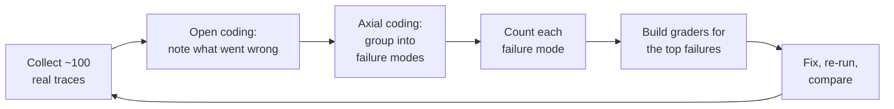
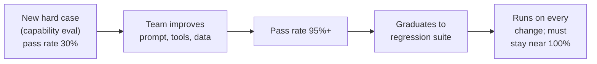
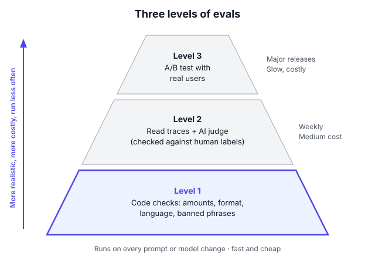

# B3.1 Evals: the AI PM's most important skill

## In one line

An eval is a repeatable test that tells you, with a number, how often your AI does the right thing on the cases your users actually bring. Without one, every prompt change is a guess.

## Why this matters

In normal software, a feature either works or it doesn't. In AI products, quality is a percentage that moves every time you change a prompt, a model or the data behind it ([B0.1](../00-foundations/01-what-makes-ai-products-different.md)). Evals are how you know which way it moved. They are also where your product judgement turns into something engineers can build against. That is why many practitioners now call evals "the new PRD" for AI features.

Evals sit behind almost every AI PM decision:

- **Launch or wait:** "is 88% good enough to ship to all users?"
- **Choosing a model:** "does the cheaper model hold up on *our* cases?" ([B0.3](../00-foundations/03-choosing-models-capability-cost-latency-open-vs.md))
- **Fixing complaints:** "did last week's fix actually fix it, and did it break anything else?"
- **Talking to leaders:** "here is what the AI gets wrong, how often, and what it costs us."

## Key terms

| Term | Plain-English meaning |
|---|---|
| **Eval (evaluation)** | A set of test cases plus a way of scoring the AI's answers, run again and again. |
| **Trace (transcript)** | The full record of one AI interaction: the user's input, every step and tool call, and the final answer. |
| **Error analysis** | Reading real traces, writing down what went wrong, and grouping the problems into types you can count. |
| **Failure mode** | One specific, named way the AI goes wrong, like "promises a refund time that isn't in the policy". |
| **Grader** | Whatever scores an answer: a piece of code, another AI model, or a person. |
| **LLM-as-judge** | Using a language model as the grader, with a prompt that tells it exactly what to check. |
| **Golden dataset** | A set of real or realistic test cases with agreed correct answers or pass/fail labels. |
| **Regression** | Something that used to work and now doesn't, usually because of a change you made elsewhere. |

## The idea, simply

!!! tip "Analogy: tasting the dal before it leaves the kitchen"
    Picture a busy dhaba. The cook changes the dal recipe a little: less salt, a new tadka. How does he know it's better? He doesn't serve it and hope. He tastes it. And a good head cook doesn't taste just one spoon. He tastes from the top and the bottom of the pot, checks it against what regular customers like, and keeps a list of past complaints ("too watery on Mondays") to check every time.

    An eval is that tasting habit, written down. The **test cases** are the spoons from different parts of the pot. The **graders** are the tasters. The **list of past complaints** is your regression suite. And the cook who tastes only one spoon, from the top, and says "seems fine" is doing what AI teams call a **vibe check**.

### 1. What an eval is made of

Every eval, however fancy, has three parts. If one is missing, it isn't really an eval yet.

| Part | Question it answers | Example: a support bot for a grocery app |
|---|---|---|
| **Test cases** | What inputs do we try? | 150 real customer messages about missing or damaged items |
| **Grader** | How do we decide pass or fail? | Code checks the refund amount against the order; an AI judge checks the tone |
| **Score and threshold** | What number do we report, and what's good enough? | "Policy followed" pass rate, must be at least 99% |

Anthropic's engineering guide on agent evals uses a slightly fuller vocabulary that is worth learning, because engineers will use it ([Anthropic, January 2026](https://www.anthropic.com/research/demystifying-evals-for-ai-agents)):

- A **task** is one test case with its inputs and success criteria.
- A **trial** is one attempt at a task. Because AI output varies, you often run several trials.
- The **transcript** (or trace) is the full record of a trial.
- The **outcome** is the final state of the world. For a booking agent: does the reservation actually exist in the database?
- A **suite** is a group of tasks with a shared goal.

### 2. Why you can't just "try it a few times"

Most teams start by typing a few questions into their AI and eyeballing the answers. This is fine for the first day. It fails quickly after that, for three reasons:

1. **You test what you think of, not what users send.** Real users make typos, mix Hindi and English, paste screenshots and ask two things at once. Your ten test questions don't.
2. **You can't see regressions.** Fixing one complaint by adding a line to the prompt often breaks something else. Without a fixed test set, you only find out from angry users.
3. **You can't compare.** "Version 2 feels better" is not something you can show your VP or put in a launch review.

Hamel Husain, an ML engineer who has helped many companies build AI products, made this argument in his widely shared 2024 essay. He wrote that unsuccessful AI products almost always share one root cause: no robust evaluation system ([Hamel Husain, "Your AI Product Needs Evals", March 2024](https://hamel.dev/blog/posts/evals/)). His case study was Lucy, an AI assistant at the real-estate software company Rechat. The team got stuck after early prompt tweaks. Each fix caused a new failure (he calls this "whack-a-mole"), and the prompt kept growing. What got them unstuck was a proper eval system.

### 3. Start from errors, not from a checklist

The biggest beginner mistake is to write eval criteria before looking at any real output: "is it helpful? accurate? concise?" These generic scores rarely match what actually goes wrong in *your* product.

The better approach, taught by Husain and Berkeley researcher Shreya Shankar, is **error analysis** ([evals FAQ, Husain & Shankar](https://hamel.dev/blog/posts/evals-faq/why-is-error-analysis-so-important-in-llm-evals-and-how-is-it-performed.html)). They call it the most important activity in evals. It borrows from how qualitative researchers analyse interviews ([A1.2](../../part-a/01-understanding-users-user-sense/02-user-research-methods-and-interviews.md)):

1. **Collect traces.** Pull around 100 varied, real interactions. If you have no users yet, write realistic synthetic ones.
2. **Open coding.** Read each trace and write a short, free-form note on what went wrong, like a journal. Note the *first* thing that went wrong, because later errors often follow from it.
3. **Axial coding.** Group the notes into a small set of failure modes, and count how many traces fall into each.
4. **Keep going until nothing new appears.** When reading more traces stops revealing new kinds of failure, you've reached what researchers call *saturation*.

The error analysis loop. Notice that graders come after you've read real traces, not before.

Why this works: counting turns a vague feeling ("the bot is a bit off") into a ranked list ("23% of failures are wrong refund amounts; 4% are tone"). Now you know what to fix first. It is the same move as turning user complaints into a sized opportunity ([A2.1](../../part-a/02-problem-discovery/01-continuous-discovery-and-opportunity-solution-tr.md)).

**Who should do the reading?** A person with domain knowledge who owns the product's quality bar. Husain and Shankar suggest one "benevolent dictator" for this. For many teams, that's the PM. Engineers can't judge whether an insurance answer is *right* any better than you can, and often less well.

### 4. Pass/fail beats 1-to-5 scores

When you grade, prefer a **binary pass or fail** for each specific failure mode over a 1–5 or 1–10 score. Husain recommends starting with binary labels for Lucy ([Husain, 2024](https://hamel.dev/blog/posts/evals/)).

Why: a "3 out of 5 for helpfulness" means different things to different people, and you can't act on it. "Fail: promised a refund within 10 minutes, but policy says 48 hours" tells an engineer exactly what to fix.

| Vague score | Specific pass/fail check |
|---|---|
| Helpfulness: 3/5 | Did it answer the question the user actually asked? |
| Accuracy: 4/5 | Does the refund amount match the order data? |
| Tone: 2/5 | Did it blame the customer or use the word "unfortunately" more than once? |
| Language quality: 3/5 | Did it reply in the language the user wrote in? |

### 5. Three kinds of grader

There are three ways to score an answer, and good eval suites use all three ([Anthropic, 2026](https://www.anthropic.com/research/demystifying-evals-for-ai-agents)).

| Grader | How it works | Strengths | Weaknesses | Use it for |
|---|---|---|---|---|
| **Code-based** | A small program checks the answer: a format, a number, a banned phrase, a database state | Fast, cheap, objective | Brittle; can't judge meaning | Refund amount matches order; reply is valid JSON; no internal IDs leaked |
| **Model-based (LLM-as-judge)** | Another AI reads the answer with a focused prompt and says pass or fail | Handles meaning and nuance | Can be wrong; varies run to run; must be checked against humans | "Did it promise something the policy doesn't allow?" |
| **Human** | A person with domain knowledge labels the answer | The gold standard | Slow, expensive | Building the golden dataset; checking the AI judge; high-stakes reviews |

**A simple rule:** use code wherever the check is objective, an AI judge where it needs reading, and humans to set the standard and check the judge.

### 6. Trust the judge only after you've tested it

An AI judge is itself an AI feature, so it needs its own eval. The method:

1. Label 50–100 traces yourself as pass or fail for one failure mode.
2. Run the judge on the same traces.
3. Compare. Look at two numbers separately:
    - **Of the real failures, how many did the judge catch?** (This is called the true positive rate, or recall.)
    - **Of the real passes, how many did the judge correctly pass?** (The true negative rate.)

Why not just "% agreement"? Because failures are usually rare. If only 10% of answers fail, a lazy judge that passes *everything* agrees with you 90% of the time while catching zero failures. Husain warns about exactly this ([Husain, 2024](https://hamel.dev/blog/posts/evals/)).

There's a second, subtler problem. Shankar and colleagues found in a 2024 study that people's grading criteria change as they grade. Reading outputs helps you discover what you actually care about. They called this **criteria drift** ([Shankar et al., "Who Validates the Validators?", UIST 2024](https://arxiv.org/abs/2404.12272)). The PM lesson: your first rubric will be wrong. Plan to revise it after reading real outputs.

### 7. Capability evals vs regression evals

Anthropic's guide separates two kinds of eval suite ([Anthropic, 2026](https://www.anthropic.com/research/demystifying-evals-for-ai-agents)):

- **Capability evals** ask "can it do this hard thing yet?" They start with a *low* pass rate and show progress over time. Example: "handles orders with three or more problem items."
- **Regression evals** ask "does it still do what it used to?" They should stay near 100%. Example: "never shows a customer another customer's phone number."

When a capability eval reaches a high pass rate, it **graduates** into the regression suite.

Capability evals measure progress; regression evals protect what you've already won.

### 8. Consistency: once vs every time

AI output varies, so one run can mislead. Anthropic's guide gives two useful measures ([Anthropic, 2026](https://www.anthropic.com/research/demystifying-evals-for-ai-agents)):

- **pass@k:** did it succeed *at least once* in k tries? Useful when a user can retry or pick from options, as with code suggestions.
- **pass^k:** did it succeed *every time* in k tries? Useful when users get one answer and must be able to rely on it, as with support and payments.

The gap can be large. An agent that succeeds 75% of the time per try succeeds on all three of three tries only about 42% of the time (0.75 × 0.75 × 0.75). For a customer-facing bot, pass^k is usually the honest number.

## Framework: Error-analysis-first evals, in three levels

Two sources shape this framework. Hamel Husain's [three levels of evaluation](https://hamel.dev/blog/posts/evals/) (March 2024) give the structure: cheap automated checks on every change, human and model review of logged traces, and A/B tests for mature products. Husain and Shreya Shankar's [error analysis method](https://hamel.dev/blog/posts/evals-faq/why-is-error-analysis-so-important-in-llm-evals-and-how-is-it-performed.html) (2025) gives the starting point: read real traces before writing any test. Anthropic's [agent evals guide](https://www.anthropic.com/research/demystifying-evals-for-ai-agents) (January 2026) adds the vocabulary for agents. The steps below combine them.

**Step 1: Write the quality bar in plain words.** Before any tooling, write 3–5 sentences: what a great answer does, what must never happen, and who decides. This is the AI equivalent of a PRD's success section ([A7.1](../../part-a/07-execution-and-delivery/01-prds-and-specs.md)).

**Step 2: Collect around 100 real or realistic traces.** From a pilot, internal dogfooding, or written by the team to cover the user types you expect. Include the messy ones: typos, mixed languages, angry users, two questions in one.

**Step 3: Do error analysis.** Open-code each trace, group the notes into failure modes, and count them. Stop when new traces stop showing new problems.

**Step 4: Choose a grader for each important failure mode.** Use code where the check is objective. Use an AI judge where it needs reading, and test that judge against your own labels first. Use people for the hardest calls.

**Step 5: Build the eval set.** Start small. Anthropic suggests 20–50 simple tasks drawn from real failures is enough to begin. Include cases where the AI *should* act and cases where it *should not* (for example, should not approve a refund without a photo).

**Step 6: Set thresholds before you look at results.** For each failure mode, decide the pass rate you need to launch. Safety and money checks get stricter bars than tone. Husain notes that the right pass rate is a product decision, and it isn't always 100%.

**Step 7: Run on every change, and read traces every week.** Level 1 checks run automatically on each prompt or model change. Every week, someone reads a fresh sample of production traces, adds new failures to the set, and checks the judge still agrees with people.

**Step 8: Confirm with real users.** Offline evals predict; they don't prove. For big changes, run an A/B test on the product metrics that matter ([A9.1](../../part-a/09-experimentation/01-a-b-testing-basics.md), [B3.2](02-ai-product-metrics-and-production-monitoring.md)).

**When to use:** any AI feature that real users will rely on, from the first prototype onwards. Evals are cheapest to start early, when the set is small.

**When not to (or not yet):** a one-day internal experiment or a throwaway prototype needs only a quick look at 20 outputs. Also, don't buy an eval platform before you've done error analysis by hand. Tools help you run evals; they can't tell you what to test.

## Diagram

Run the cheap checks constantly and the expensive ones rarely. Each level catches problems the one below it can't.

## Worked example

You're the AI PM for "Order Help", a chat assistant in a quick-commerce app. It handles complaints about missing, wrong or damaged items, and can issue refunds. It handles about **30,000 chats a day**. Policy says: refunds above ₹100 need a photo of the item, and refunds land within 48 hours.

The assistant is live for 5% of users. Leadership wants to roll out to everyone next month. You have no eval yet. Here's what you do.

**Step 1: Quality bar.** "Order Help follows refund policy every time, identifies the right item, replies in the user's language, and never promises what policy doesn't allow. The PM owns this bar."

**Step 2: Collect traces.** You pull 100 pilot chats, chosen across cities, languages (English, Hindi, Hinglish, Kannada) and order sizes.

**Step 3: Error analysis.** You spend about three hours reading. You note the first thing that went wrong in each chat, then group the notes. 28 of 100 chats had at least one failure (some had two).

| Failure mode | Chats | Grader you'll use |
|---|---|---|
| Refund over ₹100 approved without a photo | 9 | Code: compare refund, amount and photo flag with order data |
| Wrong item identified from the order | 7 | Code: compare against labelled correct item |
| Replied in English when user wrote Hindi or Hinglish | 6 | Code: language detector on input and reply |
| Promised a refund timeline not in policy ("in 10 minutes") | 5 | AI judge with a narrow prompt |
| Sent to a human agent when it didn't need to | 4 | Human review weekly |
| Curt or blaming tone | 2 | AI judge (low priority) |
| **Chats with at least one failure** | **28 of 100** | **Overall pass rate: 72%** |

Before error analysis, the team's plan was to score "helpfulness 1–5". None of the top three failures would have shown up clearly in that score.

**Step 4: Test the AI judge.** For "promised a timeline not in policy", you label 80 chats yourself: 20 fail, 60 pass. Then you compare with the judge.

| | You said fail | You said pass |
|---|---|---|
| Judge said fail | 18 | 3 |
| Judge said pass | 2 | 57 |

The judge caught 18 of 20 real failures (90%) and correctly passed 57 of 60 good chats (95%). Simple agreement would be 75 of 80 (94%), which sounds great but hides the 2 misses. You decide 90% recall is good enough for now, and you'll recheck the judge monthly.

**Step 5: Build the eval set.** 150 cases:

- 60 drawn from real failures you found
- 60 ordinary, typical chats
- 30 edge cases, including fake claims, abusive messages, orders with three problem items, and a user asking for a refund on an order that was never placed

Each case runs **three times** (three trials), because you want reliability, not luck.

**Step 6: Thresholds, set in advance.**

| Check | Launch bar |
|---|---|
| Policy followed on refunds | ≥ 99% on every trial |
| Correct item identified | ≥ 97% |
| Reply in user's language | ≥ 98% |
| No unapproved promises | ≥ 98% |
| Overall chats with no failure | ≥ 90% |

**Step 7: Iterate.** The team makes three rounds of changes, re-running the eval after each.

| Version | What changed | Policy followed | Right item | Language match | Overall pass |
|---|---|---|---|---|---|
| v1 (pilot) | — | 91% | 93% | 94% | 72% |
| v2 | Refund rules moved from the prompt into a code check the AI must call | 99.3% | 93% | 94% | 81% |
| v3 | Order items passed as a structured list; reply-language rule added with reason | 99.3% | 97.5% | 98.6% | 88% |
| v4 | Timeline wording taken from a policy snippet, not generated | 99.6% | 97.5% | 98.4% | 91% |

Notice v4 *slightly lowered* language match (98.6% to 98.4%). That's a regression the eval caught. It's still above the bar, so you note it and move on. Without the eval, nobody would have known.

**Step 8: What is it worth?**

Take the biggest failure: refunds approved without a required photo.

| | v1 | v4 |
|---|---|---|
| Chats per day | 30,000 | 30,000 |
| Rate of policy-breaking refunds | 9% | 0.4% |
| Policy-breaking refunds per day | 2,700 | 120 |
| Share that wouldn't have passed with a photo (from a sample audit) | 1 in 3 | 1 in 3 |
| Average refund | ₹180 | ₹180 |
| Avoidable refund cost per day | 900 × ₹180 = ₹1,62,000 | 40 × ₹180 = ₹7,200 |

That's about **₹1.55 lakh a day, or around ₹46 lakh a month**, from fixing one failure mode before full rollout.

The cost of the eval system is small by comparison. It took about 3 hours of your time for error analysis, a few engineer-days to build graders, and roughly 2 hours a week to keep up. Each full run is 450 AI calls (150 cases × 3 trials) plus judge calls, which costs a few hundred rupees.

**Your launch review slide now says:** "Order Help passes all launch bars on a 150-case eval run three times each. Main remaining risk: 9% of chats still fail on minor issues, mostly tone and unneeded handoffs. We'll monitor these in production ([B3.2](02-ai-product-metrics-and-production-monitoring.md))."

## Going deeper: nuances and trade-offs

### 1. Public benchmarks are not your eval

Model makers publish scores on public benchmarks: coding tests, maths tests, general knowledge quizzes. They're useful for a first shortlist of models. They tell you very little about your product.

- Your users' questions, languages and policies aren't in any benchmark.
- Benchmarks can be "saturated". Anthropic's guide notes that scores on one popular coding benchmark rose from about 40% to over 80% in roughly a year, which makes it hard to tell top models apart ([Anthropic, 2026](https://www.anthropic.com/research/demystifying-evals-for-ai-agents)).
- Benchmarks can have bugs too. The same guide describes a case where fixing grading errors in a benchmark lifted a model's score from 42% to about 95%. A low score can mean a broken test, not a bad model.

**PM habit:** when a new model launches, don't read the leaderboard. Run *your* eval set on it. That's how you decide in a day whether to switch ([B0.3](../00-foundations/03-choosing-models-capability-cost-latency-open-vs.md)).

### 2. Synthetic data: useful for starting, dangerous for finishing

Before launch, you often have no real traces. You can ask an AI to write realistic test inputs ("write 50 messages from first-time users in Tier-2 cities complaining about a damaged item, half in Hinglish"). Husain's Rechat team generated synthetic inputs this way for their automated tests.

The trade-off:

| Synthetic data is good for | Synthetic data is bad at |
|---|---|
| Getting started before any users exist | Capturing the real weirdness of user messages |
| Covering rare but important cases (fraud, abuse) | Matching real proportions (how common each issue is) |
| Testing many variations of one case | Indian language mixing, local slang, voice-to-text errors |

**Rule of thumb:** use synthetic data to start, then replace it with real traces as soon as you have them. Keep a few synthetic edge cases for things that are rare but costly.

### 3. Evals for agents need different checks

For a simple Q&A bot, you check the final answer. For an agent that takes actions ([B1.3](../01-building-blocks/03-agents-tool-use-and-mcp.md)), you also need to check:

- **The outcome, not just the words.** Did the refund actually get issued in the system? An agent can *say* "done" without doing it.
- **The path.** Did it call the right tools in a sensible order, or wander through 15 steps for a 3-step task? (That costs money and time.)
- **Things it should *not* do.** Did it avoid cancelling an order the user only asked about?

Anthropic's advice is to grade outcomes where you can, because there are often several valid paths to the same correct result. Grading the exact steps can punish an agent for finding a better route.

### 4. How evals change by risk and business type

| Product | What the eval set must stress | Typical launch bar |
|---|---|---|
| Creative tools (captions, ad copy) | Brand voice, banned words, variety | Lower; users edit anyway |
| Internal tools (text-to-SQL for analysts) | Correct numbers, admits when unsure | High for accuracy, since wrong numbers drive wrong decisions |
| Customer support | Policy compliance, language, escalation | High for money and promises |
| Fintech, health, legal | Refusals, disclaimers, never inventing figures | Very high; human review of edge cases ([B4.2](../04-data-safety-and-law/02-responsible-ai-safety-and-guardrails.md)) |
| B2B with few customers | Each key customer's own documents and workflows | Per-customer bars; review failures one by one |

**The India angle:** if your users write in Hindi, Tamil, Bengali or mixed languages, your eval set must include them in roughly the proportions you expect. An assistant can pass 95% in English and fail badly in Hinglish. Language-match checks are cheap to add and catch a surprising number of problems.

### 5. Offline evals vs online signals

Offline evals (on a fixed test set) and online signals (from real users in production) answer different questions.

| Offline evals | Online signals |
|---|---|
| Run before release | Measured after release |
| Fixed, known cases | Whatever users actually send |
| Fast, repeatable, cheap | Slower, noisier, but real |
| "Did this change make it better on known cases?" | "Is it helping users and the business?" |

You need both. A good habit is to feed production failures back into the offline set every week, so it keeps up with what users actually do. Production monitoring is the subject of [B3.2](02-ai-product-metrics-and-production-monitoring.md).

### 6. How big should the eval set be?

Smaller than most people think, at first.

- **To start:** 20–50 cases from real failures (Anthropic's suggestion). This is enough to stop whack-a-mole.
- **For a launch decision:** a few hundred, so that a 2–3% difference isn't just noise. With 50 cases, one extra failure moves the score by 2 points.
- **For high-stakes failure modes:** enough examples of *that* failure to be confident, even if it's rare in real traffic. You may need to deliberately collect or write them.

Remember that small differences on small sets are noisy, just like early A/B test results ([A9.2](../../part-a/09-experimentation/02-statistics-in-plain-english.md)). Don't celebrate 84% vs 82% on 50 cases.

### 7. Goodhart's law applies to evals too

When the eval score becomes the team's target, people start optimising for the score ([A8.1](../../part-a/08-product-metrics/01-metric-basics-leading-lagging-input-output-vanit.md)). Signs to watch for:

- The prompt gets stuffed with special-case instructions that match test cases word for word.
- The score keeps rising while user complaints don't fall.
- The AI judge's prompt is quietly loosened.

**Defences:** keep a "held-out" set the team doesn't tune against, refresh cases from production regularly, and read real traces yourself every week. If the eval says 95% but your reading says 80%, trust your reading and fix the eval.

### 8. Who owns evals, and how much time they take

Ownership usually splits like this:

- **PM (or domain expert):** defines the quality bar, does error analysis, labels the golden dataset, sets thresholds, and decides launch.
- **Engineers:** build the graders, run evals automatically on every change, and maintain the tooling.
- **Domain specialists** (lawyers, doctors, senior support agents): label the hardest cases.

The time cost is real but modest once it's running. On Lenny's Podcast, Husain and Shankar describe evals taking about 30 minutes a week once set up ([Lenny's Podcast, September 2025](https://www.lennysnewsletter.com/p/why-ai-evals-are-the-hottest-new-skill)). The first round of error analysis takes longer: plan for a few hours.

## Real-world examples (2023 onwards)

!!! example "Google AI Overviews, May 2024: the cases no test set had"
    Google rolled out AI Overviews (AI-written summaries at the top of search results) to everyone in the US in May 2024. Within days, screenshots spread of odd answers, such as suggesting glue to keep cheese on pizza and answering "How many rocks should I eat?". In a post titled ["AI Overviews: About last week"](https://blog.google/products-and-platforms/products/search/ai-overviews-update-may-2024/) (30 May 2024), Google's head of Search, Liz Reid, explained what went wrong. Some odd results came from nonsensical queries where little good content existed (a "data void"), and from satire or sarcastic forum posts being treated as fact. Google also said some circulating screenshots were fake. It described a set of changes, including better detection of nonsensical queries, less reliance on user-generated content that could mislead, and limits on when Overviews appear.

    **PM lesson:** real users, at scale, will find cases no internal team imagines, and people actively look for funny failures. Your eval set must include adversarial and nonsense inputs, and production failures must flow back into it fast. Google's own framing was that these were rare. Even so, a handful of visible failures shaped public trust, which is why "how bad is the worst case?" matters as much as the average pass rate.

!!! example "Swiggy Hermes, 2025–2026: measuring accuracy to make an internal AI tool trustworthy"
    Swiggy built Hermes, a Slack-based assistant that lets employees ask data questions in plain English and get SQL queries and answers back. [InfoQ reported in January 2026](https://www.infoq.com/news/2026/01/swiggy-hermes-conversational-ai) that the third version added retrieval of previously used SQL, session memory, an agent that plans the steps, and an explanation layer with confidence scores. Swiggy engineers were quoted as saying these changes improved SQL generation accuracy from 54% to 93%.

    **PM lesson:** for an internal data tool, a wrong number is worse than no answer, because people make decisions on it. Tracking one clear accuracy number across versions is what turned "the AI is getting better" into a claim the company could trust. The article doesn't describe Swiggy's eval method in detail, so treat the numbers as the team's reported results.

## Common mistakes

!!! warning "Watch out for"
    - **Vibe checks only.** Trying ten questions by hand and calling it tested.
    - **Writing generic criteria first** ("helpful, accurate, concise") before reading any real outputs.
    - **1–5 scores everywhere.** They're hard to agree on and hard to act on. Use specific pass/fail checks.
    - **Trusting an AI judge you haven't checked** against your own labels, or checking it with plain agreement on rare failures.
    - **Only testing the happy path.** No angry users, fake claims, mixed languages or nonsense inputs.
    - **One run per case.** AI output varies; run important cases several times.
    - **Buying a tool before doing error analysis.** Tools run evals; they don't tell you what to test.
    - **A test set that never changes.** Production keeps teaching you new failures. Add them every week.

## Common questions

**Do I need to code to do evals as a PM?**
No. The most valuable parts (reading traces, naming failure modes, labelling, setting thresholds) need product and domain judgement, not code. A spreadsheet is enough to start. Engineers automate the rest.

**How is an eval different from a normal software test?**
A software test checks that the same input always gives the same exact output. An eval accepts that AI output varies, so it measures *how often* the output is acceptable, across many cases and often several runs.

**Should we aim for 100%?**
For a few hard rules (never leak personal data, never approve refunds outside policy), aim very close to 100% and add code checks as a safety net. For softer qualities like tone, a lower bar is fine. Husain's point is that the right pass rate is a product decision based on the cost of each failure.

**What if the AI judge disagrees with me?**
Read the cases where you disagree. Sometimes your rule wasn't clear, so fix the judge's prompt with clearer criteria and examples. Sometimes you were inconsistent, which is criteria drift. Write down the decision so the next person labels the same way.

**When do we need an eval platform?**
When you have more than one AI feature, several people labelling, or evals running on every change. Before that, a spreadsheet plus a script is fine.

**Are evals only for big companies?**
No. A startup's first eval can be 30 cases in a sheet, run before every prompt change. It's the cheapest quality habit you can build.

## In the interview

!!! question "In the interview"
    **How it's tested:** AI PM interviews increasingly ask "How would you evaluate this AI feature?" or "How do you know your AI product is good enough to launch?" It also comes up inside product design questions for AI features ([B6.2](../06-the-ai-pm-role/02-ai-pm-interviews.md)).

    **Sample question:** *"You're launching an AI assistant that answers questions about a bank's credit card fees. How would you evaluate it before launch?"*

    **Outline of a strong answer:**

    1. **Define the quality bar and the stakes:** wrong fee information costs customers money and trust, and may be a compliance issue. Some failures (inventing a fee, wrong interest rate) are much worse than others (wordy answers).
    2. **Get real inputs:** past customer support chats and FAQ searches, across languages and customer types. Use synthetic cases only to fill gaps (fraud attempts, out-of-scope questions).
    3. **Do error analysis on a first version:** read 100 answers, name the failure modes, count them.
    4. **Pick graders per failure mode:** code to check fee numbers against the official fee table; an AI judge, checked against human labels, for "answered the real question"; compliance team review for edge cases.
    5. **Set launch thresholds in advance:** near 100% on fee accuracy and on refusing to give advice it shouldn't; lower bars for tone.
    6. **Plan for after launch:** sample and review production chats weekly, add failures to the set, and track online signals such as escalations to humans and repeat questions.

    Interviewers listen for: starting from real data, specific pass/fail criteria tied to harm, checking the AI judge, and a plan to keep the eval current.

## Research happening now

!!! info "Research happening now"
    - **AI judges can be consistent without being right (June 2026).** Justin Norman, Michael Rivera and D. Alex Hughes ran about 541,000 judgments from 21 AI judges across three benchmarks ([arXiv 2606.19544](https://arxiv.org/abs/2606.19544)). They found judge rankings shifted by up to 14 places between benchmarks. Some judges gave nearly the same answer on repeat runs (high reliability) yet still favoured whichever answer was shown first (position bias). They argue that checking judges only with simple agreement is not enough, and propose a minimum validation protocol. *Status: preprint, not peer-reviewed.*
    - **Which grading scale works best for AI judges? (January 2026).** A team from Harvard, CMU, Stanford and UC San Diego compared 0–5, 0–10 and 0–100 scales and found human–AI agreement was highest on the 0–5 scale ([arXiv 2601.03444](https://arxiv.org/abs/2601.03444)). They also warn that pooled results can hide big differences between tasks. *Status: preprint, not peer-reviewed.* Note this compares numeric scales; it doesn't contradict the practical advice to prefer pass/fail checks where you can.
    - **Agent evals guidance from a model lab (January 2026).** Anthropic's [Demystifying evals for AI agents](https://www.anthropic.com/research/demystifying-evals-for-ai-agents) sets out shared vocabulary (tasks, trials, graders, pass@k vs pass^k) and practical advice for evaluating agents. *Status: practitioner guidance, not a study; expect it to evolve as agent tooling matures.*

## Try it yourself (25 minutes)

Pick any AI chatbot you can access (a general assistant, or a support bot on a website you use). Choose one narrow job for it, such as "explain my mobile plan's data rollover rules" or "suggest a 3-day itinerary for Jaipur under ₹15,000".

1. Write 10 realistic test inputs, including 2 in Hindi or Hinglish, 2 with typos, and 1 that's out of scope.
2. Run each and save the answers.
3. Open-code: write one line on the first thing that went wrong in each.
4. Group your notes into 2–4 failure modes and count them.
5. For your top failure mode, write a pass/fail rule precise enough that a friend would label the same way.

??? success "Check your answer"
    - Your failure modes should be **specific and countable** ("ignored the ₹15,000 budget", "replied in English to a Hindi question"), not general ("not helpful").
    - Your pass/fail rule should name **exactly what to check**, such as "Pass if the total of listed costs is ₹15,000 or less, and every cost has a number."
    - Ask yourself: could you check this rule with code? If yes, note it. Those are your cheapest graders.
    - Did your out-of-scope input get a polite refusal or redirect? If not, that's a failure mode worth adding.
    - If you found no failures at all, your inputs were probably too easy. Add harder, messier ones.

## How this connects

- [B0.1 What makes AI products different](../00-foundations/01-what-makes-ai-products-different.md): why AI quality is a percentage, which is the reason evals exist.
- [B1.1 Prompt engineering for PMs](../01-building-blocks/01-prompt-engineering-for-pms.md): every prompt change should be checked against your eval set.
- [B2.3 Designing for trust, failure and human-in-the-loop](../02-discovery-and-design/03-designing-for-trust-failure-and-human-in-the-loo.md): evals tell you how often each failure happens, which decides the oversight you design.
- [B3.2 AI product metrics and production monitoring](02-ai-product-metrics-and-production-monitoring.md): what to measure once real users arrive, and how it feeds back into evals.
- [A8.1 Metric basics](../../part-a/08-product-metrics/01-metric-basics-leading-lagging-input-output-vanit.md): counter metrics and Goodhart's law apply to eval scores too.

## Go deeper

- **Article:** [Hamel Husain: Your AI Product Needs Evals](https://hamel.dev/blog/posts/evals/) (2024). The essay that made evals mainstream, with the Rechat case study and the three levels.
- **Guide:** [Hamel Husain & Shreya Shankar: AI Evals FAQ](https://hamel.dev/blog/posts/evals-faq/). Practical answers on error analysis, judges and dataset size, from people who teach this to thousands of PMs and engineers.
- **Guide:** [Anthropic: Demystifying evals for AI agents](https://www.anthropic.com/research/demystifying-evals-for-ai-agents) (2026). The clearest vocabulary for agent evals, with pass@k vs pass^k explained.
- **Article:** [Aman Khan: Beyond vibe checks, a PM's complete guide to evals](https://www.lennysnewsletter.com/p/beyond-vibe-checks-a-pms-complete) (Lenny's Newsletter). Written for PMs, from an AI product leader.
- **Podcast:** [Lenny's Podcast with Hamel Husain and Shreya Shankar](https://www.lennysnewsletter.com/p/why-ai-evals-are-the-hottest-new-skill) (2025). The episode description lists a live walk-through of real traces, error analysis and building an AI judge.
- **Paper:** [Shankar et al.: Who Validates the Validators?](https://arxiv.org/abs/2404.12272) (UIST 2024). The study behind "criteria drift" and checking AI judges against people.
- **Docs:** [OpenAI: Evaluation best practices](https://developers.openai.com/api/docs/guides/evaluation-best-practices). A vendor's view of eval-driven development, useful for talking to engineers.

## Key takeaways

- An eval is **test cases + a grader + a threshold**, run on every change. Vibe checks don't scale.
- **Start with error analysis:** read about 100 real traces, name the failure modes, count them, fix the biggest first.
- Prefer **specific pass/fail checks** to 1–5 scores. They're easier to agree on and to act on.
- Use **code graders** where checks are objective, **AI judges** where they need reading, and **people** to set the standard. Test every AI judge against human labels, looking at failures caught, not just agreement.
- Keep **capability evals** (progress) and **regression evals** (protection) separate. Use **pass^k** when users need it right every time.
- Public benchmarks shortlist models; **your own eval set** decides.
- The PM owns the quality bar. Evals are where product judgement becomes something the team can build and test against.

## Updates

*No updates yet.*
