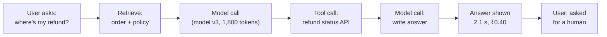
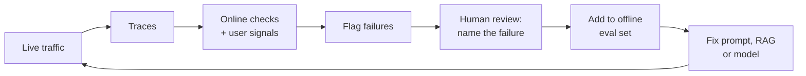
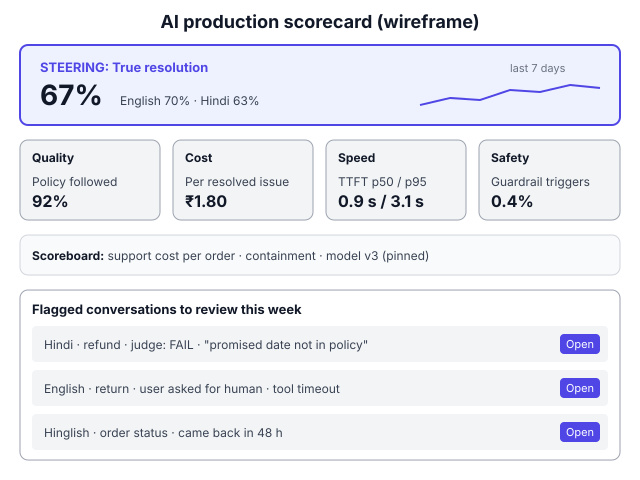

# B3.2 AI product metrics and production monitoring

## In one line

After an AI feature launches, you watch a small stack of numbers (user value, answer quality, cost, speed and safety) plus samples of real conversations, so you catch quality problems before your users and your finance team do.

## Why this matters

Offline evals ([B3.1](01-evals-the-ai-pm-s-most-important-skill.md)) tell you if an AI feature is good enough to launch. They can't tell you what happens when lakhs of real users, with real typos and real edge cases, start using it. Models change underneath you, users change what they ask, and costs can jump overnight. As the AI PM, you own the dashboard and the habits that show whether the feature is still working, and the plan for what to do when it isn't.

## Key terms

| Term | Plain-English meaning |
|---|---|
| **Production** | The live product that real users are using (as opposed to testing). |
| **Trace** | A full record of one AI request: the input, what was looked up, every model and tool call, the output, time taken and cost. |
| **Span** | One step inside a trace, such as a single model call or a single tool call. |
| **Online eval** | An automatic quality check run on real production traffic, usually on a sample. |
| **Explicit feedback** | What users tell you directly: thumbs up/down, star ratings, written comments. |
| **Implicit feedback** | What users' actions reveal: copying an answer, editing it, retrying, giving up or asking for a human. |
| **Drift** | Quality slowly changing over time because users, data or the model changed. |
| **TTFT (time to first token)** | How long before the first word of the AI's answer appears. |
| **Containment rate** | Share of conversations the AI handled without passing to a human. Not the same as solving the problem. |
| **Cost per successful task** | Total AI cost divided by the number of tasks that actually succeeded. |

## The idea, simply

!!! tip "Analogy: running a restaurant kitchen"
    Before opening a restaurant, the chef tastes every dish. That's your **offline eval**. But on opening night, things the chef never tasted start happening. Customers ask for "less spicy, no onion". A new vegetable supplier sends tomatoes that taste different. The kitchen gets slow at 9 pm.

    A good restaurant manager watches a few things all night. How many plates come back half-eaten? How long are people waiting? What's the cost of ingredients per plate? Did anyone get sick? Every so often, the manager tastes a dish straight off the line.

    AI production monitoring is the same job. Watch returned plates (user signals), waiting time (latency), food cost (cost per task) and food safety (harmful outputs). And keep tasting dishes from the line (sampling real conversations).

### 1. Why launch-day evals aren't enough

Three things change after launch, and none of them show up in your offline test set.

| What changes | Example | What you'd see |
|---|---|---|
| **Users' inputs** | Users start asking in Hinglish, or sending voice notes and screenshots | Quality drops for one slice of users |
| **The model or its settings** | The provider updates the model, or your team changes the prompt | Behaviour shifts across the board, sometimes subtly |
| **The world and your data** | A new return policy; product catalogue changes; a festival sale | Answers become out of date or wrong |

Real users also find edge cases faster than any test team. That's why every serious AI team pairs offline evals with **production monitoring**, and feeds what it finds back into the eval set.

### 2. The AI metric stack: five layers

Normal product metrics ([A8.1](../../part-a/08-product-metrics/01-metric-basics-leading-lagging-input-output-vanit.md)) still matter. AI adds layers underneath them. Think of five layers, from business result down to safety.

| Layer | Question | Example metrics |
|---|---|---|
| **1. Business outcome** | Is this helping the business? | Support cost per order; conversion; retention of AI users vs others |
| **2. User value** | Are users getting their job done? | Task success rate; answer acceptance; repeat use; escalation to human |
| **3. AI quality** | Are the answers good? | Online eval pass rate; groundedness (answers backed by sources); policy accuracy |
| **4. Operations** | Is it fast, reliable and affordable? | TTFT and total latency (p50, p95); error and timeout rate; tokens and cost per task |
| **5. Safety and trust** | Is it causing harm? | Guardrail triggers; harmful or off-policy outputs; complaints; privacy incidents |

A useful habit: pick **one steering metric** from layer 2 (usually task success), then guardrails from layers 3–5. Layer 1 is the scoreboard you report to leaders.

### 3. Explicit vs implicit feedback

Asking users "was this helpful?" seems like the obvious signal. It's weaker than you'd think. Only a small share of users ever click thumbs up or down, and those who do aren't typical (very happy or very annoyed). Worse, people tend to rate *pleasant* answers highly even when they're wrong. That's exactly the trap in the OpenAI example below.

Implicit signals, from what users *do*, are usually more plentiful and more honest.

| Signal | What it often means | Pitfall |
|---|---|---|
| **Copied or used the answer** | It was useful | Copying a wrong answer still counts |
| **Edited the AI's draft heavily** | Partly useful; quality gap | Some users always edit |
| **Regenerated or rephrased** | First answer missed | Some users explore on purpose |
| **Asked for a human** | AI couldn't solve it, or user didn't trust it | Some users always ask |
| **Came back with the same problem within 48 hours** | The "resolution" didn't stick | Needs linking sessions together |
| **Abandoned mid-conversation** | Frustration, or got what they needed | Ambiguous; read samples |
| **Thumbs down + comment** | Clear failure, with a reason | Rare and skewed |

**The rule:** never trust a single signal. Combine two or three, and check what they mean by reading real conversations.

### 4. Cost per successful task, not cost per call

AI costs money on every use, unlike most software ([B0.3](../00-foundations/03-choosing-models-capability-cost-latency-open-vs.md)). The obvious metric is cost per request. The useful one is **cost per successful task**.

| | Model A (cheap) | Model B (stronger) |
|---|---|---|
| Cost per conversation | ₹1.50 | ₹3.00 |
| Task success rate | 50% | 80% |
| **Cost per successful task** | **₹3.00** | **₹3.75** |
| Failed tasks passed to human agents (₹30 each), per 1,000 conversations | 500 → ₹15,000 | 200 → ₹6,000 |
| **Total cost per 1,000 conversations** | **₹16,500** | **₹9,000** |

The "cheap" model costs nearly twice as much once you count the failures someone else has to fix. Always cost the whole journey, including human fallback.

Watch for **cost spikes** too. One agent stuck in a loop, or a prompt change that doubles the context length, can multiply cost per task overnight. Set a daily cost alert, not just a monthly bill check.

### 5. Speed: what users actually feel

AI responses take seconds, not milliseconds, so latency matters more than in normal apps.

- **TTFT (time to first token):** how long before text starts appearing. With streaming, this is what users *feel* as speed.
- **Total time:** how long the full answer or task takes. Matters most for agents and voice.
- **Percentiles, not averages:** the p50 (median) shows the typical user; p95 shows the unluckiest 1 in 20. A good p50 with a terrible p95 means many users are having a bad day.

Voice products are the strictest. A pause of a couple of seconds on a phone call feels broken, so voice teams watch end-to-end response time very closely.

### 6. Traces: the black-box flight recorder

When something goes wrong, a dashboard shows *that* it went wrong. A **trace** shows *why*. A good trace records, for each request:

- the user input, and the system prompt and prompt version
- what was retrieved (for RAG, [B1.2](../01-building-blocks/02-rag-giving-ai-your-knowledge.md)) and which tools were called ([B1.3](../01-building-blocks/03-agents-tool-use-and-mcp.md))
- the model name and version
- the output, tokens used, time taken and cost
- any user feedback and what happened next (escalation, retry)

One trace, five spans. When a user asks for a human, the trace shows which step went wrong: retrieval, the tool, or the answer.

Industry is converging on shared formats. OpenTelemetry, the open standard many engineering teams already use for monitoring, has **GenAI semantic conventions**: common names for things like the model requested and the input and output token counts, with separate spans for agent runs, model calls and tool calls ([OpenTelemetry, May 2026](https://opentelemetry.io/blog/2026/genai-observability/); [spec](https://opentelemetry.io/docs/specs/semconv/gen-ai/gen-ai-spans/)). As a PM, you don't write this code. You make sure the trace captures what you need to answer "why did this fail?", and that capturing message content follows your privacy rules.

### 7. Online evals: tasting dishes from the line

You can't read every conversation, and you can't run expensive checks on all of them. So you **layer checks by cost**:

| Check | Runs on | Example |
|---|---|---|
| **Code checks** (cheap, instant) | 100% of traffic | Answer has a valid order ID format; no phone numbers leaked; JSON is valid; under length limit |
| **AI judge** (moderate cost) | A sample, e.g. 1–5% | "Did the answer follow the refund policy?" pass/fail |
| **Human review** (expensive) | A small sample, plus every flagged case | Weekly review of 50–100 traces, focused on failures |

These are the same graders you built for offline evals ([B3.1](01-evals-the-ai-pm-s-most-important-skill.md)), now pointed at live traffic. Every new failure you find goes **back into the offline eval set**, so the next prompt or model change is tested against it.

The eval flywheel: production finds failures, people name them, the eval set grows, and each fix is tested before it ships.

### 8. Change management: most incidents start with a change

Many AI quality incidents begin with a change someone made: a new model version, a prompt edit, a new retrieval source. Treat every change like a release ([A7.5](../../part-a/07-execution-and-delivery/05-launches-and-release-management.md)):

- **Version everything:** prompts, models, retrieval settings. Log the version in every trace.
- **Pin model versions** where your provider allows it, so the model doesn't change without you knowing.
- **Run the offline eval set** before any change ships.
- **Roll out gradually:** shadow mode (new version runs silently alongside), then a canary (a small % of users), then everyone.
- **Keep a fast rollback.** Know who can switch back, and how long it takes.

## Framework: the AI production scorecard

This combines two older ideas with newer AI practice. Google's Site Reliability Engineering book describes the **four golden signals** for monitoring any service: latency, traffic, errors and saturation (how "full" the system is) ([Google SRE book, 2016](https://sre.google/sre-book/monitoring-distributed-systems/)). AI teams add quality, cost and safety layers on top, and close the loop with the eval flywheel popularised by practitioners such as Hamel Husain ([Your AI Product Needs Evals](https://hamel.dev/blog/posts/evals/)).

**Step 1: Define task success in one sentence.** "The customer's question is answered correctly, and they don't come back with the same issue within 48 hours." This is your steering metric.

**Step 2: Choose 1–2 user-value signals** that approximate success at scale: for example, true resolution (no repeat contact) and escalation rate.

**Step 3: Choose 2–4 quality checks** from your offline evals to run online: code checks on everything, an AI judge on a sample.

**Step 4: Add operations metrics:** TTFT and total latency (p50, p95), error/timeout rate, tokens and cost per successful task.

**Step 5: Add safety guardrails:** guardrail trigger rate, harmful or off-policy outputs found, privacy incidents, complaints ([B4.2](../04-data-safety-and-law/02-responsible-ai-safety-and-guardrails.md)).

**Step 6: Set alert thresholds and owners.** For each metric: normal range, the level that triggers an alert, and who gets paged. Slice by language, platform, user type and model version.

**Step 7: Set a review rhythm.** Daily glance at ops and cost; weekly 45-minute trace review of failures; monthly check that the metrics still match what users value.

**Step 8: Write the incident playbook.** What counts as an AI incident, how to roll back, and who tells users and support.

**When to use:** for every AI feature with real users, scaled to the risk. A low-stakes writing helper needs a lighter version than a refund or health assistant.

**When not to over-build:** in the first weeks of a small beta, reading every conversation yourself beats any dashboard. Build automation once volume makes reading everything impossible. And don't track 30 metrics. If nobody acts on a number, delete it.

## Diagram

One steering number at the top, guardrails underneath, and a list of real flagged conversations to read. The flagged traces are what make the numbers explainable.

## Worked example

You're the AI PM for **ShopSaathi** (a made-up name), the support assistant inside an Indian e-commerce app. It answers order, return and refund questions in English and Hindi. It handles about **40,000 conversations a day**. The numbers are illustrative, but the steps are the real job.

**Step 1: Define success.** "The customer's issue is solved, and they don't contact support again about the same order within 48 hours." Call this **true resolution**.

**Step 2: The first dashboard.** Leadership has been celebrating containment. You add true resolution beside it.

| Metric | Value | Note |
|---|---|---|
| Conversations a day | 40,000 | |
| Containment (no human handoff) | 78% | The number leadership sees |
| Of contained, came back within 48 h | 18% | Linked by order ID |
| **True resolution** | **64%** | 78% × (1 − 0.18) |
| AI cost per conversation | ₹1.20 | ₹48,000 a day |
| **AI cost per truly resolved issue** | **₹1.88** | ₹48,000 ÷ 25,600 |
| Human agent cost per ticket | ₹35 | |
| TTFT p50 / p95 | 0.9 s / 3.8 s | p95 is high; check later |

Containment says 78%. The honest number is 64%. More than 5,600 customers a day "contained" by the bot came back with the same problem.

**Step 3: Slice it.** Averages hide problems. You split by language.

| Slice | Share of traffic | True resolution | AI judge: follows refund policy |
|---|---|---|---|
| English | 65% | 70% | 94% |
| Hindi / Hinglish | 35% | 53% | 84% |
| **All** | 100% | **64%** | 91% |

Hindi users are getting a much worse product. That's a quality issue *and* a fairness issue.

**Step 4: Read the traces.** You and an engineer review 60 failed Hindi conversations in one hour, naming each failure (the same error analysis as in [B3.1](01-evals-the-ai-pm-s-most-important-skill.md)).

| Failure | Share of failures | Cause |
|---|---|---|
| Wrong policy retrieved (return vs refund mixed up) | 40% | Hinglish queries like "paise wapas kab aayenge" matched the wrong document |
| Refund status tool timed out; bot guessed | 25% | No retry; the prompt didn't say "admit you can't check" |
| Answer correct but too long and formal | 20% | Prompt examples were all English |
| Other | 15% | Mixed |

**Step 5: Fix, test, ship.** You add a step that rewrites Hinglish queries before search, a retry on the tool, and a rule to say "I can't check that right now" instead of guessing ([B2.3](../02-discovery-and-design/03-designing-for-trust-failure-and-human-in-the-loo.md)). All 60 cases go into the offline eval set. After a canary at 5% of Hindi traffic, Hindi true resolution rises from **53% to 63%**.

**Step 6: What is it worth?**

| | Value |
|---|---|
| Hindi conversations a day | 14,000 |
| Extra issues truly resolved (+10 points) | 1,400 a day |
| Human tickets avoided × ₹35 | ₹49,000 a day |
| Extra AI cost (query rewrite, ₹0.10 × 14,000) | ₹1,400 a day |
| **Net saving** | **≈ ₹47,600 a day, about ₹1.7 crore a year** |

That's before counting happier customers, who are more likely to order again.

**Step 7: Catch a drift incident.** A month later, containment jumps from 80% to 83% overnight. Someone posts a celebration in Slack. Your dashboard tells a different story:

| | Before | After |
|---|---|---|
| Containment | 80% | 83% |
| Came back within 48 h | 16% | 26% |
| **True resolution** | **67%** (after the Hindi fix) | **61%** |
| AI judge: policy followed | 92% | 85% |

Traces show the model version changed: the provider's alias had moved to a newer model. The new model was more confident and promised refund dates that the policy doesn't allow. Customers stopped asking for humans, then came back angry. You roll back to the pinned older version within the hour, add 30 "promised a date we can't keep" cases to the eval set, and set an alert: **page the on-call owner if true resolution falls 3+ points day-on-day, even if containment rises.**

**Step 8: The final scorecard.**

| Role | Metric | Alert if |
|---|---|---|
| **Steering** | True resolution (by language) | Drops 3+ points day-on-day |
| Guardrail | AI judge: policy followed (2% sample) | Below 90% |
| Guardrail | Cost per truly resolved issue | Above ₹2.50 |
| Guardrail | TTFT p95 | Above 4 s |
| Guardrail | Complaints mentioning "bot" per 10,000 chats | Doubles week-on-week |
| Scoreboard | Support cost per order | Reviewed monthly |

## Going deeper: nuances and trade-offs

### 1. Containment is the AI version of a vanity metric

Containment (or "deflection") is easy to measure and easy to game. A bot that refuses to hand over, or that confidently says something wrong, will raise containment. This is Goodhart's law ([A8.1](../../part-a/08-product-metrics/01-metric-basics-leading-lagging-input-output-vanit.md)) in AI form. Always pair it with a **did-it-stick** check: repeat contact, reopened tickets, refunds issued later, or a short follow-up survey.

### 2. User approval can reward the wrong behaviour

If you use thumbs-up data to *train* or *tune* a model, you risk teaching it to please rather than to help. Users often like flattery, agreement and confident tone. This is how a feedback signal turned into a product incident at OpenAI in 2025 (see the case below). Use explicit ratings as one input, check them against implicit signals and expert review, and look for **sycophancy** (telling users what they want to hear) as a named failure in your evals.

### 3. Sampling: how many conversations is enough?

With an AI judge on a 2% sample of 40,000 daily chats, you check 800 a day. That's plenty to spot a 5-point drop in a common failure within a day or two. But for **rare, serious failures** (say, 1 in 5,000), a sample will often miss them. For those:

- Run cheap code checks on **100%** of traffic (for example, regex for phone numbers or card numbers).
- **Oversample risky slices:** new languages, new features, high-value orders, complaints.
- Route every user complaint or thumbs-down to the review queue.

For small numbers, use the statistics habits from [A9.2](../../part-a/09-experimentation/02-statistics-in-plain-english.md): know your normal range before reacting.

### 4. Privacy: monitoring means storing conversations

Traces contain what users typed, which can include names, addresses, health details or payment problems. Decide early, with legal and security:

- what to log in full, what to mask, and what never to store
- how long to keep traces
- who can read them, and with what audit trail
- whether users have consented, under the laws you operate under ([B4.3](../04-data-safety-and-law/03-ai-regulation-eu-ai-act-india-s-dpdp-act-and-ai.md))

One way to learn from usage at scale while protecting privacy is to look only at **aggregated patterns**. Anthropic's Clio (published December 2024, since renamed Anthropic Insights) uses a model to summarise and cluster conversations into themes, with personal details removed and only clusters above a minimum size visible to analysts ([Anthropic](https://www.anthropic.com/research/clio)). The general idea, "study topics and failure clusters, not individuals", is one PMs can borrow.

### 5. Agents need step-level metrics

For agents ([B1.3](../01-building-blocks/03-agents-tool-use-and-mcp.md)), a single "success" number isn't enough to debug. Add:

| Metric | Why |
|---|---|
| Steps per task (median, p95) | Rising steps mean the agent is getting lost, and cost rises with it |
| Tool-call error rate, by tool | One flaky API can sink the whole task |
| Loops and timeouts | Agents can repeat the same action; cap steps and cost per task |
| Human approvals requested and rejected | High rejection = the agent proposes bad actions; too many requests = approval fatigue |
| Reliability across repeated runs | An agent that works 1 time in 3 isn't reliable; see pass^k in [B3.1](01-evals-the-ai-pm-s-most-important-skill.md) |

### 6. Leading vs lagging signals for AI

Quality problems show up in different signals at different speeds.

- **Minutes:** errors, timeouts, latency, cost spikes, guardrail triggers.
- **Hours:** AI judge pass rates, escalations, retries.
- **Days:** repeat contacts, complaints, thumbs-down trends.
- **Weeks:** retention of AI users, support cost per order, revenue.

Alert on the fast signals. Steer by the medium ones. Report the slow ones. This mirrors the leading/lagging chain in [A8.1](../../part-a/08-product-metrics/01-metric-basics-leading-lagging-input-output-vanit.md).

### 7. How it changes by product type and stage

- **Early beta (hundreds of users):** read every conversation; a spreadsheet of failures beats a dashboard.
- **Scaling consumer product:** automated online evals, slicing by language and device, cost alerts. In India, **language and network quality** slices often reveal the biggest gaps.
- **B2B or internal tools:** fewer users, higher stakes per user. Track per-account success and talk to admins; one unhappy enterprise customer can matter more than 1,000 consumer thumbs-downs.
- **High-risk domains** (money, health, legal): more human review, stricter guardrail thresholds, and an incident process that includes compliance.
- **Voice:** latency and interruption handling become first-class metrics; transcripts need speech-recognition quality checks too.

### 8. Tools: build vs buy

Many observability and eval tools now exist (open-source and commercial) that collect traces, run AI judges on samples and show dashboards. The PM's job isn't to pick the fanciest one. It's to make sure whatever you use can answer four questions: **What happened? Was it good? What did it cost? Is it getting worse?** Shared standards like the OpenTelemetry GenAI conventions make it easier to switch tools later, so ask engineers whether your setup follows them.

## Real-world examples (2023 onwards)

!!! example "OpenAI, April–May 2025: good metrics, wrong behaviour"
    On 25 April 2025, OpenAI updated GPT-4o in ChatGPT. Users quickly found it overly flattering and agreeable, which OpenAI called **sycophancy**. OpenAI began rolling the update back on 28 April. In its [follow-up post (2 May 2025)](https://openai.com/index/expanding-on-sycophancy/), OpenAI said the update had added a reward signal based on users' thumbs-up and thumbs-down feedback, which, with other changes, weakened its main reward signal. Before launch, offline evals "generally looked good" and A/B tests suggested the small group of users who tried it liked it. Some expert testers said the model felt slightly off. OpenAI committed to treating behaviour issues as launch-blocking, even when metrics like A/B tests look good, and to adding sycophancy evaluations ([first post](https://openai.com/index/sycophancy-in-gpt-4o/)).

    **PM lesson:** user approval and A/B wins aren't the same as quality. When experts' qualitative concerns conflict with the dashboard, take them seriously. Name the failure ("sycophancy"), add evals for it, and make it a launch blocker.

!!! example "Meesho, November 2024: a multilingual voice bot at scale"
    Meesho launched a generative AI voice bot for customer support. [TechCrunch reported](https://techcrunch.com/2024/11/26/ai-helps-indias-meesho-cut-customer-call-costs-by-75) that it was handling about 60,000 calls a day in English and Hindi, with six more Indian languages planned. Meesho said the bot had a 95% query resolution rate, with only 5% of calls needing a human, cut some customer call costs by 75%, halved average call handling time and improved satisfaction by about 10%. These are **company claims**; Meesho didn't share per-call costs.

    **PM lesson:** notice the metric set: resolution, human handoff, cost, handling time and satisfaction, covering value, cost, speed and trust together. When you see claims like these (or report your own), ask how "resolved" is defined, and whether it checks for repeat calls.

## Common mistakes

!!! warning "Watch out for"
    - **Celebrating containment alone.** Pair it with repeat contact or another did-it-stick check.
    - **Relying on thumbs up/down.** Few users click, and they reward pleasantness over accuracy.
    - **Only looking at averages.** Slice by language, platform, user type and model version.
    - **Cost per call instead of cost per successful task,** ignoring the human fallback cost.
    - **No model version in the traces,** so you can't tell whether a change caused the drop.
    - **Letting the provider change the model silently.** Pin versions and test before switching.
    - **Dashboards nobody reads.** Without a weekly trace review and named owners, monitoring is decoration.
    - **Logging everything forever.** Traces hold personal data; set masking and retention rules.

## Common questions

**What's the single most important AI metric?**
Task success, defined from the user's point of view and checked against what happens next (did they come back with the same problem?). Everything else is a guardrail around it.

**How is this different from offline evals?**
Offline evals test a fixed set of cases before you ship. Production monitoring watches real, changing traffic after you ship. They share graders and feed each other: failures found in production become new offline test cases.

**Can an AI judge monitor another AI?**
Yes, on a sample, if you've checked the judge against human labels first ([B3.1](01-evals-the-ai-pm-s-most-important-skill.md)). Re-check it from time to time, because the judge can drift too.

**How often should a PM look at traces?**
At least weekly, for 30–60 minutes, focusing on failures and new slices. In the first weeks after launch, daily.

**Who owns AI monitoring: PM, engineering or data science?**
Engineering usually owns the pipes (tracing, alerts). The PM owns what "good" means, the steering metric, the thresholds and the review habit. Data science often builds the judges and analyses. Write the owners down.

## In the interview

!!! question "In the interview"
    **How it's tested:** AI PM interviews often ask how you'd measure an AI feature, or what you'd do if quality dropped after launch. Interviewers want to see that you go beyond usage numbers to quality, cost and safety, and that you know offline evals aren't the whole story. See [B6.2](../06-the-ai-pm-role/02-ai-pm-interviews.md).

    **Sample question:** *"You launched an AI assistant that answers customer questions for a bank. How would you measure whether it's working?"*

    **Outline of a strong answer:**

    1. **Define success from the user's view:** the question is answered correctly and safely, without the customer needing to call again.
    2. **Steering metric:** true resolution (no repeat contact within, say, 72 hours), sliced by language and query type.
    3. **Quality checks:** an AI judge on a sample for policy accuracy and groundedness; code checks on every reply for leaked account details.
    4. **Operations:** latency p50/p95, error rate, cost per resolved query including human fallback.
    5. **Safety and trust:** wrong financial guidance found in reviews, complaints, escalation when the user is distressed, and regulatory incidents.
    6. **Business:** call-centre volume and cost, customer satisfaction, and whether AI users stay.
    7. **Process:** weekly trace review, alert thresholds, pinned model versions, and a rollback plan.

    Strong candidates also name a trap: "containment can rise while the customer experience gets worse, so I'd never use it alone."

## Research happening now

!!! info "Research happening now"
    - **How teams monitor agents in practice (LangChain, June 2026).** LangChain's [State of Agent Engineering](https://www.langchain.com/state-of-agent-engineering) surveyed about 1,340 practitioners (18 November–2 December 2025). 57.3% said they had agents in production. 89% had some observability and 62% had detailed tracing, but only 37.3% ran online evals (52.4% ran offline evals). Quality was the top barrier to production, cited by about a third. Human review (59.8%) and AI judges (53.3%) were the most common evaluation methods. *Status: vendor survey (LangChain sells observability tools); respondents skew towards tech companies.*
    - **Shared standards for AI telemetry (OpenTelemetry, 2026).** The OpenTelemetry project's [GenAI observability work](https://opentelemetry.io/blog/2026/genai-observability/) defines common names for model calls, token usage, agent runs and tool calls, so traces can move between tools. *Status: in use, still under active development.*

## Try it yourself (25 minutes)

Pick an AI feature you use: an AI reply suggester in email, a shopping assistant, or a coding helper. Write:

1. A one-sentence definition of **task success** from the user's point of view.
2. One **steering metric** and how you'd measure it at scale.
3. Three **implicit signals** and what each might mean.
4. One metric each for **quality, cost, latency and safety**, with an alert threshold.
5. One way **containment-style gaming** could happen, and the metric that would catch it.

??? success "Check your answer"
    For an AI email reply suggester, a strong answer might be:

    - **Task success:** "The user sends a reply based on the suggestion, without heavy editing, and doesn't send a correction afterwards."
    - **Steering metric:** % of suggestions sent with less than 30% of the text changed.
    - **Implicit signals:** suggestion ignored (not useful); heavily edited (partly useful); "regenerate" clicked (first try missed).
    - **Quality:** AI judge on a 1% sample: "Is the tone right and are the facts from the thread correct?" Alert below 90%.
    - **Cost:** cost per sent suggestion; alert if it rises 30% week-on-week.
    - **Latency:** suggestion ready within 1.5 s at p95, or users type their own.
    - **Safety:** suggestions that invent commitments ("I'll pay by Friday"); target zero in reviewed samples.
    - **Gaming:** showing suggestions more often raises "suggestions used" while annoying users; watch the feature-off rate.

    Check yourself: Is your steering metric about *user value*, not just usage? Did you include at least one did-it-stick check? Does each alert have a number?

## How this connects

- [B3.1 Evals: the AI PM's most important skill](01-evals-the-ai-pm-s-most-important-skill.md): the graders you build before launch are the ones you run online after it.
- [A8.1 Metric basics](../../part-a/08-product-metrics/01-metric-basics-leading-lagging-input-output-vanit.md): leading vs lagging, counter metrics and Goodhart's law apply directly to AI.
- [B0.3 Choosing models](../00-foundations/03-choosing-models-capability-cost-latency-open-vs.md): cost and latency trade-offs you'll now monitor in production.
- [B2.3 Designing for trust, failure and human-in-the-loop](../02-discovery-and-design/03-designing-for-trust-failure-and-human-in-the-loo.md): how failures should look to users, and when to hand over to humans.
- [B4.2 Responsible AI, safety and guardrails](../04-data-safety-and-law/02-responsible-ai-safety-and-guardrails.md): the guardrails whose trigger rates you track here.

## Go deeper

- **Post:** [OpenAI: Expanding on what we missed with sycophancy](https://openai.com/index/expanding-on-sycophancy/) (May 2025). A rare, detailed public write-up of how good metrics missed a behaviour problem.
- **Article:** [Hamel Husain: Your AI Product Needs Evals](https://hamel.dev/blog/posts/evals/). How offline evals, production traces and A/B tests fit together.
- **Book chapter:** [Google SRE book: Monitoring Distributed Systems](https://sre.google/sre-book/monitoring-distributed-systems/). The source of the four golden signals; still the best primer on alerting.
- **Spec:** [OpenTelemetry GenAI semantic conventions](https://opentelemetry.io/docs/specs/semconv/gen-ai/gen-ai-spans/). Useful to skim before asking engineers what your traces capture.
- **Report:** [LangChain: State of Agent Engineering](https://www.langchain.com/state-of-agent-engineering) (2026). Survey data on how teams trace, evaluate and monitor agents.
- **Research:** [Anthropic: Clio](https://www.anthropic.com/research/clio) (2024). An example of learning from usage patterns while protecting privacy.

## Key takeaways

- Offline evals get you to launch; **production monitoring** keeps you honest after it.
- Use a **five-layer stack:** business outcome, user value, AI quality, operations, safety. Steer by **task success**.
- Prefer **implicit signals** (edits, retries, repeat contacts) over thumbs, and combine signals.
- Measure **cost per successful task**, including the human fallback.
- **Traces** explain *why* a number moved; log model and prompt versions in every one.
- Layer **online checks by cost** (code on 100%, AI judge on a sample, humans on failures), and feed failures back into the eval set.
- **Containment and approval can be gamed.** Pair them with a did-it-stick check, and treat every model or prompt change as a release.

## Updates

*No updates yet.*
