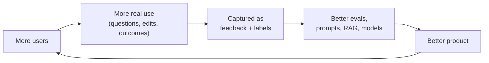
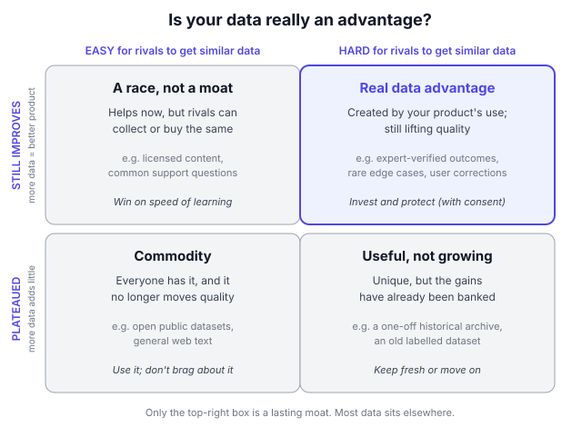

# B4.1 Data strategy and feedback loops

## In one line

A data strategy decides which data your AI product needs, how you'll get it fairly, and how real use feeds back to make the product better, without fooling yourself that "more data" is automatically a moat.

## Why this matters

In an AI product, data does three jobs. It **teaches** the system (training, fine-tuning, examples in prompts). It **informs** the system at run time (the documents RAG retrieves). And it **judges** the system (eval sets and production feedback). If any of these is weak, the model can be excellent and the product still fails.

Most AI PMs won't train a model from scratch. But every AI PM decides what feedback to collect, what users must consent to, what gets labelled, and whether the team's data is really an advantage. Those decisions shape quality for years, and some of them (like how you collect consent) are very hard to undo later.

## Key terms

| Term | Plain-English meaning |
|---|---|
| **Data flywheel** | A loop where use creates data, data improves the product, and a better product brings more use. |
| **Explicit feedback** | Feedback users give on purpose: thumbs up/down, ratings, "report a problem". |
| **Implicit feedback** | Feedback you infer from behaviour: copying an answer, editing it, retrying, abandoning. |
| **Ground truth** | The verified correct answer for a case, usually confirmed by an expert or a real-world outcome. |
| **Labelling (annotation)** | People marking data with the right answer or category so it can be used to train or test. |
| **Data moat** | A lasting advantage because you have data rivals can't easily get, and that keeps improving your product. |
| **Degenerate feedback loop** | When a model's own outputs shape the data it later learns from, so its mistakes or biases grow. |
| **Synthetic data** | Data generated by a model or program rather than collected from real people or events. |
| **Data provenance** | Where a piece of data came from, under what permission, and what has been done to it. |

## The idea, simply

!!! tip "Analogy: the chai stall that learns"
    A good chai stall owner notices things. Regulars who leave half a cup. The office crowd that wants less sugar at 4 pm. Students who always ask for an extra biscuit. Each day he adjusts a little: less sugar for the 4 pm batch, a stronger brew in winter. More customers come, and he learns even more.

    That's a **feedback loop**. But notice what makes it work. He watches the *right* signals (the half-full cups, not just how many people walked past). He knows *why* a cup came back (too sweet, or the customer got a phone call?). And he doesn't learn the wrong lesson from his own habits: if he only ever offers ginger chai, he'll "learn" that everyone loves ginger.

An AI product's data strategy is the same idea, made deliberate and written down.

### 1. The three jobs data does in an AI product

Before talking about "collecting more data", ask which job the data is for. The answer changes what "good data" means.

| Job | What it means | Example | What "good" looks like |
|---|---|---|---|
| **Teach** | Data used to train, fine-tune or give examples | 5,000 past support chats used to fine-tune tone ([B1.4](../01-building-blocks/04-prompting-vs-rag-vs-fine-tuning-how-to-decide.md)) | Correct, representative, legally usable |
| **Inform** | Knowledge the system looks up at answer time | Policy documents and product catalogue for RAG ([B1.2](../01-building-blocks/02-rag-giving-ai-your-knowledge.md)) | Current, complete, one source of truth |
| **Judge** | Data used to test quality | A 300-case eval set; weekly reviewed traces ([B3.1](../03-quality/01-evals-the-ai-pm-s-most-important-skill.md)) | Covers hard cases, has verified answers |

For most LLM products in 2026, the **judge** job matters most and gets the least attention. A team with no fine-tuning at all still needs an eval set with ground truth and a steady stream of real, reviewed cases.

### 2. Where data comes from

There are only a few ways to get data. Each has a different cost, speed and risk.

| Source | Example | Strength | Watch out for |
|---|---|---|---|
| **Your own product use** | Questions users ask, edits they make | Matches your real users exactly | Needs consent; you only see users you already have |
| **Your company's records** | Past tickets, claims, call recordings | Large and specific to your domain | Messy, may include personal data collected for another purpose |
| **Experts you pay** | Doctors or agronomists labelling cases | High quality ground truth | Slow and expensive; experts disagree |
| **Licensed or bought data** | Content licensing deals, datasets | Fast scale | Costly; rivals can buy the same thing |
| **Public and open data** | Government datasets, open corpora | Free or cheap | Everyone has it, so it's no advantage |
| **Synthetic data** | A model writes test questions | Cheap, fills gaps, safe for privacy | Can drift away from reality (see Going deeper) |

A useful rule: **the data rivals can't get is usually the data your product creates as people use it**, especially the corrections, outcomes and edge cases. Everything else can be bought, copied or scraped by someone else.

### 3. Feedback: explicit, implicit and expert

Production feedback is the fuel of any data flywheel. It comes in three kinds.

- **Explicit feedback** is easy to understand but rare and biased. Only a small share of users press thumbs up or down, and they tend to be the very happy or very annoyed.
- **Implicit feedback** is plentiful but needs interpreting. A user copying an answer suggests it was useful. A user immediately rephrasing the question suggests it wasn't. But a user who closes the app may simply have got their answer.
- **Expert feedback** is the most trustworthy and the most expensive. A trained reviewer reads a sample and marks what was right.

| Signal | Kind | What it probably means | Why you can't fully trust it |
|---|---|---|---|
| Thumbs down | Explicit | Answer was unhelpful | Few people press it; angry users over-represented |
| User edits the AI draft heavily | Implicit | Draft missed the mark | Some people edit everything out of habit |
| User retries within 30 seconds | Implicit | First answer failed | They may want a second option for fun |
| Agent escalates to a human | Implicit | AI couldn't resolve | Policy may force escalation for some topics |
| Expert marks answer "wrong" | Expert | It's wrong | Experts disagree; needs a clear rubric |
| Real-world outcome (claim approved, crop recovered) | Outcome | Ground truth | Arrives late, sometimes weeks later |

Good teams combine them. They use cheap implicit signals to **find** likely failures, then send a sample to experts to **confirm** them. This links straight to the production monitoring in [B3.2](../03-quality/02-ai-product-metrics-and-production-monitoring.md).

### 4. The data flywheel, and why most don't spin

The flywheel is the most repeated idea in AI strategy:

The loop only turns if every arrow is real work. Most stall at "captured as feedback + labels".

On a slide, it looks automatic. In practice each arrow takes effort:

- **Use → captured:** are you logging the right events, with consent, in a form you can analyse?
- **Captured → labelled:** does anyone review the data and turn it into ground truth?
- **Labelled → better:** is there a process (weekly or monthly) that turns findings into a changed prompt, a new eval case, a fixed document or a fine-tune?
- **Better → more users:** does the improvement show up in something users notice?

If you can't name the owner and the rhythm for each arrow, you don't have a flywheel. You have a pile of logs.

### 5. Data advantages are real, but smaller than the pitch decks say

In 2019, Martin Casado and Peter Lauten of a16z argued in [The Empty Promise of Data Moats](https://a16z.com/2019/05/09/data-network-effects-moats/) that most claimed "data network effects" are really just scale effects. Their key points, in plain words:

- **Diminishing returns.** The first data you collect improves the product a lot. Later data improves it less, while costing more to collect. One chatbot study they cite plateaued at around 40% coverage of user intents, however much more data was added.
- **Data goes stale.** Last year's data describes last year's users.
- **Rivals catch up.** Once a competitor collects "enough" data, your extra data stops mattering.

Their summary is blunt: "defensibility is not inherent to data itself". The advantage comes from what you do with it: how fast you learn, how good your labels are, and how tightly the loop connects to the product.

| Claim you'll hear | Better question to ask |
|---|---|
| "We have 10 crore rows of data" | Does the next 1 crore still improve quality? By how much? |
| "Our data is proprietary" | Could a rival get something close by licensing, scraping or synthesising it? |
| "Every user makes the product better" | Show me one change in the last quarter that came from user data. |
| "Our model learns from usage" | Who reviews what it learns, and how do we stop it learning mistakes? |

### 6. Data quality beats data quantity

In 2021, Andrew Ng popularised **data-centric AI**: instead of endlessly tuning the model, systematically improve the data ([IEEE Spectrum interview](https://spectrum.ieee.org/andrew-ng-data-centric-ai)). For many business problems, a few thousand clean, consistent examples beat a huge noisy pile.

The same year, a Google Research team led by Nithya Sambasivan published a CHI paper with a telling title: ["Everyone wants to do the model work, not the data work"](https://research.google/blog/data-cascades-in-machine-learning/). It described **data cascades**: data problems that start small (a vague definition, a careless collection process, poor documentation) and compound into failures much later, often after launch. The paper studied practitioners building high-stakes AI across several countries.

What "quality" means in practice:

- **Consistent labels.** Two experts labelling the same case should agree. If they don't, fix the guidelines before collecting more.
- **Coverage of hard cases.** Rare languages, unusual requests, edge cases. These are where products fail.
- **Freshness.** Prices, policies and user behaviour change.
- **Documentation.** Where it came from, what permission covers it, and what was removed.

### 7. Consent and purpose: data you can't use isn't an asset

Data collected without clear permission is a liability, not an asset. Two things matter.

- **Purpose.** Under privacy laws such as India's [Digital Personal Data Protection Act](https://static.pib.gov.in/WriteReadData/specificdocs/documents/2025/nov/doc20251117695301.pdf) and the GDPR in Europe, personal data is collected for stated purposes. "To answer your question" is not automatically the same purpose as "to train our next model".
- **Expectation.** Even where the law allows it, users and business customers react badly to surprises. Slack learned this in May 2024 (see Real-world examples).

Design consent into the product from day one: what you collect, why, how long you keep it, and how users opt out. Retrofitting it later means throwing data away. India's regime is covered in depth in [B4.3](03-ai-regulation-eu-ai-act-india-s-dpdp-act-and-ai.md).

## Framework: The Data Loop Plan

There's no single official framework for AI data strategy. This book combines three well-known sources into one plan you can fill in: Google PAIR's *People + AI Guidebook* ([chapters](https://pair.withgoogle.com/guidebook/chapters), especially "Data Collection + Evaluation"; first published 2019), Andrew Ng's data-centric approach (2021), and a16z's data moat tests (2019).

**Steps:**

1. **Name the decision.** What does the AI decide or produce, and what does a wrong answer cost the user?
2. **Map the three jobs.** For teach, inform and judge: what data do you need, and what do you have today?
3. **Choose sources.** For each gap: product use, company records, experts, licensing, public or synthetic. Note cost and risk.
4. **Design the signals.** Which explicit, implicit and outcome signals will you capture? Write how each could mislead you.
5. **Plan the labelling.** Who reviews, how many cases per week, which cases first (usually the uncertain or failed ones), and the written rubric.
6. **Close the loop.** The weekly or monthly rhythm that turns findings into eval cases, prompt changes, document fixes or retraining. Name the owner.
7. **Guard the loop.** Consent, privacy, bias checks, and a holdout that the model's own outputs never influence.
8. **Test the advantage.** Does more data still help? Could a rival get similar data? Be honest.

**When to use it:** at the start of any AI feature, and again whenever quality plateaus.

**When not to:** a quick internal prototype with no real users. There, use a small hand-made eval set and move on. Don't build a labelling operation for something you may throw away.

## Diagram

Ask two questions about any dataset: can a rival get something similar, and does more of it still help? Only "hard to get + still improving" is a moat.

## Worked example

You're the AI PM for a crop-health app used by farmers in Maharashtra. A farmer photographs a sick tomato or chilli leaf. The AI names the likely disease and suggests a treatment, in Marathi or Hindi. Your manager says: "Accuracy has been stuck for three months. Should we just collect more photos?"

**Step 1: Name the decision and the cost of a wrong answer.** The AI picks one of 12 diseases. A wrong answer means the farmer may buy the wrong spray, lose money and lose part of the crop. Wrong answers are expensive, so this is worth real data work.

**Step 2: Today's numbers.**

| | Value |
|---|---|
| Diagnoses per month | 60,000 |
| Accuracy on the eval set (top answer correct) | 78% |
| Wrong diagnoses per month | 13,200 |
| Farmers who answer "Was this right?" | 5% (3,000) |
| Farmers who call the helpline within 3 days | 12% (7,200) |
| Diagnoses where the model's confidence is low | 20% (12,000) |
| Expert-labelled photos so far | 20,000 |

**Step 3: Check the data value curve.** Your data scientist retrains on subsets of the labelled photos:

| Labelled photos used | Accuracy |
|---|---|
| 5,000 | 66% |
| 10,000 | 73% |
| 20,000 | 78% |
| 40,000 (estimated from the curve) | about 80% |

Doubling the pile of *random* photos would add only about 2 points. That's the diminishing returns a16z warned about. "Collect more photos" is the wrong answer.

**Step 4: Find where the errors are.** You read 200 wrong diagnoses with an agronomist (error analysis, as in [B3.1](../03-quality/01-evals-the-ai-pm-s-most-important-skill.md)):

| Error cause | Share of errors |
|---|---|
| Blurry or dark photos | 30% |
| Two diseases that look alike (early vs late blight) | 25% |
| Local varieties under-represented in training | 20% |
| Nutrient deficiency mistaken for disease | 15% |
| Other | 10% |

**Step 5: Fix data, not just volume.**

- **Blurry photos (30%):** not a model problem. Add a camera guide ("hold steady, fill the frame with the leaf") and a quality check that asks for a retake. No labelling needed.
- **Look-alike diseases (25%) and local varieties (20%):** target labelling. Send the agronomists the photos where the model was *unsure*, the ones farmers marked wrong, and the ones followed by a helpline call. Add a "deficiency" class for the 15%.
- **Keep 10% random.** Some of the labelled photos must be chosen randomly, so your accuracy estimate isn't skewed towards hard cases.

**Step 6: Capture outcome truth, protected from your own model.** If the app recommends a spray and farmers then buy that spray, purchase data will always "agree" with the model. That's a degenerate feedback loop. So each month, partner extension workers visit 200 farms (a random sample) and confirm the disease on the plant. Those visits are your ground truth, and the model never influences which farms are chosen.

**Step 7: Consent and privacy.** Photos carry GPS location and are linked to a phone number. The consent screen, in the farmer's language, says photos are used to improve diagnoses, how long they're kept, and how to opt out. The pipeline strips location down to district level and blurs any faces before labelling.

**Step 8: Cost.**

| Item | Monthly cost |
|---|---|
| 3,000 targeted expert labels at ₹12 each | ₹36,000 |
| 200 field verification visits at ₹150 each | ₹30,000 |
| Labelling tool and storage | ₹14,000 |
| **Total** | **₹80,000** |

**Step 9: What is it worth?** After two months of targeted labelling plus the camera guide, the eval set shows accuracy at 84%.

| | Before | After |
|---|---|---|
| Accuracy | 78% | 84% |
| Wrong diagnoses per month | 13,200 | 9,600 |
| Fewer wrong diagnoses | | 3,600 |

- **Helpline savings:** if about 40% of wrong diagnoses lead to a helpline call costing ₹45, that's 1,440 fewer calls, or about **₹65,000 a month**.
- **Retention:** suppose your data shows 55% of farmers return within 30 days after a correct diagnosis, versus 35% after a wrong one. 3,600 fewer wrong answers means about 720 more returning farmers each month. At ₹60 of monthly commission per active farmer, that's about **₹43,000 a month**, and it builds up month on month.
- **Farmers' money:** if 30% of wrong diagnoses lead to a wasted ₹350 spray, farmers save about **₹3.8 lakh a month** between them. This doesn't appear in your P&L, but it's why farmers trust and recommend the app.

The direct return (about ₹1.08 lakh a month against ₹80,000 of cost) is modest. The real case is trust and word of mouth. And notice that the biggest single fix (the camera guide) cost almost nothing.

**Step 10: Moat test.** Could a rival collect leaf photos? Yes, easily. Could a rival get *field-verified* labels on local varieties and look-alike diseases in Maharashtra? Only by building the same extension-worker network. That's your top-right box in the diagram. Protect and grow that, not the raw photo count.

## Going deeper: nuances and trade-offs

### 1. Most "data moats" are really speed-of-learning moats

The a16z argument is now widely accepted for general-purpose AI: base models are trained on huge public and licensed datasets, so little of that data is unique. What lasts is narrower:

- **Workflow data:** the corrections, approvals and outcomes that only exist because users do their work inside your product.
- **Expert ground truth:** labels that cost real expertise to create.
- **Learning speed:** how quickly you turn a failure seen on Monday into a fix shipped by Friday.

Even these can erode. If a rival offers the same workflow, they start collecting the same signals. Treat data as one source of advantage among several, alongside distribution, brand and product quality ([B5.2](../05-strategy-and-business/02-ai-native-strategy-and-moats.md)).

### 2. Feedback loops can make the model worse

In their 2015 NeurIPS paper [Hidden Technical Debt in Machine Learning Systems](https://research.google/pubs/hidden-technical-debt-in-machine-learning-systems/), D. Sculley and colleagues at Google warned about **feedback loops**: when a live system influences the very data it will later learn from.

| System | What goes wrong | Guard |
|---|---|---|
| Recommendations | Popular items get shown more, so they get clicked more, so they're shown even more. New items never get a chance. | Reserve some slots for exploration; measure with a random holdout |
| Fraud model | Blocked transactions never complete, so you never learn which blocks were wrong | Let a tiny, safe sample through for review |
| AI support bot | Users who give up don't leave feedback, so the bot "looks" good | Track abandonment and sample silent sessions |
| Crop diagnosis (above) | Purchases follow recommendations, so they "confirm" the model | Independent field checks |

The pattern: **always keep some data the model didn't shape.**

### 3. Feedback is biased by who gives it

Explicit feedback comes mostly from a few kinds of users: power users, the very pleased and the very upset. If you train or tune on thumbs data alone, you optimise for those people. Three habits help:

- Look at feedback **rates by segment** (language, city tier, new vs returning). A segment that never gives feedback isn't necessarily happy.
- Weigh **implicit signals** alongside explicit ones.
- Be careful with **"what users like" as a training target.** Optimising for approval can teach a model to flatter. OpenAI's April 2025 sycophancy rollback, discussed in [B3.2](../03-quality/02-ai-product-metrics-and-production-monitoring.md), is the well-known case.

### 4. Training on customer data: B2B rules are stricter

Business customers often forbid vendors from training on their data. Their contracts say so, and their security teams check. Typical approaches:

| Approach | What it means | When it fits |
|---|---|---|
| No training on customer data | Data used only to serve that customer | Default for most enterprise AI |
| Per-customer improvement | Data improves that customer's own setup (their RAG index, their examples) | Most B2B AI products |
| Opt-in pooled training | Customers choose to contribute, often for a benefit | Mature products with trust |
| De-identified aggregate learning | Patterns learned across customers without raw content | Needs strong privacy engineering and clear disclosure |

Whatever you choose, say it plainly in the product, not just in the terms. The Slack case below shows the cost of burying it.

### 5. Buying and licensing data: fast, but rarely unique

Content licensing became a market of its own after 2023. In February 2024, Reddit and Google announced a deal [reported at about $60 million](https://fortune.com/2024/02/23/reddit-60m-deal-google-search-giant-train-ai-models-on-posts/) that lets Google use Reddit posts to train AI models. It was announced the day before Reddit revealed its IPO plans.

For a PM, the lesson is twofold. Licensed data can fill a gap quickly. But anything you can license, a rival can often license too, so it's rarely a moat.

Ethical sourcing matters as well, especially for Indian-language data. [Karya](https://time.com/6297403/india-ai-karya-startup), a Bengaluru non-profit, pays rural workers to create speech and text data in Indian languages. TIME reported it pays a $5 hourly minimum, about 20 times India's minimum wage, and shares resale revenue with workers. Ask any data vendor how contributors were paid and what they consented to.

### 6. Synthetic data: useful, with limits

Models can now generate test questions, rare scenarios and training examples cheaply. This is very useful for **evals** (covering cases you haven't seen yet) and for **privacy** (no real customer data). The risk is **model collapse**: models trained mostly on model-generated data can drift away from reality over generations.

Recent theory is encouraging but early. In May 2026, a King's College London team [reported in *Physical Review Letters*](https://www.kcl.ac.uk/news/scientists-come-up-with-way-to-overcome-ai-data-cannibalism) that, in simplified statistical models, adding even a single real data point from outside the loop prevents collapse. That was shown in toy models, not large language models.

Practical rule: use synthetic data to **fill gaps and stress-test**. Keep verified real data as the anchor for every eval and every training mix.

### 7. Labelling is a product with its own quality problems

Labels are made by people, and people disagree. Treat labelling like a product:

- **Write a rubric** with examples of each label and the tricky borderline cases.
- **Measure agreement.** Give the same cases to two labellers. If they agree less than about 80% of the time, fix the rubric first.
- **Pay for expertise where errors are costly.** Medical, legal and financial labels need qualified people.
- **Use AI to help, not to replace.** An AI judge can pre-label, and humans can check a sample. Test the judge against human labels, as in [B3.1](../03-quality/01-evals-the-ai-pm-s-most-important-skill.md).

### 8. How data strategy changes by stage, business and market

- **Pre-launch (cold start):** you have no usage data. Use company records, a small expert-labelled set and synthetic test cases. Launch to a small group to start the loop.
- **Growth:** the bottleneck becomes review capacity. Prioritise uncertain and failed cases for labelling.
- **Scale:** focus on freshness, drift and segment coverage. Old data quietly stops describing today's users.
- **B2C vs B2B:** B2C has volume but weaker consent expectations to meet carefully. B2B has less volume, stricter contracts and per-customer data.
- **Regulated sectors** (finance, health, insurance): sector rules add to privacy law. In India, for example, the RBI's FREE-AI framework (see [B2.3](../02-discovery-and-design/03-designing-for-trust-failure-and-human-in-the-loo.md)) expects strong data governance.
- **India specifically:** Indian-language data is still scarce compared with English. Public datasets (like AIKosh, below) help, but local dialects, code-mixed speech (Hinglish, Tanglish) and low-literacy voice inputs usually need your own collection. India's DPDP Rules, notified in November 2025, phase in obligations over 12–18 months ([government notification](https://static.pib.gov.in/WriteReadData/specificdocs/documents/2025/nov/doc20251117695301.pdf)); see [B4.3](03-ai-regulation-eu-ai-act-india-s-dpdp-act-and-ai.md).

## Real-world examples (2023 onwards)

!!! example "Slack, May 2024: training on customer data without saying so clearly"
    In May 2024, users noticed that Slack's privacy principles let it use customer data to train "global models", such as those behind channel and emoji recommendations and search. Customers were included by default, and to opt out an organisation had to email Slack ([TechCrunch](https://techcrunch.com/2024/05/17/slack-under-attack-over-sneaky-ai-training-policy/)). Slack said it did not train the large language models behind its generative Slack AI product on customer data, and it then [updated its AI privacy principles](https://www.computerworld.com/article/2114741/slack-updates-ai-privacy-principles-after-user-backlash.html) to explain this more clearly.

    **PM lesson:** the backlash wasn't only about what Slack did. It was about surprise. Default opt-in, an email-only opt-out and vague wording turned an ordinary recommendation model into a trust problem. For B2B AI, say in plain words, inside the product, what data trains what, and make opting out a setting, not an email.

!!! example "India's AIKosh, 2025: public data as shared infrastructure"
    Under the IndiaAI Mission, the government launched **AIKosh**, a national platform for AI datasets and models, in March 2025 with [316 datasets](https://swarajyamag.com/amp/story/news-brief/india-unveils-ai-kosha-with-316-datasets-to-assist-indigenous-artificial-intelligence-model-development). By September 2025 it had [passed 1,000 datasets](https://yourstory.com/2025/09/ai-kosh-1000-datasets-open-data-india), covering areas such as healthcare, agriculture, governance and Indian languages. MeitY Secretary S. Krishnan described data as the "third pillar" of the mission, alongside computing power and Indian foundation models, and said the aim was to stop cost and scattered sources locking startups out.

    **PM lesson:** public datasets lower the cost of starting, especially for Indian-language and public-sector AI. But because every team can use them, they sit in the "commodity" or "race" boxes of the diagram. Use them for a head start and for evals. Build your advantage from the field data your own product creates.

## Common mistakes

!!! warning "Watch out for"
    - **"Collect more data" as the default fix.** Check the data value curve first; quality and targeting usually beat volume.
    - **Logging everything, reviewing nothing.** Data no one labels or reads improves nothing.
    - **Trusting thumbs-up rates as quality.** A tiny, biased group presses them.
    - **Letting the model grade itself.** Purchases, clicks or approvals that follow the model's own suggestion "confirm" it. Keep an independent holdout.
    - **Consent as an afterthought.** Data you can't legally or ethically use is a liability.
    - **Claiming a data moat without testing it.** Ask whether rivals could get similar data and whether more still helps.
    - **Mixing synthetic data into evals without labelling it.** You'll lose track of what reflects real users.
    - **No owner for the loop.** If nobody runs the weekly review, the flywheel doesn't turn.

## Common questions

**We use an API model and don't train anything. Do we still need a data strategy?**
Yes. Your data still informs (RAG documents) and judges (evals, production traces). Most quality gains for API-based products come from better evals, cleaner documents and better prompts, all of which are data work.

**How much data do we need before launch?**
Enough to judge quality, not to train a big model. A few hundred well-chosen, verified test cases are a strong start ([B3.1](../03-quality/01-evals-the-ai-pm-s-most-important-skill.md)). Usage data follows after launch.

**Should we ask users for thumbs up/down at all?**
Yes, but as one signal among several. It's cheap and catches obvious failures. Never treat it as your quality score on its own.

**Is synthetic data safe to use?**
For testing and filling gaps, generally yes, and it helps privacy. For training, keep real data in the mix and check results against real-world evals.

**Can we use support chats from before we had an AI to train the AI?**
Check two things first: what users were told when that data was collected, and whether it contains personal data. You may need to de-identify it, ask for fresh consent, or use it only for evaluation. Ask your privacy or legal team.

**Who owns the data strategy: PM, data science or engineering?**
The PM owns *what* to collect, *why*, and the consent experience. Data science owns labelling quality and how data is used in models. Engineering owns the pipeline. One named person should run the review rhythm.

## In the interview

!!! question "In the interview"
    **How it's tested:** AI PM interviews often ask how you'd improve an AI feature over time, or probe whether you understand that data is not automatically a moat.

    **Sample question:** *"You're the PM for an AI writing assistant inside an email product. How would you set up a feedback loop to improve it?"*

    **Outline of a strong answer:**

    1. **Define success:** a draft the user sends with few edits, and that gets a reply.
    2. **List signals:** explicit (thumbs, "regenerate"), implicit (edit distance between draft and sent email, sent vs discarded), outcome (reply received).
    3. **Name the biases:** heavy users dominate; "sent without edits" may mean the user didn't read it carefully.
    4. **Close the loop:** a weekly review of a sample of discarded and heavily edited drafts; failures become eval cases; prompt or model changes ship behind an A/B test.
    5. **Guard it:** clear consent about whether email content trains models; enterprise customers excluded by default; a holdout to measure true effect.
    6. **Moat honesty:** the data advantage comes from learning faster on real edits, not from having "more email".

    **A second common form:** *"Our competitor has ten times more data than us. Are we doomed?"* A strong answer explains diminishing returns, asks whether that data is still improving their product, and points to where a smaller player can win: better labels on a focused segment, faster learning and stronger trust.

## Research happening now

!!! info "Research happening now"
    - **Real data as an anchor against model collapse (King's College London, May 2026).** Researchers led by Yasser Roudi [showed in *Physical Review Letters*](https://www.kcl.ac.uk/news/scientists-come-up-with-way-to-overcome-ai-data-cannibalism) that in simplified statistical models, a single data point from outside the self-training loop stops collapse. *Status: peer-reviewed, but in toy models; testing on large neural networks is still to come.*
    - **Verifying synthetic data before training on it (October 2025).** A preprint, [Escaping Model Collapse via Synthetic Data Verification](https://arxiv.org/abs/2510.16657), studies how filtering synthetic data with a verifier changes the long-run picture. *Status: preprint, not peer-reviewed.*
    - **India's DPDP Rules in transition (2025–2027).** The [Digital Personal Data Protection Rules](https://static.pib.gov.in/WriteReadData/specificdocs/documents/2025/nov/doc20251117695301.pdf), notified in November 2025, phase in consent, notice and consent-manager obligations over 12–18 months. *Status: in transition; detailed practice is still forming.* Covered in [B4.3](03-ai-regulation-eu-ai-act-india-s-dpdp-act-and-ai.md).

## Try it yourself (25 minutes)

Pick an AI feature you use often (a voice assistant, an AI search answer, autocomplete in a messaging app). Write:

1. The three jobs data does for it (teach, inform, judge), with one example each.
2. Two explicit and two implicit feedback signals it could collect, and how each could mislead.
3. One feedback loop that could make it worse, and a guard against it.
4. Where its data sits in the 2×2 diagram, and why.

??? success "Check your answer"
    For an AI answer box in a shopping app, a good answer might be:

    - **Teach:** past search queries paired with products bought. **Inform:** the live product catalogue and reviews. **Judge:** a set of 300 real queries with expert-checked "best answers".
    - **Explicit:** thumbs up/down (few users press it), "report wrong info" (mostly very annoyed users). **Implicit:** clicked a suggested product (could be curiosity, not satisfaction); went back and searched again (could mean a failed answer, or just browsing).
    - **Bad loop:** products the AI recommends get more clicks and sales, so the AI recommends them even more, and new sellers never appear. **Guard:** reserve some recommendations for exploration, and measure against a random holdout.
    - **2×2:** catalogue data is "commodity" (sellers list on rival apps too). Expert-verified answer quality on Indian-language queries could be "real advantage" if it keeps improving results.

    Check that each signal comes with a reason it might mislead, and that your guard creates data the model didn't shape.

## How this connects

- [B3.1 Evals](../03-quality/01-evals-the-ai-pm-s-most-important-skill.md): eval sets are the "judge" data; error analysis tells you which data to collect.
- [B3.2 AI product metrics and production monitoring](../03-quality/02-ai-product-metrics-and-production-monitoring.md): production signals and traces are the raw material of the feedback loop.
- [B1.4 Prompting vs RAG vs fine-tuning](../01-building-blocks/04-prompting-vs-rag-vs-fine-tuning-how-to-decide.md): decides whether your data should teach (fine-tune) or inform (RAG).
- [B4.3 AI regulation: EU AI Act, India's DPDP Act](03-ai-regulation-eu-ai-act-india-s-dpdp-act-and-ai.md): the legal rules on consent and purpose.
- [B5.2 AI-native strategy and moats](../05-strategy-and-business/02-ai-native-strategy-and-moats.md): where data fits among other sources of advantage.

## Go deeper

- **Article:** [a16z: The Empty Promise of Data Moats](https://a16z.com/2019/05/09/data-network-effects-moats/) by Martin Casado and Peter Lauten (2019). The clearest argument for why data advantages fade.
- **Guide:** [Google PAIR People + AI Guidebook](https://pair.withgoogle.com/guidebook/chapters). Free; the "Data Collection + Evaluation" and "Feedback + Control" chapters are practical and PM-friendly.
- **Paper:** [Hidden Technical Debt in Machine Learning Systems](https://research.google/pubs/hidden-technical-debt-in-machine-learning-systems/) (Sculley et al., NeurIPS 2015). The classic on feedback loops and data dependencies.
- **Article:** [Google Research: Data Cascades in Machine Learning](https://research.google/blog/data-cascades-in-machine-learning/) (2021). How small data problems become big failures.
- **Interview:** [Andrew Ng on data-centric AI (IEEE Spectrum)](https://spectrum.ieee.org/andrew-ng-data-centric-ai). Why better data often beats a bigger model.
- **Book:** [*Designing Machine Learning Systems*](https://www.oreilly.com/library/view/designing-machine-learning/9781098107956/) by Chip Huyen (O'Reilly). Strong chapters on training data, labelling and feedback loops; technical but readable.

## Key takeaways

- Data does three jobs: **teach, inform and judge.** For most LLM products, "judge" (evals and reviewed production data) matters most.
- Combine **explicit, implicit and expert** feedback. Cheap signals find failures; experts confirm them.
- A data flywheel only turns if **every arrow has an owner and a rhythm.**
- **More data has diminishing returns.** Check the value curve; target hard and failed cases instead.
- Feedback loops can **reinforce mistakes.** Always keep a holdout the model didn't shape.
- **Consent and clarity** make data an asset; surprises make it a liability.
- Real data advantages come from **workflow data, expert ground truth and learning speed**, not raw volume.

## Updates

*No updates yet.*
