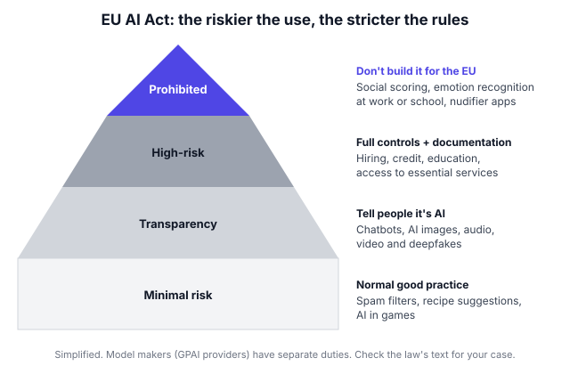
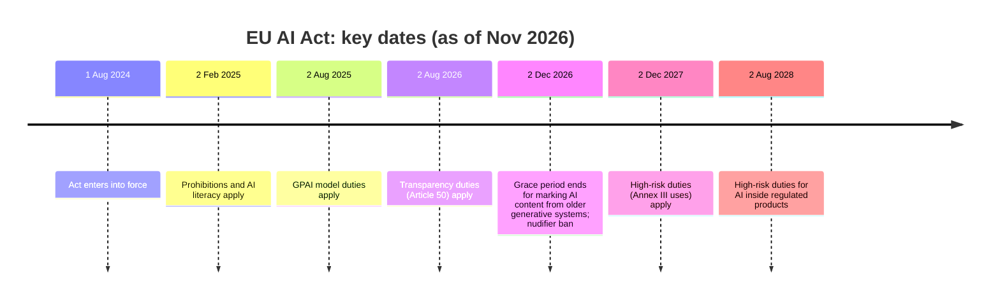
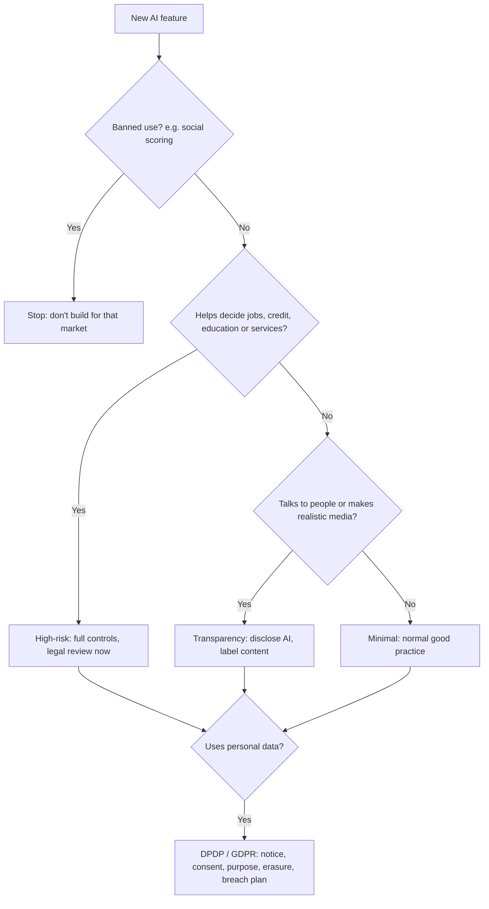

# B4.3 AI regulation: EU AI Act, India's DPDP Act and AI governance

!!! note "Not legal advice"
    This chapter teaches you how AI rules shape product decisions. It is not legal advice. Laws and dates here were checked on 25 November 2026, and they keep moving. Before you launch, confirm the details with your legal or privacy team.

## In one line

AI regulation is a set of product requirements written by governments: learn which rules apply to your feature, what role you play, and build the controls in from the first spec instead of bolting them on before launch.

## Why this matters

Regulation decides what you can build, in which markets, and how. A feature that ranks job applicants is "high-risk" in the EU and needs months of extra work. A consent screen that is fine in a demo may break India's data protection law.

PMs don't need to be lawyers. But you do need to spot when a feature touches the law, ask the right questions early, and turn legal duties into backlog items, UX and metrics. Teams that do this ship on time. Teams that don't find out in the last week before launch.

## Key terms

| Term | Plain-English meaning |
|---|---|
| **EU AI Act** | The European Union's law for AI systems. It sorts AI uses by risk and sets duties for each level. |
| **Risk-based approach** | Rules get stricter as the possible harm gets bigger. A spam filter gets almost none; a hiring tool gets many. |
| **High-risk AI system** | Under the EU AI Act, an AI use that can seriously affect people's safety or rights (hiring, credit, education and more). |
| **Provider vs deployer** | The **provider** builds an AI system and puts it on the market. The **deployer** uses it in their own work. Each has different duties. |
| **GPAI model** | General-purpose AI model: a model that can do many tasks, like the large language models behind chatbots. |
| **DPDP Act** | India's Digital Personal Data Protection Act, 2023. It sets rules for collecting and using people's digital personal data. |
| **Data fiduciary / data principal** | Under the DPDP Act, the **data fiduciary** decides why and how personal data is used (your company). The **data principal** is the person the data is about (your user). |
| **Consent manager** | A registered company in India that lets people give, manage and withdraw consent across many apps from one place. |
| **Synthetically generated information (SGI)** | India's legal term for AI-made or AI-altered audio, images or video that look real. |
| **AI governance** | The internal habits, roles and checks a company uses to make sure its AI is safe, fair and legal. |

## The idea, simply

!!! tip "Analogy: driving a truck across state borders"
    Imagine you run a trucking business that delivers from Pune to Bengaluru, and sometimes to Dubai. Some rules are the same everywhere: brakes must work, the driver needs a licence. Some depend on what you carry: chemicals need special permits, food needs cold storage. And some depend on where you are: each state has its own entry rules and taxes.

    A good fleet manager doesn't read every law before every trip. She knows **what she's carrying**, **where she's going**, and **who is responsible** for each part (the truck owner, the driver, the client). Then she builds the right checks into the trip plan.

    AI regulation works the same way. **What** your AI does sets the risk level. **Where** your users are sets which laws apply. **Your role** (builder or user of the AI) sets your duties.

### 1. Three layers of rules hit every AI product

Most people think of "AI regulation" as one law. In practice, three layers apply at once, plus a fourth that is voluntary.

| Layer | What it covers | Examples |
|---|---|---|
| **AI-specific law** | The AI system itself: its risk level, transparency, oversight | [EU AI Act](https://ai-act-service-desk.ec.europa.eu/en/ai-act/annex-3) |
| **Data protection law** | Personal data going in and out of the AI | India's DPDP Act 2023, the EU's GDPR |
| **Sector and platform rules** | Rules for a specific industry or type of platform | India's IT Rules on synthetic content; RBI's FREE-AI framework for banks and fintechs ([B2.3](../02-discovery-and-design/03-designing-for-trust-failure-and-human-in-the-loo.md)) |
| **Voluntary frameworks** | How to run AI risk management well | [NIST AI Risk Management Framework](https://airc.nist.gov/airmf-resources/airmf/5-sec-core/), ISO/IEC 42001 |

**Why this matters for a PM:** an AI feature in India might have no AI-specific law to follow, yet still be bound by data protection, IT Rules and a sector regulator. "India has no AI law" is not the same as "there are no rules".

### 2. The EU AI Act: four risk levels

The EU AI Act came into force on 1 August 2024. Its core idea is simple: **the riskier the use, the stricter the rules**. Note the word *use*. The same model can be minimal-risk in a recipe app and high-risk in a hiring tool.

Notice that most AI features sit in the bottom two layers. Your job is to spot quickly when a feature moves up a level.

| Level | What it means | Examples | Duties |
|---|---|---|---|
| **Prohibited** | Banned outright | Social scoring, emotion recognition at work or school, AI that exploits people's vulnerabilities, untargeted scraping of faces ([Bundesnetzagentur summary](https://bundesnetzagentur.de/EN/Areas/Digitalisation/AI/08_ProhibitedPractices/start.html)) | Don't build it for the EU |
| **High-risk** | Can seriously affect safety or rights | Hiring and managing workers, education and exam scoring, creditworthiness, access to essential services ([Annex III](https://ai-act-service-desk.ec.europa.eu/en/ai-act/annex-3)) | Risk management, data quality, documentation, logging, human oversight, accuracy, registration |
| **Transparency** | People must know AI is involved | Chatbots, AI-generated images, audio and video, deepfakes | Tell users they're talking to AI; mark synthetic content |
| **Minimal** | Little risk | Spam filters, recommendations for recipes, AI in games | None beyond existing law; voluntary codes |

Separately, the Act sets duties for **GPAI model providers** (companies like the labs that train large models). These cover documentation, copyright policy and, for the most powerful models, safety and security. They applied from 2 August 2025. The European Commission published a voluntary [General-Purpose AI Code of Practice](https://digital-strategy.ec.europa.eu/en/news/general-purpose-ai-code-practice-now-available) on 10 July 2025 to help providers show they comply.

**How to recognise a level change.** Ask: "Does this AI's output help decide something important about a person, such as a job, a loan, a grade or access to a service?" If yes, you are probably in high-risk territory and need legal input now, not later.

### 3. The EU AI Act timeline, and why dates move

The Act switches on in stages. In 2026 the EU also passed a "Digital Omnibus" law that delayed some parts. According to the [AI Act Explorer](https://artificialintelligenceact.eu/ai-act-explorer/digital-omnibus/) and a [Usercentrics summary](https://usercentrics.com/knowledge-hub/eu-ai-act-high-risk-delay-article-50-transparency-consent/), it was formally adopted and came into force on 27 July 2026.

The high-risk dates moved by more than a year in 2026. Plan for the duties, and treat the dates as something to re-check every quarter.

What the Omnibus changed, in plain words:

- **High-risk duties delayed.** Annex III uses (hiring, credit, education…) moved from August 2026 to **2 December 2027**. AI built into regulated products (like machinery or medical devices) moved to **2 August 2028**.
- **Transparency not delayed.** Article 50 duties have applied since 2 August 2026. Generative AI systems already on the market before then had until **2 December 2026** to start marking their output as AI-generated.
- **New bans added.** AI that generates non-consensual intimate images or child sexual abuse material is now prohibited, which covers "nudifier" apps.
- **Lighter load for smaller firms.** SMEs can submit simpler technical documentation, and the AI literacy duty was softened to "take measures to support" staff literacy rather than guarantee a level.

**PM lesson:** a delay is not a cancellation. If your hiring or lending AI will sell in the EU, the requirements are known today. Use the extra time to build them properly.

### 4. India's DPDP Act: the rules for personal data

India's [Digital Personal Data Protection Act, 2023](https://www.india-briefing.com/news/dpdp-rules-2025-india-data-protection-law-compliance-40769.html) is not an AI law, but almost every AI product touches personal data: chat logs, voice notes, photos, documents, behaviour. So it shapes AI products more than any other Indian law.

The DPDP Rules were issued on 14 November 2025, with a staggered rollout ([India Briefing](https://www.india-briefing.com/news/dpdp-rules-2025-india-data-protection-law-compliance-40769.html); [YourStory](https://yourstory.com/2025/11/digital-personal-data-protection-dpdp-rules-2025-rollout-over-18-months)):

| When | What switches on |
|---|---|
| Immediately (Nov 2025) | The Data Protection Board is set up; definitions and enforcement powers |
| After 12 months (around Nov 2026) | Registration and rules for consent managers |
| After 18 months (around May 2027) | The core duties: notices, consent, purpose limits, children's data, security, breach reporting, retention and erasure |

The duties that matter most for AI products:

| Duty | What it means for your AI feature |
|---|---|
| **Notice and consent** | Tell users in clear language what data you collect and why, before you collect it. Consent must be specific to a purpose. "We may use your data to improve our services" covering everything is risky. |
| **Purpose limitation** | Data collected to deliver a service can't quietly be reused for something else, like training a model, without a valid basis. |
| **Children** | For users under 18, you need verifiable consent from a parent, checked using identity details or DigiLocker-style credentials, with limited exemptions (e.g. healthcare, education). |
| **Breach reporting** | Tell affected users promptly, and send the Data Protection Board a detailed report within 72 hours. |
| **Erasure** | Delete data once its purpose is served, and give users 48 hours' notice before erasure in specified cases. |
| **Significant data fiduciaries** | Large or sensitive data handlers must run a yearly data protection impact assessment (DPIA) and audit, and check that their algorithms don't put users' rights at risk. |
| **Penalties** | Up to ₹250 crore per breach. |

**Why it works:** the law turns privacy from a promise into specific design choices. Each duty becomes a screen, a setting, a pipeline rule or an alert.

### 5. India's wider approach: guidelines plus targeted rules

India has no single, dedicated AI law as of November 2026. Instead, it combines national guidelines with targeted rules made under existing laws such as the IT Act.

**The India AI Governance Guidelines** were released by MeitY on 5 November 2025 ([The Tribune](https://www.tribuneindia.com/news/business/meity-unveils-india-ai-governance-guidelines-to-ensure-safe-inclusive-and-responsible-ai-adoption)). They set out seven principles ("sutras"):

1. Trust
2. People first
3. Innovation over restraint
4. Fairness and equity
5. Accountability
6. Understandable by design
7. Safety, resilience and sustainability

They also propose new bodies: an AI Governance Group, a Technology and Policy Expert Committee, and the AI Safety Institute. The guidelines favour a "flexible and adaptive" regulatory approach with sandboxes. In practice, that means fewer upfront approvals and more pressure to act fast when something goes wrong.

**The IT Amendment Rules 2026** are the clearest example of a targeted rule. In force from 20 February 2026, they require platforms to label AI-generated audio, images and video that look real. They also shorten takedown deadlines sharply, from 36 hours to 3 hours after a court or government order ([Khaitan & Co](https://www.khaitanco.com/thought-leadership/MeitY-notifies-the-IT-Amendment-Rules-2026)). [B4.2](02-responsible-ai-safety-and-guardrails.md) covers these labelling duties as a case study.

**Sector regulators add their own rules.** Banks and fintechs follow RBI's FREE-AI framework ([B2.3](../02-discovery-and-design/03-designing-for-trust-failure-and-human-in-the-loo.md)). If you build for a regulated industry, ask early which regulator's guidance applies.

### 6. Your role decides your duties

The same AI system creates different duties for different companies. Before you read any rule, work out your role.

| Your situation | EU AI Act role | DPDP role | Typical duties |
|---|---|---|---|
| You train or build an AI system and sell it under your name | Provider | Data fiduciary (for your own users' data) | The heaviest set: design, documentation, testing, monitoring |
| You buy an AI tool and use it in your business | Deployer | Data fiduciary | Use as instructed, human oversight, tell affected people, keep logs |
| You process data only on a client's instructions | Often deployer or supplier | Data processor | Follow the contract; security; help the client meet its duties |
| You call a model API to build your feature | Provider of *your* system; the lab is the GPAI provider | Data fiduciary | Your feature's duties are yours, even if the model isn't |

**The common trap:** "We just use the OpenAI or Gemini API, so the lab handles compliance." It doesn't. The lab handles the model's duties. You handle your product's duties: how it's used, what data you send, what users see and who reviews decisions.

### 7. Governance: turning rules into habits

Laws tell you *what* must be true. **AI governance** is *how* your company keeps it true as features change every week. The most widely used voluntary framework is the [NIST AI Risk Management Framework](https://airc.nist.gov/airmf-resources/airmf/5-sec-core/) (2023), which has four functions:

| Function | Plain meaning | PM example |
|---|---|---|
| **Govern** | Set up roles, policies and accountability | A named risk owner for each AI feature |
| **Map** | Understand the context and the risks | A one-page risk note in every AI PRD |
| **Measure** | Test and track the risks | Bias and harm evals before launch ([B3.1](../03-quality/01-evals-the-ai-pm-s-most-important-skill.md)) |
| **Manage** | Act on the risks, regularly | Kill switches, incident reviews, re-tests after model changes |

NIST has published a [crosswalk to ISO/IEC 42001](https://airc.nist.gov/docs/NIST_AI_RMF_to_ISO_IEC_42001_Crosswalk.pdf), the international standard for an AI management system. Enterprise buyers increasingly ask about both in procurement questionnaires.

**Why governance works:** regulators rarely check your code. They check whether you had a process, followed it, and kept evidence. A light, repeatable process is your best defence and your fastest path through enterprise sales.

## Framework: the Regulation-Ready AI Feature checklist

This is this book's synthesis, not an official method. It combines the EU AI Act's risk levels (EU, 2024), the duties in India's DPDP Act (2023) and Rules (2025), and the four functions of the [NIST AI RMF](https://airc.nist.gov/airmf-resources/airmf/5-sec-core/) (2023). Run it once per AI feature, ideally while you write the PRD.

| Step | Question to answer | Output |
|---|---|---|
| **1. Describe the intended use** | What does the AI do, for whom, and what decision does its output feed? | One paragraph in the PRD |
| **2. Map markets and users** | Where are the users? Any children? Any regulated sector? | List of laws in scope |
| **3. Name your role** | Are we provider, deployer, data fiduciary or processor, for each law? | Role table (like the one in section 6) |
| **4. Classify the risk** | Prohibited, high-risk, transparency or minimal (EU)? Significant data fiduciary (India)? | Risk level with written reasoning |
| **5. Map the data** | What personal data goes in, comes out, gets stored, gets used for training? On what basis? | Data map and consent plan |
| **6. Design the controls** | Which duties become UX, features or pipeline rules? | Backlog items: notices, labels, human review, logging, erasure |
| **7. Test and document** | Can we show it works and is fair? | Evals, bias tests, system card, decision log |
| **8. Monitor and respond** | Who watches it, and how fast can we act? | Owner, metrics, incident runbook, review date |

**When to use it:** for any new AI feature, any expansion into a new country, and any change in what an existing AI decides about people.

**When not to over-use it:** for a minimal-risk internal tool with no personal data, steps 1–4 on half a page are enough. Matching the effort to the risk is the whole point. A 40-page review for a spell-checker teaches teams to ignore the process.

## Diagram

Two questions run in parallel: how risky is the use (AI Act) and is personal data involved (data protection law). Most features need answers to both.

## Worked example

You're the PM at a Bengaluru HR-tech startup. Your product reads job applications and ranks candidates for recruiters. You have 120 customers in India. Sales wants to start selling to mid-sized companies in Germany and the Netherlands. *All figures below are illustrative.*

**Step 1: Intended use.** The AI reads CVs, scores each candidate against the job criteria and produces a ranked shortlist. Recruiters mostly interview the top 20.

**Step 2: Markets and users.** India (current), EU (planned). Users are recruiters; the people affected are candidates. No children. Not a regulated financial sector.

**Step 3: Roles.**

| Law | Your role | Your customer's role |
|---|---|---|
| EU AI Act | Provider (you build and sell the system) | Deployer (they use it to hire) |
| DPDP Act (India) | Data processor for the employer's candidate data | Data fiduciary |
| DPDP Act, if you train your shared model on all customers' CVs | You become a data fiduciary for that new purpose | — |

That last row is the hidden risk. The moment you reuse candidate data for your own purpose, you need your own lawful basis.

**Step 4: Risk level.** Recruitment, filtering applications and evaluating candidates are listed in [Annex III](https://ai-act-service-desk.ec.europa.eu/en/ai-act/annex-3). This is **high-risk** in the EU. After the Omnibus, the duties apply from 2 December 2027.

**Step 5: Size the opportunity.**

| | Value |
|---|---|
| EU prospects in pipeline | 25 companies |
| Expected win rate | 40% → 10 customers |
| Average contract | ₹18 lakh a year |
| **EU annual revenue (ARR)** | **₹1.8 crore** |
| Gross margin | 70% |
| **Yearly contribution** | **₹1.26 crore** |

**Step 6: Cost the controls.** You list what high-risk status needs and turn each item into work:

| Duty | Product work | Rough cost |
|---|---|---|
| Risk management and data governance | Risk register; checks on training data for gaps by gender, age, region and college tier | PM + ML engineer, 6 weeks |
| Logging | Store inputs, scores, model version and recruiter actions for each shortlist | 1 engineer, 4 weeks |
| Human oversight | Recruiter must see *why* a candidate ranked high or low, can override, and can view the "below the line" pool | 1 engineer + 1 designer, 6 weeks |
| Accuracy and bias testing | Eval set with fairness checks, re-run on each model change ([B3.1](../03-quality/01-evals-the-ai-pm-s-most-important-skill.md)) | ML engineer, 4 weeks, then ongoing |
| Documentation and instructions for deployers | Technical file; customer guide on proper use | PM + legal, 4 weeks |
| Conformity work and outside review | External counsel and assessment support | ₹25 lakh |

Adding it up: about 8 engineer-months at ₹2.5 lakh each (₹20 lakh), 2 PM-months (₹6 lakh) and ₹25 lakh outside help. That's **about ₹51 lakh one-time**, plus about **₹15 lakh a year** to keep tests, logs and documentation current.

**Step 7: What is it worth?**

| | Year 1 | Year 2 |
|---|---|---|
| EU contribution | ₹1.26 crore | ₹1.26 crore (before growth) |
| Compliance cost | ₹66 lakh (₹51L + ₹15L) | ₹15 lakh |
| Indian enterprise deals unlocked by the same controls (assume 2 × ₹12 lakh, 70% margin) | ₹17 lakh | ₹17 lakh |
| **Net** | **≈ ₹77 lakh** | **≈ ₹1.28 crore** |

It pays back in the first year, if the pipeline is real. The bigger point: the controls aren't only an EU cost. Explainable rankings, override buttons and bias tests also win Indian enterprise buyers, whose procurement teams increasingly ask for them.

**Step 8: Check the shortcut.** Someone suggests: "Let's call it a 'CV summariser' in the EU so it isn't high-risk." Look at what it does. If its output still evaluates or filters candidates, renaming it changes nothing; the Act looks at intended purpose, not the label. A summariser that only extracts facts, with no score or order, *might* fall outside, but that needs legal review and written reasoning.

**Step 9: India-side decisions.**

- Stop training the shared model on customer CVs by default. Offer an opt-in in the contract, with clear notice to candidates.
- Add a candidate notice template your customers can use.
- Set retention: delete CVs a fixed time after the hiring round, unless the employer has a basis to keep them.
- Write a breach runbook that can produce the facts the employer needs to report to the Data Protection Board within 72 hours.

**Step 10: The one-page summary for leadership.** High-risk in the EU from December 2027. About ₹51 lakh to build the controls, ₹15 lakh a year to run them. Pays back in year one on current pipeline. The same controls strengthen Indian enterprise sales. Recommended: start now, finish 6 months before the deadline.

## Going deeper: nuances and trade-offs

### 1. Labels don't change risk; intended purpose does

Regulators look at what a system is *for* and how it's actually used. The EU AI Act includes a narrow exception for some Annex III systems, for example those that only perform a narrow procedural task or prepare a human's assessment. But systems that profile people stay high-risk. If you rely on an exception, write down your reasoning and have a lawyer check it. Then make sure the product actually behaves that way. Marketing that says "picks your best candidates" undoes a careful legal memo.

### 2. Training on user data is where AI products most often trip

Users give you data to get a service. Using that data to train a model is a different purpose. Italy's privacy regulator fined OpenAI €15 million partly because it trained ChatGPT on personal data without an adequate legal basis (see the case below). In India, DPDP's purpose limits push the same way.

| Approach | Upside | Risk |
|---|---|---|
| Train on all user data by default, buried in terms | Most data | Legal exposure; trust damage when users find out |
| Clear opt-out with notice | Good data volume | Must honour opt-outs in pipelines, not just in the UI |
| Opt-in, with a reason to say yes | Clean and trusted | Less data; needs a good value exchange |
| No training; use only for the live session | Simplest compliance | Product improves more slowly ([B4.1](01-data-strategy-and-feedback-loops.md)) |

B2B buyers usually demand the last two. Know your answer before the first enterprise security review.

### 3. Consent UX is product design, not legal text

DPDP consent has to be specific, informed and easy to withdraw. That makes it a design problem. Show the notice at the moment of collection, in the user's language, in short sentences. Separate "needed to run the service" from "optional, to improve our AI". Make withdrawal as easy as saying yes. Pre-ticked boxes and confusing toggles are dark patterns ([A1.4](../../part-a/01-understanding-users-user-sense/04-journey-maps-and-empathy-maps.md)). They also create legal risk. Watch for consent managers: once they are live, users may manage consent for your app from outside it, and your systems must respond.

### 4. Build for the strictest market, or geo-fence?

When rules differ by country, you have three options:

| Option | When it works | Cost |
|---|---|---|
| **One global standard set to the strictest rules** | Controls are cheap or help sales everywhere | Some features slower to ship everywhere |
| **Region-specific behaviour (feature flags by market)** | One market bans or restricts a feature others allow | Complexity; more testing; risk of leaks between regions |
| **Don't launch in that market (for now)** | The market is small and the cost is large | Lost revenue; competitors may get there first |

Many teams pick the first option for transparency and logging (cheap, trust-building) and the second for genuinely market-specific features.

### 5. Proportionate governance by company stage

| Stage | Sensible governance |
|---|---|
| Early startup | A one-page risk note per AI feature; a named owner; basic logging; a kill switch |
| Growth stage | Risk tiers; review only for higher tiers; eval and bias tests in CI; incident process |
| Enterprise or regulated | Formal AI policy; review board for high-risk uses; audits; ISO/IEC 42001 or NIST-aligned management system |

The aim is that low-risk features go through in a day and high-risk ones get real attention. If every feature waits three weeks for review, teams will route around the process.

### 6. Laws move: design for principles, track the dates

The EU delayed its high-risk rules by more than a year in 2026. India issued its DPDP Rules more than two years after the Act. Draft rules also change: India's final 2026 SGI rules dropped the 10% screen-area watermark that the October 2025 draft proposed ([Khaitan & Co](https://www.khaitanco.com/thought-leadership/MeitY-notifies-the-IT-Amendment-Rules-2026)). So:

- Build to stable principles: transparency, human oversight, data minimisation, testing and logs.
- Keep a short "regulatory watch" list per product, reviewed quarterly with legal.
- Don't over-build to a draft. Prototype the control, then finish it when the final text lands.

### 7. Contracts carry the rules between companies

In B2B, much regulation reaches you through your customer's contract rather than a regulator. Expect a data processing agreement, an AI addendum ("you won't train on our data"; "you'll tell us about model changes"; "you'll support our audits") and long procurement questionnaires. A PM who can answer "what model, where is data stored, how long, who can see it, how do you test for bias" in one clear page speeds up deals by weeks.

### 8. Response speed is now a legal requirement

Some deadlines are measured in hours. Under India's 2026 IT Rules, platforms must take down content within 3 hours of a court or government order, and within 2 hours for non-consensual intimate imagery ([Khaitan & Co](https://www.khaitanco.com/thought-leadership/MeitY-notifies-the-IT-Amendment-Rules-2026)). DPDP breach reports go to the Board within 72 hours. You can't meet those deadlines by improvising. You need an on-call owner, a runbook, kill switches you've tested ([B4.2](02-responsible-ai-safety-and-guardrails.md)) and logs good enough to answer "what happened?" fast.

## Real-world examples (2023 onwards)

!!! example "MeitY and X's Grok, January 2026: a platform's AI feature becomes a legal problem in India"
    In early January 2026, India's Ministry of Electronics and IT (MeitY) wrote to X over the misuse of its Grok AI to create obscene and sexualised images of people. [The Tribune reported](https://www.tribuneindia.com/news/business/meity-writes-to-x-over-misuse-of-grok-ai-for-obscene-content-seeks-action-taken-report-within-72-hours/) that the letter asked X to review Grok's technical, procedural and governance setup, including how it processes prompts and its safety guardrails. It also asked X to remove the content and send an action-taken report within 72 hours. The letter warned that failing to comply would cost X its "safe harbour" protection under section 79 of the IT Act. That protection shields platforms from liability for what users post.

    **PM lesson:** India has no dedicated AI law, yet the government acted within days using existing IT law. The question regulators asked was about *product design*: prompts, outputs and guardrails. An image feature that can be pointed at real people needs abuse testing and limits before launch ([B4.2](02-responsible-ai-safety-and-guardrails.md)). The deadlines also show why AI teams need an incident owner who can respond in hours, not weeks.

!!! example "Italy's Garante and OpenAI, December 2024: training data needs a legal basis"
    On 20 December 2024, Italy's data protection authority fined OpenAI €15 million over ChatGPT ([Euronews](https://www.euronews.com/2024/12/20/italys-privacy-watchdog-fines-openai-15-million-after-probe-into-chatgpt-data-collection)). It found that OpenAI had processed personal data to train ChatGPT without an adequate legal basis, had not been transparent enough with users, and lacked proper age checks to keep children under 13 away from unsuitable content. It also ordered a six-month public information campaign explaining how people can object to their data being used for training. OpenAI called the fine disproportionate and said it would appeal.

    **PM lesson:** data protection law applies to AI right now, whatever happens to AI-specific laws. "Can we train on this?", "Did we tell users clearly?" and "How do we keep children out?" are product questions with legal answers. Build the opt-out, the notice and the age check into the product, not just the privacy policy.

## Common mistakes

!!! warning "Watch out for"
    - **"India has no AI law, so we're fine."** Data protection, IT Rules, consumer law and sector regulators all apply to AI features.
    - **"The model provider handles compliance."** They handle the model. You handle your product, your data and your users.
    - **Bringing legal in the week before launch.** High-risk controls like logging and human review are architecture, not paperwork. Late discovery means delays.
    - **Renaming a feature to dodge a risk level.** Regulators look at intended purpose and real use.
    - **Reusing user data for training without a clear basis or notice.** This is the most common AI privacy failure.
    - **Treating dates as fixed.** The EU moved high-risk deadlines in 2026. Re-check every quarter.
    - **Heavy process for everything.** One-size review slows low-risk work and pushes teams to skip the process entirely.
    - **No evidence.** If you tested for bias but didn't record it, a regulator or customer can't see it.

## Common questions

**Does the EU AI Act apply to an Indian company?**
It can. If you place an AI system on the EU market, or its output is used in the EU, the Act can apply even if your company has no office there. Ask legal to confirm for your setup.

**Is a customer-support chatbot "high-risk"?**
Usually not. It's normally a transparency case: tell users they're talking to AI. It can become high-risk if it decides access to essential services, such as approving or rejecting a loan or a benefit.

**When do I need to involve legal?**
At the PRD stage for anything that touches personal data in new ways, children, regulated sectors, or decisions about people. Bring a one-page summary of the feature, the data and the markets. Lawyers give better answers to specific questions.

**Do I need consent for every use of personal data under DPDP?**
Consent is the main basis, but the Act also allows some "legitimate uses" without it, in defined situations. Which applies to your case is a question for your privacy team. As a PM, your job is to make the purpose clear and the notice honest.

**Will these rules slow down AI products?**
Some, at the high-risk end. But much of what the law asks for (testing, logs, human override, clear notices) is what good AI product practice already needs. Teams that build these early often ship *faster* through enterprise sales.

**How do I keep up with changes?**
Follow one or two reliable trackers (the EU's own AI Act pages, a law-firm newsletter for India), and keep a short regulatory-watch list per product. This book's [Living Research Tracker (B7.1)](../07-living-research-tracker/01-living-research-tracker.md) is refreshed weekly.

## In the interview

!!! question "In the interview"
    **How it shows up:** AI PM interviews increasingly include a "responsible launch" question. Interviewers don't expect legal detail. They want to see that you spot regulatory risk early, know which questions to ask, and turn rules into product decisions.

    **Sample question:** *"You're launching an AI feature that pre-approves small business loans for a fintech in India, and later in Europe. How do you handle regulation?"*

    **Outline of a strong answer:**

    1. **Name the use and its stakes:** the AI's output helps decide credit, which affects people's access to money. That's high-stakes everywhere and high-risk under the EU AI Act.
    2. **Map the layers:** in India, the DPDP Act for personal data, RBI rules and the FREE-AI framework for the sector, and IT Rules if there's user-generated content. In the EU, the AI Act (high-risk) plus GDPR.
    3. **Clarify roles:** are we the provider building the model, or a deployer using a vendor's scoring model? That changes the duties.
    4. **Design the controls:** explainable reasons for decisions, human review for rejections and borderline cases, bias tests across groups, logging, a clear notice to applicants and a way to appeal.
    5. **Plan the data:** what data feeds the model, on what basis, how long it's kept, and no reuse for training without a clear basis.
    6. **Set up governance:** a named owner, pre-launch review, monitoring metrics (approval rates by group, override rates, complaints), an incident runbook.
    7. **Sequence it:** launch in India with these controls, and use the same build as the base for EU readiness.

    Interviewers listen for: risk tiering, roles, concrete controls and "I'd bring legal in at the PRD stage".

## Research happening now

!!! info "Research happening now"
    - **EU Digital Omnibus deadlines (in progress, Nov–Dec 2026).** The Omnibus, in force since 27 July 2026, gives generative AI systems already on the market until 2 December 2026 to mark their outputs as AI-generated. The new nudifier ban also applies from that date, according to [Usercentrics](https://usercentrics.com/knowledge-hub/eu-ai-act-high-risk-delay-article-50-transparency-consent/). National AI regulatory sandboxes are due by 2 August 2027. *Status: law in force; dates are from secondary summaries, so check the [AI Act Explorer](https://artificialintelligenceact.eu/ai-act-explorer/digital-omnibus/) for the text.*
    - **India's AI governance institutions (MeitY, from November 2025).** The India AI Governance Guidelines proposed an AI Governance Group, a Technology and Policy Expert Committee and the AI Safety Institute, plus India-specific risk frameworks, incident reporting and regulatory sandboxes ([The Tribune](https://www.tribuneindia.com/news/business/meity-unveils-india-ai-governance-guidelines-to-ensure-safe-inclusive-and-responsible-ai-adoption)). *Status: action plan being rolled out in phases; details of incident reporting not yet final.*
    - **NIST AI RMF revision (2026).** NIST's [AI RMF pages](https://airc.nist.gov/airmf-resources/airmf/5-sec-core/) state that version 1.0 is being updated and a revised version is in progress. *Status: in progress; no final revised text yet.*

## Try it yourself (25 minutes)

Pick an AI feature you use or know well: for example, an AI photo editor in a social app, a voice bot for a bank, or an AI tutor for exam prep. Write:

1. The intended use in one sentence: what decision or output does it produce?
2. Its EU AI Act level (prohibited, high-risk, transparency or minimal), with one line of reasoning.
3. Your company's role (provider or deployer; data fiduciary or processor).
4. The three DPDP duties that matter most for it.
5. Three product controls you'd build (a screen, a setting or a pipeline rule each).

??? success "Check your answer"
    Example, an **AI tutor for exam prep** used by Class 11–12 students in India:

    1. **Intended use:** explains concepts and grades practice answers, recommending what to study next.
    2. **EU level:** probably **transparency** (users must know they're talking to AI) if it only gives practice feedback. If it's used to decide admissions or official grades, it moves to **high-risk** (education is in Annex III).
    3. **Role:** provider of the tutor; data fiduciary for students' data.
    4. **DPDP duties:** verifiable parental consent for under-18s; a clear notice about what's collected; purpose limits (no reuse of essays for training without a basis).
    5. **Controls:** a parent-consent step at sign-up; an "AI tutor" label and a link to a human teacher for disputes; a setting that excludes the student's answers from training, on by default.

    Check: did you name a *role*, not just a risk level? Did each control map to a specific duty? If a control is "be compliant", make it concrete.

## How this connects

- [B4.2 Responsible AI, safety and guardrails](02-responsible-ai-safety-and-guardrails.md): the safety practices (harm taxonomies, red teaming, kill switches) that many legal duties assume you already have.
- [B4.1 Data strategy and feedback loops](01-data-strategy-and-feedback-loops.md): consent and purpose limits shape which data loops you can build.
- [B2.3 Designing for trust, failure and human-in-the-loop](../02-discovery-and-design/03-designing-for-trust-failure-and-human-in-the-loo.md): how to design the human oversight that high-risk rules require, and RBI's FREE-AI framework.
- [B3.1 Evals](../03-quality/01-evals-the-ai-pm-s-most-important-skill.md): the testing and evidence regulators and enterprise buyers ask for.
- [B5.1 AI pricing and unit economics](../05-strategy-and-business/01-ai-pricing-and-unit-economics.md): compliance costs belong in your unit economics.

## Go deeper

- **Official:** [EU AI Act Service Desk: Annex III](https://ai-act-service-desk.ec.europa.eu/en/ai-act/annex-3). The European Commission's own page listing the high-risk use areas.
- **Tracker:** [AI Act Explorer: Digital Omnibus](https://artificialintelligenceact.eu/ai-act-explorer/digital-omnibus/). Readable text of the 2026 changes, with summaries.
- **Explainer:** [Usercentrics: EU AI Act deal and Omnibus](https://usercentrics.com/knowledge-hub/eu-ai-act-high-risk-delay-article-50-transparency-consent/). A plain-language table of the new dates and what didn't change.
- **Official:** [EU General-Purpose AI Code of Practice](https://digital-strategy.ec.europa.eu/en/news/general-purpose-ai-code-practice-now-available). What model providers commit to on transparency, copyright and safety.
- **India:** [India Briefing: DPDP Rules 2025](https://www.india-briefing.com/news/dpdp-rules-2025-india-data-protection-law-compliance-40769.html). A clear walk-through of the phased timeline and duties.
- **India:** [Khaitan & Co: IT Amendment Rules 2026](https://www.khaitanco.com/thought-leadership/MeitY-notifies-the-IT-Amendment-Rules-2026). What the synthetic-content rules require of platforms, and the new takedown deadlines.
- **Framework:** [NIST AI RMF Core](https://airc.nist.gov/airmf-resources/airmf/5-sec-core/) and the [NIST crosswalk to ISO/IEC 42001](https://airc.nist.gov/docs/NIST_AI_RMF_to_ISO_IEC_42001_Crosswalk.pdf). The most-used voluntary governance framework and how it lines up with the international standard.
- **Report:** [Stanford HAI AI Index 2026: Policy and governance](https://hai.stanford.edu/ai-index/2026-ai-index-report/policy-and-governance). The yearly overview of AI policy activity around the world.

## Key takeaways

- AI products face **layers** of rules: AI-specific law, data protection, sector and platform rules, plus voluntary frameworks. "No AI law" never means "no rules".
- The EU AI Act is **risk-based**: prohibited, high-risk, transparency, minimal. The *use* sets the level, not the model. High-risk duties now apply from **2 December 2027** for Annex III uses.
- India's **DPDP Act** shapes AI most through notice, consent, purpose limits, children's data, 72-hour breach reports and erasure. Core duties apply from around **May 2027**.
- India governs AI through **guidelines plus targeted rules**, and acts fast through existing IT law when harms appear.
- **Your role** (provider, deployer, fiduciary, processor) decides your duties. Using a model API doesn't hand your duties to the lab.
- Turn every duty into **product work**: screens, settings, logs, human review, tests and runbooks. Bring legal in at the PRD stage.
- Keep governance **proportionate**, design for stable principles, and re-check dates every quarter.

## Updates

*No updates yet.*
