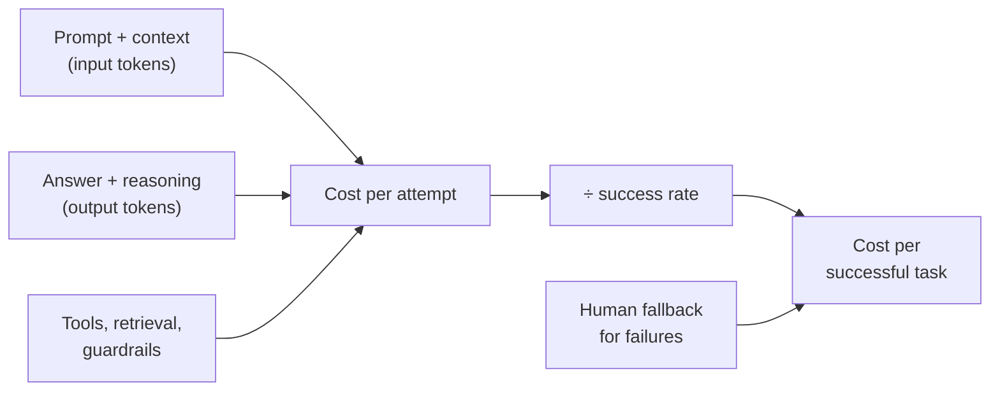
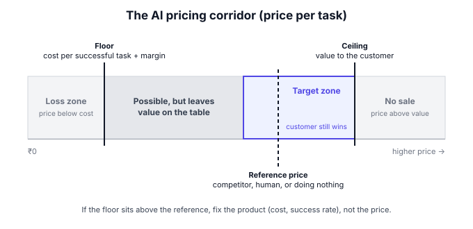

# B5.1 AI pricing and unit economics

## In one line

Every use of an AI feature costs you money, so you must price it in a unit customers understand and design it so each successful use earns more than it costs.

## Why this matters

In classic software, serving one more user costs almost nothing. That's why SaaS (software sold as a subscription) companies often keep 80–90% of revenue as gross margin. AI breaks this. Every question, summary or agent run calls a model, and every call has a bill. Bessemer Venture Partners reports that AI companies see **50–60% gross margins versus 80–90% for SaaS** ([Bessemer, February 2026](https://www.bvp.com/atlas/the-ai-pricing-and-monetization-playbook)).

This makes pricing a **product decision**, not just a finance one. As an AI PM you decide:

- which model runs, and how many steps an agent takes (cost)
- what the customer is charged for: a seat, a message, a task or a result (price unit)
- what free users get, and where limits sit (usage design)
- how to stop a few heavy users from wiping out your margin

Get it wrong and you can build a product people love that loses money on every use. Or you can price it so confusingly that customers revolt, as you'll see in the Cursor case below.

## Key terms

| Term | Plain-English meaning |
|---|---|
| **Unit economics** | The money made or lost on one unit of the business: one customer, one order, one task. |
| **COGS** | Cost of goods sold: the direct cost of delivering the product (for AI: model calls, hosting, human review). |
| **Gross margin** | (Revenue − COGS) ÷ revenue. What you keep from each rupee before salaries, marketing and rent. |
| **Inference cost** | What you pay each time a model produces an answer, usually charged per token. |
| **Cost per successful task** | Total AI cost divided by the tasks that actually worked. Failures still cost money. |
| **Pricing unit (value metric)** | The thing you charge for: seats, usage, credits, tasks or outcomes. |
| **Credits** | Prepaid units customers spend on AI actions; different actions use different amounts. |
| **Outcome-based pricing** | Charging only when the AI achieves a defined result, e.g. a support ticket resolved. |
| **Willingness to pay (WTP)** | The most a customer would pay for the value they get. |
| **Power users (heavy tail)** | The small group of users who consume a large share of usage, and cost. |

## The idea, simply

!!! tip "Analogy: the unlimited thali"
    A restaurant sells an unlimited thali for ₹250. It works because most people eat two or three rotis and one refill of dal. The owner's cost is about ₹120 a plate, so each plate earns ₹130.

    Now imagine two changes. First, a few regulars start eating ten rotis and four bowls of paneer. Second, the cost of paneer doubles. The ₹250 thali is now losing money on exactly the customers who love it most. The owner has three options: raise the price, limit refills of the expensive items, or switch to à la carte (pay per dish).

    AI products face exactly this. "Unlimited" plans work until heavy users arrive and the expensive "dishes" (the newest, most capable models) get popular. Then pricing has to change, and how you change it decides whether customers stay.

Let's build the idea up step by step.

### 1. Why AI breaks the old software maths

In traditional SaaS, most costs are fixed: engineers, offices, sales teams. Serving the thousandth user costs almost nothing extra. So a flat price per user (a **seat**) is safe: heavy and light users cost about the same.

AI adds a **variable cost per use**. The more a customer uses the product, the more you pay the model provider (or your own GPUs).

| | Classic SaaS | AI product |
|---|---|---|
| Cost of one more use | Close to zero | Real and measurable (tokens, tools, retries) |
| Typical gross margin | 80–90% | 50–60% (Bessemer, 2026) |
| Heavy user | Great: more engaged, same cost | Mixed: more engaged, much higher cost |
| Price per seat | Safe | Risky if usage varies a lot |
| Cost trend | Stable | Falling per unit, but usage per task often rising |

Investor surveys show the same pattern. ICONIQ's July 2026 survey of about 300 software executives found average gross margins on AI products of **45% in 2025**, with companies projecting 53% for 2026 ([ICONIQ State of AI 2026](https://www.iconiq.com/growth/insights/state-of-ai-2026)). Margins are improving, but they remain well below classic software.

### 2. Build up your cost per successful task

The first job is to know what one successful use really costs. Most teams underestimate it because they count only the main model call.

| Cost component | What it is | Often forgotten? |
|---|---|---|
| **Input tokens** | Your system prompt, retrieved documents, chat history and the user's message | Yes: long prompts and history are resent every turn |
| **Output tokens** | The model's answer; usually priced several times higher per token than input | Sometimes |
| **Reasoning tokens** | Hidden "thinking" by reasoning models, billed like output | Yes |
| **Retrieval and tools** | Search, database lookups, external API calls ([B1.2](../01-building-blocks/02-rag-giving-ai-your-knowledge.md)) | Sometimes |
| **Guardrails and checks** | Safety classifiers, second-model checks ([B4.2](../04-data-safety-and-law/02-responsible-ai-safety-and-guardrails.md)) | Yes |
| **Retries and failures** | Calls that fail, time out or get regenerated | Yes |
| **Human fallback** | Staff time when the AI hands over or gets it wrong | Very often |
| **Monitoring and evals** | Logging, online evals, judges ([B3.2](../03-quality/02-ai-product-metrics-and-production-monitoring.md)) | Yes |

The key formula:

> **Cost per successful task = total cost of all attempts ÷ number of tasks that succeeded**

If one attempt costs ₹3 and only 60% succeed, each success really costs ₹5. Improving the success rate cuts cost per success as surely as a cheaper model does. This is why evals ([B3.1](../03-quality/01-evals-the-ai-pm-s-most-important-skill.md)) are a pricing tool too.

Cost per successful task is the number to price against. Notice the two levers PMs control directly: how much context goes into each call, and the success rate.

### 3. The heavy tail: averages lie

AI usage is very uneven. Pricing expert Kyle Poyar writes that, in his experience, **70–80% of token consumption comes from about 10% of users** ([Growth Unhinged, September 2025](https://kylepoyar.substack.com/p/ai-credit-pricing)). Treat that as a practitioner's estimate, not a law, but most AI teams see a similar shape.

Here's what that means for a flat ₹500-a-month plan (illustrative numbers):

| User group | Share of users | Monthly AI cost per user | Margin at ₹500 |
|---|---|---|---|
| Light (tried it a few times) | 60% | ₹20 | ₹480 |
| Regular | 30% | ₹150 | ₹350 |
| Power user | 10% | ₹1,400 | −₹900 |
| **Average** | | **₹197** | **₹303 (61%)** |

The average looks healthy. But the 10% who love the product most each lose you ₹900 a month. If the product grows mainly through power users, margins shrink as you succeed.

**What to do:** always look at cost by **user decile** (each 10% band of users), not just the average. Then choose a design response: usage limits, a higher tier, pay-as-you-go top-ups, or routing heavy users' simpler requests to cheaper models.

### 4. The five ways to charge for AI

Bessemer's playbook groups AI pricing into **consumption** (per call or token), **workflow** (per completed task) and **outcome** (per successful result), plus **hybrids** that combine a base fee with usage. Add classic **seats** and you have five options.

| Pricing unit | How it works | Good for | Watch out for |
|---|---|---|---|
| **Seat** (per user per month) | Flat fee per person, AI included or as add-on | Copilots used by every employee daily | Heavy users cost more than they pay; and if AI *replaces* work, seats shrink as the product succeeds |
| **Usage / consumption** (per token, call, minute) | Pay for what you use | Developer APIs, technical buyers | Bills are unpredictable; customers ration usage, which hurts adoption |
| **Credits** | Prepaid pool; different actions cost different credits | Products with many AI actions of very different cost | Confusing if credits don't map to anything the customer understands |
| **Workflow / per task** | Fixed price per completed task (a document drafted, a call handled) | Clear, repeatable tasks | Customer pays even when the result is poor |
| **Outcome** | Pay only for defined results (a ticket resolved, a lead qualified) | Agents doing a whole job that has a clear success test | You need a clear, measurable, agreed definition of "success" |

Usage is moving toward consumption and outcomes. ICONIQ's 2026 survey found subscriptions are still the most common model, but the share of companies using consumption-based pricing rose from **35% to 42%** in six months, and outcome-based from **18% to 23%**. Companies blend about **1.7 pricing models** on average ([ICONIQ](https://www.iconiq.com/growth/insights/state-of-ai-2026)).

**A real outcome example.** Intercom charges **$0.99 per resolution** for its Fin AI support agent. A resolution counts when, after Fin's last answer, the customer either confirms it helped or leaves without asking for more help. Conversations escalated to a human because the customer asked for one aren't billed ([Intercom help centre](https://www.intercom.com/help/en/articles/8205718-fin-pricing)).

### 5. Price from value; cost only sets the floor

A common mistake is "cost-plus" pricing: work out the AI cost and add 30%. That leaves money on the table when the value is high, and it ties your price to a cost that keeps changing.

Instead, think of a **price corridor**:

- **Floor:** your cost per successful task plus the margin you need. Below this, you lose money.
- **Ceiling:** the value the customer gets (time saved, staff cost avoided, revenue gained). Above this, no rational customer buys.
- **Reference:** what customers compare you to: a competitor, a human doing the job, or doing nothing.

Your price sits between floor and ceiling, usually not far from the reference. Aim to capture only part of the value you create, so the customer clearly comes out ahead. The right share is something to test with real buyers, not to guess.

Madhavan Ramanujam and Georg Tacke's *Monetizing Innovation* (2016) argues for having the **"willingness-to-pay talk" early**, before you build, and designing the product around a price customers will accept ([O'Reilly book page](https://oreilly.com/library/view/monetizing-innovation/9781119240860)). For AI that advice matters even more, because the product decisions (which model, how many steps) directly set the floor.

### 6. Hybrids and credits: the practical middle ground

Pure usage pricing scares buyers; pure seat pricing scares your finance team. Most AI products now land in between.

**Common hybrid shapes:**

- **Base subscription + included usage + top-ups.** Predictable for the buyer, protected for you.
- **Platform fee + outcome credits.** Bessemer suggests this as a good starting bridge for agent products.
- **Tiers with fair-use limits.** Good-better-best plans, each with a clear allowance of AI actions.

Credits have spread fast. A review of pricing changes at the top 500 SaaS and AI companies in 2025 found **79 offered a credit model, up from 35** at the end of 2024 ([Growth Unhinged / PricingSaaS, January 2026](https://www.growthunhinged.com/p/2025-state-of-saas-pricing-changes)). Poyar argues credits work because they give buyers predictability and give vendors flexibility to price new, costlier actions without redoing the whole plan.

The catch: credits only work if customers can **translate them into something real** ("about 40 long documents" or "about 200 replies"). Otherwise they feel like casino chips.

### 7. Costs fall fast, but your bill may not

AI gets cheaper at a remarkable rate. Epoch AI found that the price of reaching a *fixed* level of performance fell between **9× and 900× per year**, depending on the task. They caution that the fastest drops were recent and may not last ([Epoch AI, March 2025](https://epoch.ai/data-insights/llm-inference-price-trends)).

But your actual bill often doesn't fall as fast, for three reasons:

1. **You (and your users) move to the newest models.** A 2025 preprint by Gundlach, Lynch, Mertens and Thompson estimates that while price for a given capability falls about 5–10× a year, the price of running *frontier* models is **rising 3–18× a year** ([arXiv, 2025](https://arxiv.org/abs/2511.23455); preprint, not peer-reviewed).
2. **Tasks get bigger.** Agents and reasoning models use many more tokens per task. Cursor noted that the hardest requests cost "an order of magnitude more" than simple ones ([Cursor, July 2025](https://cursor.com/blog/june-2025-pricing)).
3. **Usage grows** as the feature gets better.

**PM implication:** don't promise "unlimited" on the assumption that costs will fall. Plan on cost per *capability* falling and cost per *task* staying flat or rising, unless you actively manage model choice ([B0.3](../00-foundations/03-choosing-models-capability-cost-latency-open-vs.md)).

## Framework: the AI pricing corridor

There's no single inventor of AI pricing. This framework combines two established ideas: **value-based pricing** as set out in Ramanujam and Tacke's [*Monetizing Innovation*](https://oreilly.com/library/view/monetizing-innovation/9781119240860) (2016), and the **consumption, workflow and outcome** pricing models described in [Bessemer's AI pricing playbook](https://www.bvp.com/atlas/the-ai-pricing-and-monetization-playbook) (2026). The step-by-step corridor below is this book's synthesis.

**Step 1: Define the unit of value.** What job does the AI do, and what does "done well" mean? (A ticket resolved; a contract reviewed; a lesson plan drafted.)

**Step 2: Build the floor.** Calculate cost per successful task, including retries, guardrails and human fallback. Add your target gross margin. Check the cost for your top 10% of users separately.

**Step 3: Find the ceiling.** Estimate the value per task for the customer: staff time saved, revenue gained, risk avoided. Validate with willingness-to-pay conversations, not just a spreadsheet.

**Step 4: Find the reference.** What will customers compare you with? A competitor's price, a freelancer, an in-house person, or doing nothing?

**Step 5: Choose the pricing unit.** Pick the unit that (a) customers understand, (b) grows as they get more value, and (c) doesn't shrink as your AI succeeds. Use the table in sub-section 4.

**Step 6: Design limits and tiers.** Free allowance, plan limits, top-ups, and what happens at the limit (slow down, switch to a cheaper model, or ask to upgrade). Show usage meters so no bill is a surprise.

**Step 7: Test, launch carefully, monitor.** Run the price with a few customers first. After launch, track gross margin by customer segment and by decile every month.

**When to use:** launching a new AI feature or product; adding AI to an existing paid plan; when margins are slipping as usage grows.
**When not to:** an early experiment with a handful of users. There, keep it free or simple and learn whether people value it at all. Just put a hard cost cap in place so a runaway loop can't burn your budget.

## Diagram

Price between the floor and the ceiling. If the floor is above the reference price, the fix is product work (cheaper models, higher success rate), not a pricing trick.

## Worked example

You're the PM at **HelpDesk.in**, a made-up Indian helpdesk SaaS company. You're launching an AI agent that answers customer chats for D2C (direct-to-consumer) brands. Your first big prospect is a skincare brand that handles **20,000 chats a month** with **40 human agents**.

**Step 1: Define the unit of value.** The job is "a customer's question fully answered without a human". You define a **resolution** as: the customer confirms the answer helped, or leaves without asking for more help within 24 hours. Handovers to a human don't count.

**Step 2: Cost per conversation.** An average chat has 6 turns. Each turn sends about 4,000 input tokens (system prompt, retrieved help articles, order details, chat history) and gets back about 300 output tokens. Assume your chosen model costs ₹85 per million input tokens and ₹340 per million output tokens (illustrative prices).

| Cost item | Calculation | Cost per chat |
|---|---|---|
| Input tokens | 6 turns × 4,000 × ₹85 ÷ 10,00,000 | ₹2.04 |
| Output tokens | 6 turns × 300 × ₹340 ÷ 10,00,000 | ₹0.61 |
| Retrieval and safety classifier | Fixed per chat | ₹0.35 |
| Retries, logging and evals | +10% | ₹0.30 |
| **Total AI cost per chat** | | **₹3.30** |

**Step 3: Cost per successful task.** In your pilot, the agent resolves **60%** of chats. Every chat still costs ₹3.30, so each resolution really costs ₹3.30 ÷ 0.6 = **₹5.50**. That's your cost floor before margin.

**Step 4: The customer's value (the ceiling).** Each human agent costs the brand about ₹30,000 a month and handles about 500 chats, so a human-handled chat costs about **₹60**.

| | Today (all human) | With AI agent |
|---|---|---|
| Chats resolved by AI | 0 | 12,000 |
| Chats handled by humans | 20,000 | 8,000 |
| Agents needed | 40 | 16 |
| Human cost per month | ₹12,00,000 | ₹4,80,000 |
| **Saving before paying you** | | **₹7,20,000** |

**Step 5: Compare four pricing options.** Your AI cost for this customer is 20,000 × ₹3.30 = **₹66,000 a month**, whichever option you choose.

| Option | Monthly revenue | Gross profit | Gross margin | Problem |
|---|---|---|---|---|
| **A. Seat add-on,** ₹2,000 per agent | ₹80,000 at first; ₹32,000 once the brand drops to 16 agents | −₹34,000 | Negative | Revenue shrinks as the AI succeeds |
| **B. Per chat,** ₹8 | ₹1,60,000 | ₹94,000 | 59% | Brand pays for failed chats too; feels unfair |
| **C. Per resolution,** ₹15 | ₹1,80,000 | ₹1,14,000 | 63% | You need a resolution definition both sides trust |
| **D. Hybrid,** ₹30,000 platform fee incl. 2,000 resolutions, then ₹15 each | ₹1,80,000 | ₹1,14,000 | 63% | Slightly more complex to explain |

Option A is the classic SaaS reflex, and it's a trap here: the better your agent works, the fewer seats the brand needs. Options C and D link your revenue to the value the brand actually gets. D adds a floor of ₹30,000 a month, which protects you during the first weeks, when volumes are low and the agent is still being tuned.

**Step 6: Check the customer still wins.** Under option C or D, the brand pays ₹1.8 lakh to save ₹7.2 lakh. It keeps **₹5.4 lakh a month**, so you capture about 25% of the value created. That's an easy yes for a finance team.

**Step 7: Stress-test the margin.** Your cost doesn't depend on the resolution rate, but your revenue does.

| Scenario | Resolutions | Revenue (option C) | AI cost | Gross margin |
|---|---|---|---|---|
| Agent struggles: 40% resolved | 8,000 | ₹1,20,000 | ₹66,000 | 45% |
| Pilot result: 60% resolved | 12,000 | ₹1,80,000 | ₹66,000 | 63% |
| Agent improves: 75% resolved | 15,000 | ₹2,25,000 | ₹66,000 | 71% |
| 60% resolved, model prices halve | 12,000 | ₹1,80,000 | about ₹37,000 | 79% |

Notice the incentive: with outcome pricing, **improving quality is the fastest way to improve margin.** Your eval work ([B3.1](../03-quality/01-evals-the-ai-pm-s-most-important-skill.md)) now shows up directly in the profit line.

**Step 8: Check the heavy tail.** Another brand sells electronics. Its chats are about returns and warranty disputes and average **12 turns**. Token costs double, so the cost per chat is about ₹6.20. If it resolves only 50%, each resolution costs about ₹12.40, and your margin at ₹15 falls to about 17%. Your options:

- **Trim context:** send a summary of older turns instead of the full history.
- **Route** simple turns to a cheaper model ([B0.3](../00-foundations/03-choosing-models-capability-cost-latency-open-vs.md)).
- **Price by complexity:** a higher rate for "complex" topics such as warranty claims, agreed upfront.

**Step 9: What it's worth.** Choosing option C or D over the seat add-on turns a ₹34,000 monthly loss into ₹1.14 lakh gross profit per customer like this. Across 50 similar customers, that's about **₹57 lakh a month**, or roughly **₹6.8 crore a year**, of gross profit, from one pricing decision.

## Going deeper: nuances and trade-offs

### 1. What gross margin should an AI product target?

There's no single right number. Bessemer puts classic SaaS at 80–90% and AI companies at 50–60%, and ICONIQ's survey shows margins rising year by year as companies get better at managing cost. What matters more than the level is the **direction**: is margin improving as you scale, or getting worse because heavy users and bigger models are growing faster than revenue?

A sensible habit: report gross margin **per customer segment and per plan**, monthly. A healthy overall margin can hide one plan that loses money on every user.

### 2. Free tiers cost real money

In classic apps, a free tier costs almost nothing per user. In AI, every free question has a bill. Design free tiers around three questions:

- **What is the smallest free experience that shows the value?** Five good answers may convert better than fifty mediocre ones.
- **Which model serves free users?** Many products use a smaller, cheaper model for free use and keep frontier models for paid plans.
- **How do you stop abuse?** Bots and scripts can run up huge bills. Add rate limits, sign-in requirements and anomaly alerts.

Treat free-tier cost as a marketing expense, and measure it like one: cost per paying customer acquired.

### 3. Defining the outcome is the hard part of outcome pricing

Outcome pricing sounds perfectly fair, until you have to define "outcome". Questions you must answer in writing:

- **What counts?** Intercom counts a resolution when the customer confirms or simply leaves without asking for more help. The second case ("assumed resolution") is convenient but debatable: maybe the customer gave up.
- **Who measures it?** If only the vendor measures it, the customer must trust the vendor's logs.
- **Can it be gamed?** An agent that makes it hard to reach a human could raise "resolutions" while making customers angrier. Pair the outcome with a guardrail such as repeat contacts within 7 days or CSAT (customer satisfaction score).
- **What about partial success?** A refund started but not finished?

The tighter the definition, the more trust, and the easier the sale.

### 4. Pricing for India

Indian buyers, both consumers and businesses, are often more price-sensitive than US buyers, but the AI costs you pay are largely priced in dollars. That squeezes margins. Patterns that help:

- **Local price points.** OpenAI launched ChatGPT Go in India in August 2025 at **₹399 a month**, with UPI payment, well below ChatGPT Plus at ₹1,999 ([Business Today, August 2025](https://www.businesstoday.in/technology/news/story/openai-announces-chatgpt-go-in-india-for-rs399-a-month-heres-what-you-get-489989-2025-08-19)).
- **Lighter models for price-sensitive tiers,** so a lower price still clears the floor.
- **Smaller commitments.** Monthly or even weekly plans, and UPI mandates instead of cards.
- **Token cost of Indian languages.** Many models use more tokens for Indic scripts than for English, which raises cost per task ([B0.2](../00-foundations/02-how-llms-work-for-pms.md)). Check this before setting a price for vernacular users.

### 5. Changing prices without losing trust

Your first AI price is almost certainly wrong, because costs, models and usage keep moving. So plan for price changes from day one:

- **Explain the change in the customer's units** ("about 225 long requests a month"), not your internal ones.
- **Give notice** and, where you can, let existing customers keep the old plan for a while (called grandfathering).
- **Never surprise people with bills.** Default spending caps, usage meters and alerts at 50%, 80% and 100% of the allowance.
- **Admit mistakes fast.** The Cursor case below shows how quickly trust can drop, and what repair looks like.

### 6. Product levers that change the unit economics

Many of the biggest pricing wins are product decisions, not price changes:

| Lever | Typical effect |
|---|---|
| **Model routing** (cheap model for easy requests) | Large cost cut on the easy majority of requests |
| **Prompt caching** (reusing a fixed prompt prefix) | Cheaper, faster repeated context ([B0.3](../00-foundations/03-choosing-models-capability-cost-latency-open-vs.md)) |
| **Shorter context** (summaries instead of full history) | Fewer input tokens per turn |
| **Higher success rate** | Lower cost per *successful* task |
| **Batch processing** for non-urgent work | Discounted prices from many providers |
| **Smarter defaults** (fewer agent steps) | Fewer calls per task |

A PM who can cut cost per task in half has the same effect on margin as doubling the price, without upsetting a single customer.

### 7. B2B buyers want predictability

Business buyers have budgets set a year ahead. A bill that swings 3× from month to month is a problem even if the average is fair. That's why pure usage pricing is hard to sell outside developer tools. Ways to give predictability:

- **Annual commitments** with a pool of credits, plus agreed top-up rates.
- **Spending caps** the customer controls.
- **Usage dashboards** for the buyer's admin, not only for you.
- **True-up** (a once-a-quarter adjustment) rather than surprise overage bills.

### 8. The cannibalisation problem for incumbents

If you already sell seats and your AI does work that people used to do, your AI can shrink your own revenue (option A in the worked example). This is one of the hardest strategic questions for established SaaS companies. Choices include charging for AI separately by outcome, raising seat prices to include AI, or moving to platform-plus-usage pricing. The 2025 pricing review cited above found examples of each: some companies raised per-seat prices to include AI, while others bundled AI with credit allowances at unchanged prices ([Growth Unhinged](https://www.growthunhinged.com/p/2025-state-of-saas-pricing-changes)). How this shapes long-term strategy and moats is covered in [B5.2](02-ai-native-strategy-and-moats.md).

## Real-world examples (2023 onwards)

!!! example "Cursor, June–July 2025: a pricing change that broke trust, and the repair"
    On 16 June 2025, AI coding tool Cursor changed its $20-a-month Pro plan. The old plan gave 500 "fast" requests to premium models, then slower unlimited use. The new plan gave **$20 of model usage per month at API prices**, plus unlimited use of its own lighter features. Many users ran out quickly, some after only a few prompts on expensive models, and some were billed for extra usage they hadn't expected ([TechCrunch, 7 July 2025](https://techcrunch.com/2025/07/07/cursor-apologizes-for-unclear-pricing-changes-that-upset-users/)).

    On 4 July, CEO Michael Truell published an apology, explained that the hardest requests cost "an order of magnitude more" than simple ones, admitted that "unlimited" had applied only to some usage, and offered **refunds** for unexpected charges between 16 June and 4 July ([Cursor blog](https://cursor.com/blog/june-2025-pricing)).

    **PM lesson:** the economics behind the change were real: request-based pricing no longer matched cost when one request could be ten times more expensive than another. The failure was in the **communication and the defaults**: unclear limits, surprise overage charges, and units customers couldn't translate. Price changes are product launches; test the explanation as carefully as the numbers.

!!! example "ChatGPT Go in India, August–November 2025: a local price point, then free"
    In August 2025, OpenAI launched **ChatGPT Go** in India at ₹399 a month, payable by UPI, with 10× the message, image and upload limits of the free plan ([Business Today, 19 August 2025](https://www.businesstoday.in/technology/news/story/openai-announces-chatgpt-go-in-india-for-rs399-a-month-heres-what-you-get-489989-2025-08-19)). In late October, OpenAI said Go would be **free for one year** for users in India who signed up in a promotion starting 4 November 2025. TechCrunch cited Appfigures data showing more than 29 million ChatGPT downloads in India in the 90 days to August, but only about $3.6 million in in-app purchases ([TechCrunch, 27 October 2025](https://techcrunch.com/2025/10/27/openai-offers-free-chatgpt-go-for-one-year-to-all-users-in-india/)).

    **PM lesson:** huge usage didn't mean huge revenue: willingness to pay in India was far below the global price. OpenAI first created a local tier with a local payment method, then chose to give it away to build habit in a key market, accepting the inference cost as an investment. Few companies can afford that. For most, the lesson is to design a tier whose **cost floor fits the local price**, rather than discounting a plan built for US prices.

## Common mistakes

!!! warning "Watch out for"
    - **Pricing from cost alone** ("cost plus 30%"), leaving value on the table and tying price to a moving cost.
    - **Using average cost** and ignoring the heavy tail of power users.
    - **Counting only the main model call,** and forgetting retries, guardrails and human fallback.
    - **Selling seats for an AI that replaces seats.** Revenue falls as the product succeeds.
    - **"Unlimited" plans** that assume costs will keep falling.
    - **Units customers can't translate** (tokens, opaque credits).
    - **No spending caps or usage alerts,** leading to bill shock.
    - **Vague outcome definitions** that lead to disputes or gaming.

## Common questions

**Should every AI feature be charged separately?**
No. Small, cheap AI touches (better search, auto-tagging) are often best included in the existing plan to raise retention. Charge separately when the AI does substantial, costly or clearly valuable work.

**Is outcome-based pricing always best?**
Only when the outcome is clear, measurable, mostly caused by your product, and both sides trust the measurement. For copilots that help but don't finish the job, seats or credits are usually simpler.

**How do I estimate costs before launch?**
Run your eval set through the planned model and measure real token counts per task, including retries. Multiply by expected volume, and add 20–50% headroom for heavier real-world use. Then compare with production data in the first weeks.

**Won't model prices fall anyway?**
Prices for a fixed capability fall fast, but teams tend to adopt newer, bigger models and longer tasks, so cost per task often doesn't fall as much. Plan for it, don't bet on it.

**Who owns pricing: PM, finance or sales?**
Usually a shared decision led by product or a dedicated pricing lead, with finance checking margins and sales checking what customers will accept. The PM must own the cost side, because product choices set it.

## In the interview

!!! question "In the interview"
    **How it's tested:** AI PM interviews often include "How would you price…?" or "This AI feature is losing money: what do you do?" They test whether you understand variable costs, value and customer psychology together.

    **Sample question:** *"You're adding an AI meeting-notes feature to a project-management SaaS tool. How would you price it?"*

    **Outline of a strong answer:**

    1. **Clarify the goal:** retention and differentiation, or a new revenue line?
    2. **Estimate cost per use:** a 45-minute meeting transcript plus summary, the share of users who'd use it, and heavy users (people in back-to-back meetings).
    3. **Estimate value:** minutes saved per meeting, value of fewer missed action items, and what standalone note-taking tools charge (the reference).
    4. **Pick a unit:** for example, include a monthly allowance of meetings in each paid seat, with a higher "unlimited-with-fair-use" tier for heavy users.
    5. **Protect the margin:** cheaper model for transcription, top model only for the summary, usage alerts.
    6. **Measure:** attach rate, retention lift for users of the feature, and gross margin per plan, with a guardrail on complaints about limits.

    Interviewers listen for cost *and* value thinking, awareness of the heavy tail, and a unit the customer understands.

## Research happening now

!!! info "Research happening now"
    - **Frontier AI is getting pricier to run, even as capability gets cheaper (preprint, 2025–26).** Gundlach, Lynch, Mertens and Thompson estimate that the price of a fixed benchmark level falls about 5–10× a year, while the price of running frontier models rises 3–18× a year ([arXiv 2511.23455](https://arxiv.org/abs/2511.23455), revised March 2026). *Status: preprint, not peer-reviewed.*
    - **AI margins and pricing models (ICONIQ, July 2026).** ICONIQ's [State of AI 2026](https://www.iconiq.com/growth/insights/state-of-ai-2026) survey of about 300 software executives reports AI product gross margins of 45% in 2025, projected at 53% in 2026, and a fast rise in consumption-based (42%) and outcome-based (23%) pricing. *Status: investor survey, mostly North American companies.*
    - **The spread of credit pricing (Growth Unhinged / PricingSaaS, January 2026).** An analysis of 1,800+ pricing changes at the top 500 SaaS and AI companies in 2025 found credit models at 79 companies, up from 35 a year earlier ([report](https://www.growthunhinged.com/p/2025-state-of-saas-pricing-changes)). *Status: industry data analysis; parts are paywalled.*

## Try it yourself (25 minutes)

You're pricing an AI résumé reviewer for a job portal. Each review uses about 6,000 input tokens and 1,500 output tokens. Assume ₹85 per million input tokens and ₹340 per million output tokens. Add ₹0.50 per review for safety checks and logging. In testing, 80% of reviews are rated useful. A human career coach charges about ₹500 for a résumé review.

1. What's the AI cost per review, and per *useful* review?
2. Propose a price and a pricing unit for job seekers.
3. Name one heavy-tail risk and one design response.

??? success "Check your answer"
    1. **Cost per review:** input 6,000 × ₹85 ÷ 10,00,000 = ₹0.51; output 1,500 × ₹340 ÷ 10,00,000 = ₹0.51; plus ₹0.50 = about **₹1.52**. Per useful review: ₹1.52 ÷ 0.8 = about **₹1.90**.
    2. **Price:** the floor is tiny; the reference is ₹500 for a human coach. A reasonable answer is a pack, e.g. **₹99 for 3 reviews** or a ₹149 monthly plan with up to 10 reviews. Both stay far below the reference and far above cost. Your answer is good if you priced from value and reference, not from the ₹1.90 cost.
    3. **Heavy tail:** someone running hundreds of reviews (e.g. a placement agency using a consumer plan). Responses: a fair-use cap per month, a separate business plan, or rate limits.

    Also check that you counted the *useful* rate, not just the cost per attempt.

## How this connects

- [B0.3 Choosing models](../00-foundations/03-choosing-models-capability-cost-latency-open-vs.md): model choice, caching and routing set your cost floor.
- [B3.2 AI product metrics and production monitoring](../03-quality/02-ai-product-metrics-and-production-monitoring.md): where cost per successful task is tracked after launch.
- [B2.1 Finding AI opportunities](../02-discovery-and-design/01-finding-ai-opportunities-and-when-not-to-use-ai.md): break-even accuracy and unit maths before you build.
- [A10.3 Pricing and monetisation](../../part-a/10-growth-and-go-to-market/03-pricing-and-monetisation.md): the general pricing toolkit this chapter builds on.
- [B5.2 AI-native strategy and moats](02-ai-native-strategy-and-moats.md): how pricing and cost structure shape long-term advantage.

## Go deeper

- **Book:** [*Monetizing Innovation*](https://oreilly.com/library/view/monetizing-innovation/9781119240860) by Madhavan Ramanujam and Georg Tacke (2016). The case for willingness-to-pay conversations before you build.
- **Guide:** [Bessemer, The AI pricing and monetization playbook](https://www.bvp.com/atlas/the-ai-pricing-and-monetization-playbook) (2026). Consumption, workflow, outcome and hybrid models, with margin benchmarks.
- **Report:** [ICONIQ, State of AI 2026](https://www.iconiq.com/growth/insights/state-of-ai-2026). Survey data on AI margins, costs and pricing models.
- **Article:** [Kyle Poyar, Why everyone's switching to AI credits](https://kylepoyar.substack.com/p/ai-credit-pricing) (2025). How credit pricing works and why it's spreading (partly paywalled).
- **Example:** [Intercom's Fin pricing and outcome definitions](https://www.intercom.com/help/en/articles/8205718-fin-pricing). A real, detailed definition of a billable outcome.
- **Case:** [Cursor, Clarifying our pricing](https://cursor.com/blog/june-2025-pricing) (2025). A company explaining why its pricing changed, and apologising for how.
- **Data:** [Epoch AI, LLM inference price trends](https://epoch.ai/data-insights/llm-inference-price-trends) (2025). How fast the price of a fixed capability is falling.
- **Guide:** [Stripe, Pricing AI products: lessons from leading AI companies](https://stripe.com/guides/pricing-ai-products-lessons-from-leading-ai-companies). A payments company's guide to AI pricing patterns.

## Key takeaways

- AI has a **real cost per use**, so gross margins are lower than classic SaaS (often 50–60% vs 80–90%).
- Price against **cost per successful task**, including retries, guardrails and human fallback, not the cost of one model call.
- **Averages lie:** check cost by user decile; a few power users can wipe out the margin.
- Choose a **pricing unit** customers understand that grows with their value and doesn't shrink as your AI succeeds.
- **Price from value;** cost sets only the floor. Hybrids (base fee plus usage or outcomes) are a common practical middle ground.
- Capability gets cheaper fast, but **cost per task may not**, as models get bigger and tasks get longer.
- Treat price changes as **product launches:** clear units, spending caps, notice, and fast apologies when you get it wrong.

## Updates

*No updates yet.*
