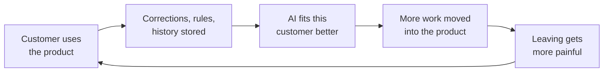

# B5.2 AI-native strategy and moats

## In one line

When everyone can rent the same AI model, your advantage has to come from what the model can't give a rival: your workflow, your data loop, your distribution and the cost of leaving you.

## Why this matters

Every AI product team gets asked the same question by leaders and investors: "What stops OpenAI, Google or a copycat from doing this next month?" If you can't answer it, your roadmap is a list of features someone else will ship for free. This chapter gives you a way to find, build and test a real moat for an AI product, and to spot when you don't have one yet.

## Key terms

| Term | Plain-English meaning |
|---|---|
| **Moat** | Anything that lets you keep earning good margins even when rivals try to copy you. |
| **Power (7 Powers)** | Hamilton Helmer's word for a moat: a *benefit* to you plus a *barrier* that stops rivals getting the same benefit. |
| **Wrapper** | A product that is mostly a user interface on top of someone else's model, with little of its own underneath. |
| **AI-native** | A product designed around what AI makes possible, rather than an old product with an AI button added. |
| **Model layer / application layer** | The model layer builds the AI models. The application layer builds products people use on top of them. |
| **Data flywheel** | A loop where usage creates data that makes the product better, which brings more usage. |
| **Switching cost** | What a customer loses or must redo to move to another product: data, setup, habits, risk. |
| **Counter-positioning** | A new business model that the market leader can't copy without hurting its own existing business. |
| **Platform risk** | The danger that a company you depend on (a model provider, an app store) changes terms, prices or competes with you. |

## The idea, simply

!!! tip "Analogy: the chai stall next to the station"
    Imagine ten chai stalls outside Pune station. They all buy the same milk, sugar and tea leaves from the same wholesaler. Nobody wins because of the ingredients. Everyone can get them.

    One stall still has a queue every morning. Why? It sits right at the exit gate (location). Regulars have a tab they settle monthly (switching cost). The owner knows that the 7:40 crowd wants it strong and fast (process). And office boys from nearby buildings order 40 cups at a time on WhatsApp (distribution).

    AI models are the milk and tea leaves. Most products rent them from the same few suppliers. Your moat is never the ingredient. It is everything you build around it.

### 1. Why AI makes the moat question urgent

In normal software, building a good product took years of engineering. That effort itself slowed copycats. AI changes three things at once:

- **The core capability is rented.** Most AI products call a model from OpenAI, Anthropic, Google or an open-weight model. Your rival can call the same one tomorrow.
- **Building is faster.** AI coding tools let small teams ship a credible clone in weeks.
- **The supplier keeps improving.** Every model upgrade can make a feature you spent months on into a one-line prompt for everyone.

The debate went public in May 2023, when a leaked internal Google document titled "We Have No Moat, And Neither Does OpenAI" was published by [SemiAnalysis](https://newsletter.semianalysis.com/p/google-we-have-no-moat-and-neither). It argued that open-source models were catching up so fast that big labs could not rely on model quality alone. It reflected one researcher's view, not Google's official position ([Simon Willison's commentary](https://simonwillison.net/2023/May/4/no-moat/)). But its core worry has largely held for the application layer: model capability spreads fast.

The numbers show why. Stanford's [2025 AI Index](https://hai.stanford.edu/news/ai-index-2025-state-of-ai-in-10-charts) found that the price of reaching GPT-3.5-level performance fell from $20 per million tokens in November 2022 to $0.07 in October 2024. That's a more than 280-fold drop in about 18 months. What was rare and expensive becomes cheap and common.

| What used to slow copycats | What AI changed |
|---|---|
| Years of engineering | Weeks, with AI coding tools |
| Owning a unique algorithm | Same rented model as everyone |
| Expensive capability | Price of a fixed capability falls quickly every year |
| Your feature lead | Next model release may give it to everyone |

### 2. Benefit plus barrier: what a moat really is

Hamilton Helmer's *7 Powers* ([book](https://bookshop.org/p/books/7-powers-the-foundations-of-business-strategy-hamilton-helmer/342a60a767bd1b85), 2016) gives the cleanest definition. A moat (he calls it "Power") needs two things:

1. **A benefit:** something that raises your prices, lowers your costs or cuts your investment needs.
2. **A barrier:** something that stops competitors from getting the same benefit, even when they try hard.

Most "AI advantages" have a benefit but no barrier. A clever prompt makes answers better (benefit). But a rival can write the same prompt in a week (no barrier). Being first is a benefit for a few months. It is not a barrier.

| Claimed advantage | Benefit? | Barrier? | Verdict |
|---|---|---|---|
| "We use the best model" | Yes, for now | No, anyone can rent it | Not a moat |
| "Our prompts are better" | Yes | Weak, can be copied | Not a moat |
| "We're integrated into 40 hospital systems" | Yes | Yes, takes years to repeat | Possible moat |
| "Customers' 3 years of history lives in our product" | Yes | Yes, painful to move | Possible moat |
| "We were first" | Yes, briefly | No | Head start only |

### 3. The seven powers, translated for AI products

Helmer lists seven sources of Power. Here's what each looks like when the model is rented.

| Power | Plain meaning | AI-product version | Strength for most AI apps |
|---|---|---|---|
| **Scale economies** | Bigger = cheaper per unit | Volume discounts on tokens, shared infrastructure | Weak for apps; strong for model labs |
| **Network economies** | Each user makes it better for others | Marketplaces, shared templates, multiplayer workspaces | Strong where it exists |
| **Counter-positioning** | A model the incumbent won't copy | Selling outcomes when the leader earns per seat | Strong, but time-limited |
| **Switching costs** | Leaving is painful | Customer data, workflows, integrations, trained habits | Often the strongest |
| **Branding** | People trust and pay more for the name | Trust for high-stakes tasks (health, money, law) | Medium, slow to build |
| **Cornered resource** | You own something scarce | Exclusive data, licences, rare talent, regulatory approval | Strong if truly exclusive |
| **Process power** | Hard-to-copy ways of working | Evals, error analysis and fix loops that improve quality every week | Medium; builds over years |

Notice what's missing: "better AI". Model quality only becomes Power for the few labs that can keep a lead, which costs billions.

### 4. Counter-positioning: the startup's best weapon against incumbents

Counter-positioning means picking a business model the leader would hurt itself by copying. AI creates many of these openings.

- A software giant earns money **per seat** (per human user). An AI-native rival does the work itself and charges **per task completed**. If the giant copies, its seat revenue shrinks as customers need fewer people.
- A services firm earns money from **billable hours**. An AI-native firm charges a fixed price per contract reviewed. Copying means billing fewer hours.
- A media company earns from **page views**. An AI answer engine gives the answer without the click.

| Incumbent earns from | AI-native rival earns from | Why the incumbent hesitates |
|---|---|---|
| Seats (users) | Tasks or outcomes (see [B5.1](01-ai-pricing-and-unit-economics.md)) | Fewer seats needed |
| Billable hours | Fixed price per job | Fewer hours billed |
| Ad clicks | Direct answers | Fewer clicks |

The catch: counter-positioning fades. Once the new model clearly wins, the incumbent switches, even at a cost. Use the window to build a second, longer-lasting moat, usually switching costs.

### 5. Switching costs: the moat most AI apps can actually build

For most application-layer AI products, the strongest moat is that leaving becomes painful. There are four kinds:

1. **Data gravity:** the customer's history, files and settings live with you. Moving means losing context.
2. **Workflow embedding:** your product sits inside daily routines, approvals and other tools (integrations). Ripping it out breaks things.
3. **Learned behaviour:** the AI has been tuned to *this* customer's style, rules and exceptions over months.
4. **Organisational risk:** the team trusts your outputs. A new tool means re-checking everything.

| Weak version | Strong version |
|---|---|
| User pastes text into a chat box | Product reads and writes directly to their accounting, CRM or ticketing system |
| AI forgets everything after a session | AI remembers customer-specific rules, past corrections and preferences |
| One user, one account | A whole team's approvals and workflows run through it |
| Output gets copied elsewhere | Output *is* the system of record (the official place the data lives) |

Switching costs compound. Each month of use adds context a rival would have to rebuild from scratch.

### 6. Data moats: real, but smaller than most pitches claim

"We have proprietary data" is the most common AI moat claim. Be sceptical. In ["The Empty Promise of Data Moats"](https://a16z.com/the-empty-promise-of-data-moats/) (2019), Martin Casado and Peter Lauten of a16z argued that most "data network effects" are really just scale effects with diminishing returns. In their support-chatbot example, coverage levels off: after a point, more data adds little, while the cost of collecting rare edge cases rises.

Data helps as a moat only when it passes three tests:

| Test | Question | Example that passes | Example that fails |
|---|---|---|---|
| **Exclusive** | Can rivals get the same or similar data? | Your own labelled corrections from 5,000 accountants | Public web pages |
| **Still improving** | Does more data still make the product noticeably better? | Rare fraud patterns that keep changing | Common FAQs you already answer well |
| **Tied to a decision** | Does the data change the product's output, not just sit in storage? | Corrections fed into evals and prompts weekly | Logs no one reads |

Feedback data (users accepting, editing or rejecting AI output) is usually more valuable than raw content, because it tells you what "good" means for your users. [B4.1](../04-data-safety-and-law/01-data-strategy-and-feedback-loops.md) covers how to design those loops.

### 7. Ride the model curve, don't fight it

The most practical strategic test for an AI product: **when the next model comes out, does your product get better or does it get replaced?**

- **Tailwind products** get better. A legal-workflow tool with deep integrations gets more accurate when models improve. Its moat (workflow, data, trust) stays.
- **Headwind products** get replaced. A tool whose whole value was "we made the model good at summarising PDFs" disappears when the base model does that natively.

| Feature built to… | Next model release likely… | Strategy |
|---|---|---|
| Patch a model weakness (bad at maths, short memory) | Removes the need | Don't bet the company on it |
| Connect AI to the customer's systems and data | Makes it more valuable | Invest heavily |
| Encode expert judgement and rules for a niche | Makes it more valuable | Invest heavily |
| Offer a nicer chat box | Commoditises it | Table stakes only |

There is also a cost angle. A March 2026 revision of an [arXiv preprint by Gundlach, Lynch, Mertens and Thompson](https://arxiv.org/abs/2511.23455) estimated that the price of a *fixed* level of benchmark performance falls roughly 5–10x per year for frontier models. But it also found the price of running the newest frontier models is *rising*. So plan for capability to get cheap, but don't assume your best-quality calls will.

## Framework: 7 Powers, applied to an AI product

**Source:** Hamilton Helmer, *[7 Powers: The Foundations of Business Strategy](https://bookshop.org/p/books/7-powers-the-foundations-of-business-strategy-hamilton-helmer/342a60a767bd1b85)* (2016). Helmer built it from decades of strategy consulting and investing. The steps below adapt it for AI products; the adaptation is this book's, not Helmer's.

**Step 1: Name the value you create.** One sentence: who gets what job done better, and how you'd measure it.

**Step 2: Do the "model upgrade test".** Imagine the next model is twice as good and half the price. Does your product get stronger, weaker or vanish? If it vanishes, stop and rethink the product, not just the moat.

**Step 3: Do the "copycat test".** Imagine a funded team copies your product with the same model in 8 weeks. List what they *can't* copy in that time. That list is your candidate moat.

**Step 4: Score each of the seven powers** from 0 (none) to 3 (strong), separately for **benefit** and **barrier**. A power only counts if both scores are 2 or more.

**Step 5: Pick one primary power to build in the next 12 months,** and one secondary. Usually switching costs plus either counter-positioning or a cornered resource.

**Step 6: Turn the power into roadmap items and metrics.** Example: "switching costs" becomes "ship 3 integrations; measure % of customers with 2+ integrations live; track churn by integration count".

**Step 7: Check platform risk.** List every supplier you depend on (model, cloud, app store, data source). For each: what if they raise prices 3x, cut you off, or launch your feature?

**When to use:** before raising money, at annual planning, when a big model release lands, or when a large company enters your space.

**When not to:** in the first weeks of finding product-market fit. Early on, a moat for a product nobody wants is worthless. Find value first ([A4.4](../../part-a/04-strategy-and-vision/04-product-market-fit.md)), then build barriers around it.

## Diagram

Aim for the top-right: products that get better with each model release and sit on workflow and data rivals can't quickly rebuild.

## Worked example

You're the PM at a Bengaluru startup that sells an **AI reconciliation assistant to CA (chartered accountant) firms**. It matches GST invoices against purchase records and flags mismatches. A large accounting-software company has just announced free built-in AI reconciliation. Your CEO asks: "Do we have a moat, and what should we build next quarter?"

**Step 1: The value.** CA firms save staff hours on monthly GST reconciliation. Today you have:

| Metric | Value now |
|---|---|
| Paying firms | 1,200 |
| Price | ₹3,000 per firm per month |
| Gross margin (after AI and hosting costs) | 60%, so ₹1,800 per firm per month |
| Monthly churn (firms leaving) | 3.0% |
| Matching accuracy on your eval set ([B3.1](../03-quality/01-evals-the-ai-pm-s-most-important-skill.md)) | 91% |

**Step 2: Model upgrade test.** A better base model would raise your accuracy. But it would raise the rival's too. Your accuracy edge is not a barrier.

**Step 3: Copycat test.** What couldn't a funded rival copy in 8 weeks?

- Each firm's custom matching rules (e.g. "this client's vendor always invoices in two parts").
- 14 months of corrections your users made to AI matches, used in weekly evals.
- A review workflow where juniors prepare and partners approve, used daily.
- Integrations with the accounting and banking tools firms already use (only 20% of firms have connected 2 or more).

**Step 4: Score the powers.**

| Power | Benefit (0–3) | Barrier (0–3) | Counts? |
|---|---|---|---|
| Switching costs (rules, history, workflow) | 3 | 2 | Yes |
| Process power (weekly correction-to-eval loop) | 2 | 2 | Yes |
| Cornered resource (correction data) | 2 | 1 | Not yet |
| Counter-positioning | 1 | 1 | No |
| Network economies | 0 | 0 | No |
| Branding | 1 | 1 | No |
| Scale economies | 1 | 0 | No |

The primary power is **switching costs**. The secondary is **process power**.

**Step 5: Compare two plans for next quarter.** Your data shows firms with 2+ integrations churn far less:

| Segment | Share of firms | Monthly churn |
|---|---|---|
| 0–1 integrations | 80% | 3.5% |
| 2+ integrations | 20% | 1.0% |
| **Blended** | | **0.8 × 3.5% + 0.2 × 1.0% = 3.0%** |

- **Plan A: chase accuracy.** Spend the quarter on a model upgrade and prompt work: 91% → 94%. Useful, but the rival will likely match it within one model release.
- **Plan B: deepen switching costs.** Ship 2 more integrations, a "firm rules" memory and the partner-approval workflow. Target: 60% of firms with 2+ integrations.

**Step 6: What is Plan B worth?** If churn by segment stays the same and the mix shifts to 60% with 2+ integrations:

| | Now | After Plan B |
|---|---|---|
| Blended monthly churn | 3.0% | 0.4 × 3.5% + 0.6 × 1.0% = **2.0%** |
| Average customer lifetime (1 ÷ churn) | about 33 months | **50 months** |
| Lifetime gross profit per firm (₹1,800 × lifetime) | about ₹60,000 | **₹90,000** |
| Across 1,200 firms | about ₹7.2 crore | **₹10.8 crore** |

That's roughly **₹3.6 crore** of extra lifetime gross profit from the current base. Say the work costs 3 engineers and a designer for a quarter, about ₹60 lakh. Plan B pays back several times over, and it gets *stronger* when models improve.

**Step 7: Be honest about the caveat.** Firms with more integrations may churn less partly because they were more committed to begin with. So roll integrations out in waves and compare churn between similar firms that got them early versus late ([A9.1](../../part-a/09-experimentation/01-a-b-testing-basics.md)). Keep a smaller slice of effort on accuracy, because falling below the rival on quality would hurt.

**Step 8: Platform risk check.** You use one model provider. Your eval set lets you test a second provider in a week ([B0.3](../00-foundations/03-choosing-models-capability-cost-latency-open-vs.md)). Add "re-run evals on a backup model every quarter" to the plan so a price rise or outage can't trap you.

## Going deeper: nuances and trade-offs

### 1. Where the money is flowing: model layer vs application layer

A common fear is that model labs will capture all the value. Recent data is more mixed. Menlo Ventures' [2025 State of Generative AI in the Enterprise](https://menlovc.com/perspective/2025-the-state-of-generative-AI-in-the-enterprise/) (December 2025, a survey of 495 US enterprise AI decision-makers) estimated enterprise generative AI spending at $37 billion in 2025. Of this, $19 billion went to applications. Startups took 63% of application-layer spending, and 76% of AI use cases were bought rather than built in-house.

So applications can win. But the same report showed spending on model APIs concentrating among a few labs. The lesson: the application layer has room, but only for products that do more than pass prompts through. *Status: one investor's survey of US enterprises; treat the figures as directional.*

### 2. Platform risk: your supplier can become your competitor

Your model provider can raise prices, change rate limits, retire a model you tuned for, or launch a product like yours. Model labs increasingly sell finished apps (coding agents, research tools, office assistants), not just APIs.

| Risk | Defence |
|---|---|
| Price rise | Evals that let you swap models quickly; caching and routing ([B5.1](01-ai-pricing-and-unit-economics.md)) |
| Model retired or behaviour changes | Pin model versions; regression evals before switching |
| Provider launches your feature | Own the workflow, data and customer relationship, not just the output |
| Access cut or restricted | A tested second provider, or an open-weight fallback |

Multi-model support costs engineering time. For a small team, one primary provider plus a *tested* backup is usually enough.

### 3. Distribution can beat a better product

Incumbents already have the customers, the login and the procurement contract. When they bundle "good enough" AI for free, a better standalone tool can still lose. Startups fight back by:

- going deep in a niche the incumbent treats as a side feature
- counter-positioning on pricing (outcomes, not seats)
- reaching users through channels incumbents ignore

In India, distribution often means WhatsApp, voice in regional languages, CA and distributor networks, or bundling with a payments or lending relationship. Those channels can be harder to copy than the AI itself.

### 4. Speed is not a moat, but it buys time to build one

AI markets move quickly. Shipping fast wins early customers and learning. But a lead from speed lasts only until rivals catch up. Experienced PMs use the head start deliberately: every month of lead should add something durable (an integration, a data loop, a contract, a habit). Ask in each planning cycle: "If we stopped shipping features for 3 months, what would still protect us?"

### 5. B2B vs B2C moats look different

| | B2B AI products | B2C AI products |
|---|---|---|
| Strongest moats | Integrations, workflow, compliance approvals, contracts | Habit, brand, network effects, personal memory |
| Typical barrier timeline | Slow to build, slow to erode | Fast to build, fast to erode |
| Biggest threat | Incumbent suite bundling AI | Free general assistants from big labs |
| What to measure | Integrations live, workflows per account, net revenue retention | Week-4 retention, daily habit, share of tasks done in-app |

Consumer AI apps face a particular problem: general assistants are free, good and improving. A consumer niche app needs either a community, a personal history the user values, or a job the general assistant does badly.

### 6. India-specific angles

- **Languages and voice.** Models still do less well, and cost more per word, in many Indian languages ([B0.2](../00-foundations/02-how-llms-work-for-pms.md)). Products that handle code-mixed speech (Hinglish, Tanglish) and dialects well can build real process power.
- **Low price points.** Indian users and small businesses often pay far less than US customers. A moat that depends on high margins may not work here; cost discipline becomes part of the strategy.
- **Sovereign and regulated data.** Government, banking and health buyers may require local hosting and compliance ([B4.3](../04-data-safety-and-law/03-ai-regulation-eu-ai-act-india-s-dpdp-act-and-ai.md)). Meeting those rules first can be a cornered resource.

### 7. When owning a model becomes the moat

For most teams, fine-tuning or training a model is not a moat; it is a cost ([B1.4](../01-building-blocks/04-prompting-vs-rag-vs-fine-tuning-how-to-decide.md)). It becomes strategic only when:

- you have exclusive data that keeps improving the model
- general models are clearly weak at your task (a rare language, a narrow technical domain)
- you need lower cost or latency at very high volume, or must run on-device or on-premises

Even then, re-test every few months against the newest general model. A tuned model that a general model has overtaken is a liability, not an asset.

### 8. Avoid "moat theatre"

Leaders sometimes ask for a moat slide, and teams respond with buzzwords: "proprietary data flywheel", "AI-first platform". Experienced PMs write a short **moat memo** instead:

- the benefit and the barrier, in plain words
- the evidence (churn by integration count, eval gains from your own data)
- the copycat time (how long a funded rival would need)
- what would break it (a model release, a price change, an incumbent's move)

If you can't fill in the evidence, say "we don't have a moat yet; here's the plan to build one". That honesty builds more trust than a confident slide.

## Real-world examples (2023 onwards)

!!! example "Windsurf, July 2025: a fast-growing AI app with a thin barrier"
    Windsurf was a popular AI coding editor. In July 2025, [TechCrunch reported](https://techcrunch.com/2025/07/11/windsurfs-ceo-goes-to-google-openais-acquisition-falls-apart/) that OpenAI's planned $3 billion acquisition had fallen apart. Instead, Google DeepMind hired Windsurf's CEO Varun Mohan, co-founder Douglas Chen and some top researchers. Bloomberg reported that Google paid $2.4 billion for this and a non-exclusive licence to some Windsurf technology. The remaining company and most staff were then acquired by Cognition ([DeepLearning.AI's The Batch](https://www.deeplearning.ai/the-batch/google-cognition-carve-up-windsurf-after-openais-failed-3b-acquisition-bid/)).

    The wider AI coding market shows how contested the space is. Cursor reportedly passed $2 billion in annualised revenue by March 2026. Yet TechCrunch noted that some individual developers were switching to Claude Code, seen as more competitively priced, while corporate buyers (about 60% of revenue) kept Cursor growing ([TechCrunch](https://www.techcrunch.com/2026/03/02/cursor-has-reportedly-surpassed-2b-in-annualized-revenue/)).

    **PM lesson:** in a category where model labs also build products, fast growth is not the same as a barrier. The parts that held up best were team-level adoption and enterprise relationships: switching costs, not features.

!!! example "Sarvam AI, April 2025: betting on a cornered resource in Indian languages"
    In April 2025, Union IT Minister Ashwini Vaishnaw announced that Bengaluru-based Sarvam AI had been selected to build India's first sovereign foundation model under the IndiaAI Mission ([Entrepreneur India](https://india.entrepreneur.com/en-in/news-and-trends/sarvam-ai-to-build-indias-first-homegrown-genai-platform/490709)). The government received over 400 proposals and shortlisted 67. Sarvam was to get access to 4,000 GPUs for six months to build a model focused on reasoning, voice tasks and fluency across Indian languages.

    **PM lesson:** Sarvam is not trying to beat global labs on general capability. Its strategy combines possible cornered resources (subsidised compute, government selection, Indian-language data) with a focus where global models are weaker. Whether this becomes durable Power is still developing. The selection gives access and credibility; the barrier will depend on whether Indian users and businesses get clearly better results.

## Common mistakes

!!! warning "Watch out for"
    - **Calling the model your moat.** If you rent it, so can everyone else.
    - **Claiming a data moat without testing it.** Check that the data is exclusive, still improving the product, and actually used.
    - **Building features that patch model weaknesses** and treating them as long-term advantages. The next release may fix them for everyone.
    - **Ignoring platform risk.** No tested backup model means one price change can wipe out your margin.
    - **Confusing growth with defensibility.** Revenue growth shows demand, not a barrier.
    - **Building a moat before finding value.** Barriers around a product nobody wants protect nothing.
    - **Moat theatre.** Buzzwords on a slide instead of evidence like churn by integration count.
    - **Assuming incumbents will be slow.** Many large companies now ship AI features quickly and bundle them free.

## Common questions

**Can a "wrapper" ever be a good business?**
Yes, if it grows real switching costs, distribution or process power on top of the model. Many successful software companies started as thin layers. The danger is staying thin.

**Should we train our own model to have a moat?**
Usually not at first. Start with rented models, collect feedback data and build evals. Consider your own model only when you have exclusive data, a task general models do badly, or a cost or hosting need they can't meet.

**How long does an AI feature lead last?**
Often only until a rival ships something similar or the next model release lands. Plan as if any pure-AI feature lead lasts months, not years.

**What's the single best moat for an early-stage B2B AI startup?**
For most, it's workflow embedding: being the place the work happens, connected to the customer's systems, holding their history. It's slow for rivals to rebuild.

**Do network effects exist in AI products?**
Sometimes: marketplaces, shared prompt or agent libraries, and team collaboration. But "more users = better model" is usually a scale effect with diminishing returns, not a true network effect.

## In the interview

!!! question "In the interview"
    **How it's tested:** strategy and product-sense rounds for AI PM roles often ask "What's the moat?" or "How would you compete with [big lab or incumbent]?" Interviewers want to see that you separate benefit from barrier and don't stop at "better AI".

    **Sample question:** *"You're the PM at an AI meeting-notes startup. A major video-calling platform just added free AI notes. What do you do?"*

    **Outline of a strong answer:**

    1. **Clarify:** Who are our best customers (by segment, size, use case)? Which ones are at risk?
    2. **Run the copycat test:** what the incumbent's free feature does well (it's already in the call) and what it can't easily do (work across platforms, connect to our customers' CRM, hold team history).
    3. **Pick a primary power:** usually switching costs. Become the system of record for what was decided in meetings, linked to tasks and CRM.
    4. **Consider counter-positioning:** price per outcome (e.g. per follow-up completed), or focus on a vertical (sales teams, doctors, recruiters) the incumbent treats as generic.
    5. **Metrics:** churn by integration count, % of meetings with actions synced, net revenue retention.
    6. **Risks:** the incumbent goes deeper; the model provider launches the same thing. A tested backup model and a vertical focus reduce both.

    Interviewers listen for a clear barrier, evidence you'd use to prove it, and honesty about what isn't defensible.

## Research happening now

!!! info "Research happening now"
    - **Where enterprise AI spending goes (Menlo Ventures, December 2025).** The [2025 State of Generative AI in the Enterprise](https://menlovc.com/perspective/2025-the-state-of-generative-AI-in-the-enterprise/) surveyed 495 US enterprise AI decision-makers. It estimated $37 billion of enterprise generative AI spend in 2025, with startups winning 63% of application spending and 76% of use cases bought rather than built. *Status: investor survey, US-only, not peer-reviewed; a 2026 edition is expected.*
    - **How fast AI capability gets cheap (Gundlach, Lynch, Mertens and Thompson; v1 November 2025, revised March 2026).** ["The Price of Progress"](https://arxiv.org/abs/2511.23455) estimates that the price of a fixed level of benchmark performance falls around 5–10x per year for frontier models, while the price of running the newest frontier models is rising. *Status: arXiv preprint, not confirmed as peer-reviewed.* It matters for strategy because features built on a capability that's getting cheap are hard to defend.

## Try it yourself (25 minutes)

Pick an AI product you use or know well (an AI coding tool, a writing assistant, a support chatbot, an AI feature in a payments or shopping app).

1. Write its value in one sentence.
2. Run the **model upgrade test**: does a 2x better, half-price model help it or replace it?
3. Run the **copycat test**: list what a funded rival couldn't copy in 8 weeks.
4. Score the seven powers (benefit and barrier, 0–3 each).
5. Name its primary power, and one roadmap item and one metric that would strengthen it.

??? success "Check your answer"
    A strong answer:

    - **Separates benefit from barrier.** "Good answers" is a benefit; it isn't a barrier unless something stops rivals copying it.
    - **Doesn't list "the model" or "our prompts" as moats.**
    - **Names something slow to rebuild:** integrations, customer history, team workflows, exclusive data, regulatory approvals, a distribution channel.
    - **Has a metric tied to the barrier,** e.g. churn by number of integrations, % of team members active, share of work done inside the product.
    - **Mentions a risk:** a model release, an incumbent bundling, or dependence on one provider.

    If your primary power scores below 2 on barrier, your honest conclusion is "no moat yet", and that's a valid answer.

## How this connects

- [B5.1 AI pricing and unit economics](01-ai-pricing-and-unit-economics.md): pricing models like outcome-based pricing are often your counter-positioning.
- [A3.4 Porter's Five Forces and SWOT](../../part-a/03-market-research/04-industry-analysis-porter-s-five-forces-and-swot.md): supplier power and switching costs at industry level.
- [B4.1 Data strategy and feedback loops](../04-data-safety-and-law/01-data-strategy-and-feedback-loops.md): how to build the data loop that can become process power.
- [B0.3 Choosing models](../00-foundations/03-choosing-models-capability-cost-latency-open-vs.md): the model choices behind platform-risk defences.
- [A4.2 Good strategy vs bad strategy](../../part-a/04-strategy-and-vision/02-good-strategy-vs-bad-strategy-the-kernel.md): turning a moat into a diagnosis, guiding policy and coherent actions.

## Go deeper

- **Book:** [*7 Powers*](https://bookshop.org/p/books/7-powers-the-foundations-of-business-strategy-hamilton-helmer/342a60a767bd1b85) by Hamilton Helmer (2016). The clearest framework for what a moat is; short and dense.
- **Article:** [a16z: The Empty Promise of Data Moats](https://a16z.com/the-empty-promise-of-data-moats/) (2019). Why most data advantages are weaker than they look.
- **Article:** [SemiAnalysis: "We Have No Moat, And Neither Does OpenAI"](https://newsletter.semianalysis.com/p/google-we-have-no-moat-and-neither) (2023). The leaked Google memo that started the AI moat debate.
- **Commentary:** [Simon Willison on the "no moat" memo](https://simonwillison.net/2023/May/4/no-moat/) (2023). A practitioner's read of what it got right.
- **Report:** [Menlo Ventures: 2025 State of Generative AI in the Enterprise](https://menlovc.com/perspective/2025-the-state-of-generative-AI-in-the-enterprise/). Where enterprise AI money actually goes.
- **Report:** [Stanford HAI: AI Index 2025 in 10 charts](https://hai.stanford.edu/news/ai-index-2025-state-of-ai-in-10-charts). How quickly AI capability is getting cheaper.
- **Listen:** [a16z podcast: Why AI moats still matter and how they've changed](https://a16z.com/podcast/why-ai-moats-still-matter-and-how-theyve-changed/). An investor discussion on AI defensibility (described from its title).

## Key takeaways

- A moat needs a **benefit and a barrier**. Most "AI advantages" have only the benefit.
- If you rent the model, the **model is not your moat**. Neither are your prompts.
- Run two tests: the **model upgrade test** (does a better model help or replace you?) and the **copycat test** (what can't a rival copy in 8 weeks?).
- For most AI apps, **switching costs** (workflow, integrations, history) are the strongest moat; **counter-positioning** is a powerful but temporary opener.
- **Data moats** are real only if the data is exclusive, still improving the product and used in decisions.
- Manage **platform risk** with evals and a tested backup model.
- Write a **moat memo with evidence**, and say "no moat yet" when that's the truth.

## Updates

*No updates yet.*
