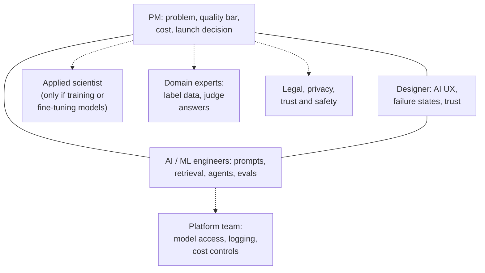
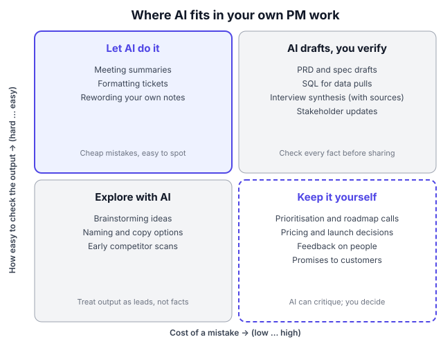

# B6.1 AI PM careers, teams and using AI in your own PM work

## In one line

"AI PM" now means three things at once: a PM who builds AI products, a PM who works in a team with new AI roles, and every PM who uses AI to do the job; this chapter shows you how to grow in all three without handing over your judgment.

## Why this matters

In early 2026, open PM roles at tech companies were [75% above their early-2023 low](https://www.lennysnewsletter.com/p/state-of-the-product-job-market-in-ee9), and AI roles were the fastest-growing part of the market. At the same time, companies like LinkedIn and Razorpay are changing what they expect PMs to do day to day. Knowing which kind of AI PM you want to be, who you'll work with, and how to use AI well in your own work is now part of the basic job, not a specialism.

## Key terms

| Term | Plain-English meaning |
|---|---|
| **AI PM** | A product manager whose product's main value comes from AI models. |
| **Platform (model) PM** | A PM for the AI itself (a model, an API, developer tools), whose users are usually developers. |
| **Applied AI PM** | A PM who uses models to solve a user problem in a product (a support bot, AI search). |
| **AI-enabled PM** | Any PM who uses AI tools to research, write, analyse and prototype faster. |
| **AI / ML engineer** | An engineer who builds features on top of models: prompts, retrieval, agents, evals. |
| **Applied scientist** | A specialist who trains, fine-tunes or deeply evaluates models. |
| **Full-stack builder** | A person who can take a product from idea to launch across PM, design and code, with AI help. |
| **Vibe coding** | Building software by describing what you want to an AI tool in plain language, rather than writing code by hand. |

## The idea, simply

!!! tip "Analogy: the cook and the new kitchen"
    Think of a good home cook who moves into a kitchen with a pressure cooker, a microwave and a food processor. Dal that took an hour now takes 15 minutes. Chopping is instant. They can try three new recipes in an evening.

    But the machines don't know what the family likes to eat. They don't taste the salt. They can burn the food faster, too. The cook's real skill was never chopping. It was knowing what to make, for whom, and when it's right.

    AI is that new kitchen for product managers. It makes drafting, prototyping and analysis much faster. It doesn't decide what's worth building or whether it's good enough.

Let's build this up.

### 1. Three meanings of "AI PM"

People use "AI PM" for very different jobs. Be clear which one you mean, especially in job searches.

| Kind | Who the users are | What you decide | Example products |
|---|---|---|---|
| **Platform (model) PM** | Developers and companies building on the AI | Model capabilities, API design, pricing per token, safety policies | A model API, an agent framework, a speech-to-text service |
| **Applied AI PM** | End users or business customers | Which problem AI should solve, quality bar, UX, cost per task | A support assistant, AI-written listings, smart search |
| **AI-enabled PM** | (Any product) | How you and your team work: research, specs, prototypes, analysis | Any product at all |

Far more companies *use* models than *build* them, so most AI PM jobs are **applied**. A fintech wants a collections assistant. An edtech wants an AI tutor. A marketplace wants better search. Platform roles exist mainly at AI labs and large cloud and model companies. Every PM is now expected to be **AI-enabled**.

### 2. What an AI PM needs on top of classic PM skills

The classic skills still matter most: understanding users, choosing problems, setting goals, working with engineers. AI adds a twist to each one. This table maps the twist to the chapters in Part B that teach it.

| Classic skill | The AI twist | Where to learn it |
|---|---|---|
| Writing specs | Writing prompts and system instructions as product specs | [B1.1](../01-building-blocks/01-prompt-engineering-for-pms.md) |
| Defining "done" | Quality is a percentage; you set the bar with evals | [B3.1](../03-quality/01-evals-the-ai-pm-s-most-important-skill.md) |
| Technical trade-offs | Choosing a model, and weighing capability, cost and latency (response time) | [B0.3](../00-foundations/03-choosing-models-capability-cost-latency-open-vs.md) |
| Architecture choices | Prompting vs RAG vs fine-tuning | [B1.4](../01-building-blocks/04-prompting-vs-rag-vs-fine-tuning-how-to-decide.md) |
| UX design | Designing for wrong answers and trust | [B2.3](../02-discovery-and-design/03-designing-for-trust-failure-and-human-in-the-loo.md) |
| Business model | Every use costs money; pricing and margins | [B5.1](../05-strategy-and-business/01-ai-pricing-and-unit-economics.md) |
| Risk and compliance | Safety, guardrails and AI law | [B4.2](../04-data-safety-and-law/02-responsible-ai-safety-and-guardrails.md), [B4.3](../04-data-safety-and-law/03-ai-regulation-eu-ai-act-india-s-dpdp-act-and-ai.md) |

If you can do the left column well and have practised the right column on one real project, you're already ahead of most applicants.

### 3. Who's on an AI product team

The classic product trio is PM, designer and engineers ([A0.2](../../part-a/00-the-pm-role/02-product-teams-the-trio-empowered-vs-feature-team.md)). An AI team keeps the trio and adds some specialists. Not every team needs all of them.

Solid lines are the core trio. Dotted lines are specialists who join when the problem needs them: the PM decides when to pull them in.

What you ask each role, as a PM:

| Role | Good questions to ask them |
|---|---|
| AI / ML engineer | "What fails most often in our traces? What would it cost to try a smaller model? How do we know a prompt change didn't break something?" |
| Applied scientist | "Do we really need to fine-tune, or would better retrieval do? How much labelled data would it take?" |
| Domain expert | "Is this answer correct and safe? What would a good answer have said?" |
| Legal / privacy | "Can we send this data to an outside model provider? What must we tell users?" |
| Platform team | "What does each call cost? Can we set a spending limit per customer?" |

One change many teams notice: **domain experts become core**. In a legal-tech or health product, a lawyer or doctor who judges AI answers is as important to quality as any engineer ([B3.1](../03-quality/01-evals-the-ai-pm-s-most-important-skill.md)).

### 4. The builder shift: PMs who ship

AI coding tools make it possible for a PM to build a working prototype, or even a small feature, without waiting for engineers. Some companies are reorganising around this.

- **LinkedIn** said in December 2025 that it would end its Associate Product Manager (APM) programme. New graduates would join an ["Associate Product Builder" programme](https://www.aol.com/news/linkedin-scrapping-associate-product-manager-063508038.html) that teaches them to code, design and do product management. LinkedIn's chief product officer, Tomer Cohen, described "full-stack builders" who can take a product from idea to launch, whatever their starting role.
- **Razorpay** said in September 2025 that its PMs had taken [low-complexity features from idea to production](https://elevationcapital.com/scaling-ai-across-product-teams-lessons-from-razorpay) using tools like Replit and Lovable, with engineers finishing the last 10–20% of the work.

This doesn't mean every PM must become an engineer. It does mean the gap between "idea" and "something people can try" has shrunk. A PM who can show a clickable or working prototype in a day has a big advantage in discovery ([A2.3](../../part-a/02-problem-discovery/03-assumption-testing-prototypes-and-mvps.md)).

Atlassian's [*State of Product 2027* report](https://sdtimes.com/product-development/product-teams-share-their-thoughts-on-ai-work-in-new-atlassian-state-of-product-2007-report/) captures the side effect: 89% of product people said they use AI for work another function used to do, and 67% said their role is hard to define.

### 5. Using AI in your own PM work

Here is where AI helps most in a typical PM week, and what you must still do yourself.

| PM task | What AI does well | What you still own | Main risk |
|---|---|---|---|
| **Research synthesis** | Clusters interview notes, pulls themes and quotes | Deciding which themes matter; checking quotes are real | Invented or merged quotes |
| **PRD and spec drafts** | First drafts, edge-case lists, acceptance criteria | The problem, the trade-offs, the "no" list | Generic specs that sound right but say nothing |
| **Prototyping** | Clickable screens or working demos in hours | What to test and with whom | Falling in love with a polished demo |
| **Data analysis** | Writing SQL, summarising dashboards, spotting outliers | Checking definitions and whether the query is right | Confidently wrong numbers |
| **Competitor scans** | Summarising public pages, release notes, reviews | Verifying sources; judging what matters | Out-of-date or made-up facts |
| **Writing for stakeholders** | Tightening updates, emails and memos | The message and the ask | Losing your own voice; over-long text |
| **Prioritisation** | Listing options and scoring against criteria you give | The final call | Hiding a judgment call behind a "score" |

India's start-up leaders are already using AI in this way. Elevation Capital's [2026 AI adoption survey of Indian start-ups](https://stateofaiadoption.elevationcapital.com/cpo) found that every chief product officer who answered reported faster idea-to-prototype times. Use for judgment-heavy work like A/B test analysis and prioritisation was far lower, at 25%. The pattern is clear: AI speeds up making things; people still decide what's right.

### 6. Measure whether AI is really helping you

It *feels* like AI makes everything faster. That feeling can be wrong.

In 2025, the research group METR ran a [randomised controlled trial](https://metr.org/blog/2025-07-10-early-2025-ai-experienced-os-dev-study/) (a fair test where chance decides who gets the tool) with 16 experienced open-source developers working on their own projects. Before starting, the developers expected AI tools to make them 24% faster. With AI allowed, tasks actually took **19% longer**. Afterwards, the developers *still believed* AI had sped them up by about 20%.

METR's [February 2026 follow-up](https://metr.org/blog/2026-02-24-uplift-update/) with newer tools and more developers pointed towards a speed-up, but METR called its own new data an unreliable signal. One reason: many developers refused to take part, or held back tasks, because they didn't want to work without AI.

The lesson for you isn't "AI makes you slower". It's that **your own sense of speed is not evidence**. If you want to know whether AI helps a task, time it, check the quality, and compare.

### 7. Rules for using AI safely at work

| Rule | Why |
|---|---|
| **Follow your company's AI policy and use approved tools.** | Pasting customer data or unreleased plans into a personal account can break contracts and data protection law, such as India's DPDP Act ([B4.3](../04-data-safety-and-law/03-ai-regulation-eu-ai-act-india-s-dpdp-act-and-ai.md)). |
| **Strip personal data before you paste.** | Names, phone numbers and account details rarely need to be in the prompt. |
| **Check every fact, number and quote before you share it.** | Models produce fluent, confident errors ([B0.1](../00-foundations/01-what-makes-ai-products-different.md)). Your name is on the document, not the model's. |
| **Keep the judgment calls.** | Prioritisation, people feedback and launch decisions need your accountability. |
| **Say when AI did a large part of the work.** | It helps reviewers know what to check, and it builds trust. |
| **Keep raw sources next to summaries.** | So anyone can trace a claim back to the interview, ticket or data it came from. |

## Framework(s)

### The full-stack builder model (LinkedIn, 2025)

**Who:** LinkedIn, described by its chief product officer Tomer Cohen on [Lenny's Podcast](https://www.lennysnewsletter.com/p/why-linkedin-is-replacing-pms) (December 2025) and reported by [Business Insider](https://www.aol.com/news/linkedin-scrapping-associate-product-manager-063508038.html).

**The idea:** the old model splits work across many functions and hand-offs, which LinkedIn says made features take around six months. Instead, people from any function can take a product from idea to launch, helped by AI tools and agents. LinkedIn backs this with a formal "Full Stack Builder" title and career ladder.

**Three pillars Cohen names:**

1. **Platform:** shared tools and data that make building safe and fast.
2. **Agents:** specialised AI helpers, including ones that critique ideas, not just write code.
3. **Culture:** which Cohen says matters most.

**What stays human,** in Cohen's words: "vision, empathy, communication, creativity, and judgment".

**When to use it:** small, low-risk features; internal tools; prototypes for discovery; teams with good shared platforms and code review.

**When not to:** high-risk changes (payments, security, health, anything one-way); systems where a mistake is costly or hard to undo. Razorpay draws the same line: it keeps strict review for "one-way doors" such as API integrations, and lets PMs build "two-way doors" that are easy to reverse.

### The personal AI workflow audit (this book's method)

This is a simple method we suggest for deciding where AI should help in your own work. It's built on the same "cost of error × ease of checking" idea from [B2.1](../02-discovery-and-design/01-finding-ai-opportunities-and-when-not-to-use-ai.md).

1. **Log a normal week.** List your tasks and the hours each takes.
2. **Score each task** on two questions: *How bad is a mistake here?* and *How easy is it for me to check the AI's output?*
3. **Place each on the 2×2** (see Diagram): let AI do it, AI drafts and you verify, explore with AI, or keep it yourself.
4. **Pick the top 3 tasks** by hours in the "AI drafts, you verify" and "let AI do it" boxes.
5. **Run a two-week trial.** Time each task with AI and note quality problems.
6. **Keep what really saved time** after checking, and put the hours you saved into the work only you can do: talking to users, thinking about strategy, unblocking your team.

## Diagram

Start in the top half, where checking is easy. Be most careful in the bottom-right, where mistakes are costly and hard to spot: those calls stay yours.

## Worked example

You're a PM at a Pune-based B2B software company that makes invoicing software for small manufacturers. You own the "payment reminders" area. Your manager asks: "Use AI to get more done, and show me what changed."

**Step 1: Log a normal week.**

| Task | Hours/week |
|---|---|
| Customer calls and notes | 5 |
| Synthesising feedback (calls, tickets, sales notes) | 4 |
| Writing PRDs, specs and tickets | 7 |
| Data pulls and metrics review | 4 |
| Stakeholder updates and emails | 4 |
| Meetings (stand-ups, planning, reviews) | 10 |
| Prioritisation and roadmap thinking | 3 |
| Competitor and market tracking | 2 |
| Unplanned work and Slack | 6 |
| **Total** | **45** |

**Step 2: Place each task on the 2×2.**

- *Let AI do it* (low cost of error, easy to check): meeting summaries, ticket formatting.
- *AI drafts, you verify* (higher cost, easy to check): PRD drafts, SQL for data pulls, stakeholder updates.
- *Explore with AI* (low cost, hard to check): competitor scans and brainstorming for ideas, treated as leads, not facts.
- *Keep it yourself* (high cost, hard to check): prioritisation, the roadmap, anything you tell a customer as a promise.

**Step 3: Pick the top three** by hours: feedback synthesis (4 hours), PRD drafts (7 hours) and data pulls (4 hours).

**Step 4: Two-week trial.** You time each task with AI, including the time spent checking and fixing.

| Task | Before (hrs/week) | With AI, incl. checking | Saved | Quality notes |
|---|---|---|---|---|
| Feedback synthesis | 4.0 | 1.5 | 2.5 | One invented quote caught; you now keep source links next to every theme |
| PRD drafts | 7.0 | 4.5 | 2.5 | Drafts were generic until you started feeding in your past PRDs and the problem statement |
| SQL / data pulls | 4.0 | 3.0 | 1.0 | Two queries used the wrong date column; you added a "check definition" step |
| **Total** | **15.0** | **9.0** | **6.0** | |

Notice two things. Checking took real time: without it, you'd have claimed nearly 10 hours saved and shipped two wrong numbers. And the biggest win didn't come from the tool. It came from changing your process (feeding the AI better context, keeping sources).

**Step 5: What is it worth?** You decide to put 4 of the 6 saved hours into extra customer calls and keep 2 for strategy work.

| Line | Value |
|---|---|
| Hours saved per week | 6 |
| Extra customer calls per week (45 minutes each, with notes) | about 5 |
| Extra calls per quarter (12 working weeks) | about 60 |
| Your current calls per quarter | about 80 |
| **Increase in customer contact** | **about 75%** |

In money terms, if your fully loaded cost to the company is ₹40 lakh a year (about ₹2,000 per hour across roughly 2,000 working hours), 6 hours a week over 48 weeks is about 290 hours, worth roughly ₹5.8 lakh a year. That's a useful number for your manager. But the better story is the 60 extra customer conversations, because those change *what* you build.

**Step 6: Report honestly.** Your update to your manager says: "AI saves me about 6 hours a week on three tasks, after checking. I've moved most of that time into customer calls. Two risks we found (invented quotes, wrong date column) are now part of my checklist."

## Going deeper: nuances and trade-offs

### 1. Is "AI PM" a separate job or just the job?

Both, for now. Job titles that say "AI PM" usually mean an applied or platform role where the product's value comes from a model. Over time, as most products include some AI, many of these skills are likely to become normal PM skills that every PM is expected to have. A practical approach: build real depth in one AI area (evals, or RAG, or agent design) so you stand out now, while keeping your core PM skills strong for the long term.

### 2. Builders vs PMs: when prototyping helps and when it hurts

PMs who can build learn faster in discovery. But there are traps:

- **The polished-demo trap:** a beautiful prototype makes a weak idea look finished, and people stop asking whether it's the right problem.
- **The shadow-engineering trap:** PM-built code that skips review, security and testing becomes someone else's problem later.
- **The time trap:** if the PM spends three days building, who's talking to customers?

A good rule: build to *learn*, and hand over to engineers to *ship*, except for clearly low-risk, reversible work agreed with your engineering lead.

### 3. Flatter teams and bigger spans

AI can let fewer managers support more people. Razorpay said it removed its group product manager layer, going from three layers to two, and moved from about [4 to about 8 individual contributors per people leader](https://elevationcapital.com/scaling-ai-across-product-teams-lessons-from-razorpay). It also built an internal PRD reviewer that handled most first-line review work.

The trade-off: fewer managers means less coaching for junior PMs. If you're early in your career at a flat company, find mentors deliberately, because nobody will be assigned to you.

### 4. AI mandates: helpful push or Goodhart's law?

In April 2025, Shopify's CEO Tobi Lütke told staff that using AI well was a ["fundamental expectation"](https://fortune.com/2025/04/08/shopify-ceo-ai-automation-no-new-hires-tech-jobs/) of everyone, that AI questions would be added to performance reviews, and that teams must show why AI can't do a job before asking for more people. Razorpay similarly asked everyone to use AI "wherever possible".

Mandates create urgency and permission to experiment. But "how much AI do you use?" is easy to game ([A8.1](../../part-a/08-product-metrics/01-metric-basics-leading-lagging-input-output-vanit.md)). If a team is rewarded for AI usage, usage will go up whether or not results improve. Judge AI by outcomes: faster learning, better decisions, happier customers.

### 5. For junior PMs: learning vs outsourcing thinking

If AI writes your first PRD, you may never learn how to think through a PRD. Early in your career, use AI as a **sparring partner, not a ghost-writer**:

- Write your own draft first, then ask AI to critique it.
- Ask it for the strongest counter-argument to your recommendation.
- Ask it what a senior PM would question.

This builds the judgment that LinkedIn's Cohen and others say they still want from people.

### 6. India and global: where the jobs are

Lenny Rachitsky's [early-2026 job market analysis](https://www.lennysnewsletter.com/p/state-of-the-product-job-market-in-ee9), based on TrueUp data, found more than 7,300 open PM roles at tech companies globally. About a third of open AI roles were in the San Francisco Bay Area. For readers in India, the practical takeaway is that platform roles are concentrated in a few places, while applied AI roles can exist wherever a company uses AI in its product, which increasingly includes Indian start-ups and enterprises. In Elevation's 2026 survey, 37.5% of responding Indian CPOs said they were freezing or cutting product headcount, and the same share said it was too early to tell. Read that as a sign of caution, not a trend, given the small sample.

### 7. How to move into an AI PM role

You don't need a machine-learning degree. A practical path:

| Step | What to do | Proof you can show |
|---|---|---|
| 1. Learn the basics | Work through Part B of this book, especially B0–B3 | You can explain tokens, RAG, evals and cost per task simply |
| 2. Build something small | Make a small AI tool for a real problem you have | A working demo and a short write-up |
| 3. Write an eval | Create 30–50 test cases for it and measure quality | A table of results and what you changed |
| 4. Bring AI into your current job | Propose one AI feature, or one AI workflow for your team | An internal doc or a shipped experiment |
| 5. Talk about trade-offs | Practise explaining cost, quality and safety decisions | Ready for AI PM interviews ([B6.2](02-ai-pm-interviews.md)) |

Step 3 is where most people stop, and it's the one hiring managers notice most.

### 8. Your own time is a product: measure it

The METR studies show how easily people misjudge AI's effect on their own speed. Treat your workflow like a product: set a baseline, run a trial, measure time *and* quality, and keep what works. Revisit every few months, because the tools change fast.

## Real-world examples (2023 onwards)

!!! example "Razorpay, September 2025: PMs as builders, with clear limits"
    At an Elevation Capital webinar, Razorpay's chief product officer Khilan Haria [described how the company rolled AI out across product teams](https://elevationcapital.com/scaling-ai-across-product-teams-lessons-from-razorpay). Everyone was asked to use AI in daily work wherever possible, with company licences for tools like Claude, ChatGPT and Midjourney. PMs built low-complexity features in Replit and Lovable, doing 80–90% of the build, with engineers covering the final 10–20%. A weekly "AI Show and Tell" started with about 200 attendees, and 50 senior leaders took part in mandatory two-day hackathons. Internal tools included a PRD reviewer and an AI interview agent that screened about 400 candidates, cutting PM interviewers' load from five interviews a week to two. Buying a new AI tool went from 30–60 days to 7–15 days.

    **PM lesson:** the change wasn't just tools. It came with learning rituals, leaders going first, faster buying, and a clear risk line: "two-way door" changes were open to PM builders, while "one-way doors" like API integrations kept strict review. If you want AI adoption on your team, copy the system, not just the licence.

!!! example "LinkedIn, December 2025: from Associate PM to Associate Product Builder"
    LinkedIn's chief product officer Tomer Cohen said on [Lenny's Podcast](https://www.lennysnewsletter.com/p/why-linkedin-is-replacing-pms) that the company would end its well-known APM programme. From January 2026, new graduates would join an ["Associate Product Builder" programme](https://www.aol.com/news/linkedin-scrapping-associate-product-manager-063508038.html) that teaches coding, design and product management together. Cohen said the traditional model had organisational bloat that slowed features to roughly six-month cycles. LinkedIn also created a formal "Full Stack Builder" title and career ladder.

    **PM lesson:** the skills LinkedIn says it will still look for are vision, empathy, communication, creativity and judgment; Cohen said he is working to automate "everything else". For your career, that means two things. Learn enough building to prototype on your own, and invest even more in the human skills that decide what's worth building. (Note: this is one company's choice, announced recently; how well it works is not yet known.)

## Common mistakes

!!! warning "Watch out for"
    - **Chasing the "AI PM" title** without being able to explain evals, cost per task or failure design.
    - **Pasting confidential or personal data** into unapproved AI tools.
    - **Sharing AI output unchecked:** invented quotes, wrong SQL, out-of-date competitor facts.
    - **Measuring AI by feel.** Time it and check quality, or you can't tell help from habit.
    - **Letting AI make judgment calls** like prioritisation, then hiding behind its "score".
    - **Building instead of discovering:** spending days on a prototype before talking to a single user.
    - **Skipping engineering review** on PM-built code that touches real users or money.
    - **Ignoring the specialists:** not bringing in domain experts or legal early enough on an AI feature.

## Common questions

**Do I need to learn to code to be an AI PM?**
Not deeply. You need to understand how AI systems are built well enough to make trade-offs, and it helps a lot to be able to prototype with AI coding tools. Being able to read a prompt, a trace and an eval result matters more than writing production code.

**Should I move from a regular PM job to an AI PM job?**
If your current company is adding AI to its product, the easiest path is often to volunteer for that work where you are. Your domain knowledge is an advantage that an outside AI specialist doesn't have.

**Will AI replace PMs?**
Nobody knows for sure, and sources disagree. What companies like LinkedIn and Razorpay are doing so far is changing the job: fewer hand-offs, more building, flatter teams. The parts they say they want people for are judgment, empathy and choosing what's worth doing.

**Which AI tools should I learn?**
Tools change every few months, so learn categories: a general chat assistant, an AI prototyping or coding tool, and an AI feature inside the tools your company already uses. Learn your company's approved tools first.

**How do I show AI skills in my CV or interview?**
Show a real artefact: a small AI tool you built, the eval you wrote for it, and what you changed because of the results. One concrete project beats a list of tool names.

## In the interview

!!! question "In the interview"
    **How it's tested:** almost every PM interview now asks how you use AI in your own work. AI PM interviews also ask how you'd staff and run an AI feature team, and how you'd decide what AI should and shouldn't do. Full coverage is in [B6.2](02-ai-pm-interviews.md).

    **Sample question:** *"How do you use AI in your day-to-day work as a PM, and how do you know it's actually helping?"*

    **Outline of a strong answer:**

    1. **Name 2–3 specific tasks,** not "I use ChatGPT for everything". For example: synthesising interview notes, first PRD drafts, writing SQL.
    2. **Explain your checks:** source links next to every theme, verifying numbers against the dashboard, never sending AI text to a customer unread.
    3. **Show you measured it:** "I timed it for two weeks; it saved about 6 hours a week after checking."
    4. **Say what you don't delegate:** prioritisation, people feedback, promises to customers.
    5. **Mention data safety:** approved tools only, personal data stripped.
    6. **Close with what you did with the time:** more customer contact, deeper strategy work.

    **A second common form:** *"You're the first PM on a new AI feature. Who do you need on the team?"* A strong answer starts with the trio, adds an AI/ML engineer who owns evals, brings in domain experts to judge quality, and involves legal and privacy early when user data is involved. It explains *when* each specialist joins, not just that they exist.

## Research happening now

!!! info "Research happening now"
    - **Does AI really speed up experts? (METR, February 2026).** METR's [follow-up study](https://metr.org/blog/2026-02-24-uplift-update/), with 57 developers and 800+ tasks, pointed towards a speed-up with late-2025 tools, reversing the 19% slowdown in its [July 2025 study](https://metr.org/blog/2025-07-10-early-2025-ai-experienced-os-dev-study/). But METR itself calls the new data an unreliable signal, partly because many developers wouldn't work without AI, and it is redesigning the study. *Status: early results; question still open.*
    - **Product roles are blurring (Atlassian, October 2026).** Atlassian's *State of Product 2027* report, [summarised by SD Times](https://sdtimes.com/product-development/product-teams-share-their-thoughts-on-ai-work-in-new-atlassian-state-of-product-2007-report/), found 99% of product teams use AI in at least one workflow, 89% use it for work another function used to do, and only 26% say their job still reflects what first attracted them to it. *Status: vendor survey, not peer-reviewed.*
    - **How Indian start-up product leaders use AI (Elevation Capital, 2026).** Elevation's [AI adoption survey](https://stateofaiadoption.elevationcapital.com/cpo) found universal use of AI for design help and faster prototyping among responding CPOs, but low use for prioritisation and A/B test analysis. Their top worry was the quality of AI output. *Status: investor survey; the CPO sample appears small and the page doesn't state its size, so treat percentages with care.*

## Try it yourself (30 minutes)

Run a mini version of the personal AI workflow audit.

1. List the 8–10 tasks that filled your last working week (or, if you're a student, your last project), with rough hours.
2. Place each on the 2×2: *let AI do it*, *AI drafts, you verify*, *explore with AI*, or *keep it yourself*.
3. Pick one task in "AI drafts, you verify". Do it once with AI, and time yourself, including checking.
4. Write three lines: time before, time with AI (including checking), and one quality problem you caught.

??? success "Check your answer"
    - [ ] Your "keep it yourself" box includes at least one judgment task (prioritisation, people feedback or a promise to a customer).
    - [ ] Your "let AI do it" box only contains tasks where a mistake is cheap *and* easy to spot.
    - [ ] Your timing includes the checking and fixing time, not just the generation.
    - [ ] You caught at least one error or weakness. If you didn't, check again: you may not have looked closely enough.
    - [ ] You used an approved tool and removed any personal or confidential data.
    - [ ] You wrote down what you'd do with the time saved.

    If your saved time is near zero after checking, that's a valid result. It means this task isn't a good fit yet, or you need to give the AI better context (examples, templates, your past work).

## How this connects

- [B6.2 AI PM interviews](02-ai-pm-interviews.md): how the skills in this chapter are tested when you apply for AI PM roles.
- [B3.1 Evals](../03-quality/01-evals-the-ai-pm-s-most-important-skill.md): the single most valuable AI PM skill, and the best proof for your portfolio.
- [B2.1 Finding AI opportunities](../02-discovery-and-design/01-finding-ai-opportunities-and-when-not-to-use-ai.md): the same cost-of-error logic, applied to products instead of your own work.
- [A0.2 Product teams](../../part-a/00-the-pm-role/02-product-teams-the-trio-empowered-vs-feature-team.md): the trio that AI teams build on.
- [A2.3 Assumption testing and prototypes](../../part-a/02-problem-discovery/03-assumption-testing-prototypes-and-mvps.md): what AI-built prototypes are really for.

## Go deeper

- **Book:** [*AI Engineering*](https://www.oreilly.com/library/view/ai-engineering/9781098166298/) by Chip Huyen (O'Reilly). A thorough guide to building applications on foundation models; read the evaluation chapters to talk confidently with AI engineers.
- **Podcast:** [Lenny's Podcast: Why LinkedIn is turning PMs into AI-powered "full stack builders"](https://www.lennysnewsletter.com/p/why-linkedin-is-replacing-pms) with Tomer Cohen (December 2025). The reasoning behind LinkedIn's shift; the full post is for paid subscribers.
- **Article:** [Elevation Capital: Scaling AI across product teams, lessons from Razorpay](https://elevationcapital.com/scaling-ai-across-product-teams-lessons-from-razorpay) (2025). A detailed Indian case study of an AI rollout in a product organisation.
- **Article:** [Fortune on Shopify's AI memo](https://fortune.com/2025/04/08/shopify-ceo-ai-automation-no-new-hires-tech-jobs/) (April 2025). The memo that made "AI as a baseline expectation" mainstream.
- **Research:** [METR: early-2025 AI and experienced developers](https://metr.org/blog/2025-07-10-early-2025-ai-experienced-os-dev-study/) and its [2026 update](https://metr.org/blog/2026-02-24-uplift-update/). The best-known evidence that perceived and real productivity can differ.
- **Data:** [Lenny's Newsletter: State of the product job market in early 2026](https://www.lennysnewsletter.com/p/state-of-the-product-job-market-in-ee9). Job openings data for PM and AI roles (partly paywalled).
- **Report:** [Atlassian State of Product](https://www.atlassian.com/software/jira/product-discovery/resources/state-of-product-2026). Yearly survey of how product teams work, including AI use.

## Key takeaways

- "AI PM" means three things: **platform** PMs, **applied** AI PMs, and every PM being **AI-enabled**.
- Classic PM skills still matter most; AI adds a **twist to each**: evals, model trade-offs, cost, trust and safety.
- AI teams add **AI engineers, domain experts and legal/privacy** to the trio; the PM decides when each joins.
- PMs are becoming **builders** for low-risk, reversible work; keep strict review for one-way doors.
- Use AI where **mistakes are cheap or easy to check**; keep judgment calls yourself.
- **Your feeling of speed isn't evidence.** Time tasks, check quality, and keep what really helps.
- Protect data, verify everything, and **put saved time into the work only you can do**.

## Updates

*No updates yet.*
